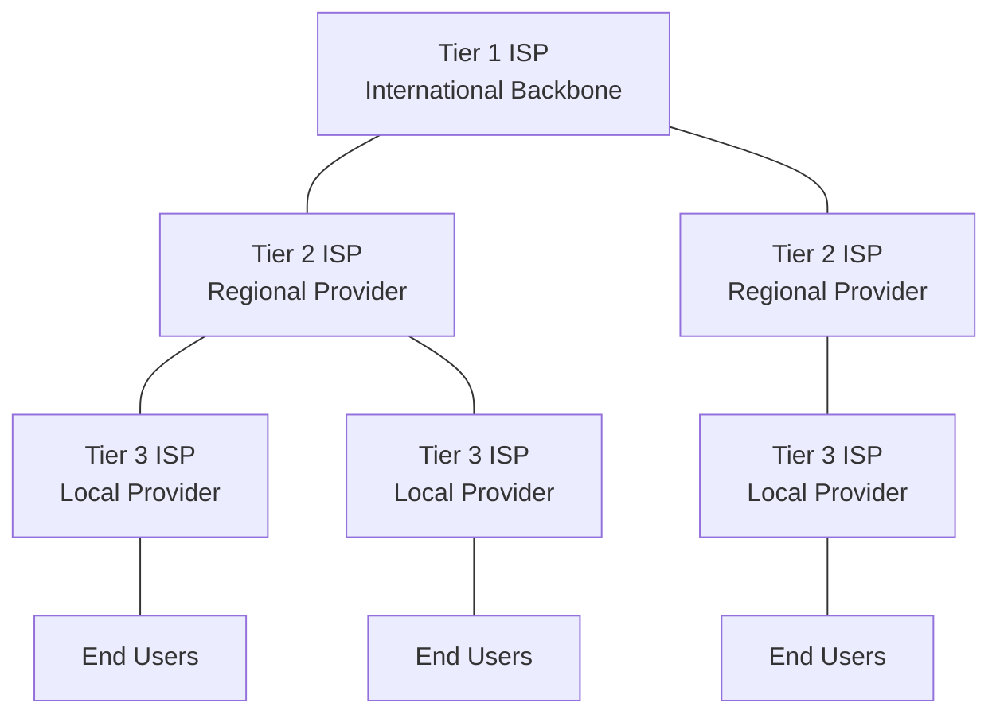
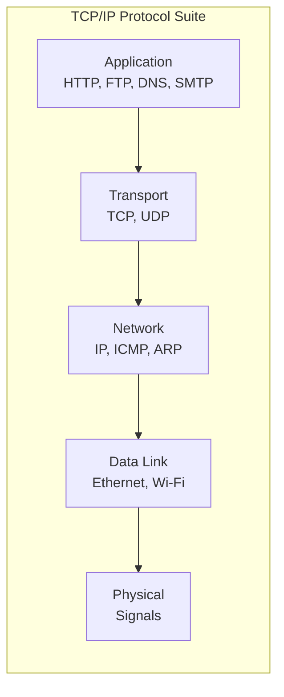
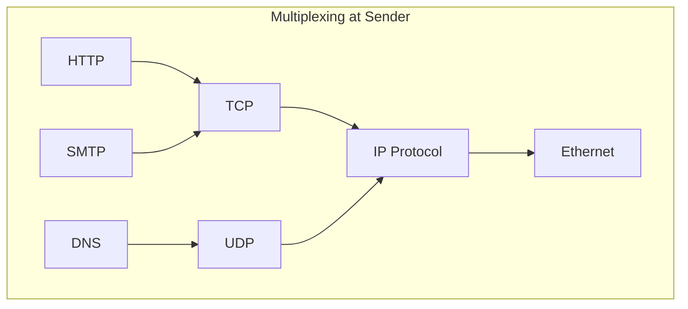

# Chapters 1-2 — Introduction to the Internet and Network Models

[Repository Guide](../../README.md) | [English](Concepts_Lecture.md) | [한국어](Concepts_Lecture.ko.md)

> **Last Updated:** 2026-10-17
>
> TCP/IP Protocol Suite, Forouzan, Ch 1, 2

> **Learning Objectives:**
> 1. Describe the OSI and TCP/IP network layer models
> 2. Classify networks by size (LAN, MAN, WAN)
> 3. Explain the concept of protocol layering and encapsulation

---

## Table of Contents

- [1. Introduction to the Internet](#1-introduction-to-the-internet)
  - [1.1 The Internet Today](#11-the-internet-today)
  - [1.2 Internet Service Providers (ISPs)](#12-internet-service-providers-isps)
  - [1.3 Protocol and Standards](#13-protocol-and-standards)
- [2. Network Models](#2-network-models)
  - [2.1 The OSI Model](#21-the-osi-model)
  - [2.2 The TCP/IP Protocol Suite](#22-the-tcpip-protocol-suite)
  - [2.3 Comparison of OSI and TCP/IP](#23-comparison-of-osi-and-tcpip)
  - [2.4 Addressing in TCP/IP](#24-addressing-in-tcpip)
- [3. Encapsulation and Decapsulation](#3-encapsulation-and-decapsulation)
- [4. Multiplexing and Demultiplexing](#4-multiplexing-and-demultiplexing)
- [5. Appendix](#5-appendix)
  - [5.1 RFC Process](#51-rfc-process)
  - [5.2 Well-Known Port Numbers](#52-well-known-port-numbers)
  - [5.3 Real-World Example: Web Page Request](#53-real-world-example-web-page-request)
- [Summary](#summary)
- [Self-Check Questions](#self-check-questions)

---

<br>

## 1. Introduction to the Internet

### 1.1 The Internet Today

The Internet is a structured communication network that interconnects billions of computing devices worldwide. It is not a single network but a **network of networks**, connecting local area networks (LANs), wide area networks (WANs), and metropolitan area networks (MANs) through standardized protocols.

Key characteristics of the Internet:
- **Packet-switched**: Data is divided into packets, and each packet is routed independently.
- **Decentralized**: There is no single point of control.
- **Scalable**: It is designed to grow without fundamental redesign.
- **Heterogeneous**: It supports diverse hardware and software platforms.

> **Key Point:** The Internet is fundamentally a packet-switched network using the TCP/IP protocol suite as its common language.

### 1.2 Internet Service Providers (ISPs)

The Internet operates through a hierarchical structure of ISPs:



*Figure 1. Hierarchical ISP structure*

| ISP Tier | Coverage | Example |
|----------|----------|---------|
| Tier 1 | International backbone | AT&T, NTT |
| Tier 2 | Regional/National | Regional carriers |
| Tier 3 | Local access | Local ISPs |

*Table 1. Coverage and examples of ISP tiers*

- **Peering**: ISPs exchange traffic directly without paying each other (settlement-free peering). Tier 1 ISPs interconnect with one another in this way.
- **Transit**: Lower-tier ISPs pay higher-tier ISPs for access to the broader Internet.
- **IXP (Internet Exchange Point)**: ISPs meet at this physical infrastructure to exchange traffic.

### 1.3 Protocol and Standards

A **protocol** defines the rules governing communication between entities. Protocols define:
- **Syntax**: The structure or format of data (field sizes, ordering).
- **Semantics**: The meaning of each section of bits.
- **Timing**: When data should be sent and how fast.

**Standards Organizations:**
- **IETF (Internet Engineering Task Force)**: Develops Internet standards through RFCs.
- **IEEE (Institute of Electrical and Electronics Engineers)**: Develops LAN and MAN standards (802.x).
- **ISO (International Organization for Standardization)**: Developed the OSI reference model.
- **ITU-T**: Develops telecommunications standards.

> **Key Point:** Standards ensure interoperability between different vendors and systems. The RFC (Request for Comments) process is how Internet standards are proposed, discussed, and adopted.

---

<br>

## 2. Network Models

### 2.1 The OSI Model

The **Open Systems Interconnection (OSI)** model is a conceptual framework with seven layers:

```text
+-------------------+
| 7. Application    |  -- Network process to application
+-------------------+
| 6. Presentation   |  -- Data representation and encryption
+-------------------+
| 5. Session        |  -- Interhost communication management
+-------------------+
| 4. Transport      |  -- End-to-end connections and reliability
+-------------------+
| 3. Network        |  -- Path determination and logical addressing
+-------------------+
| 2. Data Link      |  -- Physical addressing and media access
+-------------------+
| 1. Physical       |  -- Media, signal, and binary transmission
+-------------------+
```

*Figure 2. The seven layers of the OSI model*

Each layer has a specific responsibility:

| Layer | Unit | Function |
|-------|------|----------|
| Application | Data/Message | User interface, file transfer, email |
| Presentation | Data | Encryption, compression, translation |
| Session | Data | Dialog control, synchronization |
| Transport | Segment | Reliable delivery, flow control |
| Network | Packet/Datagram | Logical addressing, routing |
| Data Link | Frame | Physical addressing, error detection |
| Physical | Bit | Electrical/optical signal transmission |

*Table 2. Data unit and function of each OSI layer*

### 2.2 The TCP/IP Protocol Suite

The **TCP/IP model** is the practical protocol suite used by the Internet. It has five layers (sometimes presented as four by combining physical and data link):

```text
+-------------------+  Application Layer
| HTTP, FTP, SMTP,  |  (OSI layers 5-7 combined)
| DNS, DHCP, SNMP   |
+-------------------+
| TCP, UDP, SCTP    |  Transport Layer
+-------------------+
| IP, ICMP, IGMP,   |  Network Layer
| ARP               |
+-------------------+
| Ethernet, Wi-Fi,  |  Data Link Layer
| PPP               |
+-------------------+
| Cables, Signals   |  Physical Layer
+-------------------+
```

*Figure 3. Protocols at each layer of the TCP/IP protocol suite*



*Figure 4. Layer stack of the TCP/IP protocol suite*

### 2.3 Comparison of OSI and TCP/IP

| Aspect | OSI Model | TCP/IP Model |
|--------|-----------|-------------|
| Layers | 7 layers | 5 layers (or 4) |
| Development | ISO standard | DARPA/IETF |
| Approach | Theory first, then implementation | Implementation first, then model |
| Session/Presentation | Separate layers | Merged into Application |
| Usage | Reference/teaching | Actual Internet protocol |
| Protocol independence | Model-independent | Tied to specific protocols |

*Table 3. Comparison of the OSI and TCP/IP models*

> **Key Point:** The OSI model is primarily a conceptual teaching tool, while the TCP/IP model reflects the actual protocol architecture of the Internet.

### 2.4 Addressing in TCP/IP

The TCP/IP protocol suite uses four levels of addressing:

```text
+--------------------------------------------------+
| Application Layer  -->  Names (e.g., www.ku.ac.kr)|
+--------------------------------------------------+
| Transport Layer    -->  Port Numbers (e.g., 80)   |
+--------------------------------------------------+
| Network Layer      -->  Logical/IP Addresses      |
|                        (e.g., 192.168.1.1)        |
+--------------------------------------------------+
| Data Link Layer    -->  Physical/MAC Addresses    |
|                        (e.g., AA:BB:CC:DD:EE:FF)  |
+--------------------------------------------------+
```

*Figure 5. Four levels of addressing in TCP/IP*

| Address Type | Layer | Size | Scope |
|-------------|-------|------|-------|
| Physical (MAC) | Data Link | 48 bits (6 bytes) | Local link |
| Logical (IP) | Network | 32 bits (IPv4) | Global |
| Port Number | Transport | 16 bits | Local host |
| Application Name | Application | Variable | Global (DNS) |

*Table 4. Layer, size, and scope of each address type*

---

<br>

## 3. Encapsulation and Decapsulation

**Encapsulation** is the process of adding protocol information (headers/trailers) at each layer as data moves down the protocol stack.

```text
Application:    [        Data        ]
                         |
Transport:      [ H_t |    Data      ]     --> Segment (TCP) / Datagram (UDP)
                         |
Network:        [ H_n | H_t | Data   ]     --> Packet / Datagram
                         |
Data Link:      [ H_d | H_n | H_t | Data | T_d ]  --> Frame
                         |
Physical:       101010011101...             --> Bits
```

*Figure 6. Encapsulation at each layer*

**Decapsulation** is the reverse process at the receiving end, where each layer strips its header and passes the remaining data upward.

> **Key Point:** Encapsulation provides modularity. Each layer only needs to understand its own header format, enabling independent evolution of protocols at each layer.

---

<br>

## 4. Multiplexing and Demultiplexing

**Multiplexing** allows multiple higher-layer protocols to share a single lower-layer protocol. **Demultiplexing** is the reverse process at the receiver.



*Figure 7. Multiplexing at the sender*

The protocol field (or type field) in each layer's header identifies which upper-layer protocol should receive the data:
- **Ethernet frame**: The type field identifies the upper-layer protocol (0x0800 = IPv4, 0x0806 = ARP).
- **IP datagram**: The protocol field identifies the upper-layer protocol (6 = TCP, 17 = UDP, 1 = ICMP).
- **TCP/UDP**: The port number identifies the application (80 = HTTP, 25 = SMTP, 53 = DNS).

---

<br>

## 5. Appendix

### 5.1 RFC Process

In the Internet standards process, a specification passes through the following stages:
1. **Internet Draft**: A work in progress with no official status.
2. **Proposed Standard**: A stable, well-reviewed specification.
3. **Internet Standard**: A mature specification with significant implementation experience.

### 5.2 Well-Known Port Numbers

| Port | Protocol | Service |
|------|----------|---------|
| 20/21 | TCP | FTP (data/control) |
| 22 | TCP | SSH |
| 23 | TCP | Telnet |
| 25 | TCP | SMTP |
| 53 | TCP/UDP | DNS |
| 67/68 | UDP | DHCP |
| 80 | TCP | HTTP |
| 110 | TCP | POP3 |
| 143 | TCP | IMAP |
| 443 | TCP | HTTPS |

*Table 5. Well-known port numbers and services*

### 5.3 Real-World Example: Web Page Request

When you type `http://www.example.com` in a browser:
1. **DNS resolution**: The application layer resolves the domain name to an IP address.
2. **TCP connection**: The transport layer establishes a connection with a three-way handshake.
3. **HTTP request**: The application layer sends a GET request.
4. **IP routing**: The network layer routes packets hop by hop.
5. **Frame delivery**: The data link layer delivers frames on each link.
6. **Response**: The server processes the request and returns the web page to the client through the same layered process.

---

<br>

## Summary

| Concept | Key Summary |
|---------|-----------|
| Internet | It is a network of networks that uses TCP/IP and is packet-switched and decentralized. |
| ISP Hierarchy | ISPs form a hierarchy of Tier 1 (international backbone), Tier 2 (regional), and Tier 3 (local access). |
| Protocol | It is a set of rules governing communication that defines syntax, semantics, and timing. |
| OSI Model | It is a seven-layer conceptual reference model. |
| TCP/IP Model | It is the five-layer practical model used by the Internet. |
| Encapsulation | As data moves down the stack, each layer adds a header, and the data link layer also adds a trailer. |
| Addressing | TCP/IP uses four levels of addresses: MAC address (link), IP address (network), port number (transport), and name (application). |
| Multiplexing | Multiple upper-layer protocols share a single lower-layer protocol. |

---

<br>

## Self-Check Questions

1. **Encapsulation overhead:** 1000 bytes of application data are encapsulated in turn by TCP (20-byte header), IP (20-byte header), and Ethernet (14-byte header, 4-byte trailer). Find the frame size and the fraction of the frame taken by headers and trailers. Exclude the preamble and SFD added at the physical layer.

   <details>
   <summary>Answer</summary>

   The segment is 1000 + 20 = 1020 bytes, the datagram is 1020 + 20 = 1040 bytes, and the frame is 1040 + 14 + 4 = 1058 bytes. Headers and trailers total 20 + 20 + 14 + 4 = 58 bytes, so the fraction is 58 / 1058 ≈ 5.5%.

   </details>

2. **Demultiplexing trace:** A received Ethernet frame has type field 0x0800, the IP datagram inside it has protocol field 17, and the destination port number is 53. Through which protocols does the data pass, and to which application is it delivered?

   <details>
   <summary>Answer</summary>

   Type field 0x0800 means IPv4, so the frame's data goes to IP, and protocol field 17 means UDP, so the datagram's data goes to UDP. UDP looks at destination port 53 and delivers the data to DNS. The data therefore passes through Ethernet, IPv4, and UDP to reach DNS.

   </details>

3. **Address scope:** A packet travels from a source host through two routers to a destination host. Assuming no NAT, identify which addresses change on each link and which stay the same end to end, and explain why.

   <details>
   <summary>Answer</summary>

   A MAC address has local-link scope, so on each link it changes to the addresses of that link's sending and receiving devices. The path consists of three links, so three different MAC address pairs are used in turn. An IP address has global scope, so the source and destination IP addresses stay the same end to end, and the port numbers, which identify processes on the end hosts, do not change either.

   </details>

4. **OSI and TCP/IP correspondence:** Which TCP/IP layer handles the dialog control and encryption functions of the OSI session and presentation layers? Which OSI layers does the TCP/IP application layer correspond to?

   <details>
   <summary>Answer</summary>

   The TCP/IP model has no separate session or presentation layer, so these functions are merged into the application layer and handled by the application or an application-layer protocol. The TCP/IP application layer therefore corresponds to OSI layers 5-7.

   </details>

---
