# 1장 — 컴퓨터 네트워크와 인터넷

[레포지토리 안내](../../README.ko.md) | [English](Concepts_Lecture.md) | [한국어](Concepts_Lecture.ko.md)

> **최종 수정일:** 2026-11-18
>
> Computer Networking: A Top-Down Approach, Kurose and Ross, Ch 1; TCP/IP Protocol Suite, Forouzan, Ch 1, 3, 4

> **학습 목표:**
> 1. 인터넷을 구성 요소의 관점과 서비스의 관점에서 설명하고, 프로토콜의 구문, 의미, 타이밍을 예로 들 수 있다
> 2. 표준화 기구의 종류와 인터넷 표준이 RFC로 만들어지는 과정을 설명할 수 있다
> 3. 다이얼업, DSL, 케이블, FTTH, 이더넷, 무선 접속 같은 접속 네트워크와 물리 매체를 비교할 수 있다
> 4. 패킷 교환과 회선 교환을 비교하고, 저장 후 전달 지연과 FDM, TDM 회선의 속도를 계산할 수 있다
> 5. 처리 지연, 큐잉 지연, 전송 지연, 전파 지연과 트래픽 강도, 종단 간 지연, 처리량을 계산하고 해석할 수 있다
> 6. 네트워크를 겨냥한 주요 공격 유형과 인터넷이 발전해 온 과정을 설명할 수 있다

---

## 목차

- [1. 인터넷의 개념](#1-인터넷의-개념)
  - [1.1 구성 요소로 본 인터넷](#11-구성-요소로-본-인터넷)
  - [1.2 서비스로 본 인터넷](#12-서비스로-본-인터넷)
  - [1.3 프로토콜](#13-프로토콜)
- [2. 프로토콜과 표준](#2-프로토콜과-표준)
  - [2.1 표준의 필요성](#21-표준의-필요성)
  - [2.2 표준화 기구](#22-표준화-기구)
  - [2.3 인터넷 표준과 RFC](#23-인터넷-표준과-rfc)
  - [2.4 인터넷을 관리하는 조직](#24-인터넷을-관리하는-조직)
- [3. 네트워크 가장자리](#3-네트워크-가장자리)
  - [3.1 종단 시스템, 클라이언트, 서버](#31-종단-시스템-클라이언트-서버)
  - [3.2 접속 네트워크의 개념](#32-접속-네트워크의-개념)
- [4. 접속 네트워크](#4-접속-네트워크)
  - [4.1 다이얼업과 56K 모뎀](#41-다이얼업과-56k-모뎀)
  - [4.2 DSL](#42-dsl)
  - [4.3 케이블 접속과 HFC](#43-케이블-접속과-hfc)
  - [4.4 FTTH와 위성 접속](#44-ftth와-위성-접속)
  - [4.5 기업과 가정의 접속: 이더넷과 Wi-Fi](#45-기업과-가정의-접속-이더넷과-wi-fi)
  - [4.6 광역 무선 접속](#46-광역-무선-접속)
  - [4.7 접속 기술의 비교](#47-접속-기술의-비교)
- [5. 물리 매체](#5-물리-매체)
- [6. 네트워크 코어](#6-네트워크-코어)
  - [6.1 교환과 교환 네트워크의 분류](#61-교환과-교환-네트워크의-분류)
  - [6.2 패킷 교환과 저장 후 전달 전송](#62-패킷-교환과-저장-후-전달-전송)
  - [6.3 큐잉 지연과 패킷 손실](#63-큐잉-지연과-패킷-손실)
  - [6.4 포워딩 테이블과 라우팅 프로토콜](#64-포워딩-테이블과-라우팅-프로토콜)
  - [6.5 회선 교환](#65-회선-교환)
  - [6.6 FDM과 TDM](#66-fdm과-tdm)
  - [6.7 메시지 교환과 메시지 분할](#67-메시지-교환과-메시지-분할)
  - [6.8 패킷 교환과 회선 교환의 비교](#68-패킷-교환과-회선-교환의-비교)
  - [6.9 네트워크의 네트워크](#69-네트워크의-네트워크)
- [7. 지연, 손실, 처리량](#7-지연-손실-처리량)
  - [7.1 노드 지연의 네 가지 요소](#71-노드-지연의-네-가지-요소)
  - [7.2 전송 지연과 전파 지연의 구별](#72-전송-지연과-전파-지연의-구별)
  - [7.3 큐잉 지연과 트래픽 강도](#73-큐잉-지연과-트래픽-강도)
  - [7.4 패킷 손실](#74-패킷-손실)
  - [7.5 종단 간 지연과 traceroute](#75-종단-간-지연과-traceroute)
  - [7.6 처리량](#76-처리량)
- [8. 공격받는 네트워크](#8-공격받는-네트워크)
- [9. 인터넷의 역사](#9-인터넷의-역사)
- [요약](#요약)
- [점검 문제](#점검-문제)
- [참고 문헌](#참고-문헌)

---

<br>

## 1. 인터넷의 개념

인터넷이 무엇인지에 답하는 방법은 두 가지이다. 하나는 인터넷을 이루는 하드웨어와 소프트웨어 구성 요소를 하나씩 나열하는 방법이고, 다른 하나는 인터넷을 분산 응용에 서비스를 제공하는 기반 구조로 보는 방법이다. 이 절은 두 관점을 차례로 살펴본 뒤, 두 관점 모두에 등장하는 핵심 개념인 프로토콜을 정의한다.

### 1.1 구성 요소로 본 인터넷

**네트워크(network)** 는 서로 연결되어 통신하는 컴퓨터, 프린터 같은 장치의 모임이다. 둘 이상의 네트워크가 서로 통신할 수 있게 연결된 것을 소문자로 시작하는 **internet**(인터넷워크)이라 하고, 그중 가장 널리 알려진 것, 곧 전 세계 수십만 개의 네트워크가 연결된 공용 인터넷을 대문자로 시작하는 **Internet**이라 한다. 이하에서 "인터넷"은 특별한 말이 없으면 공용 인터넷을 가리킨다.

인터넷은 전 세계 수십억 대의 컴퓨팅 장치를 연결한다. 예전에는 데스크톱 PC와 웹 페이지나 전자 메일을 저장하고 보내는 서버가 대부분이었지만, 지금은 노트북, 스마트폰, 태블릿, TV, 게임기, 온도 조절기, 가전제품, 자동차 같은 다양한 장치가 인터넷에 연결된다. 인터넷 용어로 이런 장치를 모두 **호스트(host)** 또는 **종단 시스템(end system)** 이라 한다.

> **용어 정의:** **종단 시스템(end system)** 은 인터넷의 가장자리에 연결되어 응용 프로그램을 실행하는 장치이며, 응용 프로그램을 "실행한다(host)"는 뜻에서 호스트라고도 한다. 데스크톱 컴퓨터, 서버, 스마트폰 등이 모두 종단 시스템이다.

종단 시스템은 **통신 링크(communication link)** 와 **패킷 스위치(packet switch)** 로 이루어진 네트워크를 통해 서로 연결된다. 통신 링크는 동축 케이블, 구리선, 광섬유, 무선 주파수 대역 같은 물리 매체로 만들어지며, 링크마다 데이터를 보내는 속도가 다르다. 링크의 **전송률(transmission rate)** 은 초당 비트 수(bits/s, bps)로 나타낸다.

한 종단 시스템이 다른 종단 시스템으로 데이터를 보낼 때, 송신 종단 시스템은 데이터를 여러 조각으로 나누고 각 조각에 헤더 바이트를 붙인다. 이렇게 만든 정보 꾸러미를 **패킷(packet)** 이라 한다. 패킷은 네트워크를 거쳐 목적지 종단 시스템에 도착하고, 그곳에서 원래 데이터로 다시 조립된다.

패킷 스위치는 들어오는 링크 하나로 도착한 패킷을 나가는 링크 하나로 내보내는 장치이다. 오늘날의 인터넷에서 가장 대표적인 패킷 스위치는 **라우터(router)** 와 **링크 계층 스위치(link-layer switch)** 이다. 링크 계층 스위치는 주로 접속 네트워크에서, 라우터는 주로 네트워크 코어에서 쓰인다. 패킷이 송신 종단 시스템에서 수신 종단 시스템까지 거쳐 가는 통신 링크와 패킷 스위치의 나열을 그 네트워크에서의 **경로(route 또는 path)** 라 한다.

패킷 교환 네트워크는 고속도로, 도로, 교차로로 이루어진 교통망과 비슷하다. 공장에서 수천 킬로미터 떨어진 창고로 많은 화물을 옮긴다고 가정한다. 공장에서는 화물을 나누어 여러 트럭에 싣고, 각 트럭은 독립적으로 도로망을 달려 창고에 도착하며, 창고에서는 같은 화물의 나머지와 다시 합친다. 이 비유에서 패킷은 트럭, 통신 링크는 고속도로와 도로, 패킷 스위치는 교차로, 종단 시스템은 건물에 해당한다.

종단 시스템은 **인터넷 서비스 제공자(Internet Service Provider, ISP)** 를 통해 인터넷에 접속한다. 지역 케이블 회사나 전화 회사 같은 가정용 ISP, 기업 ISP, 대학 ISP, 공항과 카페에서 Wi-Fi를 제공하는 ISP, 스마트폰에 이동 접속을 제공하는 셀룰러 데이터 ISP가 모두 ISP이다. 각 ISP는 그 자체로 패킷 스위치와 통신 링크로 이루어진 네트워크이다. 종단 시스템을 서로 연결하려면 이 하위 ISP들도 서로 연결되어야 하므로, 하위 ISP는 국가 규모나 국제 규모의 상위 ISP를 통해 연결된다. 이 구조는 6.9절에서 자세히 다룬다.

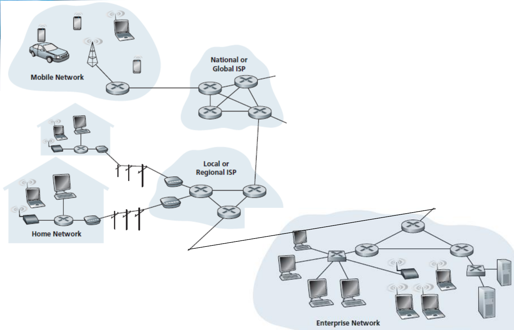

*그림 1. 인터넷을 이루는 구성 요소*

그림 1은 인터넷의 일부를 보여 준다. 이동 네트워크(mobile network), 가정 네트워크(home network), 기업 네트워크(enterprise network)의 종단 시스템이 지역 ISP(local or regional ISP)와 국가 또는 국제 ISP(national or global ISP)를 거쳐 서로 연결된다. 그림의 아이콘은 호스트(종단 시스템), 서버, 이동 단말, 라우터, 링크 계층 스위치, 모뎀, 기지국, 스마트폰, 휴대 전화 기지국 안테나를 나타낸다. 기업 네트워크 안에서 여러 컴퓨터를 묶는 장치가 링크 계층 스위치이고, 네트워크와 네트워크를 잇는 장치가 라우터이다.

가정 네트워크와 지역 ISP 사이에는 모뎀이 있다. 컴퓨터가 다루는 디지털 데이터는 그대로 전화선이나 케이블로 보낼 수 없으므로, 가정 쪽 모뎀은 데이터를 회선으로 보내기에 알맞은 신호로 바꾸고, ISP 쪽 모뎀은 그 신호를 다시 원래의 디지털 데이터로 되돌린다. 모뎀이 하는 이 변환은 4.1절과 4.2절에서 다시 다룬다.

인터넷에서 장치를 구별하려면 주소가 필요하다. 장치에는 하드웨어마다 고유하게 부여되는 **물리 주소**와, 인터넷 전체에서 장치의 위치를 가리키는 **IP 주소**가 있다. 가정이나 기업의 호스트는 대개 DHCP라는 프로토콜을 통해 IP 주소를 자동으로 할당받는다. 주소의 종류는 2장에서, IP 주소와 DHCP는 12장에서, 물리 주소는 19장에서 자세히 다룬다.

종단 시스템, 패킷 스위치, 그 밖의 인터넷 구성 요소는 정보의 송신과 수신을 제어하는 **프로토콜(protocol)** 을 실행한다. 인터넷에서 가장 중요한 프로토콜은 **전송 제어 프로토콜(Transmission Control Protocol, TCP)** 과 **인터넷 프로토콜(Internet Protocol, IP)** 이다. IP는 라우터와 종단 시스템 사이에서 주고받는 패킷의 형식을 정한다. 인터넷의 주요 프로토콜을 통틀어 **TCP/IP** 라 한다.

### 1.2 서비스로 본 인터넷

두 번째 관점에서 인터넷은 응용 프로그램에 서비스를 제공하는 기반 구조이다. 전자 메일과 웹 검색 같은 전통적 응용뿐 아니라 메신저, 실시간 교통 정보를 보여 주는 지도, 음악과 영화 스트리밍, 소셜 네트워크, 화상 회의, 다중 사용자 게임도 인터넷 응용이다. 이런 응용은 여러 종단 시스템이 서로 데이터를 주고받으므로 **분산 응용(distributed application)** 이라 한다.

중요한 점은 인터넷 응용이 종단 시스템에서만 실행되고 네트워크 코어의 패킷 스위치에서는 실행되지 않는다는 것이다. 패킷 스위치는 종단 시스템 사이의 데이터 교환을 돕지만, 데이터를 만들거나 소비하는 응용에는 관여하지 않는다.

새로운 분산 응용을 만든다고 가정한다. 응용은 종단 시스템에서 실행되므로 개발자는 종단 시스템용 프로그램을 작성한다. 이때 한 종단 시스템의 프로그램이 다른 종단 시스템의 프로그램에 데이터를 보내 달라고 인터넷에 요청하는 방법이 필요하다. 인터넷에 연결된 종단 시스템은 이를 위해 **소켓 인터페이스(socket interface)** 를 제공한다. 소켓 인터페이스는 송신 프로그램이 지켜야 하는 규칙의 집합이며, 이 규칙을 지키면 인터넷이 데이터를 목적지 프로그램까지 전달한다.

우편 서비스에 비유할 수 있다. 앨리스가 밥에게 편지를 보내려면 편지를 창밖으로 던지는 것이 아니라 봉투에 넣고, 봉투 가운데에 밥의 이름과 주소와 우편번호를 쓰고, 봉한 뒤 우표를 붙여 우체통에 넣어야 한다. 우편 서비스에도 이용자가 지켜야 하는 "인터페이스"가 있는 것이다. 또한 우편 서비스가 빠른우편, 수신 확인, 일반 우편 같은 여러 서비스를 제공하듯이 인터넷도 응용에 여러 서비스를 제공하며, 개발자는 그중 하나를 골라야 한다. 인터넷이 제공하는 서비스는 3장과 6장에서 다룬다.

### 1.3 프로토콜

두 사람이나 두 장치가 통신하려면 정해진 규칙을 따라야 한다. 사람끼리 시간을 물어보는 상황을 생각해 보면, 먼저 "안녕하세요"라고 인사하고, 상대가 인사를 받아 주면 시간을 묻고, 상대가 시간을 알려 준다. 상대가 "말 걸지 마세요"라고 하거나 아무 대답도 하지 않으면 시간을 묻지 않거나 포기한다. 이처럼 사람의 프로토콜에는 주고받는 특정한 메시지와, 메시지를 받거나 일정 시간 안에 답이 없을 때 하는 특정한 행동이 있다. 두 사람이 서로 다른 프로토콜을 따르면 대화가 이루어지지 않는다.

네트워크 프로토콜도 같다. 다만 메시지를 주고받고 행동하는 주체가 컴퓨터, 스마트폰, 라우터 같은 장치의 하드웨어나 소프트웨어 구성 요소라는 점이 다르다. 웹 브라우저에 URL을 입력하면, 컴퓨터는 먼저 웹 서버에 연결 요청 메시지를 보내고 응답을 기다린다. 서버가 연결 응답 메시지를 돌려주면 컴퓨터는 가져올 웹 페이지의 이름을 GET 메시지에 담아 보내고, 서버는 그 웹 페이지(파일)를 돌려준다.

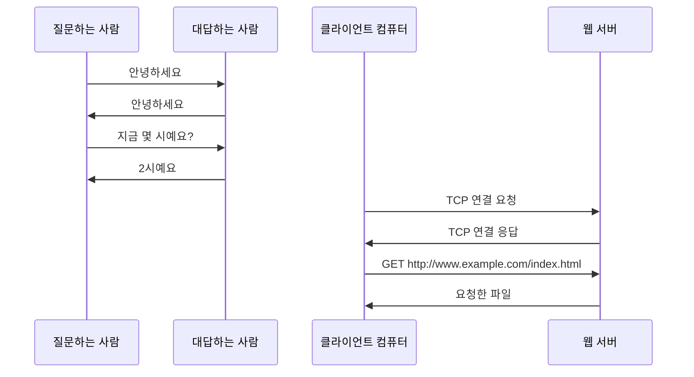

*그림 2. 사람의 프로토콜과 컴퓨터 네트워크 프로토콜*

인터넷에서 둘 이상의 떨어진 개체가 관여하는 모든 활동은 프로토콜이 지배한다. 물리적으로 연결된 두 컴퓨터의 하드웨어 프로토콜은 두 네트워크 인터페이스 카드 사이의 선 위로 흐르는 비트를 제어하고, 종단 시스템의 혼잡 제어 프로토콜은 패킷을 보내는 속도를 제어하며, 라우터의 프로토콜은 패킷이 출발지에서 목적지까지 갈 경로를 정한다.

> **용어 정의:** **프로토콜(protocol)** 은 둘 이상의 통신 개체가 주고받는 메시지의 형식과 순서, 그리고 메시지를 보내거나 받을 때나 다른 사건이 일어날 때 취하는 행동을 정의한 규칙의 집합이다.

Forouzan은 프로토콜이 무엇을, 어떻게, 언제 통신하는지를 정한다고 보고, 프로토콜의 핵심 요소로 구문, 의미, 타이밍을 든다. **구문(syntax)** 은 데이터의 구조나 형식, 곧 데이터가 표현되는 순서이다. 예를 들어 어떤 간단한 프로토콜은 처음 8비트를 송신자 주소, 다음 8비트를 수신자 주소, 나머지를 메시지로 해석하도록 정할 수 있다. 컴퓨터마다 비트를 저장하는 순서가 다를 수 있으므로, 비트를 저장하거나 보내는 순서도 구문에 포함된다. **의미(semantics)** 는 각 비트 구간이 뜻하는 바, 곧 특정 비트 패턴을 어떻게 해석하고 그 해석에 따라 어떤 행동을 할지이다. 예를 들어 주소 필드가 거쳐 갈 경로를 뜻하는지 최종 목적지를 뜻하는지는 의미의 문제이다. **타이밍(timing)** 은 데이터를 언제 보낼지와 얼마나 빨리 보낼 수 있는지이다. 송신자가 100 Mbps로 데이터를 만들어도 수신자가 1 Mbps로만 처리할 수 있다면 수신자는 과부하에 걸리고 데이터의 대부분을 잃는다.

| 요소 | 다루는 질문 | 예 |
|:-----|:-----|:-----|
| 구문 | 데이터가 어떤 형식과 순서로 표현되는가 | 처음 8비트는 송신자 주소, 다음 8비트는 수신자 주소, 나머지는 메시지 |
| 의미 | 각 비트 구간이 무엇을 뜻하고 어떤 행동을 일으키는가 | 주소 필드가 최종 목적지인지 거쳐 갈 경로인지 |
| 타이밍 | 언제, 얼마나 빨리 보내는가 | 100 Mbps 송신자와 1 Mbps 수신자 사이의 속도 맞추기 |

*표 1. 프로토콜의 세 가지 핵심 요소*

> **핵심:** 네트워크의 모든 통신은 프로토콜을 따른다. 프로토콜은 메시지의 형식(구문), 메시지의 뜻과 그에 따른 행동(의미), 메시지를 보내는 시점과 속도(타이밍)를 정한다.

---

<br>

## 2. 프로토콜과 표준

### 2.1 표준의 필요성

프로토콜이 제대로 작동하려면 모든 사람이 각 프로토콜이 하는 일에 합의해야 한다. 그래야 서로 다른 회사가 만든 시스템과 제품이 함께 동작한다. **표준(standard)** 은 이렇게 합의된 규칙이다. 표준은 데이터 통신 기술과 절차의 국내 및 국제 **상호 운용성(interoperability)**, 곧 서로 다른 장비와 시스템이 정보를 주고받으며 함께 동작할 수 있는 성질을 보장하고, 개방적이고 경쟁적인 장비 시장을 만들고 유지하는 데 필요하다. 또한 제조사, 판매사, 정부 기관, 서비스 제공자에게 국제 통신에 필요한 상호 연결성을 확보하기 위한 지침을 준다.

데이터 통신 표준은 두 범주로 나뉜다. **사실상 표준(de facto standard)** 은 공인 기관의 승인 없이 널리 쓰이면서 표준이 된 것으로, 새 제품의 기능을 정하려는 제조사가 처음 만드는 경우가 많다. **법률상 표준(de jure standard)** 은 공인된 기관이 제정한 표준이다.

> **용어 정의:** **표준(standard)** 은 서로 다른 제조사의 장비와 시스템이 함께 동작할 수 있도록 공인 기관이 제정하거나 널리 쓰여 합의된 규칙이다.

### 2.2 표준화 기구

표준은 표준 제정 위원회, 포럼, 정부 규제 기관의 협력으로 만들어진다. 데이터 통신에서 주로 참조하는 표준 제정 위원회는 표 2와 같다.

| 기구 | 성격 | 주요 활동 |
|:-----|:-----|:-----|
| ISO (International Organization for Standardization) | 1947년에 설립된 다국적 자발적 기구, 각국 정부의 표준 제정 위원회가 회원 | 국제 표준에 대한 합의, 네트워크 통신을 위한 OSI 모델 제정 |
| ITU-T (International Telecommunication Union, Telecommunication Standardization Sector) | 국제 연합(UN)의 ITU 산하 위원회, 1993-03-01에 CCITT에서 이름을 바꿈 | 전화와 데이터 시스템을 포함한 통신 표준 |
| ANSI (American National Standards Institute) | 미국 연방 정부와 무관한 민간 비영리 기관, ISO에서 미국을 대표 | 미국의 자발적 표준화를 조정 |
| IEEE (Institute of Electrical and Electronics Engineers) | 세계 최대의 전문 공학회 | 컴퓨팅과 통신의 국제 표준, 이더넷과 Wi-Fi를 정하는 IEEE 802 LAN/MAN 표준 위원회 |
| EIA (Electronic Industries Association) | ANSI와 연계된 비영리 단체 | 물리적 연결 인터페이스와 전기 신호 규격 |
| W3C (World Wide Web Consortium) | 팀 버너스리가 MIT에서 설립 | 웹 관련 표준 |
| OMA (Open Mobile Alliance) | 컴퓨터 네트워크와 무선 기술의 여러 포럼을 하나로 모은 기구 | 응용 프로토콜의 통일된 표준 |

*표 2. 데이터 통신의 주요 표준 제정 위원회*

표준 위원회는 절차를 거쳐야 하므로 기술 발전 속도를 따라가기 어렵다. 그래서 관심 있는 기업의 대표로 이루어진 **포럼(forum)** 이 특정 기술을 시험하고 평가하여 그 결론을 표준 기구에 제출한다. 프레임 릴레이의 보급을 위한 Frame Relay Forum, ATM 기술의 보급을 위한 ATM Forum, 설정 없이 네트워크에 참여하는 장치를 만들기 위한 UPnP(Universal Plug and Play) Forum이 그 예이다. 또한 모든 통신 기술은 미국의 연방 통신 위원회(FCC) 같은 정부 **규제 기관**의 규제를 받는다. 규제 기관의 목적은 라디오, 텔레비전, 유선과 케이블 통신을 규제하여 공공의 이익을 보호하는 것이다.

인터넷의 표준은 **IETF(Internet Engineering Task Force)** 가 개발한다. IETF의 표준 문서를 **RFC(Request for Comments)** 라 한다. RFC는 원래 인터넷의 전신에서 생긴 네트워크와 프로토콜 설계 문제를 해결하기 위해 "의견을 구하는" 문서로 시작했으며, 지금은 TCP, IP, HTTP, SMTP 같은 프로토콜을 기술적으로 상세하게 정의한다. 네트워크 링크처럼 인터넷 밖의 구성 요소는 다른 기구가 표준을 정하며, 예를 들어 IEEE 802 LAN/MAN 표준 위원회가 이더넷과 Wi-Fi 표준을 정한다.

### 2.3 인터넷 표준과 RFC

**인터넷 표준(Internet standard)** 은 인터넷을 사용하는 사람이 따르는, 충분히 시험된 명세이다. 명세가 인터넷 표준이 되려면 엄격한 절차를 거친다. 명세는 **인터넷 초안(Internet draft)** 으로 시작한다. 인터넷 초안은 공식 지위가 없고 수명이 6개월인 작업 문서이다. 인터넷 관리 기구가 권고하면 초안은 RFC로 발행되며, RFC는 편집을 거쳐 번호를 받고 누구나 볼 수 있게 공개된다.

Forouzan은 RFC가 일생 동안 여섯 가지 **성숙 단계(maturity level)** 중 하나에 속한다고 설명한다.

- **제안 표준(proposed standard):** 안정적이고 잘 이해되며 인터넷 사회가 충분히 관심을 가지는 명세이다. 보통 여러 그룹이 시험하고 구현한다.
- **초안 표준(draft standard):** 독립적이고 상호 운용 가능한 구현이 적어도 두 번 성공하면 제안 표준이 초안 표준이 된다. 특별한 문제가 없으면 초안 표준은 인터넷 표준이 된다.
- **인터넷 표준(Internet standard):** 초안 표준이 성공적인 구현을 보여 주면 인터넷 표준이 된다.
- **역사적(historic):** 이후의 명세로 대체되었거나 인터넷 표준이 되는 데 필요한 단계를 통과하지 못한, 역사적으로 의미 있는 RFC이다.
- **실험적(experimental):** 인터넷의 운영에 영향을 주지 않는 실험적 상황의 작업을 기술하며, 실제 인터넷 서비스에 구현해서는 안 된다.
- **정보 제공(informational):** 인터넷에 관한 일반적, 역사적, 교육적 정보를 담으며, 보통 인터넷 조직 밖의 사람(예: 판매사)이 쓴다.

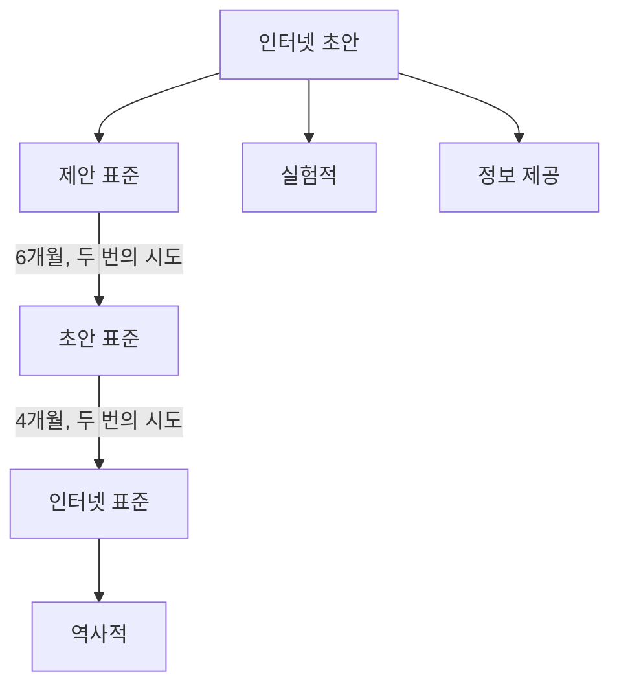

*그림 3. Forouzan이 제시한 RFC의 성숙 단계*

> **참고:** **표준화 단계의 축소.** RFC 6410은 표준화 경로(standards track)의 성숙 단계를 제안 표준(Proposed Standard)과 인터넷 표준(Internet Standard)의 두 단계로 줄였다 [1]. 따라서 Forouzan이 설명하는 초안 표준 단계는 RFC 6410 이후의 새 표준에는 적용되지 않는다.

RFC는 성숙 단계와 별개로 다섯 가지 **요구 단계(requirement level)** 로도 분류된다.

| 요구 단계 | 의미 | 예 |
|:-----|:-----|:-----|
| 필수(required) | 최소한의 적합성을 갖추려면 모든 인터넷 시스템이 구현해야 함 | IP(11장), ICMP(16장) |
| 권장(recommended) | 최소 적합성에 필수는 아니지만 유용하므로 권장 | FTP, TELNET(4장) |
| 선택(elective) | 필수도 권장도 아니지만 시스템이 필요하면 사용 | - |
| 제한 사용(limited use) | 제한된 상황에서만 사용, 실험적 RFC의 대부분 | - |
| 비권장(not recommended) | 일반적인 사용에 부적합, 대개 역사적(폐기된) RFC | - |

*표 3. RFC의 요구 단계*

### 2.4 인터넷을 관리하는 조직

인터넷은 연구 분야에서 시작하여 상업적 사용자까지 포함하게 되었고, 그 성장은 여러 조직이 조정해 왔다.

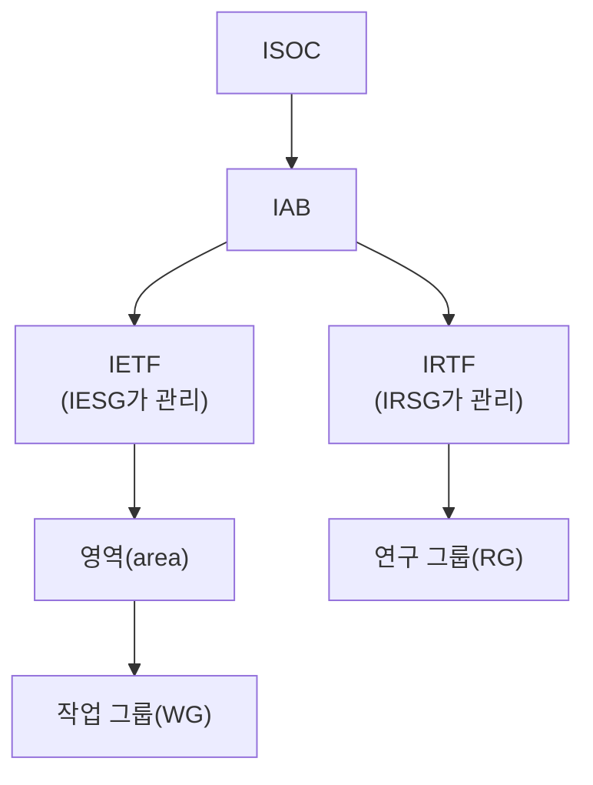

*그림 4. 인터넷을 관리하는 조직의 구성*

- **ISOC(Internet Society):** 1992년에 설립된 국제 비영리 조직으로, IAB, IETF, IRTF, IANA 같은 관리 조직을 유지하고 지원하여 인터넷 표준화 과정을 돕고, 인터넷에 관한 연구와 학술 활동을 장려한다.
- **IAB(Internet Architecture Board):** ISOC의 기술 자문 기구이다. TCP/IP 프로토콜 스위트의 지속적인 발전을 감독하고, RFC의 편집 관리를 맡으며, 다른 표준 기구와 인터넷 사이의 대외 연락을 담당한다.
- **IETF(Internet Engineering Task Force):** IESG(Internet Engineering Steering Group)가 관리하는 작업 그룹의 포럼이다. 운영상의 문제를 찾아 해결책을 제안하고, 인터넷 표준이 될 명세를 개발하고 검토한다. 작업 그룹은 응용, 인터넷 프로토콜, 라우팅, 운영, 사용자 서비스, 네트워크 관리, 전송, 차세대 IP, 보안 같은 영역(area)으로 묶인다.
- **IRTF(Internet Research Task Force):** IRSG(Internet Research Steering Group)가 관리하는 작업 그룹의 포럼으로, 인터넷 프로토콜, 응용, 구조, 기술에 관한 장기 연구를 한다.
- **IANA와 ICANN:** 미국 정부의 지원을 받는 IANA(Internet Assigned Numbers Authority)가 1998년 10월까지 인터넷 도메인 이름과 주소를 관리했고, 그 뒤로는 국제 이사회가 운영하는 민간 비영리 법인 ICANN(Internet Corporation for Assigned Names and Numbers)이 IANA의 업무를 맡는다.
- **NIC(Network Information Center):** TCP/IP 프로토콜에 관한 정보를 수집하고 배포한다.

---

<br>

## 3. 네트워크 가장자리

### 3.1 종단 시스템, 클라이언트, 서버

**네트워크 가장자리(network edge)** 는 사람들이 매일 쓰는 컴퓨터, 스마트폰 같은 종단 시스템이 놓인 인터넷의 바깥 부분이다. 종단 시스템에는 데스크톱 컴퓨터, 웹 서버나 메일 서버 같은 서버, 노트북과 스마트폰과 태블릿 같은 이동 장치가 있으며, 점점 더 많은 비전통적 "사물"이 종단 시스템으로 연결된다. 웹 브라우저, 웹 서버, 메일 클라이언트, 메일 서버 같은 응용 프로그램을 실행(host)하므로 종단 시스템을 호스트라고도 한다. 따라서 호스트와 종단 시스템은 같은 뜻이다.

호스트는 다시 **클라이언트(client)** 와 **서버(server)** 로 나뉜다. 엄밀한 정의는 아니지만, 클라이언트는 데스크톱 PC, 노트북, 스마트폰처럼 사용자가 쓰는 장치인 경우가 많고, 서버는 웹 페이지를 저장하고 배포하거나, 비디오를 스트리밍하거나, 전자 메일을 중계하는 더 강력한 기계인 경우가 많다. 오늘날 검색 결과, 전자 메일, 웹 페이지, 비디오를 보내 주는 서버의 대부분은 수십만 대의 서버를 갖춘 대규모 **데이터 센터(data center)** 에 있다. 클라이언트와 서버를 응용의 관점에서 정확히 정의하는 방법은 3장에서 다룬다.

### 3.2 접속 네트워크의 개념

종단 시스템이 인터넷을 쓰려면 먼저 네트워크에 물리적으로 연결되어야 한다.

> **용어 정의:** **접속 네트워크(access network)** 는 종단 시스템을 그 종단 시스템에서 다른 먼 종단 시스템으로 가는 경로의 첫 번째 라우터, 곧 **가장자리 라우터(edge router)** 에 물리적으로 연결하는 네트워크이다.

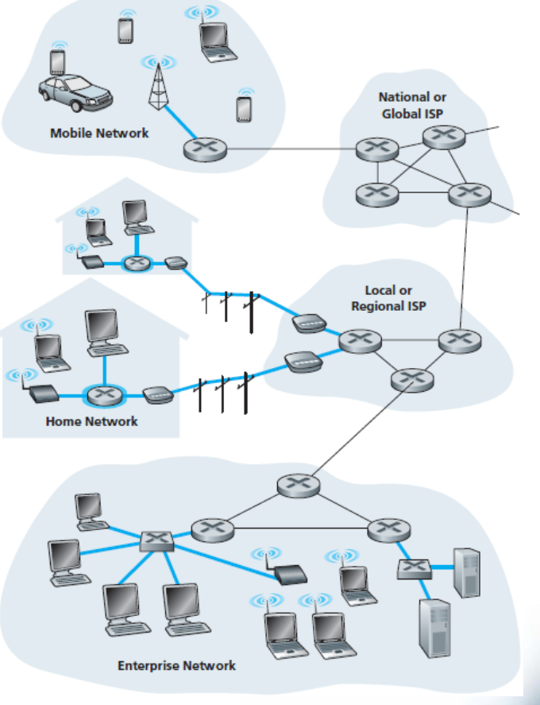

*그림 5. 접속 네트워크*

그림 5에서 굵은 파란 선이 접속 네트워크이다. 가정, 기업, 이동 환경의 종단 시스템이 각각 접속 네트워크를 거쳐 다른 동네로 나가기 위한 첫 번째 라우터까지 연결된다. 접속 네트워크는 쓰이는 환경에 따라 가정 접속(DSL, 케이블, FTTH, 다이얼업, 위성), 기업과 가정의 근거리 접속(이더넷, Wi-Fi), 광역 무선 접속(3G, LTE)으로 나뉜다.

이동 단말이 쓰는 접속 네트워크를 **무선 접속 네트워크(radio access network)** 라 한다. 이동 단말은 근처의 기지국(base station)과 무선으로 통신하고, 기지국끼리는 유선 네트워크로 연결되어 있다. 따라서 무선 접속 네트워크에서 무선 구간은 단말과 기지국 사이의 첫 구간뿐이며, 그 뒤의 기지국과 코어 사이는 유선이다.

---

<br>

## 4. 접속 네트워크

가정에서 인터넷에 접속하는 대표적인 방법은 전화망을 쓰는 다이얼업과 DSL, 방송망인 케이블 TV 망을 쓰는 케이블 접속, 광섬유를 집까지 끌어오는 FTTH이다. 다이얼업, DSL, 케이블 모뎀처럼 공중망(예: 전화망)에서 빌린 회선으로 멀리 떨어진 두 장치를 연결하는 네트워크를 Forouzan은 **점대점 WAN(point-to-point WAN)** 이라 부른다. 점대점 WAN에는 이 밖에 T 회선과 SONET이 있으며, 이 둘은 21장에서 다룬다. 이 기술들은 새로 망을 까는 것이 아니라 이미 존재하는 전화망과 케이블 TV 망을 활용한다는 공통점이 있다.

### 4.1 다이얼업과 56K 모뎀

**다이얼업(dial-up)** 접속은 가정의 모뎀이 전화선으로 ISP의 모뎀에 전화를 걸어 연결하는 방식이다. 전화선은 원래 음성을 아날로그 신호로 전달하도록 만들어졌으므로, 모뎀(modulator-demodulator)은 컴퓨터의 디지털 데이터를 아날로그 신호로 바꾸고(변조) 받은 아날로그 신호를 다시 디지털 데이터로 되돌린다(복조). 다이얼업은 속도가 최대 56 kbps로 매우 느리고, 전화와 인터넷이 같은 대역을 쓰므로 전화를 쓰는 동안에는 인터넷을 쓸 수 없고 인터넷을 쓰는 동안에는 전화를 쓸 수 없다.

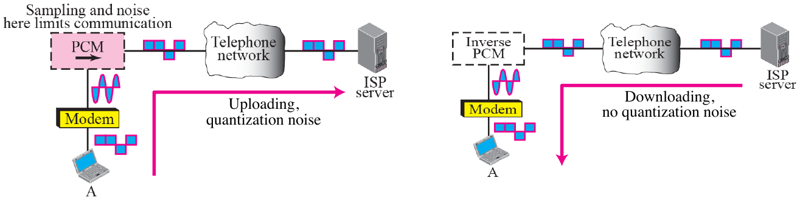

*그림 6. 56K 모뎀의 업로드와 다운로드*

그림 6처럼 56K 모뎀의 업로드와 다운로드는 속도가 다르다. 업로드할 때는 가정에서 보낸 아날로그 신호를 전화 교환국이 샘플링하여 디지털(PCM) 신호로 바꾸어야 하므로 **양자화 잡음(quantization noise)** 이 생기고, 그 결과 업로드 속도는 33.6 kbps로 제한된다. 다운로드할 때는 ISP 서버가 보낸 디지털 신호를 교환국이 역 PCM으로 바꾸어 가정으로 보내므로 샘플링이 일어나지 않고, 양자화 잡음의 영향과 섀넌 용량의 제한을 받지 않는다. 다운로드 속도가 56 kbps인 이유는 전화 회사가 음성을 초당 8000번 샘플링하고 샘플마다 8비트를 쓰되 그중 1비트를 제어용으로 쓰기 때문이다.

```math
8000\ \text{samples/s} \times 7\ \text{bits/sample} = 56{,}000\ \text{bps} = 56\ \text{kbps}
```

V.90과 V.92 표준 모뎀이 이 56 kbps 방식으로 호스트를 인터넷에 연결한다.

### 4.2 DSL

모뎀의 속도가 한계에 이르자 전화 회사는 기존의 **가입자 회선(local loop)**, 곧 전화선으로 더 빠른 접속을 제공하는 **DSL(digital subscriber line)** 기술을 개발했다. DSL을 쓰는 가정은 보통 유선 전화를 제공하는 지역 전화 회사에서 인터넷 접속을 함께 받으므로, 이 경우 전화 회사가 곧 ISP이다.

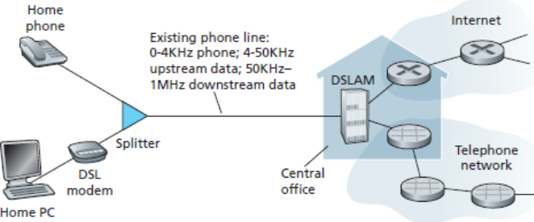

*그림 7. DSL 인터넷 접속*

그림 7처럼 가정의 DSL 모뎀은 기존 전화선(꼬임 쌍선)으로 전화 회사의 **중앙국(central office, CO)** 에 있는 **DSLAM(digital subscriber line access multiplexer)** 과 데이터를 주고받는다. DSL 모뎀은 디지털 데이터를 높은 주파수의 신호로 바꾸어 전화선으로 보내고, 중앙국의 DSLAM은 여러 가정에서 온 아날로그 신호를 다시 디지털 형식으로 바꾼다. 하나의 DSLAM에 수백에서 수천 가구가 연결된다.

Kurose는 가정의 전화선이 데이터와 전화 신호를 서로 다른 주파수 대역에 실어 동시에 전달한다고 설명한다.

- 고속 하향(downstream) 채널: 50 kHz\~1 MHz 대역
- 중속 상향(upstream) 채널: 4 kHz\~50 kHz 대역
- 일반 양방향 전화 채널: 0\~4 kHz 대역

이렇게 하면 DSL 링크 하나가 세 개의 별개 링크처럼 동작하므로, 전화 통화와 인터넷 연결이 같은 회선을 동시에 쓸 수 있다. 주파수 대역을 나누어 하나의 매체를 공유하는 이 방식을 주파수 분할 다중화라 하며, 6.6절에서 다룬다. 가정 쪽에서는 **스플리터(splitter)** 가 도착한 신호를 데이터와 전화 신호로 나누어 데이터 신호를 DSL 모뎀으로 보내고, 중앙국 쪽에서는 DSLAM이 데이터와 전화 신호를 분리하여 데이터를 인터넷으로 보낸다.

DSL 표준은 하향 12 Mbps와 상향 1.8 Mbps, 하향 55 Mbps와 상향 15 Mbps 같은 여러 전송률을 정한다. 하향 속도와 상향 속도가 다르므로 이런 접속을 **비대칭(asymmetric)** 접속이라 한다. 실제 속도는 ISP가 요금제에 따라 제한하거나, 가정과 중앙국 사이의 거리, 전화선의 굵기, 전기적 간섭 때문에 이보다 낮을 수 있다. DSL은 가정과 중앙국 사이의 거리가 짧은 경우를 위해 설계되었으며, 대체로 5\~10마일 안에 있지 않은 가정은 다른 접속 방식을 써야 한다.

**ADSL(asymmetric DSL)** 은 DSL 기술 중 첫 번째 것으로, 기존 가입자 회선이 1.1 MHz까지의 대역폭을 다룰 수 있다는 점을 이용한다. ADSL은 **적응형(adaptive)** 기술이어서 가입자 회선의 상태에 맞추어 데이터 전송률을 정한다. 56K 모뎀의 비대칭이 샘플링 위치 때문에 생긴 결과라면, ADSL의 비대칭은 설계자가 가정용 가입자를 위해 대역폭을 의도적으로 불균등하게 나눈 결과이다. 따라서 ADSL은 양방향으로 많은 데이터를 주고받는 기업에는 알맞지 않다.

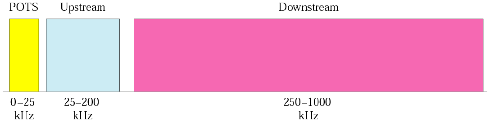

*그림 8. ADSL의 주파수 대역 배치*

그림 8은 ADSL 회선에서 가장 낮은 대역을 일반 전화 서비스(POTS, plain old telephone service)가 쓰고, 그 위를 상향(업로드, 업링크)이, 가장 넓은 높은 대역을 하향(다운로드)이 쓰는 배치를 보여 준다. 그림의 경계값(0\~25 kHz, 25\~200 kHz, 250\~1000 kHz)은 Kurose가 제시한 경계값(0\~4 kHz, 4\~50 kHz, 50 kHz\~1 MHz)과 다르지만, 전화, 상향, 하향의 순서로 대역이 높아지고 하향 대역이 가장 넓다는 구조는 같다. 다이얼업과 달리 전화와 인터넷이 서로 다른 대역을 쓰므로 둘을 동시에 쓸 수 있다.

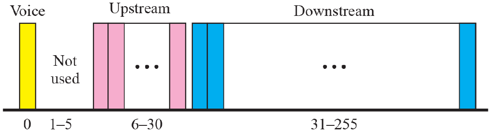

*그림 9. ADSL의 채널 분할*

Forouzan은 ADSL의 대역폭을 4 kHz 남짓한 폭의 채널 256개(0\~255번)로 나누어 설명한다(그림 9). 채널 하나의 실제 폭은 4.312 kHz이고, 계산에서는 그중 4 kHz를 쓴다고 본다.

| 채널 | 용도 | 비고 |
|:-----|:-----|:-----|
| 0 | 음성 통신 | 4 kHz |
| 1\~5 | 사용하지 않음 | 음성과 데이터 사이의 간격 |
| 6\~30 (25개) | 상향 데이터와 제어 | 제어 1개, 데이터 24개 |
| 31\~255 (225개) | 하향 데이터와 제어 | 제어 1개, 데이터 224개 |

*표 4. ADSL의 채널 배정*

채널마다 4000 Hz를 쓰고 1 Hz당 15비트를 실을 수 있다고 하면 최대 전송률은 다음과 같다.

```math
\begin{aligned}
\text{상향} &: 24 \times 4000 \times 15 = 1{,}440{,}000\ \text{bps} = 1.44\ \text{Mbps} \\
\text{하향} &: 224 \times 4000 \times 15 = 13{,}440{,}000\ \text{bps} \approx 13.4\ \text{Mbps}
\end{aligned}
```

실제로는 신호 대 잡음비의 영향 때문에 이보다 훨씬 낮아서, 상향은 64 kbps\~1 Mbps, 하향은 500 kbps\~8 Mbps 정도이다.

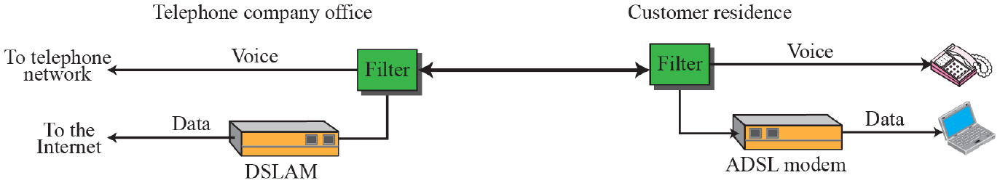

*그림 10. ADSL 모뎀과 DSLAM*

그림 10은 ADSL의 장비 구성이다. 가정의 가입자 회선은 **필터(filter)** 에 연결되고, 필터는 음성 통신과 데이터 통신을 분리하여 음성은 전화기로, 데이터는 ADSL 모뎀으로 보낸다. ADSL 모뎀은 데이터를 변조하여 상향 채널과 하향 채널을 만든다. 전화 회사 쪽에는 ADSL 모뎀 대신 DSLAM이 있으며, DSLAM은 ADSL 모뎀과 비슷하게 동작할 뿐 아니라 인터넷으로 보낼 데이터를 패킷으로 만든다.

ADSL 외의 DSL 기술은 표 5와 같다.

| 기술 | 특징 |
|:-----|:-----|
| SDSL (symmetric DSL) | 대역폭을 상향과 하향에 똑같이 나누어 양방향으로 많은 데이터를 보내는 기업에 맞춤, 꼬임 쌍선 한 쌍으로 HDSL과 같은 전송률을 얻고, 전이중 전송을 위해 반향 제거(echo cancellation) 기능을 씀 |
| HDSL (high-bit-rate DSL) | T-1 회선(1.544 Mbps)의 대안으로 Bellcore가 개발, T-1 회선의 AMI 부호화는 높은 주파수에서 감쇠에 약해 약 1 km마다 중계기가 필요하지만 HDSL은 3.6 km 안에서 중계기 없이 사용 |
| VDSL (very-high-bit-rate DSL) | 동축 케이블, 광섬유, 꼬임 쌍선으로 300\~1800 m의 짧은 거리를 연결, DMT 변조로 하향 50\~55 Mbps, 상향 1.5\~2.5 Mbps |

*표 5. ADSL 외의 DSL 기술*

이 가운데 짧은 선로에서 수십 Mbps에 이르는 VDSL이 오늘날 쓰이는 고속 DSL에 가장 가깝다. VDSL의 하향 50~55 Mbps는 앞에서 본 DSL 표준의 하향 55 Mbps와 같은 수준이다.

### 4.3 케이블 접속과 HFC

DSL이 전화 회사의 기존 전화망을 쓴다면, **케이블 인터넷 접속(cable Internet access)** 은 케이블 TV 회사의 기존 케이블 TV 망을 쓴다. DSL이 쓰는 비차폐 꼬임 쌍선은 간섭에 약해 전송률에 상한이 있으므로, 케이블 회사는 케이블 TV 망으로 고속 인터넷 접속을 제공하며 전화 회사와 경쟁한다.

케이블 TV는 원래 수신 상태가 나쁜 지역에 방송 신호를 전달하려고 시작되었다. 높은 언덕이나 건물 꼭대기의 안테나가 방송 신호를 받아 동축 케이블로 지역에 나누어 주었기 때문에 CATV(community antenna TV)라 불렀다. 케이블 TV 사무소인 **헤드엔드(head end)** 가 방송 신호를 받아 동축 케이블에 실어 보낸다.

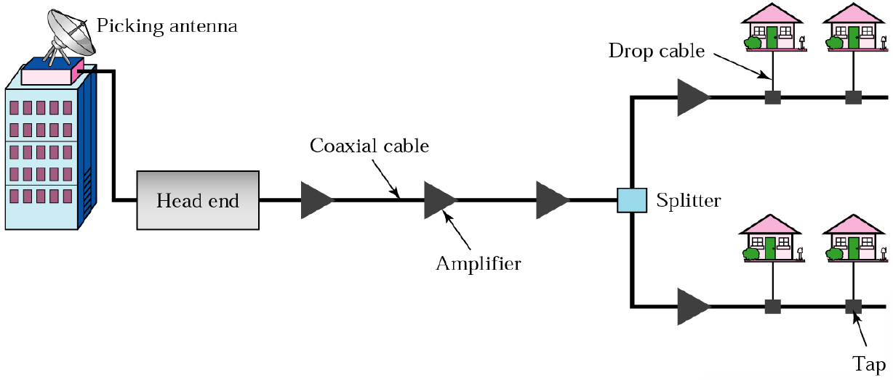

*그림 11. 전통적인 케이블 TV 네트워크*

그림 11의 전통적인 케이블 TV 네트워크는 처음부터 끝까지 동축 케이블을 썼다. 동축 케이블의 대역폭은 최대 약 750 MHz이고, 주파수 분할 다중화로 채널마다 6 MHz를 배정한다. 신호의 감쇠 때문에 증폭기를 많이 써야 했고, 그 결과 통신은 헤드엔드에서 가입자 쪽으로만 흐르는 **단방향(unidirectional)** 이었다. 헤드엔드에서 나온 신호는 증폭기를 거쳐 분배기(splitter)에서 갈라지고, 탭(tap)과 인입선(drop cable)을 거쳐 각 가정에 들어간다.

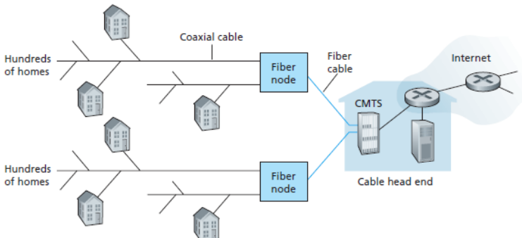

*그림 12. 광섬유와 동축 케이블을 함께 쓰는 HFC 접속 네트워크*

2세대 케이블 네트워크는 광섬유와 동축 케이블을 함께 쓰므로 **HFC(hybrid fiber-coax)** 라 한다(그림 12). 헤드엔드에서 동네 단위의 **광 노드(fiber node)** 까지는 광섬유로, 광 노드에서 동네를 거쳐 각 가정까지는 동축 케이블로 연결한다. 광 노드 하나는 보통 500\~5000가구를 담당한다. 전통적인 구조에서 HFC로 옮긴 이유 중 하나는 케이블 네트워크를 양방향으로 만들기 위해서이다.

케이블 인터넷 접속에는 **케이블 모뎀(cable modem, CM)** 이 필요하다. 케이블 모뎀은 보통 외장형 장치이며 이더넷 포트로 가정의 PC에 연결된다. 헤드엔드 쪽의 **CMTS(cable modem termination system)** 는 DSL의 DSLAM과 비슷한 역할을 하여, 여러 가정의 케이블 모뎀이 보낸 아날로그 신호를 디지털 형식으로 되돌린다. 케이블 모뎀은 HFC 네트워크를 하향 채널과 상향 채널로 나누며, DSL처럼 하향 채널에 더 높은 전송률을 배정하는 비대칭 접속이 일반적이다. Kurose에 따르면 DOCSIS 2.0 표준은 하향 최대 42.8 Mbps, 상향 최대 30.7 Mbps를 정한다.

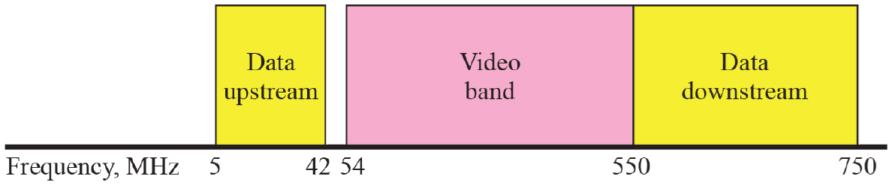

*그림 13. 케이블의 대역폭 분할*

HFC에서도 광 노드에서 가정까지의 마지막 구간은 동축 케이블이며, 그 대역폭은 약 5\~750 MHz이다. 케이블 회사는 이 대역을 그림 13처럼 세 대역으로 나눈다.

| 대역 | 주파수 | 채널 | 변조 | 전송률 |
|:-----|:-----|:-----|:-----|:-----|
| 상향 데이터 | 5\~42 MHz | 6 MHz 채널 6개 (37 MHz) | QPSK (심볼당 2비트) | 이론상 6 MHz × 2 bits/Hz = 12 Mbps, 실제로는 대개 이보다 낮음 |
| 비디오 | 54\~550 MHz | 6 MHz 채널 80여 개 | - | 하향 전용 |
| 하향 데이터 | 550\~750 MHz | 6 MHz 채널 33개 | 64-QAM (심볼당 6비트) | 교재 기준 30 Mbps, 표준은 27 Mbps |

*표 6. 케이블 대역의 구성*

비디오 대역의 폭은 550 - 54 = 496 MHz이므로 6 MHz 채널을 82개까지 넣을 수 있다. 하향 데이터 대역은 200 MHz이므로 6 MHz 채널 33개가, 상향 데이터 대역은 37 MHz이므로 6 MHz 채널 6개가 들어간다. 상향 대역은 잡음과 간섭에 더 취약한 낮은 주파수를 쓴다.

변조 방식의 이름에서 심볼당 비트 수를 읽을 수 있다. **64-QAM**은 신호 하나(심볼)가 64가지 상태를 가지는 변조이므로 64 = 2⁶에서 심볼 하나가 6비트를 한 번에 전달한다. **QPSK**는 네 가지 위상(00, 01, 10, 11)을 쓰므로 4 = 2²에서 심볼 하나가 2비트를 전달한다.

> **참고:** **하향 30 Mbps의 계산.** 교재는 하향 데이터 대역의 이론 속도를 30 Mbps, 표준이 정한 속도를 27 Mbps로 제시한다. 그런데 6 MHz에 6 bits/Hz를 곱하면 36 Mbps이므로, 30 Mbps는 "6 MHz × 6 bits/Hz"라는 곱으로는 나오지 않는다. 반면 상향의 12 Mbps는 6 MHz × 2 bits/Hz와 일치한다. 또한 교재는 케이블 모뎀이 10BASE-T 케이블로 컴퓨터에 연결되던 당시에는 이 연결이 전송률을 10 Mbps로 제한했다고 덧붙인다.

케이블 접속에서 중요한 특징은 하향과 상향 대역을 가입자들이 **공유**한다는 점이다. 상향 대역에는 채널이 6개뿐인데 한 지역의 가입자는 수천에서 수만 명에 이를 수 있다. 그래서 케이블 회사는 채널 하나를 가입자 무리에 정적으로나 동적으로 배정하고, 가입자들은 시간을 나누어(time-sharing) 채널을 쓴다. 데이터를 보내려는 가입자는 다른 가입자와 채널을 놓고 경쟁해야 하며, 이는 이더넷의 CSMA와 비슷한 상황이다. 이렇게 공유 채널에서 전송을 조정하는 다중 접근 프로토콜은 18장에서 다룬다. 하향 쪽도 33개의 채널을 많은 가입자가 나누어 쓰지만, 이 경우는 멀티캐스트에 가깝다. 어떤 가입자를 위한 데이터든 그 무리의 채널로 보내므로 무리의 모든 케이블 모뎀이 데이터를 받고, 각 케이블 모뎀은 데이터에 실린 주소가 ISP가 자신에게 배정한 주소와 같을 때만 데이터를 보관하고 나머지는 버린다.

Kurose도 같은 점을 강조한다. 헤드엔드가 보낸 패킷은 모든 링크를 따라 모든 가정으로 내려가고, 가정이 보낸 패킷은 상향 채널을 따라 헤드엔드로 올라간다. 따라서 여러 사용자가 동시에 비디오를 내려받으면 각 사용자가 실제로 받는 속도는 하향 채널의 총 전송률보다 훨씬 낮다. 반대로 활동하는 사용자가 적고 모두 웹 검색처럼 가끔씩만 요청한다면, 각 사용자는 하향 전송률 전체로 웹 페이지를 받을 수도 있다.

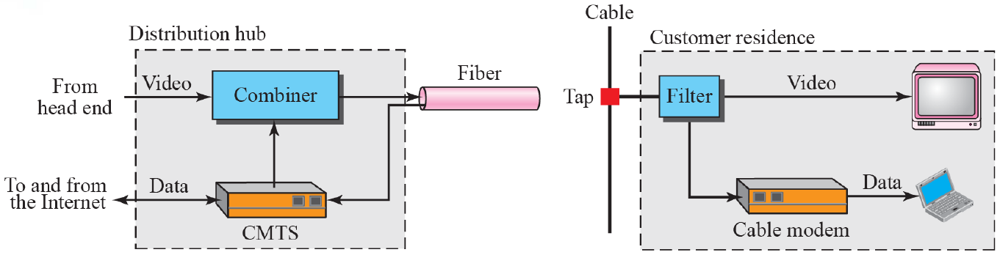

*그림 14. 케이블 모뎀의 구성*

그림 14는 케이블 데이터 전송에 필요한 두 장치의 위치를 보여 준다. 케이블 회사의 분배 허브(distribution hub)에 있는 CMTS는 인터넷에서 온 데이터를 결합기(combiner)로 넘기고, 결합기는 헤드엔드에서 온 비디오와 데이터를 합쳐 광섬유로 가입자에게 보낸다. CMTS는 가입자가 보낸 데이터를 받아 인터넷으로 넘기기도 한다. 가입자 집의 탭에서 들어온 신호는 필터를 거쳐 비디오는 TV로, 데이터는 케이블 모뎀으로 간다.

### 4.4 FTTH와 위성 접속

**FTTH(fiber to the home)** 는 중앙국에서 가정까지 광섬유 경로를 직접 제공하는 방식으로, DSL과 케이블보다 더 높은 속도를 낼 수 있다. 가장 단순한 방식은 가정마다 광섬유 한 가닥을 중앙국에서 끌어오는 **직접 광섬유(direct fiber)** 이다. 더 일반적인 방식에서는 중앙국을 떠난 광섬유 한 가닥을 여러 가정이 공유하다가 가정 가까이에서 가정별 광섬유로 나눈다. 이 분기를 하는 광 분배 네트워크에는 **능동형 광 네트워크(active optical network, AON)** 와 **수동형 광 네트워크(passive optical network, PON)** 가 있다. AON은 본질적으로 스위치드 이더넷(20장)이다.

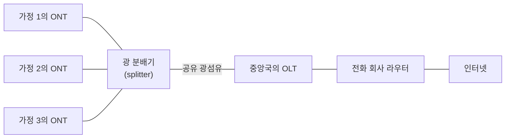

*그림 15. PON 방식의 FTTH 접속*

PON에서는 가정마다 **ONT(optical network terminator)** 가 있고, ONT는 전용 광섬유로 동네의 광 분배기(splitter)에 연결된다(그림 15). 광 분배기는 보통 100가구 미만을 하나의 공유 광섬유로 묶어 중앙국의 **OLT(optical line terminator)** 에 연결한다. OLT는 광 신호와 전기 신호를 변환하며 전화 회사의 라우터를 통해 인터넷에 연결된다. 가정에서는 무선 라우터 같은 가정용 라우터를 ONT에 연결하여 인터넷에 접속한다. PON에서는 OLT가 분배기로 보낸 모든 패킷이 분배기에서 복제되므로, 케이블 헤드엔드와 비슷한 방송 구조가 된다. FTTH는 Gbps 수준의 접속 속도를 낼 수 있다.

DSL, 케이블, FTTH를 쓸 수 없는 농촌 같은 곳에서는 **위성 링크**로 1 Mbps가 넘는 속도로 인터넷에 접속할 수 있다.

### 4.5 기업과 가정의 접속: 이더넷과 Wi-Fi

기업과 대학 캠퍼스, 그리고 점점 더 많은 가정에서는 **근거리 네트워크(local area network, LAN)** 가 종단 시스템을 가장자리 라우터에 연결한다. LAN 기술 중 가장 널리 쓰이는 것은 **이더넷(Ethernet)** 이다.

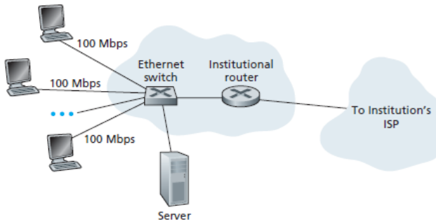

*그림 16. 이더넷 인터넷 접속*

그림 16처럼 이더넷 사용자는 꼬임 쌍선으로 이더넷 스위치에 연결하고, 이더넷 스위치나 스위치들의 네트워크는 기관 라우터를 거쳐 더 큰 인터넷에 연결된다. 사용자는 보통 100 Mbps나 1 Gbps로, 서버는 1 Gbps나 10 Gbps로 이더넷 스위치에 접속한다. 이더넷과 스위치는 20장에서 다룬다.

노트북, 스마트폰, 태블릿 같은 장치는 점점 무선으로 인터넷에 접속한다. **무선 LAN** 에서는 무선 사용자가 기업 네트워크에 연결된 **액세스 포인트(access point, AP)** 와 패킷을 주고받고, 액세스 포인트는 대개 유선 이더넷으로 유선 인터넷에 연결된다. 무선 LAN 사용자는 액세스 포인트에서 수십 미터 안에 있어야 한다. IEEE 802.11 기술에 기반한 무선 LAN을 흔히 **Wi-Fi** 라 하며, 오늘날 100 Mbps가 넘는 공유 전송률을 제공한다. 무선 LAN은 22장에서 다룬다.

이더넷과 Wi-Fi는 처음에는 기업 환경에 배치되었지만 이제 가정 네트워크의 흔한 구성 요소이다. 전형적인 가정 네트워크는 집 안을 돌아다니는 노트북과 유선 PC, 무선 장치와 통신하는 기지국(무선 액세스 포인트), 광대역 접속을 제공하는 케이블 모뎀이나 DSL 모뎀, 그리고 기지국과 유선 PC를 케이블 모뎀에 연결하는 라우터로 이루어진다.

### 4.6 광역 무선 접속

스마트폰 같은 장치는 셀룰러 전화에 쓰는 무선 기반 구조를 그대로 써서, 이동 통신 사업자가 운영하는 기지국을 통해 패킷을 주고받는다. Wi-Fi 사용자가 액세스 포인트에서 수십 미터 안에 있어야 하는 것과 달리, 셀룰러 사용자는 기지국에서 수십 킬로미터 안에만 있으면 된다. 3세대(3G) 무선은 1 Mbps가 넘는 속도로 패킷 교환 방식의 광역 무선 인터넷 접속을 제공하고, 4세대 기술인 LTE(Long-Term Evolution)는 10 Mbps가 넘는 속도를 낼 수 있다.

Wi-Fi와 셀룰러는 접속 네트워크의 소유자와 범위가 다르다. Wi-Fi는 가정이나 기관이 설치한 액세스 포인트를 거쳐 그 기관의 유선 네트워크로 인터넷에 접속하는 반면, 셀룰러 단말은 이동 통신 사업자의 이동 통신망을 거쳐 인터넷에 접속한다. 이동 통신 사업자가 데이터 요금제로 인터넷 접속을 판매하는 것은 이동 통신망이 이 경우의 접속 ISP이기 때문이다. 셀룰러 네트워크의 구조는 25장에서 다룬다.

### 4.7 접속 기술의 비교

| 기술 | 매체 | 공유 여부 | 대표 속도 |
|:-----|:-----|:-----|:-----|
| 다이얼업 (56K 모뎀) | 전화선 (꼬임 쌍선) | 전용 | 하향 56 kbps, 상향 33.6 kbps |
| ADSL | 전화선 (꼬임 쌍선) | 가입자 회선은 전용, DSLAM에서 집선 | 이론 하향 13.4 Mbps, 상향 1.44 Mbps, 실제 하향 0.5\~8 Mbps |
| 케이블 (HFC) | 광섬유와 동축 케이블 | 동네 단위로 공유 | DOCSIS 2.0 하향 42.8 Mbps, 상향 30.7 Mbps |
| FTTH (PON) | 광섬유 | 분배기 단위로 공유 | Gbps 수준 가능 |
| 이더넷 | 꼬임 쌍선 | 스위치 포트는 전용 | 100 Mbps, 1 Gbps, 10 Gbps |
| Wi-Fi (802.11) | 무선 (수십 m) | 공유 | 100 Mbps 이상 |
| 3G, LTE | 무선 (수십 km) | 공유 | 3G 1 Mbps 이상, LTE 10 Mbps 이상 |

*표 7. 주요 접속 기술의 비교*

---

<br>

## 5. 물리 매체

비트 하나가 출발지 종단 시스템에서 여러 링크와 라우터를 거쳐 목적지 종단 시스템까지 가는 과정을 살펴본다. 출발지가 비트를 보내면 첫 번째 라우터가 받고, 첫 번째 라우터가 다시 보내면 두 번째 라우터가 받는 식으로 비트는 송신기와 수신기의 쌍을 여러 번 거친다. 각 쌍에서 비트는 전자기파나 빛의 펄스로 **물리 매체(physical medium)** 를 따라 전달되며, 매체의 종류는 쌍마다 다를 수 있다.

물리 매체는 두 범주로 나뉜다. **유도 매체(guided media)** 에서는 전파가 광섬유, 꼬임 쌍선, 동축 케이블 같은 고체 매체를 따라 유도된다. **비유도 매체(unguided media)** 에서는 무선 LAN이나 디지털 위성 채널처럼 전파가 대기와 우주 공간으로 퍼져 나간다. 물리 링크의 재료비는 다른 네트워크 비용에 비해 작은 편이고, 설치 인건비가 재료비보다 몇 자릿수나 클 수 있다. 그래서 많은 건축업자는 지금 하나만 쓰더라도 꼬임 쌍선, 광섬유, 동축 케이블을 모든 방에 미리 설치한다.

- **꼬임 쌍선(twisted-pair copper wire):** 가장 싸고 가장 많이 쓰이는 유도 매체이다. 두께 약 1 mm의 절연된 구리선 두 가닥을 규칙적인 나선 모양으로 꼬아, 가까운 다른 쌍에서 오는 전기적 간섭을 줄인다. 전화기에서 지역 전화 교환기까지의 유선 연결의 99% 이상이 꼬임 쌍선이다. 건물 안의 LAN에는 **비차폐 꼬임 쌍선(unshielded twisted pair, UTP)** 이 흔히 쓰이며, 전송률은 10 Mbps\~10 Gbps이다. 카테고리 6a 케이블은 100 m까지 10 Gbps를 낼 수 있다. 다이얼업(최대 56 kbps)과 DSL(수십 Mbps)도 꼬임 쌍선을 쓴다.
- **동축 케이블(coaxial cable):** 구리 도체 두 개를 평행이 아니라 동심원으로 배치하고 특수한 절연과 차폐를 더해 높은 전송률을 얻는다. 케이블 TV 시스템에서 흔히 쓰이며, 송신기는 디지털 신호를 특정 주파수 대역으로 옮겨 하나 이상의 수신기로 보낸다. 여러 종단 시스템이 케이블에 직접 연결되어 다른 종단 시스템이 보낸 것을 모두 받는 공유 매체로 쓸 수 있다.
- **광섬유(fiber optics):** 빛의 펄스로 비트를 전달하는 가늘고 유연한 매체이다. 펄스 하나가 비트 하나를 나타낸다. 초당 수십에서 수백 기가비트를 전달할 수 있고, 전자기 간섭을 받지 않으며, 100 km까지 신호 감쇠가 매우 작고, 도청하기 어렵다. 그래서 장거리 유도 매체, 특히 해저 링크와 인터넷 백본에 쓰인다. 다만 송신기, 수신기, 스위치 같은 광 장치가 비싸서 LAN이나 가정 접속 같은 짧은 구간에는 덜 쓰인다. 광 반송파(Optical Carrier, OC) 표준의 링크 속도는 OC-n일 때 n × 51.8 Mbps이며, OC-1, OC-3, OC-12, OC-24, OC-48, OC-96, OC-192, OC-768이 쓰인다.
- **지상 무선 채널(terrestrial radio channel):** 전자기 스펙트럼으로 신호를 전달한다. 물리적인 선이 필요 없고, 벽을 통과하며, 이동 사용자에게 연결을 제공하고, 먼 거리까지 신호를 보낼 수 있다. 채널의 특성은 전파 환경과 거리에 크게 좌우되며, 거리와 장애물 때문에 신호가 약해지는 경로 손실(path loss)과 그림자 페이딩(shadow fading), 반사 때문에 생기는 다중 경로 페이딩(multipath fading), 다른 전송과 전자기 신호에 의한 간섭이 생긴다. 1\~2 m의 매우 짧은 거리(무선 헤드셋, 키보드), 수십\~수백 m의 근거리(무선 LAN), 수십 km의 광역(셀룰러 접속)으로 나뉜다.
- **위성 무선 채널(satellite radio channel):** 통신 위성은 지상국이라 부르는 둘 이상의 지상 마이크로파 송수신기를 연결한다. 위성은 한 주파수 대역으로 신호를 받아 재생한 뒤 다른 주파수로 보낸다. **정지 궤도 위성(geostationary satellite)** 은 지표면 위 36,000 km 궤도에서 지구의 같은 지점 위에 계속 머문다. 지상국에서 위성을 거쳐 다시 지상국으로 가는 거리가 매우 멀어 280 ms의 전파 지연이 생긴다. **저궤도(low-earth orbiting, LEO) 위성**은 지구에 훨씬 가깝고 한 지점 위에 머물지 않으므로, 한 지역을 계속 담당하려면 많은 위성이 필요하다.

| 매체 | 범주 | 특징 | 주요 용도 |
|:-----|:-----|:-----|:-----|
| 꼬임 쌍선 | 유도 | 가장 저렴, 꼬아서 간섭 감소, 10 Mbps\~10 Gbps | 전화선, LAN, DSL |
| 동축 케이블 | 유도 | 동심원 구조, 공유 매체로 사용 가능 | 케이블 TV, 케이블 인터넷 |
| 광섬유 | 유도 | 수십\~수백 Gbps, 간섭 없음, 낮은 감쇠, 장비가 비쌈 | 백본, 장거리, 해저 링크 |
| 지상 무선 | 비유도 | 이동성, 경로 손실, 페이딩, 간섭 | 무선 LAN, 셀룰러 |
| 위성 | 비유도 | 정지 궤도는 280 ms 전파 지연 | DSL과 케이블이 없는 지역 |

*표 8. 물리 매체의 비교*

---

<br>

## 6. 네트워크 코어

**네트워크 코어(network core)** 는 인터넷의 종단 시스템을 서로 연결하는 패킷 스위치와 링크의 그물망이다.

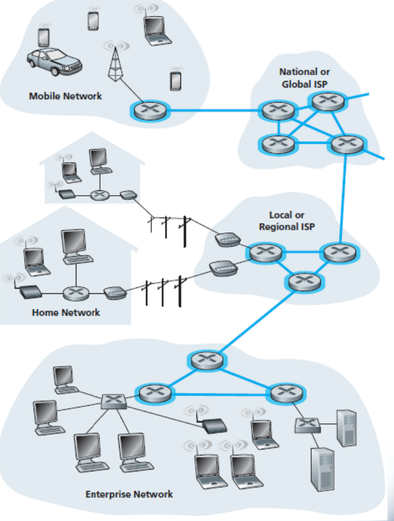

*그림 17. 네트워크 코어*

### 6.1 교환과 교환 네트워크의 분류

장치가 여럿이면 이들을 어떻게 연결해야 일대일 통신을 할 수 있는지가 문제가 된다. 모든 장치를 서로 직접 연결하는 것은 비효율적이므로, 네트워크는 **스위치(switch)** 라 부르는 연결 장치를 두고 장치들을 스위치에 연결한다.

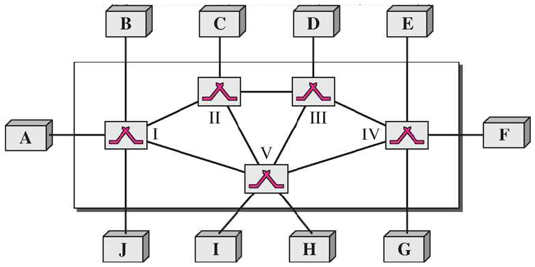

*그림 18. 스위치로 연결된 교환 네트워크*

그림 18에서 A\~J의 장치는 스위치 I\~V로 이루어진 네트워크를 거쳐 서로 연결된다. 메시지가 연결 장치(스위치)에 도착하면, 그 장치는 메시지를 내보낼 출력 포트 하나를 골라야 한다. 다시 말해 연결 장치는 한 포트를 다른 포트에 잇는 스위치로 동작한다. 이 과정을 **교환(switching)** 이라 한다.

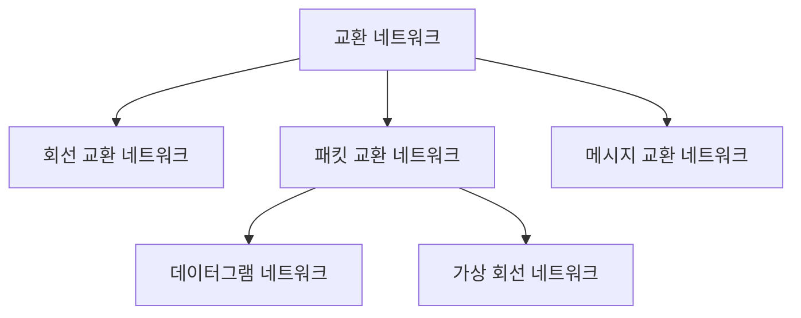

*그림 19. 교환 네트워크의 분류*

교환 네트워크는 그림 19처럼 회선 교환, 패킷 교환, 메시지 교환 네트워크로 나뉘고, 패킷 교환 네트워크는 다시 데이터그램 네트워크와 가상 회선 네트워크로 나뉜다. 오늘날의 인터넷은 데이터그램 네트워크이다. 데이터그램 방식과 가상 회선 방식은 10장에서 비교한다. 이 절은 Kurose를 따라 패킷 교환과 회선 교환을 중심으로 설명하고, 메시지 교환은 6.7절에서 다룬다.

### 6.2 패킷 교환과 저장 후 전달 전송

네트워크 응용에서 종단 시스템은 서로 **메시지(message)** 를 주고받는다. 메시지는 앞의 "안녕하세요"처럼 제어 기능을 하거나 전자 메일, JPEG 이미지, MP3 파일 같은 데이터를 담는다. 출발지 종단 시스템은 긴 메시지를 **패킷**이라 부르는 작은 데이터 덩어리로 나누어 보낸다. 패킷은 출발지와 목적지 사이의 통신 링크와 패킷 스위치를 지나며, 각 링크에서 그 링크의 최대 전송률로 전송된다. 출발지나 패킷 스위치가 $L$비트 패킷을 전송률 $R$ bps의 링크로 보내면, 패킷을 링크로 내보내는 데 $L/R$초가 걸린다.

> **용어 정의:** **패킷 교환(packet switching)** 은 메시지를 패킷으로 나누고, 자원을 미리 예약하지 않은 채 각 패킷이 필요할 때 링크를 사용하여 목적지까지 전달되게 하는 방식이다.

대부분의 패킷 스위치는 링크의 입력에서 **저장 후 전달 전송(store-and-forward transmission)** 을 한다. 패킷 스위치는 패킷 전체를 받은 뒤에야 그 패킷의 첫 비트를 출력 링크로 보내기 시작할 수 있다.

> **용어 정의:** **저장 후 전달 전송(store-and-forward transmission)** 은 패킷 스위치가 패킷의 모든 비트를 받아 버퍼에 저장한 뒤에야 그 패킷을 출력 링크로 전송하기 시작하는 방식이다.

출발지와 목적지가 라우터 하나로 연결되어 있고, 출발지가 각각 $L$비트인 패킷 세 개를 보낸다고 가정한다. 전파 지연은 무시한다. 시각 0에 출발지가 첫 패킷을 보내기 시작하면, 시각 $L/R$에 첫 패킷 전체가 라우터에 저장된다. 이때부터 라우터는 첫 패킷을 목적지로 보내고, 동시에 출발지는 둘째 패킷을 보낸다. 따라서 시각 $2L/R$에 목적지는 첫 패킷을, 라우터는 둘째 패킷을 모두 받는다.

```text
시각        0      L/R     2L/R    3L/R    4L/R
            |-------|-------|-------|-------|
출발지 → R  [ 1 ]   [ 2 ]   [ 3 ]
R → 목적지          [ 1 ]   [ 2 ]   [ 3 ]
                            ^       ^       ^
                         1 도착   2 도착   3 도착
```

*그림 20. 라우터 하나를 거치는 세 패킷의 저장 후 전달 타이밍*

패킷 하나만 보낸다면 총 지연은 $2L/R$이다. 라우터가 비트를 받는 즉시 내보낸다면 지연은 $L/R$이겠지만, 라우터는 패킷 전체를 받고 저장하고 처리한 뒤에야 내보낸다. 패킷 세 개를 모두 받는 시각은 $4L/R$이다. 일반적으로 전송률이 모두 $R$인 링크 $N$개(라우터 $N-1$개)를 거쳐 패킷 하나를 보낼 때 종단 간 지연은 다음과 같다.

```math
d_{\text{end-to-end}} = N \frac{L}{R}
```

같은 경로로 패킷 $P$개를 연달아 보내면, 첫 패킷이 $NL/R$에 도착하고 그 뒤로 $L/R$마다 하나씩 도착하므로 마지막 패킷은 $(N+P-1)L/R$에 도착한다. 앞의 예는 $N=2$, $P=3$이므로 $4L/R$이다.

예를 들어 8,000비트 패킷 하나를 2 Mbps 링크 3개로 보내면, 링크 하나의 전송 시간은 8,000 / (2 × 10⁶) = 4 ms이고 종단 간 지연은 3 × 4 = 12 ms이다.

### 6.3 큐잉 지연과 패킷 손실

패킷 스위치에는 링크가 여러 개 연결되어 있고, 스위치는 연결된 링크마다 **출력 버퍼(output buffer)** 또는 **출력 큐(output queue)** 를 둔다. 출력 버퍼는 그 링크로 보낼 패킷을 저장한다. 도착한 패킷을 보낼 링크가 다른 패킷을 전송하느라 바쁘면, 도착한 패킷은 출력 버퍼에서 기다려야 한다. 그래서 패킷은 저장 후 전달 지연에 더해 **큐잉 지연(queuing delay)** 을 겪는다. 큐잉 지연은 네트워크의 혼잡 정도에 따라 달라진다.

버퍼 공간은 유한하므로, 도착한 패킷이 버퍼가 가득 찬 것을 발견할 수 있다. 이때 **패킷 손실(packet loss)** 이 일어나며, 도착한 패킷이나 이미 큐에 있던 패킷 중 하나가 버려진다.

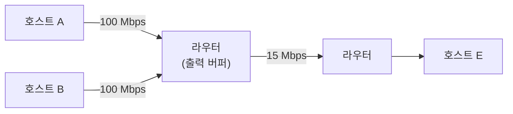

*그림 21. 출력 링크보다 빠르게 패킷이 도착하는 상황*

그림 21에서 호스트 A와 B는 100 Mbps 이더넷 링크로 첫 라우터에 패킷을 보내고, 라우터는 이 패킷들을 15 Mbps 링크로 내보낸다. 짧은 시간 동안 라우터에 도착하는 비트의 속도가 15 Mbps를 넘으면, 패킷은 링크의 출력 버퍼에 쌓이며 라우터에서 혼잡이 생긴다. 예를 들어 A와 B가 동시에 패킷 다섯 개씩을 연달아 보내면 대부분의 패킷이 큐에서 기다린다. 은행 창구나 요금소 앞에서 줄을 서는 상황과 같다.

### 6.4 포워딩 테이블과 라우팅 프로토콜

라우터는 들어온 패킷을 어느 링크로 내보낼지 어떻게 정할까? 인터넷에서는 모든 종단 시스템이 **IP 주소**를 가진다. 출발지는 목적지의 IP 주소를 패킷 헤더에 넣어 보내며, 이 주소는 우편 주소처럼 계층 구조를 가진다. 라우터마다 목적지 주소(또는 그 일부)를 그 라우터의 출력 링크에 대응시키는 **포워딩 테이블(forwarding table)** 이 있다. 패킷이 도착하면 라우터는 목적지 주소의 일부를 살펴 포워딩 테이블에서 알맞은 출력 링크를 찾고, 패킷을 그 링크로 보낸다.

> **용어 정의:** **포워딩 테이블(forwarding table)** 은 라우터가 패킷의 목적지 주소(또는 그 일부)를 보고 패킷을 내보낼 출력 링크를 찾는 데 쓰는 표이다.

이 과정은 지도 없이 길을 묻는 운전자와 비슷하다. 필라델피아에서 플로리다주 올랜도의 레이크사이드 드라이브 156번지로 가는 운전자 조가 동네 주유소에 길을 물으면, 주유소 직원은 주소에서 플로리다 부분만 보고 I-95 남쪽 고속도로를 타라고 하며 플로리다에 들어가면 다시 물어보라고 한다. 잭슨빌의 주유소 직원은 올랜도 부분을 보고 데이토나비치까지 가라고 하고, 데이토나비치의 직원은 I-4를 타고 올랜도로 가라고 한다. 올랜도의 직원은 레이크사이드 드라이브 부분을 보고 길을 알려 주고, 마지막으로 자전거를 탄 아이가 156번지를 보고 집을 가리킨다. 이 비유에서 주유소 직원과 아이가 라우터에 해당한다. 각자는 주소의 일부만 보고 다음에 갈 방향만 알려 준다.

그렇다면 포워딩 테이블은 어떻게 채워질까? 모든 라우터에서 사람이 직접 설정할 수도 있지만, 인터넷에는 포워딩 테이블을 자동으로 설정하는 **라우팅 프로토콜(routing protocol)** 이 있다. 라우팅 프로토콜은 예를 들어 각 라우터에서 각 목적지까지의 최단 경로를 구하고 그 결과로 포워딩 테이블을 설정한다. 포워딩과 라우팅의 구분은 10장에서, 포워딩 테이블의 구조는 13장에서, 라우팅 알고리즘과 라우팅 프로토콜은 14장과 15장에서 다룬다.

### 6.5 회선 교환

링크와 스위치로 이루어진 네트워크에서 데이터를 옮기는 근본적인 방법은 회선 교환과 패킷 교환 두 가지이다. **회선 교환 네트워크(circuit-switched network)** 에서는 종단 시스템 사이의 통신에 필요한 경로상의 자원(버퍼, 링크 전송률)을 통신 세션이 계속되는 동안 **예약**한다. 패킷 교환 네트워크에서는 자원을 예약하지 않으므로, 세션의 메시지는 필요할 때 자원을 쓰고 그 결과 링크를 쓰려고 기다릴(큐잉) 수 있다.

> **용어 정의:** **회선 교환(circuit switching)** 은 통신을 시작하기 전에 송신자와 수신자 사이의 경로를 설정하고, 그 경로의 자원을 통신이 끝날 때까지 예약하여 일정한 전송률을 보장하는 방식이다.

예약이 필요한 식당과 예약을 받지 않는 식당에 비유할 수 있다. 예약이 필요한 식당은 집을 나서기 전에 전화로 예약해야 하는 번거로움이 있지만, 도착하면 원칙적으로 바로 앉아 주문할 수 있다. 예약을 받지 않는 식당은 예약할 필요가 없지만, 도착해서 자리가 날 때까지 기다려야 할 수 있다.

전통적인 전화 네트워크가 회선 교환 네트워크의 예이다. 전화 네트워크는 송신자가 정보를 보내기 전에 송신자와 수신자 사이에 연결을 설정해야 한다. 이 연결은 경로상의 스위치들이 연결 상태를 유지하는 실제 연결이며, 전화 용어로 **회선(circuit)** 이라 한다. 네트워크는 회선을 설정할 때 연결이 계속되는 동안 각 링크 용량의 일부에 해당하는 일정한 전송률을 예약하므로, 송신자는 보장된 일정한 속도로 데이터를 보낼 수 있다.

Forouzan의 예제 4.1도 초기 전화 시스템을 회선 교환의 예로 든다. 발신자가 수신자의 번호를 누르면 발신자와 수신자 사이의 경로가 설정되고, 수신자가 전화를 받으면 회선이 성립한다. 그 뒤로는 모든 연결 장치가 회선을 유지하는 동안 음성 메시지가 양방향으로 흐르고, 어느 한쪽이 전화를 끊으면 회선이 해제된다. 따라서 회선 교환은 다음 세 단계로 동작한다.

1. **설정(setup):** 송신자와 수신자 사이에 전용 경로를 설정하고 자원을 예약한다.
2. **데이터 전송(data transfer):** 설정된 경로를 따라 데이터가 흐른다. 회선 교환에서는 메시지 전체가 패킷으로 나뉘지 않고 출발지에서 목적지로 전달된다.
3. **해제(teardown):** 통신이 끝나면 회선을 해제하여 링크와 연결 장치를 다른 연결이 쓸 수 있게 한다.

Forouzan은 회선 교환이 네트워크 계층에서 구현된 적은 없으며 주로 물리 계층에서 쓰인다고 덧붙인다. 또한 오늘날의 전화 네트워크는 완전한 회선 교환 네트워크가 아니다.

Kurose의 간단한 회선 교환 네트워크는 스위치 4개를 링크 4개로 연결하고, 링크마다 회선 4개를 둔다. 호스트 A가 호스트 B와 통신하려면 네트워크가 두 링크에서 회선을 하나씩 예약해야 한다. 각 링크에 회선이 4개 있으므로 연결은 연결이 지속되는 동안 각 링크 전송 용량의 4분의 1을 얻는다. 인접 스위치 사이의 링크 전송률이 1 Mbps라면 각 연결은 250 kbps의 전용 전송률을 얻는다.

반면 패킷 교환 네트워크인 인터넷에서는 링크 자원을 전혀 예약하지 않고 패킷을 네트워크로 보낸다. 링크가 혼잡하면 패킷은 링크의 송신 쪽 버퍼에서 기다리며 지연된다. 인터넷은 패킷을 제때 전달하려고 최선을 다하지만 아무것도 보장하지 않는다.

### 6.6 FDM과 TDM

링크의 회선은 **주파수 분할 다중화(frequency-division multiplexing, FDM)** 나 **시분할 다중화(time-division multiplexing, TDM)** 로 구현한다.

> **용어 정의:** **주파수 분할 다중화(frequency-division multiplexing, FDM)** 는 링크의 주파수 스펙트럼을 나누어, 연결마다 연결이 지속되는 동안 하나의 주파수 대역을 전용으로 배정하는 방식이다.

전화 네트워크에서 이 주파수 대역의 폭은 보통 4 kHz이며, 이 폭을 **대역폭(bandwidth)** 이라 한다. FM 라디오 방송국도 88 MHz\~108 MHz의 스펙트럼을 FDM으로 나누어 쓴다.

> **용어 정의:** **시분할 다중화(time-division multiplexing, TDM)** 는 시간을 고정된 길이의 프레임으로 나누고 각 프레임을 일정한 수의 슬롯으로 나누어, 연결마다 모든 프레임에서 하나의 슬롯을 전용으로 배정하는 방식이다.

```text
FDM (회선 4개)                      TDM (회선 4개)
주파수                              
 ^  [회선 4] 4 kHz ─────────────     프레임 1          프레임 2
 |  [회선 3] 4 kHz ─────────────     |1|2|3|4|        |1|2|3|4|   ...
 |  [회선 2] 4 kHz ─────────────     슬롯
 |  [회선 1] 4 kHz ─────────────     
 +------------------------------> 시간     +--------------------------> 시간
 각 회선이 대역폭의 일부를 계속 사용     각 회선이 짧은 슬롯 동안 대역폭 전체를 주기적으로 사용
```

*그림 22. FDM과 TDM에서 네 회선이 링크를 나누어 쓰는 방식*

FDM에서는 각 회선이 대역폭의 일부를 계속 쓰고, TDM에서는 각 회선이 짧은 슬롯 동안 대역폭 전체를 주기적으로 쓴다. TDM 회선의 전송률은 초당 프레임 수에 슬롯당 비트 수를 곱한 값이다. 예를 들어 링크가 초당 8,000개의 프레임을 보내고 슬롯마다 8비트를 실으면, 각 회선의 전송률은 8,000 × 8 = 64 kbps이다.

**예제.** 회선 교환 네트워크에서 호스트 A가 호스트 B에 640,000비트 파일을 보낸다. 모든 링크는 슬롯 24개의 TDM을 쓰고 전송률은 1.536 Mbps이며, 파일을 보내기 전에 종단 간 회선을 설정하는 데 500 ms가 걸린다. 각 회선의 전송률은 1.536 Mbps / 24 = 64 kbps이므로 파일 전송에 640,000 / 64,000 = 10초가 걸리고, 회선 설정 시간을 더하면 10.5초가 걸린다. 전송 시간은 링크 수와 무관하다. 회선이 링크 하나를 지나든 백 개를 지나든 전송 시간은 10초이다(실제 종단 간 지연에는 7절의 전파 지연이 더해진다).

### 6.7 메시지 교환과 메시지 분할

**메시지 교환(message switching)** 에서는 메시지 전체가 하나의 단위로 스위치에서 스위치로 전달된다. 각 스위치는 메시지 전체를 받아 저장한 뒤 다음 스위치로 보내므로, 메시지 단위의 저장 후 전달이라 할 수 있다. 전용 경로를 설정하지 않는다는 점은 패킷 교환과 같지만, 스위치마다 메시지 전체를 저장할 공간이 필요하고 메시지 전체를 받을 때까지 다음 링크로 보낼 수 없다는 단점이 있다.

긴 메시지를 패킷으로 나누는 **메시지 분할(message segmentation)** 이 지연을 얼마나 줄이는지 계산한다. 4 × 10⁶비트 메시지를 전송률 2 Mbps인 링크 3개(스위치 2개)로 보내고, 전파 지연, 큐잉 지연, 처리 지연은 무시한다.

- **분할하지 않을 때(메시지 교환):** 링크 하나에 4 × 10⁶ / (2 × 10⁶) = 2초가 걸리고, 스위치마다 메시지 전체를 받은 뒤 내보내므로 총 3 × 2 = 6초가 걸린다.
- **10,000비트 패킷 400개로 나눌 때(패킷 교환):** 패킷 하나의 링크 전송 시간은 10,000 / (2 × 10⁶) = 5 ms이다. 6.2절의 식에서 $N=3$, $P=400$이므로 마지막 패킷은 (3 + 400 - 1) × 5 ms = 2.01초에 도착한다.

패킷으로 나누면 한 스위치가 앞 패킷을 내보내는 동안 이전 링크가 다음 패킷을 보내는 식으로 여러 링크가 동시에 일하므로, 전송이 파이프라인처럼 겹쳐 지연이 크게 줄어든다.

### 6.8 패킷 교환과 회선 교환의 비교

패킷 교환을 비판하는 쪽은 패킷 교환이 주로 큐잉 지연 때문에 종단 간 지연이 변하고 예측할 수 없어서 전화나 화상 회의 같은 실시간 서비스에 알맞지 않다고 주장한다. 패킷 교환을 지지하는 쪽은 패킷 교환이 전송 용량을 더 잘 공유하고, 구현이 더 단순하고 효율적이며 비용이 적게 든다고 주장한다. 또한 회선 교환은 말이 멈춘 동안처럼 전용 회선이 쉬는 동안에도 그 자원을 다른 연결이 쓸 수 없어 낭비이며, 종단 간 회선을 설정하고 용량을 예약하는 데 복잡한 신호 소프트웨어가 필요하다고 지적한다.

**예 1: 더 많은 사용자 수용.** 사용자들이 1 Mbps 링크를 공유한다. 각 사용자는 활동할 때 100 kbps의 일정한 속도로 데이터를 만들고, 전체 시간의 10%만 활동한다. 회선 교환에서는 각 사용자에게 항상 100 kbps를 예약해야 하므로 링크는 동시에 1 Mbps / 100 kbps = 10명만 수용한다. 패킷 교환에서 사용자가 35명이라면, 동시에 11명 이상이 활동할 확률은 각 사용자가 독립적으로 확률 0.1로 활동한다고 할 때 다음과 같다.

```math
P(X \ge 11) = \sum_{k=11}^{35} \binom{35}{k} (0.1)^{k} (0.9)^{35-k} \approx 0.0004
```

> **[확률및통계]** 각 사용자가 서로 독립적으로 확률 $p$로 활동하면, $n$명 중 활동하는 사용자 수 $X$는 이항 분포 $B(n, p)$를 따르고 $P(X = k) = \binom{n}{k} p^k (1-p)^{n-k}$이다. 위 식은 $n = 35$, $p = 0.1$일 때 $k = 11, \dots, 35$의 확률을 모두 더한 것이다.

활동하는 사용자가 10명 이하이면(확률 0.9996) 데이터의 총 도착 속도가 링크 출력 속도 1 Mbps 이하이므로 패킷은 회선 교환처럼 거의 지연 없이 링크를 지난다. 11명 이상이 동시에 활동하면 출력 큐가 자라기 시작하지만, 그 확률은 매우 작다. 따라서 이 예에서 패킷 교환은 회선 교환과 거의 같은 성능을 내면서 세 배가 넘는 사용자를 수용한다.

**예 2: 혼자 활동하는 사용자.** 사용자 10명 중 한 명이 갑자기 1,000비트 패킷 1,000개를 만들고 나머지는 쉬고 있다. 프레임마다 슬롯 10개(슬롯당 1,000비트)를 쓰는 TDM 회선 교환에서는 활동하는 사용자도 프레임마다 자기 슬롯 하나만 쓸 수 있으므로, 100만 비트를 보내는 데 10초가 걸리고 나머지 슬롯 9개는 비어 있다. 패킷 교환에서는 다른 사용자가 패킷을 만들지 않으므로 활동하는 사용자가 1 Mbps 링크 전체를 써서 1초 만에 보낸다.

두 예는 링크 전송률을 나누는 두 방식의 핵심 차이를 보여 준다. 회선 교환은 수요와 관계없이 링크 사용을 미리 할당하므로 할당되었지만 필요 없는 링크 시간이 낭비된다. 패킷 교환은 링크 사용을 **필요할 때(on demand)** 할당하므로, 링크 용량은 실제로 보낼 패킷이 있는 사용자끼리만 패킷 단위로 나누어 쓴다. 두 방식 모두 오늘날의 통신망에 쓰이지만, 흐름은 분명히 패킷 교환 쪽이다. 회선 교환을 쓰던 전화 네트워크도 비싼 해외 구간 같은 곳부터 패킷 교환으로 옮겨 가고 있으며, 인터넷은 패킷 교환을 쓴다.

| 특성 | 회선 교환 | 패킷 교환 | 메시지 교환 |
|:-----|:-----|:-----|:-----|
| 사전 설정 | 필요 | 데이터그램 방식은 불필요 | 불필요 |
| 자원 할당 | 연결마다 예약 | 필요할 때 공유 | 필요할 때 공유 |
| 저장 후 전달 | 없음 | 패킷 단위 | 메시지 단위 |
| 지연 | 설정 후에는 일정 | 큐잉 때문에 변동 | 메시지 전체를 저장하므로 큼 |
| 쉬는 시간의 자원 | 낭비 | 다른 사용자가 사용 | 다른 사용자가 사용 |
| 대표 예 | 전통적 전화망 | 인터넷 | - |

*표 9. 회선 교환, 패킷 교환, 메시지 교환의 비교*

> **핵심:** 회선 교환은 자원을 예약하여 일정한 속도를 보장하지만 쉬는 동안의 자원을 낭비한다. 패킷 교환은 자원을 예약하지 않아 큐잉 지연과 손실이 생길 수 있지만, 사용자가 간헐적으로 활동하는 데이터 트래픽에서는 훨씬 많은 사용자를 효율적으로 수용한다.

### 6.9 네트워크의 네트워크

종단 시스템은 접속 ISP를 통해 인터넷에 연결된다. 접속 ISP는 전화 회사나 케이블 회사일 수도 있고, 학생과 교직원에게 인터넷을 제공하는 대학이나 직원에게 인터넷을 제공하는 기업일 수도 있다. 수십억 개의 종단 시스템을 연결하려면 접속 ISP들도 서로 연결되어야 하며, 그 결과가 **네트워크의 네트워크(network of networks)** 이다. 이 구조는 성능보다 경제성과 국가 정책에 따라 진화해 왔다. Kurose는 오늘날의 구조를 단계적으로 쌓아 설명한다.

1. **모든 접속 ISP를 서로 직접 연결:** 접속 ISP마다 수십만 개의 다른 접속 ISP와 링크를 따로 가져야 하므로 비용이 너무 크다.
2. **네트워크 구조 1:** 가상의 전역 중계(global transit) ISP 하나가 모든 접속 ISP를 연결한다. 접속 ISP는 **고객(customer)**, 전역 중계 ISP는 **제공자(provider)** 가 되어 고객이 제공자에게 요금을 낸다.
3. **네트워크 구조 2:** 경쟁하는 여러 전역 중계 ISP가 생기고, 이들은 서로 연결되어야 한다. 전역 중계 ISP가 위층, 접속 ISP가 아래층인 2계층 구조이다.
4. **네트워크 구조 3:** 실제로는 어떤 ISP도 모든 도시에 있지 않으므로, 지역마다 **지역 ISP(regional ISP)** 가 있고 지역 ISP는 **1계층 ISP(tier-1 ISP)** 에 연결된다. 1계층 ISP는 Level 3 Communications, AT&T, Sprint, NTT를 포함하여 약 12개이며, 1계층 지위를 공식적으로 인정하는 기관은 없다. 각 층에서 고객과 제공자 관계가 성립하고, 맨 위의 1계층 ISP는 누구에게도 요금을 내지 않는다. 중국처럼 도시의 접속 ISP가 성(省) 단위 ISP에, 성 단위 ISP가 국가 ISP에, 국가 ISP가 1계층 ISP에 연결되는 더 깊은 계층도 있다.
5. **네트워크 구조 4:** 여기에 PoP, 멀티홈, 피어링, IXP가 더해진다.
   - **PoP(point of presence):** 고객 ISP가 제공자 ISP에 연결할 수 있는 제공자 네트워크 안의 라우터 무리이다. 접속 ISP 층을 뺀 모든 층에 있다.
   - **멀티홈(multi-home):** 1계층 ISP를 뺀 모든 ISP는 둘 이상의 제공자 ISP에 연결할 수 있다. 멀티홈한 ISP는 제공자 하나가 고장 나도 계속 패킷을 주고받을 수 있다.
   - **피어링(peering):** 같은 층의 가까운 두 ISP가 네트워크를 직접 연결하여, 둘 사이의 트래픽을 상위 ISP를 거치지 않고 직접 주고받는다. 보통 서로 요금을 내지 않는 무정산(settlement-free) 방식이며, 1계층 ISP끼리도 무정산으로 피어링한다.
   - **IXP(Internet Exchange Point):** 제3의 회사가 만든, 여러 ISP가 모여 피어링하는 지점이다. 보통 자체 스위치를 갖춘 독립 건물에 있으며, 교재 기준(2016년)으로 인터넷에는 400개가 넘는 IXP가 있었다.
6. **네트워크 구조 5 (오늘날의 인터넷):** 구조 4에 **콘텐츠 제공자 네트워크(content-provider network)** 가 더해진다. 예를 들어 구글은 전 세계의 데이터 센터를 공용 인터넷과 분리된 자체 사설 TCP/IP 네트워크로 연결하고, 하위 ISP와 직접 또는 IXP에서 무정산 피어링하여 인터넷의 상위층을 "우회"한다. 다만 여전히 1계층 ISP를 거쳐야만 닿는 접속 ISP가 많으므로 1계층 ISP에도 연결하고 요금을 낸다. 콘텐츠 제공자는 자체 네트워크로 상위 ISP에 내는 비용을 줄이고 서비스 전달을 더 잘 통제한다.

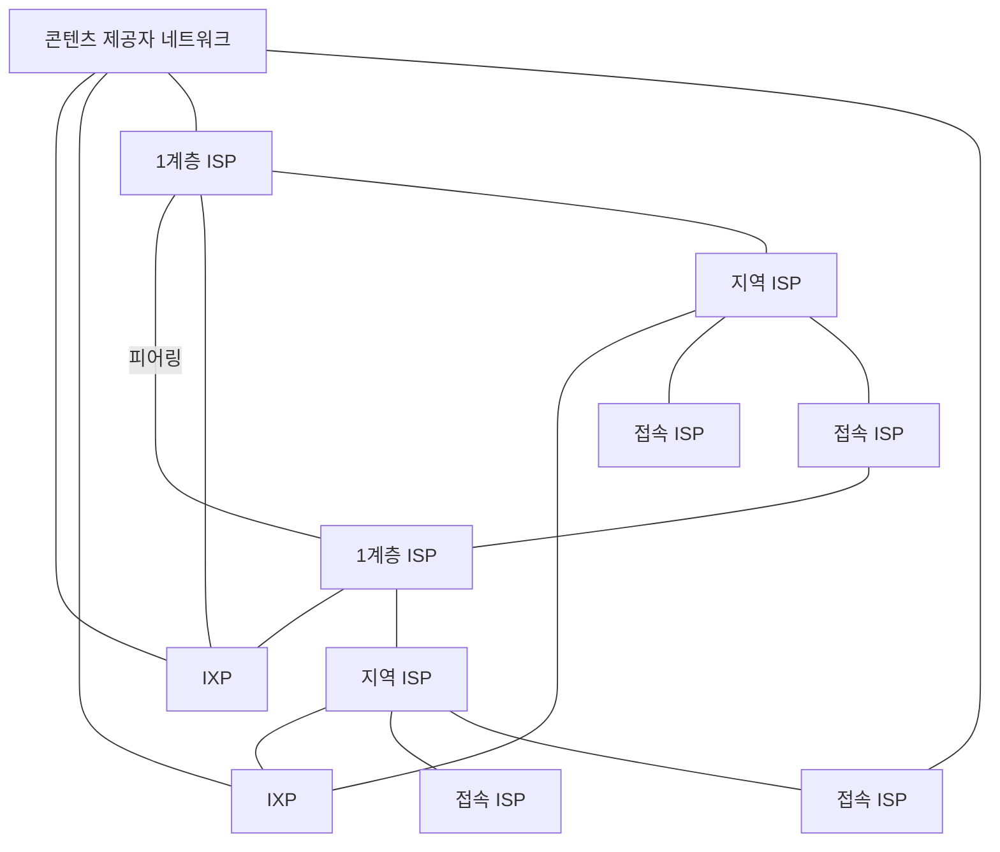

*그림 23. 오늘날 인터넷의 ISP 상호 연결 구조*

그림 23에서 접속 ISP와 지역 ISP를 잇는 선은 고객과 제공자의 관계이고, 접속 ISP 하나가 두 제공자에 연결된 것은 멀티홈이다. 요약하면 오늘날의 인터넷은 12개 남짓한 1계층 ISP와 수십만 개의 하위 ISP로 이루어진 복잡한 구조이다. 하위 ISP는 상위 ISP에 연결되고 상위 ISP끼리 서로 연결되며, 사용자와 콘텐츠 제공자는 하위 ISP의 고객이고 하위 ISP는 상위 ISP의 고객이다.

Forouzan은 같은 구조를 백본 ISP(backbone ISP), 지역 ISP(regional ISP), 로컬 ISP(local ISP)의 세 층으로 설명한다. 백본 ISP는 10 Gbps 같은 높은 속도로 동작하며 보통 제3자가 운영하는 NAP(network access point)라는 교환 지점으로 서로 연결되고, 일부 지역 ISP는 피어링 지점(peering point)이라는 사설 교환 지점으로 서로 연결된다. 로컬 ISP는 최종 사용자에게 직접 서비스를 제공하며, 인터넷 서비스만 제공하는 회사일 수도 있고 직원에게 서비스를 제공하는 기업이나 대학일 수도 있다.

| Kurose의 이름 | Forouzan의 이름 | 역할 |
|:-----|:-----|:-----|
| 1계층 ISP | 백본 ISP | 최상위 층, 서로 무정산 피어링, 요금을 내지 않음 |
| 지역 ISP | 지역 ISP | 접속 ISP와 1계층 ISP를 연결하는 중간 층 |
| 접속 ISP | 로컬 ISP | 최종 사용자와 콘텐츠 제공자를 연결 |
| IXP | NAP, 피어링 지점 | 여러 ISP가 모여 트래픽을 교환하는 지점 |

*표 10. ISP 계층의 이름 대응*

---

<br>

## 7. 지연, 손실, 처리량

이상적인 인터넷은 두 종단 시스템 사이에 원하는 만큼의 데이터를 즉시, 손실 없이 옮길 것이다. 그러나 실제 네트워크는 종단 시스템 사이의 **처리량(throughput)**, 곧 초당 전달할 수 있는 데이터의 양을 제한하고, 지연을 만들며, 패킷을 잃는다. 이 절은 이 세 가지를 정량적으로 다룬다.

### 7.1 노드 지연의 네 가지 요소

패킷은 출발지 호스트에서 출발하여 여러 라우터를 거쳐 목적지 호스트에 도착한다. 경로의 각 노드(호스트나 라우터)에서 패킷은 여러 종류의 지연을 겪으며, 그중 중요한 것이 처리 지연, 큐잉 지연, 전송 지연, 전파 지연이다. 이 넷을 합한 것이 **노드 지연(nodal delay)** 이다.


*그림 24. 라우터 A에서 생기는 노드 지연의 네 요소*

> **용어 정의:** **처리 지연(processing delay)** 은 라우터가 패킷의 헤더를 검사하고 패킷을 어디로 보낼지 정하는 데 걸리는 시간이며, 앞 노드에서 오는 동안 생긴 비트 오류를 검사하는 시간도 포함할 수 있다.

> **용어 정의:** **큐잉 지연(queuing delay)** 은 패킷이 출력 링크로 전송되기를 기다리며 큐에서 머무는 시간이다.

앞의 두 지연은 패킷이 라우터 안에서 처리되고 기다리는 시간이고, 뒤의 두 지연은 패킷을 링크로 내보내고 링크를 따라 보내는 데 걸리는 시간이다.

> **용어 정의:** **전송 지연(transmission delay)** 은 패킷의 모든 비트를 링크로 내보내는 데 걸리는 시간이며, 패킷 길이가 $L$비트이고 링크 전송률이 $R$ bps이면 $L/R$이다.

> **용어 정의:** **전파 지연(propagation delay)** 은 비트가 링크의 시작점에서 다음 노드까지 이동하는 데 걸리는 시간이며, 두 노드 사이의 거리가 $d$, 매체의 전파 속도가 $s$이면 $d/s$이다.

전파 속도는 링크의 물리 매체(광섬유, 꼬임 쌍선 등)에 따라 다르며 2 × 10⁸ m/s\~3 × 10⁸ m/s로 빛의 속도와 같거나 조금 느리다. 네 지연을 각각 $d_{\text{proc}}$, $d_{\text{queue}}$, $d_{\text{trans}}$, $d_{\text{prop}}$라 하면 노드 지연은 다음과 같다.

```math
d_{\text{nodal}} = d_{\text{proc}} + d_{\text{queue}} + d_{\text{trans}} + d_{\text{prop}}
```

| 지연 | 원인 | 계산 | 일반적인 크기 |
|:-----|:-----|:-----|:-----|
| 처리 지연 | 헤더 검사, 출력 링크 결정, 비트 오류 검사 | 라우터 성능에 의존 | 고속 라우터에서 마이크로초 이하 |
| 큐잉 지연 | 출력 큐에서 앞선 패킷을 기다림 | 트래픽의 세기와 성격에 의존 | 마이크로초\~밀리초 |
| 전송 지연 | 패킷의 모든 비트를 링크로 내보냄 | $L/R$ | 마이크로초\~밀리초 |
| 전파 지연 | 신호가 매체를 따라 이동 | $d/s$ | 광역 네트워크에서 밀리초 |

*표 11. 노드 지연의 네 요소*

네 요소의 비중은 상황에 따라 크게 다르다. 같은 대학 캠퍼스의 두 라우터를 잇는 링크에서 $d_{\text{prop}}$는 몇 마이크로초로 무시할 수 있지만, 정지 궤도 위성 링크에서는 수백 밀리초로 노드 지연의 대부분을 차지한다. $d_{\text{trans}}$도 10 Mbps 이상의 LAN에서는 무시할 만하지만, 느린 다이얼업 모뎀 링크로 큰 패킷을 보내면 수백 밀리초가 될 수 있다. $d_{\text{proc}}$는 대개 무시할 만하지만 라우터가 패킷을 포워딩할 수 있는 최대 속도인 라우터의 최대 처리량에 큰 영향을 준다.

### 7.2 전송 지연과 전파 지연의 구별

처음 배우는 사람은 전송 지연과 전파 지연을 자주 혼동한다. 전송 지연은 라우터가 패킷을 밀어내는 데 걸리는 시간으로, 패킷 길이와 링크 전송률의 함수이고 두 라우터 사이의 거리와는 무관하다. 전파 지연은 비트 하나가 한 라우터에서 다음 라우터까지 가는 시간으로, 거리의 함수이고 패킷 길이나 링크 전송률과는 무관하다.

Kurose의 **자동차 행렬(caravan) 비유**가 이 차이를 보여 준다. 고속도로에 100 km마다 요금소가 있고, 요금소 사이의 구간은 링크, 요금소는 라우터에 해당한다. 자동차는 요금소를 나오는 즉시 시속 100 km로 달린다(전파). 자동차 10대가 정해진 순서로 행렬을 이루어 함께 다니며, 자동차 하나는 비트, 행렬은 패킷에 해당한다. 요금소는 자동차 한 대를 12초에 처리(전송)하고, 행렬의 첫 차는 나머지 9대가 모두 도착하여 뒤에 줄을 설 때까지 요금소 입구에서 기다린다(저장 후 전달).

- 요금소가 행렬 전체를 고속도로로 내보내는 시간: (10대) / (분당 5대) = 2분, 전송 지연에 해당
- 자동차 한 대가 다음 요금소까지 가는 시간: 100 km / (시속 100 km) = 1시간, 전파 지연에 해당
- 행렬이 한 요금소 앞에 모두 모인 때부터 다음 요금소 앞에 모두 모일 때까지: 2분 + 60분 = 62분

이제 자동차가 시속 1,000 km로 달리고 요금소가 1분에 한 대를 처리한다고 가정한다. 요금소 사이를 가는 데 6분, 행렬 전체를 처리하는 데 10분이 걸리므로, 행렬의 마지막 차들이 첫 요금소를 떠나기 전에 앞쪽 차들이 다음 요금소에 도착한다. 패킷 교환 네트워크에서도 패킷의 앞쪽 비트가 다음 라우터에 도착했을 때 뒤쪽 비트는 아직 앞 라우터에서 전송을 기다리고 있을 수 있다.

**예제.** 1,500바이트 패킷을 10 Mbps 링크로 2,000 km 떨어진 노드에 보내고 전파 속도는 2 × 10⁸ m/s이다. 전송 지연은 12,000 / 10⁷ = 1.2 ms, 전파 지연은 2 × 10⁶ / (2 × 10⁸) = 10 ms이므로, 처리 지연과 큐잉 지연을 무시하면 노드 지연은 11.2 ms이다.

### 7.3 큐잉 지연과 트래픽 강도

큐잉 지연은 다른 세 지연과 달리 패킷마다 다르다. 예를 들어 빈 큐에 패킷 10개가 동시에 도착하면 처음 전송되는 패킷은 큐잉 지연이 없지만 마지막 패킷은 앞의 9개가 전송될 때까지 기다린다. 그래서 큐잉 지연은 평균, 분산, 특정 값을 넘을 확률 같은 통계량으로 나타낸다.

큐잉 지연의 크기는 트래픽이 큐에 도착하는 속도, 링크의 전송률, 그리고 트래픽이 주기적으로 오는지 몰려서 오는지에 달려 있다. 패킷이 큐에 도착하는 평균 속도를 $a$(packets/s), 모든 패킷의 길이를 $L$비트, 링크 전송률을 $R$ bps라 하면, 비트가 큐에 도착하는 평균 속도는 $La$ bps이다. 큐의 크기가 무한하다고 가정한다.

> **용어 정의:** **트래픽 강도(traffic intensity)** 는 비트가 큐에 도착하는 평균 속도와 비트가 큐에서 나가는 속도의 비 $La/R$이다.

$La/R > 1$이면 비트가 큐에 도착하는 평균 속도가 큐에서 나가는 속도보다 크므로 큐가 끝없이 자라고 큐잉 지연은 무한대에 가까워진다. 그래서 트래픽 공학의 황금률은 **트래픽 강도가 1을 넘지 않도록 시스템을 설계하라**는 것이다.

$La/R \le 1$이면 도착 트래픽의 성격이 큐잉 지연을 좌우한다. 패킷이 $L/R$초마다 하나씩 주기적으로 도착하면 모든 패킷이 빈 큐에 도착하므로 큐잉 지연이 없다. 반면 패킷 $N$개가 $(L/R)N$초마다 한꺼번에 도착하면, 첫 패킷은 큐잉 지연이 없고, 둘째 패킷은 $L/R$, 일반적으로 $n$번째 패킷은 $(n-1)L/R$의 큐잉 지연을 겪는다. 이때 평균 큐잉 지연은 다음과 같다.

```math
\frac{1}{N}\sum_{n=1}^{N} (n-1)\frac{L}{R} = \frac{N-1}{2}\cdot\frac{L}{R}
```

예를 들어 $N = 5$이면 평균 큐잉 지연은 $2L/R$이다. 트래픽 강도는 두 경우 모두 1이지만 몰려서 오는 경우에만 큐잉 지연이 생긴다.

실제로는 도착 과정이 무작위여서 패킷 사이의 간격이 일정하지 않으므로, $La/R$만으로 큐잉 지연의 통계를 완전히 나타낼 수는 없다. 그래도 $La/R$은 직관을 준다. 트래픽 강도가 0에 가까우면 패킷이 드물게 도착하여 큐에서 다른 패킷을 만날 가능성이 작으므로 평균 큐잉 지연은 0에 가깝다. 트래픽 강도가 1에 가까우면 도착 속도가 일시적으로 전송 용량을 넘는 구간마다 큐가 생기고, 평균 큐 길이가 점점 길어진다.

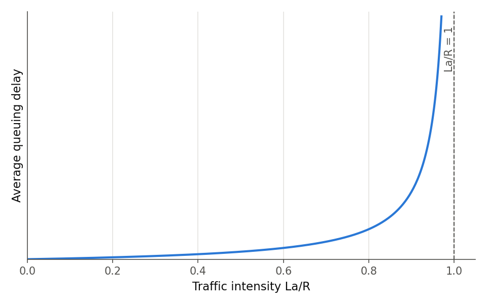

*그림 25. 트래픽 강도에 따른 평균 큐잉 지연*

그림 25는 평균 큐잉 지연이 트래픽 강도에 따라 어떻게 변하는지를 정성적으로 보여 준다. 트래픽 강도가 1에 가까워지면 평균 큐잉 지연이 급격히 증가하여, 트래픽 강도가 조금만 늘어도 지연은 훨씬 큰 비율로 늘어난다. 평소에 막히는 도로에서 차량이 조금만 더 늘어도 지연이 크게 늘어나는 것과 같다.

**예제.** 10 Mbps 링크에 10,000비트 패킷이 초당 평균 800개 도착하면 트래픽 강도는 (10,000 × 800) / 10⁷ = 0.8이다. 큐잉 지연은 1에 가까운 영역의 초입에 있으므로, 도착 속도가 25% 늘어 강도가 1.0이 되면 지연은 크게 증가한다.

### 7.4 패킷 손실

실제 큐는 용량이 유한하다. 그래서 트래픽 강도가 1에 다가가도 지연이 무한대가 되는 대신, 도착한 패킷이 가득 찬 큐를 만나게 된다. 패킷을 저장할 곳이 없으면 라우터는 그 패킷을 **버린다(drop)**. 종단 시스템의 관점에서 패킷 손실은 패킷이 네트워크 코어로 들어갔지만 목적지에서 나오지 않은 것처럼 보인다. 버려지는 패킷의 비율은 트래픽 강도가 커질수록 늘어난다. 그래서 노드의 성능은 지연뿐 아니라 패킷 손실 확률로도 측정한다. 잃은 패킷은 모든 데이터가 결국 전달되도록 종단 간에 재전송될 수 있으며, 이 방법은 7장과 8장에서 다룬다.

### 7.5 종단 간 지연과 traceroute

출발지 호스트와 목적지 호스트 사이에 라우터가 $N-1$개 있고, 네트워크가 혼잡하지 않아 큐잉 지연을 무시할 수 있으며, 각 라우터와 출발지 호스트의 처리 지연이 $d_{\text{proc}}$, 출력 전송률이 $R$, 각 링크의 전파 지연이 $d_{\text{prop}}$라 한다. 노드 지연이 누적되어 종단 간 지연은 다음과 같다.

```math
d_{\text{end-end}} = N\left(d_{\text{proc}} + d_{\text{trans}} + d_{\text{prop}}\right), \qquad d_{\text{trans}} = \frac{L}{R}
```

이 식은 처리 지연과 전파 지연을 무시한 6.2절의 $NL/R$을 일반화한 것이다. 노드마다 지연이 다르거나 평균 큐잉 지연이 있으면 각 노드의 지연을 따로 더하면 된다.

**traceroute**는 실제 네트워크의 종단 간 지연과 경로를 관찰하는 프로그램이다. 사용자가 목적지 호스트 이름을 지정하면, 출발지 호스트는 목적지로 향하는 특수 패킷을 여러 개 보낸다. 라우터가 $N-1$개라면 출발지는 1부터 $N$까지 표시한 패킷 $N$개를 보낸다. $n$번째 라우터는 $n$으로 표시된 패킷을 받으면 이를 목적지로 포워딩하지 않고 출발지에 메시지를 돌려보내며, 목적지 호스트도 $N$번째 패킷을 받으면 메시지를 돌려보낸다. 출발지는 패킷을 보낸 때부터 응답이 올 때까지의 시간과, 응답한 라우터(또는 목적지)의 이름과 주소를 기록한다. 이렇게 하여 출발지는 경로를 재구성하고 중간 라우터까지의 왕복 지연을 구한다. traceroute는 이 실험을 세 번 반복하므로 실제로는 $3N$개의 패킷을 보낸다. traceroute가 이 동작에 쓰는 ICMP 메시지와 TTL 필드는 16장에서 다룬다.

다음은 Kurose가 제시한 traceroute의 출력이다. 매사추세츠 대학교의 호스트 gaia.cs.umass.edu에서 브루클린의 폴리테크닉 대학교에 있는 호스트 cis.poly.edu까지의 경로를 추적했다.

```text
 1 cs-gw (128.119.240.254) 1.009 ms 0.899 ms 0.993 ms
 2 128.119.3.154 (128.119.3.154) 0.931 ms 0.441 ms 0.651 ms
 3 border4-rt-gi-1-3.gw.umass.edu (128.119.2.194) 1.032 ms 0.484 ms 0.451 ms
 4 acr1-ge-2-1-0.Boston.cw.net (208.172.51.129) 10.006 ms 8.150 ms 8.460 ms
 5 agr4-loopback.NewYork.cw.net (206.24.194.104) 12.272 ms 14.344 ms 13.267 ms
 6 acr2-loopback.NewYork.cw.net (206.24.194.62) 13.225 ms 12.292 ms 12.148 ms
 7 pos10-2.core2.NewYork1.Level3.net (209.244.160.133) 12.218 ms 11.823 ms 11.793 ms
 8 gige9-1-52.hsipaccess1.NewYork1.Level3.net (64.159.17.39) 13.081 ms 11.556 ms 13.297 ms
 9 p0-0.polyu.bbnplanet.net (4.25.109.122) 12.716 ms 13.052 ms 12.786 ms
10 cis.poly.edu (128.238.32.126) 14.080 ms 13.035 ms 12.802 ms
```

출력의 첫 열은 라우터의 번호 $n$, 둘째 열은 라우터의 이름, 셋째 열은 라우터의 주소이고, 마지막 세 열은 세 번의 실험에서 잰 왕복 지연이다. 어떤 라우터에서 응답을 세 개보다 적게 받으면(패킷 손실), traceroute는 그 라우터 번호 뒤에 별표를 찍고 받은 만큼의 왕복 시간만 보여 준다.

이 경로에는 출발지와 목적지 사이에 라우터가 9개 있다. 예를 들어 3번 라우터의 이름은 border4-rt-gi-1-3.gw.umass.edu이고 주소는 128.119.2.194이며, 세 번의 왕복 지연은 1.03 ms, 0.48 ms, 0.45 ms이다. 이 왕복 지연에는 전송 지연, 전파 지연, 라우터의 처리 지연, 큐잉 지연이 모두 포함된다. 큐잉 지연은 시간에 따라 변하므로, $n$번째 라우터로 보낸 패킷의 왕복 지연이 $n+1$번째 라우터로 보낸 패킷의 왕복 지연보다 길 수도 있다. 실제로 위 출력에서 6번 라우터까지의 지연이 7번 라우터까지의 지연보다 크다. 또한 4번 라우터에서 지연이 약 1 ms에서 약 10 ms로 크게 늘어나는데, 이는 패킷이 대학 네트워크를 벗어나 보스턴의 ISP 구간으로 들어가는 지점이다.

종단 시스템 자체에서도 지연이 생긴다. Wi-Fi나 케이블 모뎀처럼 공유 매체를 쓰는 종단 시스템은 다른 종단 시스템과 매체를 나누어 쓰는 프로토콜의 일부로 일부러 전송을 늦출 수 있다(18장). 인터넷 전화(VoIP)에서는 송신 쪽이 부호화한 음성으로 패킷을 채운 뒤에 보내므로, 패킷을 채우는 시간인 **패킷화 지연(packetization delay)** 이 통화 품질에 영향을 줄 수 있다.

### 7.6 처리량

지연과 손실 외에 중요한 성능 척도가 **종단 간 처리량**이다. 호스트 A에서 호스트 B로 큰 파일을 보낸다고 가정한다.

> **용어 정의:** **처리량(throughput)** 은 수신 호스트가 데이터를 받는 속도(bps)이며, 어느 순간의 속도를 **순간 처리량**, 파일 $F$비트를 받는 데 $T$초가 걸렸을 때의 $F/T$를 **평균 처리량**이라 한다.

인터넷 전화처럼 지연이 짧고 순간 처리량이 일정한 문턱(어떤 인터넷 전화 응용은 24 kbps, 어떤 실시간 비디오 응용은 256 kbps)을 넘어야 하는 응용도 있고, 파일 전송처럼 지연은 중요하지 않고 처리량이 높을수록 좋은 응용도 있다.

서버와 클라이언트가 라우터 하나를 사이에 두고 두 링크로 연결되어 있다고 가정한다. 서버와 라우터 사이의 전송률을 $R_s$, 라우터와 클라이언트 사이의 전송률을 $R_c$라 하고, 네트워크에는 이 전송만 있다고 가정한다. 비트를 유체, 링크를 파이프로 생각하면, 서버는 $R_s$보다 빠르게 비트를 내보낼 수 없고 라우터는 $R_c$보다 빠르게 비트를 전달할 수 없다. $R_s < R_c$이면 처리량은 $R_s$이고, $R_c < R_s$이면 라우터에서 비트가 쌓이며 처리량은 $R_c$이다. 따라서 처리량은 **병목 링크(bottleneck link)** 의 전송률 $\min\lbrace R_s, R_c \rbrace$이다. 전송률이 $R_1, R_2, \dots, R_N$인 링크 $N$개로 이루어진 경로에서도 처리량은 $\min\lbrace R_1, R_2, \dots, R_N \rbrace$이다. 큰 파일 $F$비트를 보내는 시간은 대략 $F/\min\lbrace R_s, R_c \rbrace$이다. 예를 들어 3,200만 비트 MP3 파일을 $R_s$ = 2 Mbps인 서버에서 $R_c$ = 1 Mbps 접속 링크로 받으면 32초가 걸린다. 이 식은 저장 후 전달 지연, 처리 지연, 프로토콜 문제를 무시한 근사이다.

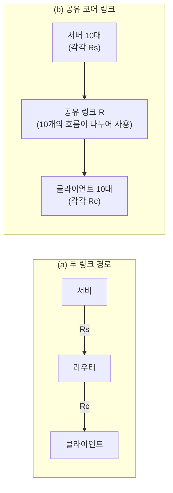

*그림 26. 두 링크 경로와 공유 코어 링크에서의 처리량*

오늘날의 인터넷 코어는 고속 링크로 넉넉하게 구축되어 혼잡이 적다. 서버와 클라이언트가 각각 $R_s$와 $R_c$의 접속 링크로 연결되고 코어의 모든 링크가 이보다 훨씬 빠르다면, 처리량은 다시 $\min\lbrace R_s, R_c \rbrace$이다. 따라서 오늘날 인터넷에서 처리량을 제한하는 것은 대개 **접속 네트워크**이다.

그러나 코어 링크를 여러 흐름이 공유하면 사정이 달라진다. 서버 10대와 클라이언트 10대가 동시에 다운로드 10개를 진행하고, 이 10개의 다운로드가 모두 전송률 $R$인 코어 링크 하나를 지나며, 공유 링크가 전송률을 10개의 다운로드에 똑같이 나눈다고 가정한다. $R_s$ = 2 Mbps, $R_c$ = 1 Mbps, $R$ = 5 Mbps이면 각 다운로드가 공유 링크에서 얻는 속도는 5 Mbps / 10 = 500 kbps이므로, 병목은 접속 네트워크가 아니라 코어의 공유 링크가 되고 다운로드마다 처리량은 500 kbps로 줄어든다. 이처럼 처리량은 경로에 있는 링크의 전송률뿐 아니라 그 링크를 함께 지나는 다른 트래픽에도 좌우된다. 전송률이 높은 링크도 많은 흐름이 지나면 병목이 될 수 있다.

> **핵심:** 다른 트래픽이 없으면 처리량은 경로에서 가장 느린 링크의 전송률이다. 다른 흐름과 링크를 공유하면 그 링크에서 각 흐름이 얻는 몫이 병목이 될 수 있다.

---

<br>

## 8. 공격받는 네트워크

인터넷은 기업, 대학, 정부 기관과 개인의 활동에 없어서는 안 될 기반이 되었다. 그만큼 인터넷에 연결된 컴퓨터를 망가뜨리고, 사생활을 침해하고, 인터넷 서비스를 마비시키려는 공격자도 있다. 네트워크 보안은 공격자가 네트워크를 공격하는 방법과, 그 공격을 막거나 처음부터 공격에 면역인 구조를 설계하는 방법을 다루며, 26장에서 자세히 다룬다. 여기서는 대표적인 공격을 개관한다.

**악성 코드(malware).** 인터넷에서 유용한 데이터와 함께 악성 코드도 장치에 들어와 감염시킬 수 있다. 악성 코드는 파일을 지우거나, 주민 번호, 비밀번호, 키 입력 같은 개인 정보를 수집하는 스파이웨어를 설치하여 정보를 공격자에게 보낸다. 감염된 호스트는 공격자가 통제하는 수천 대의 감염 장치 네트워크인 **봇넷(botnet)** 에 편입되어 스팸 메일 배포나 분산 서비스 거부 공격에 이용될 수 있다. 오늘날의 악성 코드는 대부분 **자기 복제**를 하여, 한 호스트를 감염시키면 그 호스트에서 다른 호스트로 퍼지므로 지수적으로 빠르게 확산된다. 악성 코드는 바이러스나 웜의 형태로 퍼진다.

- **바이러스(virus):** 장치를 감염시키려면 사용자의 어떤 상호 작용이 필요하다. 전형적인 예는 악성 실행 코드가 든 전자 메일 첨부 파일이며, 사용자가 첨부 파일을 열면 악성 코드가 실행되고 주소록의 모든 수신자에게 같은 첨부 파일을 보낼 수 있다.
- **웜(worm):** 사용자의 명시적인 상호 작용 없이 장치에 들어온다. 공격자가 취약한 네트워크 응용에 악성 코드를 보내면 응용이 이를 받아 실행할 수 있고, 새로 감염된 장치의 웜은 같은 취약 응용을 실행하는 다른 호스트를 찾아 자신을 복제해 보낸다.

**서버와 네트워크 기반 구조 공격.** **서비스 거부(denial-of-service, DoS) 공격**은 네트워크, 호스트, 기반 구조를 정당한 사용자가 쓸 수 없게 만든다. 웹 서버, 메일 서버, DNS 서버(5장), 기관 네트워크가 모두 DoS 공격의 대상이 될 수 있다.

> **용어 정의:** **서비스 거부 공격(denial-of-service attack)** 은 네트워크, 호스트, 그 밖의 기반 구조를 정당한 사용자가 이용할 수 없게 만드는 공격이다.

대부분의 DoS 공격은 세 범주로 나뉜다.

| 유형 | 방법 | 결과 |
|:-----|:-----|:-----|
| 취약점 공격(vulnerability attack) | 대상 호스트의 취약한 응용이나 운영 체제에 잘 만든 메시지 몇 개를 보냄 | 서비스가 멈추거나 호스트가 다운됨 |
| 대역폭 범람(bandwidth flooding) | 대상 호스트에 엄청난 양의 패킷을 보냄 | 대상의 접속 링크가 막혀 정당한 패킷이 서버에 닿지 못함 |
| 연결 범람(connection flooding) | 대상 호스트에 반쯤 열린 TCP 연결이나 완전히 열린 TCP 연결을 대량으로 만듦 | 가짜 연결을 처리하느라 정당한 연결을 받지 못함 |

*표 12. DoS 공격의 세 범주*

대역폭 범람 공격에서 서버의 접속 전송률이 $R$ bps라면, 공격자는 대략 $R$ bps의 트래픽을 보내야 피해를 줄 수 있다. 공격 트래픽이 한 출발지에서 온다면 상위 라우터가 이를 탐지하여 그 출발지의 트래픽을 막을 수 있다. 그래서 공격자는 **분산 서비스 거부(distributed DoS, DDoS) 공격**을 쓴다. DDoS 공격은 여러 출발지를 통제하여 각 출발지가 대상에 트래픽을 퍼붓게 하며, 통제하는 출발지들의 총 트래픽이 약 $R$이면 서비스를 마비시킬 수 있다. 수천 대의 감염 호스트로 이루어진 봇넷을 이용한 DDoS 공격은 흔하며, 하나의 호스트에서 오는 DoS 공격보다 탐지하고 막기가 훨씬 어렵다.

**패킷 스니핑(packet sniffing).** 무선 송신기 근처에 수동 수신기를 두면 송신되는 모든 패킷의 사본을 얻을 수 있다. 이런 패킷에는 비밀번호, 주민 번호, 영업 비밀, 개인 메시지가 담길 수 있다. 지나가는 모든 패킷의 사본을 기록하는 수동 수신기를 **패킷 스니퍼(packet sniffer)** 라 한다. 스니퍼는 유선 환경에서도 쓰일 수 있다. 많은 이더넷 LAN처럼 방송형 유선 환경에서는 LAN으로 방송되는 패킷의 사본을 얻을 수 있고, 4.3절에서 본 케이블 접속도 패킷을 방송하므로 스니핑에 취약하다. 기관의 접속 라우터나 접속 링크에 접근한 공격자는 그 기관을 드나드는 모든 패킷을 복사할 수 있다. 스니퍼는 패킷을 채널에 넣지 않는 수동 장치여서 탐지하기 어려우며, 가장 좋은 방어책은 암호화이다.

**IP 스푸핑(IP spoofing).** 임의의 출발지 주소, 패킷 내용, 목적지 주소를 가진 패킷을 만들어 인터넷으로 보내기는 놀라울 만큼 쉽다. 가짜 출발지 주소를 가진 패킷을 보내는 것을 **IP 스푸핑**이라 하며, 공격자는 다른 사용자로 위장하여 포워딩 테이블을 바꾸라는 명령 같은 것을 보낼 수 있다. 이를 막으려면 메시지가 실제로 주장하는 곳에서 왔는지 확인하는 **종단점 인증(end-point authentication)** 이 필요하며, 26장에서 다룬다.

---

<br>

## 9. 인터넷의 역사

| 시기 | 사건 |
|:-----|:-----|
| 1960년대 초 | 전화망이 세계의 지배적 통신망이던 시기에, 서로의 연구를 모르던 세 연구 그룹이 회선 교환의 대안으로 패킷 교환을 고안함: MIT 대학원생 클라인록(Leonard Kleinrock)의 첫 패킷 교환 연구, 1964년 랜드 연구소의 배런(Paul Baran), 영국 국립 물리 연구소의 데이비스(Donald Davies)와 스캔틀버리(Roger Scantlebury) |
| 1967년 | ARPA가 ACM 학회에서 ARPANET 계획을 발표, 각 호스트를 IMP(interface message processor)라는 전용 컴퓨터에 연결하고 IMP끼리 연결하는 구조 |
| 1969년 | UCLA, UCSB, SRI, 유타 대학교의 네 노드로 ARPANET이 실현됨, 호스트 사이의 통신은 NCP(Network Control Protocol)가 담당 |
| 1972년 | ARPANET이 약 15개 노드로 성장하고 칸(Robert Kahn)이 처음 공개 시연, 톰린슨(Ray Tomlinson)이 첫 전자 메일 프로그램을 작성, 서프(Vinton Cerf)와 칸이 서로 다른 네트워크를 연결하는 연구를 시작 |
| 1970년대 | 첫 다중 접근 프로토콜인 ALOHA, 이를 바탕으로 멧커프(Robert Metcalfe)와 보그스(David Boggs)가 만든 이더넷 등장, 1970년대 말까지 TCP, UDP, IP의 개념이 자리 잡음 |
| 1973년 | 서프와 칸의 논문이 캡슐화, 데이터그램, 게이트웨이의 기능을 포함한 TCP의 개념을 제시, 오류 정정의 책임을 IMP에서 호스트로 옮김 |
| 1977년 | ARPANET, 패킷 무선, 패킷 위성의 세 네트워크로 이루어진 인터넷을 시연, 그 뒤 TCP를 상위 기능을 맡는 TCP와 데이터그램 라우팅을 맡는 IP로 분리 |
| 1981년 | UC 버클리가 UNIX에 TCP/IP를 포함, NSF가 후원하는 CSNET 설립 |
| 1983-01-01 | TCP/IP가 NCP를 대신하여 ARPANET의 공식 호스트 프로토콜이 됨, 같은 해 ARPANET이 군용 MILNET과 비군용 ARPANET으로 분리 |
| 1986년 | NSF가 슈퍼컴퓨터 센터를 연결하는 NSFNET을 만듦(T-1 백본) |
| 1980년대 말 | 호스트 기반 혼잡 제어가 TCP에 추가됨, 공용 인터넷에 연결된 호스트가 10만 대에 이름 |
| 1989\~1991년 | 버너스리(Tim Berners-Lee)가 CERN에서 월드 와이드 웹을 발명 |
| 1990년 | ARPANET이 공식적으로 퇴역 |
| 1991년 | NSFNET이 상업적 사용 제한을 해제, IBM, Merit, MCI가 고속 백본 ANSNET을 구축 |
| 1995년 | NSFNET이 퇴역하고(Forouzan은 연구용 네트워크로 돌아갔다고 서술) 상업 ISP가 백본 트래픽을 운반, 대학생들이 넷스케이프 브라우저로 웹을 일상적으로 사용 |

*표 13. 인터넷의 주요 연혁*

---

<br>

## 요약

| 개념 | 핵심 요약 |
|:-----|:-----|
| 인터넷 | 종단 시스템, 통신 링크, 패킷 스위치, ISP로 이루어진 네트워크의 네트워크이며, 분산 응용에 소켓 인터페이스로 서비스를 제공하는 기반 구조이다. |
| 프로토콜 | 메시지의 형식과 순서, 메시지 송수신과 사건에 따른 행동을 정하며, 핵심 요소는 구문, 의미, 타이밍이다. |
| 표준 | 상호 운용성을 보장하며, 인터넷 표준은 IETF가 RFC로 발행하고 성숙 단계와 요구 단계로 분류된다. |
| 접속 네트워크 | 종단 시스템을 가장자리 라우터에 연결하며, 다이얼업, DSL, 케이블(HFC), FTTH, 이더넷, Wi-Fi, 3G와 LTE가 있다. |
| ADSL | 가입자 회선을 음성, 상향, 하향 채널로 나누어 비대칭 전송을 하며, 이론 속도는 상향 1.44 Mbps, 하향 13.4 Mbps이다. |
| 케이블 접속 | 5\~750 MHz 대역을 상향, 비디오, 하향 대역으로 나누고, 상향과 하향 채널을 가입자들이 공유한다. |
| 물리 매체 | 꼬임 쌍선, 동축 케이블, 광섬유 같은 유도 매체와 지상 무선, 위성 같은 비유도 매체로 나뉜다. |
| 패킷 교환 | 자원을 예약하지 않고 패킷 단위로 저장 후 전달하며, 링크 $N$개를 지나는 패킷 하나의 지연은 $NL/R$이다. |
| 회선 교환 | 설정 단계에서 FDM이나 TDM으로 자원을 예약하여 일정한 전송률을 보장하지만 쉬는 동안의 자원을 낭비한다. |
| 네트워크의 네트워크 | 접속 ISP, 지역 ISP, 1계층 ISP가 고객과 제공자 관계를 이루고, PoP, 멀티홈, 피어링, IXP, 콘텐츠 제공자 네트워크가 더해진다. |
| 노드 지연 | 처리 지연, 큐잉 지연, 전송 지연 $L/R$, 전파 지연 $d/s$의 합이다. |
| 트래픽 강도 | $La/R$이며, 1에 가까워지면 평균 큐잉 지연이 급격히 늘고 1을 넘으면 큐가 끝없이 자란다. |
| 처리량 | 다른 트래픽이 없으면 경로의 병목 링크 전송률이며, 오늘날에는 대개 접속 네트워크가 병목이다. |
| 네트워크 공격 | 악성 코드(바이러스, 웜, 봇넷), DoS와 DDoS, 패킷 스니핑, IP 스푸핑이 대표적이다. |

---

<br>

## 점검 문제

1. **저장 후 전달 지연:** 8,000비트 패킷 하나를 전송률이 모두 2 Mbps인 링크 3개로 보낸다. 전파 지연, 처리 지연, 큐잉 지연을 무시할 때 종단 간 지연을 구하라. 같은 패킷을 4개 연달아 보내면 마지막 패킷은 언제 도착하는가?

   <details>
   <summary>정답</summary>

   링크 하나의 전송 지연은 8,000 / (2 × 10⁶) = 4 ms이고, 저장 후 전달이므로 패킷 하나의 종단 간 지연은 3 × 4 = 12 ms이다. 패킷 4개를 보내면 마지막 패킷은 (N + P - 1)L/R = (3 + 4 - 1) × 4 ms = 24 ms에 도착한다.

   </details>

2. **회선 교환과 패킷 교환:** 사용자들이 1 Mbps 링크를 공유하고, 각 사용자는 활동할 때 100 kbps로 데이터를 만들며 시간의 10%만 활동한다. 회선 교환에서 수용할 수 있는 사용자 수를 구하라. 패킷 교환에서 사용자가 10명일 때와 35명일 때, 동시에 11명 이상이 활동할 확률은 각각 얼마인가?

   <details>
   <summary>정답</summary>

   회선 교환에서는 사용자마다 100 kbps를 예약하므로 1 Mbps / 100 kbps = 10명을 수용한다. 사용자가 10명이면 11명 이상이 동시에 활동할 수 없으므로 확률은 0이다. 35명이면 활동하는 사용자 수가 이항 분포 B(35, 0.1)를 따르므로 11명 이상일 확률은 약 0.0004이다. 따라서 패킷 교환은 거의 같은 성능으로 세 배가 넘는 사용자를 수용한다.

   </details>

3. **전송 지연과 전파 지연:** 두 호스트가 2,500 km 떨어져 있고 전파 속도는 2.5 × 10⁸ m/s이다. 1,000바이트 패킷을 2 Mbps 링크로 보낼 때 전파 지연과 전송 지연을 구하고, 링크 전송률을 두 배로 높이면 어느 지연이 바뀌는지 설명하라.

   <details>
   <summary>정답</summary>

   전파 지연은 2.5 × 10⁶ / (2.5 × 10⁸) = 10 ms이고, 전송 지연은 8,000 / (2 × 10⁶) = 4 ms이다. 전송률을 4 Mbps로 높이면 전송 지연만 2 ms로 줄고, 전파 지연은 거리와 매체에만 의존하므로 10 ms 그대로이다.

   </details>

4. **트래픽 강도:** 트래픽 강도 $La/R$이 1에 가까워질 때와 1을 넘을 때 큐잉 지연이 각각 어떻게 되는지 설명하고, 트래픽 강도가 1보다 작아도 큐잉 지연이 생길 수 있는 이유를 들라.

   <details>
   <summary>정답</summary>

   1에 가까워지면 도착 속도가 일시적으로 전송 용량을 넘는 구간이 자주 생겨 평균 큐 길이와 평균 큐잉 지연이 급격히 늘어난다. 1을 넘으면 평균 도착 속도가 전송 속도보다 크므로 큐가 끝없이 자라고, 실제로는 큐가 유한하므로 패킷 손실이 늘어난다. 1보다 작아도 패킷이 몰려서 도착하면 뒤에 도착한 패킷은 앞 패킷이 전송될 때까지 기다리므로 큐잉 지연이 생긴다. 예를 들어 N개가 동시에 도착하면 n번째 패킷은 (n - 1)L/R을 기다린다.

   </details>

5. **ADSL 용량:** ADSL에서 채널마다 4 kHz를 쓰고 1 Hz당 15비트를 싣는다고 할 때, 하향 데이터 채널 224개의 최대 전송률을 구하라. 실제 하향 속도가 이보다 훨씬 낮은 이유는 무엇인가?

   <details>
   <summary>정답</summary>

   224 × 4,000 × 15 = 13,440,000 bps, 곧 약 13.4 Mbps이다. 실제로는 신호 대 잡음비가 나빠 채널마다 15 bits/Hz를 실을 수 없고, ADSL이 가입자 회선의 상태에 맞추어 전송률을 정하는 적응형 기술이므로 하향 속도는 500 kbps\~8 Mbps 정도에 그친다.

   </details>

6. **공유 링크의 처리량:** 서버 접속 링크 $R_s$ = 2 Mbps, 클라이언트 접속 링크 $R_c$ = 1 Mbps이고, 10개의 다운로드가 5 Mbps 코어 링크 하나를 똑같이 나누어 쓴다. 다운로드마다 처리량을 구하라. 다운로드가 4개뿐이라면 어떻게 되는가?

   <details>
   <summary>정답</summary>

   10개일 때 공유 링크에서 각 다운로드의 몫은 5 / 10 = 0.5 Mbps이고, 이것이 접속 링크보다 작으므로 처리량은 min(2, 1, 0.5) = 500 kbps이다. 4개일 때 몫은 5 / 4 = 1.25 Mbps이므로 처리량은 min(2, 1, 1.25) = 1 Mbps이며, 병목은 다시 클라이언트의 접속 링크가 된다.

   </details>

7. **노드 지연 계산:** 1,500바이트 패킷을 10 Mbps 링크로 2,000 km 떨어진 노드에 보낸다. 전파 속도는 2 × 10⁸ m/s이고 처리 지연과 큐잉 지연은 무시한다. 전송 지연, 전파 지연, 노드 지연을 구하라.

   <details>
   <summary>정답</summary>

   패킷 길이는 1,500 × 8 = 12,000비트이므로 전송 지연은 12,000 / 10⁷ = 1.2 ms이다. 전파 지연은 2 × 10⁶ m를 2 × 10⁸ m/s로 나눈 10 ms이다. 노드 지연은 1.2 + 10 = 11.2 ms이다.

   </details>

8. **병목과 전송 시간:** 서버에서 클라이언트까지의 경로가 100 Mbps, 20 Mbps, 50 Mbps 링크로 이루어져 있다. 다른 트래픽이 없을 때 처리량은 얼마이고, 10 MB 파일을 보내는 데 걸리는 시간은 얼마인가? 1 MB = 10⁶바이트로 계산하고 지연은 무시한다.

   <details>
   <summary>정답</summary>

   처리량은 병목 링크의 전송률인 20 Mbps이다. 10 MB는 80 × 10⁶비트이므로 전송 시간은 80 × 10⁶ / (20 × 10⁶) = 4초이다.

   </details>

---

<br>

## 참고 문헌

1. R. Housley, D. Crocker, and E. Burger, "Reducing the Standards Track to Two Maturity Levels," RFC 6410, Oct. 2011. [Online]. Available: https://www.rfc-editor.org/rfc/rfc6410
