# Chapter 1 — Computer Networks and the Internet

[Repository Guide](../../README.md) | [English](Concepts_Lecture.md) | [한국어](Concepts_Lecture.ko.md)

> **Last Updated:** 2026-11-18
>
> Computer Networking: A Top-Down Approach, Kurose and Ross, Ch 1; TCP/IP Protocol Suite, Forouzan, Ch 1, 3, 4

> **Learning Objectives:**
> 1. Describe the Internet from the viewpoint of its components and from the viewpoint of its services, and give examples of the syntax, semantics, and timing of a protocol
> 2. Explain the kinds of standards organizations and the process by which Internet standards are produced as RFCs
> 3. Compare access networks such as dial-up, DSL, cable, FTTH, Ethernet, and wireless access, together with physical media
> 4. Compare packet switching and circuit switching, and compute store-and-forward delays and the rates of FDM and TDM circuits
> 5. Compute and interpret processing, queuing, transmission, and propagation delays, traffic intensity, end-to-end delay, and throughput
> 6. Explain the main types of attacks on networks and how the Internet has evolved

---

## Table of Contents

- [1. The Concept of the Internet](#1-the-concept-of-the-internet)
  - [1.1 The Internet as Components](#11-the-internet-as-components)
  - [1.2 The Internet as Services](#12-the-internet-as-services)
  - [1.3 Protocols](#13-protocols)
- [2. Protocols and Standards](#2-protocols-and-standards)
  - [2.1 The Need for Standards](#21-the-need-for-standards)
  - [2.2 Standards Organizations](#22-standards-organizations)
  - [2.3 Internet Standards and RFCs](#23-internet-standards-and-rfcs)
  - [2.4 Organizations That Administer the Internet](#24-organizations-that-administer-the-internet)
- [3. The Network Edge](#3-the-network-edge)
  - [3.1 End Systems, Clients, and Servers](#31-end-systems-clients-and-servers)
  - [3.2 The Concept of an Access Network](#32-the-concept-of-an-access-network)
- [4. Access Networks](#4-access-networks)
  - [4.1 Dial-Up and the 56K Modem](#41-dial-up-and-the-56k-modem)
  - [4.2 DSL](#42-dsl)
  - [4.3 Cable Access and HFC](#43-cable-access-and-hfc)
  - [4.4 FTTH and Satellite Access](#44-ftth-and-satellite-access)
  - [4.5 Access in the Enterprise and the Home: Ethernet and Wi-Fi](#45-access-in-the-enterprise-and-the-home-ethernet-and-wi-fi)
  - [4.6 Wide-Area Wireless Access](#46-wide-area-wireless-access)
  - [4.7 Comparison of Access Technologies](#47-comparison-of-access-technologies)
- [5. Physical Media](#5-physical-media)
- [6. The Network Core](#6-the-network-core)
  - [6.1 Switching and the Classification of Switched Networks](#61-switching-and-the-classification-of-switched-networks)
  - [6.2 Packet Switching and Store-and-Forward Transmission](#62-packet-switching-and-store-and-forward-transmission)
  - [6.3 Queuing Delay and Packet Loss](#63-queuing-delay-and-packet-loss)
  - [6.4 Forwarding Tables and Routing Protocols](#64-forwarding-tables-and-routing-protocols)
  - [6.5 Circuit Switching](#65-circuit-switching)
  - [6.6 FDM and TDM](#66-fdm-and-tdm)
  - [6.7 Message Switching and Message Segmentation](#67-message-switching-and-message-segmentation)
  - [6.8 Packet Switching Versus Circuit Switching](#68-packet-switching-versus-circuit-switching)
  - [6.9 A Network of Networks](#69-a-network-of-networks)
- [7. Delay, Loss, and Throughput](#7-delay-loss-and-throughput)
  - [7.1 The Four Components of Nodal Delay](#71-the-four-components-of-nodal-delay)
  - [7.2 Distinguishing Transmission Delay from Propagation Delay](#72-distinguishing-transmission-delay-from-propagation-delay)
  - [7.3 Queuing Delay and Traffic Intensity](#73-queuing-delay-and-traffic-intensity)
  - [7.4 Packet Loss](#74-packet-loss)
  - [7.5 End-to-End Delay and traceroute](#75-end-to-end-delay-and-traceroute)
  - [7.6 Throughput](#76-throughput)
- [8. Networks Under Attack](#8-networks-under-attack)
- [9. History of the Internet](#9-history-of-the-internet)
- [Summary](#summary)
- [Self-Check Questions](#self-check-questions)
- [References](#references)

---

<br>

## 1. The Concept of the Internet

There are two ways to answer the question of what the Internet is. One is to list, piece by piece, the hardware and software components that make up the Internet; the other is to view the Internet as an infrastructure that provides services to distributed applications. This section examines the two views in turn and then defines the protocol, the key concept that appears in both.

### 1.1 The Internet as Components

A **network** is a group of connected, communicating devices such as computers and printers. Two or more networks connected so that they can communicate with each other form an **internet** (an internetwork, with a lowercase i), and the best known of them, the public Internet that connects hundreds of thousands of networks around the world, is written with an uppercase I as the **Internet**. In what follows, "the Internet" refers to the public Internet unless stated otherwise.

The Internet interconnects billions of computing devices throughout the world. These devices were once mostly desktop PCs and servers that store and transmit Web pages and e-mail, but today laptops, smartphones, tablets, TVs, game consoles, thermostats, home appliances, cars, and many other devices are connected to the Internet. In Internet jargon, all of these devices are called **hosts** or **end systems**.

> **Definition:** An **end system** is a device attached at the edge of the Internet that runs application programs; it is also called a host because it hosts (runs) application programs. Desktop computers, servers, and smartphones are all end systems.

End systems are connected together by a network of **communication links** and **packet switches**. Communication links are made of physical media such as coaxial cable, copper wire, optical fiber, and radio spectrum, and different links send data at different rates. The **transmission rate** of a link is expressed in bits per second (bits/s, bps).

When one end system has data to send to another end system, the sending end system divides the data into pieces and adds header bytes to each piece. Each resulting package of information is called a **packet**. Packets travel through the network to the destination end system, where they are reassembled into the original data.

A packet switch takes a packet arriving on one of its incoming links and forwards it on one of its outgoing links. The two most prominent types of packet switches in today's Internet are **routers** and **link-layer switches**. Link-layer switches are typically used in access networks, and routers are typically used in the network core. The sequence of communication links and packet switches that a packet traverses from the sending end system to the receiving end system is called a **route** or **path** through the network.

A packet-switched network resembles a transportation network of highways, roads, and intersections. Suppose a factory needs to move a large amount of cargo to a warehouse thousands of kilometers away. At the factory the cargo is divided and loaded onto a fleet of trucks, each truck independently travels through the road network to the warehouse, and at the warehouse the cargo is grouped with the rest of the shipment. In this analogy, packets correspond to trucks, communication links to highways and roads, packet switches to intersections, and end systems to buildings.

End systems access the Internet through **Internet Service Providers (ISPs)**. Residential ISPs such as local cable or telephone companies, corporate ISPs, university ISPs, ISPs that provide Wi-Fi in airports and cafes, and cellular data ISPs that provide mobile access to smartphones are all ISPs. Each ISP is itself a network of packet switches and communication links. Because end systems must be connected to each other, these lower-tier ISPs must also be interconnected, and they are interconnected through national and international upper-tier ISPs. Section 6.9 examines this structure in detail.

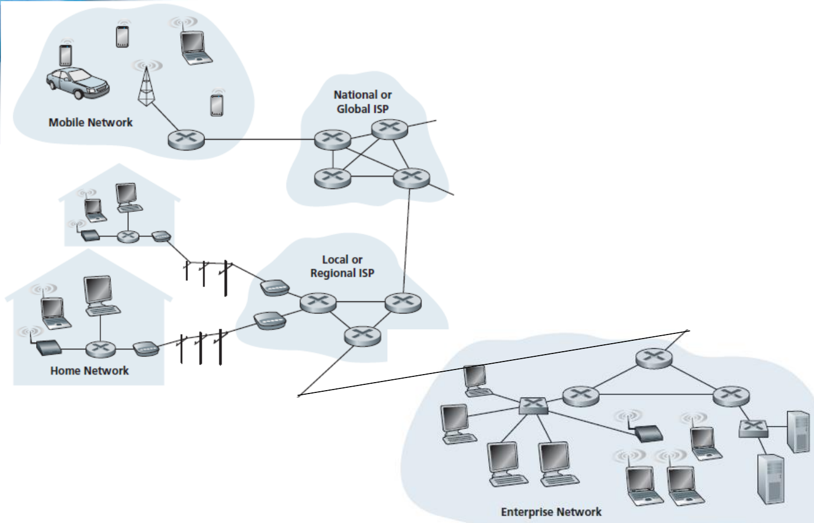

*Figure 1. Pieces of the Internet*

Figure 1 shows a part of the Internet. End systems in a mobile network, a home network, and an enterprise network are connected to each other through local or regional ISPs and national or global ISPs. The icons in the figure represent hosts (end systems), servers, mobile devices, routers, link-layer switches, modems, base stations, smartphones, and cell phone towers. Inside the enterprise network, the device that groups several computers together is a link-layer switch, and the device that joins one network to another is a router.

A modem sits between the home network and the local ISP. Digital data handled by a computer cannot be sent as it is over a telephone line or a cable, so the modem at the home converts the data into a signal suitable for the line, and the modem at the ISP converts the signal back into the original digital data. Sections 4.1 and 4.2 return to this conversion.

Devices on the Internet need addresses to be told apart. A device has a **physical address** that is uniquely assigned to each piece of hardware, and an **IP address** that indicates the location of the device in the whole Internet. Hosts in homes and enterprises usually obtain their IP addresses automatically through a protocol called DHCP. Chapter 2 covers the kinds of addresses, Chapter 12 covers IP addresses and DHCP, and Chapter 19 covers physical addresses.

End systems, packet switches, and other pieces of the Internet run **protocols** that control the sending and receiving of information. The most important protocols in the Internet are the **Transmission Control Protocol (TCP)** and the **Internet Protocol (IP)**. IP specifies the format of the packets exchanged among routers and end systems. The principal protocols of the Internet are collectively known as **TCP/IP**.

### 1.2 The Internet as Services

From the second viewpoint, the Internet is an infrastructure that provides services to applications. Besides traditional applications such as e-mail and Web surfing, messaging, maps with real-time traffic information, music and movie streaming, social networks, video conferencing, and multiplayer games are all Internet applications. Because these applications involve several end systems that exchange data with each other, they are called **distributed applications**.

The important point is that Internet applications run only on end systems and not on the packet switches in the network core. Packet switches help end systems exchange data, but they are not concerned with the applications that produce or consume the data.

Suppose you build a new distributed application. Because applications run on end systems, the developer writes programs for end systems. A way is then needed for a program on one end system to ask the Internet to deliver data to a program on another end system. End systems attached to the Internet provide a **socket interface** for this purpose. The socket interface is a set of rules that the sending program must follow, and if the program follows these rules, the Internet delivers the data to the destination program.

The postal service offers an analogy. To send a letter to Bob, Alice does not throw the letter out of her window; she puts it in an envelope, writes Bob's name, address, and postal code in the center of the envelope, seals it, puts a stamp on it, and drops it in a mailbox. The postal service, too, has an "interface" that its users must follow. Moreover, just as the postal service offers several services such as express delivery, reception confirmation, and ordinary mail, the Internet offers several services to applications, and the developer must choose one of them. Chapters 3 and 6 cover the services the Internet provides.

### 1.3 Protocols

Two people or two devices must follow agreed rules to communicate. Consider asking someone for the time: one first greets the other person with "Hi", asks for the time once the greeting is returned, and the other person tells the time. If the other person replies "Do not bother me" or gives no answer at all, one does not ask for the time or gives up. A human protocol thus has specific messages that are exchanged and specific actions that are taken when a message is received or when no reply arrives within some time. If two people follow different protocols, no conversation takes place.

A network protocol is the same, except that the entities that exchange messages and take actions are hardware or software components of devices such as computers, smartphones, and routers. When a URL is typed into a Web browser, the computer first sends a connection request message to the Web server and waits for a reply. When the server returns a connection reply message, the computer sends the name of the Web page to fetch in a GET message, and the server returns the Web page (file).

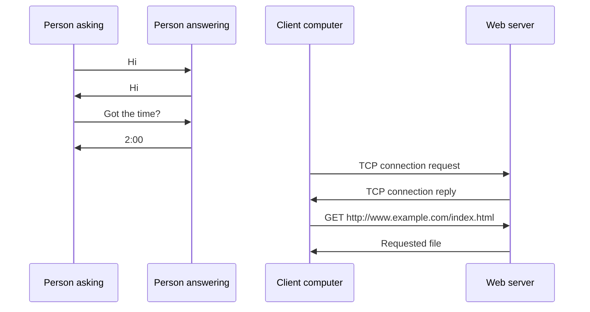

*Figure 2. A human protocol and a computer network protocol*

Every activity in the Internet that involves two or more communicating remote entities is governed by a protocol. Hardware protocols in two physically connected computers control the flow of bits on the wire between their network interface cards, congestion-control protocols in end systems control the rate at which packets are sent, and protocols in routers determine the path a packet takes from source to destination.

> **Definition:** A **protocol** is a set of rules that defines the format and the order of messages exchanged between two or more communicating entities, as well as the actions taken on the transmission or receipt of a message or on another event.

Forouzan regards a protocol as defining what is communicated, how it is communicated, and when it is communicated, and names syntax, semantics, and timing as its key elements. **Syntax** is the structure or format of the data, that is, the order in which the data are presented. For example, a simple protocol might specify that the first 8 bits are the sender address, the next 8 bits are the receiver address, and the rest is the message. Because computers may store bits in different orders, the order in which bits are stored or transmitted is also part of the syntax. **Semantics** is the meaning of each section of bits, that is, how a particular bit pattern is interpreted and what action is taken based on that interpretation. For example, whether an address field means the route to take or the final destination is a matter of semantics. **Timing** is when data should be sent and how fast they can be sent. If a sender produces data at 100 Mbps but the receiver can process data at only 1 Mbps, the receiver is overloaded and most of the data are lost.

| Element | Question it addresses | Example |
|:-----|:-----|:-----|
| Syntax | In what format and order are the data presented | First 8 bits are the sender address, next 8 bits the receiver address, the rest the message |
| Semantics | What does each section of bits mean and what action does it trigger | Whether an address field is the final destination or the route to take |
| Timing | When, and how fast, are data sent | Matching the speeds of a 100 Mbps sender and a 1 Mbps receiver |

*Table 1. The three key elements of a protocol*

> **Key Point:** All communication in a network follows protocols. A protocol specifies the format of messages (syntax), the meaning of messages and the resulting actions (semantics), and when and how fast messages are sent (timing).

---

<br>

## 2. Protocols and Standards

### 2.1 The Need for Standards

For protocols to work, everyone must agree on what each protocol does, so that systems and products made by different companies work together. A **standard** is such an agreed-upon rule. Standards guarantee national and international **interoperability** of data communication technology and processes, that is, the property that different equipment and systems can exchange information and work together, and they are needed to create and maintain an open and competitive market for equipment. They also give manufacturers, vendors, government agencies, and service providers guidelines for the interconnectivity required in international communications.

Data communication standards fall into two categories. A **de facto standard** has become a standard through widespread use without approval by an official body, and is often first created by a manufacturer that wants to define the functionality of a new product. A **de jure standard** is legislated by an officially recognized body.

> **Definition:** A **standard** is a rule, legislated by an official body or agreed upon through widespread use, that lets equipment and systems from different manufacturers work together.

### 2.2 Standards Organizations

Standards are developed through the cooperation of standards creation committees, forums, and government regulatory agencies. Table 2 lists the standards creation committees most often referred to in data communications.

| Organization | Nature | Main activity |
|:-----|:-----|:-----|
| ISO (International Organization for Standardization) | Voluntary multinational body established in 1947, whose members are the standards creation committees of governments | Agreement on international standards, the OSI model for network communications |
| ITU-T (International Telecommunication Union, Telecommunication Standardization Sector) | Committee under the ITU of the United Nations, renamed from CCITT on 1993-03-01 | Standards for telecommunications, including telephone and data systems |
| ANSI (American National Standards Institute) | Private nonprofit body unaffiliated with the US federal government, representing the United States in ISO | Coordinating voluntary standardization in the United States |
| IEEE (Institute of Electrical and Electronics Engineers) | The largest professional engineering society in the world | International standards for computing and communication, the IEEE 802 LAN/MAN Standards Committee that defines Ethernet and Wi-Fi |
| EIA (Electronic Industries Association) | Nonprofit organization aligned with ANSI | Physical connection interfaces and electrical signaling specifications |
| W3C (World Wide Web Consortium) | Founded by Tim Berners-Lee at MIT | Standards related to the Web |
| OMA (Open Mobile Alliance) | Body that gathers the forums of computer networking and wireless technology under one authority | Unified standards for application protocols |

*Table 2. Major standards creation committees in data communications*

Because standards committees must follow procedures, they find it hard to keep pace with technology. **Forums** made up of representatives of interested companies therefore test and evaluate particular technologies and submit their conclusions to the standards bodies. Examples are the Frame Relay Forum, which promotes Frame Relay, the ATM Forum, which promotes ATM technology, and the UPnP (Universal Plug and Play) Forum, which promotes devices that join a network without configuration. In addition, all communications technology is subject to government **regulatory agencies** such as the Federal Communications Commission (FCC) in the United States, whose purpose is to protect the public interest by regulating radio, television, and wire and cable communications.

Internet standards are developed by the **IETF (Internet Engineering Task Force)**. The standards documents of the IETF are called **RFCs (Requests for Comments)**. RFCs started as documents that "requested comments" to solve network and protocol design problems of the precursor to the Internet, and today they define protocols such as TCP, IP, HTTP, and SMTP in technical detail. Components outside the Internet proper, such as network links, are standardized by other bodies; for example, the IEEE 802 LAN/MAN Standards Committee specifies the Ethernet and Wi-Fi standards.

### 2.3 Internet Standards and RFCs

An **Internet standard** is a thoroughly tested specification that people who work with the Internet adhere to. A specification attains Internet standard status through a strict procedure. It begins as an **Internet draft**, a working document with no official status and a six-month lifetime. On the recommendation of the Internet authorities, a draft may be published as an RFC, which is edited, assigned a number, and made available to everyone.

Forouzan explains that an RFC falls during its lifetime into one of six **maturity levels**.

- **Proposed standard:** A specification that is stable, well understood, and of sufficient interest to the Internet community. It is usually tested and implemented by several groups.
- **Draft standard:** A proposed standard becomes a draft standard after at least two successful independent and interoperable implementations. Barring difficulties, a draft standard becomes an Internet standard.
- **Internet standard:** A draft standard becomes an Internet standard after demonstrations of successful implementation.
- **Historic:** An RFC that is significant from a historical perspective, either superseded by later specifications or never having passed the levels needed to become an Internet standard.
- **Experimental:** An RFC that describes work in an experimental situation that does not affect the operation of the Internet; it should not be implemented in any functional Internet service.
- **Informational:** An RFC that contains general, historical, or tutorial information about the Internet, usually written by someone outside the Internet organizations, such as a vendor.

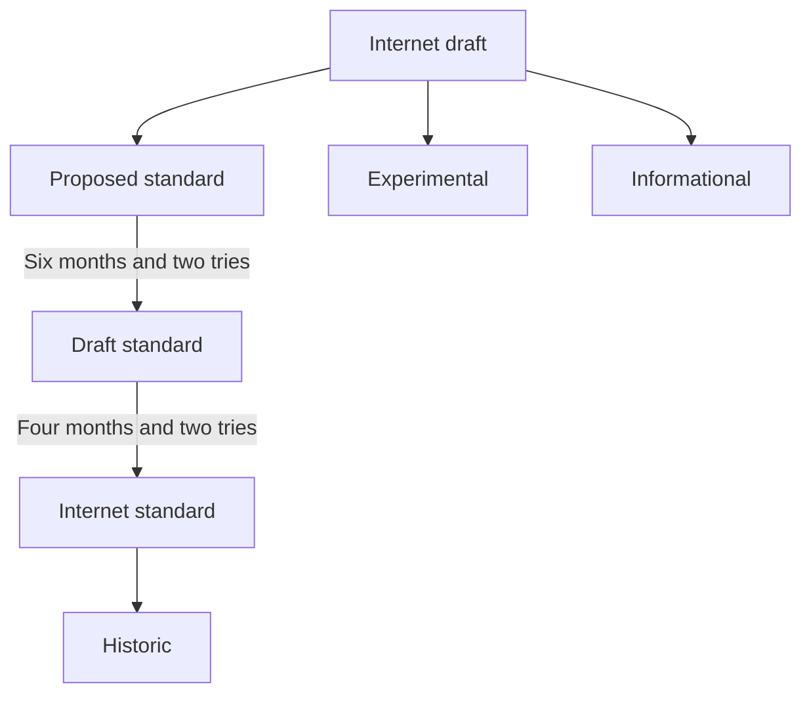

*Figure 3. Maturity levels of an RFC as presented by Forouzan*

> **Note:** **Reduction of the maturity levels.** RFC 6410 reduced the maturity levels of the standards track to two, Proposed Standard and Internet Standard [1]. The draft standard level that Forouzan describes therefore does not apply to new standards after RFC 6410.

Independently of the maturity levels, RFCs are also classified into five **requirement levels**.

| Requirement level | Meaning | Example |
|:-----|:-----|:-----|
| Required | Must be implemented by all Internet systems to achieve minimum conformance | IP (Chapter 11), ICMP (Chapter 16) |
| Recommended | Not required for minimum conformance but recommended for its usefulness | FTP, TELNET (Chapter 4) |
| Elective | Neither required nor recommended, but a system can use it for its own benefit | - |
| Limited use | Used only in limited situations, most experimental RFCs | - |
| Not recommended | Inappropriate for general use, usually a historic (deprecated) RFC | - |

*Table 3. Requirement levels of RFCs*

### 2.4 Organizations That Administer the Internet

The Internet started in the research domain and grew to include commercial users, and this growth has been coordinated by several organizations.

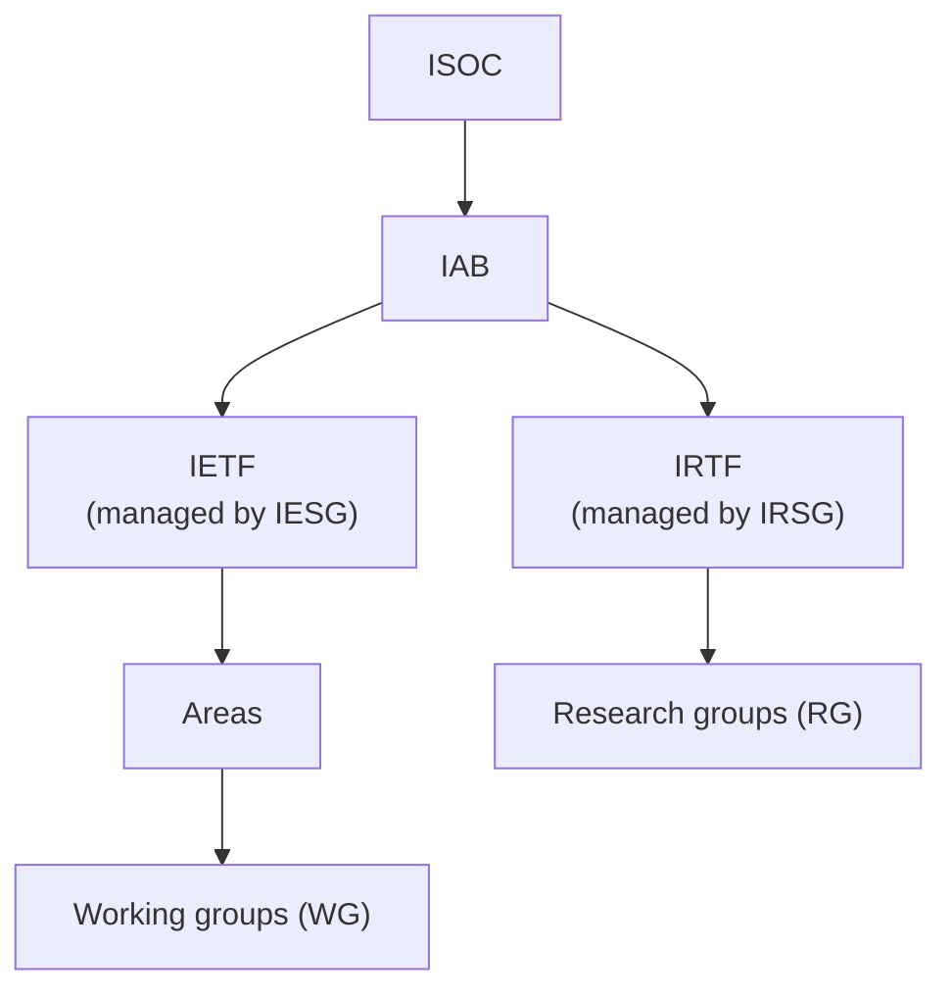

*Figure 4. Organization of Internet administration*

- **ISOC (Internet Society):** An international nonprofit organization formed in 1992 that supports the Internet standards process by maintaining and supporting administrative bodies such as the IAB, IETF, IRTF, and IANA, and that promotes research and scholarly activities related to the Internet.
- **IAB (Internet Architecture Board):** The technical advisor to the ISOC. It oversees the continuing development of the TCP/IP protocol suite, manages the editing of RFCs, and acts as the external liaison between the Internet and other standards organizations.
- **IETF (Internet Engineering Task Force):** A forum of working groups managed by the IESG (Internet Engineering Steering Group). It identifies operational problems and proposes solutions, and it develops and reviews specifications intended as Internet standards. The working groups are collected into areas such as applications, Internet protocols, routing, operations, user services, network management, transport, next-generation IP, and security.
- **IRTF (Internet Research Task Force):** A forum of working groups managed by the IRSG (Internet Research Steering Group) that focuses on long-term research on Internet protocols, applications, architecture, and technology.
- **IANA and ICANN:** IANA (Internet Assigned Numbers Authority), supported by the US government, managed Internet domain names and addresses until October 1998; since then ICANN (Internet Corporation for Assigned Names and Numbers), a private nonprofit corporation managed by an international board, has assumed the IANA operations.
- **NIC (Network Information Center):** Collects and distributes information about TCP/IP protocols.

---

<br>

## 3. The Network Edge

### 3.1 End Systems, Clients, and Servers

The **network edge** is the outer part of the Internet where end systems, such as the computers and smartphones people use every day, are located. End systems include desktop computers, servers such as Web and mail servers, and mobile devices such as laptops, smartphones, and tablets, and more and more nontraditional "things" are being attached as end systems. Because they host (run) application programs such as Web browsers, Web servers, mail clients, and mail servers, end systems are also called hosts; host and end system mean the same thing.

Hosts are further divided into **clients** and **servers**. Informally, clients tend to be devices that users operate, such as desktop PCs, laptops, and smartphones, whereas servers tend to be more powerful machines that store and distribute Web pages, stream video, or relay e-mail. Most of the servers that deliver search results, e-mail, Web pages, and videos today reside in large **data centers** with hundreds of thousands of servers. Chapter 3 gives the precise definition of client and server from the viewpoint of an application.

### 3.2 The Concept of an Access Network

To use the Internet, an end system must first be physically connected to a network.

> **Definition:** An **access network** is the network that physically connects an end system to the first router, the **edge router**, on a path from the end system to any other distant end system.

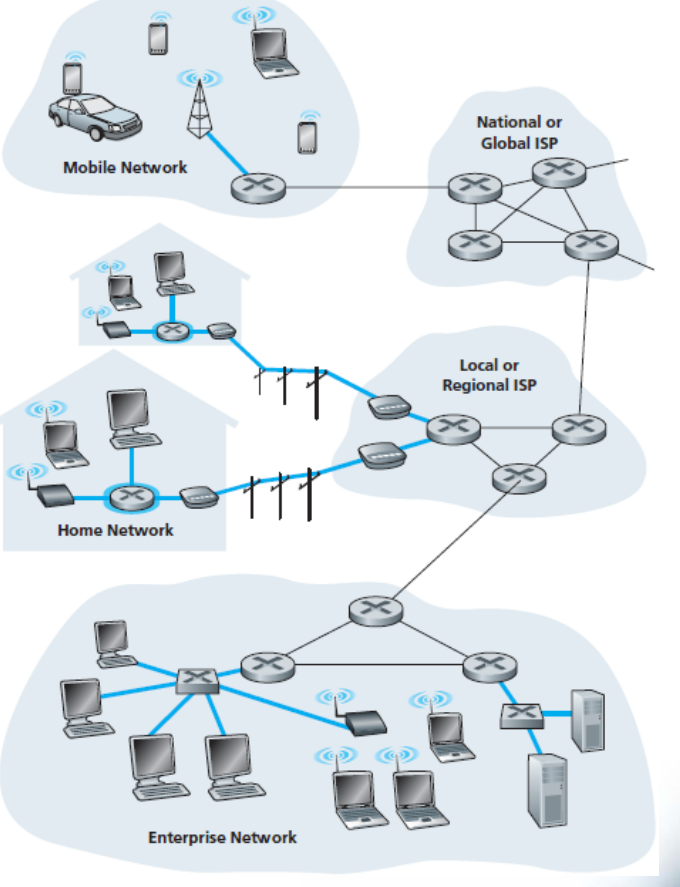

*Figure 5. Access networks*

In Figure 5, the thick blue lines are access networks. End systems in homes, enterprises, and mobile settings are each connected through an access network to the first router they need to reach other neighborhoods. Depending on the setting in which they are used, access networks are divided into home access (DSL, cable, FTTH, dial-up, satellite), local access in the enterprise and the home (Ethernet, Wi-Fi), and wide-area wireless access (3G, LTE).

The access network used by mobile terminals is called a **radio access network**. A mobile terminal communicates wirelessly with a nearby base station, and base stations are connected to each other by a wired network. In a radio access network, therefore, the wireless part is only the first segment between the terminal and the base station, and the part from the base station to the core is wired.

---

<br>

## 4. Access Networks

The representative ways to connect a home to the Internet are dial-up and DSL, which use the telephone network, cable access, which uses the cable TV network (a broadcast network), and FTTH, which brings optical fiber to the home. Forouzan calls a network such as dial-up, DSL, or a cable modem, which connects two remote devices using a line leased from a public network such as the telephone network, a **point-to-point WAN**. Point-to-point WANs also include T lines and SONET, which Chapter 21 covers. These technologies have in common that they do not build a new network but reuse the existing telephone and cable TV networks.

### 4.1 Dial-Up and the 56K Modem

**Dial-up** access connects a home modem to a modem at the ISP by placing a call over the telephone line. Because the telephone line was originally built to carry voice as an analog signal, the modem (modulator-demodulator) converts the digital data of a computer into an analog signal (modulation) and converts a received analog signal back into digital data (demodulation). Dial-up is excruciatingly slow, at most 56 kbps, and because telephone and Internet use the same band, the Internet cannot be used while the telephone is in use and the telephone cannot be used while the Internet is in use.

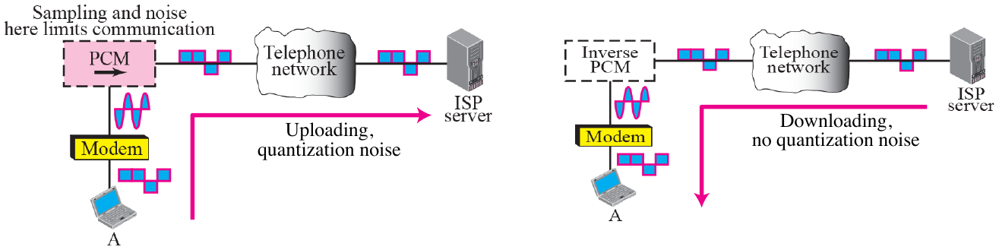

*Figure 6. Uploading and downloading with a 56K modem*

As Figure 6 shows, uploading and downloading with a 56K modem run at different rates. When uploading, the telephone switching station must sample the analog signal sent from the home and convert it into a digital (PCM) signal, which introduces **quantization noise**, and as a result the upload rate is limited to 33.6 kbps. When downloading, the switching station converts the digital signal sent by the ISP server with inverse PCM and sends it to the home, so no sampling takes place and the signal is affected neither by quantization noise nor by the Shannon capacity limit. The download rate is 56 kbps because the telephone company samples voice 8000 times per second with 8 bits per sample, one of which is used for control.

```math
8000\ \text{samples/s} \times 7\ \text{bits/sample} = 56{,}000\ \text{bps} = 56\ \text{kbps}
```

The V.90 and V.92 standard modems connect a host to the Internet with this 56 kbps scheme.

### 4.2 DSL

When modems reached their peak rate, telephone companies developed **DSL (digital subscriber line)** technology to provide faster access over the existing **local loop**, the telephone line. A household that uses DSL usually obtains Internet access from the same local telephone company that provides its wired telephone service, so in this case the telephone company is also the ISP.

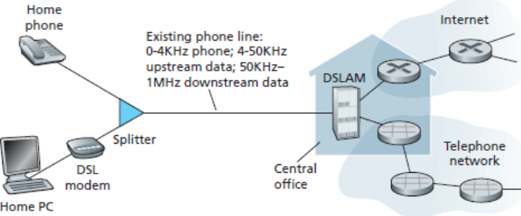

*Figure 7. DSL Internet access*

As Figure 7 shows, the home DSL modem uses the existing telephone line (twisted-pair copper wire) to exchange data with a **DSLAM (digital subscriber line access multiplexer)** located in the telephone company's **central office (CO)**. The DSL modem translates digital data into high-frequency signals for transmission over the telephone line, and the DSLAM in the central office translates the analog signals from many homes back into digital format. Hundreds or thousands of households connect to a single DSLAM.

Kurose explains that the home telephone line carries data and telephone signals simultaneously in different frequency bands.

- A high-speed downstream channel in the 50 kHz to 1 MHz band
- A medium-speed upstream channel in the 4 kHz to 50 kHz band
- An ordinary two-way telephone channel in the 0 to 4 kHz band

This makes a single DSL link behave like three separate links, so a telephone call and an Internet connection can share the same line at the same time. This way of sharing one medium by dividing its frequency bands is called frequency-division multiplexing and is covered in Section 6.6. On the home side, a **splitter** separates the arriving signal into data and telephone signals and forwards the data signal to the DSL modem; on the central office side, the DSLAM separates data and telephone signals and sends the data into the Internet.

DSL standards define several transmission rates, such as 12 Mbps downstream with 1.8 Mbps upstream and 55 Mbps downstream with 15 Mbps upstream. Because the downstream and upstream rates differ, such access is called **asymmetric**. The actual rates may be lower, because the ISP may limit the rate according to the service tier, or because of the distance between the home and the central office, the gauge of the line, and electrical interference. DSL was designed for short distances between the home and the central office; generally, a home that is not within 5 to 10 miles must use another form of access.

**ADSL (asymmetric DSL)**, the first DSL technology, exploits the fact that the existing local loop can handle bandwidths up to 1.1 MHz. ADSL is an **adaptive** technology that chooses its data rate according to the condition of the local loop. Whereas the asymmetry of the 56K modem results from where sampling occurs, the asymmetry of ADSL results from the designers deliberately dividing the bandwidth unevenly for residential subscribers. ADSL is therefore not suitable for businesses that exchange large amounts of data in both directions.

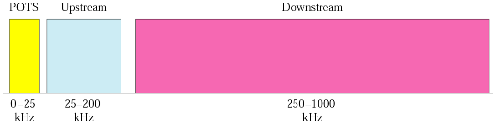

*Figure 8. Frequency band layout of ADSL*

Figure 8 shows a layout in which the lowest band of an ADSL line is used by the plain old telephone service (POTS), the band above it by upstream traffic (upload, uplink), and the widest, highest band by downstream traffic (download). The band edges in the figure (0-25 kHz, 25-200 kHz, 250-1000 kHz) differ from those given by Kurose (0-4 kHz, 4-50 kHz, 50 kHz-1 MHz), but the structure is the same: the bands rise in the order telephone, upstream, downstream, and the downstream band is the widest. Unlike dial-up, telephone and Internet use different bands, so both can be used at the same time.

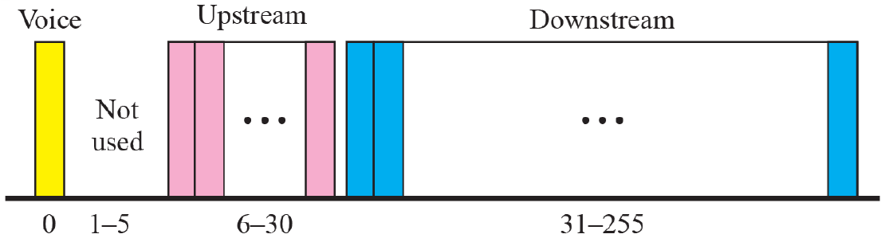

*Figure 9. Channel division of ADSL*

Forouzan describes the ADSL bandwidth as divided into 256 channels (numbered 0 to 255) a little more than 4 kHz wide (Figure 9). The actual width of a channel is 4.312 kHz, of which 4 kHz is assumed to be used in the calculation.

| Channel | Use | Remark |
|:-----|:-----|:-----|
| 0 | Voice communication | 4 kHz |
| 1-5 | Not used | Gap between voice and data |
| 6-30 (25 channels) | Upstream data and control | 1 for control, 24 for data |
| 31-255 (225 channels) | Downstream data and control | 1 for control, 224 for data |

*Table 4. Channel allocation of ADSL*

If each channel uses 4000 Hz and carries 15 bits per Hz, the maximum rates are as follows.

```math
\begin{aligned}
\text{Upstream} &: 24 \times 4000 \times 15 = 1{,}440{,}000\ \text{bps} = 1.44\ \text{Mbps} \\
\text{Downstream} &: 224 \times 4000 \times 15 = 13{,}440{,}000\ \text{bps} \approx 13.4\ \text{Mbps}
\end{aligned}
```

In practice the rates are much lower because of the signal-to-noise ratio, roughly 64 kbps to 1 Mbps upstream and 500 kbps to 8 Mbps downstream.

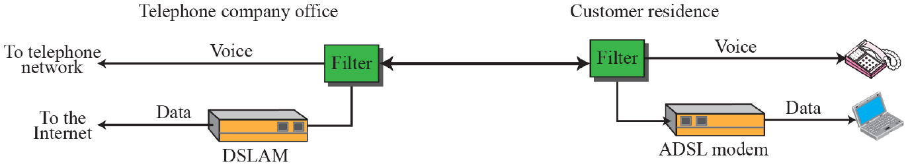

*Figure 10. ADSL modem and DSLAM*

Figure 10 shows the equipment of ADSL. At the home, the local loop connects to a **filter**, which separates voice communication from data communication, sending voice to the telephone and data to the ADSL modem. The ADSL modem modulates the data and creates the upstream and downstream channels. At the telephone company, a DSLAM is installed instead of an ADSL modem; the DSLAM functions much like an ADSL modem and, in addition, packetizes the data to be sent to the Internet.

DSL technologies other than ADSL are listed in Table 5.

| Technology | Characteristics |
|:-----|:-----|
| SDSL (symmetric DSL) | Divides the bandwidth equally between upstream and downstream for businesses that send large amounts of data in both directions, obtains the same data rate as HDSL over a single twisted pair, and adopts echo cancellation for full-duplex transmission |
| HDSL (high-bit-rate DSL) | Developed by Bellcore as an alternative to the T-1 line (1.544 Mbps); the AMI encoding of the T-1 line is susceptible to attenuation at high frequencies and needs a repeater about every 1 km, whereas HDSL is used within 3.6 km without a repeater |
| VDSL (very-high-bit-rate DSL) | Uses coaxial, fiber-optic, or twisted-pair cable over short distances of 300-1800 m, with DMT modulation giving 50-55 Mbps downstream and 1.5-2.5 Mbps upstream |

*Table 5. DSL technologies other than ADSL*

Of these, VDSL, which reaches tens of Mbps over short loops, is the closest to the high-rate DSL in use today; its 50-55 Mbps downstream rate is of the same order as the 55 Mbps downstream rate of the DSL standard mentioned above.

### 4.3 Cable Access and HFC

Whereas DSL uses the telephone company's existing telephone network, **cable Internet access** uses the cable TV company's existing cable TV network. The unshielded twisted pair used by DSL is susceptible to interference, which imposes an upper limit on its rate, so cable companies compete with telephone companies by offering high-speed Internet access over the cable TV network.

Cable TV started as a way to deliver broadcast signals to areas with poor reception. An antenna on top of a high hill or building received the broadcast signals and distributed them to the community over coaxial cable, so the system was called CATV (community antenna TV). The cable TV office, the **head end**, receives the broadcast signals and feeds them into coaxial cables.

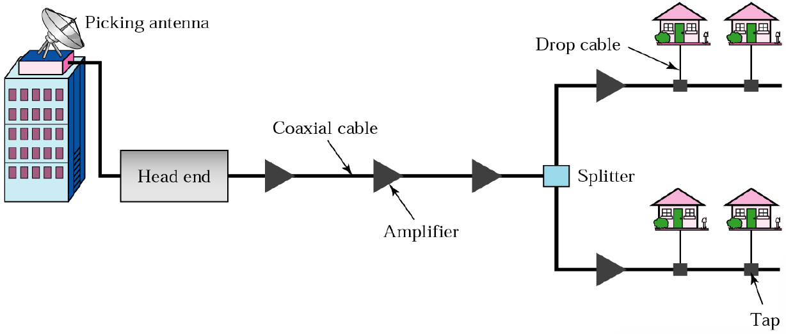

*Figure 11. Traditional cable TV network*

The traditional cable TV network in Figure 11 used coaxial cable from end to end. The bandwidth of the coaxial cable is at most about 750 MHz, and frequency-division multiplexing allocates 6 MHz to each channel. Because of signal attenuation many amplifiers were needed, and as a result communication was **unidirectional**, flowing only from the head end to the subscribers. The signal from the head end passes through amplifiers, is divided at splitters, and enters each home through a tap and a drop cable.

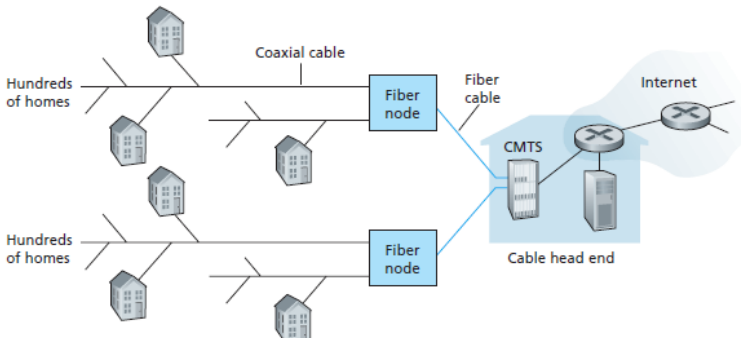

*Figure 12. HFC access network combining fiber and coaxial cable*

The second generation of cable networks combines optical fiber and coaxial cable and is therefore called **HFC (hybrid fiber-coax)** (Figure 12). Fiber connects the head end to neighborhood-level **fiber nodes**, and coaxial cable runs from each fiber node through the neighborhood to the individual homes. A fiber node typically serves 500 to 5000 homes. One reason for moving from the traditional structure to HFC was to make the cable network bidirectional.

Cable Internet access requires a **cable modem (CM)**. The cable modem is usually an external device connected to the home PC through an Ethernet port. At the head end, the **CMTS (cable modem termination system)** plays a role similar to the DSLAM of DSL, turning the analog signals sent by the cable modems of many homes back into digital format. Cable modems divide the HFC network into a downstream and an upstream channel, and as with DSL the access is typically asymmetric, with a higher rate allocated to the downstream channel. According to Kurose, the DOCSIS 2.0 standard defines downstream rates up to 42.8 Mbps and upstream rates up to 30.7 Mbps.

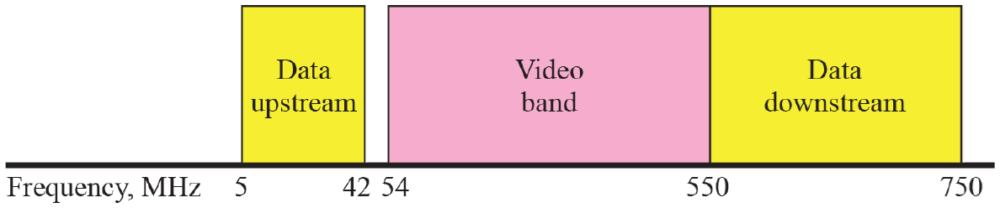

*Figure 13. Bandwidth division of cable*

Even in HFC, the last segment from the fiber node to the home is coaxial cable with a bandwidth of about 5 to 750 MHz. The cable company divides this band into three bands, as in Figure 13.

| Band | Frequency | Channels | Modulation | Rate |
|:-----|:-----|:-----|:-----|:-----|
| Upstream data | 5-42 MHz | Six 6 MHz channels (37 MHz) | QPSK (2 bits per symbol) | Theoretically 6 MHz × 2 bits/Hz = 12 Mbps, usually lower in practice |
| Video | 54-550 MHz | More than 80 channels of 6 MHz | - | Downstream only |
| Downstream data | 550-750 MHz | Thirty-three 6 MHz channels | 64-QAM (6 bits per symbol) | 30 Mbps according to the textbook, 27 Mbps in the standard |

*Table 6. Composition of the cable bands*

The video band is 550 - 54 = 496 MHz wide, so it can hold up to 82 channels of 6 MHz. The downstream data band is 200 MHz wide, so it holds 33 channels of 6 MHz, and the upstream data band is 37 MHz wide, so it holds six channels of 6 MHz. The upstream band uses lower frequencies, which are more susceptible to noise and interference.

The number of bits per symbol can be read from the name of the modulation. **64-QAM** is a modulation in which one signal element (symbol) has 64 possible states, so from 64 = 2⁶ one symbol carries 6 bits at a time. **QPSK** uses four phases (00, 01, 10, 11), so from 4 = 2² one symbol carries 2 bits.

> **Note:** **The calculation of the 30 Mbps downstream rate.** The textbook gives the theoretical rate of the downstream data band as 30 Mbps and the rate specified by the standard as 27 Mbps. Multiplying 6 MHz by 6 bits/Hz, however, gives 36 Mbps, so 30 Mbps does not follow from the product "6 MHz × 6 bits/Hz". The upstream 12 Mbps, by contrast, agrees with 6 MHz × 2 bits/Hz. The textbook adds that when the cable modem was connected to the computer through a 10BASE-T cable, this connection limited the rate to 10 Mbps.

An important characteristic of cable access is that subscribers **share** the downstream and upstream bands. The upstream band has only six channels, while an area may have thousands or tens of thousands of subscribers. The cable company therefore allocates one channel, statically or dynamically, to a group of subscribers, and the subscribers share the channel in time (time-sharing). A subscriber who wants to send data must contend for the channel with other subscribers, a situation similar to CSMA in Ethernet. The multiple access protocols that coordinate transmissions on such a shared channel are covered in Chapter 18. On the downstream side, the 33 channels are also shared by many subscribers, but here the situation resembles multicasting. Data for any subscriber in a group are sent on the group's channel, so every cable modem in the group receives them, and each cable modem keeps the data only if the address carried with the data matches the address assigned to it by the provider and discards them otherwise.

Kurose stresses the same point. Every packet sent by the head end travels downstream on every link to every home, and every packet sent by a home travels on the upstream channel to the head end. If several users download videos at the same time, each user therefore receives at a rate much lower than the aggregate downstream rate. Conversely, if few users are active and all of them, like Web surfers, request pages only occasionally, each user may receive Web pages at the full downstream rate.

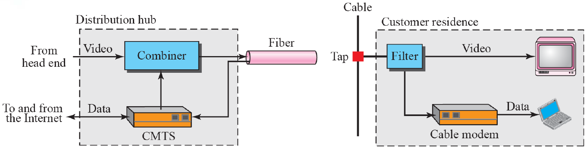

*Figure 14. Cable modem configuration*

Figure 14 shows the locations of the two devices needed for cable data transmission. The CMTS in the cable company's distribution hub passes data from the Internet to the combiner, which combines them with the video from the head end and sends them to the subscribers over fiber. The CMTS also receives data from the subscribers and passes them to the Internet. At the subscriber's home, the signal entering from the tap passes through a filter that sends video to the TV and data to the cable modem.

### 4.4 FTTH and Satellite Access

**FTTH (fiber to the home)** provides an optical fiber path directly from the central office to the home and can reach higher speeds than DSL and cable. The simplest scheme is **direct fiber**, with one fiber leaving the central office for each home. More commonly, a fiber leaving the central office is shared by many homes and is split into customer-specific fibers only close to the homes. The optical distribution networks that perform this split are **active optical networks (AONs)** and **passive optical networks (PONs)**. An AON is essentially switched Ethernet (Chapter 20).

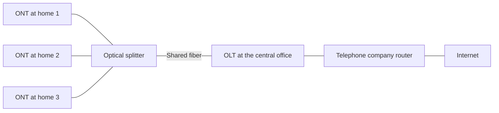

*Figure 15. FTTH access with a PON*

In a PON, each home has an **ONT (optical network terminator)**, which is connected by a dedicated fiber to a neighborhood optical splitter (Figure 15). The splitter combines a number of homes, typically fewer than 100, onto a single shared fiber that connects to the **OLT (optical line terminator)** in the central office. The OLT converts between optical and electrical signals and connects to the Internet through a router of the telephone company. In the home, users connect a home router, such as a wireless router, to the ONT and access the Internet through it. In a PON, every packet sent from the OLT to the splitter is replicated at the splitter, giving a broadcast structure similar to the cable head end. FTTH can provide access rates in the gigabits per second range.

Where DSL, cable, and FTTH are unavailable, such as in some rural settings, a **satellite link** can connect a home to the Internet at more than 1 Mbps.

### 4.5 Access in the Enterprise and the Home: Ethernet and Wi-Fi

On corporate and university campuses, and increasingly in homes, a **local area network (LAN)** connects end systems to the edge router. The most widely used LAN technology is **Ethernet**.

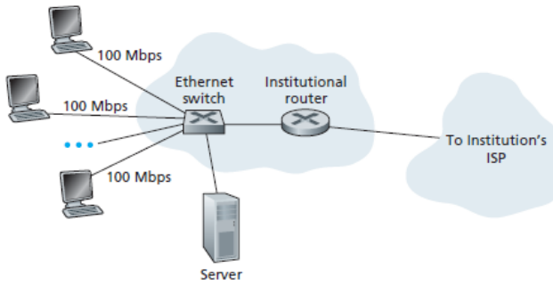

*Figure 16. Ethernet Internet access*

As Figure 16 shows, Ethernet users connect to an Ethernet switch with twisted-pair copper wire, and the Ethernet switch, or a network of switches, connects through an institutional router to the larger Internet. Users typically have 100 Mbps or 1 Gbps access to the Ethernet switch, and servers have 1 Gbps or 10 Gbps access. Chapter 20 covers Ethernet and switches.

Devices such as laptops, smartphones, and tablets increasingly access the Internet wirelessly. In a **wireless LAN**, wireless users exchange packets with an **access point (AP)** connected to the enterprise network, and the access point is usually connected to the wired Internet through wired Ethernet. A wireless LAN user must be within a few tens of meters of the access point. Wireless LANs based on IEEE 802.11 technology are commonly called **Wi-Fi**, which today provides a shared transmission rate of more than 100 Mbps. Chapter 22 covers wireless LANs.

Ethernet and Wi-Fi were first deployed in enterprises but are now common components of home networks. A typical home network consists of a roaming laptop and a wired PC, a base station (wireless access point) that communicates with the wireless devices, a cable modem or DSL modem that provides broadband access, and a router that connects the base station and the wired PC to the cable modem.

### 4.6 Wide-Area Wireless Access

Devices such as smartphones use the wireless infrastructure built for cellular telephony to send and receive packets through base stations operated by the cellular network provider. Whereas a Wi-Fi user must be within a few tens of meters of an access point, a cellular user need only be within a few tens of kilometers of a base station. Third-generation (3G) wireless provides packet-switched wide-area wireless Internet access at more than 1 Mbps, and the fourth-generation technology LTE (Long-Term Evolution) can achieve more than 10 Mbps.

Wi-Fi and cellular differ in who owns the access network and in its range. Wi-Fi reaches the Internet through an access point installed by a household or an institution and the wired network of that institution, whereas a cellular terminal reaches the Internet through the mobile network of the cellular operator. The cellular operator sells Internet access as a data plan because in this case the mobile network is the access ISP. Chapter 25 covers the structure of cellular networks.

### 4.7 Comparison of Access Technologies

| Technology | Medium | Sharing | Typical rate |
|:-----|:-----|:-----|:-----|
| Dial-up (56K modem) | Telephone line (twisted pair) | Dedicated | 56 kbps down, 33.6 kbps up |
| ADSL | Telephone line (twisted pair) | Dedicated local loop, aggregated at the DSLAM | Theoretical 13.4 Mbps down and 1.44 Mbps up, actual 0.5-8 Mbps down |
| Cable (HFC) | Fiber and coaxial cable | Shared by neighborhood | DOCSIS 2.0: 42.8 Mbps down, 30.7 Mbps up |
| FTTH (PON) | Optical fiber | Shared per splitter | Gigabits per second possible |
| Ethernet | Twisted pair | Dedicated switch port | 100 Mbps, 1 Gbps, 10 Gbps |
| Wi-Fi (802.11) | Wireless (tens of m) | Shared | More than 100 Mbps |
| 3G, LTE | Wireless (tens of km) | Shared | 3G more than 1 Mbps, LTE more than 10 Mbps |

*Table 7. Comparison of the main access technologies*

---

<br>

## 5. Physical Media

Consider a bit traveling from a source end system through a series of links and routers to a destination end system. The source transmits the bit and the first router receives it; the first router transmits it again and the second router receives it; and so the bit passes through many transmitter-receiver pairs. In each pair the bit is sent by propagating electromagnetic waves or optical pulses across a **physical medium**, and the kind of medium can differ from pair to pair.

Physical media fall into two categories. In **guided media**, the waves are guided along a solid medium such as optical fiber, twisted-pair copper wire, or coaxial cable. In **unguided media**, the waves propagate in the atmosphere and in outer space, as in a wireless LAN or a digital satellite channel. The material cost of a physical link is relatively small compared with other networking costs, and the labor cost of installation can be orders of magnitude higher than the material cost. For this reason, many builders install twisted pair, optical fiber, and coaxial cable in every room even if only one of them is used at first.

- **Twisted-pair copper wire:** The least expensive and most commonly used guided medium. Two insulated copper wires, each about 1 mm thick, are twisted in a regular spiral pattern to reduce electrical interference from nearby pairs. More than 99% of the wired connections from telephone handsets to local telephone switches use twisted pair. **Unshielded twisted pair (UTP)** is commonly used for LANs inside buildings, with rates from 10 Mbps to 10 Gbps; category 6a cable achieves 10 Gbps up to 100 m. Dial-up (up to 56 kbps) and DSL (tens of Mbps) also use twisted pair.
- **Coaxial cable:** Two copper conductors arranged concentrically rather than in parallel, with special insulation and shielding, achieve high transmission rates. Coaxial cable is common in cable TV systems, where the transmitter shifts the digital signal to a specific frequency band and sends it to one or more receivers. It can be used as a shared medium, with several end systems connected directly to the cable and each receiving whatever the others send.
- **Fiber optics:** A thin, flexible medium that conducts pulses of light, each pulse representing a bit. It supports tens or hundreds of gigabits per second, is immune to electromagnetic interference, has very low signal attenuation up to 100 km, and is very hard to tap. It is therefore the preferred long-haul guided medium, particularly for overseas links and the Internet backbone. Because optical devices such as transmitters, receivers, and switches are expensive, it is used less for short-haul segments such as LANs and home access. The link speeds of the Optical Carrier (OC) standard are n × 51.8 Mbps for OC-n; OC-1, OC-3, OC-12, OC-24, OC-48, OC-96, OC-192, and OC-768 are in use.
- **Terrestrial radio channels:** Carry signals in the electromagnetic spectrum. They need no physical wire, penetrate walls, provide connectivity to mobile users, and can carry a signal over long distances. Their characteristics depend strongly on the propagation environment and the distance: path loss and shadow fading weaken the signal with distance and obstructions, multipath fading arises from reflections, and interference comes from other transmissions and electromagnetic signals. They are classified as very short distance (one or two meters, wireless headsets and keyboards), local area (tens to a few hundred meters, wireless LANs), and wide area (tens of kilometers, cellular access).
- **Satellite radio channels:** A communication satellite links two or more Earth-based microwave transmitter-receivers called ground stations. The satellite receives a transmission on one frequency band, regenerates the signal, and transmits it on another frequency. A **geostationary satellite** stays permanently above the same spot on Earth in an orbit 36,000 km above the surface; the long distance from ground station through satellite back to ground station introduces a propagation delay of 280 ms. **Low-earth orbiting (LEO) satellites** are much closer to Earth and do not stay above one spot, so many satellites are needed to cover an area continuously.

| Medium | Category | Characteristics | Main use |
|:-----|:-----|:-----|:-----|
| Twisted pair | Guided | Least expensive, twisted to reduce interference, 10 Mbps-10 Gbps | Telephone lines, LANs, DSL |
| Coaxial cable | Guided | Concentric conductors, usable as a shared medium | Cable TV, cable Internet |
| Optical fiber | Guided | Tens to hundreds of Gbps, no interference, low attenuation, expensive devices | Backbone, long haul, overseas links |
| Terrestrial radio | Unguided | Mobility, path loss, fading, interference | Wireless LANs, cellular |
| Satellite | Unguided | 280 ms propagation delay for geostationary orbit | Areas without DSL or cable |

*Table 8. Comparison of physical media*

---

<br>

## 6. The Network Core

The **network core** is the mesh of packet switches and links that interconnects the end systems of the Internet.

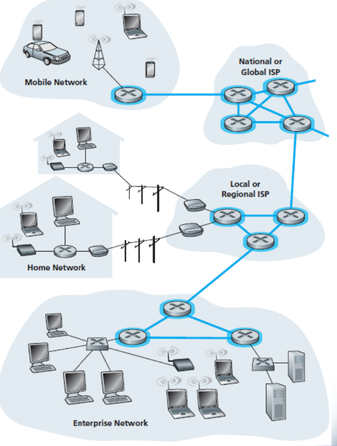

*Figure 17. The network core*

### 6.1 Switching and the Classification of Switched Networks

When there are many devices, the problem arises of how to connect them so that one-to-one communication is possible. Connecting every device directly to every other device is inefficient, so a network places connecting devices called **switches** and attaches the devices to the switches.

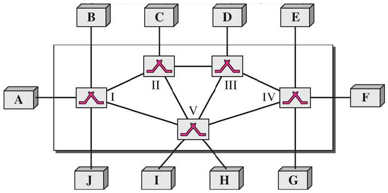

*Figure 18. A switched network connected by switches*

In Figure 18, devices A to J are connected to each other through a network of switches I to V. When a message reaches a connecting device (switch), the device must select one of its output ports through which to send the message. In other words, the connecting device acts as a switch that connects one port to another port. This process is called **switching**.

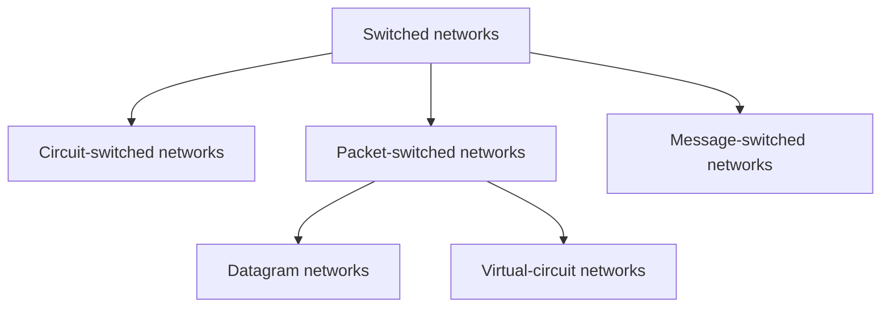

*Figure 19. Classification of switched networks*

As Figure 19 shows, switched networks are divided into circuit-switched, packet-switched, and message-switched networks, and packet-switched networks are further divided into datagram networks and virtual-circuit networks. Today's Internet is a datagram network. Chapter 10 compares the datagram and virtual-circuit approaches. This section follows Kurose and focuses on packet switching and circuit switching, and Section 6.7 covers message switching.

### 6.2 Packet Switching and Store-and-Forward Transmission

In a network application, end systems exchange **messages** with each other. A message may perform a control function, like the "Hi" above, or contain data such as an e-mail message, a JPEG image, or an MP3 file. The source end system breaks long messages into smaller chunks of data called **packets**. Packets travel through the communication links and packet switches between source and destination, and on each link they are transmitted at the full transmission rate of the link. If a source or a packet switch sends an $L$-bit packet over a link with transmission rate $R$ bps, pushing the packet onto the link takes $L/R$ seconds.

> **Definition:** **Packet switching** is a method in which messages are divided into packets and each packet is delivered to its destination, using the links on demand without reserving resources in advance.

Most packet switches use **store-and-forward transmission** at the inputs to the links. The packet switch must receive the entire packet before it can begin to transmit the first bit of the packet onto the outbound link.

> **Definition:** **Store-and-forward transmission** is a method in which a packet switch receives all the bits of a packet and stores them in a buffer before it begins to transmit the packet onto the outbound link.

Suppose a source and a destination are connected by a single router and the source sends three packets of $L$ bits each, ignoring propagation delay. The source begins to send the first packet at time 0, and at time $L/R$ the whole first packet has been stored at the router. From then on the router sends the first packet to the destination while the source sends the second packet. At time $2L/R$, therefore, the destination has received the first packet and the router has received the second.

```text
Time        0      L/R     2L/R    3L/R    4L/R
            |-------|-------|-------|-------|
Source → R  [ 1 ]   [ 2 ]   [ 3 ]
R → Dest            [ 1 ]   [ 2 ]   [ 3 ]
                            ^       ^       ^
                        1 arrives 2 arrives 3 arrives
```

*Figure 20. Store-and-forward timing of three packets through one router*

If only one packet is sent, the total delay is $2L/R$. If the router forwarded bits as soon as they arrived, the delay would be $L/R$, but the router forwards a packet only after receiving, storing, and processing all of it. All three packets are received at time $4L/R$. In general, sending one packet over $N$ links ($N-1$ routers), each of rate $R$, gives the end-to-end delay below.

```math
d_{\text{end-to-end}} = N \frac{L}{R}
```

If $P$ packets are sent back to back over the same path, the first packet arrives at $NL/R$ and one packet arrives every $L/R$ thereafter, so the last packet arrives at $(N+P-1)L/R$. The example above has $N=2$ and $P=3$, which gives $4L/R$.

For example, if one 8,000-bit packet is sent over three 2 Mbps links, the transmission time on one link is 8,000 / (2 × 10⁶) = 4 ms and the end-to-end delay is 3 × 4 = 12 ms.

### 6.3 Queuing Delay and Packet Loss

A packet switch has several links attached to it, and for each attached link it has an **output buffer**, or **output queue**, which stores the packets to be sent onto that link. If an arriving packet needs to be sent on a link that is busy transmitting another packet, the arriving packet must wait in the output buffer. Packets therefore suffer **queuing delays** in addition to store-and-forward delays. Queuing delays vary with the level of congestion in the network.

Because buffer space is finite, an arriving packet may find the buffer completely full. In that case **packet loss** occurs: either the arriving packet or one of the already-queued packets is dropped.

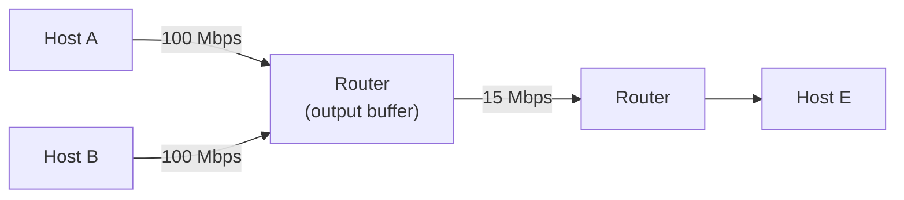

*Figure 21. Packets arriving faster than the output link can send them*

In Figure 21, hosts A and B send packets over 100 Mbps Ethernet links to the first router, which forwards them onto a 15 Mbps link. If, during a short interval, the rate at which bits arrive at the router exceeds 15 Mbps, packets queue in the link's output buffer and congestion occurs at the router. For example, if A and B each send a burst of five packets back to back at the same time, most of the packets wait in the queue. The situation is the same as waiting in line at a bank teller or a tollbooth.

### 6.4 Forwarding Tables and Routing Protocols

How does a router decide on which link to forward an arriving packet? In the Internet, every end system has an **IP address**. The source puts the destination's IP address in the packet header, and this address has a hierarchical structure like a postal address. Each router has a **forwarding table** that maps destination addresses (or portions of them) to the router's outbound links. When a packet arrives, the router examines a portion of the destination address, finds the appropriate outbound link in its forwarding table, and directs the packet to that link.

> **Definition:** A **forwarding table** is the table a router uses to find, from the destination address of a packet (or a portion of it), the outbound link on which to send the packet.

The process resembles a driver who asks for directions instead of using a map. Joe, driving from Philadelphia to 156 Lakeside Drive in Orlando, Florida, asks at his neighborhood gas station; the attendant looks only at the Florida portion of the address and tells him to take the I-95 South interstate and to ask again once he enters Florida. The attendant in Jacksonville looks at the Orlando portion and tells him to continue to Daytona Beach, and the attendant in Daytona Beach tells him to take I-4 to Orlando. The attendant in Orlando looks at the Lakeside Drive portion and gives directions, and finally a kid on a bicycle looks at 156 and points to the house. In this analogy, the gas station attendants and the kid correspond to routers. Each looks at only a portion of the address and tells only the next direction to go.

How, then, are forwarding tables filled? They could be configured by hand in every router, but the Internet has **routing protocols** that set the forwarding tables automatically. A routing protocol may, for example, determine the shortest path from each router to each destination and use the result to configure the forwarding tables. Chapter 10 covers the distinction between forwarding and routing, Chapter 13 the structure of forwarding tables, and Chapters 14 and 15 routing algorithms and routing protocols.

### 6.5 Circuit Switching

There are two fundamental approaches to moving data through a network of links and switches: circuit switching and packet switching. In a **circuit-switched network**, the resources needed along a path (buffers, link transmission rate) for communication between end systems are **reserved** for the duration of the communication session. In a packet-switched network these resources are not reserved, so a session's messages use the resources on demand and may consequently have to wait (queue) for a link.

> **Definition:** **Circuit switching** is a method in which a path between the sender and the receiver is established before communication begins, and the resources along the path are reserved until the communication ends, guaranteeing a constant transmission rate.

Consider two restaurants, one that requires reservations and one that neither requires nor accepts them. For the first, one must go through the hassle of calling before leaving home, but on arrival one can in principle be seated and order immediately. For the second, no reservation is needed, but on arrival one may have to wait for a table.

Traditional telephone networks are examples of circuit-switched networks. A telephone network must establish a connection between the sender and the receiver before the sender can send information. This is a bona fide connection for which the switches along the path maintain connection state, and in telephony jargon it is called a **circuit**. When the network establishes the circuit, it reserves a constant transmission rate, a fraction of each link's capacity, for the duration of the connection, so the sender can send data at a guaranteed constant rate.

Forouzan's Example 4.1 also cites the early telephone system as an example of circuit switching. When the caller dials the callee's number, a path is established between them, and when the callee answers, the circuit is established. From then on, the voice message flows in both directions while all the connecting devices maintain the circuit, and when either party hangs up, the circuit is disconnected. Circuit switching therefore operates in three phases.

1. **Setup:** A dedicated path is established between sender and receiver and resources are reserved.
2. **Data transfer:** Data flow along the established path. In circuit switching, the whole message is delivered from source to destination without being divided into packets.
3. **Teardown:** When communication ends, the circuit is released so that the links and connecting devices can be used for other connections.

Forouzan adds that circuit switching was never implemented at the network layer and is mostly used at the physical layer. Moreover, today's telephone network is not entirely a circuit-switched network.

Kurose's simple circuit-switched network has four switches interconnected by four links, with four circuits on each link. For host A to communicate with host B, the network must reserve one circuit on each of two links. Because each link has four circuits, the connection gets one fourth of each link's transmission capacity for the duration of the connection. If each link between adjacent switches has a rate of 1 Mbps, each connection gets 250 kbps of dedicated transmission rate.

In the Internet, a packet-switched network, a packet is sent into the network without reserving any link resources at all. If a link is congested, the packet waits in a buffer at the sending side of the link and is delayed. The Internet makes its best effort to deliver packets in a timely manner but makes no guarantees.

### 6.6 FDM and TDM

A circuit in a link is implemented with either **frequency-division multiplexing (FDM)** or **time-division multiplexing (TDM)**.

> **Definition:** **Frequency-division multiplexing (FDM)** divides the frequency spectrum of a link and dedicates one frequency band to each connection for the duration of the connection.

In telephone networks this frequency band typically has a width of 4 kHz, and the width is called the **bandwidth**. FM radio stations also share the spectrum between 88 MHz and 108 MHz using FDM.

> **Definition:** **Time-division multiplexing (TDM)** divides time into frames of fixed duration and each frame into a fixed number of slots, dedicating one slot in every frame to each connection.

```text
FDM (4 circuits)                    TDM (4 circuits)
Frequency
 ^  [circuit 4] 4 kHz ──────────     Frame 1          Frame 2
 |  [circuit 3] 4 kHz ──────────     |1|2|3|4|        |1|2|3|4|   ...
 |  [circuit 2] 4 kHz ──────────     slot
 |  [circuit 1] 4 kHz ──────────
 +------------------------------> Time     +--------------------------> Time
 Each circuit always uses a part of the band   Each circuit uses the whole band in short slots
```

*Figure 22. How four circuits share a link under FDM and TDM*

With FDM each circuit continuously gets a fraction of the bandwidth, and with TDM each circuit periodically gets all of the bandwidth during brief slots. The transmission rate of a TDM circuit is the frame rate multiplied by the number of bits in a slot. For example, if a link transmits 8,000 frames per second and each slot carries 8 bits, each circuit has a rate of 8,000 × 8 = 64 kbps.

**Example.** In a circuit-switched network, host A sends a 640,000-bit file to host B. All links use TDM with 24 slots and have a rate of 1.536 Mbps, and establishing the end-to-end circuit before sending the file takes 500 ms. Each circuit has a rate of 1.536 Mbps / 24 = 64 kbps, so transmitting the file takes 640,000 / 64,000 = 10 seconds, and adding the circuit setup time gives 10.5 seconds. The transmission time is independent of the number of links: it is 10 seconds whether the circuit passes through one link or a hundred (the actual end-to-end delay also includes the propagation delay of Section 7).

### 6.7 Message Switching and Message Segmentation

In **message switching**, a whole message is passed from switch to switch as a single unit. Each switch receives and stores the entire message before sending it to the next switch, so it is store-and-forward at the level of messages. Like packet switching it sets up no dedicated path, but each switch needs room to store whole messages and cannot send a message on the next link until it has received all of it.

Let us compute how much **message segmentation**, dividing a long message into packets, reduces the delay. A 4 × 10⁶-bit message is sent over three links (two switches) of 2 Mbps each, ignoring propagation, queuing, and processing delays.

- **Without segmentation (message switching):** One link takes 4 × 10⁶ / (2 × 10⁶) = 2 seconds, and each switch forwards the message only after receiving all of it, so the total is 3 × 2 = 6 seconds.
- **Segmented into 400 packets of 10,000 bits (packet switching):** The link transmission time of one packet is 10,000 / (2 × 10⁶) = 5 ms. With $N=3$ and $P=400$ in the formula of Section 6.2, the last packet arrives at (3 + 400 - 1) × 5 ms = 2.01 seconds.

With packets, one link sends the next packet while the following switch forwards the previous one, so several links work at the same time; the transmissions overlap like a pipeline, and the delay drops sharply.

### 6.8 Packet Switching Versus Circuit Switching

Critics of packet switching argue that its end-to-end delays, which vary unpredictably mainly because of queuing delays, make it unsuitable for real-time services such as telephone calls and video conferences. Proponents argue that packet switching shares transmission capacity better and is simpler, more efficient, and less costly to implement. They also point out that circuit switching wastes resources because dedicated circuits sit idle during silent periods, such as pauses in speech, without other connections being able to use them, and that establishing end-to-end circuits and reserving capacity requires complex signaling software.

**Example 1: supporting more users.** Users share a 1 Mbps link. Each user generates data at a constant 100 kbps when active and is active only 10% of the time. With circuit switching, 100 kbps must be reserved for each user at all times, so the link supports only 1 Mbps / 100 kbps = 10 users simultaneously. With packet switching and 35 users, if each user is independently active with probability 0.1, the probability that 11 or more users are active at the same time is as follows.

```math
P(X \ge 11) = \sum_{k=11}^{35} \binom{35}{k} (0.1)^{k} (0.9)^{35-k} \approx 0.0004
```

> **[Probability and Statistics]** If each user is independently active with probability $p$, the number $X$ of active users among $n$ follows the binomial distribution $B(n, p)$, with $P(X = k) = \binom{n}{k} p^k (1-p)^{n-k}$. The formula above sums these probabilities for $k = 11, \dots, 35$ with $n = 35$ and $p = 0.1$.

When 10 or fewer users are active (probability 0.9996), the aggregate arrival rate of data is at most the 1 Mbps output rate of the link, so packets flow through the link essentially without delay, as with circuit switching. When 11 or more users are active at once the output queue begins to grow, but the probability of this is minuscule. In this example, packet switching therefore provides essentially the same performance as circuit switching while supporting more than three times as many users.

**Example 2: a single active user.** One of 10 users suddenly generates 1,000 packets of 1,000 bits while the others stay quiet. Under TDM circuit switching with 10 slots per frame (1,000 bits per slot), the active user can use only its own slot in each frame, so sending one million bits takes 10 seconds while the other nine slots stay empty. Under packet switching no other user generates packets, so the active user sends at the full 1 Mbps link rate and finishes in 1 second.

The two examples show the crucial difference between the two ways of sharing a link's transmission rate. Circuit switching pre-allocates link use regardless of demand, so allocated but unneeded link time goes unused. Packet switching allocates link use **on demand**, so link capacity is shared packet by packet only among the users that actually have packets to send. Both approaches are present in today's telecommunication networks, but the trend is clearly toward packet switching. Telephone networks that used circuit switching are migrating to packet switching, starting with expensive parts such as the overseas portion of a call, and the Internet uses packet switching.

| Property | Circuit switching | Packet switching | Message switching |
|:-----|:-----|:-----|:-----|
| Setup in advance | Required | Not required in the datagram approach | Not required |
| Resource allocation | Reserved per connection | Shared on demand | Shared on demand |
| Store-and-forward | None | Per packet | Per message |
| Delay | Constant after setup | Variable because of queuing | Large because whole messages are stored |
| Resources during idle periods | Wasted | Used by other users | Used by other users |
| Typical example | Traditional telephone network | Internet | - |

*Table 9. Comparison of circuit, packet, and message switching*

> **Key Point:** Circuit switching reserves resources to guarantee a constant rate but wastes them during idle periods. Packet switching reserves nothing, so queuing delay and loss can occur, but for data traffic in which users are active intermittently it supports far more users efficiently.

### 6.9 A Network of Networks

End systems connect to the Internet through an access ISP. The access ISP may be a telephone or cable company, or a university that provides Internet access to its students and staff, or a company that provides access to its employees. To connect billions of end systems, the access ISPs themselves must be interconnected, and the result is a **network of networks**. This structure has evolved driven more by economics and national policy than by performance. Kurose builds up today's structure step by step.

1. **Connecting every access ISP directly to every other:** Each access ISP would need a separate link to each of hundreds of thousands of other access ISPs, which is far too costly.
2. **Network Structure 1:** A single imaginary global transit ISP interconnects all access ISPs. The access ISP is a **customer** and the global transit ISP a **provider**, and the customer pays the provider.
3. **Network Structure 2:** Several competing global transit ISPs appear, and they must be interconnected. This is a two-tier hierarchy with global transit ISPs at the top and access ISPs at the bottom.
4. **Network Structure 3:** In reality no ISP is present in every city, so each region has a **regional ISP** to which access ISPs connect, and regional ISPs connect to **tier-1 ISPs**. There are about a dozen tier-1 ISPs, including Level 3 Communications, AT&T, Sprint, and NTT, and no group officially sanctions tier-1 status. A customer-provider relationship holds at each level, and the tier-1 ISPs at the top pay no one. Some hierarchies are deeper; in China, for example, access ISPs in cities connect to provincial ISPs, which connect to national ISPs, which connect to tier-1 ISPs.
5. **Network Structure 4:** PoPs, multi-homing, peering, and IXPs are added.
   - **PoP (point of presence):** A group of routers in the provider's network where customer ISPs can connect to the provider ISP. PoPs exist at all levels except the access ISP level.
   - **Multi-home:** Any ISP except a tier-1 ISP may connect to two or more provider ISPs. A multi-homed ISP can keep sending and receiving packets even if one of its providers fails.
   - **Peering:** Two nearby ISPs at the same level connect their networks directly, so that traffic between them passes over the direct connection rather than through upstream ISPs. Peering is typically settlement-free, with neither ISP paying the other, and tier-1 ISPs also peer with one another settlement-free.
   - **IXP (Internet Exchange Point):** A meeting point, created by a third-party company, where multiple ISPs peer together. It is typically in a stand-alone building with its own switches, and Kurose counts over 400 IXPs in the Internet as of 2016.
6. **Network Structure 5 (today's Internet):** **Content-provider networks** are added to Structure 4. Google, for example, interconnects its data centers around the world with its own private TCP/IP network that is separate from the public Internet, and it "bypasses" the upper tiers of the Internet by peering settlement-free with lower-tier ISPs, either directly or at IXPs. Because many access ISPs can still be reached only through tier-1 networks, it also connects to tier-1 ISPs and pays them. With its own network, a content provider reduces its payments to upper-tier ISPs and gains more control over how its services are delivered.

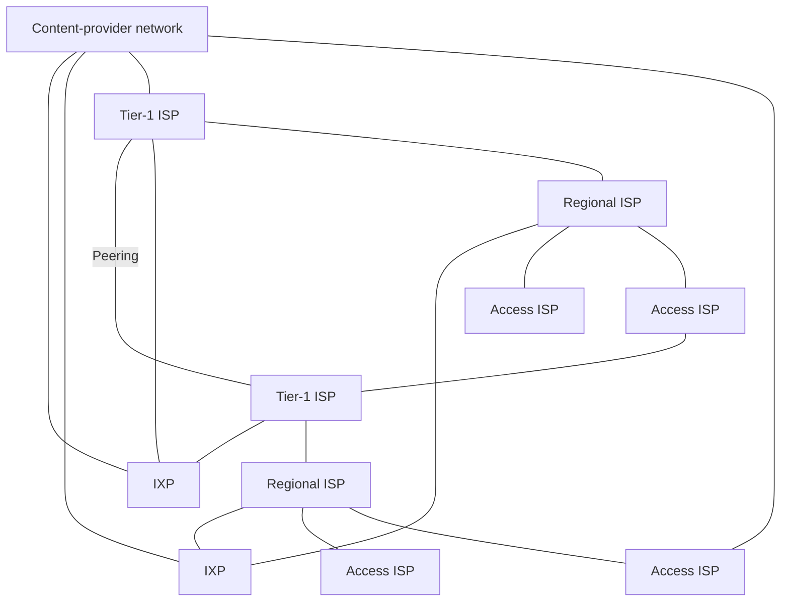

*Figure 23. Interconnection of ISPs in today's Internet*

In Figure 23, a line between an access ISP and a regional ISP is a customer-provider relationship, and an access ISP connected to two providers is multi-homed. In summary, today's Internet is a complex structure of a dozen or so tier-1 ISPs and hundreds of thousands of lower-tier ISPs. Lower-tier ISPs connect to higher-tier ISPs and higher-tier ISPs interconnect with one another; users and content providers are customers of lower-tier ISPs, and lower-tier ISPs are customers of higher-tier ISPs.

Forouzan describes the same structure with three levels: backbone ISPs, regional ISPs, and local ISPs. Backbone ISPs operate at high rates such as 10 Gbps and are connected to each other by switching stations called NAPs (network access points), normally run by a third party, and some regional ISPs are connected to each other by private switching stations called peering points. Local ISPs provide service directly to end users and may be companies that only provide Internet services, or corporations and universities that provide service to their own members.

| Kurose's name | Forouzan's name | Role |
|:-----|:-----|:-----|
| Tier-1 ISP | Backbone ISP | Top level, settlement-free peering with each other, pays no one |
| Regional ISP | Regional ISP | Middle level connecting access ISPs to tier-1 ISPs |
| Access ISP | Local ISP | Connects end users and content providers |
| IXP | NAP, peering point | Point where multiple ISPs meet to exchange traffic |

*Table 10. Correspondence of the names of the ISP levels*

---

<br>

## 7. Delay, Loss, and Throughput

An ideal Internet would move as much data as desired between any two end systems instantaneously and without loss. Real networks, however, constrain the **throughput** between end systems, that is, the amount of data that can be transferred per second, introduce delays, and lose packets. This section treats these three quantitatively.

### 7.1 The Four Components of Nodal Delay

A packet starts in a source host, passes through a series of routers, and ends in a destination host. At each node (host or router) along the path the packet suffers several types of delay, the most important of which are processing, queuing, transmission, and propagation delays. Together they make up the **nodal delay**.

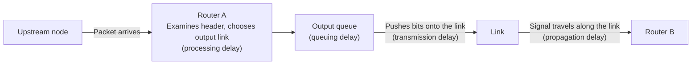

*Figure 24. The four components of nodal delay at router A*

> **Definition:** **Processing delay** is the time a router takes to examine a packet's header and determine where to direct the packet, and it may include the time to check for bit errors that occurred on the way from the upstream node.

> **Definition:** **Queuing delay** is the time a packet spends in a queue waiting to be transmitted onto the output link.

The first two delays are the time a packet spends being processed and waiting inside the router, and the last two are the time it takes to push the packet onto the link and send it along the link.

> **Definition:** **Transmission delay** is the time required to push all the bits of a packet onto the link, which is $L/R$ for a packet of $L$ bits and a link rate of $R$ bps.

> **Definition:** **Propagation delay** is the time a bit takes to travel from the beginning of a link to the next node, which is $d/s$ for a distance $d$ between the nodes and a propagation speed $s$ of the medium.

The propagation speed depends on the physical medium of the link (fiber, twisted pair, and so on) and is in the range 2 × 10⁸ m/s to 3 × 10⁸ m/s, equal to or a little less than the speed of light. Writing the four delays as $d_{\text{proc}}$, $d_{\text{queue}}$, $d_{\text{trans}}$, and $d_{\text{prop}}$, the nodal delay is as follows.

```math
d_{\text{nodal}} = d_{\text{proc}} + d_{\text{queue}} + d_{\text{trans}} + d_{\text{prop}}
```

| Delay | Cause | Calculation | Typical magnitude |
|:-----|:-----|:-----|:-----|
| Processing delay | Examining the header, choosing the output link, checking bit errors | Depends on router performance | Microseconds or less in high-speed routers |
| Queuing delay | Waiting in the output queue for earlier packets | Depends on the intensity and nature of the traffic | Microseconds to milliseconds |
| Transmission delay | Pushing all bits of the packet onto the link | $L/R$ | Microseconds to milliseconds |
| Propagation delay | Signal traveling along the medium | $d/s$ | Milliseconds in wide-area networks |

*Table 11. The four components of nodal delay*

The contributions of the four components vary widely. On a link between two routers on the same university campus, $d_{\text{prop}}$ is a few microseconds and negligible, but on a geostationary satellite link it is hundreds of milliseconds and dominates the nodal delay. $d_{\text{trans}}$ is likewise negligible on LANs of 10 Mbps and above, but it can reach hundreds of milliseconds when large packets are sent over slow dial-up modem links. $d_{\text{proc}}$ is often negligible, but it strongly influences a router's maximum throughput, the maximum rate at which the router can forward packets.

### 7.2 Distinguishing Transmission Delay from Propagation Delay

Newcomers often confuse transmission delay with propagation delay. Transmission delay is the time a router takes to push out a packet; it is a function of the packet length and the link rate and has nothing to do with the distance between the two routers. Propagation delay is the time a bit takes to travel from one router to the next; it is a function of the distance and has nothing to do with the packet length or the link rate.

Kurose's **caravan analogy** illustrates the difference. A highway has a tollbooth every 100 km; the highway segments between tollbooths correspond to links and the tollbooths to routers. A car accelerates to 100 km/hour as soon as it leaves a tollbooth (propagation). Ten cars travel together as a caravan in a fixed order; each car corresponds to a bit and the caravan to a packet. A tollbooth services (transmits) one car every 12 seconds, and the first car of the caravan waits at the tollbooth entrance until the other nine cars have arrived and lined up behind it (store-and-forward).

- Time for the tollbooth to push the whole caravan onto the highway: (10 cars) / (5 cars per minute) = 2 minutes, corresponding to transmission delay
- Time for a car to travel to the next tollbooth: 100 km / (100 km/hour) = 1 hour, corresponding to propagation delay
- Time from when the caravan is stored in front of one tollbooth until it is stored in front of the next: 2 minutes + 60 minutes = 62 minutes

Now suppose the cars travel at 1,000 km/hour and the tollbooth services one car per minute. Traveling between tollbooths takes 6 minutes and servicing the caravan takes 10 minutes, so the first cars arrive at the next tollbooth before the last cars leave the first. In a packet-switched network, too, the first bits of a packet can arrive at a router while the remaining bits are still waiting to be transmitted by the preceding router.

**Example.** A 1,500-byte packet is sent over a 10 Mbps link to a node 2,000 km away, with a propagation speed of 2 × 10⁸ m/s. The transmission delay is 12,000 / 10⁷ = 1.2 ms and the propagation delay is 2 × 10⁶ / (2 × 10⁸) = 10 ms, so ignoring processing and queuing delays the nodal delay is 11.2 ms.

### 7.3 Queuing Delay and Traffic Intensity

Unlike the other three delays, the queuing delay differs from packet to packet. If 10 packets arrive at an empty queue at the same time, for example, the first packet transmitted suffers no queuing delay, while the last waits until the other nine have been transmitted. Queuing delay is therefore described by statistics such as the average, the variance, and the probability of exceeding a given value.

The size of the queuing delay depends on the rate at which traffic arrives at the queue, the transmission rate of the link, and whether the traffic arrives periodically or in bursts. Let $a$ be the average rate at which packets arrive at the queue (packets/s), $L$ bits the length of every packet, and $R$ bps the link rate; the average rate at which bits arrive at the queue is then $La$ bps. Assume the queue is infinitely large.

> **Definition:** **Traffic intensity** is the ratio $La/R$ of the average rate at which bits arrive at a queue to the rate at which bits leave it.

If $La/R > 1$, bits arrive at the queue faster on average than they can leave it, so the queue grows without bound and the queuing delay approaches infinity. One of the golden rules of traffic engineering is therefore: **design your system so that the traffic intensity is no greater than 1**.

If $La/R \le 1$, the nature of the arriving traffic determines the queuing delay. If one packet arrives every $L/R$ seconds periodically, every packet arrives at an empty queue and there is no queuing delay. If instead $N$ packets arrive together every $(L/R)N$ seconds, the first packet has no queuing delay, the second has $L/R$, and in general the $n$-th packet has $(n-1)L/R$. The average queuing delay is then as follows.

```math
\frac{1}{N}\sum_{n=1}^{N} (n-1)\frac{L}{R} = \frac{N-1}{2}\cdot\frac{L}{R}
```

For $N = 5$, for example, the average queuing delay is $2L/R$. The traffic intensity is 1 in both cases, but a queuing delay arises only when the packets arrive in bursts.

In reality the arrival process is random and packets are spaced by random amounts of time, so $La/R$ alone does not fully characterize the queuing delay statistics. It nevertheless gives intuition. When the traffic intensity is close to 0, packets arrive rarely and are unlikely to find another packet in the queue, so the average queuing delay is close to 0. When the traffic intensity is close to 1, a queue forms during every interval in which the arrival rate temporarily exceeds the transmission capacity, and the average queue length grows larger and larger.

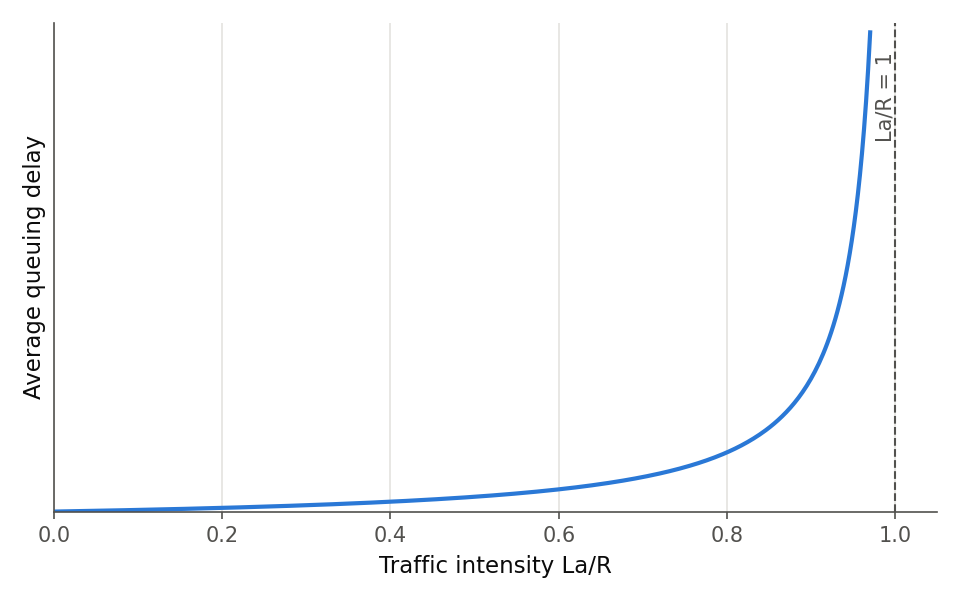

*Figure 25. Average queuing delay versus traffic intensity*

Figure 25 shows qualitatively how the average queuing delay depends on the traffic intensity. As the traffic intensity approaches 1, the average queuing delay increases rapidly, so a small increase in intensity causes a much larger percentage increase in delay. It is the same as a road that is usually congested, where a slightly larger amount of traffic causes huge delays.

**Example.** If 10,000-bit packets arrive at a 10 Mbps link at an average of 800 packets per second, the traffic intensity is (10,000 × 800) / 10⁷ = 0.8. The queuing delay is at the start of the region near 1, so if the arrival rate rises by 25% and the intensity reaches 1.0, the delay increases sharply.

### 7.4 Packet Loss

A real queue has finite capacity. As the traffic intensity approaches 1, therefore, the delay does not become infinite; instead an arriving packet finds the queue full. With no place to store the packet, the router **drops** it. From the viewpoint of an end system, a lost packet looks like a packet that entered the network core but never emerged at the destination. The fraction of lost packets increases with the traffic intensity, so the performance of a node is measured not only by delay but also by the probability of packet loss. A lost packet may be retransmitted end to end so that all data are eventually delivered, as Chapters 7 and 8 explain.

### 7.5 End-to-End Delay and traceroute

Suppose there are $N-1$ routers between the source host and the destination host, the network is uncongested so that queuing delays are negligible, and the processing delay at each router and at the source host is $d_{\text{proc}}$, the output rate is $R$, and the propagation delay on each link is $d_{\text{prop}}$. The nodal delays accumulate to give the end-to-end delay below.

```math
d_{\text{end-end}} = N\left(d_{\text{proc}} + d_{\text{trans}} + d_{\text{prop}}\right), \qquad d_{\text{trans}} = \frac{L}{R}
```

This formula generalizes $NL/R$ of Section 6.2, which ignored processing and propagation delays. If the delays differ from node to node or there is an average queuing delay, the delay of each node is simply added separately.

**traceroute** is a program for observing the end-to-end delays and paths of a real network. When the user specifies a destination host name, the source host sends several special packets toward the destination. If there are $N-1$ routers, the source sends $N$ packets marked 1 through $N$. When the $n$-th router receives the packet marked $n$, it does not forward the packet toward the destination but sends a message back to the source, and the destination host also returns a message when it receives the $N$-th packet. The source records the time from sending each packet until the reply arrives, together with the name and address of the router (or destination) that replied. In this way the source reconstructs the route and determines the round-trip delays to the intermediate routers. traceroute repeats the experiment three times, so it actually sends $3N$ packets. Chapter 16 covers the ICMP messages and the TTL field that traceroute uses for this operation.

The following is the traceroute output given by Kurose. The route was traced from the host gaia.cs.umass.edu at the University of Massachusetts to the host cis.poly.edu at Polytechnic University in Brooklyn.

```text
 1 cs-gw (128.119.240.254) 1.009 ms 0.899 ms 0.993 ms
 2 128.119.3.154 (128.119.3.154) 0.931 ms 0.441 ms 0.651 ms
 3 border4-rt-gi-1-3.gw.umass.edu (128.119.2.194) 1.032 ms 0.484 ms 0.451 ms
 4 acr1-ge-2-1-0.Boston.cw.net (208.172.51.129) 10.006 ms 8.150 ms 8.460 ms
 5 agr4-loopback.NewYork.cw.net (206.24.194.104) 12.272 ms 14.344 ms 13.267 ms
 6 acr2-loopback.NewYork.cw.net (206.24.194.62) 13.225 ms 12.292 ms 12.148 ms
 7 pos10-2.core2.NewYork1.Level3.net (209.244.160.133) 12.218 ms 11.823 ms 11.793 ms
 8 gige9-1-52.hsipaccess1.NewYork1.Level3.net (64.159.17.39) 13.081 ms 11.556 ms 13.297 ms
 9 p0-0.polyu.bbnplanet.net (4.25.109.122) 12.716 ms 13.052 ms 12.786 ms
10 cis.poly.edu (128.238.32.126) 14.080 ms 13.035 ms 12.802 ms
```

The first column of the output is the router number $n$, the second the router name, the third the router address, and the last three the round-trip delays measured in the three experiments. If the source receives fewer than three replies from a router (packet loss), traceroute places an asterisk after the router number and reports only the round-trip times it received.

This route has nine routers between the source and the destination. Router 3, for example, is named border4-rt-gi-1-3.gw.umass.edu with address 128.119.2.194, and its three round-trip delays are 1.03 ms, 0.48 ms, and 0.45 ms. These round-trip delays include all of the delays discussed above: transmission, propagation, router processing, and queuing. Because the queuing delay varies with time, the round-trip delay of a packet sent to router $n$ can be longer than that of a packet sent to router $n+1$. Indeed, in the output above the delays to router 6 are larger than the delays to router 7. The delay also jumps from about 1 ms to about 10 ms at router 4, the point where packets leave the university network and enter the ISP segment in Boston.

Delays also arise in the end systems themselves. An end system that uses a shared medium, as with Wi-Fi or a cable modem, may purposely delay its transmission as part of the protocol for sharing the medium with other end systems (Chapter 18). In Internet telephony (VoIP), the sender fills a packet with encoded speech before sending it, and the time to fill the packet, the **packetization delay**, can affect call quality.

### 7.6 Throughput

Besides delay and loss, an important performance measure is **end-to-end throughput**. Consider sending a large file from host A to host B.

> **Definition:** **Throughput** is the rate (in bps) at which the receiving host receives data; the rate at a given instant is the **instantaneous throughput**, and $F/T$ for a file of $F$ bits received in $T$ seconds is the **average throughput**.

Some applications, such as Internet telephony, need low delay and an instantaneous throughput consistently above a threshold (24 kbps for some Internet telephony applications, 256 kbps for some real-time video applications), while others, such as file transfer, do not care much about delay but benefit from the highest possible throughput.

Suppose a server and a client are connected by two links with a router between them. Let $R_s$ be the rate of the link between the server and the router and $R_c$ the rate of the link between the router and the client, and suppose this is the only transfer in the network. Thinking of bits as fluid and links as pipes, the server cannot pump bits faster than $R_s$ and the router cannot forward bits faster than $R_c$. If $R_s < R_c$ the throughput is $R_s$, and if $R_c < R_s$ bits back up at the router and the throughput is $R_c$. The throughput is therefore the rate of the **bottleneck link**, $\min\lbrace R_s, R_c \rbrace$. For a path of $N$ links with rates $R_1, R_2, \dots, R_N$, the throughput is likewise $\min\lbrace R_1, R_2, \dots, R_N \rbrace$. The time to send a large file of $F$ bits is approximately $F/\min\lbrace R_s, R_c \rbrace$. For example, downloading a 32-million-bit MP3 file from a server with $R_s$ = 2 Mbps over an access link with $R_c$ = 1 Mbps takes 32 seconds. This expression is an approximation that ignores store-and-forward and processing delays and protocol issues.

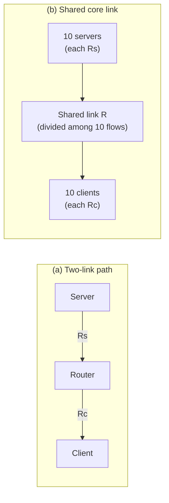

*Figure 26. Throughput on a two-link path and over a shared core link*

The core of today's Internet is over-provisioned with high-speed links and experiences little congestion. If the server and the client are connected by access links of $R_s$ and $R_c$ and all core links are much faster, the throughput is again $\min\lbrace R_s, R_c \rbrace$. The constraining factor for throughput in today's Internet is therefore typically the **access network**.

The situation changes when a core link is shared by many flows. Suppose 10 servers and 10 clients carry out 10 simultaneous downloads, all 10 downloads pass through one core link of rate $R$, and the shared link divides its rate equally among the 10 downloads. With $R_s$ = 2 Mbps, $R_c$ = 1 Mbps, and $R$ = 5 Mbps, each download gets 5 Mbps / 10 = 500 kbps on the shared link, so the bottleneck is no longer the access network but the shared link in the core, and the throughput of each download drops to 500 kbps. Throughput thus depends not only on the rates of the links along the path but also on the other traffic passing through them; a link with a high rate can still be the bottleneck if many flows pass through it.

> **Key Point:** Without other traffic, throughput is the rate of the slowest link on the path. When a link is shared with other flows, the share each flow gets on that link can become the bottleneck.

---

<br>

## 8. Networks Under Attack

The Internet has become indispensable to companies, universities, government agencies, and individuals. For the same reason there are attackers who try to damage Internet-connected computers, violate privacy, and disable Internet services. Network security deals with how attackers attack networks and how to defend against such attacks or design architectures immune to them in the first place, and Chapter 26 covers it in detail. This section surveys the representative attacks.

**Malware.** Along with useful data, malicious software can enter and infect devices over the Internet. Malware can delete files or install spyware that collects private information such as social security numbers, passwords, and keystrokes and sends it to the attacker. An infected host may be enrolled in a **botnet**, a network of thousands of compromised devices controlled by the attacker and used for spam distribution or distributed denial-of-service attacks. Most malware today is **self-replicating**: once it infects one host, it spreads from that host to other hosts, so it can spread exponentially fast. Malware spreads in the form of viruses or worms.

- **Virus:** Requires some form of user interaction to infect a device. The classic example is an e-mail attachment containing malicious executable code; when the user opens the attachment the malware runs and may send the same attachment to everyone in the user's address book.
- **Worm:** Enters a device without any explicit user interaction. An attacker may send malware to a vulnerable network application, which accepts and runs it; the worm in the newly infected device then looks for other hosts running the same vulnerable application and sends them copies of itself.

**Attacks on servers and network infrastructure.** A **denial-of-service (DoS) attack** renders a network, a host, or other infrastructure unusable by legitimate users. Web servers, mail servers, DNS servers (Chapter 5), and institutional networks can all be targets of DoS attacks.

> **Definition:** A **denial-of-service attack** is an attack that renders a network, a host, or other infrastructure unusable by legitimate users.

Most DoS attacks fall into three categories.

| Type | Method | Result |
|:-----|:-----|:-----|
| Vulnerability attack | Sends a few well-crafted messages to a vulnerable application or operating system on the target host | The service stops or the host crashes |
| Bandwidth flooding | Sends a deluge of packets to the target host | The target's access link is clogged and legitimate packets cannot reach the server |
| Connection flooding | Establishes a large number of half-open or fully open TCP connections at the target host | The host is bogged down by bogus connections and cannot accept legitimate ones |

*Table 12. The three categories of DoS attacks*

In a bandwidth-flooding attack, if the server's access rate is $R$ bps, the attacker must send traffic at roughly $R$ bps to cause damage. If the attack traffic comes from a single source, an upstream router may detect it and block all traffic from that source. Attackers therefore use **distributed DoS (DDoS) attacks**, in which the attacker controls multiple sources and has each blast traffic at the target; an aggregate rate of about $R$ across the controlled sources is enough to cripple the service. DDoS attacks that use botnets of thousands of compromised hosts are common, and they are much harder to detect and defend against than a DoS attack from a single host.

**Packet sniffing.** A passive receiver placed near a wireless transmitter can obtain a copy of every packet transmitted. These packets can contain passwords, social security numbers, trade secrets, and private messages. A passive receiver that records a copy of every packet that flies by is called a **packet sniffer**. Sniffers can be deployed in wired environments as well: in wired broadcast environments such as many Ethernet LANs, a sniffer can obtain copies of the packets broadcast on the LAN, and cable access, which broadcasts packets as Section 4.3 showed, is also vulnerable. An attacker who gains access to an institution's access router or access link can copy every packet going to and from the institution. Because sniffers are passive and inject no packets into the channel, they are difficult to detect, and the best defenses involve cryptography.

**IP spoofing.** It is surprisingly easy to create a packet with an arbitrary source address, packet content, and destination address and send it into the Internet. Sending packets with a false source address is called **IP spoofing**, and an attacker can use it to masquerade as another user, for example to send a command to modify a forwarding table. Countering it requires **end-point authentication**, a mechanism to determine with certainty whether a message originates from where it claims to, which Chapter 26 covers.

---

<br>

## 9. History of the Internet

| Period | Event |
|:-----|:-----|
| Early 1960s | While the telephone network was the dominant communication network, three research groups unaware of each other invented packet switching as an alternative to circuit switching: the first packet-switching work by MIT graduate student Leonard Kleinrock, Paul Baran at the Rand Institute in 1964, and Donald Davies and Roger Scantlebury at the National Physical Laboratory in England |
| 1967 | ARPA presented its plan for ARPANET at an ACM meeting, with each host attached to a dedicated computer called an IMP (interface message processor) and the IMPs connected to each other |
| 1969 | ARPANET became a reality with four nodes at UCLA, UCSB, SRI, and the University of Utah, with communication between hosts provided by the NCP (Network Control Protocol) |
| 1972 | ARPANET grew to about 15 nodes and was first demonstrated publicly by Robert Kahn, Ray Tomlinson wrote the first e-mail program, and Vinton Cerf and Kahn began work on connecting different networks |
| 1970s | The ALOHA protocol, the first multiple-access protocol, and Ethernet, built on it by Robert Metcalfe and David Boggs, appeared; by the end of the 1970s TCP, UDP, and IP were conceptually in place |
| 1973 | The paper by Cerf and Kahn outlined TCP with concepts such as encapsulation, the datagram, and the functions of a gateway, moving responsibility for error correction from the IMP to the host |
| 1977 | An internet of three networks (ARPANET, packet radio, and packet satellite) was demonstrated, after which TCP was split into TCP for higher-level functions and IP for datagram routing |
| 1981 | UC Berkeley included TCP/IP in UNIX, and the NSF-sponsored CSNET was established |
| 1983-01-01 | TCP/IP replaced NCP as the official host protocol of ARPANET; in the same year ARPANET split into the military MILNET and the nonmilitary ARPANET |
| 1986 | NSF created NSFNET to connect supercomputer centers (T-1 backbone) |
| Late 1980s | Host-based congestion control was added to TCP, and the number of hosts on the public Internet reached a hundred thousand |
| 1989-1991 | Tim Berners-Lee invented the World Wide Web at CERN |
| 1990 | ARPANET was officially retired |
| 1991 | NSFNET lifted its restrictions on commercial use, and IBM, Merit, and MCI built the high-speed backbone ANSNET |
| 1995 | NSFNET was decommissioned (Forouzan writes that it reverted to a research network) and commercial ISPs carried the backbone traffic; university students used Netscape browsers to surf the Web daily |

*Table 13. Major milestones of the Internet*

---

<br>

## Summary

| Concept | Key Summary |
|:-----|:-----|
| Internet | A network of networks made of end systems, communication links, packet switches, and ISPs, and an infrastructure that provides services to distributed applications through the socket interface. |
| Protocol | Defines the format and order of messages and the actions taken on sending, receiving, and other events; its key elements are syntax, semantics, and timing. |
| Standard | Guarantees interoperability; Internet standards are published by the IETF as RFCs and classified by maturity level and requirement level. |
| Access network | Connects end systems to the edge router; examples are dial-up, DSL, cable (HFC), FTTH, Ethernet, Wi-Fi, 3G, and LTE. |
| ADSL | Divides the local loop into voice, upstream, and downstream channels for asymmetric transmission, with theoretical rates of 1.44 Mbps upstream and 13.4 Mbps downstream. |
| Cable access | Divides the 5-750 MHz band into upstream, video, and downstream bands, and the upstream and downstream channels are shared by subscribers. |
| Physical media | Divided into guided media such as twisted pair, coaxial cable, and fiber, and unguided media such as terrestrial radio and satellite. |
| Packet switching | Reserves no resources and stores and forwards packet by packet; the delay of one packet over $N$ links is $NL/R$. |
| Circuit switching | Reserves resources with FDM or TDM during setup to guarantee a constant rate, but wastes them during idle periods. |
| Network of networks | Access, regional, and tier-1 ISPs form customer-provider relationships, with PoPs, multi-homing, peering, IXPs, and content-provider networks added. |
| Nodal delay | The sum of the processing delay, the queuing delay, the transmission delay $L/R$, and the propagation delay $d/s$. |
| Traffic intensity | $La/R$; as it approaches 1 the average queuing delay increases rapidly, and beyond 1 the queue grows without bound. |
| Throughput | Without other traffic, the rate of the bottleneck link of the path; today the access network is usually the bottleneck. |
| Network attacks | Malware (viruses, worms, botnets), DoS and DDoS, packet sniffing, and IP spoofing are the representative attacks. |

---

<br>

## Self-Check Questions

1. **Store-and-forward delay:** One 8,000-bit packet is sent over three links, all of rate 2 Mbps. Ignoring propagation, processing, and queuing delays, find the end-to-end delay. If four such packets are sent back to back, when does the last packet arrive?

   <details>
   <summary>Answer</summary>

   The transmission delay on one link is 8,000 / (2 × 10⁶) = 4 ms, and with store-and-forward the end-to-end delay of one packet is 3 × 4 = 12 ms. With four packets, the last packet arrives at (N + P - 1)L/R = (3 + 4 - 1) × 4 ms = 24 ms.

   </details>

2. **Circuit versus packet switching:** Users share a 1 Mbps link; each user generates data at 100 kbps when active and is active 10% of the time. Find the number of users circuit switching can support. With packet switching, what is the probability that 11 or more users are active at the same time when there are 10 users and when there are 35 users?

   <details>
   <summary>Answer</summary>

   Circuit switching reserves 100 kbps per user, so it supports 1 Mbps / 100 kbps = 10 users. With 10 users, 11 or more cannot be active at once, so the probability is 0. With 35 users, the number of active users follows the binomial distribution B(35, 0.1), and the probability of 11 or more is about 0.0004. Packet switching therefore supports more than three times as many users with essentially the same performance.

   </details>

3. **Transmission and propagation delay:** Two hosts are 2,500 km apart and the propagation speed is 2.5 × 10⁸ m/s. A 1,000-byte packet is sent over a 2 Mbps link. Find the propagation delay and the transmission delay, and explain which delay changes if the link rate is doubled.

   <details>
   <summary>Answer</summary>

   The propagation delay is 2.5 × 10⁶ / (2.5 × 10⁸) = 10 ms and the transmission delay is 8,000 / (2 × 10⁶) = 4 ms. Raising the rate to 4 Mbps reduces only the transmission delay, to 2 ms; the propagation delay depends only on the distance and the medium and stays at 10 ms.

   </details>

4. **Traffic intensity:** Explain what happens to the queuing delay as the traffic intensity $La/R$ approaches 1 and when it exceeds 1, and give a reason why queuing delay can occur even when the traffic intensity is below 1.

   <details>
   <summary>Answer</summary>

   As it approaches 1, intervals in which the arrival rate temporarily exceeds the transmission capacity occur often, so the average queue length and the average queuing delay increase rapidly. Beyond 1, the average arrival rate exceeds the transmission rate, so the queue grows without bound, and since real queues are finite, packet loss increases. Even below 1, if packets arrive in bursts, later packets wait until earlier ones are transmitted, so queuing delay occurs. For example, if N packets arrive at once, the nth packet waits (n - 1)L/R.

   </details>

5. **ADSL capacity:** If each ADSL channel uses 4 kHz and carries 15 bits per Hz, find the maximum rate of the 224 downstream data channels. Why is the actual downstream rate much lower?

   <details>
   <summary>Answer</summary>

   224 × 4,000 × 15 = 13,440,000 bps, about 13.4 Mbps. In practice the signal-to-noise ratio does not allow 15 bits/Hz per channel, and because ADSL is an adaptive technology that chooses its rate according to the condition of the local loop, the downstream rate is only about 500 kbps to 8 Mbps.

   </details>

6. **Throughput over a shared link:** The server access link is $R_s$ = 2 Mbps, the client access link is $R_c$ = 1 Mbps, and 10 downloads share one 5 Mbps core link equally. Find the throughput of each download. What if there are only 4 downloads?

   <details>
   <summary>Answer</summary>

   With 10 downloads, each gets 5 / 10 = 0.5 Mbps on the shared link, which is smaller than the access links, so the throughput is min(2, 1, 0.5) = 500 kbps. With 4 downloads, each gets 5 / 4 = 1.25 Mbps, so the throughput is min(2, 1, 1.25) = 1 Mbps and the bottleneck is again the client's access link.

   </details>

7. **Nodal delay calculation:** A 1,500-byte packet is sent over a 10 Mbps link to a node 2,000 km away. The propagation speed is 2 × 10⁸ m/s, and processing and queuing delays are ignored. Find the transmission delay, the propagation delay, and the nodal delay.

   <details>
   <summary>Answer</summary>

   The packet is 1,500 × 8 = 12,000 bits long, so the transmission delay is 12,000 / 10⁷ = 1.2 ms. The propagation delay is 2 × 10⁶ m divided by 2 × 10⁸ m/s, which is 10 ms. The nodal delay is 1.2 + 10 = 11.2 ms.

   </details>

8. **Bottleneck and transfer time:** The path from a server to a client consists of 100 Mbps, 20 Mbps, and 50 Mbps links. With no other traffic, what is the throughput, and how long does it take to send a 10 MB file? Take 1 MB = 10⁶ bytes and ignore delays.

   <details>
   <summary>Answer</summary>

   The throughput is the rate of the bottleneck link, 20 Mbps. 10 MB is 80 × 10⁶ bits, so the transfer time is 80 × 10⁶ / (20 × 10⁶) = 4 seconds.

   </details>

---

<br>

## References

1. R. Housley, D. Crocker, and E. Burger, "Reducing the Standards Track to Two Maturity Levels," RFC 6410, Oct. 2011. [Online]. Available: https://www.rfc-editor.org/rfc/rfc6410
