# 2장 — 프로토콜 계층과 네트워크 모델

[레포지토리 안내](../../README.ko.md) | [English](Concepts_Lecture.md) | [한국어](Concepts_Lecture.ko.md)

> **최종 수정일:** 2026-11-18
>
> Computer Networking: A Top-Down Approach, Kurose and Ross, Ch 1; TCP/IP Protocol Suite, Forouzan, Ch 2

> **학습 목표:**
> 1. 통신의 다섯 구성 요소와 복잡한 통신을 여러 계층으로 나누는 이유를 예를 들어 설명할 수 있다
> 2. 계층 구조의 서비스 모델과 장점, 단점을 설명할 수 있다
> 3. OSI 모델의 일곱 계층이 맡는 기능을 구분하고, 피어 프로세스와 계층 사이 인터페이스의 역할을 설명할 수 있다
> 4. TCP/IP 프로토콜 스위트의 계층별 통신 단위, 통신 범위, 대표 프로토콜을 설명하고 OSI 모델과 비교할 수 있다
> 5. 물리 주소, 논리 주소, 포트 주소, 응용 특정 주소가 쓰이는 위치를 예제로 추적할 수 있다
> 6. 호스트, 스위치, 라우터에서 일어나는 캡슐화와 역캡슐화, 다중화와 역다중화를 설명할 수 있다

---

## 목차

- [1. 프로토콜 계층화](#1-프로토콜-계층화)
  - [1.1 통신의 구성 요소](#11-통신의-구성-요소)
  - [1.2 한 계층으로 이루어지는 통신](#12-한-계층으로-이루어지는-통신)
  - [1.3 세 계층으로 이루어지는 통신](#13-세-계층으로-이루어지는-통신)
  - [1.4 항공 여행으로 본 계층 구조](#14-항공-여행으로-본-계층-구조)
  - [1.5 계층화의 장점과 단점](#15-계층화의-장점과-단점)
- [2. OSI 모델](#2-osi-모델)
  - [2.1 ISO와 OSI 모델](#21-iso와-osi-모델)
  - [2.2 계층 간 통신과 계층 사이의 인터페이스](#22-계층-간-통신과-계층-사이의-인터페이스)
  - [2.3 OSI 모델의 데이터 교환과 캡슐화](#23-osi-모델의-데이터-교환과-캡슐화)
  - [2.4 물리 계층](#24-물리-계층)
  - [2.5 데이터 링크 계층](#25-데이터-링크-계층)
  - [2.6 네트워크 계층](#26-네트워크-계층)
  - [2.7 전송 계층](#27-전송-계층)
  - [2.8 세션 계층](#28-세션-계층)
  - [2.9 표현 계층](#29-표현-계층)
  - [2.10 응용 계층](#210-응용-계층)
  - [2.11 OSI 계층의 요약](#211-osi-계층의-요약)
- [3. TCP/IP 프로토콜 스위트](#3-tcpip-프로토콜-스위트)
  - [3.1 다섯 계층](#31-다섯-계층)
  - [3.2 OSI 모델과의 대응](#32-osi-모델과의-대응)
  - [3.3 사설 인터넷으로 본 계층별 통신](#33-사설-인터넷으로-본-계층별-통신)
  - [3.4 계층별 프로토콜](#34-계층별-프로토콜)
  - [3.5 Kurose의 인터넷 프로토콜 스택](#35-kurose의-인터넷-프로토콜-스택)
- [4. OSI 모델과 TCP/IP의 비교](#4-osi-모델과-tcpip의-비교)
- [5. 주소 지정](#5-주소-지정)
  - [5.1 네 단계의 주소](#51-네-단계의-주소)
  - [5.2 물리 주소](#52-물리-주소)
  - [5.3 논리 주소](#53-논리-주소)
  - [5.4 포트 주소](#54-포트-주소)
  - [5.5 응용 특정 주소](#55-응용-특정-주소)
- [6. 캡슐화와 역캡슐화](#6-캡슐화와-역캡슐화)
  - [6.1 호스트, 스위치, 라우터에서의 캡슐화](#61-호스트-스위치-라우터에서의-캡슐화)
  - [6.2 인터넷 경로 전체에서 본 계층](#62-인터넷-경로-전체에서-본-계층)
- [7. 다중화와 역다중화](#7-다중화와-역다중화)
- [요약](#요약)
- [점검 문제](#점검-문제)

---

<br>

## 1. 프로토콜 계층화

### 1.1 통신의 구성 요소

1장에서 본 것처럼 두 개체가 통신하려면 프로토콜이 필요하다. 통신이 단순하지 않으면 복잡한 통신 작업을 여러 **계층(layer)** 으로 나누고, 계층마다 하나씩 여러 프로토콜을 둔다. 계층화를 이해하려면 먼저 통신에 무엇이 관여하는지를 알아야 한다. 데이터 통신은 다섯 가지 구성 요소로 이루어진다.

| 구성 요소 | 뜻 | 예 |
|:-----|:-----|:-----|
| 메시지(message) | 전달할 정보(데이터) | 텍스트, 숫자, 그림, 소리, 비디오, 또는 이들의 조합 |
| 송신자(sender) | 데이터 메시지를 보내는 장치 | 컴퓨터, 워크스테이션, 전화기, 비디오카메라 |
| 수신자(receiver) | 메시지를 받는 장치 | 컴퓨터, 워크스테이션, 전화기, 비디오카메라 |
| 매체(medium) | 메시지가 송신자에서 수신자로 이동하는 물리적 경로 | 꼬임 쌍선, 동축 케이블, 광섬유, 레이저, 지상 마이크로파나 위성 마이크로파 같은 전파 |
| 프로토콜(protocol) | 데이터 통신을 지배하는 규칙의 집합 | 송신자와 수신자가 각각 따르는 단계별 절차 |

*표 1. 데이터 통신의 다섯 구성 요소*

송신자와 수신자는 각자 같은 프로토콜의 단계(1단계, 2단계, 3단계 ...)를 따르고, 메시지는 매체를 통해 송신자에서 수신자로 이동한다. 통신이 복잡해지면 이 프로토콜을 하나로 두지 않고 여러 계층으로 나누는데, 다음 두 예제가 그 이유를 보여 준다.

### 1.2 한 계층으로 이루어지는 통신

**예제 2.1.** 마리아와 앤은 생각이 잘 통하는 이웃이다. 마리아는 스페인어만, 앤은 영어만 하지만 두 사람 모두 어릴 때 수화를 배웠으므로, 일주일에 두어 번 카페에서 만나 수화로 생각을 나눈다. 통신은 얼굴을 마주 보고 이루어지며 계층 하나로 충분하다.

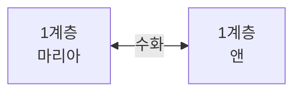

*그림 1. 한 계층으로 이루어지는 통신*

### 1.3 세 계층으로 이루어지는 통신

**예제 2.2.** 앤이 직장 때문에 다른 도시로 이사하게 되자, 마리아는 작은 기계 두 대를 선물한다. 첫 번째 기계는 영어 편지를 읽어 비밀 부호로 바꾸거나 그 반대로 바꾸고, 두 번째 기계는 스페인어 편지를 같은 비밀 부호로 바꾸거나 그 반대로 바꾼다. 앤은 첫 번째 기계를, 마리아는 두 번째 기계를 가진다. 두 사람은 이제 비밀 부호로 통신한다.

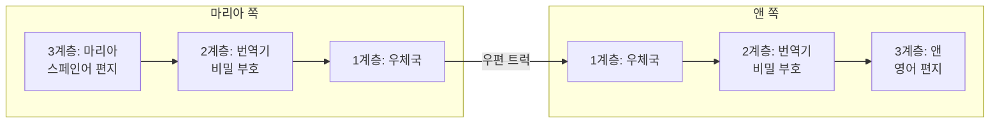

*그림 2. 세 계층으로 이루어지는 통신*

마리아는 3계층에서 자신이 편한 스페인어로 편지를 쓰고, 2계층의 번역기로 편지를 비밀 부호로 바꾼 뒤, 봉투에 넣어 1계층의 우체통에 넣는다. 편지는 우편 트럭에 실려 앤이 사는 도시의 우체국으로 가고, 앤의 집에 배달된다. 앤은 자신의 기계로 비밀 부호를 영어 편지로 바꾼다. 앤이 마리아에게 보낼 때는 같은 과정이 반대 방향으로 일어난다. 양쪽 모두 비밀 부호를 이해하지 못하지만, 계층으로 나눈 통신 덕분에 생각을 주고받을 수 있다. 각 계층은 자기만의 "언어"(스페인어나 영어, 비밀 부호, 우편 규칙)를 쓰고, 계층마다 맡은 역할이 나뉘어 있다.

이 예제에서 두 가지 개념이 나온다.

- **계층 구조(hierarchy):** 송신 쪽에는 세 가지 활동이, 수신 쪽에도 세 가지 활동이 있고, 이 활동은 정해진 순서대로 일어나야 한다. 송신 쪽에서는 편지를 쓰고, 비밀 부호로 바꾸고, 우체통에 넣은 뒤에야 우편 트럭이 가져갈 수 있다. 수신 쪽에서는 편지가 수신자의 우편함에 들어간 뒤에야 수신자가 꺼내 읽을 수 있다.
- **서비스(service):** 송신 쪽의 각 계층은 바로 아래 계층의 서비스를 이용한다. 위 계층의 사람은 가운데 계층(번역기)의 서비스를, 가운데 계층은 아래 계층(우체국)의 서비스를, 아래 계층은 운송 업자의 서비스를 이용한다.

> **용어 정의:** **계층 구조(layered architecture)** 는 복잡한 통신 기능을 순서가 있는 여러 계층으로 나누고, 각 계층이 바로 아래 계층의 서비스를 이용하여 바로 위 계층에 서비스를 제공하게 하는 설계 방식이다.

### 1.4 항공 여행으로 본 계층 구조

Kurose는 항공 시스템으로 계층 구조를 설명한다. 비행기 여행은 항공권 구매, 수하물 부치기, 탑승구 통과, 비행기 탑승, 이륙, 항로 비행으로 이어지고, 도착하면 착륙, 탑승구에서 내리기, 수하물 찾기, 그리고 여행이 불만족스러웠다면 항공권 창구에 항의하기가 이어진다. 이 동작을 수평으로 나누면 각 기능이 출발지와 도착지에 쌍으로 있음을 알 수 있다.

| 계층 | 출발지의 동작 | 도착지의 동작 | 이 계층과 아래 계층이 함께 제공하는 서비스 |
|:-----|:-----|:-----|:-----|
| 항공권 | 항공권 구매 | 항공권 창구에 항의 | 항공권 창구에서 항공권 창구까지 사람을 옮김 |
| 수하물 | 수하물 부치기 | 수하물 찾기 | 수하물을 부친 곳에서 찾는 곳까지 사람과 짐을 옮김 |
| 탑승구 | 탑승 | 하기 | 출발 탑승구에서 도착 탑승구까지 사람과 짐을 옮김 |
| 이착륙 | 이륙 | 착륙 | 활주로에서 활주로까지 사람과 짐을 옮김 |
| 항로 | 항로 비행 | 항로 비행 | 비행기를 목적지로 보냄 |

*표 2. 항공 여행 기능의 수평 계층화*

각 계층은 아래 계층들과 함께 어떤 기능, 곧 **서비스**를 구현한다. 예를 들어 수하물 계층은 이미 항공권을 산 사람에게만 서비스를 제공한다. 각 계층은 (1) 그 계층 안에서 어떤 동작을 하고(탑승구 계층이라면 비행기에 사람을 태우고 내림), (2) 바로 아래 계층의 서비스를 이용하여(탑승구 계층은 이착륙 계층의 활주로 간 이동 서비스를 이용함) 자신의 서비스를 제공한다.

네트워크 프로토콜도 같은 방식으로 계층화한다. 각 프로토콜은 한 계층에 속하며, 한 계층이 바로 위 계층에 제공하는 서비스를 그 계층의 **서비스 모델(service model)** 이라 한다. 예를 들어 $n$계층의 서비스가 네트워크 한쪽 끝에서 다른 쪽 끝으로의 신뢰적 메시지 전달이라면, 이는 신뢰성이 없는 $n-1$계층의 전달 서비스를 이용하고 그 위에 잃어버린 메시지를 탐지하여 재전송하는 기능을 더해 구현할 수 있다.

> **용어 정의:** **서비스 모델(service model)** 은 한 계층이 바로 위 계층에 제공하는 서비스의 내용이다.

프로토콜 계층은 소프트웨어, 하드웨어, 또는 둘의 조합으로 구현된다. HTTP, SMTP 같은 응용 계층 프로토콜과 전송 계층 프로토콜은 거의 항상 종단 시스템의 소프트웨어로 구현된다. 물리 계층과 데이터 링크 계층은 특정 링크의 통신을 다루므로 이더넷 카드나 Wi-Fi 카드 같은 **네트워크 인터페이스 카드(network interface card, NIC)** 와 그 드라이버에서 구현되는 경우가 많다. 네트워크 계층은 하드웨어와 소프트웨어가 섞인 구현이 많다. 따라서 컴퓨터의 관점에서 보면 응용 계층은 프로세스와 소켓으로, 전송 계층과 네트워크 계층은 운영 체제의 TCP/IP 소프트웨어로, 데이터 링크 계층과 물리 계층은 NIC와 드라이버로 대응된다. 또한 항공 시스템의 기능이 여러 공항과 관제 센터에 흩어져 있듯이, $n$계층 프로토콜도 종단 시스템, 패킷 스위치 같은 여러 구성 요소에 나뉘어 있다.

### 1.5 계층화의 장점과 단점

계층 구조는 크고 복잡한 시스템의 잘 정의된 한 부분을 따로 논의할 수 있게 하고, **모듈성(modularity)** 을 주어 한 계층의 서비스 구현을 바꾸기 쉽게 한다. 한 계층이 위 계층에 같은 서비스를 제공하고 아래 계층의 같은 서비스를 이용하는 한, 그 계층의 구현을 바꾸어도 시스템의 나머지는 바뀌지 않는다. 예를 들어 탑승구 계층이 사람을 키 순서로 태우도록 바뀌어도 사람을 태우고 내리는 기능은 그대로이므로 항공 시스템의 나머지는 바뀌지 않는다. 다만 서비스의 구현을 바꾸는 것과 서비스 자체를 바꾸는 것은 다르다.

계층화에는 단점도 있다. 첫째, 한 계층이 아래 계층의 기능을 중복할 수 있다. 예를 들어 많은 프로토콜 스택은 오류 복구를 링크 단위와 종단 간 단위에서 모두 한다. 둘째, 한 계층의 기능이 다른 계층에만 있는 정보(예: 타임스탬프 값)를 필요로 할 수 있는데, 이는 계층 분리의 목표에 어긋난다.

> **핵심:** 계층화는 복잡한 통신을 계층마다 맡은 일로 나누어, 각 계층이 아래 계층의 서비스만 이용하여 위 계층에 서비스를 제공하게 한다. 그 결과 시스템을 체계적으로 논의하고 구현을 독립적으로 바꿀 수 있지만, 기능이 중복되거나 계층 사이의 정보가 필요해지는 대가가 따른다.

---

<br>

## 2. OSI 모델

### 2.1 ISO와 OSI 모델

1947년에 설립된 **국제 표준화 기구(International Organization for Standardization, ISO)** 는 국제 표준에 대한 세계적 합의를 목표로 하는 다국적 기구이며, 세계 국가의 약 4분의 3이 참여한다. 네트워크 통신의 모든 측면을 다루는 ISO 표준이 **OSI(Open Systems Interconnection) 모델**이며, 1970년대 말에 처음 소개되었다. ISO는 기구의 이름이고 OSI는 모델의 이름이다.

**개방 시스템(open system)** 은 내부 구조가 다른 두 시스템이 서로 통신할 수 있게 하는 프로토콜의 집합이다. OSI 모델의 목적은 하드웨어와 소프트웨어의 내부 논리를 바꾸지 않고도 서로 다른 시스템 사이의 통신을 가능하게 하는 방법을 보여 주는 것이다. OSI 모델은 프로토콜이 아니라 유연하고 견고하며 상호 운용 가능한 네트워크 구조를 이해하고 설계하기 위한 모델이며, OSI 프로토콜 스택을 만드는 기반이 되도록 의도되었다.

> **용어 정의:** **OSI 모델(OSI model)** 은 ISO가 제정한, 네트워크 통신을 물리, 데이터 링크, 네트워크, 전송, 세션, 표현, 응용의 일곱 계층으로 나누어 설명하는 참조 모델이다.

OSI 모델은 순서가 있는 일곱 계층, 곧 물리 계층(1계층), 데이터 링크 계층(2계층), 네트워크 계층(3계층), 전송 계층(4계층), 세션 계층(5계층), 표현 계층(6계층), 응용 계층(7계층)으로 이루어진다. 설계자들은 데이터 전송 과정을 가장 기본적인 요소로 정리하여, 관련된 용도를 가진 네트워크 기능을 모아 계층을 만들었다. 각 계층은 다른 계층과 구별되는 기능의 묶음을 정의하며, 이렇게 기능을 나누어 자리 잡게 함으로써 포괄적이면서도 유연한 구조가 된다.

### 2.2 계층 간 통신과 계층 사이의 인터페이스

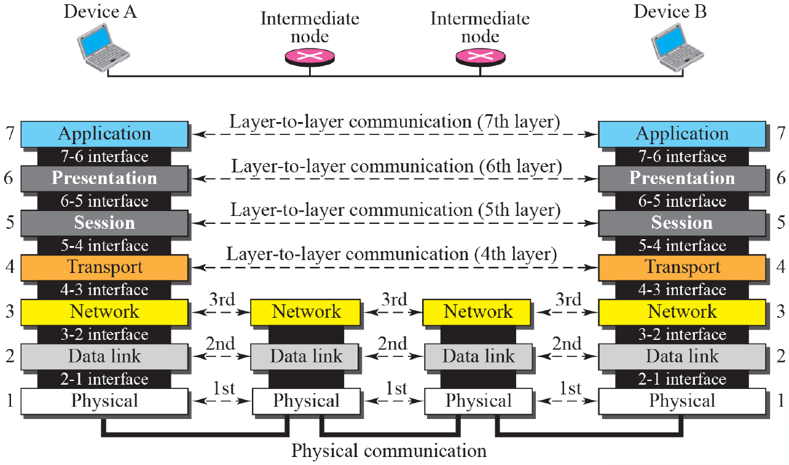

*그림 3. 장치 A에서 중간 노드를 거쳐 장치 B로 가는 OSI 계층*

그림 3은 장치 A가 장치 B로 메시지를 보낼 때 관여하는 계층을 보여 준다. 메시지는 A에서 B로 가는 동안 여러 **중간 노드(intermediate node)** 를 지날 수 있으며, 중간 노드는 보통 OSI 모델의 처음 세 계층(물리, 데이터 링크, 네트워크)만 쓴다. 4\~7계층은 데이터를 다음 노드로 전달하는 데 필요하지 않기 때문이다.

한 기계 안에서 각 계층은 바로 아래 계층의 서비스를 이용한다. 예를 들어 3계층은 2계층의 서비스를 이용하고 4계층에 서비스를 제공한다. 기계와 기계 사이에서는 한 기계의 $x$계층이 다른 기계의 $x$계층과 **논리적으로** 통신하며, 이 통신을 지배하는 규칙과 관례가 프로토콜이다. 각 기계에서 같은 계층끼리 통신하는 프로세스를 **피어 프로세스(peer-to-peer process)** 라 한다. 실제 물리적 통신은 1계층에서만 일어난다. 송신 쪽에서 메시지는 7계층에서 1계층까지 내려가고, 1계층에서 전송할 수 있는 형태로 바뀌어 전달된 뒤, 수신 쪽에서 1계층에서 7계층까지 올라간다.

> **용어 정의:** **피어 프로세스(peer-to-peer process)** 는 서로 다른 기계의 같은 계층에서 그 계층의 프로토콜에 따라 논리적으로 통신하는 프로세스이다.

데이터와 네트워크 정보가 송신 장치의 계층을 따라 내려가고 수신 장치의 계층을 따라 올라갈 수 있는 것은 인접한 두 계층 사이마다 **인터페이스(interface)** 가 있기 때문이다(그림 3의 7-6 인터페이스, 6-5 인터페이스 등). 인터페이스는 한 계층이 바로 위 계층에 제공해야 하는 정보와 서비스를 정의한다. 인터페이스와 계층의 기능이 잘 정의되어 있으면, 한 계층이 위 계층에 기대되는 서비스를 제공하는 한 그 기능의 구현을 바꾸거나 교체해도 주변 계층을 바꿀 필요가 없다.

일곱 계층은 세 무리로 볼 수 있다. 1\~3계층(물리, 데이터 링크, 네트워크)은 전기적 규격, 물리적 연결, 물리 주소 지정, 전송 시점과 신뢰성처럼 한 장치에서 다른 장치로 데이터를 옮기는 물리적 측면을 다루는 **네트워크 지원 계층(network support layers)** 이다. 5\~7계층(세션, 표현, 응용)은 서로 관련 없는 소프트웨어 시스템 사이의 상호 운용성을 제공하는 **사용자 지원 계층(user support layers)** 이다. 4계층인 전송 계층은 두 무리를 잇고, 아래 계층이 전달한 것을 위 계층이 쓸 수 있는 형태로 만든다. 위쪽 계층은 거의 항상 소프트웨어로 구현되고, 아래쪽 계층은 하드웨어와 소프트웨어의 조합이며, 물리 계층은 대부분 하드웨어이다.

### 2.3 OSI 모델의 데이터 교환과 캡슐화

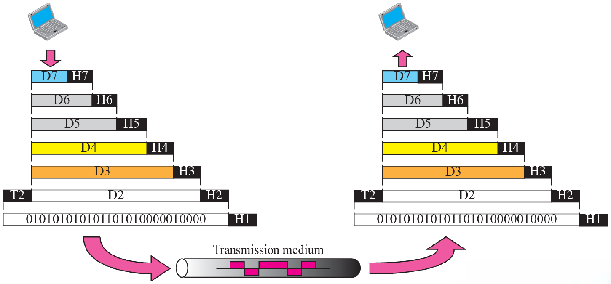

*그림 4. OSI 모델을 이용한 데이터 교환*

그림 4에서 D7은 7계층의 데이터 단위, D6은 6계층의 데이터 단위를 뜻한다. 과정은 7계층(응용 계층)에서 시작하여 위에서 아래로 차례로 진행된다. 각 계층에서 데이터 단위에 헤더(H7, H6, ...)가 붙고, 2계층에서는 트레일러(T2)도 붙을 수 있다. 형식을 갖춘 데이터 단위가 1계층(물리 계층)을 지나면 전자기 신호로 바뀌어 물리 링크를 따라 전달된다. 목적지에서 신호는 1계층으로 들어가 디지털 형태로 되돌아가고, 데이터 단위는 OSI 계층을 따라 올라간다. 각 데이터 블록이 다음 위 계층에 도달하면, 송신 쪽의 같은 계층에서 붙인 헤더와 트레일러가 제거되고 그 계층에 맞는 동작이 수행된다. 7계층에 이르면 메시지는 다시 응용에 맞는 형태가 되어 수신자에게 전달된다.

그림 4는 **캡슐화(encapsulation)** 도 보여 준다. 7계층의 패킷은 6계층의 패킷 안에 캡슐화되고, 6계층의 패킷 전체는 5계층의 패킷 안에 캡슐화되는 식이다. 다시 말해 $N$계층 패킷의 데이터 부분은 $N+1$계층에서 온 패킷 전체(데이터와 헤더)를 운반한다. $N$계층은 캡슐화된 패킷의 어느 부분이 데이터이고 어느 부분이 헤더나 트레일러인지 알지 못하며, $N+1$계층에서 온 패킷 전체를 하나의 단위로 취급한다. 그래서 송신 쪽에서 데이터 단위는 "데이터 + 헤더", "(데이터 + 헤더) + 헤더", "((데이터 + 헤더) + 헤더) + 헤더"처럼 겹겹이 싸이고, 수신 쪽에서는 이 과정을 거꾸로 하는 **역캡슐화(decapsulation)** 가 일어난다.

### 2.4 물리 계층

**물리 계층(physical layer)** 은 비트의 흐름을 물리 매체로 전달하는 데 필요한 기능을 조정하며, 비트를 한 노드에서 다음 노드로 옮기는 데 관심을 둔다. 물리 계층은 인터페이스와 전송 매체의 기계적, 전기적 규격을 다루고, 전송이 일어나기 위해 물리 장치와 인터페이스가 해야 할 절차와 기능을 정의한다. 물리 계층이 다루는 사항은 다음과 같다.

- **인터페이스와 매체의 물리적 특성:** 장치와 전송 매체 사이 인터페이스의 특성과 전송 매체의 종류를 정한다.
- **비트의 표현(부호화):** 물리 계층의 데이터는 해석되지 않은 0과 1의 흐름이다. 전송하려면 비트를 전기 신호나 빛 신호로 **부호화(encoding)** 해야 하며, 물리 계층은 0과 1을 신호로 바꾸는 방식을 정한다.
- **데이터 전송률:** 초당 보내는 비트 수, 곧 비트 하나의 지속 시간을 정한다.
- **비트의 동기화:** 송신자와 수신자는 같은 비트 전송률을 쓸 뿐 아니라 비트 수준에서 동기화되어야 한다. 다시 말해 송신자와 수신자의 클록이 맞아야 한다.
- **회선 구성:** 장치와 매체의 연결 방식이다. **점대점 구성(point-to-point configuration)** 에서는 두 장치가 전용 링크로 연결되고, **다중점 구성(multipoint configuration)** 에서는 여러 장치가 링크 하나를 공유한다.
- **물리적 토폴로지:** 장치들이 연결되어 네트워크를 이루는 노드의 물리적 배치이다. 모든 장치가 다른 모든 장치와 연결되는 **메시(mesh)**, 장치가 중앙 장치를 통해 연결되는 **스타(star)**, 각 장치가 다음 장치와 연결되어 고리를 이루는 **링(ring)**, 모든 장치가 공통 링크 하나에 연결되는 **버스(bus)** 가 있다.
- **전송 모드:** 두 장치 사이의 전송 방향이다. **단방향(simplex)** 모드에서는 한 장치만 보내고 다른 장치는 받기만 한다. **반이중(half-duplex)** 모드에서는 두 장치가 모두 보내고 받을 수 있지만 동시에는 할 수 없으며, 채널 하나를 번갈아 쓰는 무전기가 그 예이다. **전이중(full-duplex)** 모드에서는 두 장치가 동시에 보내고 받을 수 있다.

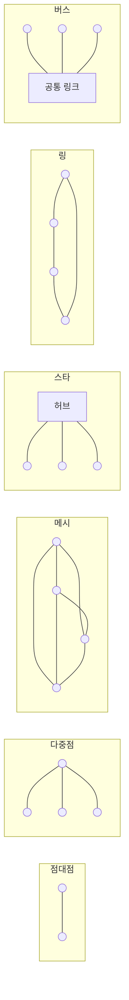

*그림 5. 회선 구성과 물리적 토폴로지*

### 2.5 데이터 링크 계층

**데이터 링크 계층(data link layer)** 은 원시 전송 설비인 물리 계층을 신뢰할 수 있는 링크로 바꾸어, 위 계층(네트워크 계층)이 보기에 물리 계층에 오류가 없는 것처럼 만든다. 데이터 링크 계층은 프레임의 전달에 관심을 두며, 다음을 맡는다.

- **프레이밍(framing):** 네트워크 계층에서 받은 비트의 흐름을 **프레임(frame)** 이라는 다루기 쉬운 데이터 단위로 나눈다. 다시 말해 비트를 모아 의미 있는 단위로 만든다.
- **물리 주소 지정(physical addressing):** 프레임을 네트워크의 여러 시스템에 나누어 보내야 하면, 프레임에 헤더를 붙여 송신자나 수신자, 곧 누구에게 보내는 데이터인지를 정의한다. 이 주소는 하드웨어 주소(MAC 주소)이다. 프레임이 송신자의 네트워크 밖의 시스템으로 가야 하면, 수신자 주소는 그 네트워크를 다음 네트워크에 연결하는 연결 장치의 주소가 된다.
- **흐름 제어(flow control):** 수신자가 데이터를 받아들이는 속도가 송신자가 데이터를 만드는 속도보다 느리면, 수신자가 넘치지 않도록 흐름 제어를 한다. 데이터 링크 계층의 흐름 제어는 한 홉(hop-to-hop) 단위이다.
- **오류 제어(error control):** 손상되거나 잃어버린 프레임을 검출하여 재전송하는 메커니즘과 중복 프레임을 알아보는 메커니즘을 더해 물리 계층에 신뢰성을 준다. 오류 제어는 보통 프레임 끝에 붙인 **트레일러(trailer)** 로 한다. 송신자와 수신자가 정한 규칙으로 트레일러를 검사하여 오류를 판단하고, 오류가 있으면 재전송을 요청한다.
- **접근 제어(access control):** 둘 이상의 장치가 같은 링크에 연결되어 있으면, 어느 순간에 어느 장치가 링크를 차지하여 신호를 보낼지 정해야 한다.

### 2.6 네트워크 계층

**네트워크 계층(network layer)** 은 패킷을 여러 네트워크(링크)를 거쳐 출발지에서 목적지까지 전달하는 **출발지-목적지 전달(source-to-destination delivery)** 을 맡는다. 데이터 링크 계층이 같은 네트워크(링크) 위의 두 시스템 사이의 전달을 감독한다면, 네트워크 계층은 각 패킷이 출발 지점에서 최종 목적지까지 가도록 보장한다. 두 시스템이 같은 링크에 연결되어 있으면 보통 네트워크 계층이 필요 없지만, 서로 다른 네트워크에 연결되어 있고 그 사이에 연결 장치가 있으면 네트워크 계층이 필요하다.

- **논리 주소 지정(logical addressing):** 데이터 링크 계층의 물리 주소 지정은 주소 문제를 지역적으로만 해결한다. 패킷이 네트워크 경계를 넘어가면 출발지와 목적지 시스템을 구별할 다른 주소 체계가 필요하다. 네트워크 계층은 위 계층에서 온 패킷에 송신자와 수신자의 논리 주소를 담은 헤더를 붙인다. 이 주소는 소프트웨어가 정하는 주소(IP 주소)이다.
- **라우팅(routing):** 독립적인 네트워크나 링크를 연결하여 인터네트워크(네트워크의 네트워크)를 만들면, 연결 장치(라우터나 스위치)가 패킷을 최종 목적지로 보내야 한다. 네트워크 계층은 이 메커니즘을 제공한다.

### 2.7 전송 계층

**전송 계층(transport layer)** 은 메시지 전체의 **프로세스-프로세스 전달(process-to-process delivery)** 을 맡는다. 프로세스는 호스트에서 실행 중인 응용 프로그램이다. 네트워크 계층은 각 패킷의 출발지-목적지 전달을 감독하지만 패킷 사이의 관계는 알지 못하고, 각 패킷을 서로 다른 메시지에 속한 것처럼 독립적으로 다룬다. 반면 전송 계층은 메시지 전체가 손상 없이 순서대로 도착하도록 출발지-목적지 수준에서 오류 제어와 흐름 제어를 감독한다.

- **서비스 지점 주소 지정(service-point addressing):** 컴퓨터는 여러 프로그램을 동시에 실행하므로, 출발지-목적지 전달은 한 컴퓨터에서 다음 컴퓨터로의 전달일 뿐 아니라 한 컴퓨터의 특정 프로세스에서 다른 컴퓨터의 특정 프로세스로의 전달이어야 한다. 그래서 전송 계층 헤더에는 **서비스 지점 주소(service-point address)**, 곧 **포트 주소(port address)** 가 들어간다. 네트워크 계층은 각 패킷을 올바른 컴퓨터로, 전송 계층은 메시지 전체를 그 컴퓨터의 올바른 프로세스로 보낸다.
- **분할과 재조립(segmentation and reassembly):** 메시지를 전송할 수 있는 세그먼트로 나누고 각 세그먼트에 순서 번호를 붙인다. 목적지의 전송 계층은 이 번호로 받은 조각을 올바르게 이어 메시지를 재조립하고, 전송 중에 잃어버린 패킷을 찾아 대체한다.
- **연결 제어(connection control):** 전송 계층은 비연결형일 수도 있고 연결형일 수도 있다. **비연결형(connectionless)** 전송 계층은 각 세그먼트를 독립적인 패킷으로 다루어 목적지의 전송 계층에 전달하며, UDP가 그 예이다. **연결형(connection-oriented)** 전송 계층은 패킷을 보내기 전에 목적지의 전송 계층과 먼저 연결을 맺고, 모든 데이터를 보낸 뒤 연결을 끊으며, TCP와 SCTP가 그 예이다.
- **흐름 제어:** 데이터 링크 계층처럼 전송 계층도 흐름 제어를 하지만, 단일 링크가 아니라 종단 간(end-to-end)으로 한다.
- **오류 제어:** 데이터 링크 계층처럼 전송 계층도 오류 제어를 하지만, 단일 링크가 아니라 프로세스 사이에서 한다. 송신 전송 계층은 메시지 전체가 손상, 손실, 중복 없이 수신 전송 계층에 도착하도록 하며, 오류 정정은 보통 재전송으로 한다.

> **참고:** **연결형이라는 말의 뜻.** 인터넷은 패킷 교환 네트워크이므로 TCP의 세그먼트도 연결 없이 독립적으로 전달되는 IP 데이터그램에 실려 간다. 그런데도 TCP를 연결형이라 부르는 것은 회선 교환처럼 경로를 물리적으로 연결하기 때문이 아니다. 두 종단의 전송 계층이 데이터를 주고받기 전에 제어 정보를 교환하여 서로의 상태(순서 번호, 버퍼 등)를 준비하고, 그 상태를 데이터 전송이 끝날 때까지 유지하는 **논리적 연결**을 맺기 때문이다. 이 연결은 종단 시스템에만 존재하며, 중간의 라우터는 연결의 존재를 알지 못한다. 상태를 맺고 유지하는 비용은 파일 전송처럼 많은 데이터가 여러 패킷으로 나뉘어 같은 목적지로 계속 흐를 때 보상되며, DNS 질의(5장)처럼 방향마다 한 패킷이면 끝나는 짧은 교환은 보통 비연결형으로 보낸다. 연결 설정 과정은 8장에서 다룬다.

### 2.8 세션 계층

처음 네 계층(물리, 데이터 링크, 네트워크, 전송)의 서비스만으로는 충분하지 않은 프로세스가 있다. **세션 계층(session layer)** 은 네트워크의 대화 관리자로서, 통신하는 시스템 사이의 상호 작용을 설정하고 유지하고 동기화한다.

- **대화 제어(dialog control):** 두 시스템이 대화에 들어가게 하고, 두 프로세스 사이의 통신을 반이중(한 번에 한 방향)이나 전이중(동시에 두 방향) 모드로 진행하게 한다.
- **동기화(synchronization):** 프로세스가 데이터 흐름에 **검사점(checkpoint)**, 곧 동기화 지점을 넣을 수 있게 한다. 예를 들어 2,000쪽짜리 파일을 보낼 때 100쪽마다 검사점을 넣어 100쪽 단위로 따로 수신과 확인을 받는다. 523쪽을 보내는 도중에 장애가 나면, 복구 뒤에 501쪽부터 523쪽까지만 다시 보내면 되고 501쪽 이전은 다시 보낼 필요가 없다.

### 2.9 표현 계층

**표현 계층(presentation layer)** 은 두 시스템이 주고받는 정보의 구문과 의미를 다룬다.

- **변환(translation):** 두 시스템의 프로세스는 보통 문자열, 숫자 같은 형태로 정보를 주고받으며, 정보는 전송 전에 비트의 흐름으로 바뀌어야 한다. 컴퓨터마다 부호화 체계가 다르므로, 송신 쪽 표현 계층은 송신자에 의존하는 형식을 공통 형식으로 바꾸고, 수신 쪽 표현 계층은 공통 형식을 수신자에 의존하는 형식으로 바꾼다.
- **암호화(encryption):** 민감한 정보를 운반하려면 프라이버시를 보장해야 한다. 암호화는 송신자가 원래 정보를 다른 형태로 바꾸어 보내는 것이고, 복호화(decryption)는 이를 거꾸로 하여 원래 형태로 되돌리는 것이다.
- **압축(compression):** 정보에 담긴 비트 수를 줄인다. 텍스트, 오디오, 비디오 같은 멀티미디어를 전송할 때 특히 중요하다.

### 2.10 응용 계층

**응용 계층(application layer)** 은 사람이든 소프트웨어든 사용자가 네트워크에 접근할 수 있게 한다. 전자 메일, 원격 파일 접근과 전송, 공유 데이터베이스 관리 같은 분산 정보 서비스를 위한 사용자 인터페이스와 지원을 제공한다. OSI 모델이 예로 드는 응용 계층의 서비스는 다음과 같다.

- **네트워크 가상 터미널(network virtual terminal):** 물리 터미널의 소프트웨어 버전으로, 사용자가 원격 호스트에 로그온할 수 있게 한다. 응용은 원격 호스트에 터미널의 소프트웨어 모조품을 만들고, 사용자의 컴퓨터는 이 소프트웨어 터미널과, 소프트웨어 터미널은 호스트와 대화한다. 원격 호스트는 자신의 터미널과 통신한다고 믿고 로그온을 허락한다. 이 개념은 4장의 TELNET에서 다시 나온다.
- **FTAM(file transfer, access, and management):** 원격 호스트의 파일에 접근하여 읽거나 바꾸고, 원격 컴퓨터의 파일을 가져와 지역 컴퓨터에서 쓰고, 원격 컴퓨터의 파일을 지역에서 관리하고 제어하게 한다.
- **전자 메일 서비스(X.400):** 전자 메일의 전달과 저장을 위한 기반을 제공한다.
- **디렉터리 서비스(X.500):** 여러 객체와 서비스에 관한 전역 정보를 위한 분산 데이터베이스와 접근을 제공한다.

### 2.11 OSI 계층의 요약

| 계층 | 이름 | 맡는 일 |
|:-----|:-----|:-----|
| 7 | 응용 | 네트워크 자원에 접근하게 함 |
| 6 | 표현 | 데이터를 변환하고 암호화하고 압축함 |
| 5 | 세션 | 세션을 설정하고 관리하고 종료함 |
| 4 | 전송 | 신뢰할 수 있는 프로세스-프로세스 메시지 전달과 오류 복구 |
| 3 | 네트워크 | 패킷을 출발지에서 목적지로 옮김, 인터네트워킹 |
| 2 | 데이터 링크 | 비트를 프레임으로 조직함, 홉 단위 전달 |
| 1 | 물리 | 비트를 매체로 전송함, 기계적이고 전기적인 규격 |

*표 3. OSI 계층별로 맡는 일*

---

<br>

## 3. TCP/IP 프로토콜 스위트

### 3.1 다섯 계층

**TCP/IP 프로토콜 스위트(TCP/IP protocol suite)** 는 OSI 모델보다 먼저 개발되었으므로 그 계층이 OSI 모델과 정확히 맞지 않는다. 원래 TCP/IP 프로토콜 스위트는 하드웨어 위에 만든 네 개의 소프트웨어 계층으로 정의되었지만, 오늘날에는 OSI 모델과 비슷한 이름을 쓰는 다섯 계층 모델로 본다.

| 원래의 계층 | 오늘날 쓰는 계층 | 계층 번호 |
|:-----|:-----|:-----|
| 응용(Application) | 응용 계층 | 5 |
| 전송(Transport) | 전송 계층 | 4 |
| 인터넷(Internet) | 네트워크 계층 | 3 |
| 네트워크 인터페이스(Network Interface) | 데이터 링크 계층 | 2 |
| 하드웨어 장치(Hardware Devices) | 물리 계층 | 1 |

*표 4. TCP/IP 프로토콜 스위트의 원래 계층과 다섯 계층*

TCP/IP의 처음 네 계층은 OSI 모델의 처음 네 계층에 대응하는 물리적 표준, 네트워크 인터페이스, 인터네트워킹, 전송 기능을 제공한다. 그러나 OSI 모델의 맨 위 세 계층(세션, 표현, 응용)은 TCP/IP에서 **응용 계층** 하나로 표현된다.

> **용어 정의:** **TCP/IP 프로토콜 스위트(TCP/IP protocol suite)** 는 인터넷에서 쓰는 프로토콜의 모임으로, 물리, 데이터 링크, 네트워크, 전송, 응용의 다섯 계층으로 이루어진다.

TCP/IP는 특정 기능을 제공하는 상호 작용 모듈로 이루어진 계층적 프로토콜이지만, 모듈들이 반드시 서로 의존하지는 않는다. OSI 모델이 각 계층에 속하는 기능을 명시하는 것과 달리, TCP/IP의 계층은 시스템의 필요에 따라 섞어 쓸 수 있는 비교적 독립적인 프로토콜을 담는다. 여기서 "계층적"이라는 말은 위 계층의 각 프로토콜이 하나 이상의 아래 계층 프로토콜의 지원을 받는다는 뜻이다.

### 3.2 OSI 모델과의 대응

| OSI 모델 | TCP/IP 프로토콜 스위트 | TCP/IP 계층에 있는 것 |
|:-----|:-----|:-----|
| 응용, 표현, 세션 | 응용 | 여러 응용 프로토콜 |
| 전송 | 전송 | 여러 전송 프로토콜 |
| 네트워크 | 네트워크 | 인터넷 프로토콜(IP)과 몇몇 보조 프로토콜 |
| 데이터 링크 | 데이터 링크 | 바탕이 되는 LAN과 WAN 기술 |
| 물리 | 물리 | 바탕이 되는 LAN과 WAN 기술 |

*표 5. OSI 모델과 TCP/IP 프로토콜 스위트의 대응*

두 모델을 비교하면 TCP/IP에는 세션 계층과 표현 계층이 없다. OSI 모델이 발표된 뒤에도 이 두 계층을 TCP/IP에 더하지 않은 데는 두 가지 이유가 있다. 첫째, TCP/IP에는 전송 계층 프로토콜이 여럿 있고, 세션 계층의 기능 중 일부는 몇몇 전송 계층 프로토콜에 이미 들어 있다. 둘째, 응용 계층은 소프트웨어 하나가 아니라 많은 응용이 개발되는 곳이므로, 세션 계층이나 표현 계층의 기능이 어떤 응용에 필요하면 그 소프트웨어를 개발할 때 넣으면 된다.

Kurose도 같은 관점을 취한다. OSI의 표현 계층은 통신하는 응용이 주고받는 데이터의 의미를 해석할 수 있게 하는 서비스로, 데이터 압축, 데이터 암호화, 그리고 응용이 데이터의 내부 저장 형식을 신경 쓰지 않게 하는 데이터 기술(data description)을 제공한다. 세션 계층은 데이터 교환의 구분과 동기화, 그리고 검사점과 복구 방식을 만드는 수단을 제공한다. 인터넷에 이 두 계층이 없다는 것은 이 서비스가 필요하면 응용 개발자가 응용 안에 직접 넣어야 한다는 뜻이다.

### 3.3 사설 인터넷으로 본 계층별 통신

TCP/IP의 각 계층이 하는 일은 전역 인터넷보다 작은 **사설 인터넷(private internet)** 으로 생각하면 이해하기 쉽다. 이런 인터넷은 **링크(link)** 라 부르는 작은 네트워크 여러 개로 이루어진다. 링크는 컴퓨터 무리가 서로 통신할 수 있게 하는 네트워크로, 사무실의 모든 컴퓨터를 선으로 연결한 것도, 회사의 컴퓨터 여러 대를 위성 채널로 연결한 것도 링크이다. 링크는 좁은 지역의 LAN일 수도 있고 넓은 지역의 WAN일 수도 있으며, 링크와 링크는 라우터나 스위치라는 장치로 연결된다.

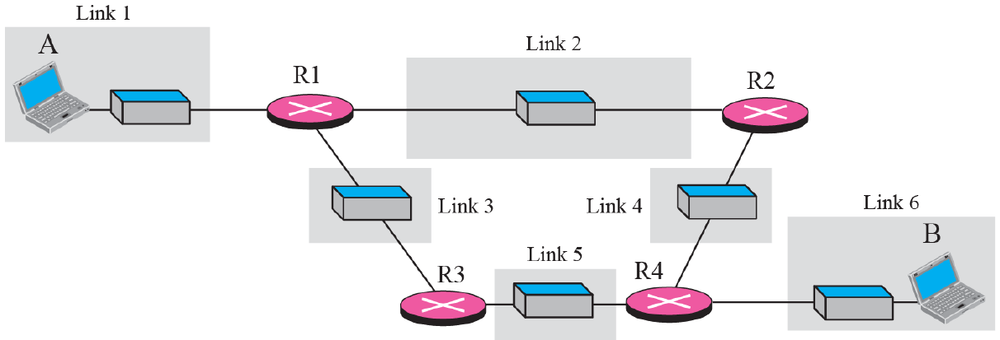

*그림 6. 링크 여섯 개와 라우터 네 개로 이루어진 사설 인터넷*

그림 6의 인터넷에는 링크 6개와 라우터 4개(R1\~R4), 그리고 컴퓨터 A와 B가 있다. A와 B는 라우터 R1, R3, R4를 거쳐 통신하는 것이 가장 효율적이라고 이미 정했다고 가정한다. 이 경로는 링크 1, 3, 5, 6으로 이루어진다.

**물리 계층.** TCP/IP는 물리 계층의 프로토콜을 따로 정의하지 않으며, 모든 표준 프로토콜과 사유 프로토콜을 지원한다. 이 수준의 통신은 컴퓨터나 라우터인 두 홉(노드) 사이에서 일어나고, 통신 단위는 **비트** 하나이다. 링크마다 다른 물리 계층 프로토콜을 쓸 수 있으므로, 링크 $n$개에 연결된 노드는 물리 계층 프로토콜이 $n$개 필요하다. 컴퓨터 A와 B 사이의 비트의 여정은 네 개의 독립적인 짧은 여행으로 이루어진다. A는 링크 1의 프로토콜 형식으로 R1에 비트를 보내고, R1은 링크 3의 프로토콜 형식으로 R3에 보내는 식이다. 링크 하나가 한 홉의 단위가 된다.

**데이터 링크 계층.** TCP/IP는 데이터 링크 계층의 프로토콜도 따로 정의하지 않고 모든 표준 프로토콜과 사유 프로토콜을 지원한다. 통신은 여전히 두 홉 사이에서 일어나지만, 통신 단위는 **프레임**이라는 패킷이다. 프레임은 네트워크 계층에서 받은 데이터에 헤더와 때로는 트레일러를 붙인 것이다. 헤더에는 프레임의 출발지와 목적지가 들어간다. 링크에 여러 노드가 연결되어 있을 수 있으므로 올바른 수신자를 정하려면 목적지 주소가 필요하고, 응답이나 확인 응답을 위해 출발지 주소도 필요하다.

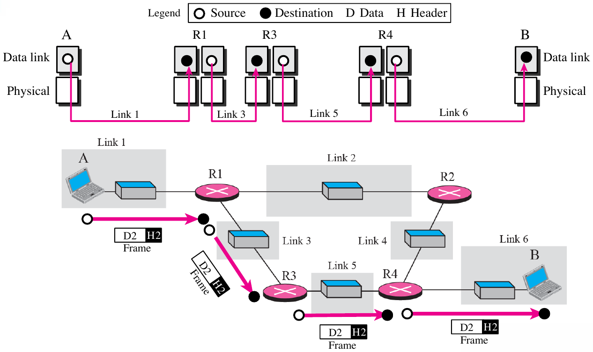

*그림 7. 데이터 링크 계층의 통신*

그림 7처럼 A와 R1 사이를 오가는 프레임은 R1과 R3 사이를 오가는 프레임과 다를 수 있다. R1은 받은 프레임을 왼쪽(링크 1)의 데이터 링크 계층 프로토콜로 열어 데이터를 꺼내고, 그 데이터를 오른쪽(링크 3)의 데이터 링크 계층 프로토콜에 넘겨 새 프레임을 만든다. 두 링크가 서로 다른 프로토콜과 프레임 형식을 쓸 수 있기 때문이다. 그래서 프레임의 주소는 링크마다 바뀐다(A에서 R1, R1에서 R3, ...). 또한 이 그림은 프레임의 물리적 이동을 보여 주는 것이 아니다. 물리적 이동은 물리 계층에서만 일어나며, 두 노드는 데이터 링크 계층에서 **논리적으로** 통신한다. A에서 R1로 실제로 가는 것은 물리 계층에서 물리 계층으로 가는 비트의 흐름이지만, A에서 프레임이 비트로 바뀌고 R1에서 비트가 프레임으로 바뀌므로 두 데이터 링크 계층은 프레임을 직접 주고받은 것처럼 보게 된다.

**네트워크 계층.** 네트워크 계층(더 정확히는 인터네트워크 계층)에서 TCP/IP는 **인터넷 프로토콜(IP)** 을 지원한다. IP는 TCP/IP 프로토콜이 쓰는 전송 메커니즘으로, **데이터그램(datagram)** 이라는 패킷으로 데이터를 운반하며 각 데이터그램은 따로 운반된다. 데이터그램은 서로 독립적이므로 그때그때 다른 경로로 갈 수 있고, 순서가 바뀌거나 중복되어 도착할 수 있다. IP는 경로를 기록하지 않으며, 도착한 데이터그램의 순서를 되돌리는 기능도 없다.

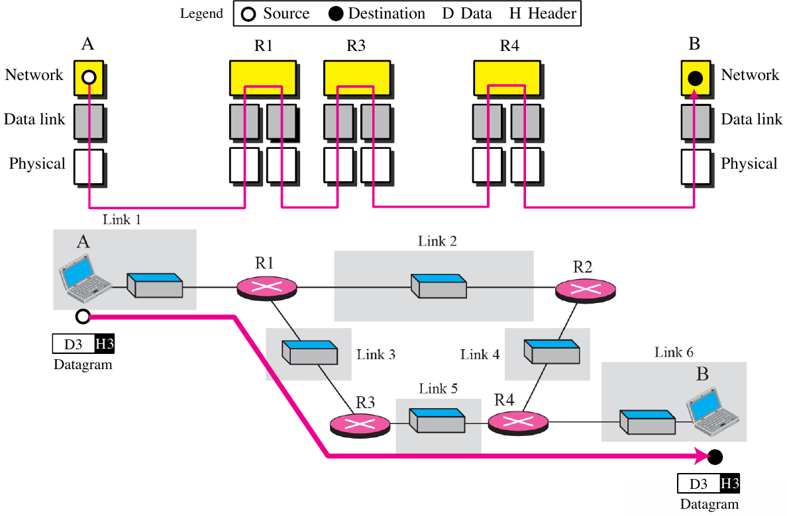

*그림 8. 네트워크 계층의 통신*

네트워크 계층의 통신과 데이터 링크 계층이나 물리 계층의 통신에는 중요한 차이가 있다. 네트워크 계층의 통신은 **종단 간(end-to-end)** 이고, 다른 두 계층의 통신은 **노드 간(node-to-node)** 이다. 컴퓨터 A에서 출발한 데이터그램이 그대로 컴퓨터 B에 도착한다(그림 8). 라우터의 네트워크 계층은 가장 좋은 경로를 찾으려고 패킷의 출발지와 목적지를 볼 수 있지만, 패킷의 내용을 바꿀 수는 없다. 따라서 데이터그램 헤더(H3)에 담긴 논리 주소(A에서 B)는 경로 전체에서 바뀌지 않는다. 물론 이 통신도 논리적이며 실제 통신은 물리 계층에서 일어난다.

**전송 계층.** 네트워크의 모든 노드에는 네트워크 계층이 있어야 하지만, 전송 계층은 두 끝의 컴퓨터에만 있으면 된다. 네트워크 계층이 개별 데이터그램을 A에서 B로 보내는 일을 맡는다면, 전송 계층은 메시지 전체를 A에서 B로 전달하는 일을 맡는다. 전송 계층의 데이터 단위는 프로토콜에 따라 **세그먼트(segment)**, **사용자 데이터그램(user datagram)**, 또는 **패킷**이라 한다. 세그먼트 하나는 데이터그램 몇 개에서 수십 개로 이루어질 수 있다. 세그먼트를 데이터그램으로 나누어 네트워크 계층에 넘기면, 인터넷이 데이터그램마다 다른 경로를 정할 수 있으므로 데이터그램은 순서가 바뀌거나 잃어버릴 수 있다. B의 전송 계층은 데이터그램이 모두 도착할 때까지 기다렸다가 모아서 세그먼트를 만든다. 전통적으로 TCP/IP의 전송 계층에는 UDP와 TCP가 있었고, 최근에 SCTP가 더해졌다.

**응용 계층.** TCP/IP의 응용 계층은 OSI 모델의 세션, 표현, 응용 계층을 합친 것에 해당하며, 사용자가 사설 인터넷이나 전역 인터넷의 서비스에 접근할 수 있게 한다. 전자 메일, 파일 전송, 월드 와이드 웹 접근 같은 서비스를 위한 많은 프로토콜이 이 계층에 정의되어 있다. 응용 계층의 통신도 전송 계층처럼 종단 간이며, 컴퓨터 A에서 만든 **메시지(message)** 는 전송 중에 바뀌지 않고 컴퓨터 B에 전달된다.

| 계층 | 통신 단위 | 통신 범위 | 경로상의 라우터가 관여하는가 |
|:-----|:-----|:-----|:-----|
| 응용 | 메시지 | 종단 간 | 관여하지 않음 |
| 전송 | 세그먼트, 사용자 데이터그램, 패킷 | 종단 간 | 관여하지 않음 |
| 네트워크 | 데이터그램 | 종단 간 (라우터가 출발지와 목적지를 보지만 내용은 바꾸지 않음) | 관여함 |
| 데이터 링크 | 프레임 | 노드 간 (링크마다 새 프레임) | 관여함 |
| 물리 | 비트 | 노드 간 | 관여함 |

*표 6. TCP/IP 계층별 통신 단위와 통신 범위*

### 3.4 계층별 프로토콜

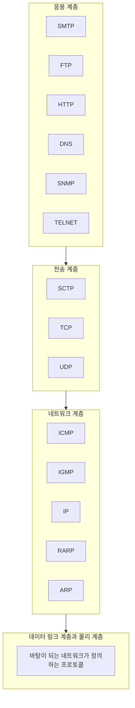

*그림 9. TCP/IP 프로토콜 스위트의 계층별 프로토콜*

- **물리 계층과 데이터 링크 계층:** 모든 표준 프로토콜과 사유 프로토콜을 지원한다. 이더넷(20장), Wi-Fi(22장), PPP(21장)가 그 예이다.
- **네트워크 계층:** **IP**는 최선형 전달(best-effort delivery) 서비스를 제공한다. 최선형이란 데이터그램을 목적지까지 전달하려고 최선을 다하지만 전달, 순서, 시간을 보장하지 않는다는 뜻이다(11장). 이를 돕는 프로토콜로 논리 주소를 물리 주소로 바꾸는 **ARP**와 그 반대인 **RARP**(19장), 오류와 상황을 보고하는 **ICMP**(Internet Control Message Protocol)와 멀티캐스트 그룹을 관리하는 **IGMP**(Internet Group Management Protocol)(16장)가 있다.
- **전송 계층:** **UDP**(User Datagram Protocol)(6장), **TCP**(Transmission Control Protocol)(8장), **SCTP**(Stream Control Transmission Protocol)가 있다.
- **응용 계층:** OSI 모델의 세션, 표현, 응용 계층을 합친 것에 해당하며, SMTP와 TELNET과 FTP(4장), HTTP(3장), DNS(5장), SNMP(17장) 같은 프로토콜이 있다.

### 3.5 Kurose의 인터넷 프로토콜 스택

Kurose는 여러 계층의 프로토콜을 합쳐 **프로토콜 스택(protocol stack)** 이라 부르고, 인터넷 프로토콜 스택을 물리, 링크, 네트워크, 전송, 응용의 다섯 계층으로 설명한다. Kurose의 책은 응용 계층부터 아래로 내려가는 하향식(top-down)으로 구성되어 있다. 이 순서에 따라 응용 계층은 3\~5장, 전송 계층은 6\~9장, 네트워크 계층은 10\~17장, 링크 계층은 18\~21장, 무선 LAN은 22장에서 다룬다. 23\~26장은 같은 순서로 P2P와 소켓 프로그래밍, IPv6와 일반화된 포워딩, 셀룰러 네트워크와 이동성, 네트워크 보안을 다룬다.

- **응용 계층:** 네트워크 응용과 그 응용 계층 프로토콜이 있는 곳이다. 웹 문서를 요청하고 전송하는 HTTP, 전자 메일을 전송하는 SMTP, 두 종단 시스템 사이에서 파일을 전송하는 FTP가 있고, www.ietf.org 같은 사람이 읽기 쉬운 이름을 32비트 네트워크 주소로 바꾸는 DNS도 응용 계층 프로토콜이다. 응용 계층 프로토콜은 여러 종단 시스템에 분산되어 있으며, 이 계층의 정보 패킷을 **메시지**라 한다.
- **전송 계층:** 응용 계층 메시지를 응용의 두 끝점 사이에서 운반한다. TCP는 연결형 서비스로 메시지의 전달 보장과 흐름 제어(송신자와 수신자의 속도 맞추기)를 제공하고, 긴 메시지를 짧은 세그먼트로 나누며, 네트워크가 혼잡하면 송신 속도를 줄이는 혼잡 제어를 한다. UDP는 신뢰성, 흐름 제어, 혼잡 제어가 없는 간소한 비연결형 서비스를 제공한다. Kurose는 전송 계층 패킷을 프로토콜과 관계없이 **세그먼트**라 부른다.
- **네트워크 계층:** **데이터그램**이라는 네트워크 계층 패킷을 한 호스트에서 다른 호스트로 옮긴다. 출발지의 전송 계층은 세그먼트와 목적지 주소를 네트워크 계층에 넘기는데, 이는 편지와 목적지 주소를 우편 서비스에 맡기는 것과 같다. 네트워크 계층에는 데이터그램의 필드와 종단 시스템과 라우터가 그 필드에 따라 하는 동작을 정의하는 IP가 하나 있고, 데이터그램이 갈 경로를 정하는 라우팅 프로토콜이 여럿 있다. IP가 인터넷을 하나로 묶는 접착제이므로 네트워크 계층을 흔히 IP 계층이라 부른다.
- **링크 계층:** 네트워크 계층은 각 노드에서 데이터그램을 링크 계층에 넘기고, 링크 계층은 경로의 다음 노드까지 데이터그램을 전달한다. 링크 계층의 서비스는 링크 계층 프로토콜에 따라 다르며, 어떤 프로토콜은 한 링크에 걸친 신뢰적 전달을 제공한다. 이는 한 종단 시스템에서 다른 종단 시스템까지의 TCP의 신뢰적 전달과 다르다. 이더넷, Wi-Fi, 케이블 접속 네트워크의 DOCSIS가 링크 계층 프로토콜이며, 데이터그램은 경로의 링크마다 다른 링크 계층 프로토콜(예: 한 링크는 이더넷, 다음 링크는 PPP)로 처리될 수 있다. 링크 계층 패킷을 **프레임**이라 한다.
- **물리 계층:** 링크 계층이 프레임 전체를 인접한 네트워크 요소로 옮긴다면, 물리 계층은 프레임 안의 개별 비트를 한 노드에서 다음 노드로 옮긴다. 물리 계층 프로토콜은 링크와 실제 전송 매체(꼬임 쌍선, 단일 모드 광섬유 등)에 따라 달라서, 예를 들어 이더넷에는 꼬임 쌍선용, 동축 케이블용, 광섬유용 물리 계층 프로토콜이 따로 있다.

| 계층 | Kurose의 패킷 이름 | Forouzan의 패킷 이름 |
|:-----|:-----|:-----|
| 응용 | 메시지 | 메시지 |
| 전송 | 세그먼트 (TCP와 UDP 모두) | 세그먼트 (TCP), 사용자 데이터그램 (UDP), 패킷 (SCTP) |
| 네트워크 | 데이터그램 | 데이터그램 |
| 링크 (데이터 링크) | 프레임 | 프레임 |
| 물리 | 비트 | 비트 |

*표 7. 계층별 패킷 이름의 대응*

> **참고:** **UDP의 패킷 이름.** Forouzan은 UDP의 데이터 단위를 사용자 데이터그램이라 부르고, Kurose는 TCP와 UDP의 데이터 단위를 모두 세그먼트라 부른다(Kurose는 RFC 같은 인터넷 문헌이 UDP의 패킷을 데이터그램이라 부르는 경우가 많지만, 같은 문헌이 네트워크 계층 패킷도 데이터그램이라 부르므로 혼동을 줄이려고 둘 다 세그먼트라 부른다고 설명한다). 두 이름은 같은 대상을 가리킨다.

---

<br>

## 4. OSI 모델과 TCP/IP의 비교

| 관점 | OSI 모델 | TCP/IP 프로토콜 스위트 |
|:-----|:-----|:-----|
| 계층 수 | 7개 | 5개 (원래 정의는 하드웨어 위의 4개) |
| 기원 | ISO가 1970년대 말에 제안 | OSI 모델보다 먼저 개발되어 인터넷에서 쓰임 |
| 세션과 표현 기능 | 별도 계층 | 별도 계층 없이 필요하면 응용 안에 구현 |
| 계층과 기능의 관계 | 각 계층에 속하는 기능을 명시 | 비교적 독립적인 프로토콜을 필요에 따라 섞어 씀 |
| 네트워크 계층 | 네트워크 계층 | 인터넷 계층(IP와 보조 프로토콜) |
| 운명 | 완전히 구현된 적이 없고 주로 개념적 참조 모델로 남음 | 인터넷에서 널리 쓰이고 시험되어 지배적인 상업 구조가 됨 |

*표 8. OSI 모델과 TCP/IP 프로토콜 스위트의 비교*

1990년 이전까지 데이터 통신과 네트워크 문헌을 지배한 계층 모델은 OSI 모델이었고, 많은 사람이 OSI 모델이 궁극적인 데이터 통신 표준이 되리라 믿었다. 그러나 그렇게 되지 않았다. TCP/IP 프로토콜 스위트가 인터넷에서 광범위하게 쓰이고 시험되면서 지배적인 상업 구조가 되었고, OSI 모델은 완전히 구현되지 않았다. Kurose는 OSI 모델이 인터넷 프로토콜이 초기 단계였을 때 형성되었고 그 설계자들이 인터넷을 염두에 두지 않았을 수 있지만, 초기 네트워크 교육에 큰 영향을 주었기 때문에 일곱 계층 모델이 여전히 교재와 교육 과정에 남아 있다고 설명한다.

> **핵심:** OSI 모델은 통신 기능을 일곱 계층으로 정리한 참조 모델이고, TCP/IP 프로토콜 스위트는 실제 인터넷이 쓰는 다섯 계층의 프로토콜 모임이다. 두 모델의 처음 네 계층은 대응하며, OSI의 세션, 표현, 응용 계층은 TCP/IP의 응용 계층 하나에 해당한다.

---

<br>

## 5. 주소 지정

### 5.1 네 단계의 주소

TCP/IP 프로토콜을 쓰는 인터넷에서는 물리 주소, 논리 주소, 포트 주소, 응용 특정 주소의 네 단계 주소를 쓴다. 각 주소는 TCP/IP 구조의 한 계층과 관련된다.

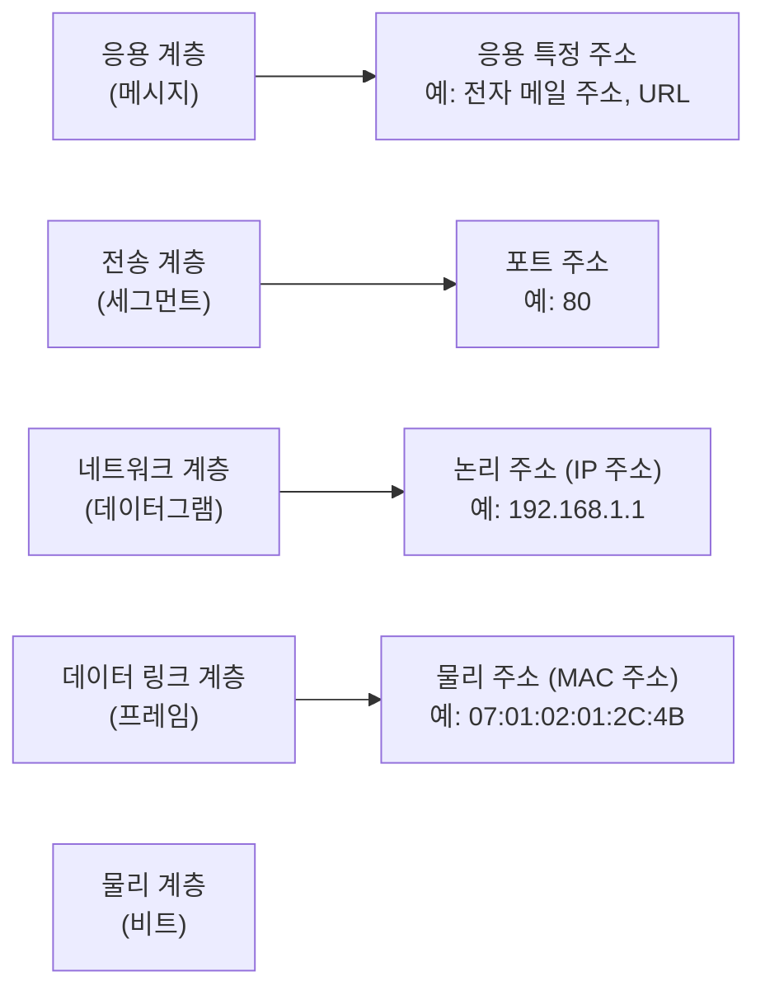

*그림 10. TCP/IP의 계층과 네 단계의 주소*

| 주소 | 계층 | 크기 (대표 예) | 범위 | 홉마다 바뀌는가 |
|:-----|:-----|:-----|:-----|:-----|
| 물리 주소 | 데이터 링크 | 이더넷은 48비트 (6바이트) | 지역 링크 | 바뀜 |
| 논리 주소 | 네트워크 | IPv4는 32비트 | 인터넷 전체 | 바뀌지 않음 |
| 포트 주소 | 전송 | 16비트 | 호스트 안 | 바뀌지 않음 |
| 응용 특정 주소 | 응용 | 가변 | 응용마다 다름 | 보내는 컴퓨터가 포트 주소와 논리 주소로 바꿈 |

*표 9. 네 단계 주소의 비교*

### 5.2 물리 주소

**물리 주소(physical address)** 는 **링크 주소(link address)** 라고도 하며, 노드가 속한 LAN이나 WAN이 정한 그 노드의 주소이다. 데이터 링크 계층이 쓰는 프레임에 들어가며 가장 낮은 단계의 주소이다. 물리 주소는 그 링크(LAN이나 WAN) 안에서만 의미가 있고, 크기와 형식은 네트워크에 따라 다르다. 예를 들어 이더넷은 네트워크 인터페이스 카드(NIC)에 새겨진 6바이트(48비트) 물리 주소를 쓰고, 애플의 LocalTalk는 장치가 켜질 때마다 바뀌는 1바이트 동적 주소를 쓴다.

> **용어 정의:** **물리 주소(physical address)** 는 데이터 링크 계층이 프레임의 송신자와 수신자를 나타내는 데 쓰는, 링크 안에서만 의미가 있는 하드웨어 주소이다.

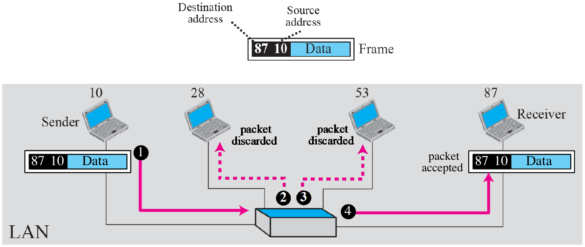

*그림 11. 예제 2.3: 물리 주소로 프레임을 전달하는 과정*

**예제 2.3.** 그림 11에서 물리 주소가 10인 노드가 물리 주소가 87인 노드에 프레임을 보낸다. 두 노드는 링크(LAN) 하나로 연결되어 있다.

1. 송신자(10)의 데이터 링크 계층은 위 계층에서 받은 데이터를 프레임에 캡슐화하고 헤더와 트레일러를 붙인다. 헤더에는 수신자와 송신자의 물리 주소가 들어가며, 대부분의 데이터 링크 프로토콜에서는 목적지 주소(87)가 출발지 주소(10)보다 앞에 온다. 트레일러에는 보통 오류 검출을 위한 추가 비트가 들어간다.
2. 프레임은 LAN으로 퍼져 나간다.
3. 물리 주소가 87이 아닌 노드(28, 53)는 프레임의 목적지 주소가 자신의 주소와 다르므로 프레임을 버린다.
4. 의도한 목적지(87)는 프레임의 목적지 주소와 자신의 주소가 같음을 발견하고, 프레임을 검사한 뒤 헤더와 트레일러를 떼어 데이터를 위 계층에 넘긴다.

그림 11의 LAN 가운데에 있는 장치는 프레임을 노드들에게 전달하는 장치이다. 이 예제처럼 모든 노드에 프레임을 보내고 각 노드가 주소를 보고 버리는 방식도 있지만, 스위치의 종류에 따라서는 주소가 맞는 장치에만 프레임을 보내기도 한다. 이 차이는 20장의 허브와 스위치에서 다룬다.

**예제 2.4.** 대부분의 LAN은 48비트(6바이트) 물리 주소를 16진수 12자리로 쓰고, 1바이트(16진수 2자리)마다 콜론으로 구분한다.

```text
07:01:02:01:2C:4B
```

물리 주소는 수신자가 하나인 **유니캐스트(unicast)**, 수신자 무리인 **멀티캐스트(multicast)**, 네트워크의 모든 시스템이 받는 **브로드캐스트(broadcast)** 주소일 수 있다. 이더넷은 세 가지를 모두 지원한다. 멀티캐스트나 브로드캐스트 물리 주소를 지원하지 않는 네트워크에서는 유니캐스트 주소로 여러 패킷을 보내 이를 흉내 낸다.

### 5.3 논리 주소

**논리 주소(logical address)** 는 바탕이 되는 물리 네트워크와 무관한 전 세계적 통신을 위해 필요하다. 서로 다른 네트워크는 주소 형식이 다를 수 있으므로 인터네트워크 환경에서는 물리 주소만으로 충분하지 않다. 바탕 네트워크와 관계없이 각 호스트를 유일하게 식별하는 보편적 주소 체계가 필요하며, 논리 주소가 그 역할을 한다. IPv4에서 인터넷의 논리 주소는 인터넷에 연결된 호스트를 유일하게 정의하는 32비트 주소이며, 공개적으로 주소를 가지고 보이는 두 호스트가 같은 IP 주소를 가질 수 없다. IPv4 주소는 12장에서 자세히 다루고, IPv6의 128비트 주소는 24장에서 다룬다.

> **용어 정의:** **논리 주소(logical address)** 는 네트워크 계층이 쓰는, 바탕 네트워크와 무관하게 인터넷 전체에서 호스트(의 연결)를 유일하게 식별하는 주소이며, 인터넷에서는 IP 주소이다.

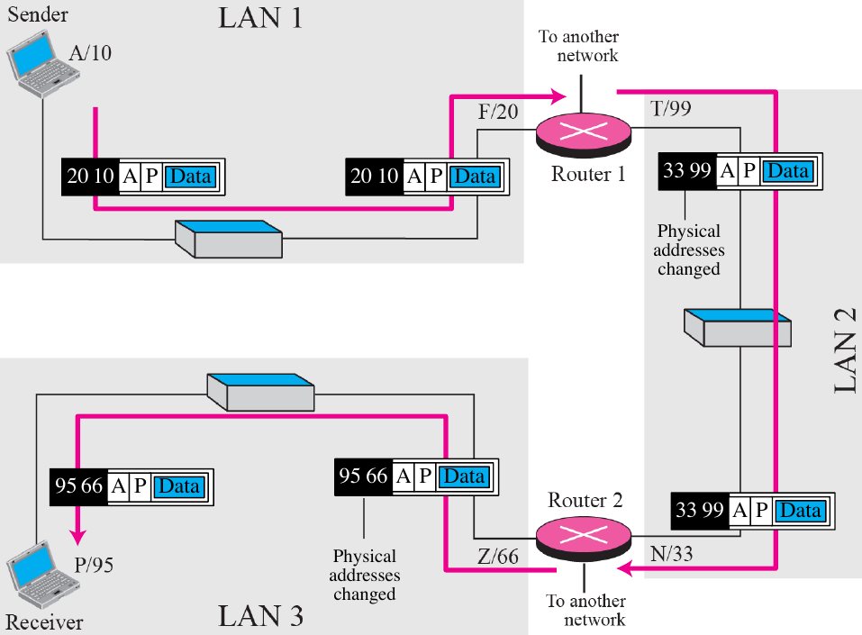

*그림 12. 예제 2.5: 논리 주소와 홉마다 바뀌는 물리 주소*

**예제 2.5.** 그림 12는 라우터 두 개가 LAN 세 개를 연결한 인터넷의 일부이다. 각 장치는 연결마다 논리 주소와 물리 주소의 쌍을 가진다. 컴퓨터는 링크 하나에만 연결되므로 주소 쌍이 하나이고, 각 라우터는 네트워크 세 개에 연결되므로(그림에는 둘만 보임) 주소 쌍이 세 개이다. 그림에서는 논리 주소를 문자로, 물리 주소를 숫자로 나타냈지만 실제로는 둘 다 숫자이다. 논리 주소가 A이고 물리 주소가 10인 컴퓨터가 논리 주소가 P이고 물리 주소가 95인 컴퓨터에 패킷을 보낸다.

1. 송신자는 데이터를 네트워크 계층에서 패킷에 캡슐화하고 논리 주소 A와 P를 붙인다. 대부분의 프로토콜에서 논리 출발지 주소는 논리 목적지 주소보다 앞에 온다(물리 주소의 순서와 반대).
2. 네트워크 계층은 포워딩 테이블을 보고 다음 홉(라우터 1)의 논리 주소가 F임을 찾는다. 이어서 ARP가 라우터 1의 논리 주소에 대응하는 물리 주소(20)를 찾는다(19장). 네트워크 계층은 이 주소를 데이터 링크 계층에 넘기고, 데이터 링크 계층은 패킷을 목적지 물리 주소 20, 출발지 물리 주소 10인 프레임에 캡슐화한다.
3. LAN 1의 모든 장치가 프레임을 받지만, 프레임의 목적지 물리 주소가 자신의 주소와 같은 라우터 1만 프레임을 받아들이고 나머지는 버린다.
4. 라우터 1은 프레임에서 패킷을 꺼내 논리 목적지 주소 P를 읽는다. P는 라우터 자신의 논리 주소가 아니므로 패킷을 포워딩해야 한다. 라우터 1은 포워딩 테이블과 ARP로 다음 홉(라우터 2)의 물리 주소를 찾아, 새 프레임을 만들고 패킷을 캡슐화하여 라우터 2로 보낸다. 이때 출발지 물리 주소는 10에서 99로, 목적지 물리 주소는 20(라우터 1)에서 33(라우터 2)으로 바뀐다. 논리 출발지 주소와 목적지 주소는 그대로여야 하며, 그렇지 않으면 패킷은 길을 잃는다.
5. 라우터 2에서도 같은 일이 일어난다. 물리 주소가 바뀌고 새 프레임이 목적지 컴퓨터로 간다.
6. 프레임이 목적지에 도착하면 패킷이 역캡슐화되고, 목적지 논리 주소 P가 컴퓨터의 논리 주소와 같으므로 데이터가 위 계층에 전달된다.

| 구간 | 목적지 물리 주소 | 출발지 물리 주소 | 출발지 논리 주소 | 목적지 논리 주소 |
|:-----|:-----|:-----|:-----|:-----|
| LAN 1 (송신자에서 라우터 1) | 20 | 10 | A | P |
| LAN 2 (라우터 1에서 라우터 2) | 33 | 99 | A | P |
| LAN 3 (라우터 2에서 수신자) | 95 | 66 | A | P |

*표 10. 예제 2.5에서 구간마다 프레임에 실리는 주소*

> **핵심:** 물리 주소는 홉마다 바뀌지만 논리 주소는 출발지에서 목적지까지 그대로이다. 물리 주소는 지역 링크 안의 전달에, 논리 주소는 인터넷 전체의 전달에 쓰이기 때문이다. 이 규칙의 예외(예: 12장의 NAT)도 있다.

논리 주소도 유니캐스트, 멀티캐스트, 브로드캐스트일 수 있으며, 브로드캐스트 주소에는 제한이 있다.

### 5.4 포트 주소

IP 주소와 물리 주소는 데이터를 출발지 호스트에서 목적지 호스트까지 보내는 데 필요하다. 그러나 인터넷 통신의 최종 목표는 목적지 호스트에 도착하는 것이 아니라 한 **프로세스**가 다른 프로세스와 통신하는 것이다. 오늘날의 컴퓨터는 여러 프로세스를 동시에 실행한다. 예를 들어 컴퓨터 A는 TELNET으로 컴퓨터 C와 통신하면서 동시에 FTP로 컴퓨터 B와 통신할 수 있다. 이 프로세스들이 동시에 데이터를 받으려면 프로세스마다 이름표, 곧 주소가 필요하다. TCP/IP 구조에서 프로세스에 붙인 이름표를 **포트 주소(port address)** 라 하며, 길이는 16비트이다.

> **용어 정의:** **포트 주소(port address)** 는 전송 계층이 한 호스트 안에서 실행 중인 프로세스를 구별하는 데 쓰는 16비트 주소이다.

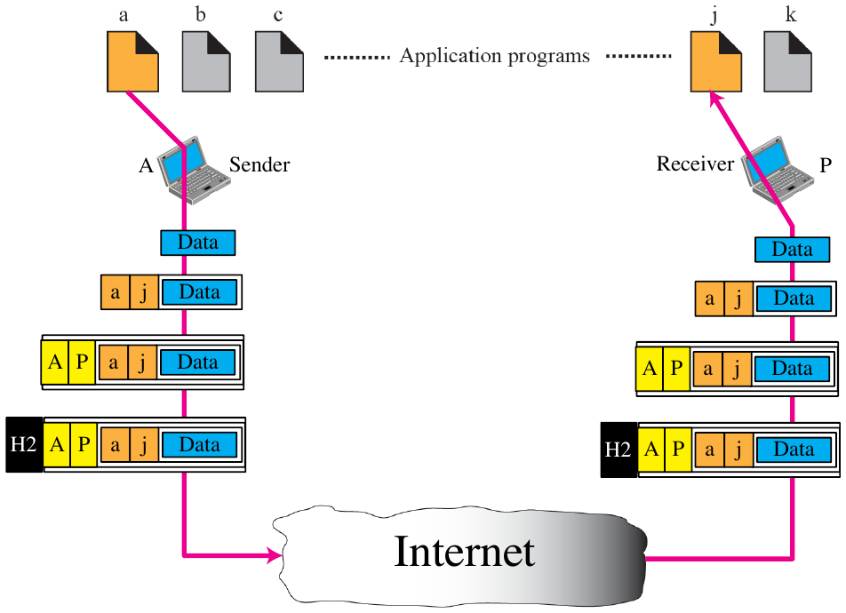

*그림 13. 예제 2.6: 포트 번호*

**예제 2.6.** 그림 13에서 송신 컴퓨터는 포트 주소가 a, b, c인 프로세스 세 개를, 수신 컴퓨터는 포트 주소가 j, k인 프로세스 두 개를 실행 중이다. 송신 컴퓨터의 프로세스 a가 수신 컴퓨터의 프로세스 j와 통신하려 한다. 두 컴퓨터가 같은 응용(예: FTP)을 쓰더라도 하나는 클라이언트 프로그램이고 하나는 서버 프로그램이므로 포트 주소가 다르다(3장).

1. 전송 계층은 프로세스 a의 데이터가 k가 아니라 j로 가야 함을 나타내기 위해, 응용 계층의 데이터를 패킷에 캡슐화하고 출발지 포트 주소 a와 목적지 포트 주소 j를 붙인다.
2. 네트워크 계층은 이 패킷을 다시 캡슐화하고 논리 출발지 주소 A와 목적지 주소 P를 붙인다. A와 P는 송수신 노드를, a와 j는 송수신 포트를 나타낸다.
3. 데이터 링크 계층은 이 패킷을 다음 홉의 물리 주소를 담은 프레임에 캡슐화한다(헤더 H2). 물리 주소는 인터넷 구름 안에서 홉마다 바뀌므로 그림에는 나타내지 않았다.

물리 주소는 홉마다 바뀌지만 논리 주소와 포트 주소는 출발지에서 목적지까지 보통 그대로이다(예외는 이후의 장에서 다룬다).

**예제 2.7.** 포트 주소는 16비트 주소이며 다음처럼 하나의 십진수로 나타낸다.

```text
753
```

### 5.5 응용 특정 주소

어떤 응용은 그 응용을 위해 설계된 사용자 친화적인 주소를 쓴다. 전자 메일의 수신자를 정하는 **전자 메일 주소**(예: forouzan@fhda.edu)와 월드 와이드 웹에서 문서를 찾는 데 쓰는 **URL**(Uniform Resource Locator, 예: www.mhhe.com)이 그 예이다. 보내는 컴퓨터는 이 주소를 해당하는 포트 주소와 논리 주소로 바꾼다. 이름을 IP 주소로 바꾸는 일은 5장의 DNS가 맡는다.

---

<br>

## 6. 캡슐화와 역캡슐화

### 6.1 호스트, 스위치, 라우터에서의 캡슐화

Kurose는 데이터가 송신 종단 시스템의 프로토콜 스택을 따라 내려가고, 중간의 링크 계층 스위치와 라우터의 프로토콜 스택을 오르내린 뒤, 수신 종단 시스템의 프로토콜 스택을 따라 올라가는 경로로 캡슐화를 설명한다. 라우터와 링크 계층 스위치도 네트워크 하드웨어와 소프트웨어를 계층으로 구성하지만, 프로토콜 스택의 모든 계층을 구현하지는 않고 아래쪽 계층만 구현한다. 링크 계층 스위치는 1\~2계층을, 라우터는 1\~3계층을 구현한다. 따라서 인터넷 라우터는 3계층 프로토콜인 IP를 구현할 수 있지만 링크 계층 스위치는 그렇지 않다. 링크 계층 스위치는 IP 주소를 알아보지 못하지만 이더넷 주소 같은 2계층 주소는 알아본다. 호스트는 다섯 계층을 모두 구현하며, 이는 인터넷 구조가 복잡성의 많은 부분을 네트워크의 가장자리에 둔다는 관점과 일치한다.

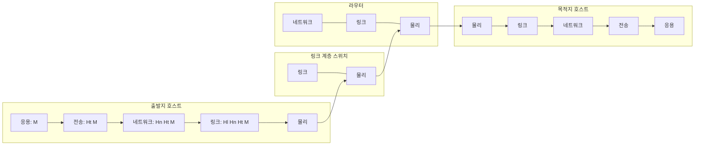

*그림 14. 호스트, 링크 계층 스위치, 라우터를 지나는 캡슐화*

송신 호스트에서 응용 계층 메시지(M)는 전송 계층으로 넘어간다. 가장 단순한 경우 전송 계층은 메시지에 수신 쪽 전송 계층이 쓸 정보, 곧 전송 계층 헤더(Ht)를 붙인다. 이 정보에는 수신 쪽 전송 계층이 메시지를 올바른 응용으로 올려 보내는 데 필요한 정보와, 메시지의 비트가 도중에 바뀌었는지 수신자가 판단할 수 있게 하는 오류 검출 비트가 들어갈 수 있다. 응용 계층 메시지와 전송 계층 헤더가 합쳐 전송 계층 세그먼트가 되며, 세그먼트는 응용 계층 메시지를 캡슐화한다. 전송 계층은 세그먼트를 네트워크 계층에 넘기고, 네트워크 계층은 출발지와 목적지 종단 시스템 주소 같은 네트워크 계층 헤더(Hn)를 붙여 네트워크 계층 데이터그램을 만든다. 데이터그램은 링크 계층으로 넘어가 링크 계층 헤더(Hl)가 붙은 링크 계층 프레임이 된다. 이렇게 각 계층의 패킷은 **헤더 필드**와 **페이로드 필드(payload field)** 두 종류의 필드를 가지며, 페이로드는 보통 바로 위 계층의 패킷이다.

> **용어 정의:** **캡슐화(encapsulation)** 는 각 계층이 위 계층에서 받은 패킷 전체를 페이로드로 삼고 자신의 헤더(와 필요하면 트레일러)를 붙여 자기 계층의 패킷을 만드는 과정이다.

Kurose는 회사 지점 사이의 사내 메모를 공중 우편으로 보내는 비유를 든다. 한 지점의 앨리스가 다른 지점의 밥에게 메모를 보낸다. 메모는 응용 계층 메시지에 해당한다. 앨리스는 메모를 사내 봉투에 넣고 밥의 이름과 부서를 쓰는데, 사내 봉투는 헤더 정보(밥의 이름과 부서)를 담고 메모를 캡슐화하는 전송 계층 세그먼트에 해당한다. 보내는 지점의 우편실은 사내 봉투를 공중 우편용 봉투에 다시 넣고 보내는 지점과 받는 지점의 주소를 쓰는데, 이 우편 봉투가 데이터그램에 해당한다. 우편 서비스가 받는 지점의 우편실에 봉투를 배달하면 역캡슐화가 시작된다. 우편실은 사내 봉투를 꺼내 밥에게 전하고, 밥은 봉투를 열어 메모를 꺼낸다.

캡슐화는 이보다 복잡할 수 있다. 큰 메시지는 여러 전송 계층 세그먼트로 나뉘고, 각 세그먼트가 다시 여러 네트워크 계층 데이터그램으로 나뉠 수 있다. 수신 쪽에서는 이렇게 나뉜 데이터그램으로 세그먼트를 다시 만들어야 한다.

```text
응용 계층:       [        데이터        ]
                         |
전송 계층:       [ H_t |    데이터      ]     --> 세그먼트 (TCP) / 사용자 데이터그램 (UDP)
                         |
네트워크 계층:    [ H_n | H_t | 데이터   ]     --> 데이터그램
                         |
데이터 링크 계층: [ H_d | H_n | H_t | 데이터 | T_d ]  --> 프레임
                         |
물리 계층:       101010011101...             --> 비트
```

*그림 15. 계층별 캡슐화 과정*

**역캡슐화(decapsulation)** 는 수신 쪽에서 각 계층이 자신의 헤더(와 트레일러)를 제거하고 나머지 데이터를 위 계층으로 넘기는 역과정이다. 링크 계층 스위치는 프레임을 2계층까지만, 라우터는 3계층까지만 역캡슐화하여 필요한 헤더를 본 뒤 다시 캡슐화하여 내보낸다.

> **핵심:** 캡슐화는 모듈성을 제공한다. 각 계층은 자신의 헤더 형식만 이해하면 되므로 계층마다 프로토콜이 독립적으로 발전할 수 있다. 라우터는 3계층까지, 스위치는 2계층까지만 처리하며, 다섯 계층을 모두 처리하는 것은 종단 시스템뿐이다.

### 6.2 인터넷 경로 전체에서 본 계층

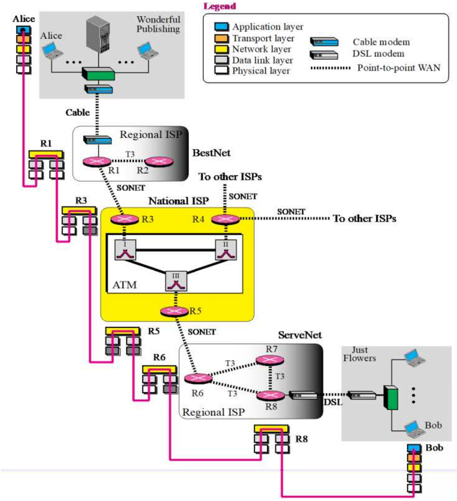

*그림 16. 앨리스에서 밥까지 인터넷을 지나는 경로와 장치마다 쓰이는 계층*

그림 16은 인터넷의 가상의 한 부분에서 앨리스(Wonderful Publishing 회사)와 밥(Just Flowers 회사)이 통신하는 경로를 보여 준다. 그림의 범례에서 응용, 전송, 네트워크, 데이터 링크, 물리 계층을 색으로 구별하며, 점선은 점대점 WAN이다.

- 앨리스의 회사 LAN은 케이블 모뎀을 통해 지역 ISP인 BestNet의 라우터 R1에 연결된다. BestNet 안에서 R1과 R2는 T3 회선으로 연결된다.
- BestNet은 SONET 링크로 국가 ISP의 R3에 연결된다. 국가 ISP 안에는 ATM 스위치(I, II, III)로 이루어진 네트워크가 있고, R4는 SONET으로 다른 ISP들과 연결되며, R5는 SONET으로 지역 ISP인 ServeNet의 R6에 연결된다.
- ServeNet 안에서 R6, R7, R8은 T3 회선으로 연결되고, R8은 DSL 모뎀을 통해 밥의 회사 LAN에 연결된다.

경로를 따라 쓰이는 계층을 보면, 앨리스와 밥의 호스트는 다섯 계층을 모두 쓰고, 경로의 각 라우터(R1, R3, R5, R6, R8)는 물리, 데이터 링크, 네트워크의 세 계층만 쓴다. 각 링크는 서로 다른 기술(케이블, T3, SONET, ATM, DSL)을 쓰므로 데이터 링크 계층과 물리 계층의 프로토콜이 링크마다 다르다. 예를 들어 점대점 링크에서는 PPP 같은 데이터 링크 프로토콜이 쓰인다(21장). 그러나 네트워크 계층에서는 모든 라우터가 IP를 쓰므로 데이터그램은 경로 전체에서 같은 형식을 유지하고, 전송 계층의 세그먼트(TCP)나 사용자 데이터그램(UDP)과 응용 계층의 메시지는 두 끝의 호스트에서만 처리된다. 1장에서 본 것처럼 이 경로의 ISP들은 기존에 존재하는 망(전화망, 케이블망, 광섬유 백본)을 빌려 쓴다.

---

<br>

## 7. 다중화와 역다중화

**다중화(multiplexing)** 는 여러 위 계층 프로토콜이 하나의 아래 계층 프로토콜을 함께 쓰는 것이다. **역다중화(demultiplexing)** 는 수신 쪽에서 아래 계층이 받은 데이터를 알맞은 위 계층 프로토콜에 나누어 주는 역과정이다.

> **용어 정의:** **다중화(multiplexing)** 는 송신 쪽에서 여러 위 계층 프로토콜의 데이터를 하나의 아래 계층 프로토콜로 보내는 것이다.

> **용어 정의:** **역다중화(demultiplexing)** 는 수신 쪽에서 헤더의 식별 정보를 보고 받은 데이터를 알맞은 위 계층 프로토콜이나 프로세스에 전달하는 것이다.

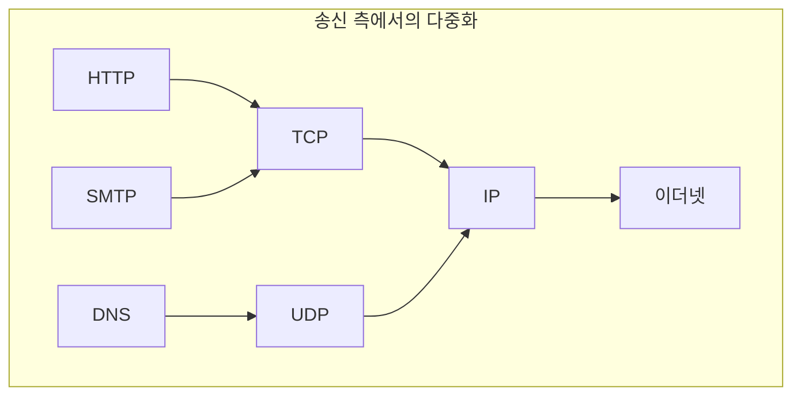

*그림 17. 송신 측에서의 다중화*

역다중화가 가능하려면 각 계층의 헤더에 데이터를 받을 위 계층을 나타내는 필드가 있어야 한다.

| 계층의 헤더 | 식별 필드 | 값의 예 |
|:-----|:-----|:-----|
| 이더넷 프레임 | 타입 필드 | 0x0800 = IPv4, 0x0806 = ARP |
| IP 데이터그램 | 프로토콜 필드 | 1 = ICMP, 6 = TCP, 17 = UDP |
| TCP 세그먼트, UDP 사용자 데이터그램 | 목적지 포트 번호 | 25 = SMTP, 53 = DNS, 80 = HTTP |

*표 11. 역다중화에 쓰이는 헤더 필드*

예를 들어 타입 필드가 0x0800인 이더넷 프레임의 데이터는 IP로, 프로토콜 필드가 17인 IP 데이터그램의 데이터는 UDP로, 목적지 포트가 53인 UDP 사용자 데이터그램의 데이터는 DNS로 전달된다. 각 헤더 필드의 형식은 11장(IP), 6장(UDP), 8장(TCP), 20장(이더넷)에서 다룬다.

---

<br>

## 요약

| 개념 | 핵심 요약 |
|:-----|:-----|
| 통신의 구성 요소 | 메시지, 송신자, 수신자, 매체, 프로토콜의 다섯 가지이다. |
| 계층 구조 | 복잡한 통신을 순서가 있는 계층으로 나누고, 각 계층은 아래 계층의 서비스를 이용하여 위 계층에 서비스를 제공한다. |
| 계층화의 장단점 | 모듈성과 구현 교체의 용이성을 주지만, 기능 중복과 다른 계층 정보의 필요라는 단점이 있다. |
| OSI 모델 | ISO가 제정한 일곱 계층 참조 모델이며, 1\~3계층은 네트워크 지원, 5\~7계층은 사용자 지원, 4계층은 둘을 잇는다. |
| 피어 프로세스와 인터페이스 | 같은 계층끼리는 프로토콜로 논리적으로 통신하고, 인접한 계층 사이는 인터페이스로 서비스를 주고받는다. |
| TCP/IP 프로토콜 스위트 | 물리, 데이터 링크, 네트워크, 전송, 응용의 다섯 계층이며, 응용 계층이 OSI의 5\~7계층을 대신한다. |
| 계층별 통신 단위 | 비트, 프레임, 데이터그램, 세그먼트(사용자 데이터그램), 메시지이며, 물리와 데이터 링크는 노드 간, 나머지는 종단 간이다. |
| 네 단계의 주소 | 물리 주소(링크), 논리 주소(IP), 포트 주소(프로세스), 응용 특정 주소(전자 메일, URL)이다. |
| 주소의 변화 | 물리 주소는 홉마다 바뀌고, 논리 주소와 포트 주소는 보통 출발지에서 목적지까지 그대로이다. |
| 캡슐화 | 각 계층이 위 계층의 패킷을 페이로드로 삼아 헤더를 붙이며, 스위치는 2계층, 라우터는 3계층까지만 처리한다. |
| 다중화와 역다중화 | 타입 필드, 프로토콜 필드, 포트 번호로 위 계층을 구별하여 여러 위 계층이 하나의 아래 계층을 공유한다. |

---

<br>

## 점검 문제

1. **캡슐화 오버헤드:** 응용 계층 데이터 1000바이트를 TCP(헤더 20바이트), IP(헤더 20바이트), 이더넷(헤더 14바이트, 트레일러 4바이트)으로 차례로 캡슐화한다. 프레임의 크기와 그중 헤더와 트레일러가 차지하는 비율을 구하라. 물리 계층에서 붙는 프리앰블과 SFD는 제외한다.

   <details>
   <summary>정답</summary>

   세그먼트는 1000 + 20 = 1020바이트, 데이터그램은 1020 + 20 = 1040바이트, 프레임은 1040 + 14 + 4 = 1058바이트이다. 헤더와 트레일러는 모두 20 + 20 + 14 + 4 = 58바이트이므로 비율은 58 / 1058 ≈ 5.5%이다.

   </details>

2. **역다중화 추적:** 수신한 이더넷 프레임의 타입 필드가 0x0800이고, 그 안의 IP 데이터그램의 프로토콜 필드가 17이며, 목적지 포트 번호가 53이다. 데이터는 어떤 프로토콜을 차례로 거쳐 어느 응용으로 전달되는가?

   <details>
   <summary>정답</summary>

   타입 필드 0x0800은 IPv4이므로 프레임의 데이터는 IP로 전달되고, 프로토콜 필드 17은 UDP이므로 데이터그램의 데이터는 UDP로 전달된다. UDP는 목적지 포트 53을 보고 데이터를 DNS로 전달한다. 따라서 데이터는 이더넷, IPv4, UDP를 거쳐 DNS에 도달한다.

   </details>

3. **주소의 범위:** 패킷이 출발지 호스트에서 라우터 두 개를 거쳐 목적지 호스트로 전달된다. NAT가 없다고 할 때, 링크를 지날 때마다 바뀌는 주소와 끝까지 유지되는 주소를 구분하고 그 이유를 설명하라.

   <details>
   <summary>정답</summary>

   물리 주소는 범위가 지역 링크이므로 링크마다 그 링크의 송신 장치와 수신 장치의 주소로 바뀐다. 이 경로는 링크 세 개로 이루어지므로 서로 다른 물리 주소 쌍 세 개가 차례로 쓰인다. 반면 IP 주소는 범위가 인터넷 전체이므로 출발지와 목적지 IP 주소가 끝까지 유지되고, 종단 호스트의 프로세스를 가리키는 포트 번호도 바뀌지 않는다.

   </details>

4. **OSI와 TCP/IP의 대응:** OSI 모델의 세션 계층과 표현 계층이 맡는 대화 제어와 암호화 기능은 TCP/IP 모델에서 어느 계층이 맡는가? 또 TCP/IP의 응용 계층은 OSI의 어느 계층들에 대응하는가?

   <details>
   <summary>정답</summary>

   TCP/IP 모델에는 세션 계층과 표현 계층이 따로 없으므로 이 기능은 응용 계층에 통합되어 응용 프로그램이나 응용 계층 프로토콜이 맡는다. 따라서 TCP/IP의 응용 계층은 OSI의 5\~7계층에 대응한다.

   </details>

5. **예제 2.5의 주소 변화:** 예제 2.5에서 패킷이 라우터 1을 지날 때 프레임의 어떤 주소가 어떻게 바뀌고 어떤 주소가 유지되는가? 라우터 1이 다음 홉의 물리 주소를 알아내는 방법도 설명하라.

   <details>
   <summary>정답</summary>

   출발지 물리 주소는 10에서 99(라우터 1의 LAN 2 쪽 인터페이스)로, 목적지 물리 주소는 20(라우터 1)에서 33(라우터 2)으로 바뀐다. 논리 출발지 주소 A와 목적지 주소 P는 그대로이다. 라우터 1은 포워딩 테이블에서 다음 홉인 라우터 2의 논리 주소를 찾고, ARP로 그 논리 주소에 대응하는 물리 주소 33을 알아낸다. 물리 주소가 링크 안에서만 의미가 있으므로 링크를 바꿀 때마다 새 프레임이 필요하다.

   </details>

6. **기능과 OSI 계층의 대응:** 프레이밍, 라우팅, 분할과 재조립, 대화 제어, 압축은 각각 OSI 모델의 어느 계층이 맡는가?

   <details>
   <summary>정답</summary>

   프레이밍은 데이터 링크 계층(2계층), 라우팅은 네트워크 계층(3계층), 분할과 재조립은 전송 계층(4계층), 대화 제어는 세션 계층(5계층), 압축은 표현 계층(6계층)이 맡는다.

   </details>

7. **스위치와 라우터가 보는 헤더:** 출발지 호스트에서 링크 계층 스위치 하나와 라우터 하나를 거쳐 목적지 호스트로 가는 세그먼트가 있다. 스위치와 라우터는 각각 어느 계층까지 처리하고 어떤 주소를 보는가? 전송 계층 헤더를 보는 장치는 어디인가?

   <details>
   <summary>정답</summary>

   링크 계층 스위치는 1\~2계층만 구현하므로 프레임 헤더의 링크 계층 주소(이더넷 주소)만 보고 IP 주소는 알아보지 못한다. 라우터는 1\~3계층을 구현하므로 데이터그램 헤더의 목적지 IP 주소를 보고 포워딩한다. 전송 계층 헤더(포트 번호)는 다섯 계층을 모두 구현한 출발지와 목적지 호스트만 처리한다.

   </details>
