# Chapter 2 — Protocol Layers and Network Models

[Repository Guide](../../README.md) | [English](Concepts_Lecture.md) | [한국어](Concepts_Lecture.ko.md)

> **Last Updated:** 2026-11-18
>
> Computer Networking: A Top-Down Approach, Kurose and Ross, Ch 1; TCP/IP Protocol Suite, Forouzan, Ch 2

> **Learning Objectives:**
> 1. Explain, with examples, the five components of communication and why complex communication is divided into several layers
> 2. Explain the service model of a layered architecture and its advantages and drawbacks
> 3. Distinguish the functions of the seven layers of the OSI model and explain the roles of peer processes and of the interfaces between layers
> 4. Explain the unit of communication, the scope of communication, and the representative protocols of each layer of the TCP/IP protocol suite, and compare it with the OSI model
> 5. Trace, through examples, where physical, logical, port, and application-specific addresses are used
> 6. Explain encapsulation and decapsulation, and multiplexing and demultiplexing, at hosts, switches, and routers

---

## Table of Contents

- [1. Protocol Layering](#1-protocol-layering)
  - [1.1 Components of Communication](#11-components-of-communication)
  - [1.2 Communication in One Layer](#12-communication-in-one-layer)
  - [1.3 Communication in Three Layers](#13-communication-in-three-layers)
  - [1.4 Layering Seen Through Air Travel](#14-layering-seen-through-air-travel)
  - [1.5 Advantages and Drawbacks of Layering](#15-advantages-and-drawbacks-of-layering)
- [2. The OSI Model](#2-the-osi-model)
  - [2.1 ISO and the OSI Model](#21-iso-and-the-osi-model)
  - [2.2 Layer-to-Layer Communication and Interfaces Between Layers](#22-layer-to-layer-communication-and-interfaces-between-layers)
  - [2.3 Data Exchange and Encapsulation in the OSI Model](#23-data-exchange-and-encapsulation-in-the-osi-model)
  - [2.4 Physical Layer](#24-physical-layer)
  - [2.5 Data Link Layer](#25-data-link-layer)
  - [2.6 Network Layer](#26-network-layer)
  - [2.7 Transport Layer](#27-transport-layer)
  - [2.8 Session Layer](#28-session-layer)
  - [2.9 Presentation Layer](#29-presentation-layer)
  - [2.10 Application Layer](#210-application-layer)
  - [2.11 Summary of the OSI Layers](#211-summary-of-the-osi-layers)
- [3. The TCP/IP Protocol Suite](#3-the-tcpip-protocol-suite)
  - [3.1 Five Layers](#31-five-layers)
  - [3.2 Correspondence with the OSI Model](#32-correspondence-with-the-osi-model)
  - [3.3 Communication at Each Layer in a Private Internet](#33-communication-at-each-layer-in-a-private-internet)
  - [3.4 Protocols at Each Layer](#34-protocols-at-each-layer)
  - [3.5 Kurose's Internet Protocol Stack](#35-kuroses-internet-protocol-stack)
- [4. Comparison of the OSI Model and TCP/IP](#4-comparison-of-the-osi-model-and-tcpip)
- [5. Addressing](#5-addressing)
  - [5.1 Four Levels of Addresses](#51-four-levels-of-addresses)
  - [5.2 Physical Addresses](#52-physical-addresses)
  - [5.3 Logical Addresses](#53-logical-addresses)
  - [5.4 Port Addresses](#54-port-addresses)
  - [5.5 Application-Specific Addresses](#55-application-specific-addresses)
- [6. Encapsulation and Decapsulation](#6-encapsulation-and-decapsulation)
  - [6.1 Encapsulation at Hosts, Switches, and Routers](#61-encapsulation-at-hosts-switches-and-routers)
  - [6.2 Layers Along an Entire Internet Path](#62-layers-along-an-entire-internet-path)
- [7. Multiplexing and Demultiplexing](#7-multiplexing-and-demultiplexing)
- [Summary](#summary)
- [Self-Check Questions](#self-check-questions)

---

<br>

## 1. Protocol Layering

### 1.1 Components of Communication

As Chapter 1 showed, two entities need a protocol to communicate. When communication is not simple, the complex task of communication is divided into several **layers**, with one protocol for each layer. To understand layering, one must first know what is involved in communication. Data communication consists of five components.

| Component | Meaning | Examples |
|:-----|:-----|:-----|
| Message | The information (data) to be communicated | Text, numbers, pictures, sound, video, or any combination of these |
| Sender | The device that sends the data message | Computer, workstation, telephone handset, video camera |
| Receiver | The device that receives the message | Computer, workstation, telephone handset, video camera |
| Medium | The physical path by which a message travels from sender to receiver | Twisted-pair wire, coaxial cable, fiber-optic cable, laser, or radio waves such as terrestrial or satellite microwave |
| Protocol | A set of rules that governs data communication | Step-by-step procedures followed by the sender and the receiver |

*Table 1. The five components of data communication*

The sender and the receiver each follow the steps of the same protocol (step 1, step 2, step 3, ...), and the message travels through the medium from the sender to the receiver. When communication becomes complex, this protocol is not kept as one piece but divided into several layers, and the following two examples show why.

### 1.2 Communication in One Layer

**Example 2.1.** Maria and Ann are neighbors with a lot of common ideas. Maria speaks only Spanish and Ann speaks only English, but both learned sign language in childhood, so they meet in a cafe a couple of days a week and exchange their ideas using signs. Communication is face to face and one layer is enough.

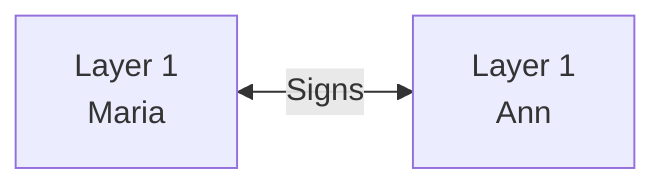

*Figure 1. Communication in one layer*

### 1.3 Communication in Three Layers

**Example 2.2.** When Ann has to move to another town because of her job, Maria gives her two small machines. The first machine can scan a letter in English and transform it into a secret code or vice versa, and the second can transform a letter in Spanish into the same secret code or vice versa. Ann takes the first machine and Maria keeps the second. The two now communicate using the secret code.

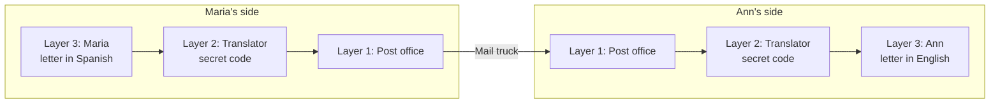

*Figure 2. Communication in three layers*

At layer 3, Maria writes a letter in Spanish, the language she is comfortable with; at layer 2, the translator machine turns the letter into the secret code; and she puts it in an envelope and drops it in the mailbox at layer 1. The letter is carried by the mail truck to the post office of Ann's town and delivered to Ann's residence. Ann uses her own machine to turn the secret code into a letter in English. Communication from Ann to Maria uses the same process in the reverse direction. Neither of them understands the secret code, yet layered communication lets them exchange ideas. Each layer uses its own "language" (Spanish or English, the secret code, the postal rules), and each layer has its own division of roles.

Two concepts arise from this example.

- **Hierarchy:** There are three activities at the sender site and three at the receiver site, and they must take place in a fixed order. At the sender site, the letter must be written, translated into the secret code, and dropped in the mailbox before the mail truck can pick it up. At the receiver site, the letter must be dropped in the recipient's mailbox before the recipient can take it out and read it.
- **Services:** Each layer at the sending site uses the services of the layer immediately below it. The person at the top layer uses the services of the middle layer (the translator), the middle layer uses the services of the lower layer (the post office), and the lower layer uses the services of the carrier.

> **Definition:** A **layered architecture** is a design in which complex communication functions are divided into ordered layers, each of which uses the services of the layer immediately below and provides services to the layer immediately above.

### 1.4 Layering Seen Through Air Travel

Kurose explains layered architecture with the airline system. An airplane trip proceeds through buying a ticket, checking bags, going through the gate, boarding, takeoff, and routing of the airplane, and on arrival through landing, deplaning at the gate, claiming bags, and, if the trip was bad, complaining at the ticket counter. Dividing these actions horizontally shows that each function appears as a pair, at the origin and at the destination.

| Layer | Action at the origin | Action at the destination | Service provided by this layer and the layers below |
|:-----|:-----|:-----|:-----|
| Ticket | Purchase ticket | Complain at the ticket counter | Transfer of a person from ticket counter to ticket counter |
| Baggage | Check bags | Claim bags | Transfer of a person and bags from baggage check to baggage claim |
| Gate | Load | Unload | Transfer of a person and bags from departure gate to arrival gate |
| Takeoff/landing | Takeoff | Landing | Transfer of people and bags from runway to runway |
| Airplane routing | Airplane routing | Airplane routing | Routing the airplane to its destination |

*Table 2. Horizontal layering of airline functionality*

Each layer, combined with the layers below it, implements some functionality, a **service**. The baggage layer, for example, provides its service only to a person who has already bought a ticket. Each layer provides its service by (1) performing certain actions within that layer (the gate layer loads and unloads people from an airplane) and (2) using the services of the layer directly below it (the gate layer uses the runway-to-runway transfer service of the takeoff/landing layer).

Network protocols are layered in the same way. Each protocol belongs to one layer, and the service a layer offers to the layer above is called the **service model** of that layer. For example, if the service of layer $n$ is reliable delivery of messages from one edge of the network to the other, it can be implemented by using the unreliable delivery service of layer $n-1$ and adding functionality at layer $n$ that detects and retransmits lost messages.

> **Definition:** A **service model** is the set of services a layer offers to the layer immediately above it.

A protocol layer can be implemented in software, in hardware, or in a combination of the two. Application-layer protocols such as HTTP and SMTP, and transport-layer protocols, are almost always implemented in software in the end systems. The physical and data link layers handle communication over a specific link, so they are often implemented in a **network interface card (NIC)**, such as an Ethernet or Wi-Fi card, and its driver. The network layer is often a mixed implementation of hardware and software. From the viewpoint of a computer, therefore, the application layer corresponds to processes and sockets, the transport and network layers to the TCP/IP software of the operating system, and the data link and physical layers to the NIC and its driver. Moreover, just as the functions of the airline system are distributed among airports and flight control centers, a protocol of layer $n$ is distributed among the end systems, packet switches, and other components.

### 1.5 Advantages and Drawbacks of Layering

A layered architecture lets one discuss a well-defined part of a large and complex system on its own and provides **modularity**, which makes it easy to change the implementation of a layer's service. As long as a layer provides the same service to the layer above and uses the same services of the layer below, changing its implementation leaves the rest of the system unchanged. If the gate layer were changed to board people by height, for example, the rest of the airline system would remain unchanged because the function of loading and unloading people stays the same. Changing the implementation of a service, however, is different from changing the service itself.

Layering also has drawbacks. First, one layer may duplicate functionality of a lower layer; many protocol stacks, for example, provide error recovery both per link and end to end. Second, functionality at one layer may need information (for example, a timestamp value) that is present only in another layer, which violates the goal of separation of layers.

> **Key Point:** Layering divides complex communication into the jobs of the individual layers, so that each layer provides services to the layer above using only the services of the layer below. The system can then be discussed systematically and implementations can be changed independently, at the cost of duplicated functionality and of needing information across layers.

---

<br>

## 2. The OSI Model

### 2.1 ISO and the OSI Model

Established in 1947, the **International Organization for Standardization (ISO)** is a multinational body dedicated to worldwide agreement on international standards, and about three-fourths of the countries of the world are represented in it. The ISO standard that covers all aspects of network communications is the **Open Systems Interconnection (OSI) model**, first introduced in the late 1970s. ISO is the name of the organization; OSI is the name of the model.

An **open system** is a set of protocols that allows any two systems with different internal architectures to communicate. The purpose of the OSI model is to show how to make communication between different systems possible without changing the logic of their underlying hardware and software. The OSI model is not a protocol but a model for understanding and designing a network architecture that is flexible, robust, and interoperable, and it was intended to be the basis for creating the protocols of the OSI stack.

> **Definition:** The **OSI model** is a reference model, established by ISO, that describes network communication in seven layers: physical, data link, network, transport, session, presentation, and application.

The OSI model consists of seven ordered layers: physical (layer 1), data link (layer 2), network (layer 3), transport (layer 4), session (layer 5), presentation (layer 6), and application (layer 7). Its designers distilled the process of transmitting data to its most fundamental elements and collected networking functions with related uses into the layers. Each layer defines a family of functions distinct from those of the other layers, and by localizing functionality in this way the architecture becomes both comprehensive and flexible.

### 2.2 Layer-to-Layer Communication and Interfaces Between Layers

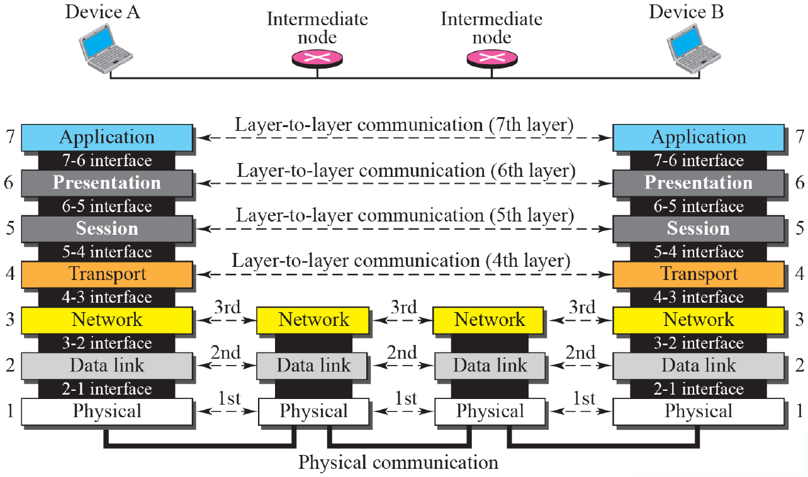

*Figure 3. OSI layers from device A through intermediate nodes to device B*

Figure 3 shows the layers involved when device A sends a message to device B. On its way from A to B the message may pass through several **intermediate nodes**, which usually involve only the first three layers of the OSI model (physical, data link, network). Layers 4 to 7 are not needed to deliver data to the next node.

Within a single machine, each layer uses the services of the layer just below it; layer 3, for example, uses the services of layer 2 and provides services to layer 4. Between machines, layer $x$ on one machine communicates **logically** with layer $x$ on the other machine, and the rules and conventions governing this communication are the protocol. The processes on each machine that communicate at the same layer are called **peer-to-peer processes**. Actual physical communication takes place only at layer 1. At the sending site the message moves down from layer 7 to layer 1, is converted at layer 1 into a form that can be transmitted, and at the receiving site moves up from layer 1 to layer 7.

> **Definition:** **Peer-to-peer processes** are processes at the same layer of different machines that communicate logically according to the protocol of that layer.

Data and network information can pass down through the layers of the sending device and back up through the layers of the receiving device because there is an **interface** between each pair of adjacent layers (the 7-6 interface, the 6-5 interface, and so on in Figure 3). An interface defines the information and services a layer must provide to the layer above it. With well-defined interfaces and layer functions, as long as a layer provides the expected services to the layer above, the implementation of its functions can be modified or replaced without changing the surrounding layers.

The seven layers can be viewed as three groups. Layers 1 to 3 (physical, data link, network) are the **network support layers**, which deal with the physical aspects of moving data from one device to another, such as electrical specifications, physical connections, physical addressing, and transmission timing and reliability. Layers 5 to 7 (session, presentation, application) are the **user support layers**, which allow interoperability among unrelated software systems. Layer 4, the transport layer, links the two groups and ensures that what the lower layers have transmitted is in a form the upper layers can use. The upper layers are almost always implemented in software, the lower layers in a combination of hardware and software, and the physical layer mostly in hardware.

### 2.3 Data Exchange and Encapsulation in the OSI Model

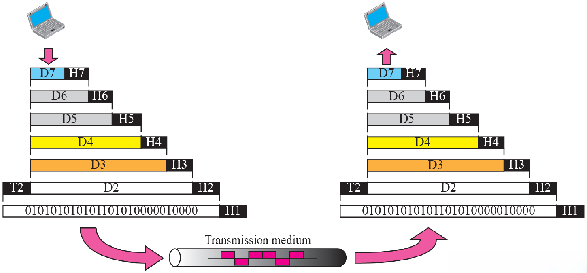

*Figure 4. Data exchange using the OSI model*

In Figure 4, D7 means the data unit at layer 7, D6 the data unit at layer 6, and so on. The process starts at layer 7 (the application layer) and moves down layer by layer. At each layer a header (H7, H6, ...) is added to the data unit, and at layer 2 a trailer (T2) may also be added. When the formatted data unit passes through layer 1 (the physical layer), it is changed into an electromagnetic signal and transported along the physical link. At the destination, the signal enters layer 1 and is transformed back into digital form, and the data units move up through the OSI layers. As each block of data reaches the next higher layer, the header and trailer attached at the corresponding sending layer are removed and the actions appropriate to that layer are taken. By the time it reaches layer 7, the message is again in a form appropriate to the application and is made available to the recipient.

Figure 4 also shows **encapsulation**. The packet at layer 7 is encapsulated in the packet at layer 6, the whole packet at layer 6 is encapsulated in the packet at layer 5, and so on. In other words, the data part of a packet at layer $N$ carries the whole packet (data and header) from layer $N+1$. Layer $N$ is not aware of which part of the encapsulated packet is data and which is header or trailer; it treats the whole packet from layer $N+1$ as one unit. At the sending side, therefore, the data unit is wrapped layer upon layer as "data + header", "(data + header) + header", "((data + header) + header) + header", and at the receiving side the reverse process, **decapsulation**, takes place.

### 2.4 Physical Layer

The **physical layer** coordinates the functions required to carry a bit stream over a physical medium and is concerned with moving bits from one node to the next. It deals with the mechanical and electrical specifications of the interface and the transmission medium, and it defines the procedures and functions that physical devices and interfaces must perform for transmission to occur. The physical layer is concerned with the following.

- **Physical characteristics of interfaces and media:** It defines the characteristics of the interface between devices and the transmission medium and the type of transmission medium.
- **Representation of bits (encoding):** The data of the physical layer is an uninterpreted stream of 0s and 1s. To be transmitted, bits must be **encoded** into electrical or optical signals, and the physical layer defines how 0s and 1s are changed into signals.
- **Data rate:** It defines the number of bits sent each second, that is, the duration of a bit.
- **Synchronization of bits:** The sender and the receiver must not only use the same bit rate but also be synchronized at the bit level; in other words, their clocks must be synchronized.
- **Line configuration:** How devices are connected to the medium. In a **point-to-point configuration** two devices are connected through a dedicated link, and in a **multipoint configuration** several devices share one link.
- **Physical topology:** The physical arrangement of the nodes connected to form a network. In a **mesh** every device is connected to every other device, in a **star** devices are connected through a central device, in a **ring** each device is connected to the next to form a ring, and in a **bus** every device is connected to one common link.
- **Transmission mode:** The direction of transmission between two devices. In **simplex** mode only one device can send and the other can only receive. In **half-duplex** mode both devices can send and receive, but not at the same time; a walkie-talkie that takes turns on a single channel is an example. In **full-duplex** mode both devices can send and receive at the same time.

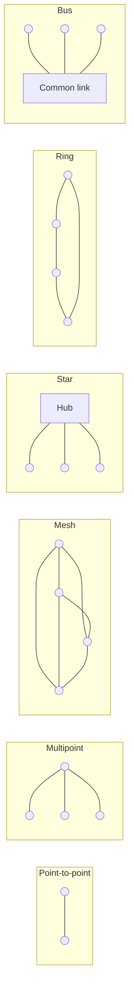

*Figure 5. Line configurations and physical topologies*

### 2.5 Data Link Layer

The **data link layer** transforms the physical layer, a raw transmission facility, into a reliable link, making the physical layer appear error-free to the layer above (the network layer). The data link layer is concerned with the delivery of frames and is responsible for the following.

- **Framing:** It divides the stream of bits received from the network layer into manageable data units called **frames**. In other words, it gathers bits into meaningful units.
- **Physical addressing:** If frames are to be distributed to different systems on the network, it adds a header to the frame to define the sender or receiver, that is, to whom the data is sent. This address is a hardware address (MAC address). If the frame is intended for a system outside the sender's network, the receiver address is the address of the connecting device that connects the network to the next one.
- **Flow control:** If the rate at which the receiver absorbs data is less than the rate at which the sender produces it, flow control prevents the receiver from being overwhelmed. Flow control at the data link layer is hop-to-hop.
- **Error control:** It adds reliability to the physical layer through mechanisms that detect and retransmit damaged or lost frames and recognize duplicate frames. Error control is normally achieved through a **trailer** added to the end of the frame: the trailer is checked according to rules agreed by sender and receiver to determine whether there is an error, and if there is, retransmission is requested.
- **Access control:** When two or more devices are connected to the same link, it determines which device has control over the link, and may send signals, at any given time.

### 2.6 Network Layer

The **network layer** is responsible for the **source-to-destination delivery** of a packet, possibly across multiple networks (links). Whereas the data link layer oversees delivery between two systems on the same network (link), the network layer ensures that each packet gets from its point of origin to its final destination. If two systems are connected to the same link there is usually no need for a network layer, but if they are attached to different networks with connecting devices between them, the network layer is needed.

- **Logical addressing:** The physical addressing of the data link layer handles the addressing problem only locally. If a packet passes the network boundary, another addressing system is needed to distinguish the source and destination systems. The network layer adds a header containing the logical addresses of the sender and receiver to the packet from the upper layer. This address is an address defined by software (the IP address).
- **Routing:** When independent networks or links are connected to create an internetwork (a network of networks), the connecting devices (routers or switches) must route packets to their final destination. The network layer provides this mechanism.

### 2.7 Transport Layer

The **transport layer** is responsible for the **process-to-process delivery** of the entire message. A process is an application program running on a host. The network layer oversees source-to-destination delivery of individual packets but does not recognize any relationship between them, treating each one independently as though it belonged to a separate message. The transport layer, in contrast, ensures that the whole message arrives intact and in order, overseeing error control and flow control at the source-to-destination level.

- **Service-point addressing:** Computers run several programs at the same time, so source-to-destination delivery must be delivery not only from one computer to the next but also from a specific process on one computer to a specific process on the other. The transport layer header must therefore include a **service-point address**, or **port address**. The network layer gets each packet to the correct computer; the transport layer gets the entire message to the correct process on that computer.
- **Segmentation and reassembly:** A message is divided into transmittable segments, each containing a sequence number. These numbers enable the transport layer at the destination to join the received pieces correctly, reassembling the message, and to identify and replace packets lost in transmission.
- **Connection control:** The transport layer can be connectionless or connection-oriented. A **connectionless** transport layer treats each segment as an independent packet and delivers it to the transport layer at the destination; UDP is an example. A **connection-oriented** transport layer first makes a connection with the transport layer at the destination before delivering packets and terminates the connection after all data are transferred; TCP and SCTP are examples.
- **Flow control:** Like the data link layer, the transport layer performs flow control, but end to end rather than across a single link.
- **Error control:** Like the data link layer, the transport layer performs error control, but process to process rather than across a single link. The sending transport layer makes sure that the entire message arrives at the receiving transport layer without damage, loss, or duplication, and error correction is usually achieved through retransmission.

> **Note:** **What connection-oriented means.** The Internet is a packet-switched network, so even TCP's segments travel inside IP datagrams that are delivered independently without a connection. TCP is nevertheless called connection-oriented, not because a path is physically connected as in circuit switching, but because the transport layers at the two ends exchange control information to prepare each other's state (sequence numbers, buffers, and so on) before exchanging data and keep that state until the data transfer ends, forming a **logical connection**. The connection exists only in the end systems, and the routers in between are unaware of it. Setting up and keeping this state pays off when a large amount of data flows as many packets to the same destination, as in a file transfer, whereas a short exchange that fits in one packet each way, such as a DNS query (Chapter 5), is usually sent connectionless. Chapter 8 covers the connection setup procedure.

### 2.8 Session Layer

For some processes the services of the first four layers (physical, data link, network, transport) are not sufficient. The **session layer** is the network dialog controller; it establishes, maintains, and synchronizes the interaction between communicating systems.

- **Dialog control:** It allows two systems to enter into a dialog and lets communication between two processes take place in either half-duplex (one way at a time) or full-duplex (two ways at a time) mode.
- **Synchronization:** It allows a process to add **checkpoints**, or synchronization points, into a stream of data. For example, when a 2,000-page file is sent, a checkpoint can be inserted after every 100 pages so that each 100-page unit is received and acknowledged independently. If a crash happens during the transmission of page 523, only pages 501 to 523 need to be resent after recovery, and pages before 501 need not be resent.

### 2.9 Presentation Layer

The **presentation layer** is concerned with the syntax and semantics of the information exchanged between two systems.

- **Translation:** Processes in two systems usually exchange information in the form of character strings, numbers, and so on, and the information must be changed into bit streams before transmission. Because different computers use different encoding systems, the presentation layer at the sender changes the information from its sender-dependent format into a common format, and the presentation layer at the receiver changes the common format into its receiver-dependent format.
- **Encryption:** Carrying sensitive information requires privacy. Encryption means that the sender transforms the original information into another form and sends it; decryption reverses the process to transform it back into its original form.
- **Compression:** It reduces the number of bits contained in the information, which is particularly important for transmitting multimedia such as text, audio, and video.

### 2.10 Application Layer

The **application layer** enables the user, whether human or software, to access the network. It provides user interfaces and support for distributed information services such as electronic mail, remote file access and transfer, and shared database management. The services of the application layer that the OSI model cites as examples are the following.

- **Network virtual terminal:** A software version of a physical terminal that allows a user to log on to a remote host. The application creates a software emulation of a terminal at the remote host; the user's computer talks to this software terminal, which in turn talks to the host. The remote host believes it is communicating with one of its own terminals and allows the user to log on. This concept reappears with TELNET in Chapter 4.
- **FTAM (file transfer, access, and management):** Allows a user to access files on a remote host to read or change them, to retrieve files from a remote computer for use on the local computer, and to manage or control files on a remote computer locally.
- **E-mail services (X.400):** Provide the basis for e-mail forwarding and storage.
- **Directory services (X.500):** Provide distributed database sources and access for global information about various objects and services.

### 2.11 Summary of the OSI Layers

| Layer | Name | Duty |
|:-----|:-----|:-----|
| 7 | Application | Allows access to network resources |
| 6 | Presentation | Translates, encrypts, and compresses data |
| 5 | Session | Establishes, manages, and terminates sessions |
| 4 | Transport | Reliable process-to-process message delivery and error recovery |
| 3 | Network | Moves packets from source to destination, internetworking |
| 2 | Data link | Organizes bits into frames, hop-to-hop delivery |
| 1 | Physical | Transmits bits over a medium, mechanical and electrical specifications |

*Table 3. Duties of each OSI layer*

---

<br>

## 3. The TCP/IP Protocol Suite

### 3.1 Five Layers

The **TCP/IP protocol suite** was developed before the OSI model, so its layers do not match those of the OSI model exactly. The original TCP/IP protocol suite was defined as four software layers built upon the hardware, but today it is thought of as a five-layer model with layers named similarly to those of the OSI model.

| Original layer | Layer used today | Layer number |
|:-----|:-----|:-----|
| Application | Application layer | 5 |
| Transport | Transport layer | 4 |
| Internet | Network layer | 3 |
| Network Interface | Data link layer | 2 |
| Hardware Devices | Physical layer | 1 |

*Table 4. Original layers and the five layers of the TCP/IP protocol suite*

The first four layers of TCP/IP provide physical standards, network interface, internetworking, and transport functions corresponding to the first four layers of the OSI model. The three topmost layers of the OSI model (session, presentation, application), however, are represented in TCP/IP by a single **application layer**.

> **Definition:** The **TCP/IP protocol suite** is the collection of protocols used in the Internet, organized in five layers: physical, data link, network, transport, and application.

TCP/IP is a hierarchical protocol made up of interactive modules, each providing a specific functionality, but the modules are not necessarily interdependent. Whereas the OSI model specifies which functions belong to each of its layers, the layers of TCP/IP contain relatively independent protocols that can be mixed and matched according to the needs of the system. "Hierarchical" here means that each upper-level protocol is supported by one or more lower-level protocols.

### 3.2 Correspondence with the OSI Model

| OSI model | TCP/IP protocol suite | Contents of the TCP/IP layer |
|:-----|:-----|:-----|
| Application, presentation, session | Application | Several application protocols |
| Transport | Transport | Several transport protocols |
| Network | Network | The Internet Protocol (IP) and some helping protocols |
| Data link | Data link | Underlying LAN and WAN technology |
| Physical | Physical | Underlying LAN and WAN technology |

*Table 5. Correspondence between the OSI model and the TCP/IP protocol suite*

Comparing the two models, the session and presentation layers are missing from TCP/IP. Two reasons are given for not adding these layers to TCP/IP after the OSI model was published. First, TCP/IP has more than one transport-layer protocol, and some functionalities of the session layer are available in some of the transport-layer protocols. Second, the application layer is not one piece of software but the place where many applications are developed, so if some functionalities of the session or presentation layer are needed by a particular application, they can be included when that software is developed.

Kurose takes the same view. The presentation layer of OSI provides services that allow communicating applications to interpret the meaning of exchanged data: data compression, data encryption, and data description, which frees applications from worrying about the internal format in which data are stored. The session layer provides delimiting and synchronization of data exchange, including the means to build a checkpointing and recovery scheme. The absence of these two layers in the Internet means that if such a service is needed, the application developer must build it into the application.

### 3.3 Communication at Each Layer in a Private Internet

The job of each TCP/IP layer is easier to understand with a **private internet**, smaller than the global Internet, in mind. Such an internet is made up of several small networks called **links**. A link is a network that allows a group of computers to communicate with each other; all computers in an office wired together form a link, and so do several computers of a company connected via a satellite channel. A link can be a LAN serving a small area or a WAN serving a larger area, and links are connected by devices called routers or switches.

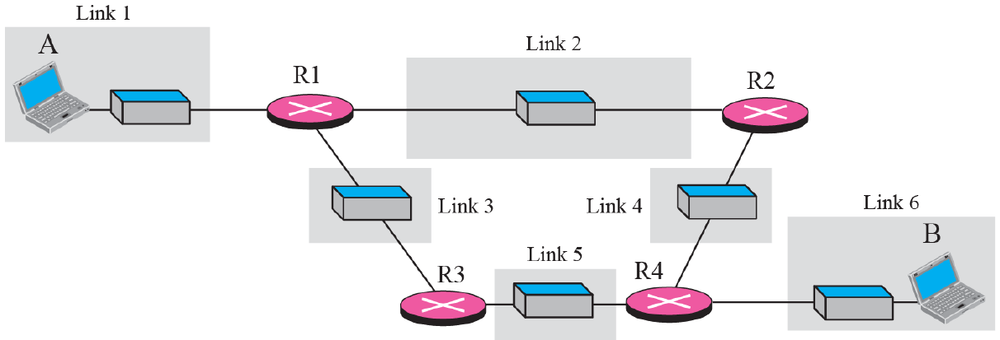

*Figure 6. A private internet of six links and four routers*

The internet in Figure 6 has six links, four routers (R1 to R4), and computers A and B. Suppose A and B have already decided that the most efficient way to communicate is via routers R1, R3, and R4. This path consists of links 1, 3, 5, and 6.

**Physical layer.** TCP/IP does not define any specific protocol for the physical layer; it supports all standard and proprietary protocols. Communication at this level is between two hops or nodes, either computers or routers, and the unit of communication is a single **bit**. Because different links may use different physical-layer protocols, a node connected to $n$ links needs $n$ physical-layer protocols. The journey of bits between computers A and B consists of four independent short trips: A sends each bit to R1 in the format of the protocol used by link 1, R1 sends it to R3 in the format of link 3, and so on. One link is the unit of one hop.

**Data link layer.** TCP/IP does not define any specific protocol for the data link layer either and supports all standard and proprietary protocols. Communication is again between two hops, but the unit of communication is a packet called a **frame**. A frame encapsulates the data received from the network layer with an added header and sometimes a trailer. The header contains the source and destination of the frame: the destination address is needed to define the right recipient because many nodes may be connected to the link, and the source address is needed for possible responses or acknowledgments.

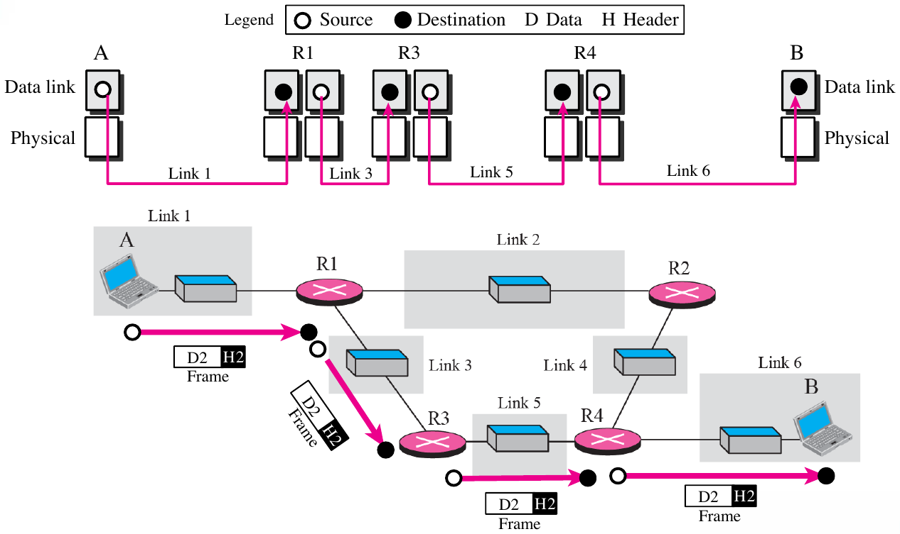

*Figure 7. Communication at the data link layer*

As Figure 7 shows, the frame traveling between A and R1 may differ from the one traveling between R1 and R3. R1 opens the received frame with the data link protocol on its left (link 1), removes the data, and passes them to the data link protocol on its right (link 3) to create a new frame, because the two links may use different protocols and frame formats. The addresses in the frame therefore change from link to link (A to R1, R1 to R3, ...). The figure also does not show the physical movement of frames; physical movement happens only at the physical layer, and the two nodes communicate **logically** at the data link layer. What actually travels from A to R1 is a stream of bits from one physical layer to another, but because a frame at A is transformed into bits and the bits at R1 are transformed back into a frame, the two data link layers see it as though a frame had been exchanged directly.

**Network layer.** At the network layer (more accurately, the internetwork layer), TCP/IP supports the **Internet Protocol (IP)**. IP is the transmission mechanism used by the TCP/IP protocols; it transports data in packets called **datagrams**, each of which is transported separately. Because datagrams are independent of each other, they can travel along different routes from time to time and can arrive out of sequence or duplicated. IP does not keep track of the routes and has no facility for reordering datagrams once they arrive.

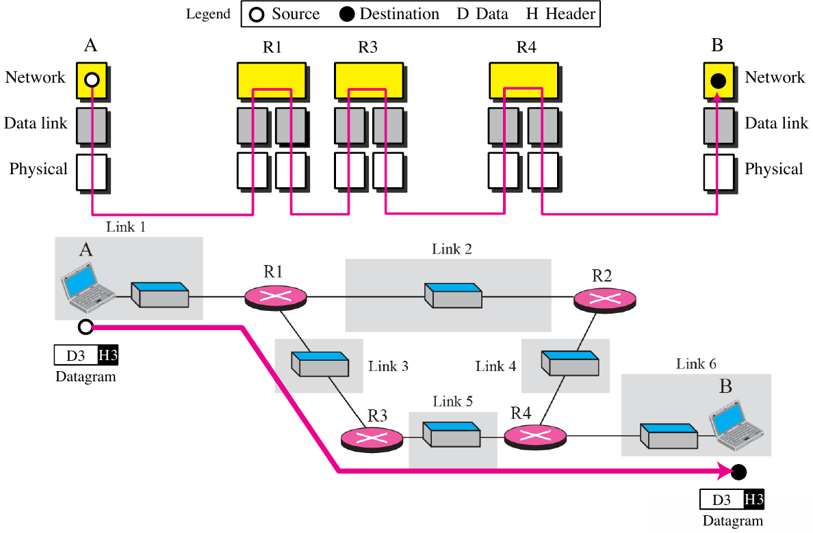

*Figure 8. Communication at the network layer*

There is a main difference between communication at the network layer and communication at the data link or physical layer. Communication at the network layer is **end to end**, while communication at the other two layers is **node to node**. The datagram started at computer A is the one that reaches computer B (Figure 8). The network layers of the routers can inspect the source and destination of the packet to find the best route, but they are not allowed to change its contents. The logical addresses (A to B) in the datagram header (H3) therefore do not change along the entire path. This communication, too, is logical; the actual communication takes place at the physical layer.

**Transport layer.** Every node in the network needs a network layer, but only the two end computers need a transport layer. The network layer is responsible for sending individual datagrams from A to B; the transport layer is responsible for delivering the whole message from A to B. The data unit of the transport layer is called a **segment**, a **user datagram**, or a **packet**, depending on the protocol. A segment may consist of a few or tens of datagrams. When segments are broken into datagrams and handed to the network layer, the datagrams may arrive out of order or be lost because the Internet may define a different route for each one. The transport layer at B waits until all the datagrams arrive and assembles them into a segment. Traditionally the transport layer of TCP/IP was represented by UDP and TCP, and SCTP has been added recently.

**Application layer.** The application layer of TCP/IP is equivalent to the combined session, presentation, and application layers of the OSI model, and it allows a user to access the services of the private internet or the global Internet. Many protocols are defined at this layer to provide services such as electronic mail, file transfer, and access to the World Wide Web. Communication at the application layer, like that at the transport layer, is end to end, and a **message** generated at computer A is delivered to computer B without being changed during the transmission.

| Layer | Unit of communication | Scope of communication | Involvement of routers on the path |
|:-----|:-----|:-----|:-----|
| Application | Message | End to end | No |
| Transport | Segment, user datagram, packet | End to end | No |
| Network | Datagram | End to end (routers see the source and destination but do not change the contents) | Yes |
| Data link | Frame | Node to node (a new frame on each link) | Yes |
| Physical | Bit | Node to node | Yes |

*Table 6. Unit and scope of communication at each TCP/IP layer*

### 3.4 Protocols at Each Layer

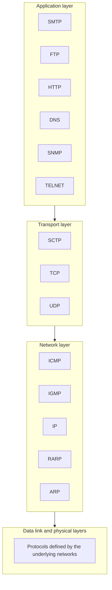

*Figure 9. Protocols at each layer of the TCP/IP protocol suite*

- **Physical and data link layers:** All standard and proprietary protocols are supported. Ethernet (Chapter 20), Wi-Fi (Chapter 22), and PPP (Chapter 21) are examples.
- **Network layer:** **IP** provides a best-effort delivery service. Best effort means that IP does its best to deliver datagrams to their destination but guarantees neither delivery, order, nor timing (Chapter 11). Helping protocols include **ARP**, which maps a logical address to a physical address, and **RARP**, which does the reverse (Chapter 19), and **ICMP** (Internet Control Message Protocol), which reports errors and conditions, and **IGMP** (Internet Group Management Protocol), which manages multicast groups (Chapter 16).
- **Transport layer:** **UDP** (User Datagram Protocol) (Chapter 6), **TCP** (Transmission Control Protocol) (Chapter 8), and **SCTP** (Stream Control Transmission Protocol).
- **Application layer:** Equivalent to the combined session, presentation, and application layers of the OSI model, with protocols such as SMTP, TELNET, and FTP (Chapter 4), HTTP (Chapter 3), DNS (Chapter 5), and SNMP (Chapter 17).

### 3.5 Kurose's Internet Protocol Stack

Kurose calls the protocols of the various layers taken together the **protocol stack** and describes the Internet protocol stack in five layers: physical, link, network, transport, and application. Kurose's book is organized top-down, from the application layer downward. Following this order, the application layer is covered in Chapters 3-5, the transport layer in Chapters 6-9, the network layer in Chapters 10-17, the link layer in Chapters 18-21, and wireless LANs in Chapter 22. Chapters 23-26 cover, in the same order, P2P and socket programming, IPv6 and generalized forwarding, cellular networks and mobility, and network security.

- **Application layer:** Where network applications and their application-layer protocols reside. It includes HTTP, which provides for Web document request and transfer, SMTP, which provides for the transfer of e-mail messages, and FTP, which provides for the transfer of files between two end systems; DNS, which translates human-friendly names such as www.ietf.org into 32-bit network addresses, is also an application-layer protocol. An application-layer protocol is distributed over multiple end systems, and the packet of information at this layer is called a **message**.
- **Transport layer:** Transports application-layer messages between application endpoints. TCP provides a connection-oriented service with guaranteed delivery of messages and flow control (sender-receiver speed matching), breaks long messages into shorter segments, and provides congestion control that throttles the sending rate when the network is congested. UDP provides a no-frills connectionless service without reliability, flow control, or congestion control. Kurose calls the transport-layer packet a **segment** regardless of the protocol.
- **Network layer:** Moves network-layer packets called **datagrams** from one host to another. The transport layer at the source passes a segment and a destination address to the network layer, just as one gives the postal service a letter with a destination address. The network layer contains one protocol, IP, which defines the fields of the datagram and how end systems and routers act on them, and many routing protocols that determine the routes datagrams take. Because IP is the glue that binds the Internet together, the network layer is often called the IP layer.
- **Link layer:** At each node the network layer passes the datagram down to the link layer, which delivers it to the next node along the route. The services of the link layer depend on the link-layer protocol, and some protocols provide reliable delivery over one link, which differs from TCP's reliable delivery from one end system to another. Ethernet, Wi-Fi, and DOCSIS of cable access networks are link-layer protocols, and a datagram may be handled by different link-layer protocols on different links of its route (for example, Ethernet on one link and PPP on the next). The link-layer packet is called a **frame**.
- **Physical layer:** Whereas the link layer moves entire frames to an adjacent network element, the physical layer moves the individual bits within a frame from one node to the next. Physical-layer protocols depend on the link and on the actual transmission medium (twisted pair, single-mode fiber, and so on); Ethernet, for example, has separate physical-layer protocols for twisted pair, coaxial cable, and fiber.

| Layer | Kurose's packet name | Forouzan's packet name |
|:-----|:-----|:-----|
| Application | Message | Message |
| Transport | Segment (both TCP and UDP) | Segment (TCP), user datagram (UDP), packet (SCTP) |
| Network | Datagram | Datagram |
| Link (data link) | Frame | Frame |
| Physical | Bit | Bit |

*Table 7. Correspondence of packet names at each layer*

> **Note:** **The name of UDP's packet.** Forouzan calls UDP's data unit a user datagram, while Kurose calls the data units of both TCP and UDP segments (Kurose explains that Internet literature such as the RFCs often calls UDP's packet a datagram, but because the same literature also calls the network-layer packet a datagram, both are called segments to reduce confusion). The two names refer to the same thing.

---

<br>

## 4. Comparison of the OSI Model and TCP/IP

| Aspect | OSI model | TCP/IP protocol suite |
|:-----|:-----|:-----|
| Number of layers | 7 | 5 (originally defined as 4 on top of the hardware) |
| Origin | Proposed by ISO in the late 1970s | Developed before the OSI model and used in the Internet |
| Session and presentation functions | Separate layers | No separate layers; built into applications when needed |
| Relation of layers and functions | Specifies which functions belong to each layer | Relatively independent protocols mixed and matched as needed |
| Network layer | Network layer | Internet layer (IP and helping protocols) |
| Fate | Never fully implemented, remaining mainly a conceptual reference model | Used and tested extensively in the Internet, becoming the dominant commercial architecture |

*Table 8. Comparison of the OSI model and the TCP/IP protocol suite*

Before 1990, the layered model that dominated the data communication and networking literature was the OSI model, and many believed it would become the ultimate standard for data communications. That did not happen. The TCP/IP protocol suite became the dominant commercial architecture because it was used and tested extensively in the Internet, and the OSI model was never fully implemented. Kurose explains that the OSI model took shape when the Internet protocols were in their infancy and its inventors probably did not have the Internet in mind, but because of its early impact on networking education, the seven-layer model lingers on in textbooks and training courses.

> **Key Point:** The OSI model is a reference model that organizes communication functions in seven layers, and the TCP/IP protocol suite is the five-layer collection of protocols the actual Internet uses. The first four layers of the two models correspond, and the session, presentation, and application layers of OSI correspond to the single application layer of TCP/IP.

---

<br>

## 5. Addressing

### 5.1 Four Levels of Addresses

An internet using the TCP/IP protocols uses four levels of addresses: physical, logical, port, and application-specific addresses. Each address is related to one layer of the TCP/IP architecture.

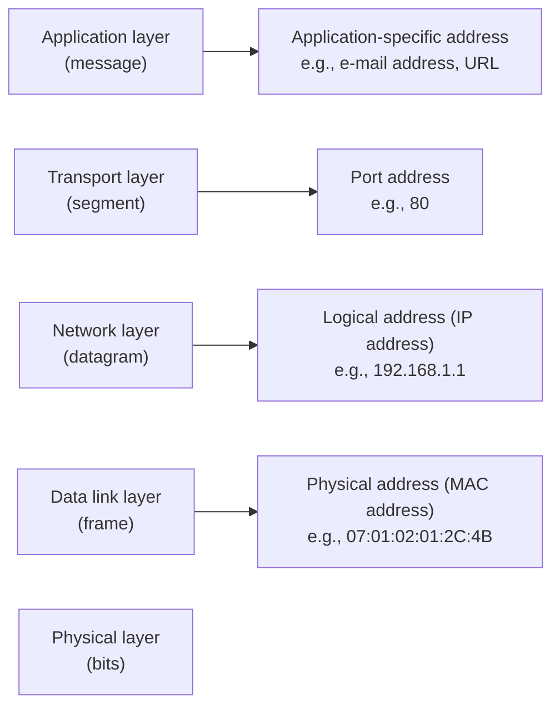

*Figure 10. Layers of TCP/IP and the four levels of addresses*

| Address | Layer | Size (representative example) | Scope | Changes at each hop |
|:-----|:-----|:-----|:-----|:-----|
| Physical address | Data link | 48 bits (6 bytes) for Ethernet | Local link | Yes |
| Logical address | Network | 32 bits for IPv4 | Whole Internet | No |
| Port address | Transport | 16 bits | Within a host | No |
| Application-specific address | Application | Variable | Specific to each application | Changed into port and logical addresses by the sending computer |

*Table 9. Comparison of the four levels of addresses*

### 5.2 Physical Addresses

The **physical address**, also called the **link address**, is the address of a node as defined by its LAN or WAN. It is included in the frame used by the data link layer and is the lowest-level address. A physical address has meaning only within its link (LAN or WAN), and its size and format vary with the network. Ethernet, for example, uses a 6-byte (48-bit) physical address imprinted on the network interface card (NIC), while Apple's LocalTalk uses a 1-byte dynamic address that changes each time the station comes up.

> **Definition:** A **physical address** is a hardware address, meaningful only within a link, that the data link layer uses to identify the sender and receiver of a frame.

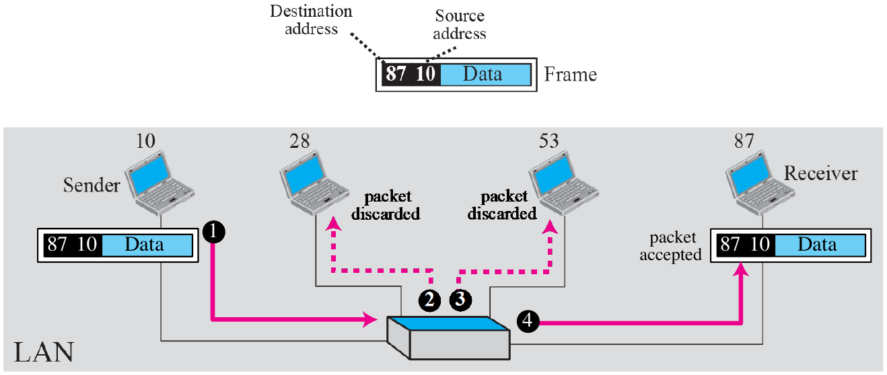

*Figure 11. Example 2.3: delivering a frame with physical addresses*

**Example 2.3.** In Figure 11, a node with physical address 10 sends a frame to a node with physical address 87. The two nodes are connected by one link (a LAN).

1. The data link layer of the sender (10) encapsulates the data received from the upper layer in a frame, adding a header and a trailer. The header carries the physical addresses of the receiver and the sender, and in most data link protocols the destination address (87) comes before the source address (10). The trailer usually contains extra bits for error detection.
2. The frame propagates through the LAN.
3. Each node with a physical address other than 87 (28, 53) drops the frame because the destination address in the frame does not match its own address.
4. The intended destination (87) finds a match between the destination address in the frame and its own address, checks the frame, removes the header and trailer, and delivers the data to the upper layer.

The device in the middle of the LAN in Figure 11 delivers frames to the nodes. Besides sending the frame to every node and letting each node discard it by address, as in this example, some kinds of switches send the frame only to the device whose address matches. Chapter 20 covers this difference between hubs and switches.

**Example 2.4.** Most LANs use a 48-bit (6-byte) physical address written as 12 hexadecimal digits, with every byte (2 hexadecimal digits) separated by a colon.

```text
07:01:02:01:2C:4B
```

A physical address can be a **unicast** address (one single recipient), a **multicast** address (a group of recipients), or a **broadcast** address (received by all systems in the network). Ethernet supports all three. A network that does not support multicast or broadcast physical addresses simulates them by sending multiple packets with unicast addresses.

### 5.3 Logical Addresses

**Logical addresses** are necessary for universal communication that is independent of the underlying physical networks. Different networks can have different address formats, so physical addresses are not adequate in an internetwork environment. A universal addressing system is needed in which each host can be identified uniquely regardless of the underlying network, and logical addresses serve this purpose. In IPv4, a logical address of the Internet is a 32-bit address that uniquely defines a host connected to the Internet; no two publicly addressed and visible hosts can have the same IP address. Chapter 12 covers IPv4 addresses in detail, and Chapter 24 covers the 128-bit addresses of IPv6.

> **Definition:** A **logical address** is the address used by the network layer that uniquely identifies a host (connection) throughout the Internet independently of the underlying network; in the Internet it is the IP address.

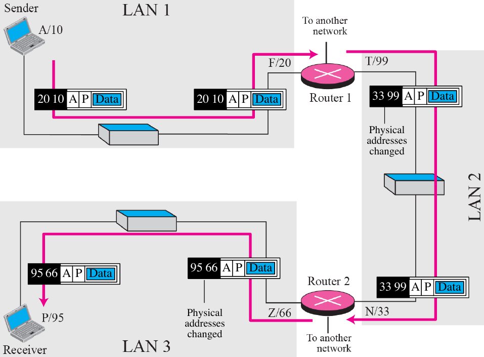

*Figure 12. Example 2.5: logical addresses and physical addresses that change at each hop*

**Example 2.5.** Figure 12 shows a part of an internet with two routers connecting three LANs. Each device has a pair of addresses, logical and physical, for each connection. A computer is connected to only one link and therefore has one pair of addresses, while each router is connected to three networks (only two are shown) and has three pairs. The figure shows logical addresses as letters and physical addresses as numbers, but both are actually numbers. The computer with logical address A and physical address 10 sends a packet to the computer with logical address P and physical address 95.

1. The sender encapsulates its data in a packet at the network layer and adds the logical addresses A and P. In most protocols the logical source address comes before the logical destination address (the reverse of the order of physical addresses).
2. The network layer consults its forwarding table and finds that the logical address of the next hop (router 1) is F. ARP then finds the physical address of router 1 (20) corresponding to its logical address (Chapter 19). The network layer passes this address to the data link layer, which encapsulates the packet in a frame with destination physical address 20 and source physical address 10.
3. Every device on LAN 1 receives the frame, but only router 1, whose physical address matches the destination physical address of the frame, accepts it; the others discard it.
4. Router 1 takes the packet out of the frame and reads the logical destination address P. Because P does not match the router's own logical address, the packet must be forwarded. Router 1 uses its forwarding table and ARP to find the physical address of the next hop (router 2), creates a new frame, encapsulates the packet, and sends it to router 2. The source physical address changes from 10 to 99, and the destination physical address changes from 20 (router 1) to 33 (router 2). The logical source and destination addresses must remain the same; otherwise the packet would be lost.
5. A similar scenario occurs at router 2: the physical addresses change and a new frame is sent to the destination computer.
6. When the frame reaches the destination, the packet is decapsulated; because the destination logical address P matches the computer's logical address, the data are delivered to the upper layer.

| Segment | Destination physical address | Source physical address | Source logical address | Destination logical address |
|:-----|:-----|:-----|:-----|:-----|
| LAN 1 (sender to router 1) | 20 | 10 | A | P |
| LAN 2 (router 1 to router 2) | 33 | 99 | A | P |
| LAN 3 (router 2 to receiver) | 95 | 66 | A | P |

*Table 10. Addresses carried in the frame on each segment in Example 2.5*

> **Key Point:** Physical addresses change from hop to hop, but logical addresses remain the same from source to destination, because physical addresses are used for delivery within a local link and logical addresses for delivery across the whole Internet. There are exceptions to this rule (for example, NAT in Chapter 12).

Logical addresses can also be unicast, multicast, or broadcast, with some limitations on broadcast addresses.

### 5.4 Port Addresses

The IP address and the physical address are needed for data to travel from the source host to the destination host. Arrival at the destination host, however, is not the final objective of Internet communication; the objective is one **process** communicating with another. Today's computers run several processes at the same time. Computer A, for example, can communicate with computer C using TELNET while communicating with computer B using FTP. For these processes to receive data simultaneously, each needs a label, that is, an address. In the TCP/IP architecture the label assigned to a process is called a **port address**, and it is 16 bits long.

> **Definition:** A **port address** is a 16-bit address the transport layer uses to distinguish the processes running within a host.

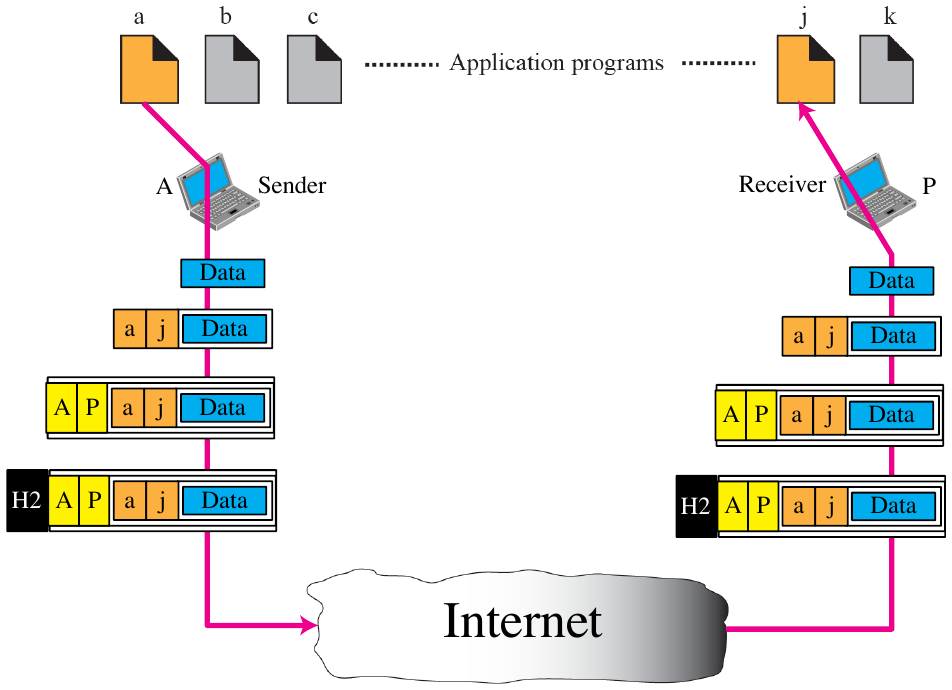

*Figure 13. Example 2.6: port numbers*

**Example 2.6.** In Figure 13, the sending computer is running three processes with port addresses a, b, and c, and the receiving computer is running two processes with port addresses j and k. Process a in the sending computer wants to communicate with process j in the receiving computer. Even if both computers use the same application (for example, FTP), the port addresses differ because one is a client program and the other a server program (Chapter 3).

1. To show that the data from process a must go to j and not to k, the transport layer encapsulates the application-layer data in a packet and adds the source port address a and the destination port address j.
2. The network layer encapsulates this packet again and adds the logical source address A and destination address P. A and P identify the sending and receiving nodes, and a and j identify the sending and receiving ports.
3. The data link layer encapsulates the packet in a frame carrying the physical addresses of the next hop (header H2). The physical addresses are not shown because they change from hop to hop inside the Internet cloud.

Physical addresses change from hop to hop, but logical and port addresses usually remain the same from source to destination (exceptions are discussed in later chapters).

**Example 2.7.** A port address is a 16-bit address represented by one decimal number, as shown.

```text
753
```

### 5.5 Application-Specific Addresses

Some applications have user-friendly addresses designed for that specific application. Examples are the **e-mail address** (for example, forouzan@fhda.edu), which defines the recipient of an e-mail, and the **URL** (Uniform Resource Locator, for example, www.mhhe.com), which is used to find a document on the World Wide Web. The sending computer changes these addresses into the corresponding port and logical addresses. Translating names into IP addresses is the job of DNS in Chapter 5.

---

<br>

## 6. Encapsulation and Decapsulation

### 6.1 Encapsulation at Hosts, Switches, and Routers

Kurose explains encapsulation with the path data take down the protocol stack of the sending end system, up and down the protocol stacks of an intervening link-layer switch and router, and up the protocol stack of the receiving end system. Routers and link-layer switches also organize their networking hardware and software into layers, but they do not implement all layers of the protocol stack; they implement only the bottom layers. Link-layer switches implement layers 1 and 2, and routers implement layers 1 through 3. Internet routers can therefore implement IP, a layer-3 protocol, while link-layer switches cannot; link-layer switches do not recognize IP addresses, but they do recognize layer-2 addresses such as Ethernet addresses. Hosts implement all five layers, which is consistent with the view that the Internet architecture puts much of its complexity at the edges of the network.

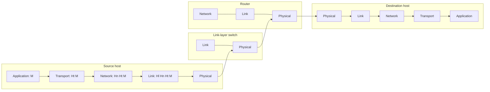

*Figure 14. Encapsulation through hosts, a link-layer switch, and a router*

At the sending host, an application-layer message (M) is passed to the transport layer. In the simplest case, the transport layer appends information to be used by the receiver-side transport layer, the transport-layer header (Ht). This information may include what the receiver-side transport layer needs to deliver the message up to the appropriate application, and error-detection bits that let the receiver determine whether bits of the message were changed en route. The application-layer message and the transport-layer header together form the transport-layer segment, which encapsulates the application-layer message. The transport layer passes the segment to the network layer, which adds a network-layer header (Hn) such as the source and destination end system addresses, creating a network-layer datagram. The datagram is passed to the link layer and becomes a link-layer frame with a link-layer header (Hl). At each layer, then, a packet has two types of fields, **header fields** and a **payload field**, and the payload is typically a packet from the layer above.

> **Definition:** **Encapsulation** is the process in which each layer takes the whole packet received from the layer above as its payload and adds its own header (and a trailer if needed) to form the packet of its layer.

Kurose gives the analogy of sending an interoffice memo between corporate branch offices through the public postal service. Alice in one branch sends a memo to Bob in another. The memo corresponds to the application-layer message. Alice puts the memo in an interoffice envelope with Bob's name and department on it; the interoffice envelope corresponds to the transport-layer segment, which contains header information (Bob's name and department) and encapsulates the memo. The sending branch's mailroom puts the interoffice envelope inside a postal envelope and writes the postal addresses of the sending and receiving branches; this postal envelope corresponds to the datagram. When the postal service delivers the envelope to the receiving branch's mailroom, decapsulation begins: the mailroom takes out the interoffice envelope and forwards it to Bob, who opens it and removes the memo.

Encapsulation can be more complex than this. A large message may be divided into multiple transport-layer segments, each of which may in turn be divided into multiple network-layer datagrams. At the receiving side, a segment must then be reconstructed from its constituent datagrams.

```text
Application:     [        Data          ]
                         |
Transport:       [ H_t |    Data        ]     --> Segment (TCP) / User datagram (UDP)
                         |
Network:         [ H_n | H_t | Data     ]     --> Datagram
                         |
Data link:       [ H_d | H_n | H_t | Data | T_d ]  --> Frame
                         |
Physical:        101010011101...             --> Bits
```

*Figure 15. Encapsulation at each layer*

**Decapsulation** is the reverse process at the receiving side, in which each layer removes its own header (and trailer) and passes the rest of the data to the layer above. A link-layer switch decapsulates a frame only up to layer 2, and a router only up to layer 3, to examine the headers it needs before encapsulating the packet again and sending it out.

> **Key Point:** Encapsulation provides modularity: each layer needs to understand only its own header format, so the protocols at each layer can evolve independently. Routers process packets up to layer 3 and switches up to layer 2; only end systems process all five layers.

### 6.2 Layers Along an Entire Internet Path

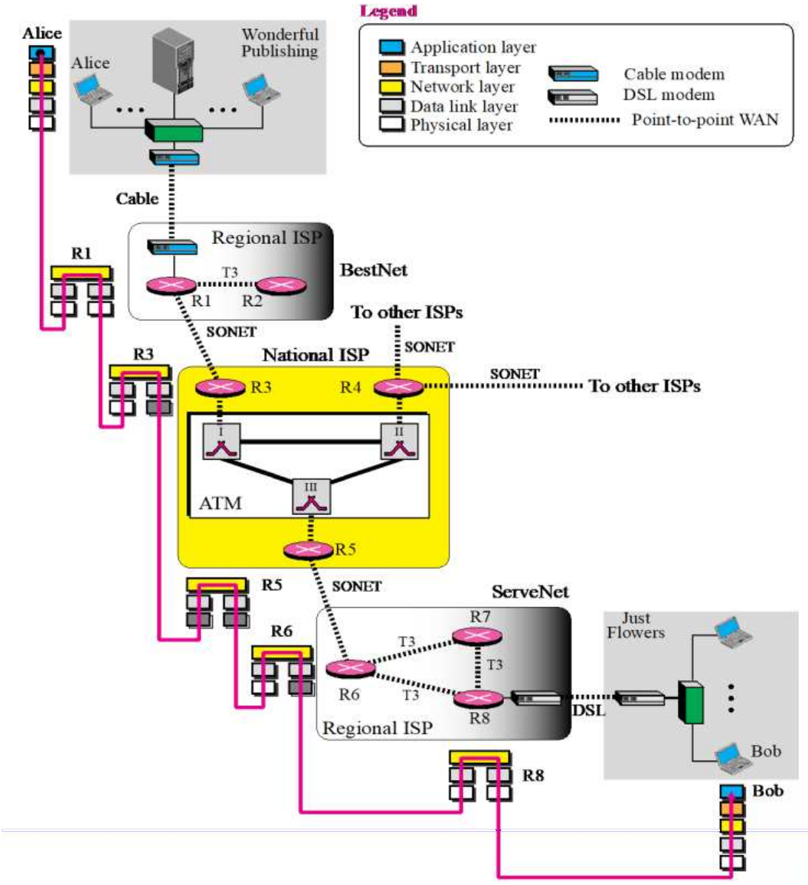

*Figure 16. The path from Alice to Bob through the Internet and the layers used at each device*

Figure 16 shows the path over which Alice (at the company Wonderful Publishing) and Bob (at the company Just Flowers) communicate in an imaginary part of the Internet. The legend of the figure distinguishes the application, transport, network, data link, and physical layers by color, and the dotted lines are point-to-point WANs.

- Alice's company LAN is connected through a cable modem to router R1 of the regional ISP BestNet. Inside BestNet, R1 and R2 are connected by a T3 line.
- BestNet is connected by a SONET link to R3 of the national ISP. The national ISP contains a network of ATM switches (I, II, III), R4 is connected by SONET to other ISPs, and R5 is connected by SONET to R6 of the regional ISP ServeNet.
- Inside ServeNet, R6, R7, and R8 are connected by T3 lines, and R8 is connected through a DSL modem to Bob's company LAN.

Looking at the layers used along the path, the hosts of Alice and Bob use all five layers, and each router on the path (R1, R3, R5, R6, R8) uses only the three layers physical, data link, and network. Each link uses a different technology (cable, T3, SONET, ATM, DSL), so the data link and physical protocols differ from link to link; on point-to-point links, for example, a data link protocol such as PPP is used (Chapter 21). At the network layer, however, every router uses IP, so the datagram keeps the same format along the whole path, and the transport-layer segment (TCP) or user datagram (UDP) and the application-layer message are processed only at the two end hosts. As Chapter 1 showed, the ISPs on this path lease existing networks (the telephone network, the cable network, fiber backbones).

---

<br>

## 7. Multiplexing and Demultiplexing

**Multiplexing** is the sharing of one lower-layer protocol by several upper-layer protocols. **Demultiplexing** is the reverse process at the receiving side, in which the lower layer distributes the data it receives to the appropriate upper-layer protocols.

> **Definition:** **Multiplexing** is sending, at the sending side, the data of several upper-layer protocols through one lower-layer protocol.

> **Definition:** **Demultiplexing** is delivering, at the receiving side, the received data to the appropriate upper-layer protocol or process according to the identifying information in the header.

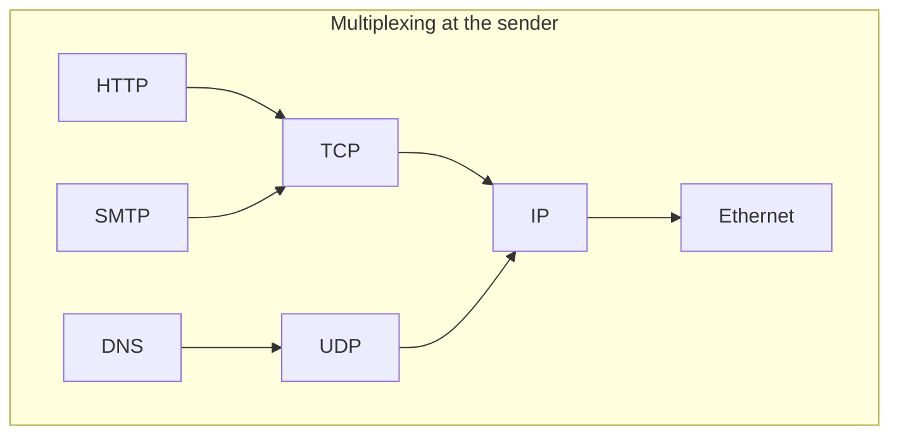

*Figure 17. Multiplexing at the sender*

For demultiplexing to be possible, the header of each layer must have a field identifying the upper layer that should receive the data.

| Header of the layer | Identifying field | Example values |
|:-----|:-----|:-----|
| Ethernet frame | Type field | 0x0800 = IPv4, 0x0806 = ARP |
| IP datagram | Protocol field | 1 = ICMP, 6 = TCP, 17 = UDP |
| TCP segment, UDP user datagram | Destination port number | 25 = SMTP, 53 = DNS, 80 = HTTP |

*Table 11. Header fields used for demultiplexing*

For example, the data of an Ethernet frame whose type field is 0x0800 are delivered to IP, the data of an IP datagram whose protocol field is 17 to UDP, and the data of a UDP user datagram whose destination port is 53 to DNS. The formats of these header fields are covered in Chapter 11 (IP), Chapter 6 (UDP), Chapter 8 (TCP), and Chapter 20 (Ethernet).

---

<br>

## Summary

| Concept | Key Summary |
|:-----|:-----|
| Components of communication | There are five: message, sender, receiver, medium, and protocol. |
| Layered architecture | Divides complex communication into ordered layers, each of which uses the services of the layer below to provide services to the layer above. |
| Advantages and drawbacks of layering | Gives modularity and easy replacement of implementations, at the cost of duplicated functionality and of needing information from other layers. |
| OSI model | A seven-layer reference model established by ISO; layers 1-3 support the network, layers 5-7 support the user, and layer 4 links the two. |
| Peer processes and interfaces | Processes at the same layer communicate logically through protocols, and adjacent layers exchange services through interfaces. |
| TCP/IP protocol suite | Five layers, physical, data link, network, transport, and application, with the application layer replacing layers 5-7 of OSI. |
| Units of communication by layer | Bit, frame, datagram, segment (user datagram), and message; the physical and data link layers are node to node, the others end to end. |
| Four levels of addresses | Physical address (link), logical address (IP), port address (process), and application-specific address (e-mail, URL). |
| Changes of addresses | Physical addresses change from hop to hop, while logical and port addresses usually remain the same from source to destination. |
| Encapsulation | Each layer takes the packet of the layer above as its payload and adds a header; switches process up to layer 2 and routers up to layer 3. |
| Multiplexing and demultiplexing | Upper layers are identified by the type field, the protocol field, and port numbers, so several upper layers can share one lower layer. |

---

<br>

## Self-Check Questions

1. **Encapsulation overhead:** 1000 bytes of application-layer data are encapsulated in turn by TCP (20-byte header), IP (20-byte header), and Ethernet (14-byte header, 4-byte trailer). Find the size of the frame and the fraction of it taken by headers and trailers. Exclude the preamble and SFD added at the physical layer.

   <details>
   <summary>Answer</summary>

   The segment is 1000 + 20 = 1020 bytes, the datagram 1020 + 20 = 1040 bytes, and the frame 1040 + 14 + 4 = 1058 bytes. The headers and trailers total 20 + 20 + 14 + 4 = 58 bytes, so the fraction is 58 / 1058 ≈ 5.5%.

   </details>

2. **Demultiplexing trace:** A received Ethernet frame has type field 0x0800, the IP datagram inside it has protocol field 17, and the destination port number is 53. Through which protocols does the data pass in turn, and to which application is it delivered?

   <details>
   <summary>Answer</summary>

   Type field 0x0800 is IPv4, so the data of the frame go to IP, and protocol field 17 is UDP, so the data of the datagram go to UDP. UDP looks at destination port 53 and delivers the data to DNS. The data thus pass through Ethernet, IPv4, and UDP to reach DNS.

   </details>

3. **Scope of addresses:** A packet travels from a source host through two routers to a destination host. Assuming there is no NAT, distinguish the addresses that change on every link from those kept to the end, and explain why.

   <details>
   <summary>Answer</summary>

   Physical addresses have the local link as their scope, so on each link they become the addresses of that link's sending and receiving devices. The path consists of three links, so three different pairs of physical addresses are used in turn. IP addresses have the whole Internet as their scope, so the source and destination IP addresses are kept to the end, and the port numbers identifying the processes on the end hosts do not change either.

   </details>

4. **Correspondence of OSI and TCP/IP:** Which TCP/IP layer takes on the dialog control and encryption functions of the OSI session and presentation layers? To which OSI layers does the TCP/IP application layer correspond?

   <details>
   <summary>Answer</summary>

   TCP/IP has no separate session or presentation layer, so these functions are absorbed into the application layer and handled by the application program or the application-layer protocol. The TCP/IP application layer therefore corresponds to OSI layers 5-7.

   </details>

5. **Address changes in Example 2.5:** In Example 2.5, which addresses in the frame change, and how, when the packet passes router 1, and which are kept? Also explain how router 1 learns the physical address of the next hop.

   <details>
   <summary>Answer</summary>

   The source physical address changes from 10 to 99 (router 1's interface on LAN 2), and the destination physical address changes from 20 (router 1) to 33 (router 2). The logical source address A and destination address P stay the same. Router 1 finds the logical address of the next hop, router 2, in its forwarding table and uses ARP to learn the corresponding physical address 33. Because a physical address has meaning only within a link, a new frame is needed every time the link changes.

   </details>

6. **Mapping functions to OSI layers:** Which OSI layer handles each of framing, routing, segmentation and reassembly, dialog control, and compression?

   <details>
   <summary>Answer</summary>

   Framing is handled by the data link layer (layer 2), routing by the network layer (layer 3), segmentation and reassembly by the transport layer (layer 4), dialog control by the session layer (layer 5), and compression by the presentation layer (layer 6).

   </details>

7. **Headers seen by switches and routers:** A segment travels from a source host through one link-layer switch and one router to a destination host. Up to which layer do the switch and the router process the packet, and which addresses do they look at? Which devices look at the transport-layer header?

   <details>
   <summary>Answer</summary>

   A link-layer switch implements only layers 1 and 2, so it looks only at the link-layer address (Ethernet address) in the frame header and does not recognize IP addresses. A router implements layers 1 to 3, so it looks at the destination IP address in the datagram header and forwards accordingly. The transport-layer header (port numbers) is processed only by the source and destination hosts, which implement all five layers.

   </details>
