# 3장 — 네트워크 응용과 웹

[레포지토리 안내](../../README.ko.md) | [English](Concepts_Lecture.md) | [한국어](Concepts_Lecture.ko.md)

> **최종 수정일:** 2026-11-19
>
> Computer Networking: A Top-Down Approach, Kurose and Ross, Ch 2; TCP/IP Protocol Suite, Forouzan, Ch 17, 22

> **학습 목표:**
> 1. 클라이언트-서버 구조와 P2P 구조를 비교하고, 클라이언트 프로세스와 서버 프로세스를 정의할 수 있다
> 2. 소켓, IP 주소, 포트 번호로 서로 다른 호스트의 프로세스가 통신하는 방법을 설명할 수 있다
> 3. 반복 서버와 동시 서버의 동작을 비교할 수 있다
> 4. 응용이 요구하는 전송 서비스를 네 가지 기준으로 분석하고 TCP와 UDP 중 알맞은 것을 고를 수 있다
> 5. HTTP의 비지속 연결과 지속 연결의 응답 시간을 계산하고, 요청 메시지와 응답 메시지를 해석할 수 있다
> 6. 쿠키, 웹 캐시, 조건부 GET이 해결하는 문제와 동작을 설명할 수 있다

---

## 목차

- [1. 네트워크 응용의 원리](#1-네트워크-응용의-원리)
  - [1.1 응용은 종단 시스템에서 실행된다](#11-응용은-종단-시스템에서-실행된다)
  - [1.2 클라이언트-서버 구조와 P2P 구조](#12-클라이언트-서버-구조와-p2p-구조)
  - [1.3 클라이언트와 서버라는 프로그램](#13-클라이언트와-서버라는-프로그램)
  - [1.4 프로세스 간 통신과 소켓](#14-프로세스-간-통신과-소켓)
  - [1.5 반복 서버와 동시 서버](#15-반복-서버와-동시-서버)
- [2. 응용이 요구하는 전송 서비스](#2-응용이-요구하는-전송-서비스)
- [3. 인터넷이 제공하는 전송 서비스](#3-인터넷이-제공하는-전송-서비스)
  - [3.1 TCP 서비스](#31-tcp-서비스)
  - [3.2 UDP 서비스](#32-udp-서비스)
  - [3.3 인터넷이 제공하지 않는 서비스](#33-인터넷이-제공하지-않는-서비스)
- [4. 응용 계층 프로토콜](#4-응용-계층-프로토콜)
- [5. 웹과 HTTP](#5-웹과-http)
  - [5.1 웹의 구조](#51-웹의-구조)
  - [5.2 웹 문서의 종류](#52-웹-문서의-종류)
  - [5.3 HTTP 개요](#53-http-개요)
  - [5.4 비지속 연결과 지속 연결](#54-비지속-연결과-지속-연결)
  - [5.5 HTTP 요청 메시지](#55-http-요청-메시지)
  - [5.6 HTTP 응답 메시지](#56-http-응답-메시지)
  - [5.7 HTTP 트랜잭션의 예](#57-http-트랜잭션의-예)
  - [5.8 HTTP와 보안](#58-http와-보안)
- [6. 쿠키](#6-쿠키)
- [7. 웹 캐싱](#7-웹-캐싱)
  - [7.1 프록시 서버의 동작](#71-프록시-서버의-동작)
  - [7.2 캐싱의 효과](#72-캐싱의-효과)
  - [7.3 조건부 GET](#73-조건부-get)
- [8. HTTP/2](#8-http2)
- [요약](#요약)
- [점검 문제](#점검-문제)
- [참고 문헌](#참고-문헌)

---

<br>

## 1. 네트워크 응용의 원리

### 1.1 응용은 종단 시스템에서 실행된다

네트워크 응용을 개발한다는 것은 서로 다른 종단 시스템에서 실행되면서 네트워크로 통신하는 프로그램을 작성한다는 뜻이다. 웹 응용에서는 사용자의 호스트(데스크톱, 노트북, 태블릿, 스마트폰)에서 실행되는 브라우저 프로그램과 웹 서버 호스트에서 실행되는 웹 서버 프로그램이 서로 통신한다. P2P 파일 공유 시스템에서는 참여하는 각 호스트에 비슷하거나 똑같은 프로그램이 있다. 개발자는 이 소프트웨어를 C, Java, Python 같은 언어로 작성한다.

중요한 점은 라우터나 링크 계층 스위치 같은 네트워크 코어 장치에서 실행되는 소프트웨어는 작성할 필요가 없다는 것이다. 작성하려 해도 할 수 없다. 2장에서 본 것처럼 네트워크 코어 장치는 응용 계층에서 동작하지 않고 네트워크 계층 이하에서 동작하기 때문이다. 응용 소프트웨어를 종단 시스템에만 두는 이 설계 덕분에 수많은 네트워크 응용이 빠르게 개발되고 배포될 수 있었다.

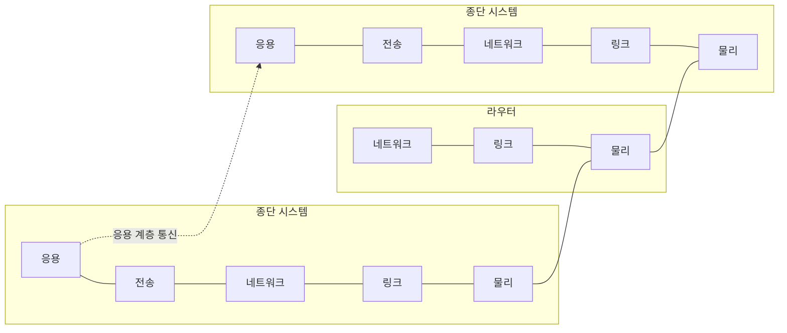

*그림 1. 응용 계층에서 종단 시스템 사이에 이루어지는 네트워크 응용의 통신*

### 1.2 클라이언트-서버 구조와 P2P 구조

프로그램을 작성하기 전에 응용의 구조를 정해야 한다. 응용 구조는 2장의 다섯 계층 인터넷 구조 같은 네트워크 구조와 다르다. 응용 개발자에게 네트워크 구조는 고정되어 있고 응용에 정해진 서비스를 제공하지만, **응용 구조(application architecture)** 는 응용 개발자가 설계하며 응용이 여러 종단 시스템에 어떻게 배치될지를 정한다. 오늘날의 네트워크 응용은 대부분 클라이언트-서버 구조나 P2P 구조를 따른다.

> **용어 정의:** **클라이언트-서버 구조(client-server architecture)** 는 항상 켜져 있는 **서버(server)** 호스트가 다른 많은 **클라이언트(client)** 호스트의 요청을 처리하는 응용 구조이다.

웹이 대표적인 예이다. 항상 켜져 있는 웹 서버는 클라이언트 호스트에서 실행되는 브라우저의 요청을 처리하며, 객체 요청을 받으면 요청한 객체를 클라이언트 호스트로 보낸다. 클라이언트-서버 구조에서 클라이언트끼리는 직접 통신하지 않으며, 예를 들어 두 브라우저는 서로 직접 통신하지 않는다. 또한 서버는 고정된 잘 알려진 주소, 곧 IP 주소를 가지므로, 클라이언트는 언제든 서버의 IP 주소로 패킷을 보내 서버에 연락할 수 있다. 웹, FTP, Telnet, 전자 메일이 클라이언트-서버 구조를 쓴다.

인기 있는 서비스에서는 서버 호스트 하나가 모든 클라이언트의 요청을 따라가지 못하는 경우가 많다. 그래서 검색 엔진, 인터넷 상거래, 웹 기반 전자 메일, 소셜 네트워킹 같은 서비스는 많은 호스트를 모은 **데이터 센터**로 강력한 가상 서버를 만든다. 데이터 센터에는 수십만 대의 서버가 있을 수 있고, 서비스 제공자는 서버의 전력과 유지 비용과 함께 데이터 센터에서 데이터를 보내는 데 드는 상호 연결 비용과 대역폭 비용을 계속 부담해야 한다.

> **용어 정의:** **P2P 구조(peer-to-peer architecture)** 는 전용 서버에 거의 또는 전혀 의존하지 않고, **피어(peer)** 라 부르는 간헐적으로 연결되는 호스트 쌍이 직접 통신하는 응용 구조이다.

피어는 서비스 제공자가 소유한 것이 아니라 사용자가 통제하는 데스크톱과 노트북이며, 대부분 가정, 대학, 사무실에 있다. 피어끼리 전용 서버를 거치지 않고 통신하므로 피어 대 피어(peer-to-peer) 구조라 한다. 파일 공유(BitTorrent), 피어 지원 다운로드 가속, 인터넷 전화와 화상 회의(Skype) 같은 트래픽이 많은 응용이 P2P 구조를 쓴다. 메신저처럼 서버로 사용자의 IP 주소를 추적하되 사용자 사이의 메시지는 서버를 거치지 않고 직접 보내는 **혼합(hybrid) 구조**도 있다.

P2P 구조의 가장 큰 장점은 **자기 확장성(self-scalability)** 이다. 예를 들어 P2P 파일 공유에서 각 피어는 파일을 요청하여 부하를 만들지만, 다른 피어에게 파일을 나누어 주어 시스템에 서비스 용량도 더한다. 또한 큰 서버 기반 시설과 서버 대역폭이 필요 없어 비용 효율적이다. 반면 고도로 분산된 구조 때문에 보안, 성능, 신뢰성 문제가 있다. P2P 파일 배포의 정량적 분석은 23장에서 다룬다.

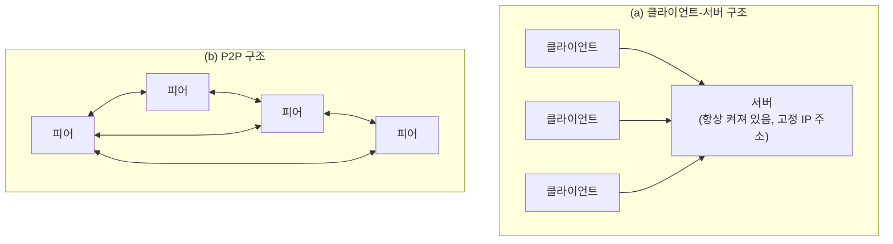

*그림 2. 클라이언트-서버 구조와 P2P 구조*

| 관점 | 클라이언트-서버 구조 | P2P 구조 |
|:-----|:-----|:-----|
| 서비스를 제공하는 쪽 | 항상 켜져 있는 서버 (데이터 센터) | 사용자가 통제하는 피어 |
| 주소 | 서버는 고정된 잘 알려진 IP 주소 | 피어는 간헐적으로 연결되고 주소가 바뀔 수 있음 |
| 클라이언트끼리의 통신 | 직접 통신하지 않음 | 피어끼리 직접 통신 |
| 확장성 | 서버 용량을 늘려야 함 | 피어가 요청하는 만큼 용량도 더함 (자기 확장성) |
| 과제 | 서버 기반 시설과 대역폭 비용 | 보안, 성능, 신뢰성 |
| 예 | 웹, FTP, Telnet, 전자 메일 | BitTorrent, Skype |

*표 1. 클라이언트-서버 구조와 P2P 구조의 비교*

### 1.3 클라이언트와 서버라는 프로그램

Forouzan은 클라이언트-서버 패러다임을 다음 질문에 답하는 방식으로 설명한다. 원격 컴퓨터의 서비스를 받으려면 두 컴퓨터가 각각 프로그램을 실행해야 하는데, 이를 실제로 구현하려면 몇 가지 결정이 필요하다.

1. **두 프로그램이 모두 서비스를 요청하고 제공할 수 있어야 하는가?** 일반적인 해법은 역할을 나누는 것이다. 지역 기계에서 실행되며 서비스를 요청하는 프로그램을 **클라이언트**, 원격 기계에서 실행되며 서비스를 제공하는 프로그램을 **서버**라 하고, 클라이언트와 서버는 쌍으로 존재하며 같은 이름을 가진다(예: FTP 클라이언트와 FTP 서버).
2. **서버는 특정 클라이언트에게만 서비스를 제공하는가?** 가장 흔한 해법은 서버가 그 종류의 서비스를 원하는 어떤 클라이언트에게든 서비스를 제공하는 것이다. 곧 서버와 클라이언트는 일대다 관계이다.
3. **컴퓨터는 클라이언트와 서버 중 하나만 실행하는가?** 인터넷에 연결된 컴퓨터는 알맞은 소프트웨어가 있으면 어떤 클라이언트 프로그램이든 실행할 수 있어야 한다. 서버 프로그램은 계속 실행될 수 있는 컴퓨터에서 실행해야 한다.
4. **프로그램은 언제 실행되어야 하는가?** 서비스를 요청하는 클라이언트는 필요할 때만 실행되면 된다. 서비스를 제공하는 서버는 서비스가 언제 필요할지 모르므로 항상 실행되어야 한다.
5. **서비스마다 프로그램을 따로 두어야 하는가?** 자주 쓰는 서비스는 전용 클라이언트-서버 프로그램을 두되, 원격 컴퓨터에 로그인하여 그 컴퓨터의 서비스를 쓰게 하는 범용 프로그램(4장의 TELNET)도 있어야 한다.

이에 따라 **서버**는 원격 기계에서 실행되며 클라이언트에게 서비스를 제공하는 프로그램이다. 서버는 시작되면 클라이언트의 요청을 받기 위해 문을 열지만, 요청을 받기 전에는 결코 서비스를 먼저 시작하지 않는다. 서버는 문제가 생기지 않는 한 끝없이 실행되는 **무한 프로그램**이며, 요청이 도착하면 반복적으로나 동시적으로 응답한다. **클라이언트**는 지역 기계에서 실행되며 서버에 서비스를 요청하는 프로그램이다. 클라이언트는 사용자(또는 다른 응용 프로그램)가 시작하고 서비스가 끝나면 종료하는 **유한 프로그램**이다. 클라이언트는 보통 원격 호스트의 IP 주소와 그 호스트에서 실행 중인 서버 프로그램의 잘 알려진 포트 주소로 통신 채널을 열고, 요청을 보내고 응답을 받는다. 요청과 응답은 여러 번 반복될 수 있지만 전체 과정은 결국 끝난다.

### 1.4 프로세스 간 통신과 소켓

운영 체제의 용어로 말하면 통신하는 것은 프로그램이 아니라 **프로세스(process)**, 곧 종단 시스템에서 실행 중인 프로그램이다. 같은 종단 시스템의 프로세스끼리는 운영 체제가 정한 규칙에 따른 프로세스 간 통신(interprocess communication)을 쓰지만, 여기서 관심은 서로 다른 호스트(운영 체제가 다를 수도 있음)의 프로세스가 통신하는 방법이다. 서로 다른 종단 시스템의 프로세스는 컴퓨터 네트워크를 통해 **메시지**를 주고받는다.

> **[운영체제]** **프로세스(process)** 는 실행 중인 프로그램으로, 자신의 주소 공간과 실행 상태를 가지고 운영 체제가 관리하는 실행 단위이다. 같은 프로그램을 여러 번 실행하면 서로 다른 프로세스가 여럿 생긴다. 운영 체제는 프로세스가 파일이나 네트워크 같은 자원에 접근할 수 있도록 시스템 호출 인터페이스를 제공하며, 소켓은 그중 네트워크 통신을 위한 인터페이스이다.

**클라이언트 프로세스와 서버 프로세스.** 네트워크 응용은 네트워크로 메시지를 주고받는 프로세스 쌍으로 이루어지며, 각 쌍에서 한 프로세스를 클라이언트, 다른 프로세스를 서버라 부른다. 웹에서는 브라우저가 클라이언트 프로세스이고 웹 서버가 서버 프로세스이다. P2P 파일 공유에서는 파일을 내려받는 피어가 클라이언트, 파일을 올려 주는 피어가 서버이다. P2P 파일 공유처럼 한 프로세스가 클라이언트도 되고 서버도 되는 응용이 있지만, 어떤 통신 세션 하나만 놓고 보면 두 프로세스를 클라이언트와 서버로 구별할 수 있다.

> **용어 정의:** 두 프로세스 사이의 통신 세션에서, 통신을 시작하는(세션을 시작할 때 상대에게 먼저 연락하는) 프로세스를 **클라이언트 프로세스(client process)** 라 하고, 연락을 기다리는 프로세스를 서버 프로세스라 한다.

예를 들어 P2P 파일 공유에서 피어 A가 피어 B에게 특정 파일을 보내 달라고 요청하면, 이 세션에서는 피어 A가 클라이언트이고 피어 B가 서버이다.

**프로세스와 네트워크 사이의 인터페이스.** 한 프로세스가 다른 프로세스로 보내는 메시지는 반드시 그 아래의 네트워크를 거친다. 프로세스는 **소켓(socket)** 이라는 소프트웨어 인터페이스를 통해 네트워크로 메시지를 보내고 네트워크에서 메시지를 받는다. 프로세스를 집, 소켓을 그 집의 문에 비유할 수 있다. 다른 호스트의 프로세스에 메시지를 보내려는 프로세스는 메시지를 문(소켓) 밖으로 밀어낸다. 송신 프로세스는 문 바깥에 메시지를 목적지 프로세스의 문까지 운반하는 운송 기반 시설이 있다고 가정한다. 메시지가 목적지 호스트에 도착하면 수신 프로세스의 문(소켓)을 통과하여 들어가고, 수신 프로세스가 그 메시지를 처리한다.

> **용어 정의:** **소켓(socket)** 은 한 호스트 안에서 응용 계층과 전송 계층 사이에 있는 인터페이스로, 프로세스는 소켓을 통해 네트워크로 메시지를 보내고 받는다.

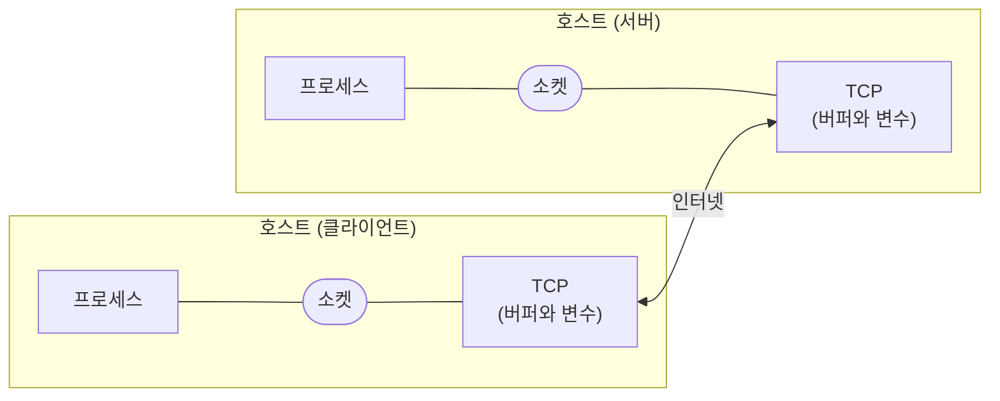

*그림 3. 응용 프로세스, 소켓, 그 아래의 전송 프로토콜*

소켓은 네트워크 응용을 만드는 프로그래밍 인터페이스이므로 응용과 네트워크 사이의 **API(Application Programming Interface)** 라고도 한다. 응용 개발자는 소켓의 응용 계층 쪽은 모두 통제하지만, 전송 계층 쪽은 거의 통제하지 못한다. 개발자가 전송 계층 쪽에서 통제할 수 있는 것은 (1) 전송 프로토콜의 선택과 (2) 최대 버퍼 크기, 최대 세그먼트 크기 같은 몇 가지 전송 계층 매개변수뿐이다. Forouzan은 소켓 인터페이스가 운영 체제와 응용 프로그램 사이에 있는 명령어 집합이며, 1980년대 초 UC 버클리의 UNIX 환경에서 시작되었다고 설명한다. 소켓 프로그래밍은 23장에서 다룬다.

**프로세스의 주소 지정.** 우편을 보내려면 목적지 주소가 필요하듯이, 다른 호스트의 프로세스에 패킷을 보내려면 수신 프로세스의 주소가 필요하다. 수신 프로세스를 식별하려면 두 가지 정보가 필요하다. 하나는 호스트의 주소이고, 다른 하나는 목적지 호스트 안에서 수신 프로세스(정확히는 수신 소켓)를 가리키는 식별자이다. 인터넷에서 호스트는 32비트 **IP 주소**로 식별되고(12장), 호스트 안의 수신 소켓은 **목적지 포트 번호(port number)** 로 식별된다. 인기 있는 응용에는 정해진 포트 번호가 배정되어 있어서, 예를 들어 웹 서버는 포트 80, SMTP를 쓰는 메일 서버는 포트 25로 식별된다. 포트 번호는 6장에서 자세히 다룬다.

### 1.5 반복 서버와 동시 서버

클라이언트와 서버 모두 동시에 여러 개가 실행될 수 있다. 클라이언트를 **반복적으로(iteratively)** 실행한다는 것은 하나를 시작하여 실행하고 끝낸 뒤에 다음 클라이언트를 시작하는 것이고, 오늘날 대부분의 컴퓨터는 둘 이상의 클라이언트를 동시에(concurrently) 실행할 수 있다.

서버도 마찬가지이다. **반복 서버(iterative server)** 는 한 번에 요청 하나만 처리한다. 요청을 받아 처리하고 응답을 보낸 뒤에야 다음 요청을 처리한다. **동시 서버(concurrent server)** 는 여러 요청을 동시에 처리하며 시간을 여러 요청에 나누어 쓴다.

> **용어 정의:** **동시 서버(concurrent server)** 는 여러 클라이언트의 요청을 동시에 처리하는 서버이며, 한 번에 요청 하나만 처리하는 서버를 반복 서버라 한다.

서버는 비연결형 전송 프로토콜인 UDP나 연결형 전송 프로토콜인 TCP(또는 SCTP)를 쓰므로, 서버의 동작은 전송 프로토콜과 서비스 방식에 따라 이론상 네 가지로 나뉜다.

| 서버 종류 | 전송 프로토콜 | 실제 사용 |
|:-----|:-----|:-----|
| 비연결형 반복 서버 | UDP | 흔함 |
| 비연결형 동시 서버 | UDP | 드묾 |
| 연결형 반복 서버 | TCP, SCTP | 드묾 |
| 연결형 동시 서버 | TCP, SCTP | 흔함 |

*표 2. 서버의 네 가지 종류*

**비연결형 반복 서버.** UDP를 쓰는 서버는 보통 반복 서버이다. 서버는 UDP가 받은 데이터그램 하나의 요청을 처리하고 응답을 UDP에 넘겨 클라이언트에 보낸다. 그동안 도착한 다른 데이터그램은 큐에 저장되어 서비스를 기다리며, 한 클라이언트에서 왔든 여러 클라이언트에서 왔든 도착 순서대로 하나씩 처리된다. 서버는 이 목적으로 잘 알려진 포트 하나만 쓰고, 그 포트에 도착한 모든 데이터그램이 줄을 서서 기다린다.

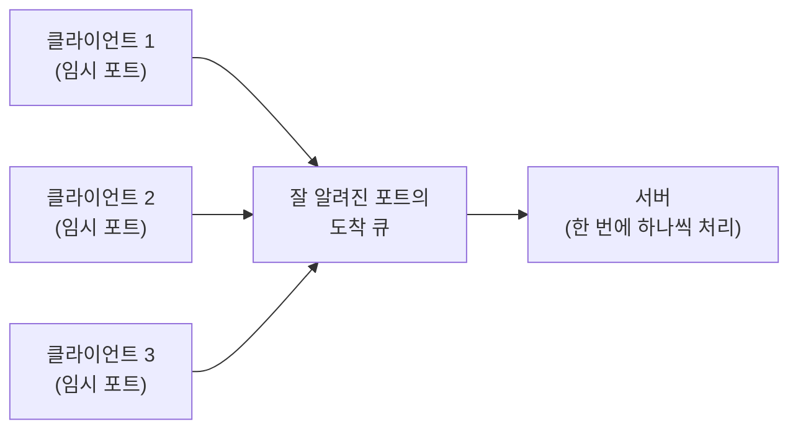

*그림 4. 비연결형 반복 서버*

**연결형 동시 서버.** TCP를 쓰는 서버는 보통 동시 서버이다. 통신은 연결형이므로 요청은 여러 세그먼트로 나뉘어 도착하는 바이트 스트림이고 응답도 여러 세그먼트를 차지할 수 있다. 서버와 각 클라이언트 사이에 연결이 설정되며, 스트림 전체가 처리되고 연결이 끊어질 때까지 연결이 유지된다. 여러 클라이언트를 동시에 서비스하기 위해 서버는 클라이언트마다 원래 프로세스(부모 프로세스)의 사본인 **자식 프로세스(child process)** 를 만들어 그 연결을 맡긴다. 부모 프로세스는 잘 알려진 포트에서 새 연결 요청만 받으므로, 다른 클라이언트가 계속 연결할 수 있다. 연결마다 들어오는 세그먼트를 저장하는 큐도 따로 있다.

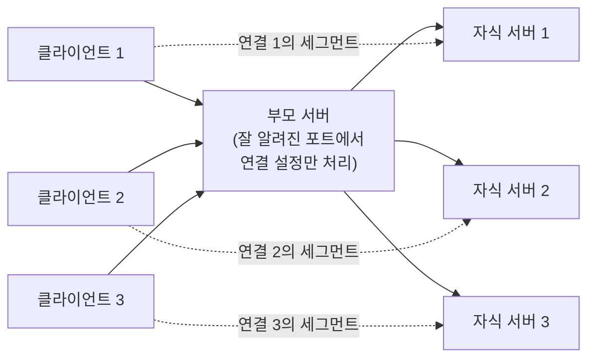

*그림 5. 연결형 동시 서버*

여러 연결이 동시에 열려 있을 때 서버 호스트의 TCP는 도착한 세그먼트를 어느 연결에 넘길지 알아야 한다. Kurose에 따르면 포트 80에서 동작하는 웹 서버로 오는 세그먼트는 연결 설정 세그먼트든 HTTP 요청을 담은 세그먼트든 모두 목적지 포트가 80이며, 서버는 출발지 IP 주소와 출발지 포트 번호까지 함께 보고 세그먼트를 구별한다. 곧 각 연결의 소켓은 출발지 IP 주소, 출발지 포트, 목적지 IP 주소, 목적지 포트의 **네 값(four-tuple)** 으로 식별된다. 이 역다중화 방식은 6장에서 다룬다.

> **참고:** **연결마다 쓰는 서버 쪽 포트.** Forouzan은 연결이 맺어지면 서버가 그 연결에 임시 포트를 배정하여 잘 알려진 포트를 비우고, 데이터 전송은 양쪽의 임시 포트 사이에서 일어난다고 설명한다. 그러나 Kurose가 설명하는 TCP에서는 연결마다 만들어지는 서버 쪽 소켓도 잘 알려진 포트(예: 80)를 그대로 쓰며, 연결의 구별은 네 값으로 한다. 23장의 TCP 소켓 프로그램을 실행하면 연결된 서버 쪽 소켓의 포트가 잘 알려진 포트와 같다는 것을 직접 확인할 수 있다. 연결마다 별도의 프로세스나 큐로 처리한다는 Forouzan 설명의 핵심은 그대로 성립한다.

> **[운영체제]** 동시 서버는 연결마다 별도의 실행 흐름이 필요하다. UNIX에서는 `fork` 시스템 호출로 부모 프로세스를 복제한 자식 프로세스를 만들고, 자식 프로세스가 한 연결을 맡고 부모 프로세스는 다시 연결 요청을 기다린다. 프로세스 대신 같은 주소 공간을 공유하는 **스레드(thread)** 를 연결마다 만들어도 된다. 23장의 예제는 스레드를 쓴다.

---

<br>

## 2. 응용이 요구하는 전송 서비스

소켓은 응용 프로세스와 전송 계층 프로토콜 사이의 인터페이스이다. 송신 쪽 응용이 소켓으로 메시지를 밀어 넣으면, 소켓 반대편의 전송 계층 프로토콜이 메시지를 수신 프로세스의 소켓까지 가져갈 책임을 진다. 인터넷을 포함한 많은 네트워크는 전송 계층 프로토콜을 둘 이상 제공하므로, 응용을 개발할 때는 그중 하나를 골라야 한다. 이는 두 도시 사이를 기차로 갈지 비행기로 갈지 고르는 것과 비슷하다. 기차는 도심에서 타고 내릴 수 있고, 비행기는 이동 시간이 짧다. 전송 계층 프로토콜이 응용에 제공할 수 있는 서비스는 크게 네 가지 차원으로 나뉜다.

**신뢰적 데이터 전송.** 네트워크에서는 라우터의 버퍼가 넘치거나 비트가 손상되어 패킷을 잃을 수 있다. 전자 메일, 파일 전송, 원격 호스트 접근, 웹 문서 전송, 금융 응용 같은 많은 응용에서 데이터 손실은 치명적이다. 송신 프로세스가 소켓에 데이터를 넘기기만 하면 데이터가 오류 없이 수신 프로세스에 도착한다고 완전히 믿을 수 있게 하는 서비스를 **신뢰적 데이터 전송(reliable data transfer)** 이라 한다. 반면 대화형 오디오와 비디오 같은 멀티미디어 응용은 어느 정도의 손실을 견딜 수 있으며, 이런 응용을 **손실 허용(loss-tolerant)** 응용이라 한다. 데이터를 조금 잃으면 오디오나 비디오에 작은 잡음이 생길 뿐 치명적이지 않다.

**처리량.** 1장에서 본 처리량은 송신 프로세스가 수신 프로세스에 비트를 전달하는 속도이다. 다른 세션이 경로의 대역폭을 나누어 쓰고 생겼다 사라지므로 가용 처리량은 시간에 따라 변한다. 전송 프로토콜은 지정한 속도 $r$ bps 이상의 처리량을 항상 보장하는 서비스를 제공할 수 있다. 예를 들어 32 kbps로 음성을 부호화하는 인터넷 전화 응용은 이 속도로 데이터를 전달받아야 하며, 그렇지 못하면 더 낮은 속도로 부호화하거나 포기해야 한다. 이처럼 처리량 요구가 있는 응용을 **대역폭 민감(bandwidth-sensitive)** 응용이라 한다. 반면 전자 메일, 파일 전송, 웹 전송처럼 가용한 처리량을 많든 적든 그대로 쓸 수 있는 응용을 **탄력적(elastic)** 응용이라 한다.

**타이밍.** 전송 프로토콜은 예를 들어 송신자가 소켓에 넣은 모든 비트가 100 ms 이내에 수신자의 소켓에 도착한다는 타이밍 보장을 제공할 수도 있다. 인터넷 전화, 가상 환경, 원격 회의, 다중 사용자 게임 같은 대화형 실시간 응용은 엄격한 타이밍 제약이 필요하다. 인터넷 전화에서 지연이 길면 대화가 부자연스럽게 끊기고, 게임에서 동작과 반응 사이의 지연이 길면 현실감이 떨어진다.

**보안.** 송신 호스트의 전송 프로토콜이 데이터를 암호화하고 수신 호스트의 전송 프로토콜이 복호화하면, 데이터가 도중에 관찰되더라도 두 프로세스 사이의 기밀성이 지켜진다. 전송 프로토콜은 기밀성 외에 데이터 무결성과 종단점 인증 같은 보안 서비스도 제공할 수 있으며, 이는 26장에서 다룬다.

| 응용 | 데이터 손실 | 처리량 | 시간 민감성 |
|:-----|:-----|:-----|:-----|
| 파일 전송과 다운로드 | 손실 불가 | 탄력적 | 아님 |
| 전자 메일 | 손실 불가 | 탄력적 | 아님 |
| 웹 문서 | 손실 불가 | 탄력적 (수 kbps) | 아님 |
| 인터넷 전화와 화상 회의 | 손실 허용 | 오디오: 수 kbps\~1 Mbps, 비디오: 10 kbps\~5 Mbps | 민감 (수백 ms) |
| 저장된 오디오와 비디오 스트리밍 | 손실 허용 | 위와 같음 | 민감 (수 초) |
| 대화형 게임 | 손실 허용 | 수 kbps\~10 kbps | 민감 (수백 ms) |
| 스마트폰 메시징 | 손실 불가 | 탄력적 | 경우에 따라 다름 |

*표 3. 대표적인 네트워크 응용의 요구 사항*

---

<br>

## 3. 인터넷이 제공하는 전송 서비스

인터넷(일반적으로 TCP/IP 네트워크)은 응용에 UDP와 TCP 두 전송 프로토콜을 제공한다. 인터넷 응용을 만들 때 가장 먼저 정해야 하는 것 중 하나가 UDP와 TCP 중 무엇을 쓸지이다.

### 3.1 TCP 서비스

TCP의 서비스 모델은 연결형 서비스와 신뢰적 데이터 전송 서비스를 포함한다.

- **연결형 서비스:** TCP는 응용 계층 메시지가 흐르기 전에 클라이언트와 서버가 전송 계층 제어 정보를 주고받게 한다. 이 **핸드셰이크(handshaking)** 절차는 클라이언트와 서버가 쏟아질 패킷에 대비하게 한다. 핸드셰이크가 끝나면 두 프로세스의 소켓 사이에 **TCP 연결**이 있다고 한다. 이 연결은 두 프로세스가 동시에 서로에게 메시지를 보낼 수 있는 **전이중(full-duplex)** 연결이다. 응용이 메시지를 다 보내면 연결을 끊어야 한다.
- **신뢰적 데이터 전송 서비스:** 통신하는 프로세스는 보낸 모든 데이터가 오류 없이 올바른 순서로 전달된다고 TCP를 믿을 수 있다. 응용의 한쪽이 소켓으로 바이트 스트림을 넘기면, TCP는 같은 바이트 스트림을 빠지거나 중복된 바이트 없이 수신 소켓에 전달한다.

TCP는 혼잡 제어 메커니즘도 포함한다. 이는 통신하는 프로세스에 직접 이익을 주기보다 인터넷 전체의 이익을 위한 서비스로, 송신자와 수신자 사이의 네트워크가 혼잡하면 송신 프로세스의 속도를 억제하고 각 TCP 연결이 네트워크 대역폭의 공정한 몫을 쓰도록 제한하려 한다(9장).

**TCP의 보안.** TCP와 UDP는 모두 암호화를 하지 않는다. 송신 프로세스가 소켓에 넘긴 데이터가 그대로 네트워크를 지나 목적지 프로세스에 도착하므로, 예를 들어 평문 비밀번호는 송신자와 수신자 사이의 모든 링크에서 엿보일 수 있다. 그래서 인터넷 사회는 TCP를 강화한 **SSL(Secure Sockets Layer)** 을 개발했고, SSL 버전 3을 약간 고친 **TLS(Transport Layer Security)** 가 IETF 표준이 되었다. SSL로 강화한 TCP는 기존 TCP의 기능에 더해 암호화, 데이터 무결성, 종단점 인증 같은 프로세스 간 보안 서비스를 제공한다. SSL은 TCP와 UDP와 같은 수준의 세 번째 전송 프로토콜이 아니라, 응용 계층에서 구현되는 TCP의 강화이다. 응용이 SSL을 쓰려면 클라이언트와 서버 양쪽에 SSL 코드(라이브러리)를 넣어야 하며, SSL은 기존 TCP 소켓 API와 비슷한 자체 소켓 API를 가진다. 송신 프로세스가 평문 데이터를 SSL 소켓에 넘기면 SSL이 암호화하여 TCP 소켓에 넘기고, 수신 쪽 SSL이 복호화하여 평문을 수신 프로세스에 넘긴다. SSL과 TLS는 26장에서 다룬다.

### 3.2 UDP 서비스

UDP는 최소한의 서비스만 제공하는 가볍고 간소한 전송 프로토콜이다. UDP는 비연결형이므로 두 프로세스가 통신을 시작하기 전에 핸드셰이크가 없다. UDP는 신뢰성 없는 데이터 전송 서비스를 제공하여, 프로세스가 UDP 소켓으로 보낸 메시지가 수신 프로세스에 도착한다는 보장이 없고, 도착한 메시지도 순서가 바뀔 수 있다. UDP에는 혼잡 제어 메커니즘이 없으므로 송신 쪽은 원하는 속도로 데이터를 아래 계층에 넣을 수 있다. 다만 경로상 링크의 전송 용량이나 혼잡 때문에 실제 종단 간 처리량은 이보다 작을 수 있다. UDP는 6장에서 다룬다.

### 3.3 인터넷이 제공하지 않는 서비스

전송 서비스의 네 차원 중 TCP는 신뢰적 데이터 전송을 제공하고, 응용 계층의 SSL로 쉽게 보안을 더할 수 있다. 그러나 오늘날의 인터넷 전송 프로토콜은 **처리량 보장과 타이밍 보장**을 제공하지 않는다. 그렇다고 인터넷 전화 같은 시간 민감 응용을 쓸 수 없는 것은 아니며, 이런 응용은 보장이 없다는 점에 최대한 대처하도록 설계되어 대체로 잘 동작한다. 그러나 지연이 지나치거나 종단 간 처리량이 제한되면 이런 설계에도 한계가 있다.

| 응용 | 응용 계층 프로토콜 | 전송 프로토콜 |
|:-----|:-----|:-----|
| 전자 메일 | SMTP | TCP |
| 원격 터미널 접속 | Telnet | TCP |
| 웹 | HTTP | TCP |
| 파일 전송 | FTP | TCP |
| 스트리밍 멀티미디어 | HTTP (예: YouTube) | TCP |
| 인터넷 전화 | SIP, RTP, 또는 사유 프로토콜 (예: Skype) | UDP 또는 TCP |

*표 4. 대표적인 인터넷 응용과 응용 계층 프로토콜, 전송 프로토콜*

전자 메일, 원격 터미널 접속, 웹, 파일 전송은 모든 데이터가 결국 목적지에 도착하도록 보장하는 신뢰적 데이터 전송 때문에 TCP를 쓴다. 인터넷 전화 응용은 손실을 어느 정도 견디지만 최소 속도가 필요하므로, TCP의 혼잡 제어와 패킷 오버헤드를 피하려고 보통 UDP를 쓴다. 다만 많은 방화벽이 대부분의 UDP 트래픽을 막도록 설정되어 있으므로, UDP 통신이 실패하면 TCP를 대안으로 쓰도록 설계하는 경우가 많다. HTTP가 UDP가 아니라 TCP를 쓰는 이유도 같다. 웹 문서는 손실을 허용하지 않으므로, HTTP는 TCP의 신뢰적 전송에 손실 복구를 맡기고 메시지 형식과 교환에만 집중한다.

---

<br>

## 4. 응용 계층 프로토콜

네트워크 프로세스는 소켓으로 메시지를 보내 통신한다. 그렇다면 메시지는 어떤 구조이고, 각 필드는 무엇을 뜻하며, 프로세스는 언제 메시지를 보내는가? 이를 정하는 것이 응용 계층 프로토콜이다.

> **용어 정의:** **응용 계층 프로토콜(application-layer protocol)** 은 서로 다른 종단 시스템에서 실행되는 응용의 프로세스들이 메시지를 주고받는 방법을 정의한 규칙이다.

응용 계층 프로토콜은 다음을 정의한다.

- 주고받는 메시지의 종류(예: 요청 메시지와 응답 메시지)
- 각 메시지 종류의 구문(메시지의 필드와 필드를 구분하는 방법)
- 필드의 의미(필드에 담긴 정보가 뜻하는 것)
- 프로세스가 언제 어떻게 메시지를 보내고 메시지에 응답하는지에 관한 규칙

어떤 응용 계층 프로토콜은 RFC로 명세되어 공개되어 있다. 예를 들어 웹의 응용 계층 프로토콜인 HTTP는 RFC로 공개되어 있으므로, 브라우저 개발자가 HTTP RFC의 규칙을 따르면 그 브라우저는 같은 규칙을 따르는 어떤 웹 서버에서든 웹 페이지를 가져올 수 있다. 반면 Skype처럼 의도적으로 공개하지 않은 **사유(proprietary)** 응용 계층 프로토콜도 많다.

네트워크 응용과 응용 계층 프로토콜은 구별해야 한다. 응용 계층 프로토콜은 네트워크 응용의 한 부분일 뿐이다. 웹은 사용자가 웹 서버에서 필요한 문서를 가져오게 하는 클라이언트-서버 응용이며, 문서 형식 표준(HTML), 웹 브라우저, 웹 서버, 그리고 응용 계층 프로토콜인 HTTP로 이루어진다. HTTP는 브라우저와 웹 서버가 주고받는 메시지의 형식과 순서를 정하는 웹의 한 부분이다. 마찬가지로 인터넷 전자 메일 응용은 사용자 메일함을 가진 메일 서버, 사용자가 메시지를 읽고 쓰는 메일 클라이언트, 전자 메일 메시지의 구조를 정하는 표준, 그리고 SMTP 같은 응용 계층 프로토콜로 이루어진다(4장).

---

<br>

## 5. 웹과 HTTP

1990년대 초까지 인터넷은 주로 연구자, 교수, 대학생이 원격 호스트에 로그인하고, 파일을 주고받고, 뉴스와 전자 메일을 주고받는 데 쓰였다. 1990년대 초에 등장한 **월드 와이드 웹(World Wide Web, WWW)** 은 일반 대중의 주목을 받은 첫 인터넷 응용이었다. 웹은 **요청할 때(on demand)** 동작한다는 점이 가장 큰 매력이다. 콘텐츠 제공자가 정한 때에 맞추어 시청해야 하는 라디오나 TV 방송과 달리, 사용자는 원하는 것을 원할 때 받는다. 또한 누구나 매우 낮은 비용으로 정보를 공개할 수 있고, 하이퍼링크와 검색 엔진으로 정보를 찾아다닐 수 있다. 웹 프로젝트는 과학 연구에 필요한 분산 자원을 다루는 시스템을 만들려고 CERN(유럽 입자 물리 연구소)에서 시작되었다.

### 5.1 웹의 구조

웹은 브라우저를 쓰는 클라이언트가 서버의 서비스에 접근하는 분산 클라이언트-서버 서비스이며, 서비스는 **사이트(site)** 라 부르는 여러 장소에 분산되어 있다. 각 사이트는 **웹 페이지(Web page)** 라 부르는 문서를 하나 이상 가진다. Kurose의 용어로 웹 페이지는 **객체(object)** 들로 이루어진다. 객체는 HTML 파일, JPEG 이미지, Java 애플릿, 비디오 클립처럼 URL 하나로 주소를 지정할 수 있는 파일이다. 대부분의 웹 페이지는 **기본 HTML 파일(base HTML file)** 하나와 그 파일이 참조하는 여러 객체로 이루어진다. 예를 들어 HTML 텍스트와 JPEG 이미지 다섯 개로 이루어진 웹 페이지는 기본 HTML 파일과 이미지 다섯 개, 모두 여섯 개의 객체를 가진다. 기본 HTML 파일은 다른 객체를 그 객체의 URL로 참조한다.

Forouzan은 같은 개념을 트랜잭션의 수로 설명한다. 그림이 문서 안에 들어 있어 별도 파일로 저장되지 않은 위인 전기 페이지는 다른 웹 페이지에 대한 링크가 없는 **단순(simple) 웹 페이지**이며 요청과 응답 한 번으로 가져올 수 있다(예제 22.1). 다른 사이트의 텍스트 파일 하나와 큰 이미지 하나를 참조하는 과학 문서는 링크를 가진 **복합(composite) 웹 페이지**이다. 원본 문서(파일 A)와 이미지(파일 B)가 사이트 I에, 참조 텍스트 파일(파일 C)이 사이트 II에 있다면, 세 파일을 보려면 트랜잭션이 세 번 필요하다(예제 22.2). 이때 A, B, C는 각자 이름과 주소를 가진 독립적인 웹 페이지이므로, 다른 사용자는 B나 C만 트랜잭션 한 번으로 가져올 수도 있다(예제 22.3).

다른 문서를 참조하는 문서를 만드는 것을 **하이퍼텍스트(hypertext)** 라 한다. 하이퍼텍스트 문서에서는 텍스트의 일부를 다른 문서에 대한 링크로 정할 수 있고, 브라우저에서 링크를 누르면 그 문서를 가져온다. 다른 텍스트 문서뿐 아니라 그림, 비디오, 오디오를 담은 문서에 대한 링크를 포함하는 문서를 **하이퍼미디어(hypermedia)** 라 한다.

**웹 클라이언트(브라우저).** 대부분의 브라우저는 비슷한 구조를 가진다. 브라우저는 **제어기(controller)**, **클라이언트 프로토콜(client protocol)**, **해석기(interpreter)** 로 이루어진다. 제어기는 키보드나 마우스의 입력을 받아 클라이언트 프로그램으로 문서에 접근하고, 문서를 가져오면 해석기 중 하나로 화면에 문서를 표시한다. 클라이언트 프로토콜은 HTTP, FTP, TELNET 등이 될 수 있고, 해석기는 문서의 종류에 따라 HTML, Java, JavaScript 등이 된다. 웹의 맥락에서 브라우저는 HTTP의 클라이언트 쪽을 구현하므로 브라우저와 클라이언트를 같은 뜻으로 쓴다.

**웹 서버.** 웹 페이지는 서버에 저장된다. 클라이언트의 요청이 올 때마다 해당 문서가 클라이언트로 전송된다. 효율을 높이려고 서버는 요청받은 파일을 디스크보다 빠른 메모리의 캐시에 두고, 멀티스레딩이나 멀티프로세싱으로 여러 요청에 동시에 응답한다. 서버는 HTTP의 서버 쪽을 구현하며 URL로 주소를 지정할 수 있는 웹 객체를 보관한다. Apache와 Microsoft Internet Information Server가 대표적인 웹 서버이다.

**URL.** 웹 페이지에 접근하려면 파일 이름과 주소가 필요하다. 전 세계에 분산된 문서에 쉽게 접근하도록 HTTP는 위치 지정자를 쓴다.

> **용어 정의:** **URL(uniform resource locator)** 은 인터넷의 어떤 정보든 지정할 수 있는 표준 위치 지정자로, 프로토콜, 호스트, 포트, 경로의 네 부분으로 이루어진다.

```text
protocol :// host : port / path

http://www.someSchool.edu/someDepartment/picture.gif
  프로토콜: http
  호스트:   www.someSchool.edu
  포트:     생략 (HTTP의 기본 포트 80)
  경로:     /someDepartment/picture.gif
```

- **프로토콜:** 문서를 가져오는 클라이언트-서버 응용 프로그램이다. FTP, HTTP, TELNET 등 여러 프로토콜이 문서를 가져올 수 있지만 오늘날 가장 흔한 것은 HTTP이다.
- **호스트:** 정보가 있는 컴퓨터의 도메인 이름이다. 웹 페이지가 저장된 컴퓨터에는 보통 "www"로 시작하는 별칭을 주지만 필수는 아니다.
- **포트:** 서버의 포트 번호이며 선택 사항이다. 포함하면 호스트와 경로 사이에 콜론으로 구분하여 넣는다.
- **경로:** 정보가 있는 파일의 경로 이름이다. UNIX처럼 경로 안의 슬래시로 디렉터리와 하위 디렉터리, 파일을 구분할 수 있다.

Kurose는 URL을 객체를 보관하는 서버의 **호스트 이름**과 객체의 **경로 이름** 두 부분으로 설명한다. 위 예에서 호스트 이름은 www.someSchool.edu, 경로 이름은 /someDepartment/picture.gif이다.

### 5.2 웹 문서의 종류

웹 문서는 내용이 정해지는 시점에 따라 정적, 동적, 활성 문서로 나뉜다.

- **정적 문서(static document):** 서버에 만들어 저장해 둔, 내용이 고정된 문서이다. 내용은 파일을 만들 때 정해지며, 서버의 내용은 바뀔 수 있지만 사용자가 바꿀 수는 없다. 클라이언트는 문서의 사본만 받는다. HTML, XML, XSL, XHTML 같은 언어로 만든다.
- **동적 문서(dynamic document):** 브라우저가 요청할 때마다 웹 서버가 만드는 문서이다. 요청이 오면 서버는 응용 프로그램이나 스크립트를 실행하여 문서를 만들고, 그 출력을 응답으로 보낸다. 요청마다 새 문서가 만들어지므로 내용이 요청마다 다를 수 있다. 서버의 날짜와 시각을 가져오는 것이 간단한 예이다.
- **활성 문서(active document):** 클라이언트에서 실행해야 하는 프로그램이나 스크립트이다. 화면에 움직이는 그래픽을 만들거나 사용자와 상호 작용하는 프로그램은 그 일이 일어나는 클라이언트에서 실행되어야 한다. 브라우저가 활성 문서를 요청하면 서버는 문서나 스크립트의 사본을 보내고, 문서는 클라이언트(브라우저)에서 실행된다.

**CGI.** **CGI(Common Gateway Interface)** 는 동적 문서를 만들고 다루는 기술로, 동적 문서를 어떻게 쓰고, 프로그램에 데이터를 어떻게 넣고, 출력 결과를 어떻게 쓰는지를 정한 표준의 모음이다. CGI는 새 언어가 아니라 C, C++, 셸, Perl 같은 여러 언어로 프로그램을 쓸 때 따를 규칙과 용어를 정의한다. 이름의 "common"은 어떤 언어나 플랫폼에도 공통인 규칙을, "gateway"는 CGI 프로그램이 데이터베이스나 그래픽 패키지 같은 다른 자원에 접근할 수 있음을, "interface"는 어떤 CGI 프로그램에서든 쓸 수 있는 정해진 용어, 변수, 호출이 있음을 뜻한다. 브라우저의 입력은 폼(form)으로 서버에 보낸다. 입력이 짧으면 `http://www.deanza/cgi-bin/prog.pl?23`처럼 URL 뒤에 물음표와 함께 붙이고, 서버는 물음표 앞부분으로 실행할 프로그램을 찾고 뒷부분(23)을 입력으로 해석한다. 입력이 길면 브라우저가 폼을 채워 보낸다. CGI 프로그램의 출력은 항상 헤더와 본문 두 부분이며, 둘 사이는 빈 줄로 구분한다. 헤더는 화면에 보이지 않지만 브라우저가 본문을 해석하는 데 쓴다.

**스크립트 기술.** 동적 문서의 일부가 요청마다 바뀌지 않는다면 CGI는 비효율적이다. 예를 들어 자동차 부품의 재고와 가격은 바뀌지만 이름, 설명, 그림은 고정되어 있다면, CGI는 요청마다 문서 전체를 새로 만든다. 그래서 고정된 부분을 HTML로 쓰고 바뀌는 부분만 서버가 실행할 **스크립트(script)** 로 문서에 넣는다. Perl 기반의 PHP(Hypertext Preprocessor), Java로 스크립트를 쓰는 JSP(Java Server Pages), Visual Basic을 쓰는 Microsoft의 ASP(Active Server Pages), SQL 질의를 HTML에 넣는 ColdFusion이 있다. 이런 문서를 서버 쪽 동적 문서라고도 한다.

**Java 애플릿과 JavaScript.** 활성 문서를 만드는 한 방법은 **Java 애플릿(applet)** 이다. 애플릿은 서버에서 Java로 작성하여 컴파일해 둔 바이트코드(이진) 형식의 프로그램이며, 브라우저가 애플릿의 인스턴스를 만들어 실행한다. 브라우저는 URL로 애플릿을 직접 요청하거나, 애플릿의 주소를 태그로 넣은 HTML 파일을 가져와 실행한다. 활성 부분이 작으면 스크립트 언어로 써서 클라이언트가 해석하며 바로 실행할 수 있는데, 이때 스크립트는 이진이 아니라 소스 코드(텍스트)이며 보통 **JavaScript**를 쓴다. 활성 문서를 클라이언트 쪽 동적 문서라고도 한다.

| 종류 | 내용이 정해지는 시점 | 실행되는 곳 | 기술 |
|:-----|:-----|:-----|:-----|
| 정적 문서 | 파일을 만들 때 | 없음 (사본만 전송) | HTML, XML, XSL, XHTML |
| 동적 문서 | 요청이 올 때 서버에서 | 서버 | CGI, PHP, JSP, ASP, ColdFusion |
| 활성 문서 | 클라이언트에서 실행할 때 | 클라이언트 (브라우저) | Java 애플릿, JavaScript |

*표 5. 웹 문서의 세 가지 종류*

### 5.3 HTTP 개요

**HTTP(HyperText Transfer Protocol)** 는 웹의 응용 계층 프로토콜로, 웹의 핵심이다. HTTP는 클라이언트 프로그램과 서버 프로그램 두 부분으로 구현되며, 서로 다른 종단 시스템에서 실행되는 두 프로그램은 HTTP 메시지를 주고받아 대화한다. HTTP는 이 메시지의 구조와 클라이언트와 서버가 메시지를 주고받는 방법을 정한다. 사용자가 웹 페이지를 요청하면(예: 하이퍼링크를 누르면) 브라우저는 페이지의 객체를 요청하는 HTTP 요청 메시지를 서버에 보내고, 서버는 요청을 받아 객체를 담은 HTTP 응답 메시지로 응답한다.

HTTP는 UDP가 아니라 **TCP**를 전송 프로토콜로 쓰며, 서버는 잘 알려진 포트 80을 쓴다. HTTP 클라이언트는 먼저 서버와 TCP 연결을 맺고, 연결이 맺어지면 브라우저와 서버 프로세스는 소켓 인터페이스로 TCP에 접근한다. 클라이언트가 소켓에 메시지를 보내면 그 메시지는 클라이언트의 손을 떠나 TCP의 손에 들어간다. TCP가 신뢰적 데이터 전송을 제공하므로, 클라이언트가 보낸 각 HTTP 요청 메시지는 결국 손상 없이 서버에 도착하고 응답 메시지도 마찬가지이다. HTTP는 잃어버린 데이터나 TCP가 손실과 순서 바뀜을 복구하는 방법을 신경 쓰지 않아도 되며, 이것이 계층 구조의 큰 장점이다.

> **용어 정의:** **무상태 프로토콜(stateless protocol)** 은 서버가 클라이언트에 관한 상태 정보를 저장하지 않는 프로토콜이며, HTTP 서버는 같은 클라이언트가 몇 초 사이에 같은 객체를 두 번 요청해도 앞서 보낸 것을 기억하지 못하고 객체를 다시 보낸다.

Forouzan은 HTTP가 FTP와 SMTP를 합친 것처럼 동작한다고 설명한다. HTTP는 파일을 전송하고 TCP의 서비스를 쓴다는 점에서 FTP와 비슷하지만, TCP 연결 하나만 쓰므로 훨씬 단순하다. 별도의 제어 연결 없이 클라이언트와 서버 사이에 데이터만 전송한다. 또한 HTTP가 주고받는 데이터는 SMTP 메시지처럼 보이고 메시지의 형식은 MIME과 비슷한 헤더가 제어한다는 점에서 SMTP와 비슷하다. 그러나 SMTP 메시지와 달리 HTTP 메시지는 사람이 읽는 것이 아니라 HTTP 서버와 클라이언트(브라우저)가 해석하며, SMTP 메시지는 저장된 뒤 전달되지만 HTTP 메시지는 즉시 전달된다. FTP와 SMTP는 4장에서 다룬다.

### 5.4 비지속 연결과 지속 연결

많은 인터넷 응용에서 클라이언트와 서버는 오랫동안 통신하며, 클라이언트가 일련의 요청을 보내고 서버가 각 요청에 응답한다. 요청은 연달아, 일정한 간격으로, 또는 간헐적으로 보낼 수 있다. 이 상호 작용이 TCP 위에서 일어날 때, 요청과 응답의 쌍마다 별도의 TCP 연결을 쓸지, 모든 요청과 응답을 같은 TCP 연결로 보낼지 정해야 한다.

> **용어 정의:** **비지속 연결(non-persistent connection)** 은 요청과 응답의 쌍 하나마다 별도의 TCP 연결을 맺고, 서버가 객체를 보낸 뒤 연결을 닫는 방식이다.

> **용어 정의:** **지속 연결(persistent connection)** 은 서버가 응답을 보낸 뒤에도 TCP 연결을 열어 두어, 같은 클라이언트와 서버 사이의 이후 요청과 응답을 같은 연결로 보내는 방식이다.

**비지속 연결의 HTTP.** 웹 페이지가 기본 HTML 파일과 JPEG 이미지 10개로 이루어지고, 11개의 객체가 모두 같은 서버에 있다고 가정한다. 기본 HTML 파일의 URL이 `http://www.someSchool.edu/someDepartment/home.index`일 때 다음 일이 일어난다.

1. HTTP 클라이언트 프로세스가 HTTP의 기본 포트 번호인 80으로 서버 www.someSchool.edu에 TCP 연결을 맺는다. 이 연결에 대해 클라이언트와 서버에 각각 소켓이 있다.
2. HTTP 클라이언트가 소켓으로 경로 이름 /someDepartment/home.index를 담은 HTTP 요청 메시지를 보낸다.
3. HTTP 서버 프로세스가 소켓으로 요청 메시지를 받고, 저장 장치(RAM이나 디스크)에서 객체를 꺼내 HTTP 응답 메시지에 캡슐화한 뒤 소켓으로 보낸다.
4. HTTP 서버 프로세스가 TCP에 연결을 닫으라고 한다. 다만 TCP는 클라이언트가 응답 메시지를 손상 없이 받았다는 것을 확인한 뒤에야 연결을 실제로 끝낸다.
5. HTTP 클라이언트가 응답 메시지를 받고 TCP 연결이 끝난다. 클라이언트는 응답 메시지에서 HTML 파일을 꺼내 살펴보고, 10개의 JPEG 객체에 대한 참조를 찾는다.
6. 참조된 각 JPEG 객체에 대해 1\~4단계를 되풀이한다.

비지속 연결에서는 각 TCP 연결이 요청 메시지 하나와 응답 메시지 하나만 운반하므로, 이 웹 페이지를 받으려면 TCP 연결 11개가 만들어진다. 10개의 JPEG을 직렬 연결 10개로 받을지 병렬 연결로 받을지는 브라우저가 정하며, 기본 설정의 브라우저는 대부분 5\~10개의 병렬 TCP 연결을 열어 각 연결로 요청과 응답 하나씩을 처리한다. 병렬 연결은 응답 시간을 줄인다. 한편 HTTP는 클라이언트가 웹 페이지를 어떻게 해석하고 표시하는지와 무관하며, HTTP 명세는 클라이언트 HTTP 프로그램과 서버 HTTP 프로그램 사이의 통신 프로토콜만 정의한다.

응답 시간을 대략 계산해 보기 위해 **왕복 시간(round-trip time, RTT)** 을 정의한다.

> **용어 정의:** **왕복 시간(round-trip time, RTT)** 은 작은 패킷이 클라이언트에서 서버로 갔다가 다시 클라이언트로 돌아오는 데 걸리는 시간이며, 패킷의 전파 지연, 큐잉 지연, 처리 지연을 포함한다.

사용자가 하이퍼링크를 누르면 브라우저는 웹 서버와 TCP 연결을 맺기 위해 **3방향 핸드셰이크(three-way handshake)** 를 시작한다. 클라이언트가 작은 TCP 세그먼트를 서버에 보내고, 서버가 작은 TCP 세그먼트로 확인 응답을 하고, 마지막으로 클라이언트가 서버에 확인 응답을 한다. 핸드셰이크의 처음 두 부분에 1 RTT가 걸린다. 클라이언트는 핸드셰이크의 세 번째 부분(확인 응답)과 함께 HTTP 요청 메시지를 보내고, 요청이 서버에 도착하면 서버는 HTML 파일을 TCP 연결로 보낸다. 이 요청과 응답에 1 RTT가 더 걸린다. 따라서 총 응답 시간은 대략 2 RTT에 서버의 HTML 파일 전송 시간을 더한 것이다. TCP 연결 설정은 8장에서 자세히 다룬다.

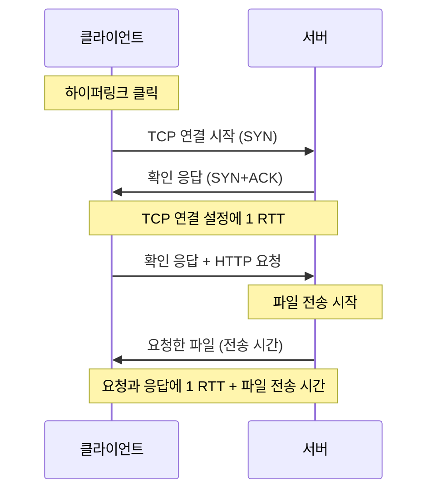

*그림 6. HTML 파일 하나를 요청하고 받는 데 걸리는 시간*

**지속 연결의 HTTP.** 비지속 연결에는 두 가지 단점이 있다. 첫째, 요청하는 객체마다 새 연결을 맺고 유지해야 한다. 연결마다 클라이언트와 서버에 TCP 버퍼를 할당하고 TCP 변수를 유지해야 하므로, 수백 개의 클라이언트를 동시에 처리하는 웹 서버에 큰 부담이 된다. Forouzan은 또한 연결을 열 때마다 TCP의 느린 시작 절차(9장)를 거쳐야 한다고 지적한다. 둘째, 객체마다 2 RTT의 전달 지연을 겪는다. 연결 설정에 1 RTT, 객체 요청과 수신에 1 RTT가 걸린다.

HTTP 1.1의 지속 연결에서는 서버가 응답을 보낸 뒤에도 TCP 연결을 열어 두고, 같은 클라이언트와 서버 사이의 이후 요청과 응답을 같은 연결로 보낸다. 웹 페이지 전체(앞의 예에서 기본 HTML 파일과 이미지 10개)뿐 아니라 같은 서버의 여러 웹 페이지도 하나의 지속 TCP 연결로 보낼 수 있다. 객체 요청은 앞 요청의 응답을 기다리지 않고 연달아 보낼 수 있는데, 이를 **파이프라이닝(pipelining)** 이라 한다. 서버는 연달아 받은 요청에 객체를 연달아 보낸다. HTTP 서버는 보통 연결이 일정 시간(설정 가능한 타임아웃) 동안 쓰이지 않으면 연결을 닫는다. Kurose는 HTTP의 기본 모드를 파이프라이닝을 쓰는 지속 연결로 설명한다. Forouzan은 서버가 보통 응답마다 데이터 길이를 함께 보내지만, 동적 문서나 활성 문서처럼 길이를 미리 알 수 없을 때는 길이를 모른다고 알리고 데이터를 다 보낸 뒤 연결을 닫아 데이터의 끝을 알린다고 덧붙인다.

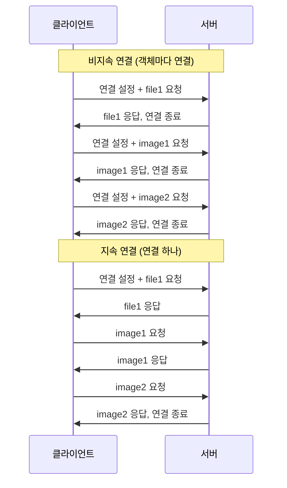

*그림 7. 텍스트 파일 하나와 이미지 두 개를 비지속 연결과 지속 연결로 가져오는 과정*

**예제.** 기본 HTML 파일과 그 파일이 참조하는 이미지 5개를 같은 서버에서 가져온다. RTT는 100 ms이고 전송 시간은 무시한다.

- 비지속 연결, 직렬: 객체마다 2 RTT이므로 6 × 2 RTT = 12 RTT = 1.2초
- 비지속 연결, 병렬 연결 5개: 기본 파일에 2 RTT, 이미지 5개를 동시에 받는 데 2 RTT, 모두 4 RTT = 0.4초
- 지속 연결, 파이프라이닝 없음: 연결 설정과 기본 파일에 2 RTT, 이미지마다 1 RTT, 모두 2 + 5 = 7 RTT = 0.7초
- 지속 연결, 파이프라이닝: 연결 설정과 기본 파일에 2 RTT, 이미지 5개를 연달아 요청하고 받는 데 1 RTT, 모두 3 RTT = 0.3초

### 5.5 HTTP 요청 메시지

HTTP 메시지에는 요청 메시지와 응답 메시지 두 종류가 있다. 다음은 전형적인 HTTP 요청 메시지이다.

```text
GET /somedir/page.html HTTP/1.1
Host: www.someschool.edu
Connection: close
User-agent: Mozilla/5.0
Accept-language: fr
```

이 메시지에서 다음을 알 수 있다. 첫째, 메시지는 사람이 읽을 수 있는 일반 ASCII 텍스트로 쓰여 있다. 둘째, 메시지는 다섯 줄이고 각 줄은 캐리지 리턴(CR)과 라인 피드(LF)로 끝나며, 마지막 줄 뒤에는 CR과 LF가 한 번 더 온다. 요청 메시지는 이보다 훨씬 많은 줄일 수도, 한 줄뿐일 수도 있다.

요청 메시지의 첫 줄을 **요청 줄(request line)**, 그다음 줄들을 **헤더 줄(header line)** 이라 한다. 요청 줄에는 **메서드(method)** 필드, **URL** 필드, **HTTP 버전** 필드의 세 필드가 공백으로 구분되어 있다. 위 예에서 브라우저는 GET 메서드로 객체 /somedir/page.html을 요청하며 HTTP/1.1을 구현한다.

헤더 줄은 다음 뜻을 가진다. `Host: www.someschool.edu`는 객체가 있는 호스트를 지정한다. 이미 그 호스트와 TCP 연결이 있으므로 불필요해 보이지만, 7절의 웹 프록시 캐시가 이 정보를 필요로 한다. `Connection: close`는 브라우저가 지속 연결을 원하지 않으며 서버가 요청한 객체를 보낸 뒤 연결을 닫기를 원한다는 뜻이다. `User-agent:`는 요청을 보내는 사용자 에이전트, 곧 브라우저의 종류(여기서는 Firefox인 Mozilla/5.0)를 지정한다. 서버는 같은 URL에 대해 사용자 에이전트마다 다른 버전의 객체를 보낼 수 있으므로 이 헤더가 쓸모 있다. `Accept-language:`는 사용자가 객체의 프랑스어 버전을 선호하며, 서버에 그런 객체가 없으면 기본 버전을 보내라는 뜻이다. 이는 HTTP의 여러 내용 협상 헤더 중 하나이다.

```text
요청 줄    : 메서드 sp URL sp 버전 cr lf
헤더 줄    : 헤더 이름: sp 값 cr lf
             ...
             헤더 이름: sp 값 cr lf
빈 줄      : cr lf
엔터티 본문: (일부 메시지에만 있음)

sp: 공백, cr: 캐리지 리턴, lf: 라인 피드
```

*그림 8. HTTP 요청 메시지의 일반 형식*

헤더 줄과 빈 줄 뒤에는 **엔터티 본문(entity body)** 이 올 수 있다. GET 메서드에서는 엔터티 본문이 비어 있고, POST 메서드에서 쓰인다. 사용자가 검색어를 입력하는 것처럼 폼을 채우면 HTTP 클라이언트는 POST 메서드를 자주 쓰며, 이때 엔터티 본문에는 사용자가 폼 필드에 입력한 내용이 담긴다. POST로도 사용자는 웹 페이지를 요청하지만, 페이지의 구체적인 내용은 입력에 따라 달라진다. 폼으로 만든 요청이 반드시 POST를 쓰는 것은 아니다. HTML 폼은 GET을 쓰고 입력값을 요청 URL에 넣는 경우가 많다. 예를 들어 필드 두 개에 monkeys와 bananas를 입력한 폼이 GET을 쓰면 URL은 `www.somesite.com/animalsearch?monkeys&bananas` 같은 구조가 된다.

| 메서드 | 동작 |
|:-----|:-----|
| GET | 서버에 문서(객체)를 요청함. 대부분의 요청 메시지가 GET을 씀 |
| HEAD | GET과 비슷하지만 서버는 요청한 객체를 빼고 응답함. 응용 개발자가 디버깅에 자주 씀 |
| POST | 클라이언트에서 서버로 정보(폼 입력 등)를 보냄 |
| PUT | 클라이언트가 서버의 특정 경로에 객체(문서)를 올림. 웹 출판 도구와 객체를 업로드하는 응용이 씀 |
| DELETE | 서버의 객체(웹 페이지)를 지움 |
| TRACE | 들어온 요청을 그대로 되돌려 보냄 |
| CONNECT | 예약됨 |
| OPTIONS | 사용할 수 있는 선택 사항을 물음 |

*표 6. HTTP 요청 메서드*

> **참고:** **PUT의 방향.** Forouzan의 메서드 표는 PUT을 "서버에서 클라이언트로 문서를 보낸다"고 설명하지만, Kurose는 PUT을 사용자가 객체를 웹 서버의 특정 경로(디렉터리)에 올리는 메서드로 설명한다. 문서를 서버에서 클라이언트로 가져오는 메서드는 GET이고, PUT은 클라이언트에서 서버로 문서를 보내는 메서드이다.

요청 메시지에서 자주 쓰는 헤더는 표 7과 같다. 각 헤더 줄은 헤더 이름, 콜론, 공백, 헤더 값으로 이루어진다.

| 헤더 | 설명 |
|:-----|:-----|
| User-agent | 클라이언트 프로그램을 식별함 |
| Accept | 클라이언트가 받아들일 수 있는 미디어 형식을 알림 |
| Accept-charset | 클라이언트가 다룰 수 있는 문자 집합을 알림 |
| Accept-encoding | 클라이언트가 다룰 수 있는 부호화 방식을 알림 |
| Accept-language | 클라이언트가 받아들일 수 있는 언어를 알림 |
| Authorization | 클라이언트가 가진 권한을 알림 |
| Host | 객체가 있는 서버의 호스트(와 포트)를 지정함 |
| Date | 현재 날짜를 알림 |
| Upgrade | 선호하는 통신 프로토콜을 지정함 |
| Cookie | 서버가 보낸 쿠키를 서버에 돌려준다 (6절) |
| If-Modified-Since | 지정한 시각 이후에 바뀐 경우에만 객체를 보내 달라고 요청함 (7.3절) |

*표 7. HTTP 요청 메시지의 주요 헤더*

### 5.6 HTTP 응답 메시지

다음은 앞의 요청 메시지에 대한 응답일 수 있는 전형적인 HTTP 응답 메시지이다.

```text
HTTP/1.1 200 OK
Connection: close
Date: Tue, 18 Aug 2015 15:44:04 GMT
Server: Apache/2.2.3 (CentOS)
Last-Modified: Tue, 18 Aug 2015 15:11:03 GMT
Content-Length: 6821
Content-Type: text/html

(data data data data data ...)
```

이 응답 메시지는 첫 **상태 줄(status line)**, 여섯 개의 헤더 줄, 그리고 엔터티 본문의 세 부분으로 이루어진다. 엔터티 본문이 메시지의 핵심이며 요청한 객체 자체(data data ...)를 담는다. 상태 줄에는 프로토콜 버전, **상태 코드(status code)**, 해당하는 **상태 메시지(status phrase)** 의 세 필드가 있다. 이 예에서 서버는 HTTP/1.1을 쓰며 모든 것이 정상, 곧 요청한 객체를 찾아 보낸다는 뜻이다.

헤더 줄의 뜻은 다음과 같다. `Connection: close`는 서버가 메시지를 보낸 뒤 TCP 연결을 닫겠다는 뜻이다. `Date:`는 서버가 응답을 만들어 보낸 날짜와 시각이며, 객체가 만들어지거나 마지막으로 바뀐 시각이 아니라 서버가 파일 시스템에서 객체를 꺼내 응답 메시지에 넣어 보낸 시각이다. `Server:`는 메시지가 Apache 웹 서버에서 만들어졌다는 뜻으로, 요청 메시지의 `User-agent:`에 해당한다. `Last-Modified:`는 객체가 만들어지거나 마지막으로 바뀐 날짜와 시각이며, 지역 클라이언트와 네트워크 캐시 서버(프록시 서버)의 객체 캐싱에 매우 중요하다. `Content-Length:`는 보내는 객체의 바이트 수이고, `Content-Type:`은 엔터티 본문의 객체가 HTML 텍스트라는 뜻이다. 객체의 종류는 파일 확장자가 아니라 `Content-Type:` 헤더로 공식적으로 나타낸다.

```text
상태 줄    : 버전 sp 상태 코드 sp 상태 메시지 cr lf
헤더 줄    : 헤더 이름: sp 값 cr lf
             ...
빈 줄      : cr lf
엔터티 본문: (오류 메시지가 아니면 문서를 담음)
```

*그림 9. HTTP 응답 메시지의 일반 형식*

상태 코드는 세 자리 수이며 첫 자리로 범주가 정해진다. 100번대는 정보 제공, 200번대는 요청 성공, 300번대는 클라이언트를 다른 URL로 재지정, 400번대는 클라이언트 쪽 오류, 500번대는 서버 쪽 오류를 나타낸다.

| 범주 | 코드 | 상태 메시지 | 뜻 |
|:-----|:-----|:-----|:-----|
| 정보 | 100 | Continue | 요청의 첫 부분을 받았으니 계속하라 |
| 성공 | 200 | OK | 요청이 성공했고 응답에 정보가 담겨 있음 |
| 재지정 | 301 | Moved permanently | 요청한 객체가 영구히 옮겨짐. 새 URL은 응답의 Location: 헤더에 있으며 클라이언트 소프트웨어가 자동으로 새 URL을 가져옴 |
| 재지정 | 304 | Not modified | 문서가 바뀌지 않았다 (7.3절) |
| 클라이언트 오류 | 400 | Bad request | 서버가 요청을 이해할 수 없음 (요청의 구문 오류) |
| 클라이언트 오류 | 404 | Not found | 요청한 문서가 이 서버에 없음 |
| 서버 오류 | 500 | Internal server error | 서버 쪽에서 다운 같은 오류가 생김 |
| 서버 오류 | 505 | HTTP Version Not Supported | 요청한 HTTP 버전을 서버가 지원하지 않음 |

*표 8. 주요 HTTP 상태 코드*

| 헤더 | 설명 |
|:-----|:-----|
| Date | 현재 날짜를 알림 |
| Upgrade | 선호하는 통신 프로토콜을 지정함 |
| Server | 서버에 관한 정보를 줌 |
| Set-Cookie | 클라이언트에 쿠키를 저장하라고 요청함 (6절) |
| Content-Encoding | 부호화 방식을 지정함 |
| Content-Language | 언어를 지정함 |
| Content-Length | 문서의 길이를 알림 |
| Content-Type | 미디어 형식을 지정함 |
| Location | 클라이언트에 다른 곳으로 요청을 보내라고 함 |
| Accept-Ranges | 서버가 요청한 바이트 범위를 받아들임 |
| Last-modified | 마지막으로 바뀐 날짜와 시각을 알림 |

*표 9. HTTP 응답 메시지의 주요 헤더*

브라우저는 브라우저의 종류와 버전, 사용자 설정(예: 선호 언어), 그리고 오래되었을 수 있는 객체를 캐시에 가지고 있는지에 따라 요청 메시지에 넣을 헤더를 정한다. 웹 서버도 제품, 버전, 설정에 따라 응답 메시지에 넣을 헤더가 달라진다.

### 5.7 HTTP 트랜잭션의 예

HTTP 메시지는 ASCII 문자로 이루어지므로, TELNET 같은 프로그램으로 웹 서버의 포트 80에 직접 연결하여 요청 줄과 헤더 줄을 입력하고 빈 줄로 끝내면 서버의 응답 메시지를 직접 볼 수 있다. 객체 없이 HTTP 메시지 줄만 보고 싶으면 GET 대신 HEAD를 쓴다.

**예제 22.4 (문서 가져오기).** 클라이언트가 GET 메서드로 경로가 /usr/bin/image1인 이미지를 가져온다. 요청 줄은 메서드(GET), URL, HTTP 버전(1.1)을 보여 주고, 두 헤더 줄은 클라이언트가 GIF나 JPEG 형식의 이미지를 받아들일 수 있다는 뜻이다. 요청에는 본문이 없다. 응답 메시지는 상태 줄과 네 줄의 헤더(날짜, 서버, MIME 버전, 문서의 길이)로 이루어지고, 헤더 뒤에 문서 본문이 온다.

```text
요청:
GET /usr/bin/image1 HTTP/1.1
Accept: image/gif
Accept: image/jpeg

응답:
HTTP/1.1 200 OK
Date: Mon, 07-Jan-05 13:15:14 GMT
Server: Challenger
MIME-version: 1.0
Content-length: 2048

(문서 본문)
```

**예제 22.5 (데이터 보내기).** 클라이언트가 POST 메서드로 서버에 데이터를 보낸다. 요청에는 네 줄의 헤더가 있고, 본문에 입력 정보가 담긴다. 응답의 본문은 서버가 만든 CGI 문서이다.

```text
요청:
POST /cgi-bin/doc.pl HTTP/1.1
Accept: */*
Accept: image/gif
Accept: image/jpeg
Content-length: 50

(입력 정보)

응답:
HTTP/1.1 200 OK
Date: Mon, 07-Jan-02 13:15:14 GMT
Server: Challenger
MIME-version: 1.0
Content-length: 2000

(문서 본문)
```

### 5.8 HTTP와 보안

HTTP 자체는 보안을 제공하지 않는다. 그러나 HTTP를 SSL 위에서 실행할 수 있으며, 이 경우를 **HTTPS**라 한다. HTTPS는 기밀성, 클라이언트와 서버 인증, 데이터 무결성을 제공한다. 브라우저의 URL이 http: 대신 https:로 시작하면 SSL을 쓰는 것이다. HTTPS 서버는 기본적으로 포트 443을 쓴다 [1]. SSL과 TLS의 동작은 26장에서 다룬다.

---

<br>

## 6. 쿠키

HTTP 서버는 무상태이므로 서버 설계가 단순하고, 수천 개의 TCP 연결을 동시에 처리하는 고성능 웹 서버를 만들 수 있다. 그러나 웹 사이트는 사용자의 접근을 제한하거나 사용자에 따라 다른 내용을 보여 주기 위해 사용자를 식별해야 할 때가 많다. 이를 위해 HTTP는 **쿠키(cookie)** 를 쓴다. Forouzan은 쿠키가 필요한 웹의 쓰임을 넷으로 든다. 웹 사이트를 전자 상점으로 써서 사용자가 물건을 골라 장바구니에 담고 마지막에 결제하게 하는 경우, 등록한 사용자에게만 접근을 허용하는 경우, 사용자가 보고 싶은 페이지를 고르는 포털로 쓰는 경우, 광고에 쓰는 경우이다.

> **용어 정의:** **쿠키(cookie)** 는 웹 사이트가 사용자를 추적할 수 있도록 서버가 응답에 담아 보내고 브라우저가 저장했다가 이후 요청에 담아 돌려주는 식별 정보이다.

Kurose에 따르면 쿠키 기술은 네 가지 구성 요소로 이루어진다.

1. HTTP 응답 메시지의 쿠키 헤더 줄(`Set-cookie:`)
2. HTTP 요청 메시지의 쿠키 헤더 줄(`Cookie:`)
3. 사용자의 종단 시스템에 저장되고 브라우저가 관리하는 쿠키 파일
4. 웹 사이트의 백엔드 데이터베이스

수전이 집의 PC에서 처음으로 Amazon.com에 접속한다고 가정한다. 수전은 전에 eBay에 접속한 적이 있다. 요청이 Amazon 웹 서버에 도착하면, 서버는 고유한 식별 번호를 만들고 이 번호로 색인되는 항목을 백엔드 데이터베이스에 만든다. 서버는 이 번호를 담은 `Set-cookie:` 헤더를 응답에 넣어 보낸다(예: `Set-cookie: 1678`). 수전의 브라우저는 이 헤더를 보고 관리하는 쿠키 파일에 서버의 호스트 이름과 식별 번호를 한 줄 덧붙인다. 쿠키 파일에는 eBay의 항목도 이미 있다. 수전이 Amazon 사이트를 계속 돌아다니면, 브라우저는 웹 페이지를 요청할 때마다 쿠키 파일에서 이 사이트의 식별 번호를 꺼내 `Cookie: 1678` 헤더 줄을 요청에 넣는다.

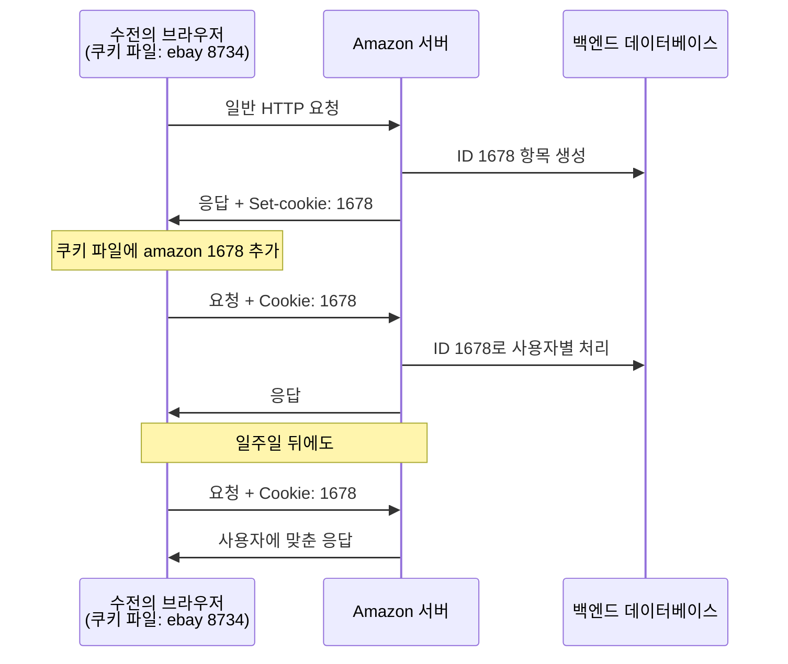

*그림 10. 쿠키로 사용자 상태를 유지하는 과정*

이렇게 Amazon 서버는 수전의 활동을 추적할 수 있다. Amazon은 수전의 이름은 모르더라도 사용자 1678이 어떤 페이지를 어떤 순서로 언제 방문했는지 정확히 안다. Amazon은 쿠키로 장바구니 서비스를 제공하여 수전이 사려는 물건 목록을 유지했다가 세션 끝에 한꺼번에 결제하게 하고, 일주일 뒤에 수전이 다시 접속해도 브라우저는 계속 `Cookie: 1678`을 보낸다. Amazon은 수전이 과거에 방문한 페이지를 바탕으로 상품을 추천할 수도 있다. 수전이 이름, 전자 메일 주소, 우편 주소, 신용 카드 정보를 등록하면 Amazon은 이 정보를 데이터베이스에 넣어 수전의 이름을 식별 번호(와 과거에 방문한 모든 페이지)에 연결할 수 있다. 이것이 다음 방문에서 이름, 카드 번호, 주소를 다시 입력하지 않아도 되는 "원클릭 쇼핑"의 원리이다.

이처럼 쿠키는 무상태인 HTTP 위에 **사용자 세션 계층**을 만드는 데 쓰인다. 예를 들어 웹 기반 전자 메일에 로그인하면 브라우저가 쿠키 정보를 서버에 보내 세션 내내 서버가 사용자를 식별할 수 있다.

Forouzan은 쿠키의 생성과 사용을 다음과 같이 설명한다. 서버는 클라이언트의 요청을 받으면 클라이언트에 관한 정보(클라이언트의 도메인 이름, 이름이나 등록 번호처럼 서버가 수집한 정보인 쿠키의 내용, 타임스탬프 등)를 파일이나 문자열에 저장하고, 쿠키를 응답에 넣어 보낸다. 브라우저는 쿠키를 서버의 도메인 이름으로 정렬된 쿠키 디렉터리에 저장한다. 이후 그 서버에 요청할 때 브라우저는 쿠키 디렉터리에서 그 서버가 보낸 쿠키를 찾아 요청에 넣고, 서버는 쿠키를 보고 새 클라이언트가 아니라 이전 클라이언트임을 안다. 쿠키의 내용은 브라우저가 읽거나 사용자에게 보여 주지 않는다. 쿠키는 서버가 만들고 서버가 소비한다.

- **전자 상점:** 클라이언트가 물건을 골라 장바구니에 넣으면 물건의 번호와 단가 같은 정보를 담은 쿠키가 브라우저로 가고, 두 번째 물건을 고르면 쿠키가 새 선택 정보로 갱신된다. 결제할 때 마지막 쿠키를 꺼내 총액을 계산한다.
- **등록 사용자 제한:** 처음 등록할 때 쿠키를 보내고, 이후에는 알맞은 쿠키를 보내는 클라이언트만 접근을 허용한다.
- **웹 포털:** 사용자가 좋아하는 페이지를 고르면 쿠키를 만들어 보내고, 다시 접속하면 쿠키로 사용자가 원하는 것을 안다.
- **광고:** 광고 회사는 자주 방문하는 주요 웹 사이트에 배너 광고 자체가 아니라 배너의 URL만 준다. 사용자가 그 사이트를 방문하여 광고를 누르면 요청이 광고 회사로 가고, 광고 회사는 배너와 함께 사용자 ID를 담은 쿠키를 보낸다. 이후 배너를 볼 때마다 사용자의 웹 행동을 기록한 데이터베이스가 쌓인다.

쿠키는 인터넷 쇼핑을 편리하게 하지만 사생활 침해로 볼 수 있어 논란이 있다. 쿠키와 사용자가 제공한 계정 정보를 합치면 웹 사이트는 사용자에 관해 많은 것을 알 수 있고, 이 정보를 제3자에게 팔 수도 있다. 특히 광고 회사의 쿠키 사용이 논란의 중심이다.

---

<br>

## 7. 웹 캐싱

### 7.1 프록시 서버의 동작

> **용어 정의:** **웹 캐시(Web cache)** 또는 **프록시 서버(proxy server)** 는 원래 웹 서버를 대신하여 HTTP 요청을 처리하는 네트워크 개체로, 자신의 저장 장치에 최근 요청된 객체의 사본을 보관한다.

사용자의 브라우저는 모든 HTTP 요청을 먼저 웹 캐시로 보내도록 설정할 수 있다. 브라우저가 객체 `http://www.someschool.edu/campus.gif`를 요청하면 다음 일이 일어난다.

1. 브라우저가 웹 캐시와 TCP 연결을 맺고 객체에 대한 HTTP 요청을 웹 캐시에 보낸다.
2. 웹 캐시는 객체의 사본을 가지고 있는지 확인한다. 있으면 객체를 HTTP 응답 메시지에 담아 브라우저에 보낸다.
3. 없으면 웹 캐시는 원래 서버(origin server), 곧 www.someschool.edu와 TCP 연결을 맺고 객체에 대한 HTTP 요청을 보낸다. 원래 서버는 객체를 HTTP 응답에 담아 웹 캐시에 보낸다.
4. 웹 캐시는 객체를 받으면 사본을 자신의 저장 장치에 보관하고, 브라우저와의 기존 TCP 연결로 사본을 HTTP 응답에 담아 브라우저에 보낸다.

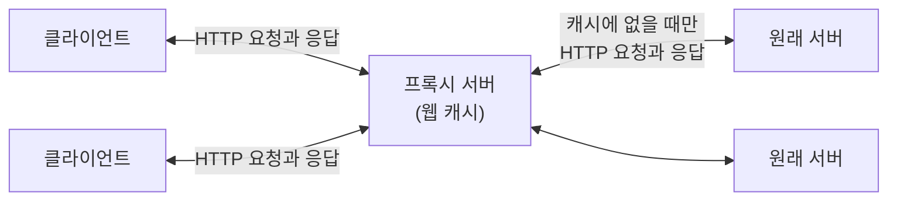

*그림 11. 웹 캐시를 거쳐 객체를 요청하는 클라이언트*

캐시는 서버이면서 동시에 클라이언트이다. 브라우저의 요청을 받고 응답할 때는 서버이고, 원래 서버에 요청을 보내고 응답을 받을 때는 클라이언트이다. 웹 캐시는 보통 ISP가 구입하여 설치한다. 대학은 캠퍼스 네트워크에 캐시를 설치하고 모든 캠퍼스 브라우저가 캐시를 가리키도록 설정할 수 있고, 큰 가정용 ISP는 자기 네트워크에 캐시를 설치하고 판매하는 브라우저가 이를 가리키도록 미리 설정할 수 있다. Forouzan은 프록시 서버가 보통 클라이언트 쪽에 있으며 계층을 이룰 수 있다고 설명한다. 클라이언트 컴퓨터 자체가 자주 쓰는 응답을 저장하는 작은 프록시가 될 수 있고, 회사는 LAN에 프록시를 두어 LAN을 드나드는 부하를 줄일 수 있으며, 많은 고객을 가진 ISP는 ISP 네트워크를 드나드는 부하를 줄이려고 프록시를 둘 수 있다. 다만 프록시를 쓰려면 클라이언트가 목적 서버 대신 프록시에 접근하도록 설정되어야 한다.

웹 캐싱이 쓰이는 이유는 두 가지이다. 첫째, 클라이언트와 원래 서버 사이의 병목 대역폭이 클라이언트와 캐시 사이의 병목 대역폭보다 훨씬 작으면, 웹 캐시는 클라이언트 요청의 응답 시간을 크게 줄인다. 둘째, 웹 캐시는 기관의 인터넷 접속 링크의 트래픽을 크게 줄여, 기관이 대역폭을 늦게 증설해도 되게 하여 비용을 줄인다. 또한 인터넷 전체의 웹 트래픽을 줄여 모든 응용의 성능을 높인다. Forouzan도 프록시 서버가 원래 서버의 부하를 줄이고, 트래픽을 줄이며, 지연을 개선한다고 정리한다.

### 7.2 캐싱의 효과

기관 네트워크와 공용 인터넷으로 이루어진 다음 상황을 살펴본다. 기관 네트워크는 100 Mbps 고속 LAN이고, 기관 네트워크의 라우터와 인터넷의 라우터는 15 Mbps 접속 링크로 연결된다. 원래 서버들은 전 세계에 흩어져 있다. 객체의 평균 크기는 1 Mbit이고, 기관의 브라우저에서 원래 서버로 가는 요청은 평균 초당 15개이다. HTTP 요청 메시지는 무시할 만큼 작아서 트래픽을 만들지 않는다고 가정한다. 또한 접속 링크의 인터넷 쪽 라우터가 요청을 보낸 때부터 응답을 받을 때까지 평균 2초가 걸린다고 하고, 이를 "인터넷 지연"이라 한다.

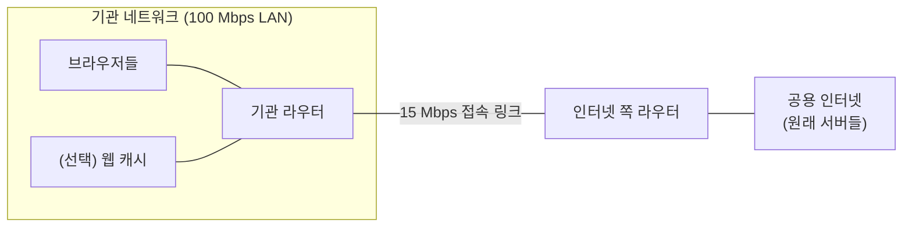

*그림 12. 기관 네트워크와 인터넷 사이의 병목*

총 응답 시간은 LAN 지연, 접속 지연(두 라우터 사이의 지연), 인터넷 지연의 합이다. 1장의 트래픽 강도로 대략 계산하면 다음과 같다.

```math
\begin{aligned}
\text{LAN의 트래픽 강도} &= \frac{(15\ \text{요청/s})(1\ \text{Mbit/요청})}{100\ \text{Mbps}} = 0.15 \\
\text{접속 링크의 트래픽 강도} &= \frac{(15\ \text{요청/s})(1\ \text{Mbit/요청})}{15\ \text{Mbps}} = 1
\end{aligned}
```

LAN의 트래픽 강도 0.15는 많아야 수십 ms의 지연을 만들므로 무시할 수 있다. 그러나 접속 링크의 트래픽 강도가 1에 가까우면 링크의 지연은 매우 커지고 끝없이 늘어나므로, 평균 응답 시간은 몇 분 이상이 되어 사용자가 받아들일 수 없다.

**해결책 1: 접속 링크 증설.** 접속 링크를 15 Mbps에서 100 Mbps로 높이면 접속 링크의 트래픽 강도는 0.15가 되고 두 라우터 사이의 지연은 무시할 만해진다. 총 응답 시간은 대략 인터넷 지연인 2초가 된다. 그러나 비싼 증설이 필요하다.

**해결책 2: 웹 캐시 설치.** 접속 링크를 그대로 두고 기관 네트워크에 웹 캐시를 설치한다. 캐시가 요청을 만족시키는 비율인 **적중률(hit rate)** 은 실제로 보통 0.2\~0.7이다. 적중률이 0.4라고 가정한다. 클라이언트와 캐시는 같은 고속 LAN에 있으므로 요청의 40%는 캐시가 거의 즉시, 예를 들어 10 ms 안에 처리한다. 나머지 60%만 원래 서버로 가므로 접속 링크의 트래픽 강도는 1.0에서 0.6으로 줄어든다. 트래픽 강도가 0.8보다 작으면 15 Mbps 링크의 지연은 대개 수십 ms로 작아서 2초의 인터넷 지연에 비해 무시할 수 있다. 따라서 평균 지연은 다음과 같다.

```math
0.4 \times (0.01\ \text{s}) + 0.6 \times (2.01\ \text{s}) = 1.21\ \text{s}
```

캐시를 설치하면 접속 링크를 증설하는 것보다 응답 시간이 더 짧아지고, 기관은 증설 비용을 들이지 않아도 된다. 웹 캐시는 저렴한 PC에서 공개 소프트웨어로 실행되는 경우가 많아 비용도 적다.

| 방안 | 접속 링크의 트래픽 강도 | 평균 응답 시간 | 비용 |
|:-----|:-----|:-----|:-----|
| 아무것도 하지 않음 | 1.0 | 몇 분 이상 (끝없이 증가) | 없음 |
| 접속 링크를 100 Mbps로 증설 | 0.15 | 약 2초 | 큼 |
| 적중률 0.4의 웹 캐시 설치 | 0.6 | 약 1.21초 | 작음 |

*표 10. 기관 네트워크의 세 가지 방안 비교*

웹 캐시는 **CDN(Content Distribution Network)** 을 통해서도 인터넷에서 점점 중요한 역할을 한다. CDN 회사는 지리적으로 분산된 많은 캐시를 인터넷 곳곳에 두어 트래픽의 많은 부분을 지역화한다. CDN은 23장에서 다룬다.

### 7.3 조건부 GET

캐싱은 사용자가 느끼는 응답 시간을 줄이지만, 캐시에 있는 객체의 사본이 **오래된(stale)** 것일 수 있다는 새 문제를 만든다. 사본을 캐시에 넣은 뒤에 웹 서버의 객체가 바뀌었을 수 있기 때문이다. HTTP에는 캐시가 자신의 객체가 최신인지 확인하는 메커니즘이 있다.

> **용어 정의:** **조건부 GET(conditional GET)** 은 GET 메서드를 쓰고 `If-Modified-Since:` 헤더 줄을 포함하여, 지정한 시각 이후에 객체가 바뀐 경우에만 객체를 보내 달라고 요청하는 HTTP 요청 메시지이다.

예를 들어 프록시 캐시가 브라우저를 대신하여 웹 서버에 요청을 보낸다.

```text
GET /fruit/kiwi.gif HTTP/1.1
Host: www.exotiquecuisine.com
```

웹 서버는 요청한 객체를 담은 응답을 캐시에 보낸다.

```text
HTTP/1.1 200 OK
Date: Sat, 3 Oct 2015 15:39:29
Server: Apache/1.3.0 (Unix)
Last-Modified: Wed, 9 Sep 2015 09:23:24
Content-Type: image/gif

(data data data data data ...)
```

캐시는 객체를 요청한 브라우저에 넘기고 자신에게도 저장하며, 이때 마지막 수정 날짜도 함께 저장한다. 일주일 뒤 다른 브라우저가 캐시를 거쳐 같은 객체를 요청한다. 객체는 아직 캐시에 있지만 지난주에 서버에서 바뀌었을 수 있으므로, 캐시는 조건부 GET으로 최신인지 확인한다.

```text
GET /fruit/kiwi.gif HTTP/1.1
Host: www.exotiquecuisine.com
If-modified-since: Wed, 9 Sep 2015 09:23:24
```

`If-modified-since:` 헤더의 값은 일주일 전에 서버가 보낸 `Last-Modified:` 헤더의 값과 정확히 같다. 이 조건부 GET은 지정한 날짜 이후에 객체가 바뀐 경우에만 객체를 보내 달라는 뜻이다. 객체가 바뀌지 않았다면 서버는 다음 응답을 보낸다.

```text
HTTP/1.1 304 Not Modified
Date: Sat, 10 Oct 2015 15:39:29
Server: Apache/1.3.0 (Unix)

(엔터티 본문 없음)
```

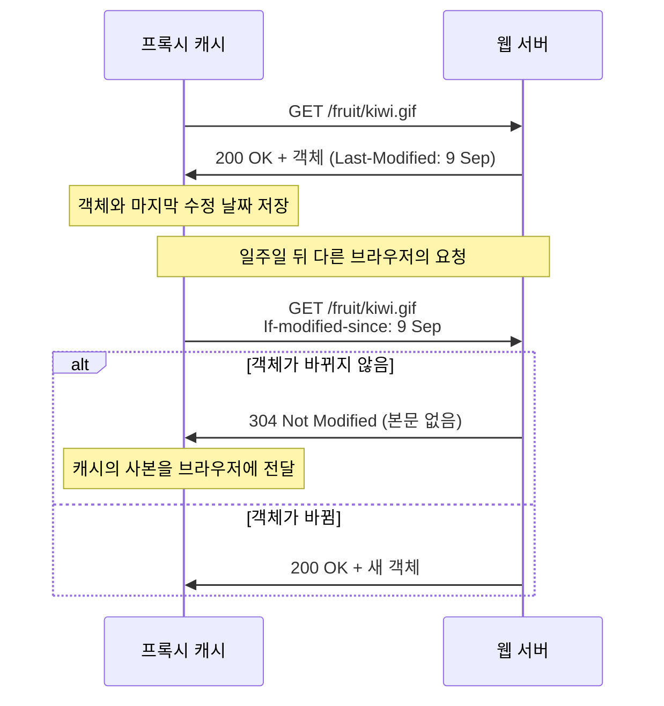

*그림 13. 조건부 GET으로 캐시의 사본을 확인하는 과정*

서버는 조건부 GET에 대해서도 응답 메시지를 보내지만 요청한 객체는 넣지 않는다. 객체를 넣으면 대역폭을 낭비하고 사용자가 느끼는 응답 시간이 늘어나기 때문이며, 객체가 클수록 그렇다. 상태 줄의 304 Not Modified는 캐시가 자신의 사본을 요청한 브라우저에 보내도 된다는 뜻이다.

Forouzan도 클라이언트가 요청에 조건을 붙일 수 있으며, 가장 흔한 조건이 웹 페이지의 수정 시각이라고 설명한다. 또한 응답을 프록시 서버에 얼마나 오래 둘지에 관한 다른 방법도 소개한다. 하나는 정보가 한동안 바뀌지 않는 사이트의 목록을 두는 것이다. 예를 들어 뉴스 기관이 매일 아침 뉴스 페이지를 바꾼다면, 프록시는 아침 일찍 뉴스를 가져와 다음 날까지 보관할 수 있다. 다른 하나는 마지막 수정 시각을 보여 주는 헤더를 보고 정보가 얼마나 오래 유효할지 추정하는 것이다.

---

<br>

## 8. HTTP/2

HTTP/1.1의 지속 연결과 파이프라이닝 위에, **HTTP/2**는 같은 연결 안에서 여러 요청과 응답을 섞어(interleave) 보낼 수 있게 하고, 연결 안의 HTTP 요청 메시지와 응답 메시지에 우선순위를 매기는 메커니즘을 더한다. Kurose는 HTTP/2가 RFC 7540으로 명세되었다고 소개하며, 이후 RFC 9113이 RFC 7540을 폐기하고 HTTP/2를 새로 명세하였다 [2]. 요청과 응답을 섞어 보내면 여러 객체가 연결 하나를 동시에 나누어 쓸 수 있다.

---

<br>

## 요약

| 개념 | 핵심 요약 |
|:-----|:-----|
| 응용의 위치 | 네트워크 응용은 종단 시스템에서만 실행되며, 네트워크 코어 장치는 네트워크 계층 이하에서만 동작한다. |
| 클라이언트-서버 구조 | 고정 IP 주소를 가진 항상 켜진 서버가 클라이언트의 요청을 처리하며, 클라이언트끼리는 직접 통신하지 않는다. |
| P2P 구조 | 간헐적으로 연결되는 피어가 직접 통신하며, 피어가 서비스 용량을 더하므로 자기 확장성이 있다. |
| 클라이언트와 서버 프로세스 | 세션에서 통신을 시작하는 쪽이 클라이언트, 연락을 기다리는 쪽이 서버이며, 서버는 무한 프로그램, 클라이언트는 유한 프로그램이다. |
| 소켓 | 응용 계층과 전송 계층 사이의 인터페이스이며, 수신 프로세스는 IP 주소와 포트 번호로 식별한다. |
| 반복 서버와 동시 서버 | 반복 서버는 요청을 하나씩, 동시 서버는 여럿을 동시에 처리하며, UDP 서버는 주로 반복형, TCP 서버는 주로 동시형이다. |
| 전송 서비스의 네 차원 | 신뢰적 데이터 전송, 처리량, 타이밍, 보안이며, 인터넷은 처리량과 타이밍 보장을 제공하지 않는다. |
| TCP와 UDP 서비스 | TCP는 연결형, 신뢰적 전송, 혼잡 제어를 제공하고 SSL로 보안을 더할 수 있으며, UDP는 최소한의 비연결형 서비스이다. |
| 응용 계층 프로토콜 | 메시지의 종류, 구문, 의미, 송수신 규칙을 정하며, RFC로 공개된 것과 사유 프로토콜이 있다. |
| 웹 문서 | 정적 문서, 서버에서 만드는 동적 문서(CGI, 스크립트), 클라이언트에서 실행하는 활성 문서(애플릿, JavaScript)가 있다. |
| HTTP | TCP 포트 80을 쓰는 무상태 요청과 응답 프로토콜이며, 요청은 요청 줄, 헤더, 본문, 응답은 상태 줄, 헤더, 본문으로 이루어진다. |
| 비지속 연결과 지속 연결 | 비지속 연결은 객체마다 2 RTT가 들고, 지속 연결은 연결 하나로 여러 객체를 보내며 파이프라이닝으로 요청을 연달아 보낸다. |
| 쿠키 | Set-cookie와 Cookie 헤더, 쿠키 파일, 백엔드 데이터베이스로 무상태 HTTP 위에 사용자 세션을 만든다. |
| 웹 캐시 | 클라이언트 가까이에서 원래 서버를 대신해 응답하여 응답 시간과 접속 링크 트래픽을 줄인다. |
| 조건부 GET | If-Modified-Since로 캐시의 사본이 최신인지 확인하며, 바뀌지 않았으면 서버는 304 Not Modified를 본문 없이 보낸다. |

---

<br>

## 점검 문제

1. **HTTP 응답 시간:** 기본 HTML 파일 하나와 그 파일이 참조하는 작은 객체 10개를 같은 서버에서 가져온다. RTT는 50 ms이고 전송 시간은 무시한다. (a) 비지속 연결을 직렬로 쓸 때, (b) 지속 연결을 파이프라이닝 없이 쓸 때, (c) 지속 연결을 파이프라이닝과 함께 쓸 때 총 응답 시간을 구하라.

   <details>
   <summary>정답</summary>

   (a) 객체 11개마다 연결 설정 1 RTT와 요청과 응답 1 RTT가 들므로 11 × 2 = 22 RTT = 1100 ms이다. (b) 연결 설정과 기본 파일에 2 RTT, 이후 객체마다 1 RTT이므로 2 + 10 = 12 RTT = 600 ms이다. (c) 연결 설정과 기본 파일에 2 RTT, 10개의 객체를 연달아 요청하고 받는 데 1 RTT이므로 3 RTT = 150 ms이다.

   </details>

2. **캐싱의 효과:** 7.2절의 기관 네트워크에서 요청이 초당 15개, 객체가 평균 1 Mbit, 접속 링크가 15 Mbps이다. 캐시가 없을 때와 적중률 0.4의 캐시가 있을 때 접속 링크의 트래픽 강도를 구하고, 캐시가 있을 때의 평균 응답 시간을 구하라. 캐시 적중 응답은 10 ms, 원래 서버의 응답은 2.01초가 걸린다고 한다.

   <details>
   <summary>정답</summary>

   캐시가 없으면 15 × 1 / 15 = 1.0이고, 캐시가 있으면 요청의 60%만 접속 링크를 지나므로 0.6이다. 평균 응답 시간은 0.4 × 0.01 + 0.6 × 2.01 = 1.21초이다. 접속 링크를 100 Mbps로 증설해 얻는 약 2초보다도 짧다.

   </details>

3. **요청 메시지 해석:** 다음 요청 메시지에서 메서드, 요청하는 객체, HTTP 버전, 객체가 있는 호스트를 찾고, 브라우저가 지속 연결을 원하는지 판단하라.

   ```text
   GET /cs453/index.html HTTP/1.1
   Host: gaia.cs.umass.edu
   Accept-language: en-us
   Connection: keep-alive
   ```

   <details>
   <summary>정답</summary>

   메서드는 GET, 요청하는 객체의 경로는 /cs453/index.html, HTTP 버전은 1.1, 호스트는 gaia.cs.umass.edu이다. Connection 헤더가 close가 아니라 keep-alive이므로 브라우저는 응답 뒤에도 연결을 열어 두는 지속 연결을 원한다. 전체 URL은 http://gaia.cs.umass.edu/cs453/index.html이다.

   </details>

4. **무상태와 쿠키:** HTTP가 무상태 프로토콜이라는 것이 무슨 뜻이고 어떤 장점이 있는지 설명하라. 그렇다면 장바구니 같은 서비스는 어떻게 사용자의 상태를 유지하는가?

   <details>
   <summary>정답</summary>

   서버가 클라이언트에 관한 정보를 저장하지 않아 같은 클라이언트가 같은 객체를 다시 요청해도 앞서 보낸 것을 기억하지 못한다는 뜻이다. 서버 설계가 단순해져 많은 연결을 동시에 처리하는 고성능 서버를 만들기 쉽다. 상태는 쿠키로 유지한다. 서버가 처음 응답에 Set-cookie로 식별 번호를 보내고 백엔드 데이터베이스에 항목을 만들면, 브라우저는 이후 요청마다 Cookie 헤더로 번호를 돌려주고, 서버는 이 번호로 데이터베이스의 장바구니 정보를 찾는다.

   </details>

5. **반복 서버와 동시 서버:** 클라이언트 3개가 거의 동시에 요청을 보낸다. 각 요청을 처리하는 데 1초가 걸린다면, UDP를 쓰는 반복 서버와 TCP를 쓰는 동시 서버에서 마지막 클라이언트가 응답을 받는 시점은 대략 언제인가? 네트워크 지연과 처리 자원의 경쟁은 무시한다.

   <details>
   <summary>정답</summary>

   반복 서버는 큐에서 요청을 하나씩 처리하므로 첫 클라이언트는 1초, 둘째는 2초, 마지막은 약 3초 뒤에 응답을 받는다. 동시 서버는 연결마다 자식 프로세스(또는 스레드)가 요청을 동시에 처리하므로 세 클라이언트 모두 약 1초 뒤에 응답을 받는다. 실제로는 CPU를 나누어 쓰므로 처리 시간이 늘어날 수 있다.

   </details>

6. **조건부 GET:** 프록시 캐시가 일주일 전에 받은 객체를 가지고 있다. 캐시가 원래 서버에 보내는 요청과, 객체가 바뀌지 않았을 때 서버의 응답이 각각 무엇을 담는지 설명하고, 응답에 객체를 넣지 않는 이유를 들라.

   <details>
   <summary>정답</summary>

   캐시는 GET 요청에 If-modified-since 헤더를 넣고, 그 값으로 일주일 전 응답의 Last-Modified 값을 쓴다. 객체가 바뀌지 않았으면 서버는 상태 줄이 304 Not Modified이고 엔터티 본문이 없는 응답을 보내며, 캐시는 자신의 사본을 브라우저에 보낸다. 객체를 넣으면 대역폭을 낭비하고 응답 시간이 늘어나며, 객체가 클수록 그 손해가 크기 때문이다.

   </details>

7. **전송 프로토콜의 선택:** 인터넷 전화 응용이 보통 UDP를 쓰면서도 TCP를 대안으로 준비하는 이유와, 웹(HTTP)이 TCP를 쓰는 이유를 표 3의 요구 사항에 비추어 설명하라.

   <details>
   <summary>정답</summary>

   인터넷 전화는 손실을 어느 정도 허용하지만 최소 속도와 수백 ms의 시간 제약이 있으므로, TCP의 재전송과 혼잡 제어가 속도를 억제하는 것을 피하려고 UDP를 쓴다. 그러나 많은 방화벽이 UDP 트래픽을 막으므로 UDP 통신이 실패하면 TCP를 쓴다. 웹 문서는 손실을 허용하지 않고 처리량은 탄력적이며 시간에 민감하지 않으므로, 신뢰적 데이터 전송을 제공하는 TCP가 알맞다.

   </details>

---

<br>

## 참고 문헌

1. E. Rescorla, "HTTP Over TLS," RFC 2818, May 2000. [Online]. Available: https://www.rfc-editor.org/rfc/rfc2818
2. M. Thomson and C. Benfield, Eds., "HTTP/2," RFC 9113, Jun. 2022. [Online]. Available: https://www.rfc-editor.org/rfc/rfc9113
