# Chapter 3 — Network Applications and the Web

[Repository Guide](../../README.md) | [English](Concepts_Lecture.md) | [한국어](Concepts_Lecture.ko.md)

> **Last Updated:** 2026-11-18
>
> Computer Networking: A Top-Down Approach, Kurose and Ross, Ch 2; TCP/IP Protocol Suite, Forouzan, Ch 17, 22

> **Learning Objectives:**
> 1. Compare the client-server and P2P architectures and define the client process and the server process
> 2. Explain how processes on different hosts communicate using sockets, IP addresses, and port numbers
> 3. Compare the operation of iterative and concurrent servers
> 4. Analyze the transport services an application needs along four dimensions and choose between TCP and UDP
> 5. Compute the response times of non-persistent and persistent HTTP connections, and interpret request and response messages
> 6. Explain the problems that cookies, Web caches, and the conditional GET solve and how they work

---

## Table of Contents

- [1. Principles of Network Applications](#1-principles-of-network-applications)
  - [1.1 Applications Run on End Systems](#11-applications-run-on-end-systems)
  - [1.2 Client-Server and P2P Architectures](#12-client-server-and-p2p-architectures)
  - [1.3 Clients and Servers as Programs](#13-clients-and-servers-as-programs)
  - [1.4 Interprocess Communication and Sockets](#14-interprocess-communication-and-sockets)
  - [1.5 Iterative and Concurrent Servers](#15-iterative-and-concurrent-servers)
- [2. Transport Services Applications Need](#2-transport-services-applications-need)
- [3. Transport Services Provided by the Internet](#3-transport-services-provided-by-the-internet)
  - [3.1 TCP Services](#31-tcp-services)
  - [3.2 UDP Services](#32-udp-services)
  - [3.3 Services the Internet Does Not Provide](#33-services-the-internet-does-not-provide)
- [4. Application-Layer Protocols](#4-application-layer-protocols)
- [5. The Web and HTTP](#5-the-web-and-http)
  - [5.1 Architecture of the Web](#51-architecture-of-the-web)
  - [5.2 Kinds of Web Documents](#52-kinds-of-web-documents)
  - [5.3 Overview of HTTP](#53-overview-of-http)
  - [5.4 Non-Persistent and Persistent Connections](#54-non-persistent-and-persistent-connections)
  - [5.5 HTTP Request Messages](#55-http-request-messages)
  - [5.6 HTTP Response Messages](#56-http-response-messages)
  - [5.7 Examples of HTTP Transactions](#57-examples-of-http-transactions)
  - [5.8 HTTP and Security](#58-http-and-security)
- [6. Cookies](#6-cookies)
- [7. Web Caching](#7-web-caching)
  - [7.1 Operation of a Proxy Server](#71-operation-of-a-proxy-server)
  - [7.2 The Effect of Caching](#72-the-effect-of-caching)
  - [7.3 The Conditional GET](#73-the-conditional-get)
- [8. HTTP/2](#8-http2)
- [Summary](#summary)
- [Self-Check Questions](#self-check-questions)
- [References](#references)

---

<br>

## 1. Principles of Network Applications

### 1.1 Applications Run on End Systems

Developing a network application means writing programs that run on different end systems and communicate with each other over the network. In the Web application, a browser program running on the user's host (desktop, laptop, tablet, smartphone) communicates with a Web server program running on the Web server host. In a P2P file-sharing system, each participating host runs a similar or identical program. Developers write this software in languages such as C, Java, and Python.

The important point is that no software has to be written for network-core devices such as routers and link-layer switches; even if one wanted to, it would not be possible. As Chapter 2 showed, network-core devices do not function at the application layer but at the network layer and below. This design, which confines application software to the end systems, has allowed a vast array of network applications to be developed and deployed rapidly.

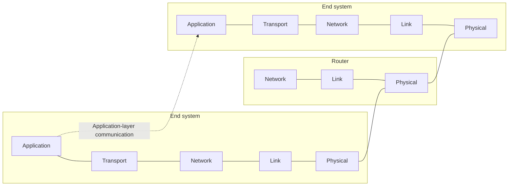

*Figure 1. Communication of a network application between end systems at the application layer*

### 1.2 Client-Server and P2P Architectures

Before writing programs, the architecture of the application must be decided. The application architecture is distinct from a network architecture such as the five-layer Internet architecture of Chapter 2. For the application developer, the network architecture is fixed and provides a specific set of services to applications, whereas the **application architecture** is designed by the developer and dictates how the application is structured over the various end systems. Most network applications today follow either the client-server or the P2P architecture.

> **Definition:** A **client-server architecture** is an application architecture in which an always-on **server** host services requests from many other **client** hosts.

The Web is the classic example. An always-on Web server services requests from browsers running on client hosts, and when it receives a request for an object, it sends the requested object to the client host. In the client-server architecture, clients do not communicate directly with each other; two browsers, for example, do not talk directly. The server also has a fixed, well-known address, its IP address, so a client can always contact the server by sending a packet to that address. The Web, FTP, Telnet, and e-mail use the client-server architecture.

For popular services, a single server host often cannot keep up with all the requests from clients. Services such as search engines, Internet commerce, Web-based e-mail, and social networking therefore use **data centers**, housing large numbers of hosts, to create a powerful virtual server. A data center can have hundreds of thousands of servers, and the service provider must pay recurring costs for powering and maintaining them, as well as interconnection and bandwidth costs for sending data from the data center.

> **Definition:** A **P2P architecture** (peer-to-peer architecture) is an application architecture with minimal or no reliance on dedicated servers, in which pairs of intermittently connected hosts called **peers** communicate directly.

Peers are not owned by the service provider but are desktops and laptops controlled by users, mostly residing in homes, universities, and offices. Because peers communicate without passing through a dedicated server, the architecture is called peer-to-peer. Traffic-intensive applications such as file sharing (BitTorrent), peer-assisted download acceleration, and Internet telephony and video conferencing (Skype) use the P2P architecture. There are also **hybrid architectures**, as in instant messaging, where servers track the IP addresses of users but user-to-user messages are sent directly without passing through the servers.

The most compelling feature of the P2P architecture is its **self-scalability**. In P2P file sharing, for example, each peer generates workload by requesting files, but each peer also adds service capacity to the system by distributing files to other peers. P2P architectures are also cost effective because they do not need significant server infrastructure and server bandwidth. On the other hand, their highly decentralized structure raises challenges of security, performance, and reliability. Chapter 23 analyzes P2P file distribution quantitatively.

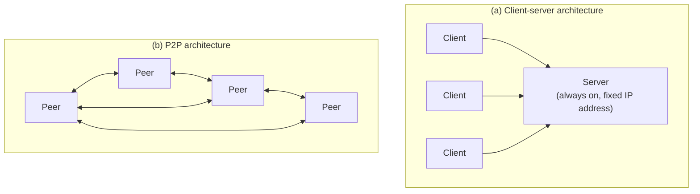

*Figure 2. Client-server and P2P architectures*

| Aspect | Client-server architecture | P2P architecture |
|:-----|:-----|:-----|
| Who provides the service | Always-on servers (data centers) | Peers controlled by users |
| Addresses | Servers have fixed, well-known IP addresses | Peers connect intermittently and their addresses may change |
| Communication among clients | None directly | Peers communicate directly |
| Scalability | Server capacity must be increased | Peers add capacity as they make requests (self-scalability) |
| Challenges | Cost of server infrastructure and bandwidth | Security, performance, reliability |
| Examples | Web, FTP, Telnet, e-mail | BitTorrent, Skype |

*Table 1. Comparison of the client-server and P2P architectures*

### 1.3 Clients and Servers as Programs

Forouzan explains the client-server paradigm by answering a series of questions. To receive a service from a remote computer, the two computers must each run a program, and implementing this requires several decisions.

1. **Should both programs be able to request and provide services?** The common solution is to separate the roles. The program running on the local machine that requests a service is the **client**, the program running on the remote machine that provides it is the **server**, and clients and servers come in pairs with the same name (for example, an FTP client and an FTP server).
2. **Should a server serve only a specific client?** The most common solution is for the server to provide its service to any client that needs that type of service; the server-client relationship is one-to-many.
3. **Should a computer run only a client or only a server?** A computer connected to the Internet should be able to run any client program if the appropriate software is available. Server programs need to run on a computer that can run continuously.
4. **When should a program run?** A client, which requests a service, needs to run only when it is needed. A server, which provides a service, must run all the time because it does not know when its service will be needed.
5. **Should there be a separate program for each service?** Frequently used services have dedicated client-server programs, but there should also be a generic program that lets a user log on to a remote computer and use its services (TELNET in Chapter 4).

Accordingly, a **server** is a program running on the remote machine that provides service to clients. When it starts, it opens the door for incoming requests from clients, but it never initiates a service until it is requested to do so. A server is an **infinite program** that runs indefinitely unless a problem arises, and it responds to arriving requests either iteratively or concurrently. A **client** is a program running on the local machine that requests service from a server. A client is a **finite program** started by the user (or another application program) that terminates when the service is complete. A client normally opens a communication channel using the IP address of the remote host and the well-known port address of the server program running on that host, sends its request, and receives a response. The request-response part may be repeated several times, but the whole process eventually comes to an end.

### 1.4 Interprocess Communication and Sockets

In the jargon of operating systems, it is not programs but **processes**, programs running within an end system, that communicate. Processes on the same end system communicate with interprocess communication governed by the operating system, but the interest here is in how processes on different hosts (possibly with different operating systems) communicate. Processes on different end systems communicate by exchanging **messages** across the computer network.

> **[Operating Systems]** A **process** is a running program, an execution unit managed by the operating system with its own address space and execution state. Running the same program several times creates several different processes. The operating system provides a system call interface through which processes access resources such as files and the network, and the socket is the interface for network communication.

**Client and server processes.** A network application consists of pairs of processes that send messages to each other over a network, and in each pair one process is called the client and the other the server. In the Web, the browser is the client process and the Web server the server process. In P2P file sharing, the peer that downloads a file is the client and the peer that uploads it is the server. In some applications, such as P2P file sharing, a process can be both a client and a server, but in the context of any one communication session the two processes can still be labeled client and server.

> **Definition:** In a communication session between two processes, the process that initiates the communication (that is, first contacts the other at the beginning of the session) is the **client process**, and the process that waits to be contacted is the server process.

In P2P file sharing, for example, when peer A asks peer B to send a specific file, peer A is the client and peer B is the server in that session.

**The interface between the process and the network.** Any message sent from one process to another must go through the underlying network. A process sends messages into, and receives messages from, the network through a software interface called a **socket**. A process can be likened to a house and its socket to its door. When a process wants to send a message to a process on another host, it shoves the message out its door (socket). The sending process assumes that there is a transportation infrastructure on the other side of its door that will carry the message to the door of the destination process. When the message arrives at the destination host, it passes through the receiving process's door (socket), and the receiving process acts on it.

> **Definition:** A **socket** is the interface between the application layer and the transport layer within a host, through which a process sends and receives messages over the network.

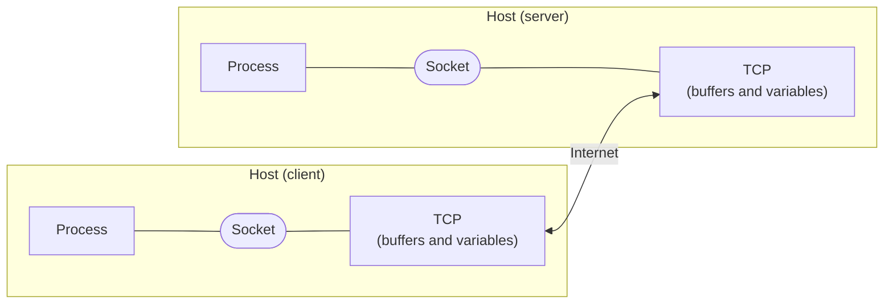

*Figure 3. Application processes, sockets, and the underlying transport protocol*

Because the socket is the programming interface with which network applications are built, it is also called the **API (Application Programming Interface)** between the application and the network. The application developer controls everything on the application-layer side of the socket but has little control over the transport-layer side. The only control the developer has on the transport-layer side is (1) the choice of transport protocol and (2) a few transport-layer parameters such as maximum buffer and maximum segment sizes. Forouzan explains that the socket interface is a set of instructions located between the operating system and the application programs, and that it started in the early 1980s at UC Berkeley as part of the UNIX environment. Chapter 23 covers socket programming.

**Addressing processes.** Just as postal mail needs a destination address, sending a packet to a process on another host needs the address of the receiving process. Two pieces of information identify the receiving process: the address of the host, and an identifier of the receiving process (more precisely, the receiving socket) within the destination host. In the Internet, the host is identified by its 32-bit **IP address** (Chapter 12), and the receiving socket within the host is identified by a **destination port number**. Popular applications have been assigned specific port numbers; a Web server, for example, is identified by port 80 and a mail server using SMTP by port 25. Chapter 6 covers port numbers in detail.

### 1.5 Iterative and Concurrent Servers

Both clients and servers can run several at a time. Running clients **iteratively** means starting, running, and terminating one client before starting the next, and most computers today can run two or more clients concurrently.

The same holds for servers. An **iterative server** processes only one request at a time: it receives a request, processes it, and sends the response before handling another request. A **concurrent server** processes many requests at the same time, sharing its time among them.

> **Definition:** A **concurrent server** is a server that processes the requests of several clients at the same time; a server that processes only one request at a time is an iterative server.

Servers use either UDP, a connectionless transport protocol, or TCP (or SCTP), a connection-oriented transport protocol, so in principle server operation falls into four types according to the transport protocol and the service method.

| Server type | Transport protocol | Use in practice |
|:-----|:-----|:-----|
| Connectionless iterative | UDP | Common |
| Connectionless concurrent | UDP | Rare |
| Connection-oriented iterative | TCP, SCTP | Rare |
| Connection-oriented concurrent | TCP, SCTP | Common |

*Table 2. The four types of servers*

**Connectionless iterative server.** Servers that use UDP are normally iterative. The server processes the request in one datagram received from UDP and gives the response to UDP to send to the client. Other datagrams that arrive in the meantime are stored in a queue to wait for service, and whether they come from one client or many, they are processed one by one in order of arrival. The server uses a single well-known port for this purpose, and all datagrams arriving at that port wait in line.

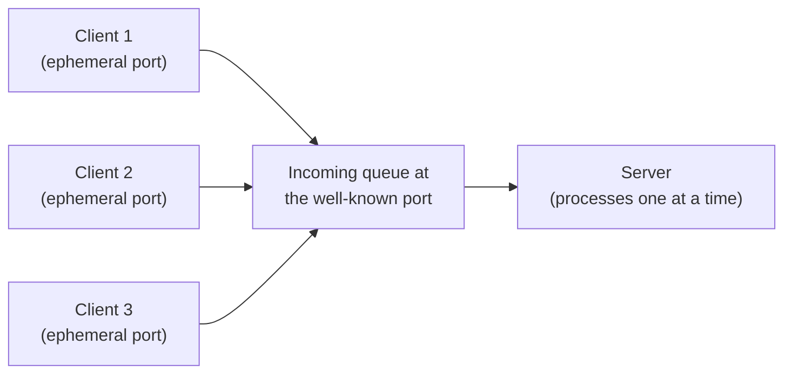

*Figure 4. A connectionless iterative server*

**Connection-oriented concurrent server.** Servers that use TCP are normally concurrent. Communication is connection-oriented, so a request is a stream of bytes that can arrive in several segments and the response can occupy several segments. A connection is established between the server and each client and remains open until the entire stream is processed and the connection is terminated. To serve several clients at the same time, the server creates for each client a **child process**, a copy of the original (parent) process, and hands the connection to it. The parent process only accepts new connection requests at the well-known port, so other clients can keep connecting. There is also a separate queue for the incoming segments of each connection.

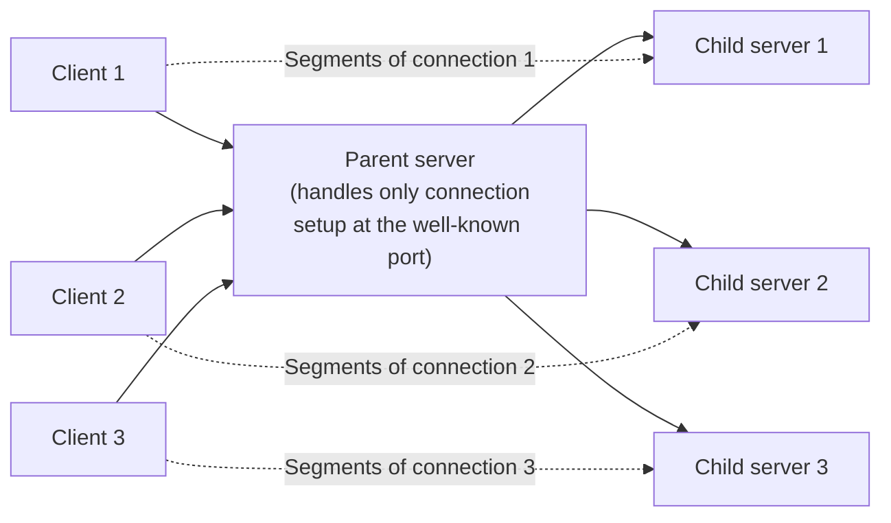

*Figure 5. A connection-oriented concurrent server*

When several connections are open at the same time, TCP in the server host must know to which connection an arriving segment belongs. According to Kurose, all segments sent to a Web server running on port 80, whether connection-establishment segments or segments carrying HTTP requests, have destination port 80, and the server distinguishes them by also looking at the source IP address and source port number. The socket of each connection is thus identified by a **four-tuple**: source IP address, source port, destination IP address, and destination port. Chapter 6 covers this demultiplexing.

> **Note:** **The server-side port of each connection.** Forouzan explains that once a connection is made, the server assigns a temporary port to the connection to free the well-known port, and data transfer takes place between temporary ports at both sites. In TCP as Kurose describes it, however, the server-side socket created for each connection keeps the well-known port (for example, 80), and connections are distinguished by the four-tuple. Running the TCP socket programs of Chapter 23 shows directly that the port of a connected server-side socket equals the well-known port. The core of Forouzan's explanation, that each connection is handled by a separate process or queue, still holds.

> **[Operating Systems]** A concurrent server needs a separate flow of execution for each connection. In UNIX, the `fork` system call creates a child process that duplicates the parent; the child handles one connection while the parent goes back to waiting for connection requests. Instead of processes, a **thread**, which shares the same address space, can be created for each connection. The examples in Chapter 23 use threads.

---

<br>

## 2. Transport Services Applications Need

The socket is the interface between the application process and the transport-layer protocol. The sending application pushes messages through the socket, and the transport-layer protocol on the other side of the socket is responsible for getting them to the socket of the receiving process. Many networks, including the Internet, provide more than one transport-layer protocol, so an application developer must choose one. This is similar to choosing between train and airplane travel between two cities: the train offers downtown pickup and drop-off, while the plane offers shorter travel time. The services a transport-layer protocol can offer to applications fall broadly along four dimensions.

**Reliable data transfer.** Packets can be lost in a network because a router buffer overflows or bits are corrupted. For many applications, such as e-mail, file transfer, remote host access, Web document transfer, and financial applications, data loss can have devastating consequences. A service that lets the sending process pass data into its socket with complete confidence that the data will arrive without errors at the receiving process is called **reliable data transfer**. Multimedia applications such as conversational audio and video, in contrast, can tolerate some loss and are called **loss-tolerant** applications; lost data might cause a small glitch in the audio or video, not a crucial impairment.

**Throughput.** Throughput, as seen in Chapter 1, is the rate at which the sending process can deliver bits to the receiving process. Because other sessions share the bandwidth along the path and come and go, the available throughput fluctuates with time. A transport protocol could provide guaranteed available throughput at some specified rate $r$ bps. For example, an Internet telephony application that encodes voice at 32 kbps needs data delivered at this rate, and if it cannot get it, it must encode at a lower rate or give up. Applications with throughput requirements are called **bandwidth-sensitive** applications. Applications such as e-mail, file transfer, and Web transfers, which can use as much or as little throughput as is available, are called **elastic** applications.

**Timing.** A transport protocol could also provide timing guarantees, for example that every bit the sender pumps into the socket arrives at the receiver's socket no more than 100 ms later. Interactive real-time applications such as Internet telephony, virtual environments, teleconferencing, and multiplayer games require tight timing constraints. Long delays in Internet telephony cause unnatural pauses in conversation, and in a game a long delay between an action and the response makes the game feel less realistic.

**Security.** If the transport protocol in the sending host encrypts all data and the transport protocol in the receiving host decrypts them, confidentiality between the two processes is preserved even if the data are observed along the way. Besides confidentiality, a transport protocol can provide security services such as data integrity and end-point authentication, which Chapter 26 covers.

| Application | Data loss | Throughput | Time-sensitive |
|:-----|:-----|:-----|:-----|
| File transfer and download | No loss | Elastic | No |
| E-mail | No loss | Elastic | No |
| Web documents | No loss | Elastic (few kbps) | No |
| Internet telephony and video conferencing | Loss-tolerant | Audio: few kbps-1 Mbps, video: 10 kbps-5 Mbps | Yes (100s of ms) |
| Streaming stored audio and video | Loss-tolerant | Same as above | Yes (few seconds) |
| Interactive games | Loss-tolerant | Few kbps-10 kbps | Yes (100s of ms) |
| Smartphone messaging | No loss | Elastic | Yes and no |

*Table 3. Requirements of selected network applications*

---

<br>

## 3. Transport Services Provided by the Internet

The Internet (and TCP/IP networks in general) makes two transport protocols available to applications, UDP and TCP. One of the first decisions in creating an Internet application is whether to use UDP or TCP.

### 3.1 TCP Services

The TCP service model includes a connection-oriented service and a reliable data transfer service.

- **Connection-oriented service:** TCP has the client and server exchange transport-layer control information before application-level messages begin to flow. This **handshaking** procedure prepares the client and server for an onslaught of packets. After the handshake, a **TCP connection** is said to exist between the sockets of the two processes. The connection is a **full-duplex** connection in which the two processes can send messages to each other at the same time. When the application finishes sending messages, it must tear down the connection.
- **Reliable data transfer service:** The communicating processes can rely on TCP to deliver all data sent without error and in the proper order. When one side of the application passes a stream of bytes into a socket, TCP delivers the same stream of bytes to the receiving socket with no missing or duplicate bytes.

TCP also includes a congestion-control mechanism, a service for the general welfare of the Internet rather than for the direct benefit of the communicating processes; it throttles a sending process when the network between sender and receiver is congested and attempts to limit each TCP connection to its fair share of network bandwidth (Chapter 9).

**Securing TCP.** Neither TCP nor UDP provides any encryption. The data a sending process passes into its socket travel over the network unchanged to the destination process, so a cleartext password, for example, could be sniffed on any link between sender and receiver. The Internet community therefore developed an enhancement for TCP called **SSL (Secure Sockets Layer)**, and **TLS (Transport Layer Security)**, a slightly modified version of SSL version 3, has been standardized by the IETF. TCP enhanced with SSL does everything traditional TCP does and also provides process-to-process security services such as encryption, data integrity, and end-point authentication. SSL is not a third Internet transport protocol on the same level as TCP and UDP but an enhancement of TCP implemented in the application layer. An application that wants to use SSL must include SSL code (libraries) in both the client and the server, and SSL has its own socket API similar to the traditional TCP socket API. The sending process passes cleartext data to the SSL socket, SSL encrypts them and passes them to the TCP socket, and SSL at the receiver decrypts the data and passes the cleartext to the receiving process. Chapter 26 covers SSL and TLS.

### 3.2 UDP Services

UDP is a no-frills, lightweight transport protocol that provides minimal services. UDP is connectionless, so there is no handshaking before two processes start to communicate. UDP provides an unreliable data transfer service: there is no guarantee that a message sent into a UDP socket will ever reach the receiving process, and messages that do arrive may arrive out of order. UDP has no congestion-control mechanism, so the sending side can pump data into the layer below at any rate it pleases, although the actual end-to-end throughput may be lower because of the limited capacity of the links or congestion along the path. Chapter 6 covers UDP.

### 3.3 Services the Internet Does Not Provide

Of the four dimensions of transport services, TCP provides reliable data transfer, and security can easily be added with SSL at the application layer. Today's Internet transport protocols, however, provide **no throughput or timing guarantees**. This does not mean that time-sensitive applications such as Internet telephony cannot run; such applications are designed to cope, as far as possible, with the lack of guarantees and usually work well. Clever design has its limits, though, when delay is excessive or end-to-end throughput is limited.

| Application | Application-layer protocol | Transport protocol |
|:-----|:-----|:-----|
| Electronic mail | SMTP | TCP |
| Remote terminal access | Telnet | TCP |
| Web | HTTP | TCP |
| File transfer | FTP | TCP |
| Streaming multimedia | HTTP (e.g., YouTube) | TCP |
| Internet telephony | SIP, RTP, or proprietary (e.g., Skype) | UDP or TCP |

*Table 4. Popular Internet applications, their application-layer protocols, and their transport protocols*

E-mail, remote terminal access, the Web, and file transfer use TCP because of its reliable data transfer, which guarantees that all data eventually reach their destination. Internet telephony applications tolerate some loss but need a minimal rate, so they usually run over UDP to avoid TCP's congestion control and packet overhead. Because many firewalls are configured to block most UDP traffic, however, they are often designed to use TCP as a backup if UDP communication fails. HTTP uses TCP rather than UDP for the same reason: Web documents cannot tolerate loss, so HTTP leaves loss recovery to TCP's reliable transfer and concentrates on the format and exchange of messages.

---

<br>

## 4. Application-Layer Protocols

Network processes communicate by sending messages into sockets. How are these messages structured, what do the fields mean, and when do processes send them? An application-layer protocol settles these questions.

> **Definition:** An **application-layer protocol** is a set of rules defining how the processes of an application, running on different end systems, pass messages to each other.

An application-layer protocol defines the following.

- The types of messages exchanged (for example, request messages and response messages)
- The syntax of each message type (the fields of the message and how they are delineated)
- The semantics of the fields (the meaning of the information in them)
- The rules for when and how a process sends messages and responds to them

Some application-layer protocols are specified in RFCs and are in the public domain. HTTP, the Web's application-layer protocol, is available as an RFC, so if a browser developer follows the rules of the HTTP RFC, the browser can retrieve Web pages from any Web server that follows the same rules. Many other application-layer protocols, such as Skype's, are **proprietary** and intentionally not made public.

A network application must be distinguished from an application-layer protocol; the protocol is only one piece of the application. The Web is a client-server application that lets users obtain documents from Web servers on demand, and it consists of a standard for document formats (HTML), Web browsers, Web servers, and the application-layer protocol HTTP. HTTP is the piece of the Web that defines the format and sequence of messages exchanged between browser and Web server. Likewise, the Internet e-mail application consists of mail servers that house user mailboxes, mail clients with which users read and compose messages, a standard defining the structure of an e-mail message, and application-layer protocols such as SMTP (Chapter 4).

---

<br>

## 5. The Web and HTTP

Until the early 1990s the Internet was used mainly by researchers, academics, and university students to log in to remote hosts, transfer files, and exchange news and electronic mail. The **World Wide Web (WWW)**, which arrived in the early 1990s, was the first Internet application to catch the general public's eye. What appeals most is that the Web operates **on demand**: unlike broadcast radio and television, which force users to tune in when the content provider makes the content available, users receive what they want when they want it. In addition, anyone can make information available at extremely low cost, and hyperlinks and search engines help users navigate information. The Web project was initiated at CERN (the European Laboratory for Particle Physics) to create a system for handling distributed resources needed for scientific research.

### 5.1 Architecture of the Web

The Web is a distributed client-server service in which a client using a browser accesses a service on a server, and the service is distributed over many locations called **sites**. Each site holds one or more documents called **Web pages**. In Kurose's terms, a Web page consists of **objects**. An object is simply a file, such as an HTML file, a JPEG image, a Java applet, or a video clip, that is addressable by a single URL. Most Web pages consist of a **base HTML file** and several referenced objects. A Web page containing HTML text and five JPEG images, for example, has six objects: the base HTML file plus the five images. The base HTML file references the other objects with their URLs.

Forouzan explains the same idea through the number of transactions. A page with the biography of a famous character whose pictures are embedded in the document itself, rather than stored as separate files, is a **simple Web page** with no links to other pages and can be retrieved with one request-response transaction (Example 22.1). A scientific document that references one text file at another site and one large image is a **composite Web page** with links. If the original document (file A) and the image (file B) are at site I and the referenced text file (file C) is at site II, three transactions are needed to see all three files (Example 22.2). A, B, and C are independent Web pages with their own names and addresses, so another user can retrieve B or C alone with one transaction (Example 22.3).

Creating documents that refer to other documents is called **hypertext**. In a hypertext document, a part of the text can be defined as a link to another document, and clicking the link in a browser retrieves that document. A document that contains links not only to other text documents but also to documents containing graphics, video, or audio is called **hypermedia**.

**Web client (browser).** Most browsers share the same architecture, consisting of a **controller**, **client protocols**, and **interpreters**. The controller receives input from the keyboard or mouse and uses the client programs to access the document; after the document has been accessed, the controller uses one of the interpreters to display it on the screen. The client protocol can be HTTP, FTP, TELNET, and so on, and the interpreter can be HTML, Java, or JavaScript, depending on the type of document. In the context of the Web, the browser implements the client side of HTTP, so browser and client are used interchangeably.

**Web server.** Web pages are stored at the server, and each time a client request arrives, the corresponding document is sent to the client. To improve efficiency, servers keep requested files in a cache in memory, which is faster than disk, and use multithreading or multiprocessing to answer several requests at a time. The server implements the server side of HTTP and houses Web objects addressable by URLs. Apache and Microsoft Internet Information Server are well-known Web servers.

**URL.** Accessing a Web page requires a file name and an address. To make documents distributed throughout the world easy to access, HTTP uses locators.

> **Definition:** A **URL (uniform resource locator)** is a standard locator for specifying any kind of information on the Internet, consisting of four parts: protocol, host, port, and path.

```text
protocol :// host : port / path

http://www.someSchool.edu/someDepartment/picture.gif
  protocol: http
  host:     www.someSchool.edu
  port:     omitted (default HTTP port 80)
  path:     /someDepartment/picture.gif
```

- **Protocol:** The client-server application program used to retrieve the document. Many protocols, such as FTP, HTTP, and TELNET, can retrieve a document, but the most common today is HTTP.
- **Host:** The domain name of the computer on which the information is located. Computers storing Web pages are usually given aliases beginning with "www", but this is not mandatory.
- **Port:** The port number of the server, which is optional. If included, it is inserted between the host and the path and separated from the host by a colon.
- **Path:** The path name of the file where the information is located. As in UNIX, slashes in the path can separate directories, subdirectories, and files.

Kurose describes a URL as two parts: the **host name** of the server that houses the object and the **path name** of the object. In the example above, the host name is www.someSchool.edu and the path name is /someDepartment/picture.gif.

### 5.2 Kinds of Web Documents

Web documents are grouped into static, dynamic, and active documents according to when their contents are determined.

- **Static document:** A fixed-content document created and stored in a server. Its contents are determined when the file is created; the contents on the server can be changed, but the user cannot change them. The client gets only a copy. Static documents are prepared with languages such as HTML, XML, XSL, and XHTML.
- **Dynamic document:** A document created by a Web server whenever a browser requests it. When a request arrives, the server runs an application program or script that creates the document and returns the output as the response. Because a fresh document is created for each request, the contents can vary from one request to another. Retrieving the time and date from a server is a simple example.
- **Active document:** A program or script that must be run at the client site. A program that creates animated graphics on the screen or interacts with the user must run at the client where the animation or interaction takes place. When a browser requests an active document, the server sends a copy of the document or script, and the document is run at the client (browser).

**CGI.** The **Common Gateway Interface (CGI)** is a technology that creates and handles dynamic documents, a set of standards defining how a dynamic document is written, how data are input to the program, and how the output is used. CGI is not a new language; it defines rules and terms to follow when writing programs in languages such as C, C++, shell, or Perl. "Common" in the name indicates that the rules are common to any language or platform, "gateway" that a CGI program can access other resources such as databases and graphic packages, and "interface" that there is a set of predefined terms, variables, and calls usable in any CGI program. Input from a browser is sent to the server with a form. If the input is short, it is appended to the URL after a question mark, as in `http://www.deanza/cgi-bin/prog.pl?23`; the server uses the part before the question mark to find the program to run and interprets the part after it (23) as the input. If the input is long, the browser fills in a form and sends it. The output of a CGI program always consists of two parts, a header and a body, separated by a blank line. The header is not shown on the screen but is used by the browser to interpret the body.

**Scripting technologies.** CGI is inefficient when part of a dynamic document does not change from request to request. If the availability and prices of car parts vary but their names, descriptions, and pictures are fixed, CGI creates the entire document for each request. The solution is to write the fixed part in HTML and embed in the document a **script** that the server runs only for the varying part. Examples are PHP (Hypertext Preprocessor), which uses Perl, JSP (Java Server Pages), which uses Java for scripting, Microsoft's ASP (Active Server Pages), which uses Visual Basic, and ColdFusion, which embeds SQL queries in HTML. Such documents are sometimes called server-site dynamic documents.

**Java applets and JavaScript.** One way to create an active document is a **Java applet**, a program written in Java on the server and compiled into bytecode (binary) form, of which the browser creates an instance and runs it. The browser can request the applet directly in a URL or retrieve and run an HTML file that embeds the address of the applet as a tag. If the active part is small, it can be written in a scripting language and interpreted and run by the client at once; the script is then source code (text) rather than binary, and **JavaScript** is usually used. Active documents are sometimes called client-site dynamic documents.

| Kind | When the contents are determined | Where it runs | Technologies |
|:-----|:-----|:-----|:-----|
| Static document | When the file is created | Nowhere (only a copy is sent) | HTML, XML, XSL, XHTML |
| Dynamic document | At the server when a request arrives | Server | CGI, PHP, JSP, ASP, ColdFusion |
| Active document | When run at the client | Client (browser) | Java applets, JavaScript |

*Table 5. The three kinds of Web documents*

### 5.3 Overview of HTTP

**HTTP (HyperText Transfer Protocol)**, the Web's application-layer protocol, is at the heart of the Web. HTTP is implemented in two programs, a client program and a server program, which execute on different end systems and talk to each other by exchanging HTTP messages. HTTP defines the structure of these messages and how the client and server exchange them. When a user requests a Web page (for example, clicks a hyperlink), the browser sends HTTP request messages for the objects in the page to the server, and the server receives the requests and responds with HTTP response messages that contain the objects.

HTTP uses **TCP**, not UDP, as its transport protocol, and the server uses the well-known port 80. The HTTP client first initiates a TCP connection with the server, and once the connection is established, the browser and server processes access TCP through their socket interfaces. Once the client sends a message into its socket, the message is out of the client's hands and in the hands of TCP. Because TCP provides reliable data transfer, each HTTP request message sent by the client eventually arrives intact at the server, and likewise for responses. HTTP need not worry about lost data or how TCP recovers from loss and reordering, which is one of the great advantages of a layered architecture.

> **Definition:** A **stateless protocol** is a protocol in which the server maintains no state information about clients; an HTTP server that receives the same request for an object from the same client twice within a few seconds does not remember that it just served it and sends the object again.

Forouzan explains that HTTP functions like a combination of FTP and SMTP. It is similar to FTP in that it transfers files and uses the services of TCP, but it is much simpler because it uses only one TCP connection; there is no separate control connection, and only data are transferred between client and server. It is similar to SMTP in that the data exchanged look like SMTP messages and their format is controlled by MIME-like headers. Unlike SMTP messages, however, HTTP messages are not meant to be read by humans but are read and interpreted by the HTTP server and HTTP client (browser), and whereas SMTP messages are stored and forwarded, HTTP messages are delivered immediately. Chapter 4 covers FTP and SMTP.

### 5.4 Non-Persistent and Persistent Connections

In many Internet applications the client and server communicate for an extended period, with the client making a series of requests and the server responding to each. The requests may be made back to back, periodically, or intermittently. When this interaction takes place over TCP, one must decide whether each request-response pair should be sent over a separate TCP connection or all requests and responses over the same TCP connection.

> **Definition:** A **non-persistent connection** is an approach in which a separate TCP connection is established for each request-response pair and the server closes the connection after sending the object.

> **Definition:** A **persistent connection** is an approach in which the server leaves the TCP connection open after sending a response, so that subsequent requests and responses between the same client and server are sent over the same connection.

**HTTP with non-persistent connections.** Suppose a Web page consists of a base HTML file and 10 JPEG images, all 11 objects residing on the same server. If the URL of the base HTML file is `http://www.someSchool.edu/someDepartment/home.index`, the following happens.

1. The HTTP client process initiates a TCP connection to the server www.someSchool.edu on port 80, the default port number for HTTP. Associated with the TCP connection there is a socket at the client and a socket at the server.
2. The HTTP client sends an HTTP request message containing the path name /someDepartment/home.index to the server via its socket.
3. The HTTP server process receives the request message via its socket, retrieves the object from its storage (RAM or disk), encapsulates it in an HTTP response message, and sends the response via its socket.
4. The HTTP server process tells TCP to close the TCP connection. TCP, however, does not actually terminate the connection until it knows for sure that the client has received the response intact.
5. The HTTP client receives the response message, and the TCP connection terminates. The client extracts the HTML file from the response, examines it, and finds references to the 10 JPEG objects.
6. Steps 1-4 are repeated for each of the referenced JPEG objects.

With non-persistent connections, each TCP connection carries exactly one request message and one response message, so 11 TCP connections are generated to receive this Web page. Whether the 10 JPEGs are obtained over 10 serial connections or over parallel connections is up to the browser; in their default modes most browsers open 5 to 10 parallel TCP connections, each handling one request-response transaction. Parallel connections shorten the response time. HTTP, incidentally, has nothing to do with how a client interprets and displays a Web page; the HTTP specifications define only the communication protocol between the client HTTP program and the server HTTP program.

To estimate the response time, we define the **round-trip time (RTT)**.

> **Definition:** The **round-trip time (RTT)** is the time it takes for a small packet to travel from client to server and back to the client, including packet propagation, queuing, and processing delays.

When the user clicks a hyperlink, the browser initiates a **three-way handshake** to establish a TCP connection with the Web server: the client sends a small TCP segment to the server, the server acknowledges with a small TCP segment, and finally the client acknowledges back to the server. The first two parts of the handshake take one RTT. The client sends the HTTP request message combined with the third part of the handshake (the acknowledgment), and when the request arrives, the server sends the HTML file into the TCP connection; this request and response take another RTT. The total response time is therefore roughly two RTTs plus the transmission time of the HTML file at the server. Chapter 8 covers TCP connection setup in detail.

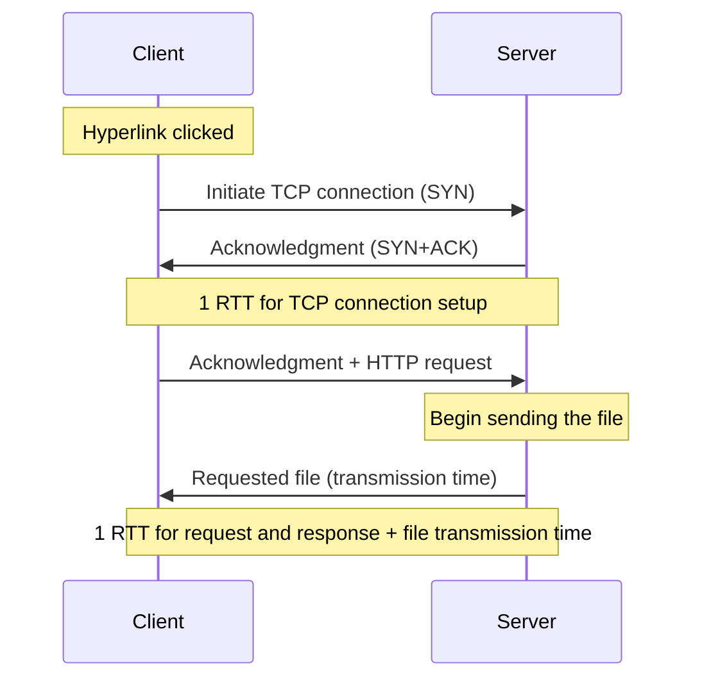

*Figure 6. Time needed to request and receive one HTML file*

**HTTP with persistent connections.** Non-persistent connections have two shortcomings. First, a brand-new connection must be established and maintained for each requested object; for each connection TCP buffers must be allocated and TCP variables kept at both client and server, which places a significant burden on a Web server serving hundreds of clients simultaneously. Forouzan also points out that each newly opened connection must go through TCP's slow start procedure (Chapter 9). Second, each object suffers a delivery delay of two RTTs, one to establish the connection and one to request and receive the object.

With HTTP 1.1 persistent connections, the server leaves the TCP connection open after sending a response, and subsequent requests and responses between the same client and server are sent over the same connection. Not only an entire Web page (the base HTML file and the 10 images in the example) but also multiple Web pages on the same server can be sent over a single persistent TCP connection. Requests for objects can be made back to back without waiting for replies to pending requests, which is called **pipelining**, and the server sends the objects back to back. An HTTP server typically closes a connection when it has not been used for a certain time (a configurable timeout). Kurose describes the default mode of HTTP as persistent connections with pipelining. Forouzan adds that the server usually sends the length of the data with each response, but when the length is not known in advance, as with dynamic or active documents, it informs the client that the length is unknown and closes the connection after sending the data to signal the end.

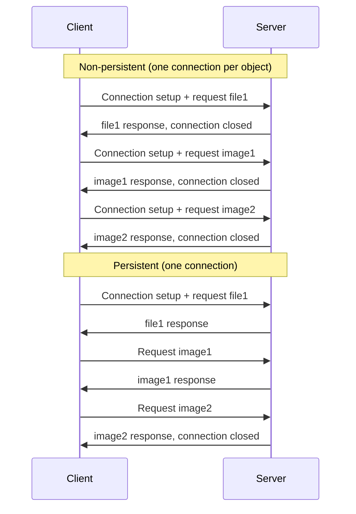

*Figure 7. Retrieving a text file and two images with non-persistent and persistent connections*

**Example.** A base HTML file and the 5 images it references are retrieved from the same server. The RTT is 100 ms and transmission times are ignored.

- Non-persistent, serial: 2 RTTs per object, so 6 × 2 RTT = 12 RTT = 1.2 seconds
- Non-persistent, 5 parallel connections: 2 RTTs for the base file and 2 RTTs to receive the 5 images at once, 4 RTT = 0.4 seconds in all
- Persistent, without pipelining: 2 RTTs for connection setup and the base file and 1 RTT per image, 2 + 5 = 7 RTT = 0.7 seconds in all
- Persistent, with pipelining: 2 RTTs for connection setup and the base file and 1 RTT to request and receive the 5 images back to back, 3 RTT = 0.3 seconds in all

### 5.5 HTTP Request Messages

There are two types of HTTP messages, request messages and response messages. The following is a typical HTTP request message.

```text
GET /somedir/page.html HTTP/1.1
Host: www.someschool.edu
Connection: close
User-agent: Mozilla/5.0
Accept-language: fr
```

Several things can be learned from this message. First, it is written in ordinary ASCII text that people can read. Second, it consists of five lines, each followed by a carriage return (CR) and a line feed (LF), and the last line is followed by an additional CR and LF. A request message can have many more lines or as few as one.

The first line of a request message is called the **request line**, and the subsequent lines the **header lines**. The request line has three fields separated by spaces: the **method** field, the **URL** field, and the **HTTP version** field. In the example, the browser requests the object /somedir/page.html with the GET method and implements HTTP/1.1.

The header lines mean the following. `Host: www.someschool.edu` specifies the host on which the object resides; this may seem unnecessary because there is already a TCP connection to the host, but the Web proxy caches of Section 7 need it. `Connection: close` tells the server that the browser does not want a persistent connection and wants the server to close the connection after sending the requested object. `User-agent:` specifies the user agent, the type of browser making the request (here Mozilla/5.0, a Firefox browser); it is useful because the server can send different versions of the same object, addressed by the same URL, to different types of user agents. `Accept-language:` indicates that the user prefers a French version of the object and that the server should send its default version if none exists; it is one of many content negotiation headers in HTTP.

```text
Request line : method sp URL sp version cr lf
Header lines : header name: sp value cr lf
               ...
               header name: sp value cr lf
Blank line   : cr lf
Entity body  : (present only in some messages)

sp: space, cr: carriage return, lf: line feed
```

*Figure 8. General format of an HTTP request message*

After the header lines and the blank line comes the **entity body**. The entity body is empty with the GET method and is used with the POST method. An HTTP client often uses the POST method when the user fills out a form, for example when providing search words to a search engine; the entity body then contains what the user entered into the form fields. With POST the user is still requesting a Web page, but its specific contents depend on the input. A request generated with a form does not necessarily use POST: HTML forms often use GET and include the input in the requested URL. If a form with two fields uses GET and the inputs are monkeys and bananas, the URL has the structure `www.somesite.com/animalsearch?monkeys&bananas`.

| Method | Action |
|:-----|:-----|
| GET | Requests a document (object) from the server; the great majority of request messages use GET |
| HEAD | Like GET, but the server leaves out the requested object in its response; application developers often use it for debugging |
| POST | Sends information (such as form input) from the client to the server |
| PUT | Lets a client upload an object (document) to a specific path on the server; used by Web publishing tools and applications that upload objects |
| DELETE | Deletes an object (Web page) on the server |
| TRACE | Echoes the incoming request |
| CONNECT | Reserved |
| OPTIONS | Enquires about available options |

*Table 6. HTTP request methods*

> **Note:** **The direction of PUT.** Forouzan's method table describes PUT as "sends a document from the server to the client", but Kurose describes PUT as the method that lets a user upload an object to a specific path (directory) on a Web server. The method that retrieves a document from the server to the client is GET; PUT sends a document from the client to the server.

The headers commonly used in request messages are listed in Table 7. Each header line consists of a header name, a colon, a space, and a header value.

| Header | Description |
|:-----|:-----|
| User-agent | Identifies the client program |
| Accept | Shows the media formats the client can accept |
| Accept-charset | Shows the character sets the client can handle |
| Accept-encoding | Shows the encoding schemes the client can handle |
| Accept-language | Shows the languages the client can accept |
| Authorization | Shows what permissions the client has |
| Host | Specifies the host (and port) of the server on which the object resides |
| Date | Shows the current date |
| Upgrade | Specifies the preferred communication protocol |
| Cookie | Returns the cookie sent by the server (Section 6) |
| If-Modified-Since | Asks for the object only if it has changed after the given time (Section 7.3) |

*Table 7. Main headers of HTTP request messages*

### 5.6 HTTP Response Messages

The following is a typical HTTP response message, which could be the response to the request message above.

```text
HTTP/1.1 200 OK
Connection: close
Date: Tue, 18 Aug 2015 15:44:04 GMT
Server: Apache/2.2.3 (CentOS)
Last-Modified: Tue, 18 Aug 2015 15:11:03 GMT
Content-Length: 6821
Content-Type: text/html

(data data data data data ...)
```

This response message has three sections: an initial **status line**, six header lines, and the entity body. The entity body is the meat of the message and contains the requested object itself (data data ...). The status line has three fields: the protocol version, a **status code**, and a corresponding **status phrase**. In the example, the server is using HTTP/1.1 and everything is OK, that is, it has found and is sending the requested object.

The header lines mean the following. `Connection: close` tells the client that the server will close the TCP connection after sending the message. `Date:` is the time and date when the server created and sent the response; it is not the time when the object was created or last modified but the time when the server retrieved the object from its file system, inserted it into the response, and sent it. `Server:` indicates that the message was generated by an Apache Web server; it is analogous to `User-agent:` in the request message. `Last-Modified:` is the time and date when the object was created or last modified, and it is critical for object caching in both the local client and network cache servers (proxy servers). `Content-Length:` is the number of bytes in the object being sent, and `Content-Type:` indicates that the object in the entity body is HTML text. The object type is officially indicated by the `Content-Type:` header and not by the file extension.

```text
Status line  : version sp status code sp status phrase cr lf
Header lines : header name: sp value cr lf
               ...
Blank line   : cr lf
Entity body  : (contains the document unless the response is an error message)
```

*Figure 9. General format of an HTTP response message*

The status code is a three-digit number whose first digit determines its category: codes in the 100 range are informational, the 200 range indicates a successful request, the 300 range redirects the client to another URL, the 400 range indicates an error at the client site, and the 500 range an error at the server site.

| Category | Code | Status phrase | Meaning |
|:-----|:-----|:-----|:-----|
| Informational | 100 | Continue | The initial part of the request was received; continue |
| Informational | 101 | Switching | The server is complying with a switch of protocols |
| Success | 200 | OK | The request succeeded and the information is returned in the response |
| Success | 201 | Created | A new URL was created |
| Success | 202 | Accepted | The request is accepted but not immediately acted upon |
| Success | 204 | No content | There is no content in the body |
| Redirection | 301 | Moved permanently | The requested object has been permanently moved; the new URL is in the Location: header of the response, and the client software automatically retrieves the new URL |
| Redirection | 302 | Moved temporarily | The requested URL has moved temporarily |
| Redirection | 304 | Not modified | The document has not been modified (Section 7.3) |
| Client error | 400 | Bad request | The server could not understand the request (syntax error in the request) |
| Client error | 401 | Unauthorized | The request lacks proper authorization |
| Client error | 403 | Forbidden | Service is denied |
| Client error | 404 | Not found | The requested document does not exist on this server |
| Client error | 405 | Method not allowed | The method is not supported for this URL |
| Client error | 406 | Not acceptable | The requested format is not acceptable |
| Server error | 500 | Internal server error | An error, such as a crash, occurred at the server site |
| Server error | 501 | Not implemented | The requested action cannot be performed |
| Server error | 503 | Service unavailable | The service is temporarily unavailable |
| Server error | 505 | HTTP Version Not Supported | The requested HTTP version is not supported by the server |

*Table 8. HTTP status codes*

| Header | Description |
|:-----|:-----|
| Date | Shows the current date |
| Upgrade | Specifies the preferred communication protocol |
| Server | Gives information about the server |
| Set-Cookie | Asks the client to save a cookie (Section 6) |
| Content-Encoding | Specifies the encoding scheme |
| Content-Language | Specifies the language |
| Content-Length | Shows the length of the document |
| Content-Type | Specifies the media type |
| Location | Asks the client to send the request to another site |
| Accept-Ranges | The server accepts requested byte ranges |
| Last-modified | Gives the date and time of the last change |

*Table 9. Main headers of HTTP response messages*

A browser decides which header lines to include in a request according to the browser type and version, the user's configuration (for example, preferred language), and whether it has a cached, possibly out-of-date, copy of the object. Web servers likewise include different header lines according to the product, version, and configuration.

### 5.7 Examples of HTTP Transactions

Because HTTP messages consist of ASCII characters, one can connect directly to port 80 of a Web server with a program such as TELNET, type a request line and header lines followed by a blank line, and see the server's response message directly. To see only the HTTP message lines without the object, use HEAD instead of GET.

**Example 22.4 (retrieving a document).** A client uses the GET method to retrieve an image with the path /usr/bin/image1. The request line shows the method (GET), the URL, and the HTTP version (1.1), and the two header lines show that the client can accept images in GIF or JPEG format. The request has no body. The response consists of the status line and four header lines (date, server, MIME version, and length of the document), followed by the body of the document.

```text
Request:
GET /usr/bin/image1 HTTP/1.1
Accept: image/gif
Accept: image/jpeg

Response:
HTTP/1.1 200 OK
Date: Mon, 07-Jan-05 13:15:14 GMT
Server: Challenger
MIME-version: 1.0
Content-length: 2048

(Body of the document)
```

**Example 22.5 (sending data).** A client uses the POST method to send data to the server. The request has four header lines, and its body contains the input information. The body of the response is a CGI document created by the server.

```text
Request:
POST /cgi-bin/doc.pl HTTP/1.1
Accept: */*
Accept: image/gif
Accept: image/jpeg
Content-length: 50

(Input information)

Response:
HTTP/1.1 200 OK
Date: Mon, 07-Jan-02 13:15:14 GMT
Server: Challenger
MIME-version: 1.0
Content-length: 2000

(Body of the document)
```

### 5.8 HTTP and Security

HTTP itself does not provide security. HTTP can, however, be run over SSL, in which case it is called **HTTPS**. HTTPS provides confidentiality, client and server authentication, and data integrity. When the URL in a browser begins with https: rather than http:, SSL is being used. An HTTPS server uses port 443 by default [1]. Chapter 26 covers the operation of SSL and TLS.

---

<br>

## 6. Cookies

Because an HTTP server is stateless, server design is simple, and high-performance Web servers that handle thousands of simultaneous TCP connections can be built. A Web site, however, often needs to identify users, either to restrict access or to serve content according to the user's identity. For these purposes HTTP uses **cookies**. Forouzan names four uses of the Web that need cookies: a Web site used as an electronic store where users select items, put them in a cart, and pay at the end; a site that allows access only to registered clients; a site used as a portal on which the user selects the pages to see; and a site used for advertising.

> **Definition:** A **cookie** is identifying information that a server sends in a response, the browser stores, and the browser returns in later requests so that a Web site can keep track of users.

According to Kurose, cookie technology has four components.

1. A cookie header line in the HTTP response message (`Set-cookie:`)
2. A cookie header line in the HTTP request message (`Cookie:`)
3. A cookie file kept on the user's end system and managed by the browser
4. A back-end database at the Web site

Suppose Susan contacts Amazon.com from her home PC for the first time; she has visited eBay before. When the request arrives at the Amazon Web server, the server creates a unique identification number and an entry in its back-end database indexed by that number. The server responds with a `Set-cookie:` header containing the number (for example, `Set-cookie: 1678`). Susan's browser sees the header and appends a line with the host name of the server and the identification number to the cookie file it manages; the file already has an entry for eBay. As Susan continues to browse the Amazon site, each time she requests a Web page the browser takes her identification number for this site from the cookie file and puts a `Cookie: 1678` header line in the request.

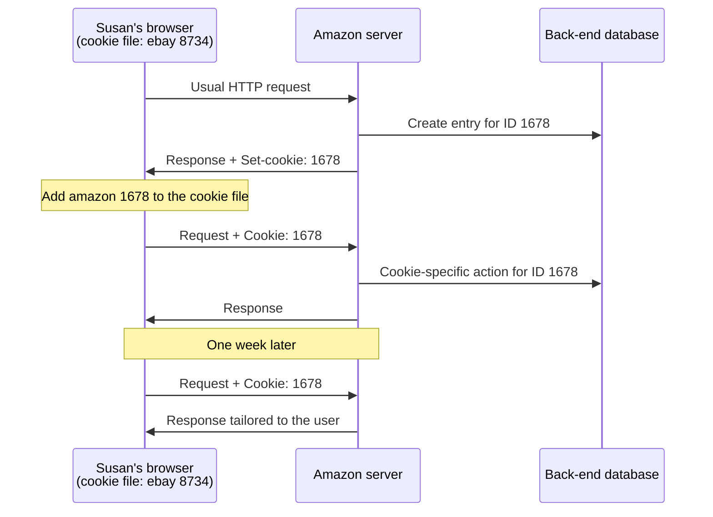

*Figure 10. Keeping user state with cookies*

In this way the Amazon server can track Susan's activity. Even without knowing Susan's name, Amazon knows exactly which pages user 1678 visited, in which order, and at what times. Amazon uses cookies to provide its shopping cart service, keeping a list of Susan's intended purchases so that she can pay for them together at the end of the session, and if Susan returns a week later, her browser keeps sending `Cookie: 1678`. Amazon can also recommend products based on the pages she has visited in the past. If Susan registers her name, e-mail address, postal address, and credit card information, Amazon can put this information in its database and associate her name with her identification number (and all the pages she has visited). This is how "one-click shopping" works, so that she need not re-enter her name, card number, or address on a later visit.

Cookies are thus used to create a **user session layer** on top of stateless HTTP. When a user logs in to Web-based e-mail, for example, the browser sends cookie information to the server so that the server can identify the user throughout the session.

Forouzan describes the creation and use of cookies as follows. When a server receives a request from a client, it stores information about the client (the client's domain name, the contents of the cookie, which is information the server has gathered such as a name or registration number, a timestamp, and so on) in a file or a string and includes the cookie in its response. The browser stores the cookie in a cookie directory sorted by the domain server name. When the client later sends a request to that server, the browser looks in the cookie directory for a cookie sent by that server and includes it in the request, and the server knows from the cookie that this is an old client, not a new one. The contents of the cookie are never read by the browser or disclosed to the user; a cookie is made by the server and eaten by the server.

- **Electronic store:** When a client selects an item and puts it in the cart, a cookie containing information about the item, such as its number and unit price, is sent to the browser; if the client selects a second item, the cookie is updated with the new selection. At checkout the last cookie is retrieved and the total charge is calculated.
- **Restricting access to registered clients:** A cookie is sent when the client registers for the first time, and afterward only clients that send the appropriate cookie are allowed access.
- **Web portal:** When a user selects favorite pages, a cookie is made and sent; when the site is accessed again, the cookie shows what the client is looking for.
- **Advertising:** An advertising agency supplies a main Web site that users visit often with only the URL of a banner, not the banner itself. When a user visits the site and clicks the advertisement, a request goes to the agency, which sends the banner together with a cookie containing the user's ID. Every later viewing of the banners adds to a database that profiles the user's Web behavior.

Although cookies make Internet shopping convenient, they are controversial because they can be considered an invasion of privacy. Combining cookies with user-supplied account information, a Web site can learn a lot about a user and potentially sell this information to a third party. The use of cookies by advertising agencies, in particular, is at the center of the controversy.

---

<br>

## 7. Web Caching

### 7.1 Operation of a Proxy Server

> **Definition:** A **Web cache**, or **proxy server**, is a network entity that satisfies HTTP requests on behalf of an origin Web server, keeping copies of recently requested objects in its own storage.

A user's browser can be configured so that all of its HTTP requests are first directed to the Web cache. When the browser requests the object `http://www.someschool.edu/campus.gif`, the following happens.

1. The browser establishes a TCP connection to the Web cache and sends an HTTP request for the object to the cache.
2. The Web cache checks whether it has a copy of the object stored locally. If it does, it returns the object in an HTTP response message to the browser.
3. If it does not, the Web cache opens a TCP connection to the origin server, www.someschool.edu, and sends an HTTP request for the object. The origin server sends the object in an HTTP response to the Web cache.
4. When the Web cache receives the object, it stores a copy in its local storage and sends a copy in an HTTP response message to the browser over the existing TCP connection.

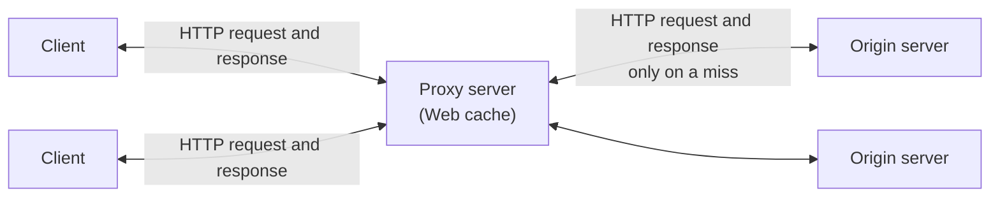

*Figure 11. Clients requesting objects through a Web cache*

A cache is both a server and a client at the same time: when it receives requests from and sends responses to a browser it is a server, and when it sends requests to and receives responses from an origin server it is a client. A Web cache is typically purchased and installed by an ISP. A university might install a cache on its campus network and configure all campus browsers to point to it, and a large residential ISP might install caches in its network and preconfigure the browsers it ships to point to them. Forouzan explains that proxy servers are normally located at the client site and can form a hierarchy: a client computer itself can act as a small proxy storing responses it often uses, a company can install a proxy on its LAN to reduce the load going out of and coming into the LAN, and an ISP with many customers can install a proxy to reduce the load going out of and coming into its network. To use a proxy, however, the client must be configured to access the proxy instead of the target server.

Web caching is deployed for two reasons. First, a Web cache can substantially reduce the response time for a client request, particularly if the bottleneck bandwidth between the client and the origin server is much smaller than that between the client and the cache. Second, Web caches can substantially reduce traffic on an institution's access link to the Internet, so the institution need not upgrade its bandwidth as quickly, reducing costs; they also reduce Web traffic in the Internet as a whole, improving performance for all applications. Forouzan likewise summarizes that a proxy server reduces the load on the original server, decreases traffic, and improves latency.

### 7.2 The Effect of Caching

Consider the following situation of an institutional network and the public Internet. The institutional network is a 100 Mbps high-speed LAN, and a router in the institutional network and a router in the Internet are connected by a 15 Mbps access link. The origin servers are located all over the globe. The average object size is 1 Mbit, and the average request rate from the institution's browsers to the origin servers is 15 requests per second. Suppose the HTTP request messages are negligibly small and create no traffic, and that the time from when the router on the Internet side of the access link forwards a request until it receives the response is two seconds on average; call this the "Internet delay".

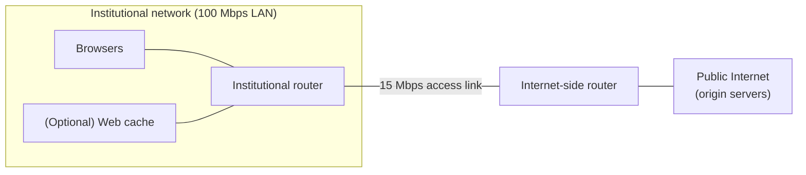

*Figure 12. The bottleneck between an institutional network and the Internet*

The total response time is the sum of the LAN delay, the access delay (between the two routers), and the Internet delay. A crude calculation with the traffic intensity of Chapter 1 gives the following.

```math
\begin{aligned}
\text{Traffic intensity on the LAN} &= \frac{(15\ \text{requests/s})(1\ \text{Mbit/request})}{100\ \text{Mbps}} = 0.15 \\
\text{Traffic intensity on the access link} &= \frac{(15\ \text{requests/s})(1\ \text{Mbit/request})}{15\ \text{Mbps}} = 1
\end{aligned}
```

A traffic intensity of 0.15 on the LAN results in at most tens of milliseconds of delay, which can be neglected. But as the traffic intensity on the access link approaches 1, the delay on the link becomes very large and grows without bound, so the average response time is on the order of minutes, if not more, which is unacceptable to users.

**Solution 1: upgrading the access link.** Raising the access link from 15 Mbps to 100 Mbps lowers its traffic intensity to 0.15, and the delay between the two routers becomes negligible. The total response time is then roughly the Internet delay, two seconds. But a costly upgrade is required.

**Solution 2: installing a Web cache.** Keep the access link and install a Web cache in the institutional network. The **hit rate**, the fraction of requests satisfied by the cache, typically ranges from 0.2 to 0.7 in practice. Suppose the hit rate is 0.4. Because the clients and the cache are on the same high-speed LAN, 40% of the requests are satisfied almost immediately, say within 10 ms, by the cache. Only the remaining 60% go to the origin servers, so the traffic intensity on the access link drops from 1.0 to 0.6. A traffic intensity below 0.8 typically corresponds to a small delay of tens of milliseconds on a 15 Mbps link, negligible compared with the two-second Internet delay. The average delay is therefore as follows.

```math
0.4 \times (0.01\ \text{s}) + 0.6 \times (2.01\ \text{s}) = 1.21\ \text{s}
```

Installing a cache gives an even shorter response time than upgrading the access link, and the institution avoids the upgrade cost. Web caches often run public-domain software on inexpensive PCs, so their cost is low.

| Option | Traffic intensity on the access link | Average response time | Cost |
|:-----|:-----|:-----|:-----|
| Do nothing | 1.0 | Minutes or more (grows without bound) | None |
| Upgrade the access link to 100 Mbps | 0.15 | About 2 seconds | High |
| Install a Web cache with hit rate 0.4 | 0.6 | About 1.21 seconds | Low |

*Table 10. Comparison of three options for the institutional network*

Web caches also play an increasingly important role in the Internet through **Content Distribution Networks (CDNs)**. A CDN company installs many geographically distributed caches throughout the Internet, thereby localizing much of the traffic. Chapter 23 covers CDNs.

### 7.3 The Conditional GET

Caching reduces user-perceived response times but introduces a new problem: the copy of an object in the cache may be **stale**, because the object on the Web server may have been modified since the copy was cached. HTTP has a mechanism that lets a cache verify that its objects are up to date.

> **Definition:** A **conditional GET** is an HTTP request message that uses the GET method and includes an `If-Modified-Since:` header line, asking for the object only if it has been modified since the specified time.

For example, a proxy cache sends a request to a Web server on behalf of a browser.

```text
GET /fruit/kiwi.gif HTTP/1.1
Host: www.exotiquecuisine.com
```

The Web server sends a response with the requested object to the cache.

```text
HTTP/1.1 200 OK
Date: Sat, 3 Oct 2015 15:39:29
Server: Apache/1.3.0 (Unix)
Last-Modified: Wed, 9 Sep 2015 09:23:24
Content-Type: image/gif

(data data data data data ...)
```

The cache forwards the object to the requesting browser and also caches it locally, storing the last-modified date along with it. One week later, another browser requests the same object via the cache. The object is still in the cache, but it may have been modified at the server in the past week, so the cache checks whether it is up to date with a conditional GET.

```text
GET /fruit/kiwi.gif HTTP/1.1
Host: www.exotiquecuisine.com
If-modified-since: Wed, 9 Sep 2015 09:23:24
```

The value of the `If-modified-since:` header is exactly the value of the `Last-Modified:` header the server sent a week earlier. This conditional GET asks the server to send the object only if it has been modified since the specified date. If the object has not been modified, the server sends the following response.

```text
HTTP/1.1 304 Not Modified
Date: Sat, 10 Oct 2015 15:39:29
Server: Apache/1.3.0 (Unix)

(empty entity body)
```

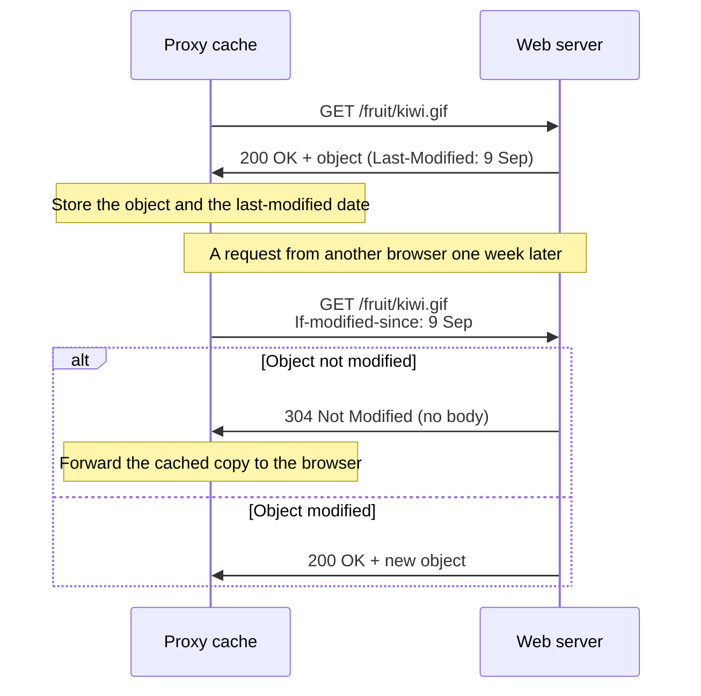

*Figure 13. Checking a cached copy with a conditional GET*

The server still sends a response message to the conditional GET but does not include the requested object, because including it would only waste bandwidth and increase the user-perceived response time, particularly for a large object. The 304 Not Modified in the status line tells the cache that it can forward its copy of the object to the requesting browser.

Forouzan also explains that a client can add a condition to its request, the most common being the modification time of the Web page. He further describes other ways of deciding how long a response should remain in a proxy server. One is to keep a list of sites whose information stays the same for a while; if a news agency changes its news page every morning, for example, the proxy can get the news early in the morning and keep it until the next day. Another is to use headers showing the last modification time to estimate how long the information will remain valid.

---

<br>

## 8. HTTP/2

Building on the persistent connections and pipelining of HTTP/1.1, **HTTP/2** allows multiple requests and replies to be interleaved in the same connection and adds a mechanism for prioritizing HTTP request and response messages within the connection. Kurose notes that HTTP/2 is specified in RFC 7540; RFC 9113 later obsoleted RFC 7540 and now specifies HTTP/2 [2]. Interleaving requests and replies lets several objects share one connection at the same time.

---

<br>

## Summary

| Concept | Key Summary |
|:-----|:-----|
| Where applications run | Network applications run only on end systems; network-core devices operate only at the network layer and below. |
| Client-server architecture | An always-on server with a fixed IP address services requests from clients, and clients do not communicate directly with each other. |
| P2P architecture | Intermittently connected peers communicate directly, and because peers add service capacity, the architecture is self-scaling. |
| Client and server processes | In a session the process that initiates communication is the client and the one that waits is the server; a server is an infinite program and a client a finite one. |
| Socket | The interface between the application layer and the transport layer; a receiving process is identified by an IP address and a port number. |
| Iterative and concurrent servers | An iterative server handles requests one by one and a concurrent server several at once; UDP servers are mostly iterative and TCP servers mostly concurrent. |
| Four dimensions of transport services | Reliable data transfer, throughput, timing, and security; the Internet provides no throughput or timing guarantees. |
| TCP and UDP services | TCP provides connection-oriented service, reliable transfer, and congestion control and can be secured with SSL; UDP is a minimal connectionless service. |
| Application-layer protocol | Defines message types, syntax, semantics, and rules for sending and responding; some are public RFCs and others proprietary. |
| Web documents | Static documents, dynamic documents created at the server (CGI, scripts), and active documents run at the client (applets, JavaScript). |
| HTTP | A stateless request-response protocol over TCP port 80; a request consists of a request line, headers, and a body, and a response of a status line, headers, and a body. |
| Non-persistent and persistent connections | Non-persistent connections cost 2 RTTs per object; persistent connections send many objects over one connection, and pipelining sends requests back to back. |
| Cookie | Builds user sessions on top of stateless HTTP with the Set-cookie and Cookie headers, a cookie file, and a back-end database. |
| Web cache | Responds on behalf of the origin server close to the clients, reducing response time and access-link traffic. |
| Conditional GET | Checks whether a cached copy is current with If-Modified-Since; if the object has not changed, the server sends 304 Not Modified without a body. |

---

<br>

## Self-Check Questions

1. **HTTP response time:** A base HTML file and 10 small objects it references are retrieved from the same server. The RTT is 50 ms and transmission times are ignored. Find the total response time (a) with serial non-persistent connections, (b) with persistent connections without pipelining, and (c) with persistent connections with pipelining.

   <details>
   <summary>Answer</summary>

   (a) Each of the 11 objects costs 1 RTT for connection setup and 1 RTT for request and response, so 11 × 2 = 22 RTT = 1100 ms. (b) Connection setup and the base file take 2 RTT and each later object 1 RTT, so 2 + 10 = 12 RTT = 600 ms. (c) Connection setup and the base file take 2 RTT and requesting and receiving the 10 objects back to back takes 1 RTT, so 3 RTT = 150 ms.

   </details>

2. **Effect of caching:** In the institutional network of Section 7.2, there are 15 requests per second, the average object is 1 Mbit, and the access link is 15 Mbps. Find the traffic intensity on the access link without a cache and with a cache of hit rate 0.4, and find the average response time with the cache. A cache hit takes 10 ms and a response from an origin server 2.01 seconds.

   <details>
   <summary>Answer</summary>

   Without a cache it is 15 × 1 / 15 = 1.0, and with the cache only 60% of the requests cross the access link, so it is 0.6. The average response time is 0.4 × 0.01 + 0.6 × 2.01 = 1.21 seconds, which is shorter even than the roughly 2 seconds obtained by upgrading the access link to 100 Mbps.

   </details>

3. **Interpreting a request message:** In the following request message, find the method, the requested object, the HTTP version, and the host where the object resides, and decide whether the browser wants a persistent connection.

   ```text
   GET /cs453/index.html HTTP/1.1
   Host: gaia.cs.umass.edu
   Accept-language: en-us
   Connection: keep-alive
   ```

   <details>
   <summary>Answer</summary>

   The method is GET, the path of the requested object is /cs453/index.html, the HTTP version is 1.1, and the host is gaia.cs.umass.edu. Because the Connection header is keep-alive rather than close, the browser wants a persistent connection that stays open after the response. The full URL is http://gaia.cs.umass.edu/cs453/index.html.

   </details>

4. **Statelessness and cookies:** Explain what it means that HTTP is a stateless protocol and what advantage it brings. How, then, do services such as shopping carts keep user state?

   <details>
   <summary>Answer</summary>

   It means the server stores no information about clients, so it does not remember having sent an object even if the same client requests it again. Server design becomes simple, which makes it easy to build high-performance servers handling many simultaneous connections. State is kept with cookies: the server sends an identification number with Set-cookie in its first response and creates an entry in its back-end database, the browser returns the number in a Cookie header with every later request, and the server uses the number to find the cart information in the database.

   </details>

5. **Iterative and concurrent servers:** Three clients send requests almost simultaneously, and each request takes 1 second to process. Roughly when does the last client receive its response from an iterative server using UDP and from a concurrent server using TCP? Ignore network delays and competition for processing resources.

   <details>
   <summary>Answer</summary>

   The iterative server processes the requests in its queue one by one, so the first client receives its response after 1 second, the second after 2 seconds, and the last after about 3 seconds. The concurrent server processes the requests at the same time with a child process (or thread) per connection, so all three clients receive their responses after about 1 second. In practice the processing time may grow because the CPU is shared.

   </details>

6. **Conditional GET:** A proxy cache holds an object received a week ago. Explain what the cache's request to the origin server and the server's response contain when the object has not changed, and give the reason the response does not include the object.

   <details>
   <summary>Answer</summary>

   The cache puts an If-modified-since header in a GET request, using the Last-Modified value of the response from a week ago. If the object has not changed, the server sends a response whose status line is 304 Not Modified and whose entity body is empty, and the cache forwards its copy to the browser. Including the object would waste bandwidth and increase the response time, and the loss grows with the size of the object.

   </details>

7. **Choosing a transport protocol:** In light of the requirements in Table 3, explain why Internet telephony applications usually use UDP while keeping TCP as a backup, and why the Web (HTTP) uses TCP.

   <details>
   <summary>Answer</summary>

   Internet telephony tolerates some loss but has a minimum rate and a timing constraint of hundreds of milliseconds, so it uses UDP to avoid TCP's retransmissions and congestion control throttling its rate. Because many firewalls block UDP traffic, however, it uses TCP when UDP communication fails. Web documents cannot tolerate loss, their throughput is elastic, and they are not time-sensitive, so TCP, which provides reliable data transfer, is appropriate.

   </details>

---

<br>

## References

1. E. Rescorla, "HTTP Over TLS," RFC 2818, May 2000. [Online]. Available: https://www.rfc-editor.org/rfc/rfc2818
2. M. Thomson and C. Benfield, Eds., "HTTP/2," RFC 9113, Jun. 2022. [Online]. Available: https://www.rfc-editor.org/rfc/rfc9113
