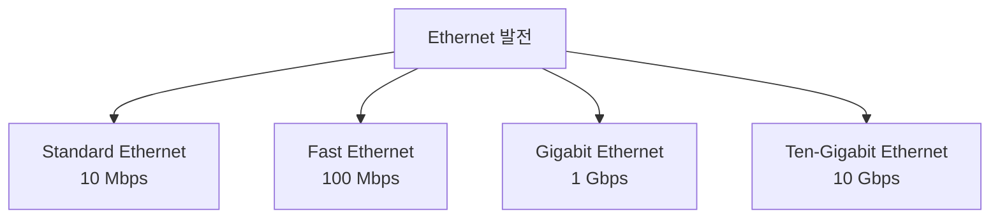
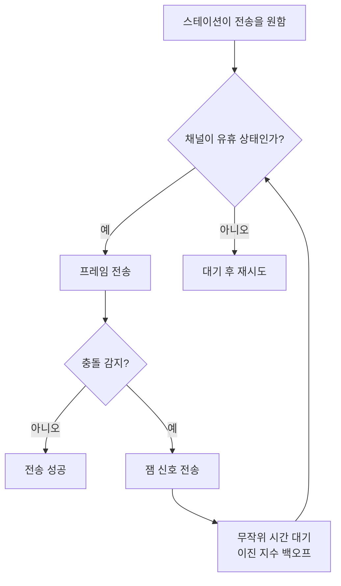

# 3장 — 기반 기술

[레포지토리 안내](../../README.ko.md) | [English](Concepts_Lecture.md) | [한국어](Concepts_Lecture.ko.md)

> **최종 수정일:** 2026-10-17
>
> TCP/IP Protocol Suite, Forouzan, Ch 3

> **학습 목표:**
> 1. 이더넷과 Wi-Fi를 포함한 LAN 기술을 설명할 수 있다
> 2. MAC 주소 체계와 프레임 포맷을 설명할 수 있다
> 3. 연결 지향과 비연결 서비스를 비교할 수 있다

---

## 목차

- [1. 근거리 통신망 (LAN)](#1-근거리-통신망-lan)
  - [1.1 LAN에 대한 IEEE 표준](#11-lan에-대한-ieee-표준)
  - [1.2 Ethernet 프레임 형식](#12-ethernet-프레임-형식)
  - [1.3 Ethernet 주소 지정](#13-ethernet-주소-지정)
  - [1.4 Ethernet의 발전](#14-ethernet의-발전)
- [2. CSMA/CD 접근 방법](#2-csmacd-접근-방법)
  - [2.1 충돌 감지 메커니즘](#21-충돌-감지-메커니즘)
  - [2.2 최소 프레임 크기](#22-최소-프레임-크기)
- [3. 브리지 및 스위치 Ethernet](#3-브리지-및-스위치-ethernet)
  - [3.1 브리지](#31-브리지)
  - [3.2 스위치](#32-스위치)
  - [3.3 VLAN](#33-vlan)
- [4. 무선 LAN](#4-무선-lan)
  - [4.1 IEEE 802.11 (Wi-Fi)](#41-ieee-80211-wi-fi)
  - [4.2 Bluetooth](#42-bluetooth)
- [5. 광역 통신망 (WAN)](#5-광역-통신망-wan)
  - [5.1 점대점 WAN](#51-점대점-wan)
  - [5.2 교환 WAN](#52-교환-wan)
- [6. 연결 장치](#6-연결-장치)
- [7. 부록](#7-부록)
  - [7.1 Ethernet 프레임 크기 계산](#71-ethernet-프레임-크기-계산)
  - [7.2 MAC 주소 할당](#72-mac-주소-할당)
  - [7.3 실전 예시: 가정용 네트워크](#73-실전-예시-가정용-네트워크)
- [요약](#요약)
- [점검 문제](#점검-문제)

---

<br>

## 1. 근거리 통신망 (LAN)

**근거리 통신망(LAN)** 은 건물이나 캠퍼스와 같이 제한된 지리적 영역을 위해 설계된 컴퓨터 네트워크이다. LAN은 조직 내 자원 공유를 위한 독립 네트워크로 사용될 수 있지만, 오늘날 대부분의 LAN은 광역 통신망(WAN)이나 인터넷에 연결되어 있다.

### 1.1 LAN에 대한 IEEE 표준

IEEE는 데이터 링크 계층을 두 개의 부계층으로 분할하여 LAN 표준을 정의하였다:

```text
+------------------------------+
|         LLC (Logical          |
|       Link Control)           |  -- 모든 LAN 유형에 공통
+-----+--------+--------+------+
| Eth | Token  | Token  | ...  |  -- MAC 부계층
| MAC | Ring   | Bus    |      |     (매체별 특화)
+-----+--------+--------+------+
| Eth | Token  | Token  | ...  |  -- 물리 계층
| PHY | Ring   | Bus    |      |     (매체별 특화)
+-----+--------+--------+------+
```

*그림 1. IEEE 802 표준의 LLC 부계층과 MAC 부계층*

- **LLC (Logical Link Control)**: 네트워크 계층에 대한 공통 인터페이스로, 흐름 제어와 오류 제어를 담당한다.
- **MAC (Media Access Control)**: LAN 프로토콜마다 다른 부계층으로, 매체 접근과 주소 지정을 담당한다.

> **핵심:** IEEE 802 프로젝트는 데이터 링크 계층을 LLC와 MAC 부계층으로 분리하여, 서로 다른 물리/MAC 구현이 공통 LLC 인터페이스를 공유할 수 있도록 한다.

### 1.2 Ethernet 프레임 형식

Ethernet 프레임(IEEE 802.3)은 다음과 같은 구조를 가진다:

```text
+----------+-----+-------------+-------------+--------+---------------+-----+
| Preamble | SFD | Destination | Source      | Length | Data and      | CRC |
|          |     | Address     | Address     | /Type  | Padding       |     |
+----------+-----+-------------+-------------+--------+---------------+-----+
  7 bytes  1 byte   6 bytes      6 bytes     2 bytes  46-1500 bytes  4 bytes
  |________|
  물리 계층
  헤더
```

*그림 2. Ethernet 프레임 형식*

| 필드 | 크기 | 설명 |
|------|------|------|
| Preamble | 7바이트 | 동기화를 위한 1과 0의 교대 패턴 56비트 |
| SFD (Start Frame Delimiter) | 1바이트 | 프레임 시작을 알리는 플래그 패턴 `10101011` |
| 목적지 주소 | 6바이트 | 다음 홉의 MAC 주소 |
| 출발지 주소 | 6바이트 | 송신자의 MAC 주소 |
| 길이/유형 | 2바이트 | 프레임 길이 또는 상위 계층 프로토콜 유형 |
| 데이터 및 패딩 | 46~1500바이트 | 상위 계층 데이터 (46바이트 미만이면 패딩) |
| CRC | 4바이트 | 오류 검출을 위한 순환 중복 검사 |

*표 1. Ethernet 프레임의 필드*

**프레임 크기 제약 (프리앰블과 SFD 제외):**
- 최소 페이로드는 **46바이트**이며, 데이터가 이보다 짧으면 패딩을 붙인다.
- 최대 페이로드는 **1500바이트**이며, 이 값이 최대 전송 단위(MTU)이다.
- 최소 프레임은 **64바이트**(512비트)이다.
- 최대 프레임은 **1518바이트**(12,144비트)이다.

### 1.3 Ethernet 주소 지정

각 Ethernet 인터페이스는 고유한 **48비트(6바이트) MAC 주소**를 가지며, 일반적으로 16진수 표기법으로 표현된다:

```text
d1d2 : d3d4 : d5d6 : d7d8 : d9d10 : d11d12

예: A4:6E:F4:59:83:AB
```

*그림 3. MAC 주소의 16진수 표기 형식*

- 6바이트는 16진수 12자리, 곧 48비트이다.
- 주소는 제조사가 NIC의 ROM에 기록한다.
- **유니캐스트(Unicast)**: 단일 목적지를 가리킨다(첫 바이트의 최하위 비트 = 0).
- **멀티캐스트(Multicast)**: 목적지 그룹을 가리킨다(첫 바이트의 최하위 비트 = 1).
- **브로드캐스트(Broadcast)**: 모든 스테이션을 가리킨다(`FF:FF:FF:FF:FF:FF`).

### 1.4 Ethernet의 발전

Ethernet은 네 세대를 거쳐 발전하였다:



*그림 4. Ethernet의 네 세대*

| 세대 | 속도 | 매체 | 표준 |
|------|------|------|------|
| Standard Ethernet | 10 Mbps | 동축 케이블, 트위스티드 페어 | IEEE 802.3 |
| Fast Ethernet | 100 Mbps | 트위스티드 페어, 광섬유 | IEEE 802.3u |
| Gigabit Ethernet | 1 Gbps | 트위스티드 페어, 광섬유 | IEEE 802.3z/ab |
| Ten-Gigabit Ethernet | 10 Gbps | 광섬유, 트위스티드 페어 | IEEE 802.3ae/an |

*표 2. Ethernet 세대별 속도, 매체, 표준*

---

<br>

## 2. CSMA/CD 접근 방법

**반송파 감지 다중 접속/충돌 감지(Carrier Sense Multiple Access with Collision Detection, CSMA/CD)** 는 Standard Ethernet에서 사용되는 접근 방법이다. 원칙은 **"전송 전에 들어라(listen before talk)"** 이다.

### 2.1 충돌 감지 메커니즘

CSMA/CD 과정:



*그림 5. CSMA/CD의 동작 흐름*

1. 스테이션은 전송 전에 채널을 감지한다.
2. 유휴 상태이면 전송을 시작한다.
3. 전송 중에 충돌을 감시한다.
4. 충돌이 감지되면 **잼 신호(jam signal)** 를 보내고 전송을 중단한다.
5. 스테이션은 **이진 지수 백오프(binary exponential backoff)** 를 사용하여 무작위 시간 대기 후 재시도한다.

**이진 지수 백오프**: $k$번째 충돌 후 스테이션은 $\lbrace 0, 1, \ldots, 2^k - 1 \rbrace$에서 무작위 수 $R$을 선택하고 $R \times$ 슬롯 시간만큼 대기한 후 재시도한다. 단, $k$가 10을 넘으면 범위는 $k = 10$일 때의 범위로 고정된다.

### 2.2 최소 프레임 크기

CSMA/CD가 올바르게 동작하려면, 프레임 전송 시간이 최소한 **최대 전파 시간의 2배** 이상이어야 한다:

```text
T_frame >= 2 x T_propagation
```

> **핵심:** 최소 프레임 길이를 전송 속도로 나눈 값(최소 전송 시간)은 충돌 도메인의 최대 길이를 전파 속도로 나눈 값(최대 전파 시간)의 2배 이상이어야 한다.

**예시:** 최대 전파 시간이 $T_p = 25.6\ \mu\text{s}$인 Standard Ethernet의 경우:
- 최소 전송 시간은 $T_{frame} = 2 \times T_p = 51.2\ \mu\text{s}$이다.
- 최소 프레임 크기는 $10\ \text{Mbps} \times 51.2\ \mu\text{s} = 512$비트, 곧 **64바이트**이다.

이것이 Ethernet 최소 프레임 크기가 64바이트인 이유이다.

---

<br>

## 3. 브리지 및 스위치 Ethernet

### 3.1 브리지

**브리지(bridge)** 는 데이터 링크 계층에서 동작하며 두 개 이상의 LAN 세그먼트를 연결한다:
- MAC 주소를 사용하여 트래픽을 필터링한다.
- MAC 주소를 포트에 대응시키는 **포워딩 테이블**을 유지한다.
- **자가 학습 알고리즘(self-learning algorithm)** 으로 주소를 학습한다.
- LAN을 더 작은 충돌 도메인으로 나눈다.

### 3.2 스위치

**스위치(switch)** 는 본질적으로 포트당 전용 대역폭을 가진 다중 포트 브리지이다:
- 각 포트가 별도의 충돌 도메인이다.
- **전이중(full-duplex)** 통신을 지원하며, 이때는 충돌이 일어나지 않는다.
- **저장 후 전달(store-and-forward)** 또는 **컷스루(cut-through)** 방식으로 스위칭한다.
- MAC 주소 테이블을 유지한다.

| 특성 | 허브 | 브리지 | 스위치 |
|------|------|--------|--------|
| 계층 | 물리 | 데이터 링크 | 데이터 링크 |
| 충돌 도메인 | 단일 | 포트별 분리 | 포트별 분리 |
| 대역폭 | 공유 | 세그먼트별 공유 | 포트별 전용 |
| 포워딩 | 모두 브로드캐스트 | 선택적 | 선택적 |

*표 3. 허브, 브리지, 스위치의 비교*

### 3.3 VLAN

**가상 LAN(Virtual LAN, VLAN)** 은 여러 물리적 스위치에 걸쳐 스테이션을 논리적으로 그룹화한 것이다:
- 물리적 배선이 아니라 소프트웨어로 구성한다.
- 브로드캐스트 트래픽을 줄인다.
- 그룹을 격리하여 보안을 높인다.
- VLAN 소속을 식별하기 위해 IEEE 802.1Q 태깅을 사용한다.

---

<br>

## 4. 무선 LAN

### 4.1 IEEE 802.11 (Wi-Fi)

IEEE 802.11은 무선 LAN 표준을 정의한다:

| 표준 | 주파수 | 최대 속도 | 실내 범위(대략) |
|------|--------|-----------|------|
| 802.11a | 5 GHz | 54 Mbps | 35 m |
| 802.11b | 2.4 GHz | 11 Mbps | 38 m |
| 802.11g | 2.4 GHz | 54 Mbps | 38 m |
| 802.11n | 2.4/5 GHz | 600 Mbps | 70 m |
| 802.11ac | 5 GHz | 6.9 Gbps | 35 m |

*표 4. IEEE 802.11 표준별 주파수, 최대 속도, 실내 범위*

무선 LAN이 CSMA/CD 대신 **CSMA/CA (Collision Avoidance)** 를 사용하는 이유는 다음과 같다:
- 무선 매체에서는 충돌 감지가 어렵다(숨겨진 터미널 문제).
- 스테이션이 같은 주파수에서 전송과 수신을 동시에 할 수 없다.

**CSMA/CA 과정:**
1. 채널을 감지한다.
2. 유휴 상태이면 DIFS (Distributed Inter-Frame Space) 동안 대기한다.
3. RTS (Request to Send)를 전송한다.
4. CTS (Clear to Send)를 수신한다.
5. 프레임을 전송한다.
6. ACK를 수신한다.

### 4.2 Bluetooth

Bluetooth는 소규모 무선 LAN(WPAN)을 위한 무선 기술이다:
- 단거리 통신에 쓰인다(일반적으로 10 m 미만).
- 2.4 GHz ISM 대역을 사용한다.
- 주파수 호핑 확산 스펙트럼(FHSS) 방식을 쓴다.
- 피코넷(최대 8대의 장치)과 스캐터넷을 지원한다.

---

<br>

## 5. 광역 통신망 (WAN)

### 5.1 점대점 WAN

점대점 WAN은 두 개의 원격 장치를 직접 연결한다:
- **전용 회선(Leased lines)**: 두 지점 사이의 전용 연결이다.
- **PPP (Point-to-Point Protocol)**: 점대점 링크를 위한 표준 프로토콜이다.
- **HDLC (High-Level Data Link Control)**: WAN을 위한 비트 지향 프로토콜이다.

### 5.2 교환 WAN

교환 WAN은 스위칭 장치를 통해 여러 지점을 연결한다:
- **X.25**: 초기의 패킷 교환 WAN이다.
- **Frame Relay**: X.25를 간소화하여 오버헤드를 줄인 기술이다.
- **ATM (Asynchronous Transfer Mode)**: 고정 길이 53바이트 셀을 기반으로 하는 셀 교환 기술이다.

---

<br>

## 6. 연결 장치

프로토콜 스택의 각 계층에 위치하는 장치:

| 장치 | 계층 | 기능 |
|------|------|------|
| 리피터/허브 | 물리 | 신호 재생 및 분배 |
| 브리지/스위치 | 데이터 링크 | MAC에 의한 프레임 필터링 및 포워딩 |
| 라우터 | 네트워크 | IP 주소에 의한 패킷 포워딩 |
| 게이트웨이 | 응용 | 네트워크 간 프로토콜 변환 |

*표 5. 계층별 연결 장치와 기능*


*그림 6. 연결 장치의 계층 구조*

---

<br>

## 7. 부록

### 7.1 Ethernet 프레임 크기 계산

주어진 조건:
- 최대 전파 시간은 $T_p = 25.6\ \mu\text{s}$이다.
- 데이터 전송률은 10 Mbps이다.

최소 프레임 전송 시간:
- $T_{frame} = 2 \times T_p = 2 \times 25.6 = 51.2\ \mu\text{s}$

최소 프레임 크기:
- $\text{Size} = \text{Rate} \times \text{Time} = 10 \times 10^6 \times 51.2 \times 10^{-6} = 512$비트 = **64바이트**

### 7.2 MAC 주소 할당

48비트 MAC 주소는 다음과 같이 나뉜다:
- **OUI (Organizationally Unique Identifier)**: 앞쪽 24비트로, IEEE가 제조사에 할당한다.
- **장치 식별자(Device Identifier)**: 뒤쪽 24비트로, 제조사가 할당한다.

### 7.3 실전 예시: 가정용 네트워크

일반적인 가정용 네트워크는 기반 기술 개념을 잘 보여 준다:
- **Wi-Fi 라우터**: 라우터(L3), 스위치(L2), 무선 AP 기능을 한 장치에 결합한다.
- **Ethernet 케이블 (Cat 5e/6)**: 100/1000 Mbps의 물리 계층 연결을 제공한다.
- **DHCP**: 연결된 장치에 IP 주소를 자동으로 할당한다.
- **NAT**: 여러 장치가 하나의 공인 IP 주소를 공유하게 한다.

---

<br>

## 요약

| 개념 | 핵심 요약 |
|------|------------|
| LAN | 건물이나 캠퍼스처럼 제한된 지리적 영역을 위한 네트워크이며, IEEE 802 표준이 정의한다. |
| Ethernet 프레임 | Preamble, SFD, 목적지 주소, 출발지 주소, 길이/유형, 데이터, CRC로 이루어지며, 프리앰블과 SFD를 제외한 크기는 64~1518바이트이다. |
| MAC 주소 | NIC에 부여된 48비트 고유 물리 주소이다. |
| CSMA/CD | 전송 전에 채널을 감지하고, 충돌을 감지하면 이진 지수 백오프로 재전송 시점을 정한다. |
| 최소 프레임 | Standard Ethernet은 송신이 끝나기 전에 충돌을 감지할 수 있도록, 프레임 전송 시간이 최대 전파 시간의 2배 이상이 되게 최소 프레임을 64바이트로 정한다. |
| 스위치 | 포트마다 전용 대역폭과 별도의 충돌 도메인을 갖는 다중 포트 브리지이다. |
| VLAN | 802.1Q 태깅으로 스테이션을 논리적인 LAN으로 묶는다. |
| Wi-Fi (802.11) | CSMA/CD 대신 CSMA/CA를 사용하는 무선 LAN이다. |
| WAN | 지리적으로 멀리 떨어진 사이트를 연결하는 광역 통신망이다. |

---

<br>

## 점검 문제

1. **최소 프레임과 충돌 도메인:** 데이터 전송률이 1 Gbps인 반이중 CSMA/CD 네트워크에서 최소 프레임 크기를 64바이트로 유지한다. 허용되는 최대 전파 시간 $T_p$는 얼마인가? 신호의 전파 속도가 $2 \times 10^8$ m/s이고 다른 지연을 무시하면 충돌 도메인의 최대 길이는 얼마인가?

   <details>
   <summary>정답</summary>

   64바이트는 512비트이므로 최소 전송 시간은 $512 / 10^9$ s = 0.512 μs이다. $T_{frame} \ge 2 \times T_p$이므로 $T_p \le 0.256\ \mu\text{s}$이다. 최대 길이는 $0.256 \times 10^{-6} \times 2 \times 10^8 = 51.2$ m이다. 최대 전파 시간이 10 Mbps일 때의 25.6 μs보다 100배 짧아지므로, 같은 최소 프레임 크기로는 충돌 도메인을 크게 만들 수 없다.

   </details>

2. **패딩:** 상위 계층 데이터 20바이트를 Ethernet 프레임으로 보낼 때 필요한 패딩의 크기와 프레임 크기를 구하라(프리앰블과 SFD 제외). 데이터가 1600바이트이면 어떻게 되는가?

   <details>
   <summary>정답</summary>

   최소 페이로드가 46바이트이므로 패딩은 46 − 20 = 26바이트이고, 프레임은 6 + 6 + 2 + 46 + 4 = 64바이트이다. 1600바이트는 최대 페이로드 1500바이트를 넘으므로 한 프레임에 담을 수 없고, 상위 계층에서 1500바이트 이하로 나누어 여러 프레임으로 보내야 한다.

   </details>

3. **MAC 주소 유형:** 목적지 주소가 (a) `4A:30:10:21:10:1A`, (b) `47:20:1B:2E:08:EE`, (c) `FF:FF:FF:FF:FF:FF`일 때 각각 유니캐스트, 멀티캐스트, 브로드캐스트 중 무엇인가?

   <details>
   <summary>정답</summary>

   (a) 첫 바이트 4A는 `01001010`이고 최하위 비트가 0이므로 유니캐스트이다. (b) 첫 바이트 47은 `01000111`이고 최하위 비트가 1이므로 멀티캐스트이다. (c) 모든 비트가 1이므로 브로드캐스트이다.

   </details>

4. **이진 지수 백오프:** 10 Mbps Standard Ethernet의 슬롯 시간은 512비트 시간, 곧 51.2 μs이다. 스테이션이 세 번째 충돌을 겪은 뒤 $R$을 고르는 범위와 최대 대기 시간을 구하라. 15번째 충돌 뒤에는 어떻게 되는가?

   <details>
   <summary>정답</summary>

   $k = 3$이므로 $R$은 0\~7 중에서 고르고, 최대 대기 시간은 7 × 51.2 = 358.4 μs이다. 15번째 충돌 뒤에는 $k$가 10으로 고정되므로 $R$은 0\~1023 중에서 고르고, 최대 대기 시간은 1023 × 51.2 = 52,377.6 μs, 곧 약 52.4 ms이다.

   </details>

5. **충돌 도메인:** 스테이션 8대를 (a) 허브 하나로, (b) 각 스테이션을 별도 포트에 연결한 스위치 하나로 연결한다. 각각 충돌 도메인은 몇 개인가? (b)에서 모든 링크가 전이중으로 동작하면 어떻게 되는가?

   <details>
   <summary>정답</summary>

   (a) 허브는 물리 계층에서 신호를 모든 포트로 재생하므로 8대 전체가 하나의 충돌 도메인을 이룬다. (b) 스위치는 각 포트가 별도의 충돌 도메인이므로 충돌 도메인은 8개이다. 전이중으로 동작하면 각 링크에서 송신과 수신이 동시에 이루어지므로 충돌이 일어나지 않는다.

   </details>

---
