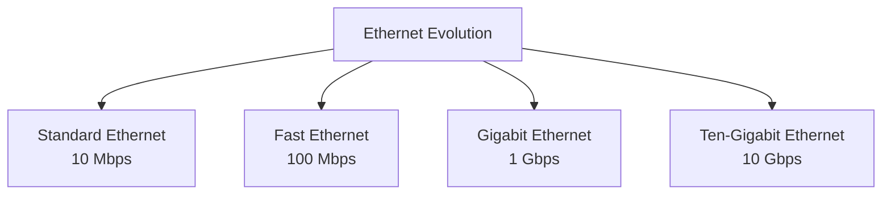
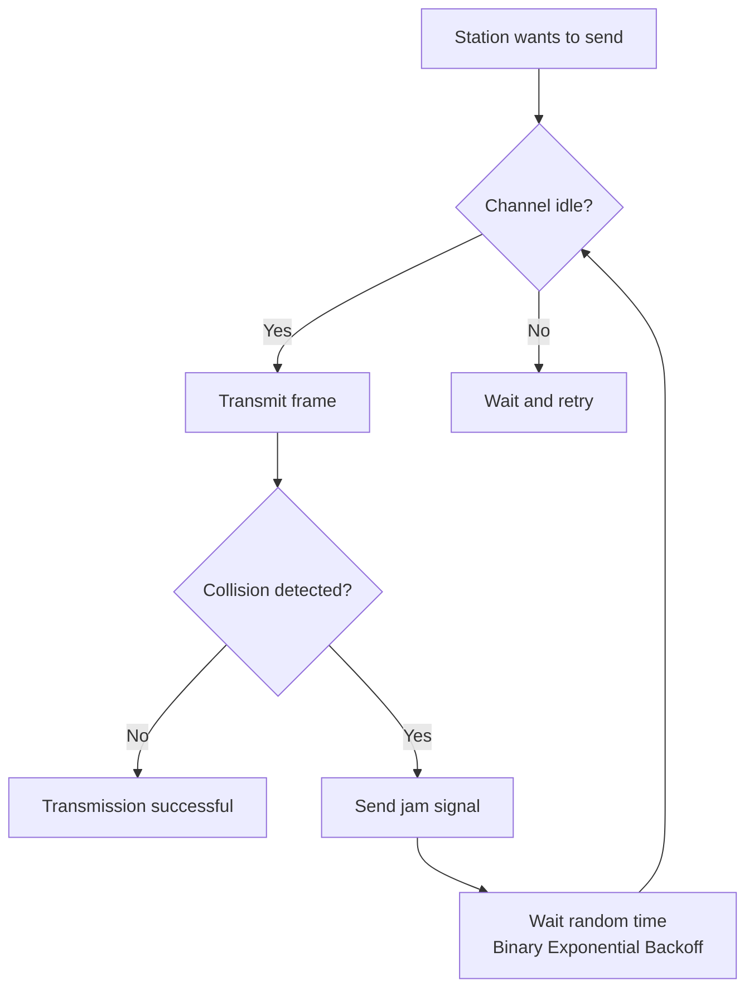
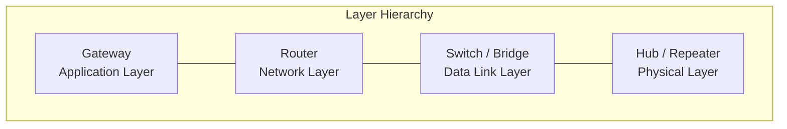

# Chapter 3 — Underlying Technology

[Repository Guide](../../README.md) | [English](Concepts_Lecture.md) | [한국어](Concepts_Lecture.ko.md)

> **Last Updated:** 2026-10-26
>
> TCP/IP Protocol Suite, Forouzan, Ch 3

> **Learning Objectives:**
> 1. Describe LAN technologies including Ethernet and Wi-Fi
> 2. Explain MAC addressing and frame formats
> 3. Explain how CSMA/CD handles collisions and why it needs a minimum frame size
> 4. Distinguish connecting devices (hubs, bridges, switches, routers, and gateways) by their operating layer and function

---

## Table of Contents

- [1. Local Area Networks (LANs)](#1-local-area-networks-lans)
  - [1.1 IEEE Standards for LANs](#11-ieee-standards-for-lans)
  - [1.2 Ethernet Frame Format](#12-ethernet-frame-format)
  - [1.3 Ethernet Addressing](#13-ethernet-addressing)
  - [1.4 Ethernet Evolution](#14-ethernet-evolution)
- [2. CSMA/CD Access Method](#2-csmacd-access-method)
  - [2.1 Collision Detection Mechanism](#21-collision-detection-mechanism)
  - [2.2 Minimum Frame Size](#22-minimum-frame-size)
- [3. Bridged and Switched Ethernet](#3-bridged-and-switched-ethernet)
  - [3.1 Bridges](#31-bridges)
  - [3.2 Switches](#32-switches)
  - [3.3 VLANs](#33-vlans)
- [4. Wireless LANs](#4-wireless-lans)
  - [4.1 IEEE 802.11 (Wi-Fi)](#41-ieee-80211-wi-fi)
  - [4.2 Bluetooth](#42-bluetooth)
- [5. Wide Area Networks (WANs)](#5-wide-area-networks-wans)
  - [5.1 Point-to-Point WANs](#51-point-to-point-wans)
  - [5.2 Switched WANs](#52-switched-wans)
- [6. Connecting Devices](#6-connecting-devices)
- [7. Appendix](#7-appendix)
  - [7.1 Ethernet Frame Size Calculation](#71-ethernet-frame-size-calculation)
  - [7.2 MAC Address Assignment](#72-mac-address-assignment)
  - [7.3 Real-World Example: Home Network](#73-real-world-example-home-network)
- [Summary](#summary)
- [Self-Check Questions](#self-check-questions)

---

<br>

## 1. Local Area Networks (LANs)

A **local area network (LAN)** is a computer network designed for a limited geographic area, such as a building or a campus. Although a LAN can be used as an isolated network to connect computers in an organization for sharing resources, most LANs today are linked to a wide area network (WAN) or the Internet.

### 1.1 IEEE Standards for LANs

The IEEE has defined the standards for LANs, dividing the data link layer into two sublayers:

```text
+------------------------------+
|         LLC (Logical          |
|       Link Control)           |  -- Common to all LAN types
+-----+--------+--------+------+
| Eth | Token  | Token  | ...  |  -- MAC sublayer
| MAC | Ring   | Bus    |      |     (media-specific)
+-----+--------+--------+------+
| Eth | Token  | Token  | ...  |  -- Physical layer
| PHY | Ring   | Bus    |      |     (media-specific)
+-----+--------+--------+------+
```

*Figure 1. LLC and MAC sublayers in the IEEE 802 standard*

- **LLC (Logical Link Control)**: It is the common interface to the network layer and handles flow and error control.
- **MAC (Media Access Control)**: It is specific to each LAN protocol and handles media access and addressing.

> **Key Point:** The IEEE 802 project separates the data link layer into LLC and MAC sublayers, allowing different physical/MAC implementations to share a common LLC interface.

### 1.2 Ethernet Frame Format

The Ethernet frame (IEEE 802.3) has the following structure:

```text
+----------+-----+-------------+-------------+--------+---------------+-----+
| Preamble | SFD | Destination | Source      | Length | Data and      | CRC |
|          |     | Address     | Address     | /Type  | Padding       |     |
+----------+-----+-------------+-------------+--------+---------------+-----+
  7 bytes  1 byte   6 bytes      6 bytes     2 bytes  46-1500 bytes  4 bytes
  |________|
  Physical layer
  header
```

*Figure 2. Ethernet frame format*

| Field | Size | Description |
|-------|------|-------------|
| Preamble | 7 bytes | 56 bits of alternating 1s and 0s for synchronization |
| SFD (Start Frame Delimiter) | 1 byte | Flag pattern `10101011` signaling frame start |
| Destination Address | 6 bytes | MAC address of the next hop |
| Source Address | 6 bytes | MAC address of the sender |
| Length/Type | 2 bytes | Frame length or upper-layer protocol type |
| Data and Padding | 46-1500 bytes | Upper-layer data (padded if shorter than 46 bytes) |
| CRC | 4 bytes | Cyclic Redundancy Check for error detection |

*Table 1. Fields of the Ethernet frame*

**Frame size constraints (excluding the preamble and SFD):**
- The minimum payload is **46 bytes**, and shorter data is padded.
- The maximum payload is **1500 bytes**, which is the maximum transmission unit (MTU).
- The minimum frame is **64 bytes** (512 bits).
- The maximum frame is **1518 bytes** (12,144 bits).

### 1.3 Ethernet Addressing

Each Ethernet interface has a unique **48-bit (6-byte) MAC address**, typically expressed in hexadecimal notation:

```text
d1d2 : d3d4 : d5d6 : d7d8 : d9d10 : d11d12

Example: A4:6E:F4:59:83:AB
```

*Figure 3. Hexadecimal notation of a MAC address*

- 6 bytes equal 12 hexadecimal digits, or 48 bits.
- The manufacturer burns the address into the NIC's ROM.
- **Unicast**: The address refers to a single destination (least significant bit of the first byte = 0).
- **Multicast**: The address refers to a group of destinations (least significant bit of the first byte = 1).
- **Broadcast**: The address refers to all stations (`FF:FF:FF:FF:FF:FF`).

### 1.4 Ethernet Evolution

Ethernet has evolved through four generations:



*Figure 4. Four generations of Ethernet*

| Generation | Speed | Medium | Standard |
|-----------|-------|--------|----------|
| Standard Ethernet | 10 Mbps | Coax, Twisted Pair | IEEE 802.3 |
| Fast Ethernet | 100 Mbps | Twisted Pair, Fiber | IEEE 802.3u |
| Gigabit Ethernet | 1 Gbps | Twisted Pair, Fiber | IEEE 802.3z/ab |
| Ten-Gigabit Ethernet | 10 Gbps | Fiber, Twisted Pair | IEEE 802.3ae/an |

*Table 2. Speed, medium, and standard of each Ethernet generation*

---

<br>

## 2. CSMA/CD Access Method

**Carrier Sense Multiple Access with Collision Detection (CSMA/CD)** is the access method used by Standard Ethernet. The principle is **"listen before talk"**.

### 2.1 Collision Detection Mechanism

The CSMA/CD process:



*Figure 5. CSMA/CD operation flow*

1. A station senses the channel before transmitting.
2. If the channel is idle, the station begins transmitting.
3. During transmission, it monitors for collisions.
4. If a collision is detected, it sends a **jam signal** and aborts.
5. The station waits a random time using **binary exponential backoff** before retrying.

**Binary Exponential Backoff**: After the $k$-th collision, the station chooses a random number $R$ from $\lbrace 0, 1, \ldots, 2^k - 1 \rbrace$ and waits $R \times$ slot time before retrying. When $k$ exceeds 10, the range stays at its value for $k = 10$.

### 2.2 Minimum Frame Size

For CSMA/CD to work correctly, the frame transmission time must be at least **twice the maximum propagation time**:

```text
T_frame >= 2 x T_propagation
```

> **Key Point:** The minimum frame length divided by the transmission rate (the minimum transmission time) must be at least twice the maximum collision-domain length divided by the propagation speed (the maximum propagation time).

**Example:** In Standard Ethernet with maximum propagation time $T_p = 25.6\ \mu\text{s}$:
- The minimum transmission time is $T_{frame} = 2 \times T_p = 51.2\ \mu\text{s}$.
- The minimum frame size is $10\ \text{Mbps} \times 51.2\ \mu\text{s} = 512$ bits, that is, **64 bytes**.

This is why the minimum Ethernet frame size is 64 bytes.

---

<br>

## 3. Bridged and Switched Ethernet

### 3.1 Bridges

A **bridge** operates at the data link layer and connects two or more LAN segments:
- It filters traffic using MAC addresses.
- It maintains a **forwarding table** mapping MAC addresses to ports.
- It learns addresses through the **self-learning algorithm**.
- It divides the LAN into smaller collision domains.

### 3.2 Switches

A **switch** is essentially a multi-port bridge with dedicated bandwidth per port:
- Each port is a separate collision domain.
- It supports **full-duplex** communication, in which no collisions occur.
- It uses **store-and-forward** or **cut-through** switching.
- It maintains a MAC address table.

| Feature | Hub | Bridge | Switch |
|---------|-----|--------|--------|
| Layer | Physical | Data Link | Data Link |
| Collision Domain | Single | Separate per port | Separate per port |
| Bandwidth | Shared | Shared per segment | Dedicated per port |
| Forwarding | Broadcast all | Selective | Selective |

*Table 3. Comparison of hubs, bridges, and switches*

### 3.3 VLANs

A **Virtual LAN (VLAN)** is a logical grouping of stations that can span multiple physical switches:
- It is configured by software rather than physical wiring.
- It reduces broadcast traffic.
- It improves security by isolating groups.
- It uses IEEE 802.1Q tagging to identify VLAN membership.

---

<br>

## 4. Wireless LANs

### 4.1 IEEE 802.11 (Wi-Fi)

IEEE 802.11 defines wireless LAN standards:

| Standard | Frequency | Max Speed | Indoor Range (approx.) |
|----------|-----------|-----------|-------|
| 802.11a | 5 GHz | 54 Mbps | 35 m |
| 802.11b | 2.4 GHz | 11 Mbps | 38 m |
| 802.11g | 2.4 GHz | 54 Mbps | 38 m |
| 802.11n | 2.4/5 GHz | 600 Mbps | 70 m |
| 802.11ac | 5 GHz | 6.9 Gbps | 35 m |

*Table 4. Frequency, maximum speed, and indoor range of IEEE 802.11 standards*

Wireless LANs use **CSMA/CA (Collision Avoidance)** instead of CSMA/CD for the following reasons:
- Collision detection is difficult in wireless media (hidden terminal problem).
- A station cannot transmit and listen simultaneously on the same frequency.

**CSMA/CA process:**
1. Sense the channel.
2. If the channel is idle, wait for DIFS (Distributed Inter-Frame Space).
3. Send RTS (Request to Send).
4. Receive CTS (Clear to Send).
5. Transmit the frame.
6. Receive ACK.

### 4.2 Bluetooth

Bluetooth is a wireless technology for small wireless LANs (WPANs):
- It is used for short-range communication (typically under 10 m).
- It uses the 2.4 GHz ISM band.
- It uses frequency hopping spread spectrum (FHSS).
- It supports piconets (up to 8 devices) and scatternets.

---

<br>

## 5. Wide Area Networks (WANs)

### 5.1 Point-to-Point WANs

Point-to-point WANs connect two remote devices directly:
- **Leased lines**: A dedicated connection between two points.
- **PPP (Point-to-Point Protocol)**: The standard protocol for point-to-point links.
- **HDLC (High-Level Data Link Control)**: A bit-oriented protocol for WANs.

### 5.2 Switched WANs

Switched WANs connect multiple points through switching devices:
- **X.25**: An early packet-switched WAN.
- **Frame Relay**: A simplified X.25 with reduced overhead.
- **ATM (Asynchronous Transfer Mode)**: A cell-switching technology based on fixed 53-byte cells.

---

<br>

## 6. Connecting Devices

Devices at different layers of the protocol stack:

| Device | Layer | Function |
|--------|-------|----------|
| Repeater/Hub | Physical | Signal regeneration and distribution |
| Bridge/Switch | Data Link | Frame filtering and forwarding by MAC |
| Router | Network | Packet forwarding by IP address |
| Gateway | Application | Protocol translation between networks |

*Table 5. Connecting devices and their functions by layer*



*Figure 6. Layer hierarchy of connecting devices*

---

<br>

## 7. Appendix

### 7.1 Ethernet Frame Size Calculation

Given:
- The maximum propagation time is $T_p = 25.6\ \mu\text{s}$.
- The data rate is 10 Mbps.

Minimum frame transmission time:
- $T_{frame} = 2 \times T_p = 2 \times 25.6 = 51.2\ \mu\text{s}$

Minimum frame size:
- $\text{Size} = \text{Rate} \times \text{Time} = 10 \times 10^6 \times 51.2 \times 10^{-6} = 512$ bits = **64 bytes**

### 7.2 MAC Address Assignment

The 48-bit MAC address is divided into:
- **OUI (Organizationally Unique Identifier)**: The first 24 bits, which IEEE assigns to the manufacturer.
- **Device Identifier**: The last 24 bits, which the manufacturer assigns.

### 7.3 Real-World Example: Home Network

A typical home network illustrates underlying technology concepts:
- **Wi-Fi router**: It combines router (L3), switch (L2), and wireless AP functions in one device.
- **Ethernet cables (Cat 5e/6)**: They provide physical layer connections at 100/1000 Mbps.
- **DHCP**: It automatically assigns IP addresses to connected devices (Chapter 5).
- **NAT**: It allows multiple devices to share a single public IP address (Chapter 4).

---

<br>

## Summary

| Concept | Key Summary |
|---------|-----------|
| LAN | It is a network for a limited geographic area such as a building or campus, and the IEEE 802 standards define it. |
| Ethernet Frame | It consists of the preamble, SFD, destination address, source address, length/type, data, and CRC, and it is 64-1518 bytes long excluding the preamble and SFD. |
| MAC Address | It is a 48-bit unique physical address assigned to the NIC. |
| CSMA/CD | A station senses the channel before transmitting and, after a collision, uses binary exponential backoff to choose when to retransmit. |
| Minimum Frame | Standard Ethernet sets the minimum frame at 64 bytes so that the frame transmission time is at least twice the maximum propagation time and a collision is detected before transmission ends. |
| Switch | It is a multi-port bridge with dedicated bandwidth and a separate collision domain for each port. |
| VLAN | It groups stations into logical LANs using 802.1Q tagging. |
| Wi-Fi (802.11) | It is a wireless LAN that uses CSMA/CA instead of CSMA/CD. |
| WAN | It is a wide area network connecting geographically distant sites. |

---

<br>

## Self-Check Questions

1. **Minimum frame and collision domain:** A half-duplex CSMA/CD network with a data rate of 1 Gbps keeps the minimum frame size at 64 bytes. What is the largest allowed maximum propagation time $T_p$? If the signal propagates at $2 \times 10^8$ m/s and other delays are ignored, what is the maximum length of the collision domain?

   <details>
   <summary>Answer</summary>

   64 bytes are 512 bits, so the minimum transmission time is $512 / 10^9$ s = 0.512 μs. Since $T_{frame} \ge 2 \times T_p$, $T_p \le 0.256\ \mu\text{s}$. The maximum length is $0.256 \times 10^{-6} \times 2 \times 10^8 = 51.2$ m. The maximum propagation time is 100 times shorter than the 25.6 μs at 10 Mbps, so the same minimum frame size cannot support a large collision domain.

   </details>

2. **Padding:** Find the padding size and the frame size when 20 bytes of upper-layer data are sent in an Ethernet frame (excluding the preamble and SFD). What happens if the data is 1600 bytes?

   <details>
   <summary>Answer</summary>

   The minimum payload is 46 bytes, so the padding is 46 − 20 = 26 bytes and the frame is 6 + 6 + 2 + 46 + 4 = 64 bytes. 1600 bytes exceed the maximum payload of 1500 bytes, so the data cannot fit in one frame, and an upper layer must split it into pieces of at most 1500 bytes sent in several frames.

   </details>

3. **MAC address type:** Is each destination address (a) `4A:30:10:21:10:1A`, (b) `47:20:1B:2E:08:EE`, and (c) `FF:FF:FF:FF:FF:FF` unicast, multicast, or broadcast?

   <details>
   <summary>Answer</summary>

   (a) The first byte 4A is `01001010`, and its least significant bit is 0, so the address is unicast. (b) The first byte 47 is `01000111`, and its least significant bit is 1, so the address is multicast. (c) All bits are 1, so the address is broadcast.

   </details>

4. **Binary exponential backoff:** The slot time of 10 Mbps Standard Ethernet is 512 bit times, or 51.2 μs. After a station's third collision, find the range from which $R$ is chosen and the maximum waiting time. What happens after the fifteenth collision?

   <details>
   <summary>Answer</summary>

   Since $k = 3$, $R$ is chosen from 0-7, and the maximum waiting time is 7 × 51.2 = 358.4 μs. After the fifteenth collision, $k$ stays at 10, so $R$ is chosen from 0-1023, and the maximum waiting time is 1023 × 51.2 = 52,377.6 μs, or about 52.4 ms.

   </details>

5. **Collision domains:** Eight stations are connected (a) with one hub and (b) with one switch, each station on its own port. How many collision domains are there in each case? What happens in (b) if every link operates in full-duplex mode?

   <details>
   <summary>Answer</summary>

   (a) A hub regenerates the signal to all ports at the physical layer, so all eight stations form a single collision domain. (b) Each switch port is a separate collision domain, so there are eight collision domains. In full-duplex mode, each link sends and receives at the same time, so no collisions occur.

   </details>

---
