# 4장 — 전자 메일, 원격 로그인, 파일 전송

[레포지토리 안내](../../README.ko.md) | [English](Concepts_Lecture.md) | [한국어](Concepts_Lecture.ko.md)

> **최종 수정일:** 2026-11-18
>
> Computer Networking: A Top-Down Approach, Kurose and Ross, Ch 2; TCP/IP Protocol Suite, Forouzan, Ch 20, 21, 23

> **학습 목표:**
> 1. 사용자 에이전트, 메일 서버, 메시지 전송 에이전트, 메시지 접근 에이전트의 역할을 네 가지 시나리오로 설명할 수 있다
> 2. SMTP 세션의 명령과 응답을 추적하고, 메일 전송의 세 단계와 SMTP와 HTTP의 차이를 설명할 수 있다
> 3. 메일 메시지의 헤더와 MIME이 비ASCII 데이터를 전달하는 방법을 설명하고 base64 부호화를 계산할 수 있다
> 4. POP3와 IMAP, 웹 기반 메일의 차이를 설명할 수 있다
> 5. TELNET의 NVT, 옵션 협상, 동작 모드와 SSH의 구성 요소를 설명할 수 있다
> 6. FTP의 제어 연결과 데이터 연결, TFTP의 메시지와 오류 제어를 설명할 수 있다

---

## 목차

- [1. 전자 메일의 구조](#1-전자-메일의-구조)
  - [1.1 사용자 에이전트, 메일 서버, SMTP](#11-사용자-에이전트-메일-서버-smtp)
  - [1.2 네 가지 시나리오](#12-네-가지-시나리오)
  - [1.3 사용자 에이전트](#13-사용자-에이전트)
- [2. SMTP](#2-smtp)
  - [2.1 SMTP의 특징](#21-smtp의-특징)
  - [2.2 SMTP 세션](#22-smtp-세션)
  - [2.3 명령과 응답](#23-명령과-응답)
  - [2.4 메일 전송의 세 단계](#24-메일-전송의-세-단계)
- [3. SMTP와 HTTP의 비교](#3-smtp와-http의-비교)
- [4. 메일 메시지 형식과 MIME](#4-메일-메시지-형식과-mime)
  - [4.1 메일 메시지의 헤더](#41-메일-메시지의-헤더)
  - [4.2 MIME 헤더](#42-mime-헤더)
  - [4.3 내용 전송 부호화와 base64](#43-내용-전송-부호화와-base64)
- [5. 메일 접근 프로토콜](#5-메일-접근-프로토콜)
  - [5.1 두 단계로 메일을 전달하는 이유](#51-두-단계로-메일을-전달하는-이유)
  - [5.2 POP3](#52-pop3)
  - [5.3 IMAP](#53-imap)
  - [5.4 웹 기반 메일과 전자 메일 보안](#54-웹-기반-메일과-전자-메일-보안)
- [6. 원격 로그인: TELNET](#6-원격-로그인-telnet)
  - [6.1 시분할 환경과 원격 로그인](#61-시분할-환경과-원격-로그인)
  - [6.2 네트워크 가상 터미널](#62-네트워크-가상-터미널)
  - [6.3 임베딩](#63-임베딩)
  - [6.4 옵션과 옵션 협상](#64-옵션과-옵션-협상)
  - [6.5 원격 프로그램의 제어](#65-원격-프로그램의-제어)
  - [6.6 동작 모드와 보안 문제](#66-동작-모드와-보안-문제)
- [7. SSH](#7-ssh)
- [8. FTP](#8-ftp)
  - [8.1 제어 연결과 데이터 연결](#81-제어-연결과-데이터-연결)
  - [8.2 이질성의 해결](#82-이질성의-해결)
  - [8.3 명령과 응답](#83-명령과-응답)
  - [8.4 파일 전송의 예](#84-파일-전송의-예)
  - [8.5 익명 FTP와 보안](#85-익명-ftp와-보안)
- [9. TFTP](#9-tftp)
  - [9.1 메시지](#91-메시지)
  - [9.2 연결과 데이터 전송](#92-연결과-데이터-전송)
  - [9.3 흐름 제어와 오류 제어](#93-흐름-제어와-오류-제어)
  - [9.4 UDP 포트와 응용](#94-udp-포트와-응용)
- [요약](#요약)
- [점검 문제](#점검-문제)
- [참고 문헌](#참고-문헌)

---

<br>

## 1. 전자 메일의 구조

전자 메일은 인터넷 초창기부터 가장 인기 있는 응용이었고, 지금도 가장 중요하고 많이 쓰이는 인터넷 응용 중 하나이다. 일반 우편처럼 전자 메일은 **비동기적(asynchronous)** 통신 매체이다. 사람들은 다른 사람과 일정을 맞추지 않고 편할 때 메시지를 보내고 읽는다. 일반 우편과 달리 전자 메일은 빠르고, 배포하기 쉽고, 비용이 적으며, 첨부 파일, 하이퍼링크, HTML 형식의 텍스트, 사진을 담을 수 있다.

### 1.1 사용자 에이전트, 메일 서버, SMTP

Kurose는 인터넷 메일 시스템이 **사용자 에이전트**, **메일 서버**, **SMTP(Simple Mail Transfer Protocol)** 의 세 가지 주요 구성 요소로 이루어진다고 설명한다. 앨리스가 밥에게 전자 메일을 보내는 상황으로 각 구성 요소를 살펴본다.

> **용어 정의:** **사용자 에이전트(user agent)** 는 사용자가 메시지를 작성하고, 읽고, 답장하고, 전달하고, 저장할 수 있게 하는 프로그램이다.

Microsoft Outlook과 Apple Mail이 사용자 에이전트의 예이다. 앨리스가 메시지를 다 쓰면 사용자 에이전트는 메시지를 앨리스의 메일 서버로 보내고, 메시지는 메일 서버의 송신 메시지 큐에 들어간다. 밥이 메시지를 읽고 싶으면 밥의 사용자 에이전트가 밥의 메일 서버에 있는 메일함에서 메시지를 가져온다.

> **용어 정의:** **메일 서버(mail server)** 는 사용자의 메일함을 관리하고, SMTP의 클라이언트와 서버를 모두 실행하여 다른 메일 서버와 메시지를 주고받는 전자 메일 기반 시설의 핵심 구성 요소이다.

밥 같은 각 수신자는 메일 서버 중 하나에 **메일함(mailbox)** 을 가지며, 메일함은 밥에게 온 메시지를 관리하고 보관한다. 메시지는 보통 송신자의 사용자 에이전트에서 출발하여 송신자의 메일 서버로 가고, 수신자의 메일 서버로 가서 수신자의 메일함에 들어간다. 밥이 메일함의 메시지에 접근하려 하면 메일함을 가진 메일 서버가 사용자 이름과 비밀번호로 밥을 인증한다. 앨리스의 메일 서버는 밥의 메일 서버의 장애에도 대처해야 한다. 밥의 서버로 메일을 보낼 수 없으면 앨리스의 서버는 메시지를 메시지 큐에 보관하고 나중에 다시 보낸다. 재시도는 보통 30분 정도마다 하며, 며칠이 지나도 실패하면 서버는 메시지를 지우고 송신자(앨리스)에게 전자 메일로 알린다.

**SMTP**는 인터넷 전자 메일의 주요 응용 계층 프로토콜로, TCP의 신뢰적 데이터 전송 서비스로 송신자의 메일 서버에서 수신자의 메일 서버로 메일을 전송한다. 대부분의 응용 계층 프로토콜처럼 SMTP에는 송신자의 메일 서버에서 실행되는 클라이언트 쪽과 수신자의 메일 서버에서 실행되는 서버 쪽이 있다. 모든 메일 서버에서 SMTP의 클라이언트와 서버가 모두 실행되며, 메일 서버가 다른 메일 서버로 메일을 보낼 때는 SMTP 클라이언트로, 다른 메일 서버에서 메일을 받을 때는 SMTP 서버로 동작한다.

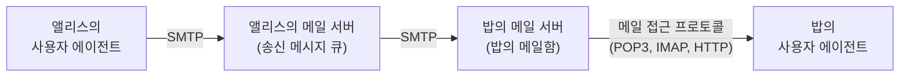

*그림 1. 인터넷 전자 메일 시스템의 구성 요소*

### 1.2 네 가지 시나리오

Forouzan은 전자 메일의 구조를 가장 단순한 경우부터 복잡도를 더해 가는 네 가지 시나리오로 설명하며, 사용자 에이전트(UA) 외에 **메시지 전송 에이전트(message transfer agent, MTA)** 와 **메시지 접근 에이전트(message access agent, MAA)** 를 구별한다.

- **첫째 시나리오:** 송신자와 수신자가 같은 메일 서버의 사용자이다. 관리자는 사용자마다 메일함을 하나씩 만들며, 메일함은 소유자만 접근할 수 있는 지역 하드 디스크의 특수 파일이다. 앨리스는 UA로 메시지를 작성하여 밥의 메일함에 저장하고, 밥은 편할 때 UA로 메일함을 읽는다. 사무실 우편실의 개인 우편함에 메모를 넣는 것과 같다. 이 경우 UA 두 개면 된다.
- **둘째 시나리오:** 송신자와 수신자가 서로 다른 메일 서버의 사용자이므로 메시지가 인터넷을 거쳐야 한다. 앨리스의 UA는 메시지를 자기 사이트의 메일 서버로 보내고, 메일 서버는 보낼 메시지를 큐(스풀)에 보관한다. 메시지를 인터넷으로 보내려면 MTA 클라이언트와 MTA 서버가 필요하다. 서버는 클라이언트가 언제 연결을 요청할지 모르므로 항상 실행되고, 클라이언트는 큐에 보낼 메시지가 있을 때 시스템이 실행한다. 이 경우 UA 두 개와 MTA 한 쌍이 필요하다.
- **셋째 시나리오:** 밥은 둘째 시나리오처럼 메일 서버에 직접 연결되어 있지만, 앨리스는 다이얼업, DSL, 케이블 모뎀 같은 점대점 WAN이나 조직의 LAN으로 메일 서버와 떨어져 있다. 앨리스의 UA는 MTA 클라이언트를 불러 자기 시스템의 MTA 서버와 연결하고, 시스템은 받은 메시지를 큐에 넣었다가 MTA 클라이언트로 밥의 사이트에 보낸다. 이 경우 UA 두 개와 MTA 두 쌍이 필요하다.
- **넷째 시나리오:** 가장 흔한 경우로, 밥도 WAN이나 LAN으로 메일 서버에 연결되어 있다. 메시지가 밥의 메일 서버에 도착하면 밥은 메시지를 가져와야 하며, 이를 위해 MAA 클라이언트와 MAA 서버가 필요하다. 이 경우 UA 두 개, MTA 두 쌍, MAA 한 쌍이 필요하다.

넷째 시나리오에서 두 가지를 강조할 필요가 있다. 첫째, 밥은 메일 서버를 건너뛰고 MTA 서버를 직접 쓸 수 없다. 그러려면 메시지가 언제 도착할지 모르므로 밥의 컴퓨터에서 MTA 서버를 항상 실행해야 하고, LAN이라면 컴퓨터를 항상 켜 두어야 하고 WAN이라면 연결을 항상 유지해야 하는데, 둘 다 현실적이지 않다. 둘째, 밥에게 MAA라는 별도의 클라이언트-서버 프로그램이 필요한 이유는 MTA가 **푸시(push)** 프로그램이기 때문이다. MTA에서는 클라이언트가 서버로 메시지를 밀어 넣지만, 밥은 클라이언트가 서버에서 메시지를 끌어오는 **풀(pull)** 프로그램이 필요하다.


*그림 2. 넷째 시나리오: UA 두 개, MTA 두 쌍, MAA 한 쌍*

| 시나리오 | 상황 | 필요한 에이전트 |
|:-----|:-----|:-----|
| 첫째 | 송신자와 수신자가 같은 메일 서버에 직접 연결 | UA 두 개 |
| 둘째 | 서로 다른 메일 서버에 각자 직접 연결 | UA 두 개, MTA 한 쌍 |
| 셋째 | 송신자만 LAN이나 WAN으로 메일 서버에 연결 | UA 두 개, MTA 두 쌍 |
| 넷째 | 송신자와 수신자 모두 LAN이나 WAN으로 메일 서버에 연결 | UA 두 개, MTA 두 쌍, MAA 한 쌍 |

*표 1. 전자 메일 구조의 네 가지 시나리오*

Kurose의 구성 요소와 대응시키면, Kurose의 메일 서버는 Forouzan의 MTA 서버, MTA 클라이언트, MAA 서버를 함께 실행하는 컴퓨터이고, MTA는 SMTP로, MAA는 POP3나 IMAP으로 구현된다.

### 1.3 사용자 에이전트

사용자 에이전트는 메시지를 작성하고, 읽고, 답장하고, 전달하는 소프트웨어 패키지이며, 사용자 컴퓨터의 지역 메일함도 다룬다. 사용자 에이전트에는 두 종류가 있다. **명령 기반(command-driven)** 사용자 에이전트는 전자 메일 초기의 것으로, 키보드에서 한 글자 명령을 받아 동작한다. 예를 들어 명령 프롬프트에서 r을 입력하면 송신자에게 답장하고, R을 입력하면 송신자와 모든 수신자에게 답장한다. mail, pine, elm이 그 예이다. 오늘날의 사용자 에이전트는 키보드와 마우스로 아이콘, 메뉴, 창을 다루는 **GUI 기반** 사용자 에이전트이며, Eudora, Outlook, Netscape가 그 예이다.

**메일 보내기.** 사용자는 사용자 에이전트로 일반 우편과 비슷한 메일을 만든다. 메일은 **봉투(envelope)** 와 **메시지(message)** 로 이루어진다. 봉투에는 보통 송신자 주소, 수신자 주소, 그 밖의 정보가 들어간다. 메시지는 **헤더(header)** 와 **본문(body)** 으로 이루어지며, 헤더는 송신자, 수신자, 제목 같은 정보를, 본문은 수신자가 읽을 실제 정보를 담는다.

**메일 받기.** 사용자 에이전트는 사용자(또는 타이머)가 실행한다. 사용자에게 메일이 있으면 알려 주고, 사용자가 읽을 준비가 되면 메일함의 메시지마다 송신자 주소, 제목, 보내거나 받은 시각을 요약한 줄의 목록을 보여 준다. 사용자는 메시지를 골라 내용을 화면에 표시할 수 있다.

**주소.** 메일을 전달하려면 유일한 주소 체계가 필요하다. 인터넷의 전자 메일 주소는 @로 구분된 **로컬 부분(local part)** 과 **도메인 이름(domain name)** 으로 이루어진다.

```text
local part @ domain name
(수신자의 메일함 주소) @ (메일 서버의 도메인 이름)
```

로컬 부분은 사용자에게 온 모든 메일을 메시지 접근 에이전트가 가져갈 때까지 보관하는 특수 파일, 곧 **사용자 메일함**의 이름이다. 도메인 이름은 조직이 전자 메일을 주고받으려고 정한 호스트, 곧 메일 서버(메일 교환기)의 이름이다. 메일 교환기의 도메인 이름은 DNS 데이터베이스에서 오거나 조직 이름 같은 논리적 이름이다. 메일 서버의 실제 주소를 찾는 DNS의 MX 레코드는 5장에서 다룬다.

**메일링 리스트.** 전자 메일은 별칭(alias) 하나가 여러 전자 메일 주소를 나타내게 할 수 있으며, 이를 **메일링 리스트(mailing list)** 라 한다. 메시지를 보낼 때마다 시스템은 수신자 이름을 별칭 데이터베이스와 대조하여, 그 별칭에 메일링 리스트가 있으면 목록의 항목마다 별도의 메시지를 만들어 MTA에 넘기고, 없으면 그 이름 자체를 수신 주소로 하여 메시지 하나를 전달한다.

---

<br>

## 2. SMTP

### 2.1 SMTP의 특징

SMTP는 인터넷 전자 메일의 중심이며, Kurose는 그 명세로 RFC 5321을 든다. SMTP는 HTTP보다 훨씬 오래되어 최초의 SMTP RFC는 1982년에 나왔고, SMTP 자체는 그보다 더 전부터 있었다. SMTP는 널리 쓰이지만 몇 가지 오래된 특성을 가진 레거시 기술이다. 대표적인 것이 헤더뿐 아니라 메일 메시지의 **본문까지 7비트 ASCII로 제한**한다는 점이다. 이 제한은 전송 용량이 부족하고 큰 첨부 파일이나 이미지, 오디오, 비디오를 보내지 않던 1980년대 초에는 합리적이었지만, 멀티미디어 시대에는 이진 데이터를 보내기 전에 ASCII로 부호화하고 받은 뒤에 다시 이진으로 복호화해야 하는 불편이 있다. 반면 HTTP는 멀티미디어 데이터를 ASCII로 부호화하지 않아도 된다.

Forouzan의 넷째 시나리오에서 SMTP는 두 번 쓰인다. 송신자와 송신자의 메일 서버 사이, 그리고 두 메일 서버 사이이다. 메일 서버와 수신자 사이에는 다른 프로토콜(5절)이 필요하다. SMTP는 명령과 응답을 어떻게 주고받는지만 정의하며, 구현 소프트웨어는 각 네트워크가 자유롭게 고른다.

SMTP는 보통 중간 메일 서버를 거치지 않는다. 앨리스의 서버가 홍콩에 있고 밥의 서버가 세인트루이스에 있어도 TCP 연결은 두 서버를 직접 잇는다. 밥의 메일 서버가 다운되어 있으면 메시지는 어떤 중간 메일 서버에 놓이는 것이 아니라 앨리스의 메일 서버에 남아 다음 시도를 기다린다.

### 2.2 SMTP 세션

앨리스가 밥에게 간단한 ASCII 메시지를 보낸다고 가정한다.

1. 앨리스가 전자 메일 사용자 에이전트를 실행하여 밥의 주소(예: bob@someschool.edu)를 입력하고 메시지를 작성한 뒤 보내라고 지시한다.
2. 앨리스의 사용자 에이전트가 메시지를 앨리스의 메일 서버로 보내고, 메시지는 메시지 큐에 들어간다.
3. 앨리스의 메일 서버에서 실행되는 SMTP 클라이언트가 큐의 메시지를 보고, 밥의 메일 서버에서 실행되는 SMTP 서버와 TCP 연결을 연다.
4. 초기 SMTP 핸드셰이크 뒤에 SMTP 클라이언트가 앨리스의 메시지를 TCP 연결로 보낸다.
5. 밥의 메일 서버에서 SMTP 서버가 메시지를 받아 밥의 메일함에 넣는다.
6. 밥이 편할 때 사용자 에이전트를 실행하여 메시지를 읽는다.

SMTP 클라이언트(송신 메일 서버)는 SMTP 서버(수신 메일 서버)의 **포트 25**로 TCP 연결을 맺는다. 서버가 다운되어 있으면 클라이언트는 나중에 다시 시도한다. 연결이 맺어지면 사람들이 정보를 주고받기 전에 서로를 소개하듯이 서버와 클라이언트는 응용 계층 핸드셰이크를 하며, 이때 클라이언트는 송신자(메시지를 만든 사람)와 수신자의 전자 메일 주소를 알린다. 서로 소개가 끝나면 클라이언트가 메시지를 보내며, TCP의 신뢰적 데이터 전송 덕분에 메시지는 오류 없이 서버에 도착한다. 클라이언트는 같은 서버에 보낼 메시지가 더 있으면 같은 TCP 연결로 이 과정을 되풀이하고, 없으면 TCP에 연결을 닫으라고 한다.

다음은 클라이언트(C)와 서버(S)가 주고받는 메시지의 예이다. 클라이언트의 호스트 이름은 crepes.fr, 서버의 호스트 이름은 hamburger.edu이며, C:와 S:로 시작하는 줄은 각각 클라이언트와 서버가 TCP 소켓에 보내는 ASCII 텍스트 줄이다. 기록은 TCP 연결이 맺어진 직후부터 시작한다.

```text
S: 220 hamburger.edu
C: HELO crepes.fr
S: 250 Hello crepes.fr, pleased to meet you
C: MAIL FROM: <alice@crepes.fr>
S: 250 alice@crepes.fr ... Sender ok
C: RCPT TO: <bob@hamburger.edu>
S: 250 bob@hamburger.edu ... Recipient ok
C: DATA
S: 354 Enter mail, end with "." on a line by itself
C: Do you like ketchup?
C: How about pickles?
C: .
S: 250 Message accepted for delivery
C: QUIT
S: 221 hamburger.edu closing connection
```

이 대화에서 클라이언트는 메일 서버 crepes.fr에서 메일 서버 hamburger.edu로 메시지("Do you like ketchup? How about pickles?")를 보낸다. 클라이언트는 HELO(HELLO의 줄임), MAIL FROM, RCPT TO, DATA, QUIT의 다섯 명령을 보냈다. 또한 마침표 하나만 있는 줄을 보내 메시지의 끝을 서버에 알렸다. ASCII 용어로 각 메시지는 `CRLF.CRLF`로 끝나며, CR과 LF는 각각 캐리지 리턴과 라인 피드이다. 서버는 각 명령에 응답 코드와 (선택적인) 영어 설명으로 답한다.

SMTP는 **지속 연결**을 쓴다. 송신 메일 서버가 같은 수신 메일 서버에 보낼 메시지가 여럿이면 모든 메시지를 같은 TCP 연결로 보낸다. 메시지마다 새 `MAIL FROM`으로 시작하고 마침표 하나만 있는 줄로 끝내며, 모든 메시지를 보낸 뒤에야 `QUIT`을 보낸다. TELNET으로 메일 서버의 포트 25에 연결하면 220 응답을 받은 뒤 이 명령들을 직접 입력하여 SMTP 서버와 대화할 수 있다.

### 2.3 명령과 응답

SMTP는 MTA 클라이언트와 MTA 서버 사이에서 **명령(command)** 과 **응답(response)** 으로 메시지를 전송한다. 명령은 클라이언트에서 서버로, 응답은 서버에서 클라이언트로 가며, 각 명령이나 응답은 두 글자(CR과 LF)의 줄 끝 표시로 끝난다. 명령은 키워드 뒤에 0개 이상의 인자가 오는 형식이며, Forouzan은 SMTP의 명령 14개를 다음과 같이 정리한다.

| 키워드 | 인자 | 설명 |
|:-----|:-----|:-----|
| HELO | 송신자의 호스트 이름 | 클라이언트가 자신을 밝힘 |
| MAIL FROM | 메시지의 송신자 | 송신자의 전자 메일 주소(로컬 부분과 도메인 이름)를 밝힘 |
| RCPT TO | 의도한 수신자 | 수신자의 전자 메일 주소를 밝힘, 수신자가 여럿이면 되풀이함 |
| DATA | 메일 본문 | 실제 메시지를 보냄, 마침표 하나만 있는 줄로 끝남 |
| QUIT | - | 메시지 전송을 끝냄 |
| RSET | - | 현재 메일 트랜잭션을 중단하고 저장된 송신자와 수신자 정보를 지움 |
| VRFY | 수신자 이름 | 수신자의 주소가 유효한지 확인을 요청함 |
| NOOP | - | 수신자의 상태를 확인하며 응답을 요구함 |
| TURN | - | 송신자와 수신자의 역할을 바꿈, 오늘날 대부분의 구현은 지원하지 않음 |
| EXPN | 메일링 리스트 | 메일링 리스트를 펼쳐 구성원의 메일함 주소를 돌려 달라고 요청함 |
| HELP | 명령 이름 | 인자로 준 명령에 관한 정보를 요청함 |
| SEND FROM | 송신자 | 메일을 수신자의 메일함이 아니라 터미널에 전달하며, 수신자가 로그인해 있지 않으면 되돌려 보냄 |
| SOML FROM | 송신자 | 수신자가 로그인해 있으면 터미널에만, 아니면 메일함에 전달함 |
| SAML FROM | 송신자 | 수신자가 로그인해 있으면 터미널과 메일함 모두에, 아니면 메일함에만 전달함 |

*표 2. SMTP 명령*

응답은 세 자리 코드 뒤에 텍스트 정보가 올 수 있는 형식이다. 코드의 첫 자리 뜻은 3장의 HTTP 상태 코드와 비슷하게, 2는 긍정 완료, 3은 긍정 중간, 4는 일시적 부정 완료, 5는 영구적 부정 완료를 뜻한다.

| 범주 | 코드 | 설명 |
|:-----|:-----|:-----|
| 긍정 완료 | 211 | 시스템 상태 또는 도움말 응답 |
| 긍정 완료 | 214 | 도움말 메시지 |
| 긍정 완료 | 220 | 서비스 준비 완료 |
| 긍정 완료 | 221 | 전송 채널을 닫는 중 |
| 긍정 완료 | 250 | 요청한 명령 완료 |
| 긍정 완료 | 251 | 수신자가 지역 사용자가 아니므로 메시지를 전달함 |
| 긍정 중간 | 354 | 메일 입력을 시작하라 |
| 일시적 부정 | 421 | 서비스를 쓸 수 없음 |
| 일시적 부정 | 450 | 메일함을 쓸 수 없음 |
| 일시적 부정 | 451 | 지역 오류로 명령 중단 |
| 일시적 부정 | 452 | 저장 공간 부족으로 명령 중단 |
| 영구적 부정 | 500 | 구문 오류, 알 수 없는 명령 |
| 영구적 부정 | 501 | 매개변수나 인자의 구문 오류 |
| 영구적 부정 | 502 | 구현되지 않은 명령 |
| 영구적 부정 | 503 | 잘못된 명령 순서 |
| 영구적 부정 | 504 | 구현되지 않은 명령 매개변수 |
| 영구적 부정 | 550 | 메일함을 쓸 수 없어 명령을 실행하지 않음 |
| 영구적 부정 | 551 | 지역 사용자가 아님 |
| 영구적 부정 | 552 | 할당된 저장 공간 초과로 요청 중단 |
| 영구적 부정 | 553 | 허용되지 않는 메일함 이름이므로 요청을 수행하지 않음 |
| 영구적 부정 | 554 | 트랜잭션 실패 |

*표 3. SMTP 응답 코드*

> **용어 정의:** **SMTP(Simple Mail Transfer Protocol)** 는 TCP 포트 25를 쓰는 푸시 방식의 응용 계층 프로토콜로, 명령과 응답을 주고받아 메일 메시지를 송신 측에서 수신 측 메일 서버로 전송한다.

### 2.4 메일 전송의 세 단계

메일 메시지의 전송은 **연결 설정**, **메시지 전송**, **연결 종료**의 세 단계로 이루어진다.

**연결 설정.** 클라이언트가 잘 알려진 포트 25로 TCP 연결을 맺으면 SMTP 서버가 연결 단계를 시작한다.

1. 서버가 메일을 받을 준비가 되었다는 뜻으로 코드 220(서비스 준비)을 보낸다. 준비가 안 되었으면 421(서비스를 쓸 수 없음)을 보낸다.
2. 클라이언트가 자신의 도메인 이름으로 자신을 밝히는 HELO 메시지를 보낸다. TCP 연결을 맺을 때 송신자와 수신자는 서로의 IP 주소만 알기 때문에 서버에 클라이언트의 도메인 이름을 알리는 이 단계가 필요하다.
3. 서버가 코드 250(요청한 명령 완료)이나 상황에 맞는 다른 코드로 응답한다.

**메시지 전송.** 연결이 설정되면 송신자 한 명과 수신자 한 명 이상 사이에서 메시지 하나를 주고받을 수 있다. 이 단계는 여덟 단계로 이루어지며, 수신자가 여럿이면 3단계와 4단계를 되풀이한다.

1. 클라이언트가 MAIL FROM으로 메시지의 송신자를 알린다. 서버에 오류를 돌려보내고 보고할 반송 주소를 주는 단계이다.
2. 서버가 코드 250이나 다른 알맞은 코드로 응답한다.
3. 클라이언트가 RCPT TO로 수신자의 메일 주소를 보낸다.
4. 서버가 코드 250이나 다른 알맞은 코드로 응답한다.
5. 클라이언트가 DATA로 메시지 전송을 시작한다.
6. 서버가 코드 354(메일 입력 시작)나 다른 알맞은 코드로 응답한다.
7. 클라이언트가 메시지의 내용(헤더, 빈 줄, 본문)을 연속된 줄로 보낸다. 각 줄은 CR과 LF로 끝나고, 메시지는 마침표 하나만 있는 줄로 끝난다.
8. 서버가 코드 250(OK)이나 다른 알맞은 코드로 응답한다.

**연결 종료.** 메시지를 성공적으로 전송한 뒤 클라이언트가 QUIT을 보내고, 서버가 코드 221(서비스 종료)로 응답한다. 이 단계가 끝나면 TCP 연결을 닫는다.

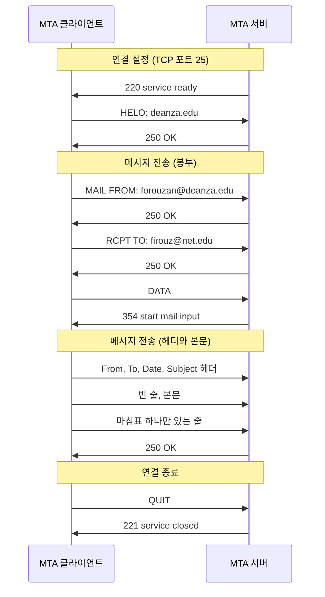

*그림 3. SMTP 메일 전송의 세 단계*

그림 3에서 MAIL FROM과 RCPT TO는 SMTP의 봉투에 해당하고, DATA 뒤에 보내는 From, To, Date, Subject는 메시지 자체의 헤더이다. 두 가지는 같은 낱말을 쓰지만 다른 것이다. 봉투는 SMTP 핸드셰이크 프로토콜의 일부이고, 헤더는 메일 메시지 자체의 일부이다(4.1절).

---

<br>

## 3. SMTP와 HTTP의 비교

SMTP와 HTTP는 모두 한 호스트에서 다른 호스트로 파일을 전송한다. HTTP는 웹 서버에서 웹 클라이언트(보통 브라우저)로 파일(객체)을 전송하고, SMTP는 한 메일 서버에서 다른 메일 서버로 파일(전자 메일 메시지)을 전송한다. 파일을 전송할 때 지속 연결의 HTTP와 SMTP는 모두 지속 연결을 쓴다. 그러나 둘 사이에는 중요한 차이가 있다.

| 관점 | HTTP | SMTP |
|:-----|:-----|:-----|
| 방향 | 주로 **풀(pull)** 프로토콜: 누군가 웹 서버에 올려 둔 정보를 사용자가 편할 때 끌어옴 | 주로 **푸시(push)** 프로토콜: 송신 메일 서버가 수신 메일 서버로 파일을 밀어 넣음 |
| TCP 연결을 시작하는 쪽 | 파일을 받으려는 기계 | 파일을 보내려는 기계 |
| 데이터 형식 | 7비트 ASCII 제한 없음 | 본문을 포함한 메시지 전체가 7비트 ASCII여야 하며, 악센트가 있는 문자나 이진 데이터는 7비트 ASCII로 부호화해야 함 |
| 여러 객체로 된 문서 | 객체마다 별도의 HTTP 응답 메시지에 담음 | 메시지의 모든 객체를 메시지 하나에 담음 |
| 메시지의 독자 | HTTP 서버와 클라이언트 프로그램이 해석 | 사람이 읽는 메시지를 저장 후 전달 |

*표 4. SMTP와 HTTP의 비교*

---

<br>

## 4. 메일 메시지 형식과 MIME

### 4.1 메일 메시지의 헤더

일반 편지의 위쪽에 받는 사람의 주소, 보내는 사람의 주소, 날짜를 적듯이, 전자 메일 메시지에도 본문 앞에 부수 정보를 담은 헤더가 온다. Kurose는 이 헤더 줄의 형식과 의미를 RFC 5322가 정한다고 설명한다. 헤더 줄과 메시지 본문은 빈 줄(CRLF)로 구분된다. HTTP처럼 각 헤더 줄은 키워드, 콜론, 값으로 이루어진 읽을 수 있는 텍스트이다. 필수인 키워드와 선택인 키워드가 있으며, 모든 헤더에는 `From:` 줄과 `To:` 줄이 있어야 하고 `Subject:` 줄과 그 밖의 선택 헤더 줄이 있을 수 있다.

```text
From: alice@crepes.fr
To: bob@hamburger.edu
Subject: Searching for the meaning of life.
```

메시지 헤더 뒤에는 빈 줄이 오고, 그 뒤에 ASCII로 된 메시지 본문이 온다. 이 헤더 줄은 2.2절의 SMTP 명령과 다르다. "from", "to" 같은 같은 낱말을 쓰지만, SMTP 명령은 SMTP 핸드셰이크 프로토콜의 일부이고 헤더 줄은 메일 메시지 자체의 일부이다.

### 4.2 MIME 헤더

전자 메일의 단순한 구조에는 대가가 따른다. 메시지를 NVT 7비트 ASCII 형식으로만 보낼 수 있으므로, 영어가 아닌 언어(프랑스어, 독일어, 히브리어, 러시아어, 중국어, 일본어 등)에 쓸 수 없고, 이진 파일이나 비디오, 오디오 데이터도 보낼 수 없다.

> **용어 정의:** **MIME(Multipurpose Internet Mail Extensions)** 은 비ASCII 데이터를 전자 메일로 보낼 수 있게 하는 보조 프로토콜로, 송신 측에서 비ASCII 데이터를 NVT ASCII 데이터로 바꾸어 MTA에 넘기고, 수신 측에서 원래 데이터로 되돌린다.

MIME은 비ASCII 데이터를 ASCII 데이터로, 또 그 반대로 바꾸는 소프트웨어 함수의 모음이라고 생각할 수 있다. MIME은 변환 매개변수를 정의하기 위해 원래의 전자 메일 헤더 부분에 더할 수 있는 다섯 헤더를 정의한다.

```text
전자 메일 헤더
MIME-Version: (사용하는 MIME의 버전)
Content-Type: type/subtype
Content-Transfer-Encoding: encoding type
Content-Id: message id
Content-Description: textual explanation of nontextual contents
전자 메일 본문
```

*그림 4. MIME 헤더*

- **MIME-Version:** 사용하는 MIME의 버전을 정의한다.
- **Content-Type:** 메시지 본문에 쓰인 데이터의 종류를 정의한다. 내용 형식(type)과 하위 형식(subtype)은 슬래시로 구분하며, 하위 형식에 따라 다른 매개변수가 올 수 있다.
- **Content-Transfer-Encoding:** 메시지를 0과 1로 부호화하여 전송하는 방법을 정의한다(4.3절).
- **Content-Id:** 여러 메시지가 있는 환경에서 메시지 전체를 유일하게 식별한다.
- **Content-Description:** 본문이 이미지인지, 오디오인지, 비디오인지 등을 설명한다.

MIME은 일곱 가지 데이터 형식을 허용한다.

| 형식 | 하위 형식 | 설명 |
|:-----|:-----|:-----|
| Text | Plain | 서식 없는 텍스트 |
| Text | HTML | HTML 형식 |
| Multipart | Mixed | 본문이 서로 다른 데이터 형식의 부분들을 순서대로 담음 |
| Multipart | Parallel | Mixed와 같지만 순서가 없음 |
| Multipart | Digest | Mixed와 비슷하지만 기본 형식이 message/RFC822 |
| Multipart | Alternative | 같은 메시지의 서로 다른 버전을 담음 |
| Message | RFC822 | 본문이 캡슐화된 메시지 |
| Message | Partial | 본문이 더 큰 메시지의 조각 |
| Message | External-Body | 본문이 다른 메시지에 대한 참조 |
| Image | JPEG | JPEG 형식의 이미지 |
| Image | GIF | GIF 형식의 이미지 |
| Video | MPEG | MPEG 형식의 비디오 |
| Audio | Basic | 8 kHz로 부호화한 단일 채널 음성 |
| Application | PostScript | Adobe PostScript |
| Application | Octet-stream | 일반 이진 데이터(8비트 바이트) |

*표 5. MIME의 데이터 형식과 하위 형식*

- **Text:** 원래 메시지가 7비트 ASCII 형식이므로 MIME의 변환이 필요 없다.
- **Multipart:** 본문에 서로 독립적인 여러 부분이 있다. 부분 사이의 경계를 정하는 매개변수(boundary)가 필요하며, 경계 문자열은 각 부분 앞에 하이픈 두 개를 붙여 한 줄로 오고, 본문의 끝은 경계 문자열 앞뒤에 하이픈 두 개를 붙여 나타낸다. Mixed 하위 형식에서는 부분들을 메시지의 순서 그대로 수신자에게 보여 주어야 하며, Parallel은 순서가 중요하지 않다. Alternative는 같은 메시지를 서로 다른 형식으로 반복한다.

```text
Content-Type: multipart/mixed; boundary=xxxx

--xxxx
Content-Type: text/plain;
...
--xxxx
Content-Type: image/gif;
...
--xxxx--
```

- **Message:** 본문 자체가 메일 메시지 전체이거나, 메일 메시지의 일부이거나, 메시지에 대한 포인터이다. RFC822 하위 형식은 다른 메시지(헤더와 본문 포함)를 캡슐화할 때 쓴다. Partial 하위 형식은 원래 메시지를 여러 메일 메시지로 나누었을 때 그 조각임을 뜻하며, 조각은 목적지에서 MIME이 재조립해야 하므로 메시지를 식별하는 id, 조각의 순서를 나타내는 number, 전체 조각 수를 나타내는 total 매개변수를 붙인다. External-body 하위 형식은 본문에 실제 메시지가 아니라 원래 메시지에 대한 참조만 있음을 뜻하며, 매개변수로 원래 메시지에 접근하는 방법(이름, 사이트, 접근 방식 등)을 정한다.
- **Image:** 애니메이션이 없는 정지 이미지이며, 압축을 쓰는 JPEG과 GIF 하위 형식이 있다.
- **Video:** 시간에 따라 변하는 이미지(애니메이션)이며 하위 형식은 MPEG 하나이다. 소리가 있으면 오디오 내용 형식으로 따로 보낸다.
- **Audio:** 소리이며, 8 kHz 표준 오디오 데이터를 쓰는 Basic 하위 형식 하나가 있다.
- **Application:** 앞에서 정의하지 않은 종류의 데이터이다. PostScript는 Adobe PostScript 형식의 데이터에, Octet-stream은 데이터를 8비트 바이트의 나열(이진 파일)로 해석해야 할 때 쓴다.

### 4.3 내용 전송 부호화와 base64

`Content-Transfer-Encoding:` 헤더는 메시지를 전송하기 위해 0과 1로 부호화하는 방법을 정한다.

| 형식 | 설명 |
|:-----|:-----|
| 7bit | NVT ASCII 문자와 짧은 줄, 특별한 변환은 없지만 한 줄이 1,000자를 넘지 않아야 함 |
| 8bit | 비ASCII 문자와 짧은 줄, MIME이 부호화하지 않으므로 아래의 SMTP가 8비트 비ASCII 문자를 전송할 수 있어야 함 |
| Binary | 비ASCII 문자와 길이 제한이 없는 줄, MIME이 부호화하지 않으므로 SMTP가 이진 데이터를 전송할 수 있어야 함 |
| Base64 | 6비트 데이터 블록을 8비트 ASCII 문자로 부호화 |
| Quoted-printable | 비ASCII 문자를 등호와 ASCII 코드로 부호화 |

*표 6. MIME의 내용 전송 부호화*

8bit와 Binary는 아래의 SMTP가 해당 데이터를 전송할 수 있어야 하므로 권장되지 않으며, base64나 quoted-printable이 더 낫다.

**Base64.** 최상위 비트가 0이 아닐 수 있는 바이트로 이루어진 데이터를 보내는 방법이다. base64는 이진 데이터(비트의 흐름)를 24비트 블록으로 나누고, 각 블록을 6비트씩 네 부분으로 나눈다. 각 6비트 값(0\~63)은 다음 변환표에 따라 인쇄 가능한 문자 하나로 바뀐다.

| 값 | 문자 |
|:-----|:-----|
| 0\~25 | A\~Z |
| 26\~51 | a\~z |
| 52\~61 | 0\~9 |
| 62 | + |
| 63 | / |

*표 7. base64의 변환표*

예를 들어 바이트 세 개 `11001100 10000001 00111001`을 부호화하면 다음과 같다.

```text
비ASCII 데이터 (24비트) : 11001100 10000001 00111001
6비트씩 나누기          : 110011   001000   000100   111001
값                      : 51       8        4        57
base64 문자             : z        I        E        5
```

*그림 5. base64 부호화의 예*

51은 26\~51 범위의 26번째 소문자이므로 z, 8은 I, 4는 E, 57은 52\~61 범위에서 5에 대응한다. 결과는 문자열 `zIE5`이다.

base64는 **중복이 있는(redundant)** 부호화이다. 24비트가 문자 네 개가 되고, 각 문자는 결국 8비트로 전송되므로 32비트를 보낸다. 전송되는 비트 중 8/32 = 25%가 오버헤드이고, 원래 크기와 비교하면 데이터가 32/24 = 4/3배, 곧 약 33% 늘어난다.

**Quoted-printable.** 데이터가 대부분 ASCII 문자이고 비ASCII 부분이 조금뿐이라면 quoted-printable 부호화를 쓴다. ASCII 문자는 그대로 보내고, 비ASCII 문자는 세 문자로 보낸다. 첫 문자는 등호(=)이고, 다음 두 문자는 그 바이트의 16진수 표현이다. 예를 들어 `& L (10011101) 9 K`에서 비ASCII 바이트 10011101은 16진수 9D이므로 `=9D`로 바뀌어 `&L=9D9K`가 된다.

```text
원래 데이터    : 00100110 01001100 10011101 00111001 01001011
                 &        L        (9D)     9        K
quoted-printable: &  L  =  9  D  9  K
```

*그림 6. quoted-printable 부호화의 예*

---

<br>

## 5. 메일 접근 프로토콜

### 5.1 두 단계로 메일을 전달하는 이유

SMTP가 앨리스의 메일 서버에서 밥의 메일 서버로 메시지를 전달하면 메시지는 밥의 메일함에 놓인다. 1990년대 초까지는 사용자가 서버 호스트에 로그인하여 그 호스트에서 메일 읽기 프로그램을 실행하는 것이 표준이었다. 지금은 사무실 PC, 노트북, 스마트폰 같은 사용자의 종단 시스템에서 실행되는 클라이언트로 메일을 읽는 클라이언트-서버 방식이며, 멀티미디어 메시지와 첨부 파일을 보는 등 풍부한 기능을 쓸 수 있다.

밥이 자기 PC에서 사용자 에이전트를 실행한다면, 메일 서버도 밥의 PC에 두면 어떨까? 메일 서버는 메일함을 관리하고 SMTP의 클라이언트와 서버를 실행하므로, 메일 서버가 밥의 PC에 있다면 언제 도착할지 모르는 메일을 받으려고 밥의 PC는 항상 켜져 있고 인터넷에 연결되어 있어야 한다. 이는 많은 사용자에게 비현실적이다. 그래서 사용자는 지역 PC에서 사용자 에이전트를 실행하되, 보통 사용자의 ISP(대학이나 회사 등)가 관리하는, 항상 켜져 있는 공유 메일 서버의 메일함에 접근한다.

송신 쪽도 두 단계를 거친다. 앨리스의 사용자 에이전트가 SMTP로 메시지를 밥의 메일 서버에 직접 보낼 수도 있지만, 보통은 앨리스의 사용자 에이전트가 SMTP로 메시지를 앨리스의 메일 서버에 밀어 넣고, 앨리스의 메일 서버가 SMTP 클라이언트로서 밥의 메일 서버에 메시지를 중계한다. 앨리스의 메일 서버를 거치지 않으면 앨리스의 사용자 에이전트는 목적지 메일 서버에 연결할 수 없을 때 대처할 방법이 없기 때문이다. 앨리스가 먼저 자기 메일 서버에 메일을 맡기면, 앨리스의 메일 서버는 밥의 메일 서버가 동작할 때까지 예를 들어 30분마다 재전송을 시도할 수 있다.

남은 문제는 밥이 자기 ISP의 메일 서버에 있는 메시지를 지역 PC로 가져오는 방법이다. 메시지를 가져오는 것은 풀 동작이고 SMTP는 푸시 프로토콜이므로, 밥의 사용자 에이전트는 SMTP로 메시지를 가져올 수 없다. 그래서 밥의 메일 서버에서 밥의 PC로 메시지를 전송하는 **메일 접근 프로토콜(mail access protocol)** 이 필요하며, POP3(Post Office Protocol, version 3), IMAP(Internet Mail Access Protocol), HTTP가 쓰인다. 정리하면 SMTP는 송신자의 사용자 에이전트에서 송신자의 메일 서버로, 송신자의 메일 서버에서 수신자의 메일 서버로 메일을 전송하고, 메일 접근 프로토콜은 수신자의 메일 서버에서 수신자의 사용자 에이전트로 메일을 전송한다.

### 5.2 POP3

**POP3**는 매우 단순한 메일 접근 프로토콜이며, Kurose는 그 명세로 짧고 읽기 쉬운 RFC 1939를 든다. 단순한 만큼 기능은 제한적이다. 클라이언트 POP3 소프트웨어는 수신자의 컴퓨터에, 서버 POP3 소프트웨어는 메일 서버에 설치된다. POP3는 사용자 에이전트(클라이언트)가 메일 서버(서버)의 **포트 110**으로 TCP 연결을 열면서 시작되며, 연결이 맺어지면 세 단계를 거친다.

> **용어 정의:** **POP3(Post Office Protocol, version 3)** 는 TCP 포트 110을 쓰는 단순한 메일 접근 프로토콜로, 인증, 트랜잭션, 갱신의 세 단계로 사용자 에이전트가 메일 서버의 메일함에서 메시지를 가져오게 한다.

1. **인증(authorization):** 사용자 에이전트가 사용자 이름과 비밀번호를 (평문으로) 보내 사용자를 인증한다.
2. **트랜잭션(transaction):** 사용자 에이전트가 메시지를 가져온다. 이 단계에서 메시지에 삭제 표시를 하거나 표시를 지우고, 메일 통계를 얻을 수도 있다.
3. **갱신(update):** 클라이언트가 quit 명령을 보내 POP3 세션을 끝낸 뒤에 일어나며, 메일 서버는 삭제 표시가 된 메시지를 지운다.

POP3 트랜잭션에서 사용자 에이전트는 명령을 보내고 서버는 각 명령에 응답한다. 응답은 앞 명령이 정상이었다는 뜻의 `+OK`(뒤에 서버에서 클라이언트로 가는 데이터가 올 수 있음)와 앞 명령에 문제가 있었다는 뜻의 `-ERR` 두 가지이다. 인증 단계의 주요 명령은 `user <사용자 이름>`과 `pass <비밀번호>`이다. 예를 들어 TELNET으로 POP3 서버의 포트 110에 직접 연결하면 다음과 같은 대화를 볼 수 있다.

```text
telnet mailServer 110
+OK POP3 server ready
user bob
+OK
pass hungry
+OK user successfully logged on
```

명령을 잘못 입력하면 서버는 `-ERR` 메시지로 답한다. 트랜잭션 단계에서 사용자 에이전트는 사용자의 설정에 따라 **내려받고 지우기(download-and-delete)** 나 **내려받고 남기기(download-and-keep)** 모드로 동작하며, 모드에 따라 보내는 명령이 다르다. 내려받고 지우기 모드에서는 list, retr, dele 명령을 쓴다. 메일함에 메시지가 두 개 있을 때의 대화는 다음과 같다(C:는 사용자 에이전트, S:는 메일 서버).

```text
C: list
S: 1 498
S: 2 912
S: .
C: retr 1
S: (blah blah ...
S: .................
S: ..........blah)
S: .
C: dele 1
C: retr 2
S: (blah blah ...
S: .................
S: ..........blah)
S: .
C: dele 2
C: quit
S: +OK POP3 server signing off
```

사용자 에이전트는 먼저 메일 서버에 저장된 각 메시지의 크기를 묻고(list), 각 메시지를 가져와(retr) 지운다(dele). 인증 단계 뒤에 쓴 명령은 list, retr, dele, quit의 네 개뿐이다. quit 명령을 처리한 뒤 POP3 서버는 갱신 단계로 들어가 메일함에서 메시지 1과 2를 지운다.

내려받고 지우기 모드의 문제는 수신자 밥이 사무실 PC, 집의 PC, 노트북처럼 여러 기기에서 메일에 접근하려 할 때 생긴다. 이 모드는 밥의 메시지를 세 기기에 나누어 놓으므로, 밥이 사무실 PC에서 먼저 읽은 메시지를 저녁에 집에서 노트북으로 다시 읽을 수 없다. 내려받고 남기기 모드에서는 사용자 에이전트가 내려받은 뒤에도 메시지를 메일 서버에 남겨 두므로, 밥은 여러 기기에서 메시지를 다시 읽을 수 있다. Forouzan은 같은 두 모드를 삭제 모드(delete mode)와 보관 모드(keep mode)라 부른다. 삭제 모드는 사용자가 자기 고정 컴퓨터에서 메일을 받아 읽고 정리할 때, 보관 모드는 노트북처럼 주 컴퓨터가 아닌 곳에서 메일을 읽고 나중에 정리하려고 남겨 둘 때 쓴다.

POP3 서버는 한 POP3 세션 동안에는 어떤 메시지에 삭제 표시가 되었는지 같은 상태 정보를 유지하지만, 세션과 세션 사이에는 상태 정보를 유지하지 않는다. 이 덕분에 POP3 서버의 구현이 매우 단순하다.

### 5.3 IMAP

POP3로 메시지를 지역 기기에 내려받은 뒤에는 지역에 메일 폴더를 만들고 메시지를 옮기고 지우고 검색할 수 있다. 그러나 폴더와 메시지가 지역 기기에 있는 이 방식은, 어느 컴퓨터에서든 접근할 수 있는 원격 서버의 폴더 계층을 원하는 이동 사용자에게 문제가 된다. POP3에는 원격 폴더를 만들고 메시지를 폴더에 넣는 수단이 없다. 이 문제를 풀려고 만든 것이 **IMAP**이며, Kurose는 그 명세로 RFC 3501을 든다. IMAP 서버는 기본적으로 포트 143을 쓴다 [1].

> **용어 정의:** **IMAP(Internet Mail Access Protocol)** 은 서버의 폴더에 메시지를 두고, 세션 사이에도 사용자의 상태를 유지하며, 메시지의 일부만 가져올 수 있게 하는 메일 접근 프로토콜이다.

IMAP은 POP3보다 기능이 훨씬 많지만 훨씬 복잡하며, 그만큼 클라이언트와 서버의 구현도 복잡하다. IMAP 서버는 각 메시지를 폴더에 연결한다. 메시지가 서버에 처음 도착하면 수신자의 INBOX 폴더에 연결되고, 수신자는 메시지를 사용자가 만든 새 폴더로 옮기고, 읽고, 지울 수 있다. IMAP은 폴더를 만들고 폴더 사이에 메시지를 옮기는 명령과, 원격 폴더에서 조건에 맞는 메시지를 검색하는 명령을 제공한다. POP3와 달리 IMAP 서버는 폴더 이름과 각 메시지가 어느 폴더에 있는지 같은 사용자 상태 정보를 세션 사이에도 유지한다. 또한 사용자 에이전트가 메시지의 일부, 예를 들어 헤더만이나 다중 부분 MIME 메시지의 한 부분만 가져오게 하는 명령이 있다. 이는 사용자 에이전트와 메일 서버 사이의 연결이 느릴 때, 오디오나 비디오 같은 큰 메시지를 모두 내려받지 않으려는 사용자에게 유용하다.

Forouzan은 IMAP4가 제공하는 추가 기능을 다음과 같이 정리한다.

- 내려받기 전에 전자 메일 헤더를 확인할 수 있다.
- 내려받기 전에 전자 메일의 내용에서 특정 문자열을 검색할 수 있다.
- 전자 메일을 일부만 내려받을 수 있다. 대역폭이 제한되어 있고 메일에 대역폭이 큰 멀티미디어가 있을 때 특히 유용하다.
- 메일 서버에서 메일함을 만들고, 지우고, 이름을 바꿀 수 있다.
- 전자 메일 저장을 위해 폴더 안에 메일함의 계층을 만들 수 있다.

| 관점 | POP3 | IMAP |
|:-----|:-----|:-----|
| 포트 | TCP 110 | TCP 143 |
| 메시지의 위치 | 대개 지역 기기로 내려받음 (지우거나 남김) | 서버의 폴더에 둠 |
| 세션 사이의 상태 | 유지하지 않음 | 폴더 이름, 메시지와 폴더의 연결을 유지 |
| 원격 폴더 | 없음 | 만들기, 지우기, 이름 바꾸기, 계층 구성 |
| 일부만 가져오기 | 불가 | 헤더만, MIME 부분만 가져오기 가능 |
| 구현 | 매우 단순 | 복잡 |

*표 8. POP3와 IMAP의 비교*

### 5.4 웹 기반 메일과 전자 메일 보안

오늘날 많은 사용자가 웹 브라우저로 전자 메일을 보내고 읽는다. Hotmail이 1990년대 중반에 웹 기반 접근을 도입한 이후 Google, Yahoo!와 거의 모든 주요 대학과 기업이 웹 기반 전자 메일을 제공한다. 이 서비스에서 사용자 에이전트는 일반 웹 브라우저이며, 사용자는 HTTP로 원격 메일함과 통신한다. 밥이 메일함의 메시지에 접근하려 하면 메시지는 POP3나 IMAP이 아니라 HTTP로 밥의 메일 서버에서 밥의 브라우저로 전송되고, 앨리스가 메시지를 보내면 메시지는 SMTP가 아니라 HTTP로 앨리스의 브라우저에서 앨리스의 메일 서버로 전송된다. 그러나 메일 서버끼리는 여전히 SMTP로 메시지를 주고받는다.

Forouzan은 두 경우로 설명한다. 첫째 경우에는 송신자 앨리스가 일반 메일 서버를, 수신자 밥이 웹 기반 서버의 계정을 쓴다. 앨리스의 브라우저에서 앨리스의 메일 서버로, 두 메일 서버 사이로는 SMTP로 전송되지만, 수신 서버(웹 서버)에서 밥의 브라우저로는 POP3나 IMAP4 대신 HTTP를 쓴다. 밥은 웹 사이트에 HTTP 요청을 보내 로그인 이름과 비밀번호를 담은 폼을 받고, 로그인하면 전자 메일 목록을 HTML 형식으로 받으며, 이후의 HTTP 트랜잭션으로 메일을 하나씩 가져온다. 둘째 경우에는 앨리스와 밥이 모두 웹 서버를 쓴다. 앨리스는 밥의 메일함 이름과 주소를 URL로 하여 자기 웹 서버에 HTTP 요청으로 메시지를 보내고, 앨리스 쪽 서버는 메시지를 SMTP 클라이언트에 넘겨 밥 쪽 서버로 보낸다. 밥은 HTTP 트랜잭션으로 메시지를 받는다.

이 장에서 다룬 프로토콜은 그 자체로 보안 기능을 제공하지 않는다. 전자 메일 교환은 PGP(Pretty Good Privacy)와 S/MIME(Secure MIME) 같은 전자 메일 전용 응용 계층 보안으로 보호할 수 있으며, 그 가운데 PGP는 26장에서 다룬다.

---

<br>

## 6. 원격 로그인: TELNET

**TELNET**(TErminaL NETwork)은 ISO가 제안한 가상 터미널 서비스를 위한 TCP/IP의 표준 프로토콜이다. TELNET은 원격 시스템과 연결을 맺어 지역 터미널이 원격 시스템의 터미널처럼 보이게 하는 범용 클라이언트-서버 응용 프로그램이다.

### 6.1 시분할 환경과 원격 로그인

TELNET이 설계될 무렵 UNIX 같은 대부분의 운영 체제는 **시분할(time-sharing)** 환경에서 동작했다. 이 환경에서는 큰 컴퓨터 한 대가 여러 사용자를 지원하며, 사용자와 컴퓨터의 상호 작용은 키보드, 모니터, 마우스로 이루어진 터미널(또는 터미널 에뮬레이터)로 이루어진다. 모든 처리는 중앙 컴퓨터에서 일어나며, 사용자가 키보드로 글자를 입력하면 그 글자는 보통 컴퓨터로 보내졌다가 모니터에 에코(echo)된다. 각 사용자는 자기 전용 컴퓨터를 쓰는 것처럼 느낀다. 시분할 환경에서 각 허가된 사용자는 식별자와 비밀번호를 가지며, 사용자 ID나 로그인 이름으로 시스템에 **로그인(login)** 한다.

**로컬 로그인(local login).** 사용자가 지역 시분할 시스템에 로그인하면, 터미널이나 터미널 에뮬레이터에서 입력한 키는 터미널 드라이버가 받아 운영 체제에 넘기고, 운영 체제는 글자 조합을 해석하여 원하는 응용 프로그램이나 유틸리티를 실행한다. 운영 체제는 특수 문자에 특별한 뜻을 줄 수 있다. 예를 들어 UNIX에서 Ctrl+z는 일시 정지, Ctrl+c는 중단을 뜻한다. 로컬 로그인에서는 터미널 에뮬레이터와 터미널 드라이버가 각 글자 조합의 정확한 뜻을 알고 있으므로 문제가 없지만, 원격 로그인에서는 특수 문자를 클라이언트와 서버 중 누가 해석할지가 문제가 된다.

**원격 로그인(remote login).** 사용자가 원격 기계의 응용 프로그램이나 유틸리티에 접근하려면 TELNET 클라이언트와 서버를 쓴다. 사용자가 입력한 키는 터미널 드라이버로 가지만, 지역 운영 체제는 글자를 해석하지 않고 TELNET 클라이언트에 넘긴다. TELNET 클라이언트는 글자를 **NVT(Network Virtual Terminal)** 라는 보편적 문자 집합으로 바꾸어 지역 TCP/IP 스택에 넘긴다. NVT 형태의 명령이나 텍스트는 인터넷을 지나 원격 기계의 TCP/IP 스택에 도착하고, 운영 체제를 거쳐 TELNET 서버에 전달되며, TELNET 서버는 원격 컴퓨터가 이해하는 글자로 바꾼다. 그러나 원격 운영 체제는 TELNET 서버가 아니라 터미널 드라이버에서 글자를 받도록 설계되어 있으므로, 글자를 운영 체제에 바로 넘길 수 없다. 그래서 글자가 터미널에서 오는 것처럼 꾸미는 **의사 터미널 드라이버(pseudoterminal driver)** 라는 소프트웨어를 더하고, 운영 체제는 글자를 알맞은 응용 프로그램에 넘긴다.

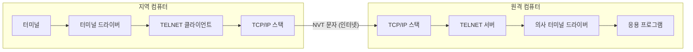

*그림 7. TELNET을 이용한 원격 로그인*

### 6.2 네트워크 가상 터미널

원격 컴퓨터에 접근하는 메커니즘이 복잡한 이유는 컴퓨터와 운영 체제마다 특별한 글자 조합을 토큰으로 받아들이기 때문이다. 예를 들어 DOS 운영 체제에서 파일의 끝(end-of-file) 토큰은 Ctrl+z이고, UNIX에서는 Ctrl+d이다. 이처럼 서로 다른 시스템을 다루므로, 세계의 어느 원격 컴퓨터에 접근하려면 그 컴퓨터의 종류를 알고 그 컴퓨터용 터미널 에뮬레이터를 설치해야 할 것이다. TELNET은 **NVT 문자 집합**이라는 보편적 인터페이스를 정의하여 이 문제를 푼다. TELNET 클라이언트는 지역 터미널에서 온 글자(데이터나 명령)를 NVT 형태로 바꾸어 네트워크에 보내고, TELNET 서버는 NVT 형태의 데이터와 명령을 원격 컴퓨터가 받아들이는 형태로 바꾼다.

> **용어 정의:** **네트워크 가상 터미널(network virtual terminal, NVT)** 은 TELNET이 정의한 보편적 문자 집합으로, 클라이언트와 서버가 각자의 지역 문자 집합과 NVT 사이를 변환하여 서로 다른 시스템 사이의 원격 로그인을 가능하게 한다.

NVT는 데이터용과 제어용 두 문자 집합을 쓰며, 둘 다 8비트 바이트이다. 데이터용 **NVT ASCII**는 하위 7비트가 US ASCII와 같고 최상위 비트가 0인 8비트 문자 집합이다. 최상위 비트를 0이나 1로 하는 8비트 ASCII를 보낼 수도 있지만, 그러려면 먼저 클라이언트와 서버가 옵션 협상으로 합의해야 한다. 컴퓨터 사이에 제어 문자를 보낼 때는 최상위 비트가 1인 8비트 문자 집합을 쓴다.

| 문자 | 십진수 | 이진수 | 뜻 |
|:-----|:-----|:-----|:-----|
| EOF | 236 | 11101100 | 파일의 끝 |
| EOR | 239 | 11101111 | 레코드의 끝 |
| SE | 240 | 11110000 | 하위 옵션 끝 |
| NOP | 241 | 11110001 | 아무 동작 없음 |
| DM | 242 | 11110010 | 데이터 표시 |
| BRK | 243 | 11110011 | 중단 |
| IP | 244 | 11110100 | 프로세스 인터럽트 |
| AO | 245 | 11110101 | 출력 중단 |
| AYT | 246 | 11110110 | 거기 있는가? |
| EC | 247 | 11110111 | 글자 지우기 |
| EL | 248 | 11111000 | 줄 지우기 |
| GA | 249 | 11111001 | 진행 |
| SB | 250 | 11111010 | 하위 옵션 시작 |
| WILL | 251 | 11111011 | 옵션을 켜는 데 동의 |
| WONT | 252 | 11111100 | 옵션을 켜는 것을 거부 |
| DO | 253 | 11111101 | 옵션 요청을 승인 |
| DONT | 254 | 11111110 | 옵션 요청을 거부 |
| IAC | 255 | 11111111 | 다음 문자를 제어로 해석 |

*표 9. NVT 제어 문자*

### 6.3 임베딩

TELNET은 TCP 연결 하나만 쓴다. 서버는 잘 알려진 **포트 23**을, 클라이언트는 임시 포트를 쓴다. 같은 연결로 데이터와 제어 문자를 모두 보내므로, TELNET은 제어 문자를 데이터 흐름에 끼워 넣는다(**임베딩, embedding**). 데이터와 제어 문자를 구별하기 위해 각 제어 문자 열 앞에는 **IAC(interpret as control)** 라는 특수 제어 문자를 붙인다.

예를 들어 사용자가 원격 서버에서 파일 file1의 내용을 보려고 UNIX 명령 `cat file1`을 입력하다가 파일 이름을 filea로 잘못 입력하여 백스페이스로 고쳤다고 가정한다.

```text
입력           : cat filea<backspace>1
서버로 가는 것 : c a t   f i l e a IAC EC 1
```

*그림 8. 제어 문자를 데이터에 끼워 넣는 임베딩의 예*

TELNET의 기본 구현에서는 사용자가 지역에서 편집할 수 없고 편집은 원격 서버에서 이루어진다. 그래서 백스페이스는 두 개의 원격 문자 IAC EC(글자 지우기)로 바뀌어 데이터에 끼워져 서버로 간다.

### 6.4 옵션과 옵션 협상

TELNET은 서비스를 쓰기 전이나 쓰는 도중에 클라이언트와 서버가 **옵션(option)** 을 협상하게 한다. 옵션은 더 정교한 터미널을 가진 사용자가 쓸 수 있는 추가 기능이며, 단순한 터미널을 가진 사용자는 기본 기능을 쓴다.

| 코드 | 옵션 | 뜻 |
|:-----|:-----|:-----|
| 0 | Binary | IAC를 제외한 모든 8비트 문자를 이진 데이터로 해석함. IAC를 받으면 다음 문자를 명령으로 해석하지만, IAC가 두 번 연달아 오면 첫째를 버리고 둘째를 데이터로 해석함 |
| 1 | Echo | 서버가 클라이언트에서 받은 데이터를 에코함. 이때 사용자 터미널은 입력한 글자를 직접 표시하지 않고 서버가 되돌려 보낸 글자를 기다림 |
| 3 | Suppress go-ahead | GA(진행) 문자를 보내지 않음 |
| 5 | Status | 서버에서 켜진 옵션의 상태를 물음 |
| 6 | Timing mark | 앞서 받은 모든 데이터를 처리했음을 나타내는 타이밍 표시를 보냄 |
| 24 | Terminal type | 클라이언트가 자신의 터미널 종류를 보냄 |
| 32 | Terminal speed | 클라이언트가 자신의 터미널 속도를 보냄 |
| 34 | Line mode | 클라이언트가 줄 모드로 바꿈 |

*표 10. TELNET의 주요 옵션*

옵션을 쓰려면 먼저 클라이언트와 서버가 **옵션 협상(option negotiation)** 을 해야 하며, 이에 네 가지 제어 문자를 쓴다.

| 문자 | 코드 | 뜻 1 | 뜻 2 | 뜻 3 |
|:-----|:-----|:-----|:-----|:-----|
| WILL | 251 | 켜기를 제안 | 켜기를 수락 | - |
| WONT | 252 | 켜기를 거부 | 끄기를 제안 | 끄기를 수락 |
| DO | 253 | 켜기를 승인 | 켜기를 요청 | - |
| DONT | 254 | 켜기를 불허 | 끄기를 승인 | 끄기를 요청 |

*표 11. 옵션 협상에 쓰는 NVT 문자*

옵션 중에는 서버만, 클라이언트만, 또는 양쪽 모두 켤 수 있는 것이 있다. 옵션은 **제안(offer)** 이나 **요청(request)** 으로 켜고 끈다.

- **켜기 제안:** 옵션을 켤 권한이 있는 쪽이 옵션을 켜겠다고 묻는 WILL을 보내면, 상대는 그렇게 하라는 DO나 하지 말라는 DONT로 답한다.
- **켜기 요청:** 상대에게 옵션을 켜 달라고 DO를 보내면, 상대는 켜겠다는 WILL이나 켜지 않겠다는 WONT으로 답한다.
- **끄기 제안:** 켜진 옵션을 더는 쓰지 않겠다고 WONT을 보내면, 상대는 더는 쓰지 말라는 DONT로 답해야 하며 거부할 수 없다.
- **끄기 요청:** 상대에게 옵션을 꺼 달라고 DONT를 보내면, 상대는 더는 쓰지 않겠다는 WONT으로 답해야 하며 거부할 수 없다.

**예제 20.1.** 클라이언트가 서버에 보낸 각 글자를 서버가 에코하기를 원한다. 곧 사용자가 키보드로 입력한 글자가 서버로 갔다가 처리되기 전에 사용자의 화면으로 되돌아오게 한다. 에코 옵션은 글자를 사용자 터미널로 되돌려 보내는 서버가 켜는 것이므로, 클라이언트는 DO로 서버에 옵션을 켜 달라고 요청한다. 요청은 IAC, DO, ECHO의 세 문자이다. 서버는 요청을 수락하여 옵션을 켜고, 세 문자 IAC, WILL, ECHO로 클라이언트에 알린다.

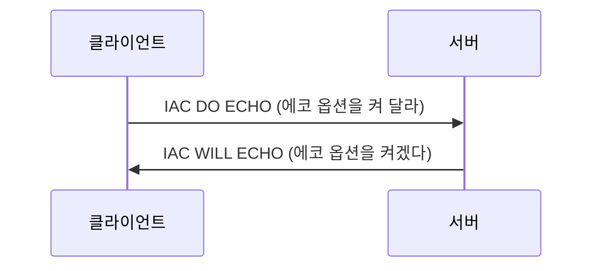

*그림 9. 예제 20.1: 에코 옵션의 협상*

TELNET의 옵션 협상은 **대칭적(symmetric)** 이어서 클라이언트와 서버에 같은 기회가 주어진다. 연결이 시작될 때 양쪽 모두 옵션이 꺼진 기본 TELNET 구현을 쓴다고 가정하고, 어느 쪽이든 옵션을 켜고 싶으면 제안하거나 요청한다. 상대는 그 옵션을 쓸 수 없거나 쓰고 싶지 않으면 제안을 불허하거나 요청을 거부할 수 있다. 이 덕분에 TELNET을 확장할 수 있다. 더 정교한 TELNET을 설치한 쪽은 새 옵션을 제안하거나 요청하고, 상대도 그 옵션을 지원하면 옵션이 켜지며, 그렇지 않으면 거부된다.

**하위 옵션 협상.** 터미널의 종류나 속도처럼 추가 정보가 필요한 옵션은 문자열이나 수를 함께 보내야 하며, 이를 위해 하위 옵션 문자 SB(250, 하위 옵션 시작)와 SE(240, 하위 옵션 끝)를 쓴다. 예를 들어 클라이언트가 터미널 종류를 정할 때는 다음과 같이 협상한다.

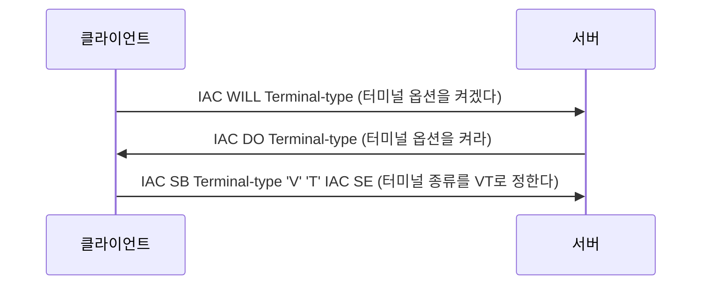

*그림 10. 하위 옵션 협상으로 터미널 종류를 정하는 과정*

### 6.5 원격 프로그램의 제어

지역에서 응용 프로그램을 실행할 때는 특수 문자로 프로그램을 중단하거나(예: Ctrl+c) 마지막 글자를 지운다(예: Delete나 Backspace). 프로그램이 원격 컴퓨터에서 실행될 때는 이 제어 문자를 원격 기계에 보내야 하므로, 사용자가 입력한 같은 키 조합을 특수 문자로 바꾸어 서버로 보낸다.

- **IP(interrupt process, 244):** 지역에서는 무한 루프에 빠진 프로그램을 Ctrl+c로 중단하면 운영 체제가 함수를 호출하여 프로그램을 멈춘다. 프로그램이 원격 기계에서 실행 중이면 원격 기계의 운영 체제가 그 함수를 호출해야 하므로, TELNET은 원격 기계에서 인터럽트 함수를 부르는 명령으로 해석되는 IP 제어 문자를 정의한다. 사용자가 Ctrl+c를 입력하면 TELNET 클라이언트는 IAC IP를 서버로 보낸다.
- **AO(abort output, 245):** IP와 같지만 프로세스가 출력만 만들지 않고 계속 실행되게 한다. 예를 들어 출력은 필요 없고 종료 상태만 필요할 때 쓴다.
- **AYT(are you there?, 246):** 특히 서버가 오래 조용할 때 원격 기계가 아직 살아 있는지 확인한다. 서버는 보통 소리나 화면 신호로 동작 중임을 알린다.
- **EC(erase character, 247):** 원격 기계에서 마지막으로 입력한 글자를 지운다.
- **EL(erase line, 248):** 원격 호스트에서 현재 줄을 지운다.

**대역 외 신호(out-of-band signaling).** 원격 서버의 응용 프로그램이 무한 루프에 빠져 입력을 더 받지 않는다고 가정한다. 프로그램이 버퍼의 데이터를 읽지 않으므로 서버의 TCP는 버퍼가 가득 찼다는 것을 알고 클라이언트의 윈도우 크기를 0으로 알리는 세그먼트를 보낸다. 곧 서버의 TCP는 일반 트래픽을 더 받지 않는다. 이때 사용자가 보낸 IAC IP는 일반 데이터처럼 버퍼에 막혀 전달되지 않는다. 이 상황을 해결하려면 클라이언트가 서버로 **긴급(urgent) TCP 세그먼트**를 보내야 하며, 긴급 세그먼트는 일반 흐름 제어 메커니즘을 무시하고 받아들여진다(8장의 긴급 데이터). TELNET 프로세스는 대역 외로 보낼 제어 문자열을 데이터 흐름에 끼워 넣고 **DM(data mark)** 이라는 특수 문자를 덧붙인 뒤, 긴급 비트를 켜고 긴급 포인터가 DM 문자를 가리키는 TCP 세그먼트를 만든다. 수신 프로세스는 데이터를 읽으면서 제어 문자(예: IAC와 IP) 앞의 데이터를 버리고, DM 문자에 이르면 나머지 데이터를 정상적으로 처리한다. 곧 DM은 수신 프로세스를 긴급 모드에서 일반 모드로 되돌리고 양쪽을 다시 동기화하는 문자이다.

```text
               버려짐             유지됨
서버 쪽 수신: | Data | IAC IP DM | Data |
                              ^
                        긴급 포인터
```

*그림 11. 대역 외 신호에서 DM과 긴급 포인터*

**이스케이프 문자.** 사용자가 입력한 글자는 보통 서버로 가지만, 때로는 서버가 아니라 클라이언트가 해석해야 하는 글자가 있다. 이때 사용자는 보통 Ctrl+](^]로 표시)인 **이스케이프 문자(escape character)** 를 쓴다. 예를 들어 Ctrl+c는 원격 사이트의 응용 프로그램을 중단시키지만, Ctrl+]는 지역 사이트의 클라이언트 프로세스를 중단시키고 TELNET 프롬프트를 표시한다. 일반 사용자는 TELNET 명령을 직접 쓰지 않고, 운영 체제가 정의한 open(원격 컴퓨터에 연결), close(연결 닫기), display(동작 매개변수 표시), mode(줄 모드나 글자 모드로 전환), set(동작 매개변수 설정), status(상태 정보 표시), send(특수 문자 보내기), quit(TELNET 종료) 같은 사용자 친화적인 인터페이스 명령을 쓰며, 인터페이스가 이 명령을 프로토콜의 명령으로 바꾼다.

### 6.6 동작 모드와 보안 문제

대부분의 TELNET 구현은 세 가지 모드 중 하나로 동작한다.

| 모드 | 에코와 편집 | 전송 단위 | 특징 |
|:-----|:-----|:-----|:-----|
| 기본 모드(default mode) | 클라이언트가 에코 | 한 줄 | 줄 하나를 보낸 뒤 서버의 GA(진행)를 기다렸다가 다음 줄을 받는 반이중 동작, TCP 연결이 전이중이므로 비효율적이어서 거의 쓰이지 않음 |
| 글자 모드(character mode) | 서버가 에코 | 한 글자 | 글자마다 세 TCP 세그먼트(글자 전송, 서버의 확인 응답과 에코, 클라이언트의 확인 응답)가 필요해 트래픽이 많고, 전송 시간이 길면(예: 위성 연결) 에코가 늦음 |
| 줄 모드(line mode) | 클라이언트가 줄 편집(에코, 글자와 줄 지우기) | 한 줄 | 기본 모드와 비슷하지만 GA 없이 줄을 연달아 보내는 전이중 동작 |

*표 12. TELNET의 동작 모드*

예제 20.2는 기본 모드의 동작을 보여 준다. 서버가 GA를 보내면 클라이언트가 WILL TERMINAL TYPE을 보내고 서버가 DO TERMINAL TYPE으로 답하며, 다시 GA 뒤에 클라이언트가 WILL TERMINAL SPEED를 보내고 서버가 DONT TERMINAL SPEED로 거부한다. 이어 서버가 "Login:" 뒤에 GA를 보내면 클라이언트가 로그인 이름을, "Password:" 뒤에 GA를 보내면 비밀번호를 보내고, 다시 GA 뒤에 클라이언트가 명령(예: cp file1 file2)을 보낸다. 매번 GA를 기다리는 것이 반이중 동작의 비효율을 보여 준다.

**예제 20.3.** 클라이언트가 글자 모드로 바꾸려면 서버에 SUPPRESS GO AHEAD와 ECHO 옵션을 켜 달라고 요청해야 한다.

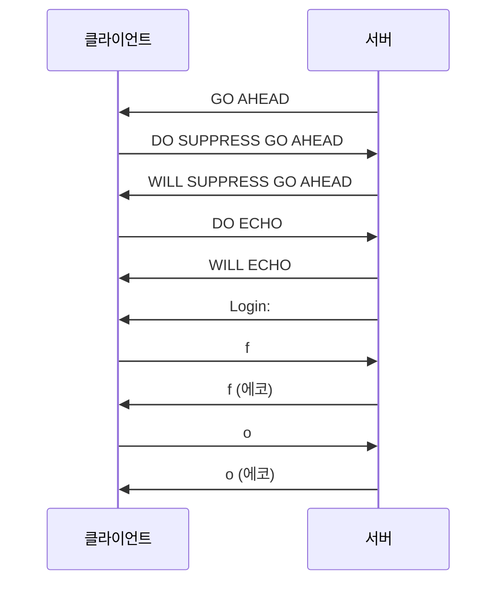

*그림 12. 예제 20.3: 글자 모드로 바꾸는 협상과 글자 단위의 에코*

**보안 문제.** TELNET은 보안에 문제가 있다. TELNET은 로그인 이름과 비밀번호를 요구하지만 이것만으로는 충분하지 않다. 방송형 LAN에 연결된 컴퓨터는 엿보기(snooper) 소프트웨어로 쉽게 엿들어 로그인 이름과 비밀번호를 가로챌 수 있다. 이 문제를 해결하는 것이 다음 절의 SSH이다.

---

<br>

## 7. SSH

**SSH(Secure Shell)** 는 또 다른 인기 있는 원격 로그인 응용 프로그램이다. SSH도 TELNET처럼 TCP를 아래의 전송 프로토콜로 쓰지만, TELNET보다 안전하고 더 많은 서비스를 제공한다. SSH 서버는 기본적으로 TCP 포트 22를 쓴다 [2]. SSH에는 서로 호환되지 않는 SSH-1과 SSH-2 두 버전이 있으며, SSH-1은 보안 결함 때문에 쓰지 않는다.

> **용어 정의:** **SSH(Secure Shell)** 는 TCP 위에 안전한 채널을 만들어 원격 로그인, 파일 전송, 포트 포워딩 같은 응용에 기밀성, 무결성, 인증을 제공하는 응용 계층 프로토콜이다.

SSH는 다음 구성 요소로 이루어진다.

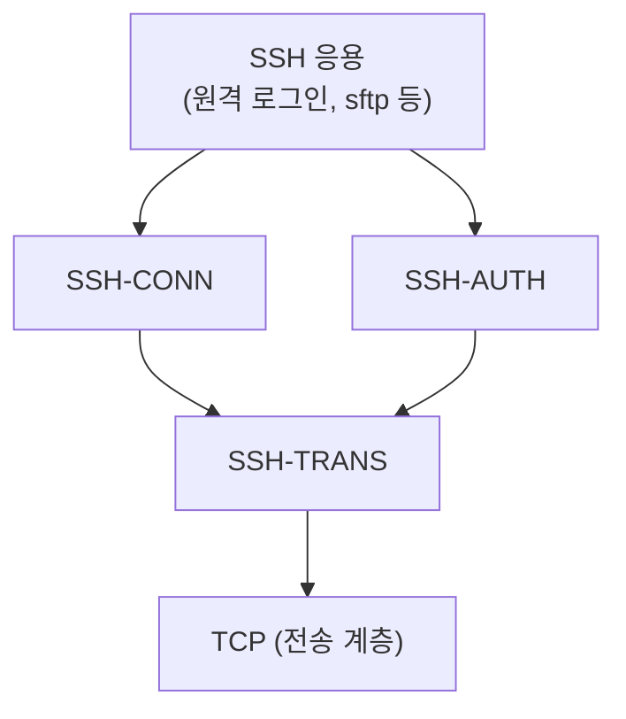

*그림 13. SSH의 구성 요소*

- **SSH 전송 계층 프로토콜(SSH-TRANS):** TCP는 안전한 전송 계층 프로토콜이 아니므로, SSH는 먼저 TCP 위에 안전한 채널을 만드는 SSH-TRANS를 쓴다. 클라이언트와 서버는 TCP로 안전하지 않은 연결을 맺은 뒤 여러 보안 매개변수를 교환하여 TCP 위에 안전한 채널을 만든다. SSH-TRANS가 제공하는 서비스는 (1) 주고받는 메시지의 프라이버시(기밀성), (2) 클라이언트와 서버가 주고받는 메시지를 침입자가 바꾸지 않았음을 보장하는 데이터 무결성, (3) 클라이언트가 서버가 주장하는 그 서버임을 확인하는 서버 인증, (4) 시스템의 효율을 높이고 공격을 더 어렵게 하는 메시지 압축이다.
- **SSH 인증 프로토콜(SSH-AUTH):** 안전한 채널이 만들어지고 서버가 클라이언트에게 인증되면, SSH는 서버에게 클라이언트를 인증하는 소프트웨어를 부른다.
- **SSH 연결 프로토콜(SSH-CONN):** 안전한 채널이 만들어지고 서버와 클라이언트가 서로 인증되면, SSH는 SSH-CONN을 부른다. SSH-CONN이 제공하는 서비스 중 하나가 다중화이다. SSH-CONN은 앞의 두 프로토콜이 만든 안전한 채널 위에 클라이언트가 여러 논리 채널을 만들 수 있게 한다.

> **[정보보호]** **기밀성(confidentiality)** 은 허가되지 않은 사람이 메시지의 내용을 알 수 없게 하는 성질이고, **무결성(integrity)** 은 메시지가 전송 중에 바뀌지 않았음을 보장하는 성질이며, **인증(authentication)** 은 통신 상대가 주장하는 그 개체임을 확인하는 것이다. SSH-TRANS는 이 세 가지를 모두 제공하며, 이를 구현하는 암호 기법은 26장에서 다룬다.

**SSH 응용.** 연결 단계가 끝나면 SSH는 여러 응용 프로그램이 연결을 쓰게 한다. 각 응용은 논리 채널을 하나 만들어 안전한 연결의 이점을 누린다. 원격 로그인은 SSH-CONN을 쓰는 서비스 중 하나이고, 파일 전송 응용도 논리 채널 하나를 쓸 수 있다(8.5절의 sftp).

**포트 포워딩(port forwarding).** SSH의 흥미로운 서비스 중 하나가 포트 포워딩이다. SSH의 안전한 채널로 보안 서비스를 제공하지 않는 응용 프로그램에 접근할 수 있다. TELNET이나 SMTP 같은 응용은 포트 포워딩으로 SSH의 서비스를 쓸 수 있다. SSH 포트 포워딩은 다른 프로토콜의 메시지가 지나갈 수 있는 터널을 만들므로 **SSH 터널링(SSH tunneling)** 이라고도 한다. TELNET 클라이언트와 TELNET 서버 사이의 직접적이지만 안전하지 않은 연결을 포트 포워딩으로 바꿀 수 있다. TELNET 클라이언트는 지역의 SSH 클라이언트를 써서 원격의 SSH 서버와 안전한 연결을 맺고, TELNET 클라이언트와 서버 사이의 모든 요청과 응답은 SSH 클라이언트와 서버가 만든 터널을 지난다. 터널링은 26장에서 다시 다룬다.

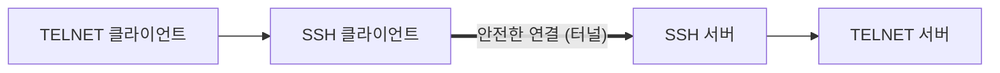

*그림 14. SSH 포트 포워딩*

**SSH 패킷 형식.** 교재는 SSH 프로토콜이 쓰는 패킷을 다음 형식으로 설명한다.

```text
| Length (4 bytes) | Padding (1-8 bytes) | Type (1 byte) | Data (variable) | CRC (4 bytes) |
                   |<------------------- 기밀성을 위해 암호화 ------------------------>|
```

*그림 15. 교재가 제시하는 SSH 패킷 형식*

- **Length:** 패딩과 길이 필드를 뺀, 타입과 데이터와 CRC 필드를 포함한 패킷의 길이이다.
- **Padding:** 보안 장치에 대한 공격을 더 어렵게 하려고 1\~8바이트의 패딩을 더한다.
- **Type:** SSH 프로토콜이 쓰는 패킷의 종류를 정한다.
- **Data:** 가변 길이 필드이며, 길이 필드의 값에서 5바이트를 빼면 데이터의 길이가 나온다.
- **CRC:** 오류 검출을 위한 순환 중복 검사(18장) 필드이다.

> **참고:** **CRC와 무결성.** CRC는 전송 중의 우연한 비트 오류를 검출하는 기법이며, 의도적으로 메시지를 바꾸는 공격자는 바꾼 메시지에 맞는 CRC를 다시 계산할 수 있으므로 CRC만으로는 공격자의 변조를 막지 못한다. 그래서 SSH가 제공하는 데이터 무결성은 SSH-TRANS의 암호 기법으로 보장되며, 그 방법은 26장의 메시지 무결성에서 다룬다.

---

<br>

## 8. FTP

**FTP(File Transfer Protocol)** 는 한 호스트에서 다른 호스트로 파일을 복사하기 위해 TCP/IP가 제공하는 표준 메커니즘이다. 시스템 사이의 파일 전송은 단순해 보이지만 먼저 해결할 문제가 있다. 두 시스템은 파일 이름 규칙이 다를 수 있고, 텍스트와 데이터를 나타내는 방법이 다를 수 있으며, 디렉터리 구조가 다를 수 있다. FTP는 이 문제를 단순하고 우아하게 해결한다.

### 8.1 제어 연결과 데이터 연결

FTP가 다른 클라이언트-서버 응용과 다른 점은 호스트 사이에 연결을 두 개 맺는다는 것이다. 하나는 데이터 전송에, 다른 하나는 제어 정보(명령과 응답)에 쓴다. 명령과 데이터 전송을 분리하면 FTP가 더 효율적이다. 제어 연결은 한 번에 명령 한 줄이나 응답 한 줄만 보내므로 매우 단순한 통신 규칙을 쓰고, 데이터 연결은 전송하는 데이터의 종류가 다양하므로 더 복잡한 규칙이 필요하다. FTP는 TCP의 서비스를 쓰며, 잘 알려진 TCP 포트 두 개를 쓴다. **포트 21**은 제어 연결에, **포트 20**은 데이터 연결에 쓴다.

> **용어 정의:** **FTP 제어 연결(FTP control connection)** 은 FTP 클라이언트와 서버의 제어 프로세스 사이에서 서버의 포트 21로 맺어져 세션 내내 유지되며 명령과 응답을 운반하는 TCP 연결이다.

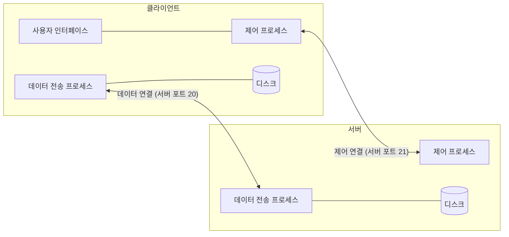

*그림 16. FTP의 기본 모델*

클라이언트는 사용자 인터페이스, 클라이언트 제어 프로세스, 클라이언트 데이터 전송 프로세스의 세 구성 요소를, 서버는 서버 제어 프로세스와 서버 데이터 전송 프로세스의 두 구성 요소를 가진다. 제어 연결은 제어 프로세스 사이에, 데이터 연결은 데이터 전송 프로세스 사이에 맺어진다. 제어 연결은 대화형 FTP 세션 내내 연결되어 있고, 데이터 연결은 파일을 전송할 때마다 열렸다가 닫힌다. 곧 사용자가 FTP 세션을 시작하면 제어 연결이 열리고, 제어 연결이 열려 있는 동안 여러 파일을 전송하면 데이터 연결이 여러 번 열리고 닫힌다.

**제어 연결의 수립.** 다른 응용 프로그램과 같은 방식으로 두 단계를 거친다.

1. 서버가 잘 알려진 포트 21에서 수동 열기(passive open)를 하고 클라이언트를 기다린다.
2. 클라이언트가 임시 포트로 능동 열기(active open)를 한다.

이 연결은 전체 과정 동안 열려 있다. 제어 연결은 사람과 서버 사이의 대화형 연결이어서 사용자가 명령을 입력하고 큰 지연 없이 응답을 받기를 기대하므로, IP가 쓰는 서비스 유형은 지연 최소화(minimize delay)이다.

**데이터 연결의 수립.** 데이터 연결은 서버 쪽에서 잘 알려진 포트 20을 쓰지만, 만드는 방식이 지금까지 본 것과 다르다.

1. 서버가 아니라 **클라이언트**가 임시 포트로 수동 열기를 한다. 파일 전송 명령을 내리는 쪽이 클라이언트이기 때문이다.
2. 클라이언트가 PORT 명령으로 이 포트 번호를 서버에 보낸다.
3. 서버가 포트 번호를 받아 잘 알려진 포트 20과 받은 임시 포트 번호로 능동 열기를 한다.

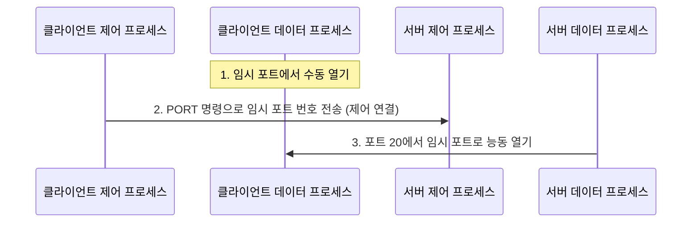

*그림 17. FTP 데이터 연결의 수립*

PASV 명령을 쓰면 이 단계가 바뀐다. 클라이언트가 서버에 포트 번호를 먼저 고르라고 요청하면, 서버는 그 포트에서 수동 열기를 하고 응답(227)으로 포트 번호를 보내며, 클라이언트가 그 포트 번호로 능동 열기를 한다.

### 8.2 이질성의 해결

FTP 클라이언트와 서버는 서로 다른 컴퓨터에서 실행되며 운영 체제, 문자 집합, 파일 구조, 파일 형식이 다를 수 있다. FTP는 제어 연결과 데이터 연결에 서로 다른 방법으로 이 이질성을 해결한다.

**제어 연결의 통신.** FTP는 TELNET이나 SMTP와 같은 방법으로 제어 연결에서 통신한다. NVT ASCII 문자 집합을 쓰며, 명령과 응답으로 통신한다. 한 번에 명령(또는 응답) 하나를 보내고 각 명령이나 응답은 짧은 한 줄이므로 파일 형식이나 구조를 걱정할 필요가 없다. 각 줄은 두 글자(CR과 LF)의 줄 끝 표시로 끝난다.

**데이터 연결의 통신.** 데이터 연결으로 파일을 전송하기 전에, 클라이언트는 제어 연결으로 전송할 파일의 **파일 형식**, **데이터 구조**, **전송 모드**를 정하여 이질성 문제를 해결한다.

| 속성 | 값 | 설명 |
|:-----|:-----|:-----|
| 파일 형식 | ASCII 파일 | 텍스트 파일 전송의 기본값, 송신자는 파일을 NVT ASCII로 바꾸고 수신자는 자신의 표현으로 바꿈 |
| 파일 형식 | EBCDIC 파일 | 한쪽이나 양쪽이 EBCDIC 부호화를 쓰면 EBCDIC으로 전송 |
| 파일 형식 | 이미지 파일 | 이진 파일 전송의 기본값, 해석이나 부호화 없이 비트의 연속된 흐름으로 보내며 컴파일된 프로그램 같은 이진 파일에 씀 |
| 인쇄 속성 (ASCII, EBCDIC) | Nonprint | 텍스트 파일의 기본값, 수직 이동에 관한 인쇄 문자가 없어 추가 처리 없이는 인쇄할 수 없으며 저장했다가 나중에 처리할 파일에 씀 |
| 인쇄 속성 (ASCII, EBCDIC) | TELNET | CR, LF, NL, VT 같은 NVT ASCII 수직 문자를 담아 전송 뒤에 바로 인쇄할 수 있음 |
| 데이터 구조 | 파일 구조 (기본값) | 구조가 없는 연속된 바이트 흐름 |
| 데이터 구조 | 레코드 구조 | 파일을 레코드로 나눔, 텍스트 파일에만 씀 |
| 데이터 구조 | 페이지 구조 | 파일을 페이지 번호와 페이지 헤더를 가진 페이지로 나누며, 페이지는 임의로나 순차로 저장하고 접근할 수 있음 |
| 전송 모드 | 스트림 모드 (기본값) | 데이터를 연속된 바이트 흐름으로 TCP에 넘기고 TCP가 알맞은 크기의 세그먼트로 나눔, 파일 구조라면 송신자가 데이터 연결을 닫는 것이 파일의 끝이고, 레코드 구조라면 레코드마다 1바이트 EOR, 파일 끝에 1바이트 EOF를 붙임 |
| 전송 모드 | 블록 모드 | 데이터를 블록 단위로 TCP에 넘기며, 각 블록 앞에 블록 기술자 1바이트와 블록 크기 2바이트로 된 3바이트 헤더를 붙임 |
| 전송 모드 | 압축 모드 | 큰 파일을 압축하여 보냄, 보통 같은 데이터 단위가 연속되면 하나와 반복 횟수로 바꾸는 런 렝스(run-length) 부호화를 쓰며 텍스트 파일에서는 주로 공백을, 이진 파일에서는 주로 널 문자를 압축 |

*표 13. FTP 데이터 연결의 파일 형식, 데이터 구조, 전송 모드*

### 8.3 명령과 응답

FTP는 제어 연결으로 클라이언트 제어 프로세스와 서버 제어 프로세스 사이의 통신을 맺는다. 명령은 클라이언트에서 서버로, 응답은 서버에서 클라이언트로 간다. 명령은 ASCII 대문자로 쓰며 인자가 뒤따를 수 있다. 명령은 대략 여섯 무리로 나뉜다.

| 무리 | 명령 (인자) | 설명 |
|:-----|:-----|:-----|
| 접근 | USER (사용자 ID), PASS (비밀번호), ACCT (과금 계정), REIN, QUIT, ABOR | 사용자 정보, 비밀번호, 계정 정보, 다시 초기화, 로그아웃, 앞 명령 중단 |
| 파일 관리 | CWD (디렉터리), CDUP, DELE (파일), LIST (디렉터리), NLST (디렉터리), MKD (디렉터리), PWD, RMD (디렉터리), RNFR (옛 이름), RNTO (새 이름), SMNT (파일 시스템) | 다른 디렉터리로 이동, 상위 디렉터리로 이동, 파일 삭제, 하위 디렉터리나 파일 나열, 속성 없이 나열, 디렉터리 만들기, 현재 디렉터리 이름 표시, 디렉터리 삭제, 이름을 바꿀 파일 지정, 이름 바꾸기, 파일 시스템 마운트 |
| 데이터 형식 | TYPE (A, E, I, N, T), STRU (F, R, P), MODE (S, B, C) | 파일 형식, 데이터 구조, 전송 모드를 정함 |
| 포트 정의 | PORT (6자리 식별자), PASV | 클라이언트가 포트를 고름, 서버가 포트를 고름 |
| 파일 전송 | RETR (파일), STOR (파일), APPE (파일), STOU (파일), ALLO (파일), REST (파일), STAT (파일) | 서버에서 클라이언트로 가져오기, 클라이언트에서 서버로 저장하기, 파일이 있으면 덧붙이며 저장, 디렉터리에서 유일한 이름으로 저장, 서버에 저장 공간 할당, 파일 표시를 지정한 위치로 옮김, 파일 상태 반환 |
| 기타 | HELP, NOOP, SITE (명령), SYST | 서버에 관한 정보 요청, 서버가 살아 있는지 확인, 사이트 고유 명령 지정, 서버의 운영 체제 질의 |

*표 14. FTP 명령*

모든 FTP 명령은 적어도 하나의 응답을 만든다. 응답은 세 자리 수와 그 뒤의 텍스트로 이루어지며, 수는 코드를, 텍스트는 필요한 매개변수나 추가 설명을 정의한다. 세 자리를 xyz로 나타내면 다음과 같다.

| 자리 | 값 | 뜻 |
|:-----|:-----|:-----|
| 첫째 자리 | 1yz | 긍정 예비 응답: 동작이 시작되었으며, 서버는 다른 명령을 받기 전에 응답을 하나 더 보냄 |
| 첫째 자리 | 2yz | 긍정 완료 응답: 동작이 완료되었으며, 서버는 다른 명령을 받음 |
| 첫째 자리 | 3yz | 긍정 중간 응답: 명령을 받았지만 추가 정보가 필요함 |
| 첫째 자리 | 4yz | 일시적 부정 완료 응답: 동작이 일어나지 않았지만 일시적인 오류이므로 같은 명령을 나중에 다시 보낼 수 있음 |
| 첫째 자리 | 5yz | 영구적 부정 완료 응답: 명령을 받아들이지 않았으며 다시 시도하면 안 됨 |
| 둘째 자리 | x0z, x1z, x2z, x3z, x4z, x5z | 구문, 정보, 연결, 인증과 계정, 미지정, 파일 시스템 |
| 셋째 자리 | - | 추가 정보 |

*표 15. FTP 응답 코드의 각 자리의 뜻*

| 코드 | 설명 | 코드 | 설명 |
|:-----|:-----|:-----|:-----|
| 120 | 서비스가 곧 준비됨 | 331 | 사용자 이름 정상, 비밀번호 필요 |
| 125 | 데이터 연결이 열려 있음, 데이터 전송이 곧 시작됨 | 332 | 로그인에 계정 필요 |
| 150 | 파일 상태 정상, 데이터 연결이 곧 열림 | 350 | 파일 동작 대기 중, 추가 정보 필요 |
| 200 | 명령 정상 | 425 | 데이터 연결을 열 수 없음 |
| 220 | 서비스 준비 완료 | 426 | 연결이 닫혀 전송 중단 |
| 221 | 서비스 종료 | 450 | 파일을 쓸 수 없어 동작하지 않음 |
| 225 | 데이터 연결이 열려 있음 | 500 | 구문 오류, 알 수 없는 명령 |
| 226 | 데이터 연결을 닫는 중 | 501 | 매개변수나 인자의 구문 오류 |
| 227 | 수동 모드로 들어감, 서버가 IP 주소와 포트 번호를 보냄 | 502 | 구현되지 않은 명령 |
| 230 | 사용자 로그인 정상 | 530 | 로그인하지 않은 사용자 |
| 250 | 요청한 파일 동작 정상 | 550 | 파일을 쓸 수 없어 동작하지 않음 |

*표 16. FTP의 주요 응답 코드*

### 8.4 파일 전송의 예

파일 전송은 제어 연결으로 보낸 명령의 통제 아래 데이터 연결에서 일어난다. FTP의 파일 전송은 세 가지 중 하나이다. 서버에서 클라이언트로 파일을 복사하는 **가져오기(retrieving)** 는 RETR 명령으로, 클라이언트에서 서버로 파일을 복사하는 **저장하기(storing)** 는 STOR 명령으로, 서버에서 클라이언트로 디렉터리나 파일 이름의 목록을 보내는 것은 LIST 명령으로 한다. FTP는 디렉터리나 파일 이름의 목록도 파일로 취급하여 데이터 연결으로 보낸다.

**예제 21.1.** 디렉터리의 항목 목록을 가져오는 과정이다.

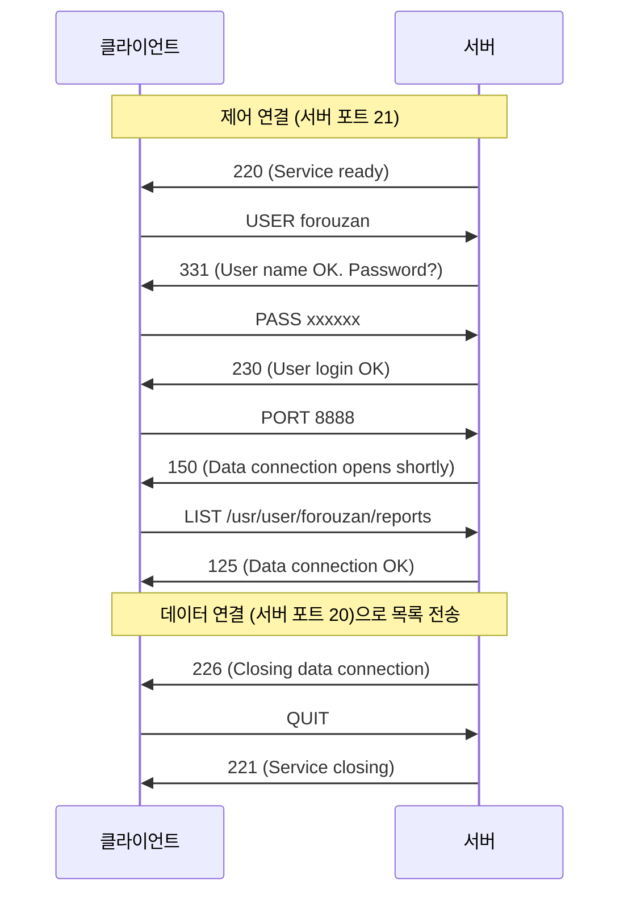

*그림 18. 예제 21.1: FTP로 디렉터리 목록을 가져오는 과정*

1. 포트 21로 제어 연결이 맺어지면 FTP 서버가 제어 연결으로 220(서비스 준비) 응답을 보낸다.
2. 클라이언트가 USER 명령을 보내고, 서버가 331(사용자 이름 정상, 비밀번호 필요)로 응답한다.
3. 클라이언트가 PASS 명령을 보내고, 서버가 230(로그인 정상)으로 응답한다.
4. 클라이언트가 데이터 연결을 위해 임시 포트에서 수동 열기를 하고, (제어 연결으로) PORT 명령을 보내 이 포트 번호를 서버에 알린다.
5. 서버는 아직 연결을 열지 않고, 서버 쪽 포트 20과 클라이언트에게 받은 임시 포트 사이의 데이터 연결에 능동 열기를 할 준비를 하며 150(데이터 연결이 곧 열림)을 보낸다.
6. 클라이언트가 LIST 메시지를 보낸다.
7. 서버가 125로 응답하고 데이터 연결을 연다.
8. 서버가 데이터 연결으로 파일이나 디렉터리의 목록을 (파일로) 보낸다. 목록을 모두 보내면 제어 연결으로 226(데이터 연결을 닫는 중)을 보낸다.
9. 클라이언트는 QUIT 명령으로 제어 연결을 닫거나 다른 명령으로 다른 작업(과 새 데이터 연결)을 시작할 수 있다. 이 예에서는 QUIT을 보낸다.
10. 서버가 221(서비스 종료)로 응답하고 제어 연결을 닫는다.

**예제 21.2.** 다음은 예제 21.1과 비슷한 실제 FTP 세션의 출력이다. 이 세션은 PORT 대신 수동 모드를 쓴다.

```text
$ ftp voyager.deanza.fhda.edu
Connected to voyager.deanza.fhda.edu.
220 (vsFTPd 1.2.1)
530 Please login with USER and PASS.
Name (voyager.deanza.fhda.edu:forouzan): forouzan
331 Please specify the password.
Password:
230 Login successful.
Remote system type is UNIX.
Using binary mode to transfer files.
ftp> ls reports
227 Entering Passive Mode (153,18,17,11,238,169)
150 Here comes the directory listing.
drwxr-xr-x 2 3027 411 4096 Sep 24 2002 business
drwxr-xr-x 2 3027 411 4096 Sep 24 2002 personal
drwxr-xr-x 2 3027 411 4096 Sep 24 2002 school
226 Directory send OK.
ftp> quit
221 Goodbye.
```

227 응답의 괄호 안 여섯 수 중 앞의 네 개(153.18.17.11)는 서버의 IP 주소이고, 뒤의 두 개는 서버가 고른 포트 번호의 상위 바이트와 하위 바이트이다. 따라서 데이터 연결에 쓸 서버의 포트는 238 × 256 + 169 = 61097이다.

**예제 21.3.** 이미지 파일을 저장할 때는 USER, PASS, PORT 뒤에 TYPE 명령(예: TYPE EBCDIC)과 STRU 명령(예: STRU R)으로 파일 형식과 데이터 구조를 정하고 각각 200(명령 정상) 응답을 받은 뒤, STOR 명령을 보낸다. 서버가 데이터 연결을 열고 250으로 응답하면 클라이언트는 데이터 연결으로 파일을 보내며, 파일을 다 보낸 뒤 데이터 연결을 닫는 것이 파일의 끝을 뜻한다. 서버는 제어 연결으로 226을 보낸다.

### 8.5 익명 FTP와 보안

FTP를 쓰려면 원격 서버에 계정(사용자 이름)과 비밀번호가 있어야 한다. 그러나 어떤 사이트는 공개적으로 접근할 수 있는 파일 모음을 가지고 있으며, 사용자는 계정이나 비밀번호 없이 사용자 이름으로 anonymous를, 비밀번호로 guest를 써서 접근할 수 있다. 이를 **익명 FTP(anonymous FTP)** 라 한다. 익명 사용자의 접근은 매우 제한되어, 대부분의 사이트는 일부 파일을 복사하는 것만 허용하고 디렉터리 탐색은 허용하지 않는다.

FTP는 보안이 큰 문제가 아니던 시절에 설계되었다. FTP는 비밀번호를 요구하지만 비밀번호가 **평문**으로 전송되므로 공격자가 가로채 쓸 수 있고, 데이터 연결도 데이터를 평문으로 전송하므로 안전하지 않다. 안전하게 하려면 FTP 응용 계층과 TCP 계층 사이에 SSL(26장)을 더할 수 있으며, 이 경우 FTP를 SSL-FTP라 한다. 안전한 채널로 파일을 전송하는 또 다른 방법은 독립된 프로토콜인 **sftp**(secure file transfer protocol)를 쓰는 것이다. sftp는 SSH의 일부인 UNIX 프로그램이며, SSH가 SSH 클라이언트와 서버 사이에 안전한 연결을 맺으면 이 연결을 쓰는(다중화하는) 응용 프로그램 중 하나가 sftp이다. 곧 sftp는 SSH의 응용 구성 요소에 속하며, FTP처럼 동작하는 대화형 프로그램이다.

---

<br>

## 9. TFTP

파일을 단순히 복사하기만 하면 되고 FTP의 모든 기능이 필요 없는 경우가 있다. 예를 들어 디스크 없는 워크스테이션이나 라우터가 부팅될 때는 부트스트랩 파일과 설정 파일을 내려받아야 하는데, FTP의 정교함은 필요 없고 파일을 빠르게 복사하는 프로토콜만 있으면 된다.

> **용어 정의:** **TFTP(Trivial File Transfer Protocol)** 는 UDP의 잘 알려진 포트 69를 쓰고, 정지 후 대기 방식으로 512바이트 블록을 주고받아 파일을 읽거나 쓰는 단순한 파일 전송 프로토콜이다.

TFTP는 매우 단순해서 디스크 없는 워크스테이션의 읽기 전용 메모리(ROM)에 들어갈 수 있으며 부트스트랩 시간에 쓸 수 있다. ROM에 들어갈 수 있는 이유는 기본적인 IP와 UDP만 필요하기 때문이다. 그러나 TFTP에는 보안 기능이 없다. TFTP는 클라이언트를 위해 파일을 읽거나 쓸 수 있다. **읽기**는 서버에서 클라이언트로, **쓰기**는 클라이언트에서 서버로 파일을 복사하는 것이다. TFTP는 **UDP**의 잘 알려진 **포트 69**를 쓴다.

### 9.1 메시지

TFTP 메시지에는 RRQ, WRQ, DATA, ACK, ERROR의 다섯 종류가 있으며, 모두 첫 필드가 2바이트 연산 코드(OpCode)이다.

```text
RRQ   : | OpCode = 1 (2 bytes) | File name (variable) | All 0s (1 byte) | Mode (variable) | All 0s (1 byte) |
WRQ   : | OpCode = 2 (2 bytes) | File name (variable) | All 0s (1 byte) | Mode (variable) | All 0s (1 byte) |
DATA  : | OpCode = 3 (2 bytes) | Block number (2 bytes) | Data (0-512 bytes) |
ACK   : | OpCode = 4 (2 bytes) | Block number (2 bytes) |
ERROR : | OpCode = 5 (2 bytes) | Error number (2 bytes) | Error data (variable) | All 0s (1 byte) |
```

*그림 19. TFTP 메시지의 형식*

- **RRQ(read request, 읽기 요청):** 클라이언트가 서버에서 데이터를 읽기 위한 연결을 맺을 때 쓴다. 파일 이름은 ASCII로 부호화한 가변 길이 문자열이며 끝을 1바이트 0으로 표시한다. 모드도 가변 길이 문자열이며 1바이트 0으로 끝나고, ASCII 파일을 뜻하는 "netascii"나 이진 파일을 뜻하는 "octet" 중 하나이다. 파일 이름과 모드는 대문자, 소문자, 또는 섞어 쓸 수 있다.
- **WRQ(write request, 쓰기 요청):** 클라이언트가 서버에 데이터를 쓰기 위한 연결을 맺을 때 쓴다. 형식은 RRQ와 같고 연산 코드만 2이다.
- **DATA:** 클라이언트나 서버가 데이터 블록을 보낼 때 쓴다. 블록 번호는 데이터를 보내는 쪽이 순서를 매기는 데 쓰는 2바이트 필드이며, 모든 블록은 1부터 차례로 번호를 받는다. 블록 번호는 확인 응답에 필요하다. 데이터 필드는 마지막 블록을 제외한 모든 DATA 메시지에서 정확히 512바이트여야 하고, 마지막 블록은 0\~511바이트여야 한다. 512바이트가 아닌 블록이 송신자가 모든 데이터를 보냈다는 신호, 곧 파일의 끝 표시이다. 파일의 데이터가 정확히 512바이트의 배수이면 송신자는 전송의 끝을 알리기 위해 0바이트 블록을 하나 더 보내야 한다. 데이터는 NVT ASCII(netascii)나 이진 옥텟(octet)으로 전송할 수 있다.
- **ACK(acknowledge, 확인 응답):** 클라이언트나 서버가 데이터 블록을 받았음을 알릴 때 쓰며, 길이는 4바이트이다. 블록 번호 필드에는 받은 블록의 번호가 들어간다. ACK는 WRQ에 대한 응답일 수도 있는데, 이때 서버는 데이터를 받을 준비가 되었음을 알리며 블록 번호 필드의 값은 0이다.
- **ERROR:** 연결을 맺을 수 없거나 데이터 전송 중에 문제가 생겼을 때 클라이언트나 서버가 쓴다. RRQ나 WRQ에 대한 부정 응답이 될 수 있고, 데이터 전송 단계에서 다음 블록을 보낼 수 없을 때도 쓴다. 손상되거나 중복된 메시지를 알리는 데는 쓰지 않으며, 이 문제는 9.3절의 오류 제어 메커니즘이 해결한다. 오류 번호는 오류의 종류를 정하고, 오류 데이터는 1바이트 0으로 끝나는 텍스트 오류 정보이다.

| 메시지 | 연산 코드 | 용도 |
|:-----|:-----|:-----|
| RRQ | 1 | 읽기(서버에서 클라이언트로 복사) 연결 요청 |
| WRQ | 2 | 쓰기(클라이언트에서 서버로 복사) 연결 요청 |
| DATA | 3 | 번호를 붙인 데이터 블록 (마지막을 제외하고 512바이트) |
| ACK | 4 | 받은 블록의 번호를 확인 (WRQ에 대한 응답이면 0) |
| ERROR | 5 | 연결 불가나 전송 문제를 알림 |

*표 17. TFTP의 메시지*

| 번호 | 뜻 | 번호 | 뜻 |
|:-----|:-----|:-----|:-----|
| 0 | 정의되지 않음 | 4 | 허용되지 않는 동작 |
| 1 | 파일을 찾을 수 없음 | 5 | 알 수 없는 포트 번호 |
| 2 | 접근 위반 | 6 | 파일이 이미 있음 |
| 3 | 디스크가 가득 차거나 할당량 초과 | 7 | 그런 사용자가 없음 |

*표 18. TFTP의 오류 번호*

### 9.2 연결과 데이터 전송

TFTP는 UDP의 서비스를 쓴다. UDP에는 연결 설정과 종료가 없으므로 각 데이터 블록은 독립적인 사용자 데이터그램에 캡슐화되어 전송된다. 그러나 TFTP는 같은 파일에 속한 블록들을 독립적으로 보내는 것이 아니라 하나의 연결로 묶어 보내야 한다. 그래서 TFTP는 RRQ, WRQ, ACK, ERROR 메시지로 연결을 맺고, 512바이트보다 작은(0\~511바이트) 블록을 담은 DATA 메시지로 연결을 끝낸다.

**연결 설정.** 읽기와 쓰기의 연결 설정 방식이 다르다.

- **읽기:** 클라이언트가 파일 이름과 전송 모드를 담은 RRQ를 보낸다. 서버가 파일을 전송할 수 있으면 첫 데이터 블록을 담은 DATA 메시지(블록 번호 1)로 긍정 응답을 하고, 파일을 열 수 없거나 권한이 없는 등의 문제가 있으면 ERROR 메시지로 부정 응답을 한다.
- **쓰기:** 클라이언트가 파일 이름과 전송 모드를 담은 WRQ를 보낸다. 서버가 파일의 사본을 받을 수 있으면 블록 번호가 0인 ACK로 긍정 응답을 하고, 문제가 있으면 ERROR 메시지로 부정 응답을 한다. 클라이언트는 이 확인 응답을 받은 뒤 블록 번호 1인 첫 데이터 블록을 보낸다.

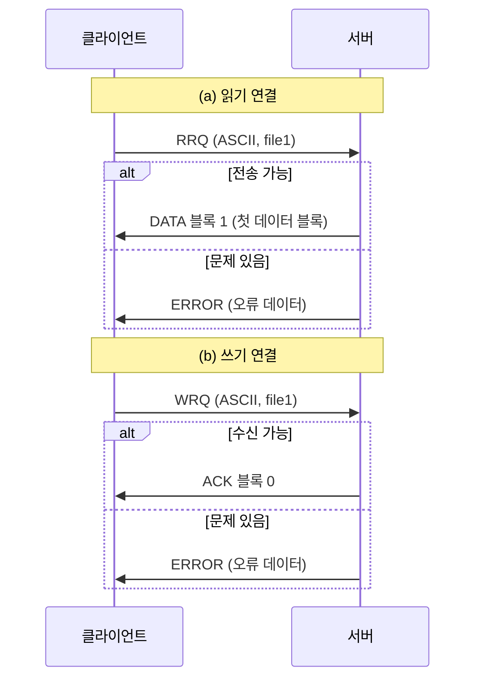

*그림 20. TFTP의 연결 설정*

**연결 종료.** 파일 전체를 전송하면 연결을 끝내야 하지만, TFTP에는 종료를 위한 특별한 메시지가 없다. 512바이트보다 작은 마지막 데이터 블록을 보내는 것이 종료이다.

**데이터 전송.** 데이터 전송 단계는 연결 설정과 종료 사이에 일어난다. 파일은 데이터 블록으로 나뉘며, 마지막을 제외한 각 블록은 정확히 512바이트이고 마지막 블록은 0\~511바이트이다.

### 9.3 흐름 제어와 오류 제어

UDP에는 흐름 제어와 오류 제어 메커니즘이 없으므로, TFTP가 연속된 데이터 블록으로 이루어진 파일을 전송하려면 자체 흐름 제어와 오류 제어를 만들어야 한다.

**흐름 제어.** TFTP는 데이터 블록을 DATA 메시지로 보내고 ACK 메시지를 기다린다. 송신자는 타임아웃 전에 확인 응답을 받으면 다음 블록을 보낸다. 곧 데이터 블록에 번호를 붙이고 다음 블록을 보내기 전에 ACK를 기다리는 방식으로 흐름 제어를 한다. 이는 7장의 **정지 후 대기(stop-and-wait)** 프로토콜이다. 파일을 가져올 때(읽기)는 클라이언트가 RRQ를 보내고 서버가 블록 번호 1인 첫 블록을 보내며, 파일을 저장할 때(쓰기)는 클라이언트가 WRQ를 보내고 서버가 블록 번호 0인 ACK로 답한 뒤 클라이언트가 블록 번호 1인 첫 블록을 보낸다.

**오류 제어.** TFTP의 오류 제어는 다른 프로토콜과 달리 **대칭적**이다. 송신자와 수신자가 모두 타임아웃을 쓴다. 송신자는 데이터 메시지에, 수신자는 확인 응답 메시지에 타임아웃을 쓴다. 데이터 메시지를 잃으면 송신자가 타임아웃 뒤에 재전송하고, 확인 응답을 잃으면 수신자가 타임아웃 뒤에 재전송한다. 오류 제어가 필요한 상황은 네 가지이다.

- **손상된 메시지:** 부정 확인 응답이 없다. 데이터 블록이 손상되면 수신자가 이를 검출하여 블록을 버리고, 송신자는 확인 응답을 기다리다가 타임아웃이 지나면 블록을 다시 보낸다. TFTP의 DATA 메시지에는 체크섬 필드가 없으므로, 수신자가 데이터 손상을 검출하는 방법은 UDP 사용자 데이터그램의 체크섬(6장)뿐이다.
- **잃어버린 메시지:** 블록을 잃으면 수신자에 도착하지 않으므로 확인 응답도 없고, 송신자가 타임아웃 뒤에 블록을 다시 보낸다.
- **잃어버린 확인 응답:** 수신자의 타이머가 송신자의 타이머보다 먼저 만료되면 수신자가 확인 응답을 재전송하고, 그렇지 않으면 송신자가 데이터를 재전송한다.
- **중복된 메시지:** 수신자는 블록 번호로 중복을 검출하여 중복된 블록을 버린다.

**마법사의 제자 버그(sorcerer's apprentice bug).** TFTP의 흐름 제어와 오류 제어는 대칭적이지만, 이 때문에 문제가 생길 수 있다. 계속 자신을 복제하는 대걸레를 불러낸 만화 캐릭터에서 이름을 딴 이 문제는 패킷의 ACK가 사라지지 않고 **지연**될 때 일어난다. 이 경우 그 뒤의 모든 블록이 두 번씩 보내지고 모든 확인 응답이 두 번씩 도착한다.

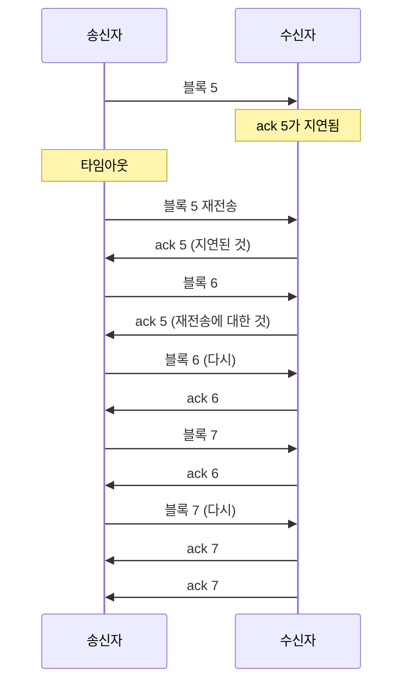

*그림 21. 마법사의 제자 버그*

다섯째 블록의 확인 응답이 지연되면 송신자는 타임아웃 뒤에 다섯째 블록을 다시 보내고, 수신자는 이를 다시 확인한다. 송신자는 다섯째 블록의 확인 응답을 두 번 받으므로 여섯째 블록을 두 번 보내고, 수신자는 여섯째 블록을 두 번 받아 확인 응답을 두 번 보내므로 일곱째 블록도 두 번 보내지는 식으로 계속된다.

**TFTP의 예.** 클라이언트가 2,000바이트 파일 file1의 사본을 가져온다. 2,000 = 512 × 3 + 464이므로 블록은 512, 512, 512, 464바이트의 네 개이다.

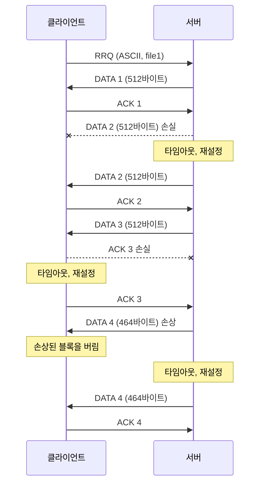

*그림 22. 2,000바이트 파일을 TFTP로 가져오는 예*

클라이언트가 RRQ를 보내면 서버가 첫 512바이트를 담은 첫 블록을 보내고, 이 블록은 손상 없이 도착하여 확인된다. 이 두 메시지가 연결 설정이다. 둘째 블록은 손실되어 서버가 타임아웃 뒤에 재전송한다. 셋째 블록은 손상 없이 도착하지만 확인 응답이 손실되어, 수신자(클라이언트)가 타임아웃 뒤에 확인 응답을 재전송한다. 나머지 464바이트를 담은 마지막 블록은 손상되어 도착하므로 클라이언트가 버리고, 서버가 타임아웃 뒤에 재전송한다. 이 블록은 512바이트보다 작으므로 연결 종료로 간주된다.

### 9.4 UDP 포트와 응용

UDP를 쓰는 프로세스는 보통 서버가 잘 알려진 포트에서 수동 열기를 하고 클라이언트가 임시 포트로 능동 열기를 하며, 이후 두 포트로 통신한다. TFTP는 다른 단계를 따른다. TFTP 클라이언트와 서버의 통신은 몇 초에서 몇 분까지 길어질 수 있으므로, TFTP 서버가 잘 알려진 포트 69로 한 클라이언트와 통신하면 그동안 다른 클라이언트가 서비스를 쓸 수 없다. 그래서 잘 알려진 포트는 처음 연결에만 쓰고 나머지 통신에는 임시 포트를 쓴다.

1. 서버가 잘 알려진 포트 69로 수동 열기를 한다.
2. 클라이언트가 출발지 포트로 임시 포트(예: 50032)를, 목적지 포트로 잘 알려진 포트 69를 써서 능동 열기를 한다. RRQ나 WRQ 메시지로 한다.
3. 서버가 출발지 포트로 새 임시 포트(예: 62000)를, 목적지 포트로 클라이언트에게 받은 임시 포트를 써서 능동 열기를 하고, 이 포트들로 DATA, ACK, ERROR 메시지를 보낸다. 이렇게 하면 잘 알려진 포트 69가 다른 클라이언트를 위해 비워진다. 클라이언트는 서버의 첫 메시지를 받으면 자신의 임시 포트와 서버가 보낸 임시 포트로 이후의 통신을 한다.

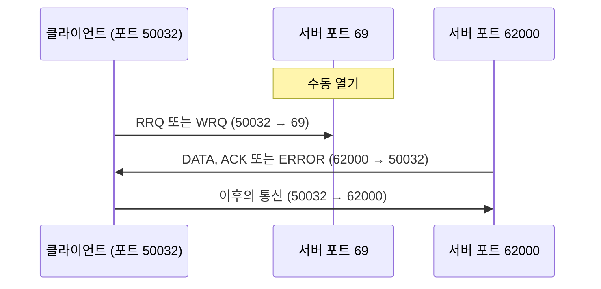

*그림 23. TFTP가 쓰는 UDP 포트 번호*

**옵션.** RRQ와 WRQ 메시지에 옵션을 덧붙이는 TFTP 확장이 제안되었다. 옵션은 주로 블록의 크기와 처음 순서 번호를 협상하는 데 쓴다. 옵션이 없으면 블록의 크기는 마지막 블록을 제외하고 512바이트이지만, 협상하면 메시지가 UDP 사용자 데이터그램에 캡슐화될 수 있는 한 어떤 크기로든 정할 수 있다. 상대가 옵션을 수락하거나 거부하게 하는 새 메시지인 OACK(option acknowledgment)도 제안되었다.

**보안.** TFTP에는 사용자 식별이나 비밀번호 같은 보안 장치가 없다. 그래서 해커가 파일에 접근하지 못하도록 TFTP의 접근을 중요하지 않은 파일로 제한하거나, TFTP 서버 가까이의 라우터에서 특정 호스트만 서버에 접근하게 하는 식으로 최소한의 보안을 구현한다.

**응용.** TFTP는 보안이 큰 문제가 아닌 기본적인 파일 전송에 매우 유용하며, 브리지나 라우터 같은 장치를 초기화하는 데 쓸 수 있다. 주된 응용은 DHCP(12장)와 함께 쓰는 것이다. TFTP는 적은 메모리만 필요하고 UDP와 IP의 서비스만 쓰므로 ROM에 쉽게 넣을 수 있다. 스테이션이 켜지면 DHCP 클라이언트로 DHCP 서버에서 설정 파일의 이름을 받고, 이 이름을 TFTP 클라이언트에 넘겨 TFTP 서버에서 설정 파일의 내용을 가져온다.

| 관점 | FTP | TFTP |
|:-----|:-----|:-----|
| 전송 프로토콜 | TCP | UDP |
| 잘 알려진 포트 | 21 (제어), 20 (데이터) | 69 (처음 연결) |
| 연결 | 제어 연결과 데이터 연결 두 개 | 메시지 교환으로 맺는 논리적 연결 하나 |
| 인증 | 사용자 이름과 비밀번호 (평문), 익명 FTP | 없음 |
| 기능 | 디렉터리 탐색, 파일 관리, 형식과 구조와 모드 선택 | 파일 읽기와 쓰기만 |
| 신뢰성 | TCP가 제공 | 정지 후 대기와 대칭적 타임아웃으로 직접 구현 |
| 대표 용도 | 일반 파일 전송 | 디스크 없는 장치의 부팅, DHCP와 함께 설정 파일 가져오기 |

*표 19. FTP와 TFTP의 비교*

---

<br>

## 요약

| 개념 | 핵심 요약 |
|:-----|:-----|
| 전자 메일의 구성 요소 | 사용자 에이전트, 메일함과 메시지 큐를 가진 메일 서버, 메일 서버 사이와 송신 쪽의 SMTP로 이루어진다. |
| 네 가지 시나리오 | 송수신자가 메일 서버와 떨어질수록 UA 두 개에 MTA 쌍과 MAA 쌍이 더해지며, 가장 흔한 넷째 시나리오는 UA 두 개, MTA 두 쌍, MAA 한 쌍이다. |
| SMTP | TCP 포트 25의 푸시 프로토콜로, HELO, MAIL FROM, RCPT TO, DATA, QUIT 명령과 세 자리 응답 코드로 메시지를 전송하며 본문까지 7비트 ASCII로 제한한다. |
| 메일 전송의 세 단계 | 연결 설정(220, HELO, 250), 메시지 전송(봉투, DATA, 354, 본문, 마침표 줄, 250), 연결 종료(QUIT, 221)이다. |
| SMTP와 HTTP | HTTP는 풀, SMTP는 푸시이며, SMTP는 7비트 ASCII 제한이 있고 여러 객체를 메시지 하나에 담는다. |
| MIME | 다섯 헤더로 비ASCII 데이터의 형식과 부호화를 정하며, base64는 24비트를 6비트 문자 네 개로 바꾸어 데이터가 약 33% 늘어난다. |
| POP3 | TCP 포트 110을 쓰고 인증, 트랜잭션, 갱신의 세 단계로 메시지를 내려받으며, 세션 사이의 상태를 유지하지 않는다. |
| IMAP | 서버의 폴더에 메시지를 두고 세션 사이의 상태를 유지하며, 메시지의 일부만 가져올 수 있다. |
| TELNET | TCP 포트 23의 원격 로그인 프로토콜로, NVT 문자 집합, IAC로 시작하는 제어 문자의 임베딩, WILL, WONT, DO, DONT 옵션 협상을 쓴다. |
| SSH | SSH-TRANS, SSH-AUTH, SSH-CONN으로 TCP 위에 안전한 채널을 만들어 원격 로그인, sftp, 포트 포워딩을 제공한다. |
| FTP | 포트 21의 제어 연결과 포트 20의 데이터 연결을 쓰며, 파일 형식, 데이터 구조, 전송 모드로 이질성을 해결한다. |
| TFTP | UDP 포트 69를 쓰는 단순한 파일 전송으로, 512바이트 블록을 정지 후 대기로 주고받고 512바이트보다 작은 블록으로 끝을 알린다. |

---

<br>

## 점검 문제

1. **SMTP 명령의 순서:** 앨리스의 메일 서버(crepes.fr)가 밥(bob@hamburger.edu)과 캐럴(carol@hamburger.edu) 두 사람에게 메시지 하나를 보낸다. 클라이언트가 보내는 명령을 순서대로 쓰고, 각 명령에 서버가 정상적으로 답하는 코드를 쓰라.

   <details>
   <summary>정답</summary>

   연결이 맺어지면 서버가 220을 보낸다. 클라이언트는 HELO crepes.fr(250), MAIL FROM: <alice@crepes.fr>(250), RCPT TO: <bob@hamburger.edu>(250), RCPT TO: <carol@hamburger.edu>(250), DATA(354), 메시지의 헤더와 본문, 마침표 하나만 있는 줄(250), QUIT(221)을 차례로 보낸다. 수신자가 둘이므로 RCPT TO를 두 번 보낸다.

   </details>

2. **연결의 분리:** FTP는 명령과 데이터를 서로 다른 TCP 연결로 보내고, HTTP는 연결 하나로 보낸다. FTP가 연결을 분리하여 얻는 이점과, HTTP가 연결 하나를 쓰는 이유를 설명하라.

   <details>
   <summary>정답</summary>

   FTP의 제어 연결은 한 번에 한 줄의 명령과 응답만 주고받으므로 단순한 규칙과 지연 최소화 서비스로 충분하고, 데이터 연결은 다양한 파일 형식과 구조를 다루는 더 복잡한 규칙을 쓴다. 분리하면 세션 내내 제어 연결을 유지하면서 파일마다 데이터 연결을 열고 닫을 수 있어 효율적이다. HTTP는 요청 메시지와 응답 메시지 자체에 명령(메서드)과 데이터를 함께 담고, 사람과 대화하는 세션 대신 요청과 응답의 교환만 하므로 별도의 제어 연결 없이 연결 하나로 충분하다.

   </details>

3. **base64의 크기:** 300바이트 첨부 파일을 base64로 부호화하면 몇 개의 문자가 되는가? 원래 크기에 대한 증가율과 전송되는 비트 중 오버헤드의 비율을 구하라.

   <details>
   <summary>정답</summary>

   300바이트는 2,400비트이고 24비트 블록 100개이다. 블록마다 문자 네 개가 되므로 400개의 문자, 곧 400바이트가 된다. 원래 크기에 비해 400 / 300 = 4/3배로 약 33% 늘어나며, 전송되는 32비트마다 8비트가 추가된 것이므로 오버헤드는 전송 비트의 25%이다.

   </details>

4. **POP3의 모드:** 밥이 POP3의 내려받고 지우기 모드로 사무실 PC에서 메일을 읽은 뒤 집에서 노트북으로 같은 메일을 다시 읽으려 한다. 무슨 일이 일어나며, 이를 피하는 방법은 무엇인가?

   <details>
   <summary>정답</summary>

   사무실 PC의 사용자 에이전트가 메시지를 내려받으면서 dele 명령을 보냈으므로 POP3 서버는 갱신 단계에서 메시지를 지웠다. 따라서 노트북에서는 그 메시지를 다시 읽을 수 없고, 밥의 메시지는 여러 기기에 나뉘어 흩어진다. 내려받고 남기기 모드를 쓰면 메시지가 서버에 남아 여러 기기에서 다시 읽을 수 있고, IMAP을 쓰면 폴더와 상태까지 서버에 유지된다.

   </details>

5. **TFTP와 정지 후 대기:** TFTP가 UDP 위에서 신뢰적 전송을 위해 쓰는 흐름 제어와 오류 제어의 방식을 설명하라. 1,024바이트 파일을 읽을 때 서버가 보내는 DATA 메시지는 몇 개이고 각각 몇 바이트를 담는가?

   <details>
   <summary>정답</summary>

   TFTP는 데이터 블록에 번호를 붙여 하나를 보내고 그 블록의 ACK를 받은 뒤에야 다음 블록을 보내는 정지 후 대기 방식을 쓴다(7장). 송신자와 수신자 모두 타임아웃을 써서, 데이터를 잃으면 송신자가, 확인 응답을 잃으면 수신자가 재전송하고, 중복은 블록 번호로 검출한다. 1,024바이트는 512바이트의 배수이므로 512바이트 블록 두 개 뒤에 전송의 끝을 알리는 0바이트 블록을 하나 더 보내야 하며, DATA 메시지는 세 개이다.

   </details>

6. **TELNET의 옵션 협상:** 클라이언트가 서버의 에코를 원할 때 주고받는 문자열을 쓰라. 서버가 켜져 있던 에코 옵션을 끄겠다고 하면 클라이언트는 어떻게 답해야 하는가?

   <details>
   <summary>정답</summary>

   에코는 서버가 켜는 옵션이므로 클라이언트가 IAC DO ECHO로 요청하고, 서버가 수락하면 IAC WILL ECHO로 답한다. 서버가 IAC WONT ECHO로 끄기를 제안하면 끄기 제안은 거부할 수 없으므로 클라이언트는 반드시 IAC DONT ECHO로 답한다.

   </details>

7. **수동 모드의 포트:** FTP 서버가 `227 Entering Passive Mode (192,168,10,5,19,137)`로 응답했다. 클라이언트가 데이터 연결을 위해 연결할 IP 주소와 포트 번호를 구하라.

   <details>
   <summary>정답</summary>

   앞의 네 수가 IP 주소 192.168.10.5이고, 뒤의 두 수가 포트 번호의 상위 바이트와 하위 바이트이므로 포트는 19 × 256 + 137 = 5001이다. 클라이언트는 192.168.10.5의 포트 5001로 능동 열기를 한다.

   </details>

---

<br>

## 참고 문헌

1. A. Melnikov, Ed., and B. Leiba, Ed., "Internet Message Access Protocol (IMAP) - Version 4rev2," RFC 9051, Aug. 2021. [Online]. Available: https://www.rfc-editor.org/rfc/rfc9051
2. T. Ylonen and C. Lonvick, Ed., "The Secure Shell (SSH) Transport Layer Protocol," RFC 4253, Jan. 2006. [Online]. Available: https://www.rfc-editor.org/rfc/rfc4253
