# Chapter 4 — Electronic Mail, Remote Login, and File Transfer

[Repository Guide](../../README.md) | [English](Concepts_Lecture.md) | [한국어](Concepts_Lecture.ko.md)

> **Last Updated:** 2026-11-19
>
> Computer Networking: A Top-Down Approach, Kurose and Ross, Ch 2; TCP/IP Protocol Suite, Forouzan, Ch 20, 21, 23

> **Learning Objectives:**
> 1. Explain the roles of user agents, mail servers, message transfer agents, and message access agents through four scenarios
> 2. Trace the commands and responses of an SMTP session, and explain the three phases of mail transfer and the differences between SMTP and HTTP
> 3. Explain the header of a mail message and how MIME carries non-ASCII data, and compute base64 encodings
> 4. Explain the differences among POP3, IMAP, and Web-based mail
> 5. Explain the NVT, option negotiation, and modes of operation of TELNET and the components of SSH
> 6. Explain the control and data connections of FTP and the messages and error control of TFTP

---

## Table of Contents

- [1. Architecture of Electronic Mail](#1-architecture-of-electronic-mail)
  - [1.1 User Agents, Mail Servers, and SMTP](#11-user-agents-mail-servers-and-smtp)
  - [1.2 Four Scenarios](#12-four-scenarios)
  - [1.3 User Agents](#13-user-agents)
- [2. SMTP](#2-smtp)
  - [2.1 Characteristics of SMTP](#21-characteristics-of-smtp)
  - [2.2 An SMTP Session](#22-an-smtp-session)
  - [2.3 Commands and Responses](#23-commands-and-responses)
  - [2.4 The Three Phases of Mail Transfer](#24-the-three-phases-of-mail-transfer)
- [3. Comparison of SMTP and HTTP](#3-comparison-of-smtp-and-http)
- [4. Mail Message Formats and MIME](#4-mail-message-formats-and-mime)
  - [4.1 The Header of a Mail Message](#41-the-header-of-a-mail-message)
  - [4.2 MIME Headers](#42-mime-headers)
  - [4.3 Content Transfer Encoding and base64](#43-content-transfer-encoding-and-base64)
- [5. Mail Access Protocols](#5-mail-access-protocols)
  - [5.1 Why Mail Is Delivered in Two Steps](#51-why-mail-is-delivered-in-two-steps)
  - [5.2 POP3](#52-pop3)
  - [5.3 IMAP](#53-imap)
  - [5.4 Web-Based Mail and E-Mail Security](#54-web-based-mail-and-e-mail-security)
- [6. Remote Login: TELNET](#6-remote-login-telnet)
  - [6.1 Time-Sharing and Remote Login](#61-time-sharing-and-remote-login)
  - [6.2 Network Virtual Terminal](#62-network-virtual-terminal)
  - [6.3 Embedding](#63-embedding)
  - [6.4 Options and Option Negotiation](#64-options-and-option-negotiation)
  - [6.5 Controlling a Remote Program](#65-controlling-a-remote-program)
  - [6.6 Modes of Operation and the Security Issue](#66-modes-of-operation-and-the-security-issue)
- [7. SSH](#7-ssh)
- [8. FTP](#8-ftp)
  - [8.1 Control and Data Connections](#81-control-and-data-connections)
  - [8.2 Resolving Heterogeneity](#82-resolving-heterogeneity)
  - [8.3 Commands and Responses](#83-commands-and-responses)
  - [8.4 Examples of File Transfer](#84-examples-of-file-transfer)
  - [8.5 Anonymous FTP and Security](#85-anonymous-ftp-and-security)
- [9. TFTP](#9-tftp)
  - [9.1 Messages](#91-messages)
  - [9.2 Connection and Data Transfer](#92-connection-and-data-transfer)
  - [9.3 Flow Control and Error Control](#93-flow-control-and-error-control)
  - [9.4 UDP Ports and Applications](#94-udp-ports-and-applications)
- [Summary](#summary)
- [Self-Check Questions](#self-check-questions)
- [References](#references)

---

<br>

## 1. Architecture of Electronic Mail

Electronic mail has been the most popular application since the early days of the Internet and remains one of the most important and widely used Internet applications. Like ordinary postal mail, e-mail is an **asynchronous** communication medium: people send and read messages when convenient for them, without coordinating with other people's schedules. Unlike postal mail, e-mail is fast, easy to distribute, and inexpensive, and it can carry attachments, hyperlinks, HTML-formatted text, and photos.

### 1.1 User Agents, Mail Servers, and SMTP

Kurose explains that the Internet mail system has three major components: **user agents**, **mail servers**, and **SMTP (Simple Mail Transfer Protocol)**. Each component is described below in the context of Alice sending an e-mail message to Bob.

> **Definition:** A **user agent** is a program that allows users to compose, read, reply to, forward, and save messages.

Microsoft Outlook and Apple Mail are examples of user agents. When Alice finishes composing her message, her user agent sends it to her mail server, where it is placed in the server's outgoing message queue. When Bob wants to read a message, his user agent retrieves it from his mailbox in his mail server.

> **Definition:** A **mail server** is the core component of the e-mail infrastructure that manages users' mailboxes and runs both the client and server sides of SMTP to exchange messages with other mail servers.

Each recipient, such as Bob, has a **mailbox** in one of the mail servers, which manages and maintains the messages sent to him. A typical message starts in the sender's user agent, travels to the sender's mail server, and travels to the recipient's mail server, where it is deposited in the recipient's mailbox. When Bob wants to access the messages in his mailbox, the mail server containing the mailbox authenticates him with a username and password. Alice's mail server must also deal with failures of Bob's mail server. If it cannot deliver mail to Bob's server, it holds the message in a message queue and attempts to transfer it later. Reattempts are typically made every 30 minutes or so, and if there is no success after several days, the server removes the message and notifies the sender (Alice) with an e-mail message.

**SMTP** is the principal application-layer protocol for Internet e-mail; it uses the reliable data transfer service of TCP to transfer mail from the sender's mail server to the recipient's mail server. Like most application-layer protocols, SMTP has a client side, which executes on the sender's mail server, and a server side, which executes on the recipient's mail server. Both the client and server sides of SMTP run on every mail server: a mail server acts as an SMTP client when it sends mail to other mail servers and as an SMTP server when it receives mail from them.

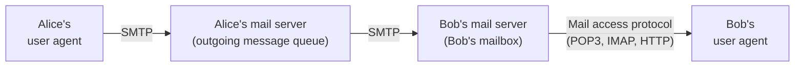

*Figure 1. Components of the Internet e-mail system*

### 1.2 Four Scenarios

Forouzan explains the architecture of e-mail with four scenarios of increasing complexity and, besides the user agent (UA), distinguishes the **message transfer agent (MTA)** and the **message access agent (MAA)**.

- **First scenario:** The sender and the receiver are users of the same mail server. The administrator creates one mailbox per user, a special file on the local hard drive that only its owner can access. Alice uses a UA to compose a message and store it in Bob's mailbox, and Bob reads his mailbox with a UA when convenient. This is like putting a memo in a colleague's mailbox in an office mail room. Two UAs are enough.
- **Second scenario:** The sender and the receiver are users of different mail servers, so the message must go through the Internet. Alice's UA sends the message to the mail server at her own site, which uses a queue (spool) to store messages waiting to be sent. Sending the message across the Internet requires an MTA client and an MTA server. The server must run all the time because it does not know when a client will ask for a connection, while the client is triggered by the system when there is a message in the queue. Two UAs and one pair of MTAs are needed.
- **Third scenario:** Bob is directly connected to his mail server as in the second scenario, but Alice is separated from her mail server by a point-to-point WAN such as dial-up, DSL, or a cable modem, or by the LAN of an organization. Alice's UA calls an MTA client, which connects to the MTA server on her system; the system queues the received messages and then uses an MTA client to send them to Bob's site. Two UAs and two pairs of MTAs are needed.
- **Fourth scenario:** The most common case, in which Bob is also connected to his mail server by a WAN or a LAN. After the message arrives at Bob's mail server, Bob must retrieve it, which requires an MAA client and an MAA server. Two UAs, two pairs of MTAs, and one pair of MAAs are needed.

Two points about the fourth scenario deserve emphasis. First, Bob cannot bypass the mail server and use the MTA server directly. To do so, he would have to run the MTA server on his computer all the time because he does not know when a message will arrive; with a LAN his computer would have to stay on all the time, and with a WAN the connection would have to be kept up all the time, neither of which is practical. Second, Bob needs a separate client-server program, the MAA, because an MTA is a **push** program: the client pushes the message to the server. Bob needs a **pull** program, in which the client pulls the message from the server.

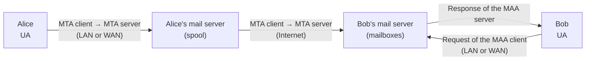

*Figure 2. The fourth scenario: two UAs, two pairs of MTAs, and one pair of MAAs*

| Scenario | Situation | Agents needed |
|:-----|:-----|:-----|
| First | Sender and receiver directly connected to the same mail server | Two UAs |
| Second | Each directly connected to a different mail server | Two UAs, one pair of MTAs |
| Third | Only the sender connected to the mail server by a LAN or WAN | Two UAs, two pairs of MTAs |
| Fourth | Both sender and receiver connected to their mail servers by a LAN or WAN | Two UAs, two pairs of MTAs, one pair of MAAs |

*Table 1. Four scenarios of the e-mail architecture*

In terms of Kurose's components, Kurose's mail server is a computer that runs Forouzan's MTA server, MTA client, and MAA server together; the MTA is implemented by SMTP and the MAA by POP3 or IMAP.

### 1.3 User Agents

A user agent is a software package that composes, reads, replies to, and forwards messages, and it also handles local mailboxes on the user's computer. There are two types of user agents. A **command-driven** user agent belongs to the early days of e-mail and accepts one-character commands from the keyboard; for example, typing r at the command prompt replies to the sender, and typing R replies to the sender and all recipients. mail, pine, and elm are examples. Modern user agents are **GUI-based**, letting the user work with icons, menu bars, and windows using both keyboard and mouse; Eudora, Outlook, and Netscape are examples.

**Sending mail.** Through the user agent, the user creates mail that looks very similar to postal mail. Mail consists of an **envelope** and a **message**. The envelope usually contains the sender address, the receiver address, and other information. The message consists of a **header** and a **body**; the header defines the sender, the receiver, the subject, and other information, and the body contains the actual information to be read by the recipient.

**Receiving mail.** The user agent is triggered by the user (or a timer). If the user has mail, it informs the user, and when the user is ready to read, it displays a list in which each line summarizes a message in the mailbox: usually the sender's address, the subject, and the time the mail was sent or received. The user can select any message and display its contents on the screen.

**Addresses.** Delivering mail requires a unique addressing system. An e-mail address in the Internet consists of a **local part** and a **domain name**, separated by an @ sign.

```text
local part @ domain name
(mailbox address of the recipient) @ (domain name of the mail server)
```

The local part is the name of a special file, the **user mailbox**, where all the mail received for a user is stored until the message access agent retrieves it. The domain name is the name of the host, the mail server (mail exchanger), that an organization has chosen to send and receive e-mail. The domain name of a mail exchanger comes either from the DNS database or is a logical name such as the name of the organization. The DNS MX record that finds the actual address of a mail server is covered in Chapter 5.

**Mailing lists.** E-mail allows one name, an alias, to represent several different e-mail addresses; this is called a **mailing list**. Every time a message is to be sent, the system checks the recipient's name against the alias database; if there is a mailing list for the alias, a separate message is prepared for each entry in the list and handed to the MTA, and if not, the name itself is the receiving address and a single message is delivered.

---

<br>

## 2. SMTP

### 2.1 Characteristics of SMTP

SMTP is at the heart of Internet e-mail, and Kurose cites RFC 5321 as its specification. SMTP is much older than HTTP: the original SMTP RFC dates back to 1982, and SMTP was around long before that. Although widely used, SMTP is a legacy technology with certain archaic characteristics. The most notable is that it restricts **the body of every mail message, not just the headers, to 7-bit ASCII**. This restriction made sense in the early 1980s, when transmission capacity was scarce and no one sent large attachments or image, audio, or video files, but in the multimedia era it is a pain: binary data must be encoded to ASCII before being sent over SMTP and decoded back to binary afterward. HTTP, by contrast, does not require multimedia data to be ASCII encoded.

In Forouzan's fourth scenario, SMTP is used twice: between the sender and the sender's mail server, and between the two mail servers. Another protocol is needed between the mail server and the receiver (Section 5). SMTP simply defines how commands and responses are sent back and forth, and each network is free to choose its implementation software.

SMTP does not normally use intermediate mail servers. Even if Alice's server is in Hong Kong and Bob's in St. Louis, the TCP connection directly links the two servers. If Bob's mail server is down, the message is not placed in some intermediate mail server but remains in Alice's mail server waiting for a new attempt.

### 2.2 An SMTP Session

Suppose Alice wants to send Bob a simple ASCII message.

1. Alice invokes her e-mail user agent, provides Bob's address (for example, bob@someschool.edu), composes a message, and instructs the user agent to send it.
2. Alice's user agent sends the message to her mail server, where it is placed in a message queue.
3. The client side of SMTP, running on Alice's mail server, sees the message in the queue and opens a TCP connection to an SMTP server running on Bob's mail server.
4. After some initial SMTP handshaking, the SMTP client sends Alice's message into the TCP connection.
5. At Bob's mail server, the server side of SMTP receives the message and places it in Bob's mailbox.
6. Bob invokes his user agent to read the message at his convenience.

The SMTP client (the sending mail server) has TCP establish a connection to **port 25** of the SMTP server (the receiving mail server). If the server is down, the client tries again later. Once the connection is established, the server and client perform application-layer handshaking, just as people introduce themselves before exchanging information, and during this phase the client indicates the e-mail addresses of the sender (the person who generated the message) and the recipient. After the introductions, the client sends the message, and thanks to TCP's reliable data transfer the message arrives at the server without errors. If the client has other messages for the same server, it repeats this process over the same TCP connection; otherwise it instructs TCP to close the connection.

The following is an example transcript of messages exchanged between a client (C) and a server (S). The client's host name is crepes.fr and the server's is hamburger.edu; the lines prefaced with C: and S: are exactly the ASCII text lines the client and server send into their TCP sockets. The transcript begins as soon as the TCP connection is established.

```text
S: 220 hamburger.edu
C: HELO crepes.fr
S: 250 Hello crepes.fr, pleased to meet you
C: MAIL FROM: <alice@crepes.fr>
S: 250 alice@crepes.fr ... Sender ok
C: RCPT TO: <bob@hamburger.edu>
S: 250 bob@hamburger.edu ... Recipient ok
C: DATA
S: 354 Enter mail, end with "." on a line by itself
C: Do you like ketchup?
C: How about pickles?
C: .
S: 250 Message accepted for delivery
C: QUIT
S: 221 hamburger.edu closing connection
```

In this dialogue the client sends a message ("Do you like ketchup? How about pickles?") from mail server crepes.fr to mail server hamburger.edu. The client issued five commands: HELO (an abbreviation for HELLO), MAIL FROM, RCPT TO, DATA, and QUIT. It also sent a line consisting of a single period, which indicates the end of the message to the server. In ASCII jargon each message ends with `CRLF.CRLF`, where CR and LF stand for carriage return and line feed. The server replies to each command with a reply code and an (optional) English-language explanation.

SMTP uses **persistent connections**. If the sending mail server has several messages for the same receiving mail server, it sends all of them over the same TCP connection, beginning each message with a new `MAIL FROM`, ending it with a line containing a single period, and issuing `QUIT` only after all messages have been sent. Connecting to port 25 of a mail server with TELNET, one receives the 220 reply and can then type these commands to talk to the SMTP server directly.

### 2.3 Commands and Responses

SMTP uses **commands** and **responses** to transfer messages between an MTA client and an MTA server. Commands go from the client to the server and responses from the server to the client, and each command or response is terminated by a two-character (CR and LF) end-of-line token. A command consists of a keyword followed by zero or more arguments, and the main commands are as follows.

| Keyword | Argument | Description |
|:-----|:-----|:-----|
| HELO | Sender's host name | The client identifies itself |
| MAIL FROM | Sender of the message | Identifies the sender's e-mail address (local part plus domain name) |
| RCPT TO | Intended recipient | Identifies the recipient's e-mail address; repeated for multiple recipients |
| DATA | Body of the mail | Sends the actual message, terminated by a line containing just one period |
| QUIT | - | Terminates the message transfer |
| RSET | - | Aborts the current mail transaction and deletes the stored sender and recipient information |
| VRFY | Name of recipient | Asks for confirmation that the recipient's address is valid |

*Table 2. Main SMTP commands*

A response is a three-digit code that may be followed by textual information. As with the HTTP status codes of Chapter 3, the first digit indicates the category: 2 means positive completion, 3 positive intermediate, 4 transient negative completion, and 5 permanent negative completion.

| Category | Code | Description |
|:-----|:-----|:-----|
| Positive completion | 220 | Service ready |
| Positive completion | 221 | Service closing transmission channel |
| Positive completion | 250 | Request command completed |
| Positive intermediate | 354 | Start mail input |
| Transient negative | 421 | Service not available |
| Transient negative | 450 | Mailbox not available |
| Permanent negative | 500 | Syntax error; unrecognized command |
| Permanent negative | 550 | Command not executed; mailbox unavailable |

*Table 3. Main SMTP response codes*

> **Definition:** **SMTP (Simple Mail Transfer Protocol)** is a push-style application-layer protocol over TCP port 25 that transfers mail messages from the sending side to the receiving mail server by exchanging commands and responses.

### 2.4 The Three Phases of Mail Transfer

Transferring a mail message occurs in three phases: **connection establishment**, **message transfer**, and **connection termination**.

**Connection establishment.** After a client has made a TCP connection to the well-known port 25, the SMTP server starts the connection phase.

1. The server sends code 220 (service ready) to tell the client that it is ready to receive mail. If it is not ready, it sends 421 (service not available).
2. The client sends the HELO message to identify itself with its domain name. This step is needed because during TCP connection establishment the sender and receiver know each other only by their IP addresses.
3. The server responds with code 250 (request command completed) or another code depending on the situation.

**Message transfer.** After the connection is established, a single message between one sender and one or more recipients can be exchanged. This phase has eight steps, and steps 3 and 4 are repeated if there is more than one recipient.

1. The client sends MAIL FROM to introduce the sender of the message; this gives the server a return address for returning errors and reporting.
2. The server responds with code 250 or another appropriate code.
3. The client sends RCPT TO with the mail address of the recipient.
4. The server responds with code 250 or another appropriate code.
5. The client sends DATA to initialize the message transfer.
6. The server responds with code 354 (start mail input) or another appropriate code.
7. The client sends the contents of the message (header, blank line, body) in consecutive lines, each terminated by CR and LF, and ends the message with a line containing just one period.
8. The server responds with code 250 (OK) or another appropriate code.

**Connection termination.** After the message has been transferred successfully, the client sends QUIT and the server responds with code 221 (service closed). After this phase, the TCP connection is closed.

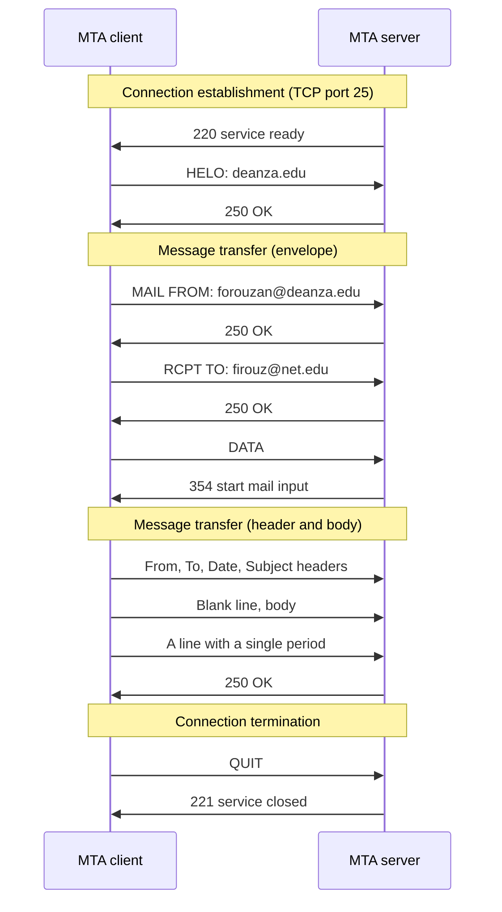

*Figure 3. The three phases of SMTP mail transfer*

In Figure 3, MAIL FROM and RCPT TO correspond to SMTP's envelope, while From, To, Date, and Subject sent after DATA are the header of the message itself. The two use the same words but are different things: the envelope is part of SMTP's handshaking protocol, and the header is part of the mail message itself (Section 4.1).

---

<br>

## 3. Comparison of SMTP and HTTP

Both SMTP and HTTP transfer files from one host to another. HTTP transfers files (objects) from a Web server to a Web client (typically a browser), and SMTP transfers files (e-mail messages) from one mail server to another. When transferring files, both persistent HTTP and SMTP use persistent connections. There are, however, important differences.

| Aspect | HTTP | SMTP |
|:-----|:-----|:-----|
| Direction | Mainly a **pull** protocol: someone loads information on a Web server and users pull it at their convenience | Mainly a **push** protocol: the sending mail server pushes the file to the receiving mail server |
| Who initiates the TCP connection | The machine that wants to receive the file | The machine that wants to send the file |
| Data format | No 7-bit ASCII restriction | The whole message, including the body, must be 7-bit ASCII; accented characters or binary data must be encoded into 7-bit ASCII |
| Documents with several objects | Each object in its own HTTP response message | All objects of the message in one message |
| Reader of the messages | Interpreted by the HTTP server and client programs | Messages read by people, stored and forwarded |

*Table 4. Comparison of SMTP and HTTP*

---

<br>

## 4. Mail Message Formats and MIME

### 4.1 The Header of a Mail Message

Just as the top of an ordinary letter carries the addressee's address, the sender's return address, and the date, an e-mail message has a header with peripheral information preceding the body. Kurose explains that the format and semantics of these header lines are defined by RFC 5322. The header lines and the body of the message are separated by a blank line (CRLF). As with HTTP, each header line is readable text consisting of a keyword, a colon, and a value. Some keywords are required and others optional: every header must have a `From:` line and a `To:` line, and it may include a `Subject:` line and other optional header lines.

```text
From: alice@crepes.fr
To: bob@hamburger.edu
Subject: Searching for the meaning of life.
```

After the message header comes a blank line and then the message body (in ASCII). These header lines are different from the SMTP commands of Section 2.2: although they contain some common words such as "from" and "to", the SMTP commands are part of the SMTP handshaking protocol, while the header lines are part of the mail message itself.

### 4.2 MIME Headers

The simple structure of e-mail comes at a price. Messages can be sent only in NVT 7-bit ASCII format, so e-mail cannot be used for languages other than English (such as French, German, Hebrew, Russian, Chinese, and Japanese), nor to send binary files, video, or audio data.

> **Definition:** **MIME (Multipurpose Internet Mail Extensions)** is a supplementary protocol that allows non-ASCII data to be sent through e-mail; it transforms non-ASCII data into NVT ASCII data at the sending site before handing it to the MTA and transforms it back into the original data at the receiving site.

MIME can be thought of as a set of software functions that transform non-ASCII data into ASCII data and vice versa. MIME defines five headers that can be added to the original e-mail header section to define the transformation parameters.

```text
E-mail header
MIME-Version: (version of MIME used)
Content-Type: type/subtype
Content-Transfer-Encoding: encoding type
Content-Id: message id
Content-Description: textual explanation of nontextual contents
E-mail body
```

*Figure 4. MIME headers*

- **MIME-Version:** Defines the version of MIME used.
- **Content-Type:** Defines the type of data used in the body of the message. The content type and subtype are separated by a slash, and depending on the subtype the header may contain other parameters.
- **Content-Transfer-Encoding:** Defines the method used to encode the message into 0s and 1s for transport (Section 4.3).
- **Content-Id:** Uniquely identifies the whole message in an environment with multiple messages.
- **Content-Description:** Describes whether the body is an image, audio, video, and so on.

MIME allows seven types of data.

| Type | Subtype | Description |
|:-----|:-----|:-----|
| Text | Plain | Unformatted text |
| Text | HTML | HTML format |
| Multipart | Mixed | Body contains ordered parts of different data types |
| Multipart | Parallel | Same as Mixed, but with no order |
| Multipart | Digest | Similar to Mixed, but the default is message/RFC822 |
| Multipart | Alternative | Parts are different versions of the same message |
| Message | RFC822 | Body is an encapsulated message |
| Message | Partial | Body is a fragment of a bigger message |
| Message | External-Body | Body is a reference to another message |
| Image | JPEG | Image in JPEG format |
| Image | GIF | Image in GIF format |
| Video | MPEG | Video in MPEG format |
| Audio | Basic | Single-channel encoding of voice at 8 kHz |
| Application | PostScript | Adobe PostScript |
| Application | Octet-stream | General binary data (eight-bit bytes) |

*Table 5. MIME data types and subtypes*

- **Text:** The original message is in 7-bit ASCII format, so no transformation by MIME is needed.
- **Multipart:** The body contains multiple independent parts. A parameter (boundary) is needed to define the boundary between the parts: the boundary string comes on a line by itself before each part, preceded by two hyphens, and the end of the body is marked by the boundary string preceded and followed by two hyphens. In the Mixed subtype the parts must be presented to the recipient in the exact order of the message, while in Parallel the order is unimportant. Alternative repeats the same message in different formats.

```text
Content-Type: multipart/mixed; boundary=xxxx

--xxxx
Content-Type: text/plain;
...
--xxxx
Content-Type: image/gif;
...
--xxxx--
```

- **Message:** The body is itself an entire mail message, a part of a mail message, or a pointer to a message. The RFC822 subtype is used when the body encapsulates another message (including its header and body). The Partial subtype indicates that the original message has been fragmented into several mail messages and this is one of the fragments; because the fragments must be reassembled by MIME at the destination, the parameters id (identifying the message), number (the order of the fragment), and total (the number of fragments) are added. The External-body subtype indicates that the body contains not the actual message but only a reference to the original message, with parameters defining how to access it (name, site, access type, and so on).
- **Image:** A stationary image with no animation; the subtypes are JPEG, which uses compression, and GIF.
- **Video:** A time-varying image (animation); the only subtype is MPEG. If the animation contains sound, the sound must be sent separately with the audio content type.
- **Audio:** Sound; the only subtype is Basic, which uses 8 kHz standard audio data.
- **Application:** A type of data not previously defined. PostScript is used for data in Adobe PostScript format, and Octet-stream when the data must be interpreted as a sequence of 8-bit bytes (a binary file).

### 4.3 Content Transfer Encoding and base64

The `Content-Transfer-Encoding:` header defines the method used to encode the message into 0s and 1s for transport.

| Type | Description |
|:-----|:-----|
| 7bit | NVT ASCII characters and short lines; no special transformation, but a line should not exceed 1,000 characters |
| 8bit | Non-ASCII characters and short lines; MIME does no encoding, so the underlying SMTP must be able to transfer 8-bit non-ASCII characters |
| Binary | Non-ASCII characters with unlimited-length lines; MIME does no encoding, so SMTP must be able to transfer binary data |
| Base64 | 6-bit blocks of data are encoded into 8-bit ASCII characters |
| Quoted-printable | Non-ASCII characters are encoded as an equal sign plus an ASCII code |

*Table 6. MIME content transfer encodings*

8bit and Binary are not recommended because the underlying SMTP must be able to transfer such data; base64 and quoted-printable are preferable.

**Base64.** A solution for sending data made of bytes whose highest bit is not necessarily zero. Base64 divides binary data (a stream of bits) into 24-bit blocks and each block into four 6-bit sections. Each 6-bit value (0-63) is changed into one printable character according to the following conversion table.

| Value | Character |
|:-----|:-----|
| 0-25 | A-Z |
| 26-51 | a-z |
| 52-61 | 0-9 |
| 62 | + |
| 63 | / |

*Table 7. Base64 conversion table*

For example, encoding the three bytes `11001100 10000001 00111001` gives the following.

```text
Non-ASCII data (24 bits) : 11001100 10000001 00111001
Split into 6 bits        : 110011   001000   000100   111001
Values                   : 51       8        4        57
Base64 characters        : z        I        E        5
```

*Figure 5. An example of base64 encoding*

51 is the 26th lowercase letter in the range 26-51, so it is z; 8 is I; 4 is E; and 57 corresponds to 5 in the range 52-61. The result is the string `zIE5`.

Base64 is a **redundant** encoding: 24 bits become four characters, each eventually sent as 8 bits, so 32 bits are sent. Of the transmitted bits, 8/32 = 25% is overhead, and compared with the original size the data grow by 32/24 = 4/3, about 33%.

**Quoted-printable.** If the data consist mostly of ASCII characters with a small non-ASCII portion, quoted-printable encoding is used. An ASCII character is sent as is, and a non-ASCII character is sent as three characters: an equal sign (=) followed by the two hexadecimal digits of the byte. For example, in `& L (10011101) 9 K` the non-ASCII byte 10011101 is 9D in hexadecimal, so it becomes `=9D` and the result is `&L=9D9K`.

```text
Original data   : 00100110 01001100 10011101 00111001 01001011
                  &        L        (9D)     9        K
Quoted-printable: &  L  =  9  D  9  K
```

*Figure 6. An example of quoted-printable encoding*

---

<br>

## 5. Mail Access Protocols

### 5.1 Why Mail Is Delivered in Two Steps

Once SMTP delivers a message from Alice's mail server to Bob's mail server, the message is placed in Bob's mailbox. Until the early 1990s the standard was for users to log on to the server host and run a mail reader on that host. Today mail access uses a client-server architecture in which users read e-mail with a client running on their own end systems, such as an office PC, a laptop, or a smartphone, enjoying a rich set of features such as viewing multimedia messages and attachments.

If Bob runs his user agent on his own PC, why not place a mail server on his PC as well? A mail server manages mailboxes and runs the client and server sides of SMTP, so if Bob's mail server resided on his PC, his PC would have to remain always on and connected to the Internet to receive mail, which can arrive at any time. This is impractical for many users. Instead, a user runs a user agent on the local PC but accesses a mailbox on an always-on shared mail server, typically maintained by the user's ISP (a university or company, for example).

The sending side also takes two steps. Alice's user agent could send the message directly to Bob's mail server with SMTP, but typically Alice's user agent uses SMTP to push the message into her own mail server, and her mail server then relays it, as an SMTP client, to Bob's mail server. Without relaying through Alice's mail server, her user agent would have no recourse when the destination mail server is unreachable. By first depositing the e-mail in her own mail server, Alice's mail server can repeatedly try to send the message, say every 30 minutes, until Bob's mail server becomes operational.

The remaining problem is how Bob obtains his messages from his ISP's mail server onto his local PC. Obtaining messages is a pull operation and SMTP is a push protocol, so Bob's user agent cannot use SMTP for this. A **mail access protocol** is therefore needed to transfer messages from Bob's mail server to his PC; POP3 (Post Office Protocol, version 3), IMAP (Internet Mail Access Protocol), and HTTP are used. In summary, SMTP transfers mail from the sender's user agent to the sender's mail server and from the sender's mail server to the recipient's mail server, and a mail access protocol transfers mail from the recipient's mail server to the recipient's user agent.

### 5.2 POP3

**POP3** is an extremely simple mail access protocol, and Kurose cites the short and readable RFC 1939 as its specification. Because the protocol is so simple, its functionality is limited. The client POP3 software is installed on the recipient's computer and the server POP3 software on the mail server. POP3 begins when the user agent (the client) opens a TCP connection to the mail server (the server) on **port 110**, and once the connection is established, POP3 progresses through three phases.

> **Definition:** **POP3 (Post Office Protocol, version 3)** is a simple mail access protocol over TCP port 110 that lets a user agent retrieve messages from a mailbox on a mail server through three phases: authorization, transaction, and update.

1. **Authorization:** The user agent sends a username and a password (in the clear) to authenticate the user.
2. **Transaction:** The user agent retrieves messages. In this phase it can also mark messages for deletion, remove deletion marks, and obtain mail statistics.
3. **Update:** Occurs after the client has issued the quit command, ending the POP3 session; the mail server deletes the messages marked for deletion.

In a POP3 transaction the user agent issues commands and the server responds to each with a reply. There are two possible replies: `+OK` (sometimes followed by server-to-client data), indicating that the previous command was fine, and `-ERR`, indicating that something was wrong with it. The authorization phase has two principal commands, `user <username>` and `pass <password>`. Connecting directly to port 110 of a POP3 server with TELNET, for example, shows a dialogue like the following.

```text
telnet mailServer 110
+OK POP3 server ready
user bob
+OK
pass hungry
+OK user successfully logged on
```

If a command is misspelled, the server replies with an `-ERR` message. In the transaction phase the user agent operates in either **download-and-delete** or **download-and-keep** mode according to the user's configuration, and the commands it issues depend on the mode. In download-and-delete mode it uses the list, retr, and dele commands. The dialogue for a mailbox with two messages is as follows (C: is the user agent and S: the mail server).

```text
C: list
S: 1 498
S: 2 912
S: .
C: retr 1
S: (blah blah ...
S: .................
S: ..........blah)
S: .
C: dele 1
C: retr 2
S: (blah blah ...
S: .................
S: ..........blah)
S: .
C: dele 2
C: quit
S: +OK POP3 server signing off
```

The user agent first asks the mail server for the size of each stored message (list), then retrieves (retr) and deletes (dele) each message. After the authorization phase it used only four commands: list, retr, dele, and quit. After processing the quit command, the POP3 server enters the update phase and removes messages 1 and 2 from the mailbox.

The problem with download-and-delete mode arises when the recipient, Bob, wants to access his mail from several machines, such as his office PC, his home PC, and his laptop. The mode partitions Bob's messages over these machines, so if he first reads a message on his office PC, he cannot reread it on his laptop at home in the evening. In download-and-keep mode the user agent leaves the messages on the mail server after downloading them, so Bob can reread messages from different machines. Forouzan calls the same two modes the delete mode and the keep mode: the delete mode is used when the user works at a permanent computer and can save and organize the mail after reading it, and the keep mode when the user reads mail away from the primary computer, such as on a laptop, and keeps it on the server for later organizing.

A POP3 server maintains some state information during a POP3 session, such as which messages have been marked for deletion, but it does not carry state information across sessions. This makes the implementation of a POP3 server very simple.

### 5.3 IMAP

After downloading messages to a local machine with POP3, one can create mail folders locally and move, delete, and search messages. This paradigm of folders and messages on the local machine, however, poses a problem for a nomadic user who wants a folder hierarchy on a remote server accessible from any computer. POP3 provides no means to create remote folders and assign messages to them. **IMAP** was invented to solve this and other problems, and Kurose cites RFC 3501 as its specification. An IMAP server uses port 143 by default [1].

> **Definition:** **IMAP (Internet Mail Access Protocol)** is a mail access protocol that keeps messages in folders on the server, maintains user state across sessions, and allows retrieving only parts of a message.

IMAP has many more features than POP3 but is significantly more complex, and so are its client and server implementations. An IMAP server associates each message with a folder: when a message first arrives at the server, it is associated with the recipient's INBOX folder, and the recipient can then move it into a new, user-created folder, read it, delete it, and so on. IMAP provides commands to create folders and move messages between them and commands to search remote folders for messages matching given criteria. Unlike POP3, an IMAP server maintains user state information across sessions, such as the names of the folders and which messages are associated with which folders. It also has commands that let a user agent obtain components of messages, for example just the header of a message or just one part of a multipart MIME message. This is useful when the connection between the user agent and the mail server is slow and the user does not want to download large messages such as audio or video clips in full.

Forouzan lists the extra functions IMAP4 provides as follows.

- A user can check the e-mail header prior to downloading.
- A user can search the contents of the e-mail for a specific string of characters prior to downloading.
- A user can partially download e-mail, which is especially useful if bandwidth is limited and the e-mail contains multimedia with high bandwidth requirements.
- A user can create, delete, or rename mailboxes on the mail server.
- A user can create a hierarchy of mailboxes in a folder for e-mail storage.

| Aspect | POP3 | IMAP |
|:-----|:-----|:-----|
| Port | TCP 110 | TCP 143 |
| Location of messages | Usually downloaded to the local machine (deleted or kept) | Kept in folders on the server |
| State across sessions | Not maintained | Folder names and associations of messages with folders maintained |
| Remote folders | None | Create, delete, rename, build hierarchies |
| Partial retrieval | Not possible | Only headers or only MIME parts can be retrieved |
| Implementation | Very simple | Complex |

*Table 8. Comparison of POP3 and IMAP*

### 5.4 Web-Based Mail and E-Mail Security

Today many users send and access e-mail through their Web browsers. Since Hotmail introduced Web-based access in the mid 1990s, Google, Yahoo!, and just about every major university and corporation have offered Web-based e-mail. With this service the user agent is an ordinary Web browser, and the user communicates with the remote mailbox via HTTP. When Bob accesses a message in his mailbox, the message is sent from his mail server to his browser using HTTP rather than POP3 or IMAP, and when Alice sends a message, it is sent from her browser to her mail server using HTTP rather than SMTP. The mail servers, however, still exchange messages with each other using SMTP.

Forouzan explains two cases. In the first, the sender Alice uses a traditional mail server and the receiver Bob has an account on a Web-based server. Transfer from Alice's browser to her mail server and between the two mail servers uses SMTP, but from the receiving server (the Web server) to Bob's browser HTTP is used instead of POP3 or IMAP4. Bob sends an HTTP request to the Web site, receives a form for his login name and password, receives the list of e-mails in HTML format after logging in, and retrieves his e-mails one by one with further HTTP transactions. In the second case, both Alice and Bob use Web servers. Alice sends the message to her Web server with an HTTP request using the name and address of Bob's mailbox as the URL, and the server at Alice's site passes the message to an SMTP client, which sends it to the server at Bob's site. Bob receives the message with HTTP transactions.

The protocols discussed in this chapter provide no security by themselves. E-mail exchanges can be secured with application-layer security designed for e-mail, such as PGP (Pretty Good Privacy) and S/MIME (Secure MIME); Chapter 26 covers PGP.

---

<br>

## 6. Remote Login: TELNET

**TELNET** (TErminaL NETwork) is the standard TCP/IP protocol for the virtual terminal service as proposed by ISO. TELNET is a general-purpose client-server application program that establishes a connection to a remote system in such a way that the local terminal appears to be a terminal at the remote system.

### 6.1 Time-Sharing and Remote Login

When TELNET was designed, most operating systems, such as UNIX, operated in a **time-sharing** environment. In such an environment a large computer supports multiple users, and the interaction between a user and the computer occurs through a terminal (or terminal emulator) consisting of a keyboard, monitor, and mouse. All processing is done by the central computer; when a user types a character, it is usually sent to the computer and echoed to the monitor. Each user has the illusion of a dedicated computer. In a time-sharing environment each authorized user has an identification and a password and **logs in** to the system with a user ID or login name.

**Local login.** When a user logs in to a local time-sharing system, the keystrokes typed at a terminal or terminal emulator are accepted by the terminal driver, which passes the characters to the operating system; the operating system interprets the combination of characters and invokes the desired application program or utility. The operating system may assign special meanings to special characters; in UNIX, for example, Ctrl+z means suspend and Ctrl+c means abort. In local login this causes no problem because the terminal emulator and the terminal driver know the exact meaning of each character combination, but in remote login the question arises of whether the client or the server should interpret special characters.

**Remote login.** When a user wants to access an application program or utility on a remote machine, the TELNET client and server come into use. The keystrokes go to the terminal driver, but the local operating system does not interpret them; it passes them to the TELNET client, which transforms them into a universal character set called the **NVT (Network Virtual Terminal)** character set and delivers them to the local TCP/IP stack. The commands or text in NVT form travel through the Internet to the TCP/IP stack of the remote machine, are delivered to the operating system, and are passed to the TELNET server, which changes them into characters the remote computer understands. The characters cannot be passed directly to the remote operating system, however, because it is designed to receive characters from a terminal driver, not from a TELNET server. The solution is a piece of software called a **pseudoterminal driver**, which pretends that the characters are coming from a terminal; the operating system then passes them to the appropriate application program.

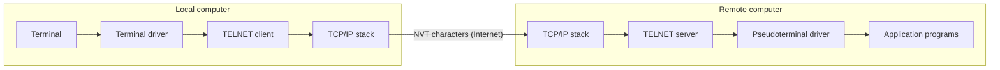

*Figure 7. Remote login with TELNET*

### 6.2 Network Virtual Terminal

Accessing a remote computer is complex because every computer and operating system accepts special combinations of characters as tokens. The end-of-file token, for example, is Ctrl+z in DOS and Ctrl+d in UNIX. Because systems are heterogeneous, accessing any remote computer in the world would require knowing what type of computer it is and installing its specific terminal emulator. TELNET solves this problem by defining a universal interface, the **NVT character set**. The TELNET client translates characters (data or commands) from the local terminal into NVT form and delivers them to the network, and the TELNET server translates data and commands from NVT form into the form acceptable to the remote computer.

> **Definition:** The **network virtual terminal (NVT)** is the universal character set defined by TELNET; the client and server each translate between their local character set and the NVT, making remote login possible between different systems.

NVT uses two sets of characters, one for data and one for control, both 8-bit bytes. For data, NVT uses **NVT ASCII**, an 8-bit character set whose seven lowest-order bits are the same as US ASCII and whose highest-order bit is 0. It is possible to send 8-bit ASCII with the highest bit set to 0 or 1, but this must first be agreed upon by the client and server through option negotiation. To send control characters between computers, NVT uses an 8-bit character set in which the highest-order bit is 1.

| Character | Decimal | Binary | Meaning |
|:-----|:-----|:-----|:-----|
| EOF | 236 | 11101100 | End of file |
| EOR | 239 | 11101111 | End of record |
| SE | 240 | 11110000 | Suboption end |
| NOP | 241 | 11110001 | No operation |
| DM | 242 | 11110010 | Data mark |
| BRK | 243 | 11110011 | Break |
| IP | 244 | 11110100 | Interrupt process |
| AO | 245 | 11110101 | Abort output |
| AYT | 246 | 11110110 | Are you there? |
| EC | 247 | 11110111 | Erase character |
| EL | 248 | 11111000 | Erase line |
| GA | 249 | 11111001 | Go ahead |
| SB | 250 | 11111010 | Suboption begin |
| WILL | 251 | 11111011 | Agreement to enable an option |
| WONT | 252 | 11111100 | Refusal to enable an option |
| DO | 253 | 11111101 | Approval of an option request |
| DONT | 254 | 11111110 | Denial of an option request |
| IAC | 255 | 11111111 | Interpret the next character as control |

*Table 9. NVT control characters*

### 6.3 Embedding

TELNET uses only one TCP connection. The server uses the well-known **port 23** and the client an ephemeral port. Because the same connection carries both data and control characters, TELNET **embeds** the control characters in the data stream. To distinguish data from control characters, each sequence of control characters is preceded by a special control character called **IAC (interpret as control)**.

Suppose a user wants a remote server to display the contents of file1 with the UNIX command `cat file1`, but mistypes the file name as filea and corrects it with the backspace key.

```text
Typed            : cat filea<backspace>1
Sent to server   : c a t   f i l e a IAC EC 1
```

*Figure 8. An example of embedding control characters in data*

In the default implementation of TELNET the user cannot edit locally; editing is done at the remote server. The backspace is therefore translated into the two remote characters IAC EC (erase character), which are embedded in the data and sent to the server.

### 6.4 Options and Option Negotiation

TELNET lets the client and server negotiate **options** before or during the use of the service. Options are extra features available to a user with a more sophisticated terminal; users with simpler terminals use the default features.

| Code | Option | Meaning |
|:-----|:-----|:-----|
| 0 | Binary | Interprets every 8-bit character received, except IAC, as binary data. When IAC is received, the next character is interpreted as a command, but if two consecutive IACs are received, the first is discarded and the second interpreted as data |
| 1 | Echo | The server echoes data received from the client; the user terminal then does not display typed characters itself but waits for those echoed by the server |
| 3 | Suppress go-ahead | Suppresses the GA (go ahead) character |
| 5 | Status | Asks for the status of the options enabled at the server |
| 6 | Timing mark | Issues a timing mark indicating that all previously received data have been processed |
| 24 | Terminal type | The client sends its terminal type |
| 32 | Terminal speed | The client sends its terminal speed |
| 34 | Line mode | The client switches to line mode |

*Table 10. Main TELNET options*

Using an option first requires **option negotiation** between the client and the server, for which four control characters are used.

| Character | Code | Meaning 1 | Meaning 2 | Meaning 3 |
|:-----|:-----|:-----|:-----|:-----|
| WILL | 251 | Offering to enable | Accepting to enable | - |
| WONT | 252 | Rejecting to enable | Offering to disable | Accepting to disable |
| DO | 253 | Approving to enable | Requesting to enable | - |
| DONT | 254 | Disapproving to enable | Approving to disable | Requesting to disable |

*Table 11. NVT characters for option negotiation*

Some options can be enabled only by the server, some only by the client, and some by both. An option is enabled or disabled through an **offer** or a **request**.

- **Offer to enable:** The party that has the right to enable an option sends WILL, asking whether it should enable the option, and the other party answers with DO, meaning go ahead, or DONT, meaning do not.
- **Request to enable:** A party sends DO to ask the other to enable an option, and the other answers with WILL, meaning it will, or WONT, meaning it will not.
- **Offer to disable:** A party sends WONT to say it will no longer use an enabled option, and the other must answer with DONT, meaning stop using it; this offer cannot be refused.
- **Request to disable:** A party sends DONT to ask the other to disable an option, and the other must answer with WONT, meaning it will no longer use it; this request cannot be refused.

**Example 20.1.** The client wants the server to echo each character sent to it, so that a character typed at the keyboard goes to the server and is sent back to the user's screen before being processed. The echo option is enabled by the server, because it is the server that sends the characters back to the user terminal, so the client requests it with DO. The request consists of three characters: IAC, DO, and ECHO. The server accepts the request, enables the option, and informs the client with the three characters IAC, WILL, and ECHO.

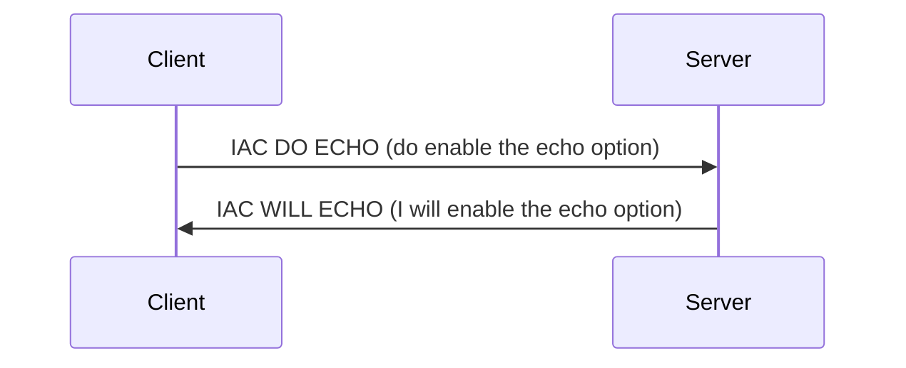

*Figure 9. Example 20.1: negotiating the echo option*

TELNET's option negotiation is **symmetric**, giving the client and server equal opportunity. At the beginning of a connection both sides are assumed to use a default TELNET implementation with no options enabled, and either side that wants an option enabled can offer or request it. The other side may disapprove the offer or reject the request if it cannot or does not want to use the option. This allows TELNET to be extended: a party with a more sophisticated TELNET can offer or request new options, which are enabled if the other party also supports them and rejected otherwise.

**Suboption negotiation.** Some options, such as terminal type or speed, require additional information, so a string or a number must be sent along; the suboption characters SB (250, suboption begin) and SE (240, suboption end) are used for this. For example, the client sets its terminal type as follows.

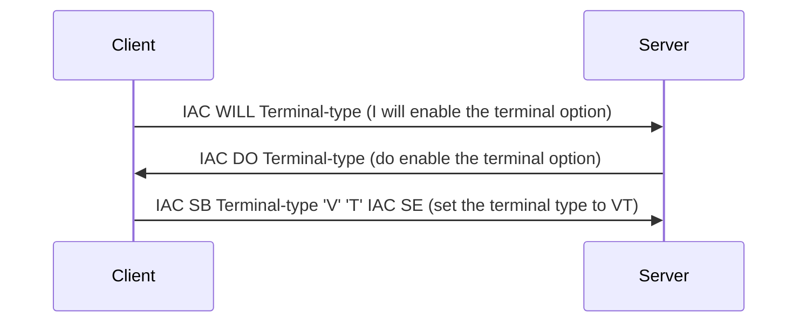

*Figure 10. Setting the terminal type with suboption negotiation*

### 6.5 Controlling a Remote Program

When an application program runs locally, special characters are used to interrupt it (for example, Ctrl+c) or to erase the last character typed (for example, the Delete or Backspace key). When the program runs on a remote computer, these control characters must be sent to the remote machine, so the same key combinations typed by the user are changed into special characters and sent to the server.

- **IP (interrupt process, 244):** Locally, a program that has gone into an infinite loop can be interrupted with Ctrl+c, and the operating system calls a function that aborts it. If the program runs on a remote machine, the operating system of the remote machine must call that function, so TELNET defines the IP control character, which is interpreted as the command for invoking the interrupting function on the remote machine. When the user types Ctrl+c, the TELNET client sends IAC IP to the server.
- **AO (abort output, 245):** Like IP, but it lets the process continue without creating output; useful, for example, when the exit status is wanted but not the output.
- **AYT (are you there?, 246):** Determines whether the remote machine is still up and running, especially after a long silence from the server; the server usually responds with an audible or visual signal.
- **EC (erase character, 247):** Erases the last character typed at the remote machine.
- **EL (erase line, 248):** Erases the current line at the remote host.

**Out-of-band signaling.** Suppose an application program at the server has gone into an infinite loop and accepts no more input. Because the program does not read data from the buffer, TCP at the server finds the buffer full and sends a segment specifying a window size of zero for the client; that is, TCP at the server accepts no more regular traffic. An IAC IP sent by the user would then be blocked in the buffer like ordinary data. To remedy this, the client must send an **urgent TCP segment** to the server; an urgent segment overrides the regular flow-control mechanism and is accepted (urgent data in Chapter 8). The TELNET process embeds the control sequence to be sent out of band in the data stream, inserts a special character called a **DM (data mark)**, and creates a TCP segment with the urgent bit set and the urgent pointer pointing to the DM character. The receiving process reads the data, discards any data preceding the control characters (for example, IAC and IP), and handles the remaining data normally once it reaches the DM character. The DM is thus a synchronization character that switches the receiving process from urgent mode back to normal mode and resynchronizes the two ends.

```text
               Discarded            Kept
At the server: | Data | IAC IP DM | Data |
                               ^
                        Urgent pointer
```

*Figure 11. The DM and the urgent pointer in out-of-band signaling*

**Escape character.** A character typed by the user is normally sent to the server, but sometimes the user wants a character interpreted by the client rather than the server. In this case the user types an **escape character**, normally Ctrl+] (shown as ^]). Ctrl+c, for example, interrupts the application program at the remote site, while Ctrl+] interrupts the client process at the local site and displays the TELNET prompt. Ordinary users do not use TELNET commands directly; they use user-friendly interface commands defined by the operating system, such as open (connect to a remote computer), close (close the connection), display (show the operating parameters), mode (change to line or character mode), set (set the operating parameters), status (display status information), send (send special characters), and quit (exit TELNET), and the interface translates them into the protocol's commands.

### 6.6 Modes of Operation and the Security Issue

Most TELNET implementations operate in one of three modes.

| Mode | Echoing and editing | Unit of transmission | Characteristics |
|:-----|:-----|:-----|:-----|
| Default mode | The client echoes | One line | Half-duplex operation: after sending a line, the client waits for GA (go ahead) from the server before accepting a new line; inefficient because the TCP connection is full-duplex, so it is becoming obsolete |
| Character mode | The server echoes | One character | Three TCP segments per character (character sent, server's acknowledgment and echo, client's acknowledgment) create much traffic, and echoing can be delayed if the transmission time is long (for example, over a satellite connection) |
| Line mode | The client does line editing (echoing, character and line erasing) | One line | Looks like the default mode but is full-duplex, with lines sent one after another without an intervening GA |

*Table 12. Modes of operation of TELNET*

Example 20.2 shows the operation of the default mode. After the server sends GA, the client sends WILL TERMINAL TYPE and the server answers DO TERMINAL TYPE; after another GA, the client sends WILL TERMINAL SPEED and the server refuses with DONT TERMINAL SPEED. The server then sends "Login:" followed by GA, the client sends the login name, the server sends "Password:" followed by GA, the client sends the password, and after another GA the client sends a command (for example, cp file1 file2). Waiting for GA every time shows the inefficiency of half-duplex operation.

**Example 20.3.** To switch to character mode, the client must request the server to enable the SUPPRESS GO AHEAD and ECHO options.

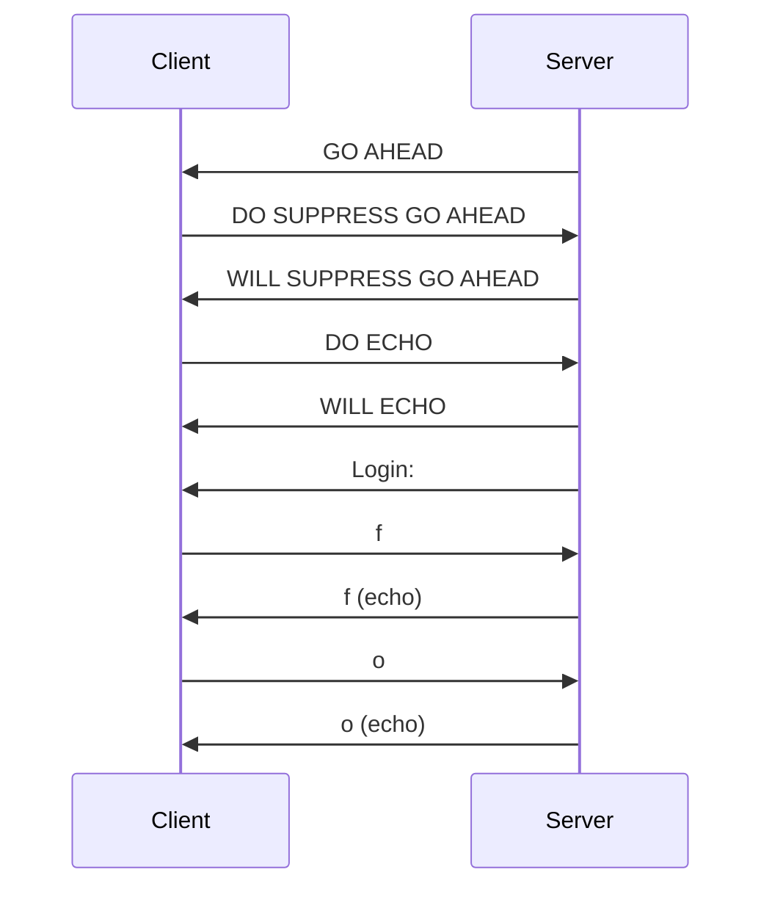

*Figure 12. Example 20.3: negotiating character mode and echoing character by character*

**Security issue.** TELNET suffers from security problems. Although it requires a login name and password, this is often not enough: a computer connected to a broadcast LAN can easily eavesdrop with snooper software and capture a login name and the corresponding password. SSH, in the next section, solves this problem.

---

<br>

## 7. SSH

**SSH (Secure Shell)** is another popular remote login application program. Like TELNET, SSH uses TCP as the underlying transport protocol, but it is more secure and provides more services than TELNET. An SSH server uses TCP port 22 by default [2]. There are two versions, SSH-1 and SSH-2, which are totally incompatible, and SSH-1 is deprecated because of security flaws.

> **Definition:** **SSH (Secure Shell)** is an application-layer protocol that creates a secure channel on top of TCP, providing confidentiality, integrity, and authentication to applications such as remote login, file transfer, and port forwarding.

SSH consists of the following components.

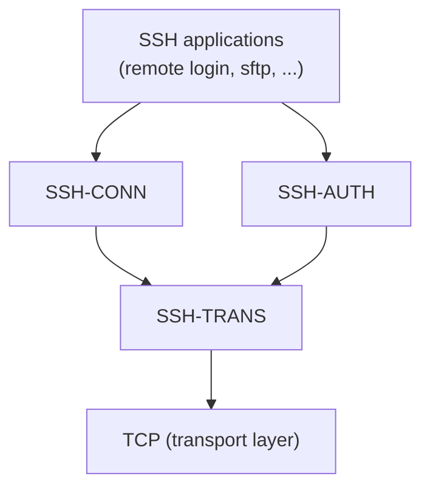

*Figure 13. Components of SSH*

- **SSH Transport-Layer Protocol (SSH-TRANS):** Because TCP is not a secure transport-layer protocol, SSH first uses SSH-TRANS to create a secure channel on top of TCP. The client and server first establish an insecure connection with TCP and then exchange several security parameters to establish a secure channel on top of it. The services SSH-TRANS provides are (1) privacy, or confidentiality, of the messages exchanged, (2) data integrity, guaranteeing that the messages exchanged between client and server are not changed by an intruder, (3) server authentication, assuring the client that the server is the one it claims to be, and (4) compression of the messages, which improves efficiency and makes attacks more difficult.
- **SSH Authentication Protocol (SSH-AUTH):** After a secure channel is established and the server is authenticated to the client, SSH calls software that authenticates the client to the server.
- **SSH Connection Protocol (SSH-CONN):** After the secure channel is established and the server and client are authenticated to each other, SSH calls SSH-CONN. One of its services is multiplexing: SSH-CONN takes the secure channel established by the two previous protocols and lets the client create multiple logical channels over it.

> **[Information Security]** **Confidentiality** is the property that unauthorized parties cannot learn the content of a message, **integrity** is the property that a message has not been changed in transit, and **authentication** is confirming that a communicating party is the entity it claims to be. SSH-TRANS provides all three, and Chapter 26 covers the cryptographic techniques that implement them.

**SSH applications.** After the connection phase, SSH allows several application programs to use the connection; each application creates a logical channel and benefits from the secure connection. Remote login is one of the services that use SSH-CONN, and a file transfer application can also use a logical channel (sftp in Section 8.5).

**Port forwarding.** One interesting service of SSH is port forwarding: the secure channels of SSH can be used to access an application program that does not provide security services. Applications such as TELNET and SMTP can use the services of SSH through port forwarding. SSH port forwarding creates a tunnel through which messages of another protocol can travel, so it is also called **SSH tunneling**. A direct but insecure connection between a TELNET client and a TELNET server can be replaced by port forwarding: the TELNET client uses the SSH client at the local site to make a secure connection with the SSH server at the remote site, and every request and response between the TELNET client and server is carried through the tunnel provided by the SSH client and server. Chapter 26 returns to tunneling.

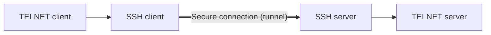

*Figure 14. SSH port forwarding*

**Format of SSH packets.** The textbook describes the packets used by the SSH protocols with the following format.

```text
| Length (4 bytes) | Padding (1-8 bytes) | Type (1 byte) | Data (variable) | CRC (4 bytes) |
                   |<------------------- Encrypted for confidentiality -------------->|
```

*Figure 15. SSH packet format as presented by the textbook*

- **Length:** The length of the packet including the type, data, and CRC fields, but not the padding and length fields.
- **Padding:** One to eight bytes of padding added to make attacks on the security provisions more difficult.
- **Type:** Defines the type of packet used by the SSH protocols.
- **Data:** A variable-length field whose length is the value of the length field minus five bytes.
- **CRC:** A cyclic redundancy check field used for error detection (Chapter 18).

> **Note:** **CRC and integrity.** A CRC detects accidental bit errors in transmission, and an attacker who deliberately modifies a message can recompute a matching CRC for the modified message, so a CRC alone cannot prevent tampering by an attacker. The data integrity SSH provides is therefore guaranteed by the cryptographic techniques of SSH-TRANS, which are covered under message integrity in Chapter 26.

---

<br>

## 8. FTP

**FTP (File Transfer Protocol)** is the standard mechanism provided by TCP/IP for copying a file from one host to another. Transferring files between systems seems simple, but some problems must be dealt with first: two systems may use different file name conventions, different ways to represent text and data, and different directory structures. FTP solves these problems in a very simple and elegant approach.

### 8.1 Control and Data Connections

FTP differs from other client-server applications in that it establishes two connections between the hosts. One is used for data transfer and the other for control information (commands and responses). Separating commands from data transfer makes FTP more efficient. The control connection uses very simple rules of communication because only a line of command or a line of response is sent at a time, while the data connection needs more complex rules because of the variety of data types transferred. FTP uses the services of TCP and two well-known TCP ports: **port 21** for the control connection and **port 20** for the data connection.

> **Definition:** The **FTP control connection** is the TCP connection made to port 21 of the server between the control processes of the FTP client and server, which stays open for the whole session and carries commands and responses.

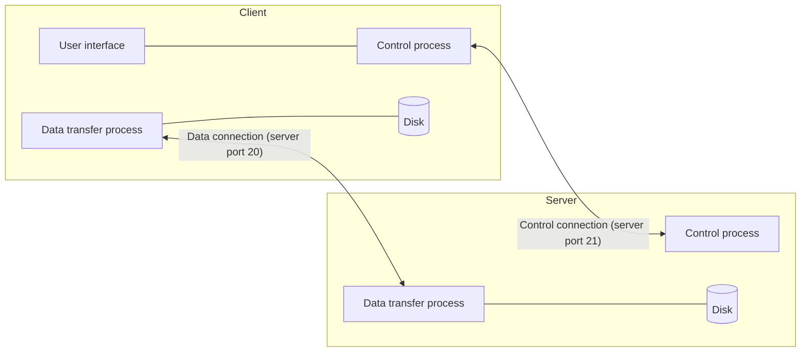

*Figure 16. The basic model of FTP*

The client has three components, the user interface, the client control process, and the client data transfer process, and the server has two, the server control process and the server data transfer process. The control connection is made between the control processes and the data connection between the data transfer processes. The control connection remains connected during the entire interactive FTP session, while the data connection is opened and closed for each file transferred. When a user starts an FTP session, the control connection opens, and while it is open the data connection can be opened and closed many times if several files are transferred.

**Establishing the control connection.** It is created in the same way as for other application programs, in two steps.

1. The server issues a passive open on the well-known port 21 and waits for a client.
2. The client uses an ephemeral port and issues an active open.

The connection remains open during the entire process. Because the control connection is an interactive connection between a person and the server, in which the user types commands and expects responses without significant delay, the service type used by IP is minimize delay.

**Establishing the data connection.** The data connection uses the well-known port 20 at the server site, but it is created differently from what we have seen so far.

1. The **client**, not the server, issues a passive open using an ephemeral port, because it is the client that issues the commands for transferring files.
2. The client sends this port number to the server using the PORT command.
3. The server receives the port number and issues an active open using the well-known port 20 and the received ephemeral port number.

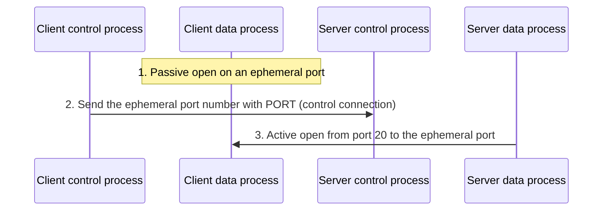

*Figure 17. Establishing the FTP data connection*

These steps change if the PASV command is used. The client asks the server to choose a port number first; the server does a passive open on that port and sends the port number in its response (227), and the client issues an active open using that port number.

### 8.2 Resolving Heterogeneity

The FTP client and server run on different computers that may use different operating systems, character sets, file structures, and file formats. FTP resolves this heterogeneity with different approaches for the control and data connections.

**Communication over the control connection.** FTP uses the same approach as TELNET or SMTP: the NVT ASCII character set, with communication achieved through commands and responses. Because one command (or response) is sent at a time and each is only one short line, file format and structure need not be considered. Each line is terminated with a two-character (CR and LF) end-of-line token.

**Communication over the data connection.** Before sending a file through the data connection, the client defines over the control connection the **file type**, the **data structure**, and the **transmission mode** of the file to be transferred, thereby resolving the heterogeneity problem.

| Attribute | Value | Description |
|:-----|:-----|:-----|
| File type | ASCII file | The default for text files; the sender transforms the file into NVT ASCII and the receiver into its own representation |
| File type | EBCDIC file | Transferred in EBCDIC if one or both ends use EBCDIC encoding |
| File type | Image file | The default for binary files; sent as a continuous stream of bits without interpretation or encoding, used for binary files such as compiled programs |
| Printability (ASCII, EBCDIC) | Nonprint | The default for text files; contains no vertical specifications for printing, so it cannot be printed without further processing; used for files to be stored and processed later |
| Printability (ASCII, EBCDIC) | TELNET | Contains NVT ASCII vertical characters such as CR, LF, NL, and VT, so the file is printable after transfer |
| Data structure | File structure (default) | No structure, a continuous stream of bytes |
| Data structure | Record structure | The file is divided into records; used only with text files |
| Data structure | Page structure | The file is divided into pages, each with a page number and a page header, which can be stored and accessed randomly or sequentially |
| Transmission mode | Stream mode (default) | Data are delivered to TCP as a continuous stream of bytes and TCP chops them into segments of appropriate size; with file structure the end of file is the closing of the data connection by the sender, and with record structure each record has a 1-byte EOR and the file ends with a 1-byte EOF |
| Transmission mode | Block mode | Data are delivered to TCP in blocks, each preceded by a 3-byte header: a 1-byte block descriptor and 2 bytes of block size |
| Transmission mode | Compressed mode | A big file is compressed, normally with run-length encoding, which replaces consecutive appearances of a data unit by one occurrence and the number of repetitions; usually spaces in text files and null characters in binary files are compressed |

*Table 13. File types, data structures, and transmission modes of the FTP data connection*

### 8.3 Commands and Responses

FTP uses the control connection to establish communication between the client control process and the server control process. Commands go from the client to the server and responses from the server to the client. Commands are in ASCII uppercase and may be followed by arguments. They can roughly be divided into six groups.

| Group | Commands (arguments) | Description |
|:-----|:-----|:-----|
| Access | USER (user ID), PASS (password), ACCT (account to be charged), REIN, QUIT, ABOR | User information, password, account information, reinitialize, log out, abort the previous command |
| File management | CWD (directory), CDUP, DELE (file), LIST (directory), NLST (directory), MKD (directory), PWD, RMD (directory), RNFR (old name), RNTO (new name), SMNT (file system) | Change to another directory, change to the parent directory, delete a file, list subdirectories or files, list without attributes, create a directory, display the current directory, delete a directory, identify a file to rename, rename it, mount a file system |
| Data formatting | TYPE (A, E, I, N, T), STRU (F, R, P), MODE (S, B, C) | Define the file type, the data structure, and the transmission mode |
| Port defining | PORT (6-digit identifier), PASV | The client chooses a port, the server chooses a port |
| File transfer | RETR (file), STOR (file), APPE (file), STOU (file), ALLO (file), REST (file), STAT (file) | Retrieve from server to client, store from client to server, store appending if the file exists, store with a unique name in the directory, allocate storage at the server, position the file marker at a data point, return the file status |
| Miscellaneous | HELP, NOOP, SITE (commands), SYST | Ask for information about the server, check if the server is alive, specify site-specific commands, ask about the server's operating system |

*Table 14. FTP commands*

Every FTP command generates at least one response. A response has two parts: a three-digit number followed by text. The number defines the code, and the text defines needed parameters or extra explanations. Writing the three digits as xyz, their meanings are as follows.

| Digit | Value | Meaning |
|:-----|:-----|:-----|
| First digit | 1yz | Positive preliminary reply: the action has started, and the server will send another reply before accepting another command |
| First digit | 2yz | Positive completion reply: the action has been completed, and the server will accept another command |
| First digit | 3yz | Positive intermediate reply: the command has been accepted, but further information is needed |
| First digit | 4yz | Transient negative completion reply: the action did not take place, but the error is temporary, so the same command can be sent later |
| First digit | 5yz | Permanent negative completion reply: the command was not accepted and should not be retried |
| Second digit | x0z, x1z, x2z, x3z, x4z, x5z | Syntax, information, connections, authentication and accounting, unspecified, file system |
| Third digit | - | Additional information |

*Table 15. Meaning of each digit of FTP response codes*

| Code | Description | Code | Description |
|:-----|:-----|:-----|:-----|
| 120 | Service will be ready shortly | 331 | User name OK; password is needed |
| 125 | Data connection open; data transfer will start shortly | 332 | Need account for logging |
| 150 | File status is OK; data connection will be open shortly | 350 | The file action is pending; more information needed |
| 200 | Command OK | 425 | Cannot open data connection |
| 220 | Service ready | 426 | Connection closed; transfer aborted |
| 221 | Service closing | 450 | File action not taken; file not available |
| 225 | Data connection open | 500 | Syntax error; unrecognized command |
| 226 | Closing data connection | 501 | Syntax error in parameters or arguments |
| 227 | Entering passive mode; the server sends its IP address and port number | 502 | Command not implemented |
| 230 | User login OK | 530 | User not logged in |
| 250 | Request file action OK | 550 | Action is not done; file unavailable |

*Table 16. Main FTP response codes*

### 8.4 Examples of File Transfer

File transfer occurs over the data connection under the control of the commands sent over the control connection. File transfer in FTP means one of three things: copying a file from the server to the client, **retrieving** a file, under the RETR command; copying a file from the client to the server, **storing** a file, under the STOR command; and sending a list of directory or file names from the server to the client under the LIST command. FTP treats a list of directory or file names as a file and sends it over the data connection.

**Example 21.1.** Retrieving a list of the items in a directory.

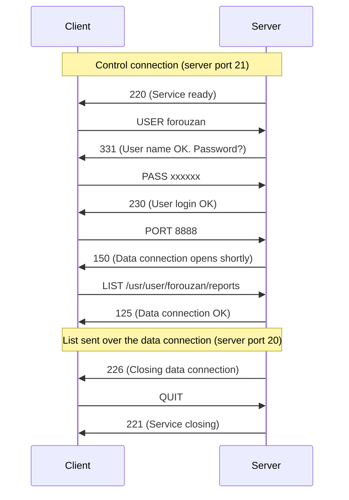

*Figure 18. Example 21.1: retrieving a directory list with FTP*

1. After the control connection to port 21 is created, the FTP server sends the 220 (service ready) response on the control connection.
2. The client sends the USER command, and the server responds with 331 (user name OK, password required).
3. The client sends the PASS command, and the server responds with 230 (user login OK).
4. The client issues a passive open on an ephemeral port for the data connection and sends the PORT command (over the control connection) to give this port number to the server.
5. The server does not open the connection yet but prepares itself to issue an active open on the data connection between port 20 (server side) and the ephemeral port received from the client, and sends 150 (data connection will open shortly).
6. The client sends the LIST message.
7. The server responds with 125 and opens the data connection.
8. The server sends the list of files or directories (as a file) on the data connection; when the whole list has been sent, it responds with 226 (closing data connection) over the control connection.
9. The client can now close the control connection with QUIT or send another command to start another activity (and eventually a new data connection). In this example it sends QUIT.
10. The server responds with 221 (service closing) and closes the control connection.

**Example 21.2.** The following is the output of an actual FTP session that parallels Example 21.1. This session uses passive mode instead of PORT.

```text
$ ftp voyager.deanza.fhda.edu
Connected to voyager.deanza.fhda.edu.
220 (vsFTPd 1.2.1)
530 Please login with USER and PASS.
Name (voyager.deanza.fhda.edu:forouzan): forouzan
331 Please specify the password.
Password:
230 Login successful.
Remote system type is UNIX.
Using binary mode to transfer files.
ftp> ls reports
227 Entering Passive Mode (153,18,17,11,238,169)
150 Here comes the directory listing.
drwxr-xr-x 2 3027 411 4096 Sep 24 2002 business
drwxr-xr-x 2 3027 411 4096 Sep 24 2002 personal
drwxr-xr-x 2 3027 411 4096 Sep 24 2002 school
226 Directory send OK.
ftp> quit
221 Goodbye.
```

Of the six numbers in parentheses in the 227 response, the first four (153.18.17.11) are the IP address of the server, and the last two are the high-order and low-order bytes of the port number chosen by the server. The server port for the data connection is therefore 238 × 256 + 169 = 61097.

**Example 21.3.** To store an image file, after USER, PASS, and PORT the client defines the file type and data structure with the TYPE command (for example, TYPE EBCDIC) and the STRU command (for example, STRU R), receiving 200 (command OK) for each, and then sends the STOR command. When the server opens the data connection and responds with 250, the client sends the file over the data connection, and closing the data connection after the whole file is sent means end of file. The server sends 226 on the control connection.

### 8.5 Anonymous FTP and Security

To use FTP, a user needs an account (user name) and a password on the remote server. Some sites, however, have files available for public access, and a user can access them without an account or password by using anonymous as the user name and guest as the password. This is **anonymous FTP**. Access by anonymous users is very limited; most sites allow copying some files but not navigating through the directories.

FTP was designed when security was not a big issue. Although FTP requires a password, the password is sent in **plaintext**, so it can be intercepted and used by an attacker, and the data connection also transfers data in plaintext, which is insecure. To make FTP secure, SSL (Chapter 26) can be added between the FTP application layer and the TCP layer, in which case FTP is called SSL-FTP. Another way to transfer files over a secure channel is the independent protocol **sftp** (secure file transfer protocol). sftp is a UNIX program that is part of SSH: once SSH has established a secure connection between an SSH client and server, one of the application programs that can use (multiplex) this connection is sftp. sftp thus belongs to the application component of SSH and is an interactive program that works like FTP.

---

<br>

## 9. TFTP

There are occasions when a file simply needs to be copied without all the features of FTP. When a diskless workstation or a router is booted, for example, the bootstrap and configuration files must be downloaded, and the sophistication of FTP is not needed; only a protocol that quickly copies files is.

> **Definition:** **TFTP (Trivial File Transfer Protocol)** is a simple file transfer protocol over the well-known UDP port 69 that reads or writes a file by exchanging 512-byte blocks with stop-and-wait.

TFTP is so simple that it fits into the read-only memory (ROM) of a diskless workstation and can be used at bootstrap time. It fits in ROM because it requires only basic IP and UDP. TFTP, however, has no security. TFTP can read or write a file for the client: **reading** means copying a file from the server to the client, and **writing** means copying a file from the client to the server. TFTP uses the services of **UDP** on the well-known **port 69**.

### 9.1 Messages

There are five types of TFTP messages, RRQ, WRQ, DATA, ACK, and ERROR, all of which begin with a 2-byte operation code (OpCode).

```text
RRQ   : | OpCode = 1 (2 bytes) | File name (variable) | All 0s (1 byte) | Mode (variable) | All 0s (1 byte) |
WRQ   : | OpCode = 2 (2 bytes) | File name (variable) | All 0s (1 byte) | Mode (variable) | All 0s (1 byte) |
DATA  : | OpCode = 3 (2 bytes) | Block number (2 bytes) | Data (0-512 bytes) |
ACK   : | OpCode = 4 (2 bytes) | Block number (2 bytes) |
ERROR : | OpCode = 5 (2 bytes) | Error number (2 bytes) | Error data (variable) | All 0s (1 byte) |
```

*Figure 19. Formats of TFTP messages*

- **RRQ (read request):** Used by the client to establish a connection for reading data from the server. The file name is a variable-length string encoded in ASCII whose end is signaled by a 1-byte field of 0s. The mode is another variable-length string terminated by a 1-byte field of 0s, and it is either "netascii" (an ASCII file) or "octet" (a binary file). The file name and mode can be in uppercase, lowercase, or a combination.
- **WRQ (write request):** Used by the client to establish a connection for writing data to the server. The format is the same as RRQ except that the OpCode is 2.
- **DATA:** Used by the client or the server to send blocks of data. The block number is a 2-byte field the sender uses for sequencing; all blocks are numbered sequentially starting with 1, and the block number is needed for acknowledgment. The data field must be exactly 512 bytes in all DATA messages except the last block, which must be between 0 and 511 bytes. A non-512-byte block signals that the sender has sent all the data, that is, it is the end-of-file indicator. If the data in the file happen to be an exact multiple of 512 bytes, the sender must send one extra block of zero bytes to show the end of transmission. Data can be transferred in NVT ASCII (netascii) or binary octet (octet).
- **ACK (acknowledge):** Used by the client or the server to acknowledge receipt of a data block; it is only 4 bytes long, and the block number field contains the number of the block received. An ACK can also be a response to a WRQ, sent by the server to indicate that it is ready to receive data, in which case the block number is 0.
- **ERROR:** Used by the client or the server when a connection cannot be established or there is a problem during data transmission. It can be a negative response to an RRQ or WRQ and can also be used when the next block cannot be transferred during the data transfer phase. It is not used to declare a damaged or duplicated message; those problems are resolved by the error-control mechanisms of Section 9.3. The error number defines the type of error, and the error data are textual error information terminated by a 1-byte field of 0s.

| Message | OpCode | Use |
|:-----|:-----|:-----|
| RRQ | 1 | Request for a read (copy from server to client) connection |
| WRQ | 2 | Request for a write (copy from client to server) connection |
| DATA | 3 | A numbered data block (512 bytes except the last) |
| ACK | 4 | Acknowledges the number of the block received (0 in response to a WRQ) |
| ERROR | 5 | Reports that a connection is impossible or a transfer problem |

*Table 17. TFTP messages*

| Number | Meaning | Number | Meaning |
|:-----|:-----|:-----|:-----|
| 0 | Not defined | 4 | Illegal operation |
| 1 | File not found | 5 | Unknown port number |
| 2 | Access violation | 6 | File already exists |
| 3 | Disk full or quota exceeded | 7 | No such user |

*Table 18. TFTP error numbers*

### 9.2 Connection and Data Transfer

TFTP uses UDP services. Because UDP has no connection establishment or termination, each block of data is encapsulated in an independent user datagram. TFTP, however, must transfer the blocks belonging to the same file as one connection rather than independently. TFTP therefore uses the RRQ, WRQ, ACK, and ERROR messages to establish a connection and a DATA message carrying a block of fewer than 512 bytes (0-511) to terminate it.

**Connection establishment.** Establishing a connection for reading differs from establishing one for writing.

- **Reading:** The client sends an RRQ message containing the file name and transmission mode. If the server can transfer the file, it responds positively with a DATA message containing the first block (block number 1); if there is a problem, such as difficulty opening the file or a permission restriction, it responds negatively with an ERROR message.
- **Writing:** The client sends a WRQ message containing the file name and transmission mode. If the server can accept a copy of the file, it responds positively with an ACK using 0 as the block number; if there is a problem, it responds negatively with an ERROR message. After receiving this acknowledgment, the client sends the first data block with block number 1.

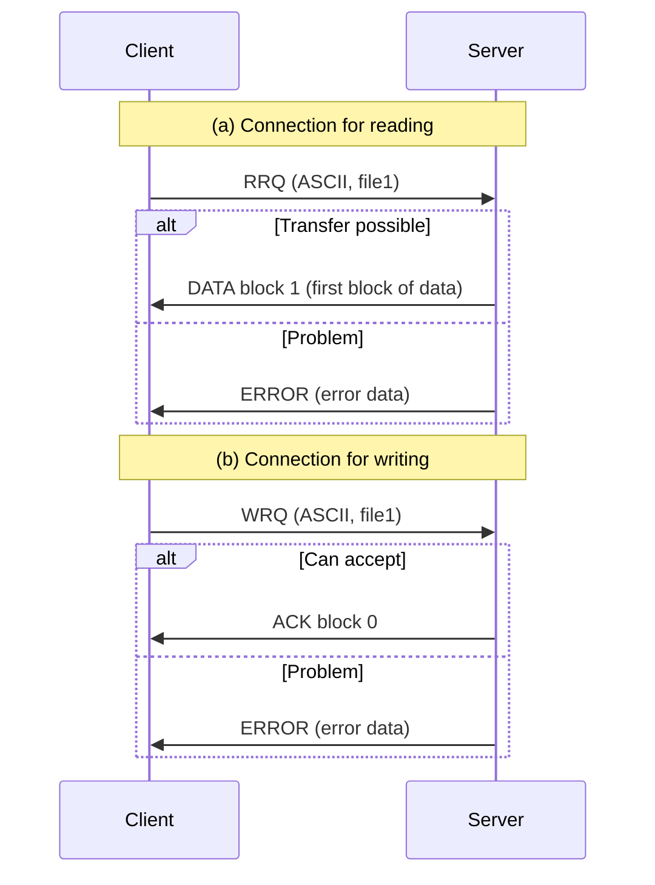

*Figure 20. TFTP connection establishment*

**Connection termination.** After the entire file is transferred, the connection must be terminated, but TFTP has no special message for termination. Termination is accomplished by sending the last block of data, which is smaller than 512 bytes.

**Data transfer.** The data transfer phase occurs between connection establishment and termination. The file is divided into blocks of data, each except the last exactly 512 bytes, and the last between 0 and 511 bytes.

### 9.3 Flow Control and Error Control

UDP has no flow- or error-control mechanism, so TFTP must create its own to transfer a file made of continuous blocks of data.

**Flow control.** TFTP sends a block of data with a DATA message and waits for an ACK message. If the sender receives the acknowledgment before the timeout, it sends the next block. Flow control is thus achieved by numbering the data blocks and waiting for an ACK before sending the next block. This is the **stop-and-wait** protocol of Chapter 7. To retrieve (read) a file, the client sends an RRQ and the server sends the first block with block number 1; to store (write) a file, the client sends a WRQ, the server responds with an ACK numbered 0, and the client then sends the first block with block number 1.

**Error control.** TFTP's error control differs from that of other protocols in that it is **symmetric**: both sender and receiver use timeouts. The sender uses a timeout for data messages and the receiver a timeout for acknowledgment messages. If a data message is lost, the sender retransmits it after the timeout; if an acknowledgment is lost, the receiver retransmits it after the timeout. Error control is needed in four situations.

- **Damaged message:** There is no negative acknowledgment. If a block of data is damaged, the receiver detects it and discards the block; the sender waits for the acknowledgment, does not receive it within the timeout, and sends the block again. There is no checksum field in the TFTP DATA message, so the only way the receiver can detect data corruption is through the checksum of the UDP user datagram (Chapter 6).
- **Lost message:** If a block is lost, it never reaches the receiver and no acknowledgment is sent; the sender resends the block after the timeout.
- **Lost acknowledgment:** If the receiver's timer expires before the sender's, the receiver retransmits the acknowledgment; otherwise the sender retransmits the data.
- **Duplicate message:** The receiver detects duplication through the block number and simply discards the duplicate block.

**Sorcerer's apprentice bug.** Although TFTP's flow and error control are symmetric, this can lead to a problem. Named for the cartoon character who inadvertently conjures up a mop that continuously replicates itself, it happens when the ACK for a packet is not lost but **delayed**. In that case every succeeding block is sent twice and every succeeding acknowledgment is received twice.

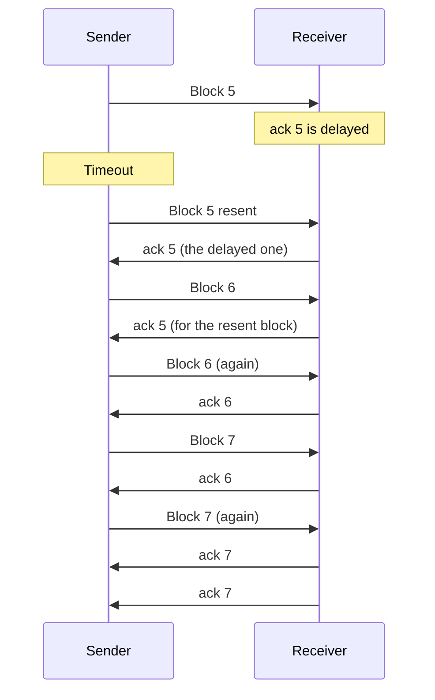

*Figure 21. The sorcerer's apprentice bug*

If the acknowledgment for the fifth block is delayed, the sender retransmits the fifth block after the timeout, and the receiver acknowledges it again. The sender receives two acknowledgments for the fifth block and therefore sends the sixth block twice; the receiver receives the sixth block twice and sends two acknowledgments, so the seventh block is also sent twice, and so on.

**A TFTP example.** A client retrieves a copy of a 2,000-byte file called file1. Since 2,000 = 512 × 3 + 464, there are four blocks of 512, 512, 512, and 464 bytes.

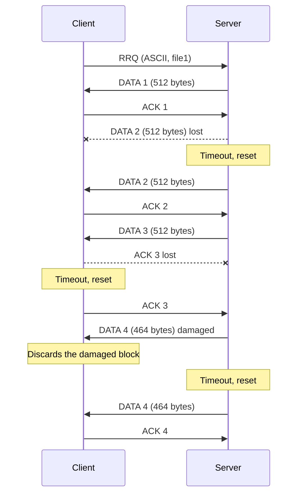

*Figure 22. Retrieving a 2,000-byte file with TFTP*

The client sends an RRQ, and the server sends the first block carrying the first 512 bytes, which is received intact and acknowledged; these two messages are the connection establishment. The second block is lost, and the server retransmits it after the timeout. The third block is received intact, but its acknowledgment is lost, so the receiver (the client) retransmits the acknowledgment after the timeout. The last block, carrying the remaining 464 bytes, arrives damaged, so the client discards it, and the server retransmits it after the timeout. Because this block carries fewer than 512 bytes, it is considered the connection termination.

### 9.4 UDP Ports and Applications

When a process uses UDP, the server normally issues a passive open on the well-known port and the client an active open on an ephemeral port, and the two then communicate using these two ports. TFTP follows a different set of steps. Communication between a TFTP client and server can be lengthy (seconds or even minutes), so if a TFTP server used the well-known port 69 to communicate with one client, no other clients could use the service during that time. The solution is to use the well-known port only for the initial connection and ephemeral ports for the remaining communication.

1. The server passively opens the connection using the well-known port 69.
2. A client actively opens a connection using an ephemeral port (for example, 50032) as the source port and the well-known port 69 as the destination port, through an RRQ or WRQ message.
3. The server actively opens a connection using a new ephemeral port (for example, 62000) as the source port and the ephemeral port received from the client as the destination port, and sends the DATA, ACK, or ERROR message using these ports. This frees the well-known port 69 for other clients. When the client receives the first message from the server, it uses its own ephemeral port and the ephemeral port sent by the server for the rest of the communication.

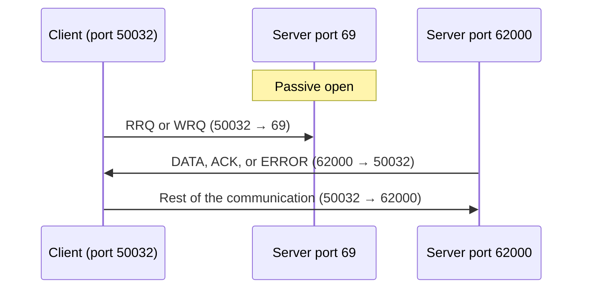

*Figure 23. UDP port numbers used by TFTP*

**Options.** An extension to TFTP that appends options to the RRQ and WRQ messages has been proposed. The options are mainly used to negotiate the size of the block and possibly the initial sequence number. Without options the block size is 512 bytes except for the last block, but negotiation can set any size as long as the message can be encapsulated in a UDP user datagram. A new message, OACK (option acknowledgment), which lets the other party accept or reject the options, has also been proposed.

**Security.** TFTP has no provision for security, such as user identification or a password. Minimal security is therefore achieved by limiting TFTP access to noncritical files or by implementing security in the router close to a TFTP server so that only certain hosts can access it.

**Applications.** TFTP is very useful for basic file transfer where security is not a big issue, and it can be used to initialize devices such as bridges and routers. Its main application is in conjunction with DHCP (Chapter 12). TFTP requires only a small amount of memory and uses only the services of UDP and IP, so it can easily be put in ROM. When a station is powered on, it uses its DHCP client to get the name of the configuration file from the DHCP server, and then passes the name to its TFTP client to get the contents of the configuration file from the TFTP server.

| Aspect | FTP | TFTP |
|:-----|:-----|:-----|
| Transport protocol | TCP | UDP |
| Well-known ports | 21 (control), 20 (data) | 69 (initial connection) |
| Connections | Two: control and data | One logical connection formed by exchanging messages |
| Authentication | User name and password (plaintext), anonymous FTP | None |
| Functions | Directory navigation, file management, choice of type, structure, and mode | Reading and writing files only |
| Reliability | Provided by TCP | Implemented directly with stop-and-wait and symmetric timeouts |
| Typical use | General file transfer | Booting diskless devices, retrieving configuration files with DHCP |

*Table 19. Comparison of FTP and TFTP*

---

<br>

## Summary

| Concept | Key Summary |
|:-----|:-----|
| Components of e-mail | User agents, mail servers with mailboxes and message queues, and SMTP between mail servers and on the sending side. |
| Four scenarios | As sender and receiver are farther from their mail servers, pairs of MTAs and MAAs are added to the two UAs; the most common fourth scenario needs two UAs, two pairs of MTAs, and one pair of MAAs. |
| SMTP | A push protocol over TCP port 25 that transfers messages with the HELO, MAIL FROM, RCPT TO, DATA, and QUIT commands and three-digit response codes, restricting even the body to 7-bit ASCII. |
| Three phases of mail transfer | Connection establishment (220, HELO, 250), message transfer (envelope, DATA, 354, body, single-period line, 250), and connection termination (QUIT, 221). |
| SMTP and HTTP | HTTP is pull and SMTP push; SMTP has the 7-bit ASCII restriction and places multiple objects in one message. |
| MIME | Five headers define the type and encoding of non-ASCII data; base64 turns 24 bits into four 6-bit characters, growing the data by about 33%. |
| POP3 | Uses TCP port 110 and downloads messages through the authorization, transaction, and update phases, keeping no state across sessions. |
| IMAP | Keeps messages in folders on the server, maintains state across sessions, and can retrieve parts of a message. |
| TELNET | A remote login protocol over TCP port 23 that uses the NVT character set, embedding of control characters preceded by IAC, and WILL, WONT, DO, DONT option negotiation. |
| SSH | Creates a secure channel over TCP with SSH-TRANS, SSH-AUTH, and SSH-CONN, providing remote login, sftp, and port forwarding. |
| FTP | Uses a control connection on port 21 and a data connection on port 20, resolving heterogeneity with the file type, data structure, and transmission mode. |
| TFTP | Simple file transfer over UDP port 69 that exchanges 512-byte blocks with stop-and-wait and signals the end with a block smaller than 512 bytes. |

---

<br>

## Self-Check Questions

1. **Order of SMTP commands:** Alice's mail server (crepes.fr) sends one message to two people, Bob (bob@hamburger.edu) and Carol (carol@hamburger.edu). Write the commands the client sends in order and the code with which the server normally answers each.

   <details>
   <summary>Answer</summary>

   When the connection is established, the server sends 220. The client then sends HELO crepes.fr (250), MAIL FROM: <alice@crepes.fr> (250), RCPT TO: <bob@hamburger.edu> (250), RCPT TO: <carol@hamburger.edu> (250), DATA (354), the header and body of the message, a line with a single period (250), and QUIT (221). RCPT TO is sent twice because there are two recipients.

   </details>

2. **Separation of connections:** FTP sends commands and data over different TCP connections, while HTTP uses one connection. Explain what FTP gains by separating the connections and why HTTP uses only one.

   <details>
   <summary>Answer</summary>

   FTP's control connection exchanges only one line of command or response at a time, so simple rules and a minimize-delay service suffice, while the data connection uses more complex rules for various file types and structures. Separating them lets the control connection stay open for the whole session while a data connection is opened and closed for each file, which is efficient. HTTP carries the command (method) and the data together in its request and response messages and only exchanges requests and responses rather than holding a human dialogue, so one connection is enough without a separate control connection.

   </details>

3. **Size under base64:** How many characters does a 300-byte attachment become when encoded with base64? Find the growth relative to the original size and the fraction of transmitted bits that is overhead.

   <details>
   <summary>Answer</summary>

   300 bytes are 2,400 bits, or 100 blocks of 24 bits. Each block becomes four characters, so the result is 400 characters, that is, 400 bytes. The data grow by 400 / 300 = 4/3, about 33%, and because 8 extra bits are added for every 32 transmitted bits, the overhead is 25% of the transmitted bits.

   </details>

4. **POP3 modes:** Bob reads his mail on his office PC with POP3 in download-and-delete mode and then wants to reread the same mail on his laptop at home. What happens, and how can it be avoided?

   <details>
   <summary>Answer</summary>

   The user agent on the office PC sent dele commands while downloading, so the POP3 server deleted the messages in the update phase. The laptop therefore cannot reread them, and Bob's messages are partitioned across several machines. With download-and-keep mode the messages stay on the server and can be reread from several machines, and with IMAP the folders and state are kept on the server as well.

   </details>

5. **TFTP and stop-and-wait:** Explain the flow and error control TFTP uses for reliable transfer over UDP. When a 1,024-byte file is read, how many DATA messages does the server send, and how many bytes does each carry?

   <details>
   <summary>Answer</summary>

   TFTP numbers the data blocks, sends one, and sends the next only after receiving the ACK for it: the stop-and-wait method (Chapter 7). Both sender and receiver use timeouts; the sender retransmits lost data and the receiver retransmits lost acknowledgments, and duplicates are detected by the block number. Because 1,024 bytes is a multiple of 512, two 512-byte blocks must be followed by one extra 0-byte block to signal the end of transmission, so there are three DATA messages.

   </details>

6. **TELNET option negotiation:** Write the strings exchanged when the client wants the server to echo. If the server says it will turn off the enabled echo option, how must the client answer?

   <details>
   <summary>Answer</summary>

   Echo is an option the server enables, so the client requests it with IAC DO ECHO, and if the server accepts, it answers IAC WILL ECHO. If the server offers to disable it with IAC WONT ECHO, an offer to disable cannot be refused, so the client must answer IAC DONT ECHO.

   </details>

7. **Port in passive mode:** An FTP server responds with `227 Entering Passive Mode (192,168,10,5,19,137)`. Find the IP address and port number the client connects to for the data connection.

   <details>
   <summary>Answer</summary>

   The first four numbers are the IP address 192.168.10.5, and the last two are the high-order and low-order bytes of the port number, so the port is 19 × 256 + 137 = 5001. The client issues an active open to port 5001 of 192.168.10.5.

   </details>

---

<br>

## References

1. A. Melnikov, Ed., and B. Leiba, Ed., "Internet Message Access Protocol (IMAP) - Version 4rev2," RFC 9051, Aug. 2021. [Online]. Available: https://www.rfc-editor.org/rfc/rfc9051
2. T. Ylonen and C. Lonvick, Ed., "The Secure Shell (SSH) Transport Layer Protocol," RFC 4253, Jan. 2006. [Online]. Available: https://www.rfc-editor.org/rfc/rfc4253
