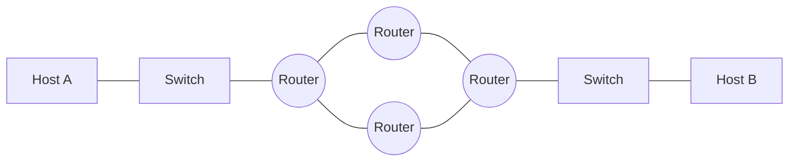
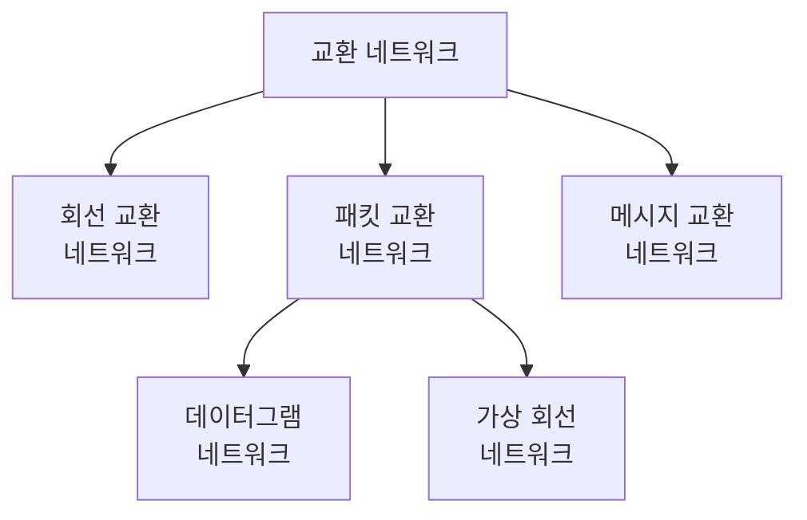
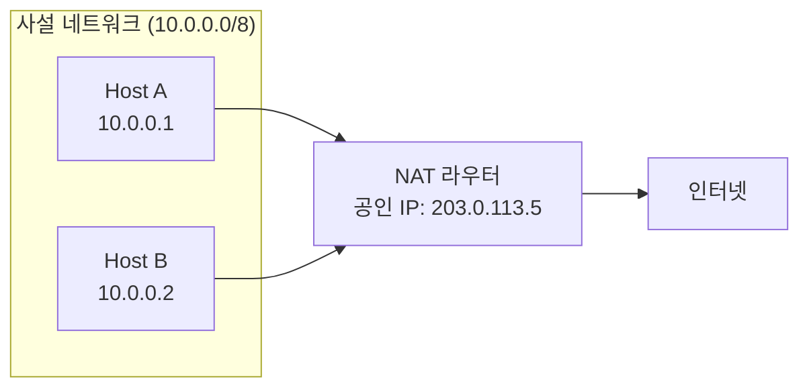

# 4장 — 네트워크 계층 개론

[레포지토리 안내](../../README.ko.md) | [English](Concepts_Lecture.md) | [한국어](Concepts_Lecture.ko.md)

> **최종 수정일:** 2026-10-17
>
> TCP/IP Protocol Suite, Forouzan, Ch 4

> **학습 목표:**
> 1. TCP/IP에서 네트워크 계층의 역할을 설명할 수 있다
> 2. 교환 기술(회선, 패킷)을 구분할 수 있다
> 3. 네트워크 계층 서비스 모델을 설명할 수 있다

---

## 목차

- [1. 서론](#1-서론)
  - [1.1 네트워크 계층 서비스](#11-네트워크-계층-서비스)
  - [1.2 네트워크의 결합으로서의 인터넷](#12-네트워크의-결합으로서의-인터넷)
- [2. 교환 방식](#2-교환-방식)
  - [2.1 회선 교환](#21-회선-교환)
  - [2.2 패킷 교환](#22-패킷-교환)
  - [2.3 메시지 교환](#23-메시지-교환)
  - [2.4 교환 방식 비교](#24-교환-방식-비교)
- [3. 패킷 교환의 상세](#3-패킷-교환의-상세)
  - [3.1 데이터그램 네트워크 (비연결형)](#31-데이터그램-네트워크-비연결형)
  - [3.2 가상 회선 네트워크 (연결형)](#32-가상-회선-네트워크-연결형)
- [4. 네트워크 계층 성능](#4-네트워크-계층-성능)
  - [4.1 지연](#41-지연)
  - [4.2 처리량](#42-처리량)
  - [4.3 패킷 손실](#43-패킷-손실)
- [5. NAT (네트워크 주소 변환)](#5-nat-네트워크-주소-변환)
  - [5.1 NAT 개념과 동기](#51-nat-개념과-동기)
  - [5.2 NAT 동작 방식](#52-nat-동작-방식)
  - [5.3 NAT의 유형](#53-nat의-유형)
  - [5.4 NAT의 한계](#54-nat의-한계)
- [6. 부록](#6-부록)
  - [6.1 사설 IP 주소 범위 (RFC 1918)](#61-사설-ip-주소-범위-rfc-1918)
  - [6.2 NAT 통과 기법](#62-nat-통과-기법)
  - [6.3 실전 예시: 가정용 라우터 NAT](#63-실전-예시-가정용-라우터-nat)
- [요약](#요약)
- [점검 문제](#점검-문제)

---

<br>

## 1. 서론

### 1.1 네트워크 계층 서비스

개념적 수준에서 글로벌 인터넷은 전 세계 수백만, 많게는 수십억 대의 컴퓨터를 연결하는 블랙박스 네트워크로 볼 수 있다. 이 관점에서는 한 컴퓨터의 응용 계층에서 보낸 메시지가 다른 컴퓨터의 응용 계층에 도달하는지만 고려한다.

```text
Application  [===]                          [===]  Application
Transport    [===]                          [===]  Transport
Network      [===]                          [===]  Network
Data link    [===]      (Internet)          [===]  Data link
Physical     [===] ---- cloud of routers ---[===]  Physical
             Host A                         Host B
```

*그림 1. 블랙박스로 본 인터넷과 양 끝 호스트의 계층*

네트워크 계층이 제공하는 서비스는 다음과 같다:
- **패킷화(Packetizing)**: 전송 계층의 페이로드를 패킷으로 캡슐화한다.
- **라우팅(Routing)**: 출발지에서 목적지까지의 최적 경로를 결정한다.
- **포워딩(Forwarding)**: 라우터의 입력에서 적절한 출력으로 패킷을 옮긴다.
- **오류 제어(Error control)**: 헤더 체크섬으로 헤더의 손상만 검사하는 제한된 오류 제어를 한다.
- **흐름 제어(Flow control)**: 인터넷의 네트워크 계층은 흐름 제어를 직접 제공하지 않으며, 이 기능은 상위 계층에 맡긴다.

### 1.2 네트워크의 결합으로서의 인터넷

인터넷은 **연결 장치(라우터)** 를 통해 서로 연결된 **다수의 네트워크(또는 링크)** 로 구성되어 있다. 근본적으로 LAN과 WAN의 결합체이다.



*그림 2. 라우터로 연결된 네트워크의 결합인 인터넷*

> **핵심:** 각 라우터는 최소 두 개의 네트워크(링크)에 연결된다. 라우터는 목적지 IP 주소를 검사하고 패킷을 적절한 다음 홉으로 전달한다.

---

<br>

## 2. 교환 방식

여러 장치가 있을 때, 일대일 통신이 가능하도록 **어떻게 연결**할 것인가의 문제가 발생한다. 교환(switching)이 이 해결책을 제공한다.



*그림 3. 교환 네트워크의 분류*

### 2.1 회선 교환

**회선 교환 네트워크(circuit-switched network)** 는 물리적 링크로 연결된 스위치의 집합으로 구성되며, 각 링크는 n개의 채널로 나뉜다.

주요 특성:
- 자원은 **설정 단계에서 예약**된다.
- 자원은 해제 단계까지 데이터 전송 **전체 기간 동안 전용**으로 유지된다.
- 전체 메시지가 **패킷으로 분할되지 않고** 전송된다.

**세 단계:**
1. **설정(Setup)**: 송신자와 수신자 사이에 전용 경로를 설정한다.
2. **데이터 전송(Data Transfer)**: 설정된 경로를 따라 데이터가 흐른다.
3. **해제(Teardown)**: 통신이 끝나면 회선을 해제한다.

**예시:** 초기 전화 시스템이 대표적이다. 번호를 다이얼하면 발신자와 수신자 사이에 경로가 설정되었고, 한쪽이 전화를 끊을 때까지 회선이 전용으로 유지되었다.

### 2.2 패킷 교환

네트워크 계층은 **패킷 교환 네트워크(packet-switched network)** 로 설계되어 있다:
- 출발지의 메시지를 **데이터그램(datagram)** 이라는 다루기 쉬운 크기의 패킷으로 분할한다.
- 각 데이터그램은 출발지에서 목적지까지 독립적으로 전송된다.
- 목적지에서 데이터그램을 재조립하여 원래 메시지를 복원한다.
- 인터넷의 네트워크 계층은 원래 **비연결형 서비스(connectionless service)** 로 설계되었다.

### 2.3 메시지 교환

메시지 교환에서는:
- 전체 메시지가 하나의 단위로 스위치에서 스위치로 전송된다.
- 각 스위치는 전체 메시지를 저장한 후 전달한다(저장 후 전달).
- 전용 경로를 설정하지 않는다.
- 스위치에 큰 저장 공간이 필요하여 현재는 거의 사용되지 않는다.

### 2.4 교환 방식 비교

| 특성 | 회선 교환 | 패킷 교환 | 메시지 교환 |
|------|-----------|-----------|-------------|
| 설정 | 필요 | 불필요 (데이터그램) | 불필요 |
| 전용 경로 | 있음 | 없음 | 없음 |
| 저장 후 전달 | 없음 | 있음 (패킷 단위) | 있음 (전체 메시지) |
| 대역폭 | 예약 | 공유 | 공유 |
| 지연 | 낮음 (설정 후) | 가변적 | 높음 |
| 예시 | 전화 | 인터넷 | 이메일 중계 (역사적) |

*표 1. 회선 교환, 패킷 교환, 메시지 교환의 비교*

---

<br>

## 3. 패킷 교환의 상세

### 3.1 데이터그램 네트워크 (비연결형)

**비연결형 패킷 교환 네트워크(connectionless packet-switched network)** 에서는 각 패킷이 독립적으로 처리된다:

- 한 메시지의 패킷들은 목적지까지 **같은 경로**로 이동할 수도 있고 아닐 수도 있다.
- 이 유형의 네트워크에서는 스위치를 **라우터**라고 한다.
- 각 패킷은 헤더의 정보(출발지 주소, 목적지 주소)에 따라 라우팅된다.

```text
송신자                                              수신자
  [4|3|2|1] --> R1 --> R2 --> [2]                   [1|3|4|2]
                 |              \                    순서 불일치
                 v               v
                R3 --> R4 --> R5
                  [3]    [4]    [1]
```

*그림 4. 데이터그램 네트워크에서 서로 다른 경로로 전달되어 순서가 바뀐 패킷*

**포워딩 과정**: 각 라우터는 패킷의 **목적지 주소**를 검사하고, **라우팅 테이블**을 참조하여 적절한 출력 인터페이스로 패킷을 전달한다.

```text
+-----------+--------+
| Dest Addr | Output |
|           | Iface  |
+-----------+--------+
|     A     |   1    |
|     B     |   2    |
|    ...    |  ...   |
|     H     |   3    |
+-----------+--------+
```

*그림 5. 목적지 주소와 출력 인터페이스로 이루어진 라우팅 테이블*

> **핵심:** 비연결형 패킷 교환 네트워크에서 포워딩 결정은 패킷의 목적지 주소에 기반한다.

### 3.2 가상 회선 네트워크 (연결형)

**연결형(connection-oriented)** 접근 방식에서는 데이터 전송 전에 가상 경로가 설정된다:
- 모든 패킷이 **같은 경로**를 따른다.
- 패킷이 **순서대로** 도착한다.
- 각 패킷은 전체 목적지 주소 대신 **가상 회선 식별자(VCI)** 를 운반한다.
- 경로를 따라 자원을 할당할 수 있다.

| 특성 | 데이터그램 | 가상 회선 |
|------|-----------|-----------|
| 연결 설정 | 없음 | 있음 |
| 패킷 순서 보장 | 미보장 | 보장 |
| 라우팅 결정 | 패킷 단위 | 연결 단위 |
| 패킷 헤더 | 전체 목적지 주소 | VCI |
| 장애 내성 | 높음 | 낮음 (경로 장애 시) |

*표 2. 데이터그램 네트워크와 가상 회선 네트워크의 비교*

---

<br>

## 4. 네트워크 계층 성능

### 4.1 지연

네트워크를 통과하는 패킷의 총 지연:

```text
D_total = D_processing + D_queuing + D_transmission + D_propagation
```

| 지연 유형 | 원인 | 공식 |
|-----------|------|------|
| 처리 지연(Processing) | 헤더 검사, 출력 결정 | 무시 가능 |
| 큐잉 지연(Queuing) | 출력 큐에서의 대기 | 트래픽에 의존 |
| 전송 지연(Transmission) | 비트를 링크에 밀어넣는 시간 | L / R (패킷 길이 / 링크 속도) |
| 전파 지연(Propagation) | 매체를 통한 신호 이동 | d / s (거리 / 속도) |

*표 3. 지연의 유형별 원인과 공식*

### 4.2 처리량

**처리량(Throughput)** 은 데이터가 실제로 전달되는 속도이다:
- **순간 처리량**: 특정 순간의 전달 속도이다.
- **평균 처리량**: 더 긴 기간에 걸친 평균 전달 속도이다.
- 경로 전체의 처리량은 병목 링크가 결정한다.

### 4.3 패킷 손실

패킷은 다음과 같은 이유로 손실될 수 있다:
- 라우터의 버퍼가 넘친다(혼잡).
- 비트 오류로 체크섬 검사에 실패한다.
- TTL이 만료된다.

---

<br>

## 5. NAT (네트워크 주소 변환)

### 5.1 NAT 개념과 동기

**네트워크 주소 변환(Network Address Translation, NAT)** 은 사설 네트워크의 여러 장치가 하나의 공인 IP 주소를 공유하여 인터넷에 접속할 수 있게 한다.

**동기:**
- IPv4 주소 고갈: 주소가 약 43억 개($2^{32}$)뿐이다.
- 보안: 내부 네트워크 토폴로지가 외부에 드러나지 않는다.
- 유연성: 외부 연결에 영향을 주지 않고 내부 주소를 바꿀 수 있다.

### 5.2 NAT 동작 방식



*그림 6. NAT 라우터를 거쳐 인터넷에 접속하는 사설 네트워크*

**변환 과정 (PAT 기준):**
1. 내부 호스트가 사설 출발지 IP로 패킷을 전송한다.
2. NAT 라우터가 사설 출발지 IP를 자신의 공인 IP로, 출발지 포트를 외부 포트로 바꾼다.
3. NAT 라우터가 내부 IP:포트와 외부 포트를 대응시키는 항목을 **NAT 변환 테이블**에 만든다.
4. 응답이 도착하면 NAT 라우터가 테이블을 조회하여 목적지를 내부 IP:포트로 되돌리고 올바른 내부 호스트로 전달한다.

**NAT 변환 테이블:**

| 내부 IP:포트 | 외부 포트 | 목적지 |
|-------------|-----------|--------|
| 10.0.0.1:3345 | 5001 | 128.119.40.186:80 |
| 10.0.0.2:3346 | 5002 | 64.233.167.99:80 |

*표 4. NAT 변환 테이블의 예*

### 5.3 NAT의 유형

| 유형 | 설명 |
|------|------|
| 정적 NAT (Static NAT) | 사설 IP와 공인 IP 간의 일대일 매핑 |
| 동적 NAT (Dynamic NAT) | 공인 IP 풀에서 요청 시 할당 |
| PAT/NAPT | 포트 번호를 사용하여 여러 사설 IP가 하나의 공인 IP를 공유 |

*표 5. NAT의 유형*

**PAT (Port Address Translation)** 가 가장 일반적인 형태이며, **NAT 오버로딩(NAT overloading)** 또는 **NAPT (Network Address Port Translation)** 라고도 불린다.

### 5.4 NAT의 한계

- 인터넷의 종단 간(end-to-end) 원칙을 위반한다.
- P2P 응용 프로그램을 복잡하게 만든다.
- 페이로드에 IP 주소를 넣는 프로토콜(FTP, SIP)에서 문제가 생긴다.
- 외부에서 시작하는 연결을 받으려면 포트 포워딩 같은 별도 처리가 필요하다.

---

<br>

## 6. 부록

### 6.1 사설 IP 주소 범위 (RFC 1918)

| 클래스 | 범위 | CIDR | 주소 수 |
|--------|------|------|---------|
| A | 10.0.0.0~10.255.255.255 | 10.0.0.0/8 | 16,777,216 |
| B | 172.16.0.0~172.31.255.255 | 172.16.0.0/12 | 1,048,576 |
| C | 192.168.0.0~192.168.255.255 | 192.168.0.0/16 | 65,536 |

*표 6. 사설 IP 주소 블록별 범위와 주소 수*

### 6.2 NAT 통과 기법

NAT를 통한 수신 연결이 필요한 응용 프로그램을 위한 기법:
- **포트 포워딩(Port Forwarding)**: NAT 라우터가 특정 포트를 내부 호스트로 전달하도록 수동으로 설정한다.
- **UPnP (Universal Plug and Play)**: 포트 매핑을 자동으로 설정한다.
- **STUN (Session Traversal Utilities for NAT)**: 자신의 공인 IP와 포트 매핑을 알아낸다.
- **TURN (Traversal Using Relays around NAT)**: 직접 연결이 실패하면 릴레이 서버를 사용한다.
- **ICE (Interactive Connectivity Establishment)**: STUN과 TURN을 결합하여 연결 경로를 찾는다.

### 6.3 실전 예시: 가정용 라우터 NAT

가정용 컴퓨터(192.168.1.100)가 google.com에 접속할 때:
1. PC가 src=192.168.1.100:50000, dst=142.250.196.46:443인 패킷을 전송한다.
2. 라우터가 출발지를 바꾸어 src=public_IP:12345, dst=142.250.196.46:443으로 전송한다.
3. Google이 dst=public_IP:12345로 응답한다.
4. 라우터가 테이블을 조회하여 목적지를 dst=192.168.1.100:50000으로 바꾸어 전달한다.

---

<br>

## 요약

| 개념 | 핵심 요약 |
|------|------------|
| 네트워크 계층 | 네트워크 사이에서 패킷의 라우팅과 포워딩을 담당한다. |
| 회선 교환 | 설정, 데이터 전송, 해제의 세 단계로 동작하며, 설정 단계에서 자원을 예약한 전용 경로를 사용한다. |
| 패킷 교환 | 메시지를 패킷으로 나누어 공유 자원을 통해 전달하며, 인터넷의 네트워크 계층은 이 방식으로 설계되었다. |
| 데이터그램 네트워크 | 비연결형으로 패킷마다 독립적으로 경로를 정하므로, 패킷의 도착 순서가 보장되지 않는다. |
| 가상 회선 | 연결형으로 설정된 경로를 따라 VCI로 패킷을 전달하므로, 패킷이 순서대로 도착한다. |
| 포워딩 | 데이터그램 네트워크의 라우터는 패킷마다 목적지 주소로 라우팅 테이블을 조회하여 출력 인터페이스를 정한다. |
| 지연 | 총 지연은 처리 지연, 큐잉 지연, 전송 지연, 전파 지연의 합이다. |
| NAT | 사설 IP 주소를 공인 IP 주소로 변환하여 IPv4 주소 고갈 문제를 완화한다. |

---

<br>

## 점검 문제

1. **지연 계산:** 1,500바이트 패킷을 10 Mbps 링크로 2,000 km 떨어진 곳에 보낸다. 전파 속도는 $2 \times 10^8$ m/s이고 처리 지연과 큐잉 지연은 무시한다. 전송 지연, 전파 지연, 총 지연을 구하라.

   <details>
   <summary>정답</summary>

   패킷 길이는 1,500 × 8 = 12,000비트이므로 전송 지연은 $12{,}000 / 10^7$ s = 1.2 ms이다. 전파 지연은 $2 \times 10^6$ m를 $2 \times 10^8$ m/s로 나눈 0.01 s = 10 ms이다. 총 지연은 1.2 + 10 = 11.2 ms이다.

   </details>

2. **처리량과 병목:** 서버에서 클라이언트까지의 경로가 100 Mbps, 20 Mbps, 50 Mbps 링크로 이루어져 있다. 다른 트래픽이 없을 때 처리량은 얼마이고, 10 MB 파일을 전송하는 데 걸리는 시간은 얼마인가? 1 MB = $10^6$바이트로 계산하고 지연은 무시한다.

   <details>
   <summary>정답</summary>

   처리량은 병목 링크의 속도인 20 Mbps이다. 10 MB는 $80 \times 10^6$비트이므로 전송 시간은 $80 \times 10^6 / (20 \times 10^6)$ = 4 s이다.

   </details>

3. **도착 순서와 장애:** 패킷 1, 2, 3, 4를 차례로 보냈을 때 데이터그램 네트워크에서는 2, 1, 4, 3 순서로 도착할 수 있지만 가상 회선 네트워크에서는 보낸 순서대로 도착하는 이유를 설명하라. 경로 중간의 라우터가 고장 나면 두 네트워크는 어떻게 달라지는가?

   <details>
   <summary>정답</summary>

   데이터그램 네트워크에서는 라우터가 패킷마다 목적지 주소로 독립적으로 포워딩하므로 패킷들이 서로 다른 경로와 큐를 거칠 수 있고, 경로마다 지연이 다르면 순서가 바뀐다. 가상 회선 네트워크에서는 설정 단계에서 정한 하나의 경로를 모든 패킷이 따르므로 순서대로 도착한다. 라우터가 고장 나면 데이터그램 네트워크는 이후 패킷을 다른 경로로 보낼 수 있지만, 가상 회선 네트워크는 그 경로를 쓰는 연결이 끊기므로 회선을 다시 설정해야 한다.

   </details>

4. **NAT 변환 추적:** 표 4의 변환 테이블을 가진 NAT 라우터의 공인 IP 주소가 203.0.113.5이다. (a) 10.0.0.1:3345가 128.119.40.186:80으로 보낸 패킷이 라우터를 나갈 때 출발지 주소와 포트는 어떻게 바뀌는가? (b) 64.233.167.99:80에서 203.0.113.5:5002로 응답이 도착하면 라우터는 이 패킷을 어디로 전달하는가?

   <details>
   <summary>정답</summary>

   (a) 출발지는 203.0.113.5:5001로 바뀌고, 목적지 128.119.40.186:80은 그대로이다. (b) 라우터는 외부 포트 5002의 항목을 찾아 목적지를 10.0.0.2:3346으로 바꾼 뒤 Host B에 전달한다.

   </details>

5. **사설 주소 블록:** 172.16.0.0/12 블록에 들어 있는 주소의 수와 마지막 주소를 구하라.

   <details>
   <summary>정답</summary>

   접두사가 12비트이므로 나머지 32 − 12 = 20비트가 블록 안의 주소를 구분하고, 주소 수는 $2^{20}$ = 1,048,576개이다. 접두사 12비트는 172의 8비트와 16의 상위 4비트(0001)이므로 둘째 바이트는 16~31 범위이다. 마지막 주소는 나머지 20비트를 모두 1로 채운 172.31.255.255이다.

   </details>

---
