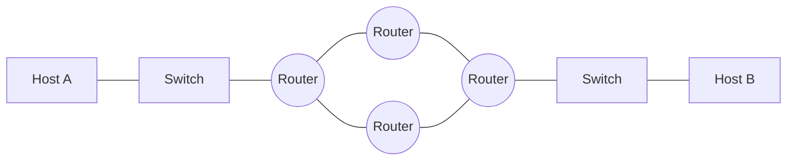
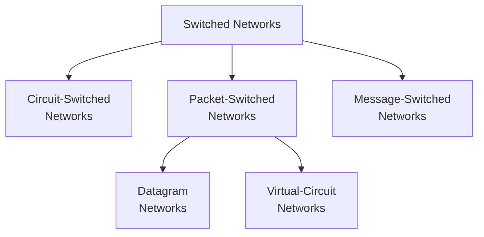
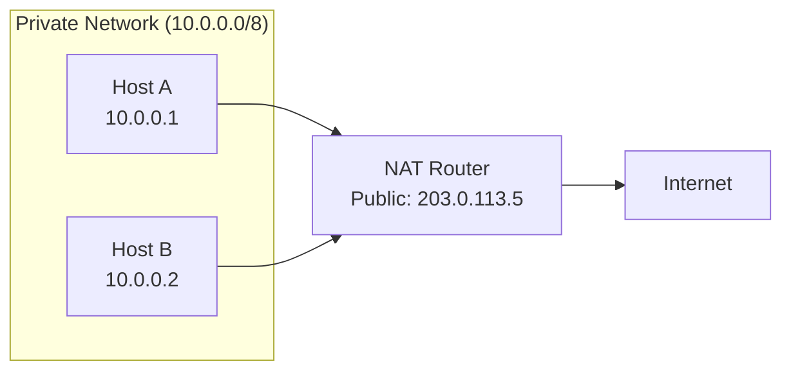

# Chapter 4 — Introduction to Network Layer

[Repository Guide](../../README.md) | [English](Concepts_Lecture.md) | [한국어](Concepts_Lecture.ko.md)

> **Last Updated:** 2026-10-17
>
> TCP/IP Protocol Suite, Forouzan, Ch 4

> **Learning Objectives:**
> 1. Explain the role of the network layer in TCP/IP
> 2. Distinguish between switching techniques (circuit, packet)
> 3. Describe the network layer service model

---

## Table of Contents

- [1. Introduction](#1-introduction)
  - [1.1 Network Layer Services](#11-network-layer-services)
  - [1.2 The Internet as a Combination of Networks](#12-the-internet-as-a-combination-of-networks)
- [2. Switching](#2-switching)
  - [2.1 Circuit Switching](#21-circuit-switching)
  - [2.2 Packet Switching](#22-packet-switching)
  - [2.3 Message Switching](#23-message-switching)
  - [2.4 Comparison of Switching Methods](#24-comparison-of-switching-methods)
- [3. Packet Switching in Detail](#3-packet-switching-in-detail)
  - [3.1 Datagram Networks (Connectionless)](#31-datagram-networks-connectionless)
  - [3.2 Virtual-Circuit Networks (Connection-Oriented)](#32-virtual-circuit-networks-connection-oriented)
- [4. Network Layer Performance](#4-network-layer-performance)
  - [4.1 Delay](#41-delay)
  - [4.2 Throughput](#42-throughput)
  - [4.3 Packet Loss](#43-packet-loss)
- [5. NAT (Network Address Translation)](#5-nat-network-address-translation)
  - [5.1 NAT Concept and Motivation](#51-nat-concept-and-motivation)
  - [5.2 NAT Operation](#52-nat-operation)
  - [5.3 Types of NAT](#53-types-of-nat)
  - [5.4 NAT Limitations](#54-nat-limitations)
- [6. Appendix](#6-appendix)
  - [6.1 Private IP Address Ranges (RFC 1918)](#61-private-ip-address-ranges-rfc-1918)
  - [6.2 NAT Traversal Techniques](#62-nat-traversal-techniques)
  - [6.3 Real-World Example: Home Router NAT](#63-real-world-example-home-router-nat)
- [Summary](#summary)
- [Self-Check Questions](#self-check-questions)

---

<br>

## 1. Introduction

### 1.1 Network Layer Services

At the conceptual level, the global Internet can be viewed as a black box network that connects millions (if not billions) of computers worldwide. From this viewpoint, the only concern is that a message from the application layer in one computer reaches the application layer in another computer.

```text
Application  [===]                          [===]  Application
Transport    [===]                          [===]  Transport
Network      [===]                          [===]  Network
Data link    [===]      (Internet)          [===]  Data link
Physical     [===] ---- cloud of routers ---[===]  Physical
             Host A                         Host B
```

*Figure 1. The Internet as a black box between the layers of two hosts*

The services of the network layer are as follows:
- **Packetizing**: It encapsulates the payload from the transport layer into packets.
- **Routing**: It determines the best path from source to destination.
- **Forwarding**: It moves packets from a router input to the appropriate router output.
- **Error control**: It provides only limited error control, using a header checksum to detect corruption of the header.
- **Flow control**: The network layer of the Internet does not provide flow control directly and leaves it to the upper layers.

### 1.2 The Internet as a Combination of Networks

The Internet is made of **many networks (or links) connected together** through **connecting devices** (routers). It is fundamentally a combination of LANs and WANs.



*Figure 2. The Internet as networks connected by routers*

> **Key Point:** Each router connects to at least two networks (links). The router examines the destination IP address and forwards the packet to the appropriate next hop.

---

<br>

## 2. Switching

Whenever we have multiple devices, we have the problem of **how to connect** them to make one-to-one communication possible. Switching provides the solution.



*Figure 3. Taxonomy of switched networks*

### 2.1 Circuit Switching

A **circuit-switched network** is made of a set of switches connected by physical links, in which each link is divided into n channels.

Key characteristics:
- Resources are **reserved during the setup phase**.
- Resources remain **dedicated for the entire duration** of data transfer until the teardown phase.
- The whole message is sent **without being divided into packets**.

**Three phases:**
1. **Setup**: A dedicated path is established between sender and receiver.
2. **Data Transfer**: Data flows along the established path.
3. **Teardown**: The circuit is released after communication ends.

**Example:** The early telephone system is a typical example. A path was established between caller and callee when the number was dialed, and the circuit remained dedicated until one party hung up.

### 2.2 Packet Switching

The network layer is designed as a **packet-switched network**:
- The message at the source is divided into manageable packets called **datagrams**.
- Individual datagrams are transferred independently from source to destination.
- Datagrams are reassembled at the destination to recreate the original message.
- The Internet's network layer was originally designed as a **connectionless service**.

### 2.3 Message Switching

In message switching:
- The entire message is sent as a single unit from switch to switch.
- Each switch stores the entire message before forwarding (store-and-forward).
- No dedicated path is established.
- It is rarely used today because switches need large storage.

### 2.4 Comparison of Switching Methods

| Feature | Circuit Switching | Packet Switching | Message Switching |
|---------|-------------------|-----------------|-------------------|
| Setup | Required | Not required (datagram) | Not required |
| Dedicated path | Yes | No | No |
| Store-and-forward | No | Yes (per packet) | Yes (entire message) |
| Bandwidth | Reserved | Shared | Shared |
| Delay | Low (after setup) | Variable | High |
| Example | Telephone | Internet | Email relay (historical) |

*Table 1. Comparison of circuit, packet, and message switching*

---

<br>

## 3. Packet Switching in Detail

### 3.1 Datagram Networks (Connectionless)

In a **connectionless packet-switched network**, each packet is treated independently:

- Packets in a message may or may not travel the **same path** to their destination.
- The switches in this type of network are called **routers**.
- Each packet is routed based on the information in its header (source address, destination address).

```text
Sender                                              Receiver
  [4|3|2|1] --> R1 --> R2 --> [2]                   [1|3|4|2]
                 |              \                    Out of order
                 v               v
                R3 --> R4 --> R5
                  [3]    [4]    [1]
```

*Figure 4. Packets taking different paths and arriving out of order in a datagram network*

**Forwarding process**: Each router examines the **destination address** of the packet, consults its **routing table**, and forwards the packet to the appropriate output interface.

```text
+-----------+--------+
| Dest Addr | Output |
|           | Iface  |
+-----------+--------+
|     A     |   1    |
|     B     |   2    |
|    ...    |  ...   |
|     H     |   3    |
+-----------+--------+
```

*Figure 5. Routing table mapping destination addresses to output interfaces*

> **Key Point:** In a connectionless packet-switched network, the forwarding decision is based on the destination address of the packet.

### 3.2 Virtual-Circuit Networks (Connection-Oriented)

In a **connection-oriented** approach, a virtual path is established before data transfer:
- All packets follow the **same path**.
- Packets arrive **in order**.
- Each packet carries a **virtual circuit identifier (VCI)** instead of the full destination address.
- Resources can be allocated along the path.

| Feature | Datagram | Virtual Circuit |
|---------|----------|----------------|
| Connection setup | No | Yes |
| Packet ordering | Not guaranteed | Guaranteed |
| Routing decision | Per packet | Per connection |
| Packet header | Full destination address | VCI |
| Fault tolerance | High | Low (if path fails) |

*Table 2. Comparison of datagram and virtual-circuit networks*

---

<br>

## 4. Network Layer Performance

### 4.1 Delay

Total delay for a packet traversing a network:

```text
D_total = D_processing + D_queuing + D_transmission + D_propagation
```

| Delay Type | Cause | Formula |
|-----------|-------|---------|
| Processing | Examining header, determining output | Negligible |
| Queuing | Waiting in output queue | Depends on traffic |
| Transmission | Pushing bits onto the link | L / R (packet length / link rate) |
| Propagation | Signal traveling through medium | d / s (distance / speed) |

*Table 3. Cause and formula of each delay type*

### 4.2 Throughput

**Throughput** is the rate at which data is actually delivered:
- **Instantaneous throughput**: The delivery rate at a specific moment.
- **Average throughput**: The average delivery rate over a longer period.
- The bottleneck link determines the end-to-end throughput.

### 4.3 Packet Loss

Packets can be lost due to:
- Buffer overflow at routers (congestion).
- Bit errors causing checksum failures.
- TTL expiration.

---

<br>

## 5. NAT (Network Address Translation)

### 5.1 NAT Concept and Motivation

**Network Address Translation (NAT)** allows multiple devices on a private network to share a single public IP address for accessing the Internet.

**Motivation:**
- IPv4 address exhaustion: There are only about 4.3 billion ($2^{32}$) addresses.
- Security: The internal network topology is hidden from the outside.
- Flexibility: Internal addressing can be changed without affecting external connections.

### 5.2 NAT Operation



*Figure 6. A private network reaching the Internet through a NAT router*

**Translation process (PAT):**
1. The internal host sends a packet with a private source IP.
2. The NAT router replaces the private source IP with its public IP and the source port with an external port.
3. The NAT router creates an entry in the **NAT translation table** mapping the internal IP:port to the external port.
4. When a response arrives, the NAT router looks up the table, restores the internal IP:port as the destination, and forwards the packet to the correct internal host.

**NAT Translation Table:**

| Internal IP:Port | External Port | Destination |
|-----------------|---------------|-------------|
| 10.0.0.1:3345 | 5001 | 128.119.40.186:80 |
| 10.0.0.2:3346 | 5002 | 64.233.167.99:80 |

*Table 4. Example of a NAT translation table*

### 5.3 Types of NAT

| Type | Description |
|------|-------------|
| Static NAT | One-to-one mapping between private and public IPs |
| Dynamic NAT | Pool of public IPs assigned on demand |
| PAT/NAPT | Multiple private IPs share one public IP using port numbers |

*Table 5. Types of NAT*

**PAT (Port Address Translation)** is the most common form, also called **NAT overloading** or **NAPT (Network Address Port Translation)**.

### 5.4 NAT Limitations

- It breaks the end-to-end principle of the Internet.
- It complicates peer-to-peer applications.
- It causes problems for protocols that embed IP addresses in the payload (FTP, SIP).
- It requires special handling, such as port forwarding, for incoming connections.

---

<br>

## 6. Appendix

### 6.1 Private IP Address Ranges (RFC 1918)

| Class | Range | CIDR | Number of Addresses |
|-------|-------|------|-------------------|
| A | 10.0.0.0-10.255.255.255 | 10.0.0.0/8 | 16,777,216 |
| B | 172.16.0.0-172.31.255.255 | 172.16.0.0/12 | 1,048,576 |
| C | 192.168.0.0-192.168.255.255 | 192.168.0.0/16 | 65,536 |

*Table 6. Range and size of each private IP address block*

### 6.2 NAT Traversal Techniques

For applications that need incoming connections through NAT:
- **Port Forwarding**: The NAT router is manually configured to forward specific ports to an internal host.
- **UPnP (Universal Plug and Play)**: It sets up port mappings automatically.
- **STUN (Session Traversal Utilities for NAT)**: It discovers the public IP and port mapping.
- **TURN (Traversal Using Relays around NAT)**: It uses a relay server when a direct connection fails.
- **ICE (Interactive Connectivity Establishment)**: It combines STUN and TURN to find a connection path.

### 6.3 Real-World Example: Home Router NAT

When a home computer (192.168.1.100) visits google.com:
1. The PC sends a packet with src=192.168.1.100:50000, dst=142.250.196.46:443.
2. The router replaces the source and sends src=public_IP:12345, dst=142.250.196.46:443.
3. Google responds to dst=public_IP:12345.
4. The router looks up the table, changes the destination, and forwards the packet to dst=192.168.1.100:50000.

---

<br>

## Summary

| Concept | Key Summary |
|---------|-----------|
| Network Layer | It is responsible for routing and forwarding packets across networks. |
| Circuit Switching | It goes through setup, data transfer, and teardown phases and uses a dedicated path whose resources are reserved during setup. |
| Packet Switching | It divides a message into packets delivered over shared resources, and the Internet's network layer is designed this way. |
| Datagram Network | It is connectionless and routes each packet independently, so the arrival order of packets is not guaranteed. |
| Virtual Circuit | It is connection-oriented and forwards packets by VCI along an established path, so packets arrive in order. |
| Forwarding | In a datagram network, a router looks up the routing table with each packet's destination address to choose the output interface. |
| Delay | Total delay is the sum of processing, queuing, transmission, and propagation delays. |
| NAT | It translates private IP addresses to a public IP address and thereby mitigates IPv4 address exhaustion. |

---

<br>

## Self-Check Questions

1. **Delay calculation:** A 1,500-byte packet is sent over a 10 Mbps link to a destination 2,000 km away. The propagation speed is $2 \times 10^8$ m/s, and processing and queuing delays are ignored. Find the transmission delay, the propagation delay, and the total delay.

   <details>
   <summary>Answer</summary>

   The packet length is 1,500 × 8 = 12,000 bits, so the transmission delay is $12{,}000 / 10^7$ s = 1.2 ms. The propagation delay is $2 \times 10^6$ m divided by $2 \times 10^8$ m/s, which is 0.01 s = 10 ms. The total delay is 1.2 + 10 = 11.2 ms.

   </details>

2. **Throughput and bottleneck:** The path from a server to a client consists of 100 Mbps, 20 Mbps, and 50 Mbps links. With no other traffic, what is the throughput, and how long does it take to transfer a 10 MB file? Use 1 MB = $10^6$ bytes and ignore delays.

   <details>
   <summary>Answer</summary>

   The throughput is 20 Mbps, the rate of the bottleneck link. 10 MB is $80 \times 10^6$ bits, so the transfer time is $80 \times 10^6 / (20 \times 10^6)$ = 4 s.

   </details>

3. **Arrival order and failures:** Packets 1, 2, 3, and 4 are sent in order. Explain why they can arrive in the order 2, 1, 4, 3 in a datagram network but arrive in the order sent in a virtual-circuit network. How do the two networks differ if a router in the middle of the path fails?

   <details>
   <summary>Answer</summary>

   In a datagram network, routers forward each packet independently by its destination address, so packets can take different paths and queues, and different delays on those paths change the order. In a virtual-circuit network, all packets follow the single path chosen during setup, so they arrive in order. If a router fails, a datagram network can send later packets along another path, but in a virtual-circuit network the connections using that path are broken and the circuit must be set up again.

   </details>

4. **NAT translation trace:** A NAT router with the translation table in Table 4 has the public IP address 203.0.113.5. (a) When a packet sent from 10.0.0.1:3345 to 128.119.40.186:80 leaves the router, how do its source address and port change? (b) When a response from 64.233.167.99:80 arrives at 203.0.113.5:5002, where does the router forward it?

   <details>
   <summary>Answer</summary>

   (a) The source becomes 203.0.113.5:5001, and the destination 128.119.40.186:80 stays the same. (b) The router finds the entry for external port 5002, changes the destination to 10.0.0.2:3346, and forwards the packet to Host B.

   </details>

5. **Private address block:** Find the number of addresses in the 172.16.0.0/12 block and its last address.

   <details>
   <summary>Answer</summary>

   The prefix is 12 bits, so the remaining 32 − 12 = 20 bits distinguish the addresses in the block, and the number of addresses is $2^{20}$ = 1,048,576. The 12-bit prefix consists of the 8 bits of 172 and the upper 4 bits of 16 (0001), so the second byte ranges over 16-31. The last address, with all remaining 20 bits set to 1, is 172.31.255.255.

   </details>

---
