# 5장 — 도메인 이름 시스템 (DNS)

[레포지토리 안내](../../README.ko.md) | [English](Concepts_Lecture.md) | [한국어](Concepts_Lecture.ko.md)

> **최종 수정일:** 2026-11-18
>
> Computer Networking: A Top-Down Approach, Kurose and Ross, Ch 2; TCP/IP Protocol Suite, Forouzan, Ch 19

> **학습 목표:**
> 1. 호스트 이름을 IP 주소로 바꾸는 DNS가 필요한 이유와 DNS가 제공하는 서비스를 설명할 수 있다
> 2. 도메인 이름 공간의 구조와 레이블, FQDN, PQDN, 도메인, 영역의 관계를 설명할 수 있다
> 3. 루트, TLD, 책임, 로컬 DNS 서버의 역할과 인터넷의 일반, 국가, 역 도메인을 설명할 수 있다
> 4. 반복 질의와 재귀 질의로 이름이 해석되는 과정을 추적하고, 캐싱이 메시지 수를 줄이는 효과를 계산할 수 있다
> 5. 자원 레코드의 형식과 DNS 메시지의 헤더, 플래그, 압축을 해석할 수 있다
> 6. DNS가 UDP와 TCP를 쓰는 경우, 레코드를 등록하고 갱신하는 방법, DNS에 대한 공격을 설명할 수 있다

---

## 목차

- [1. DNS가 필요한 이유와 서비스](#1-dns가-필요한-이유와-서비스)
  - [1.1 호스트 이름과 IP 주소](#11-호스트-이름과-ip-주소)
  - [1.2 DNS의 정의와 동작 개요](#12-dns의-정의와-동작-개요)
  - [1.3 DNS가 제공하는 서비스](#13-dns가-제공하는-서비스)
- [2. 이름 공간](#2-이름-공간)
  - [2.1 평면 이름 공간과 계층적 이름 공간](#21-평면-이름-공간과-계층적-이름-공간)
  - [2.2 도메인 이름 공간](#22-도메인-이름-공간)
  - [2.3 FQDN과 PQDN](#23-fqdn과-pqdn)
  - [2.4 도메인](#24-도메인)
- [3. 이름 공간의 분산과 DNS 서버](#3-이름-공간의-분산과-dns-서버)
  - [3.1 중앙 집중 설계의 문제](#31-중앙-집중-설계의-문제)
  - [3.2 서버의 계층과 영역](#32-서버의-계층과-영역)
  - [3.3 주 서버와 보조 서버](#33-주-서버와-보조-서버)
  - [3.4 루트, TLD, 책임 DNS 서버](#34-루트-tld-책임-dns-서버)
  - [3.5 로컬 DNS 서버](#35-로컬-dns-서버)
  - [3.6 인터넷의 DNS: 일반 도메인, 국가 도메인, 역 도메인](#36-인터넷의-dns-일반-도메인-국가-도메인-역-도메인)
- [4. 이름 해석](#4-이름-해석)
  - [4.1 리졸버](#41-리졸버)
  - [4.2 반복 질의와 재귀 질의](#42-반복-질의와-재귀-질의)
  - [4.3 주소를 이름으로 바꾸는 해석](#43-주소를-이름으로-바꾸는-해석)
  - [4.4 DNS 캐싱과 TTL](#44-dns-캐싱과-ttl)
- [5. 자원 레코드](#5-자원-레코드)
  - [5.1 네 값으로 이루어진 자원 레코드](#51-네-값으로-이루어진-자원-레코드)
  - [5.2 책임 서버와 다른 서버가 가진 레코드](#52-책임-서버와-다른-서버가-가진-레코드)
  - [5.3 레코드 형식 번호와 클래스](#53-레코드-형식-번호와-클래스)
- [6. DNS 메시지](#6-dns-메시지)
  - [6.1 메시지의 구조](#61-메시지의-구조)
  - [6.2 헤더와 플래그](#62-헤더와-플래그)
  - [6.3 질의 레코드와 자원 레코드의 형식](#63-질의-레코드와-자원-레코드의-형식)
  - [6.4 압축](#64-압축)
  - [6.5 메시지 해석의 예](#65-메시지-해석의-예)
- [7. 전송 프로토콜과 캡슐화](#7-전송-프로토콜과-캡슐화)
- [8. 레코드의 등록과 갱신](#8-레코드의-등록과-갱신)
  - [8.1 등록 기관](#81-등록-기관)
  - [8.2 등록한 레코드로 이루어지는 이름 해석](#82-등록한-레코드로-이루어지는-이름-해석)
  - [8.3 DDNS](#83-ddns)
- [9. DNS 보안](#9-dns-보안)
- [요약](#요약)
- [점검 문제](#점검-문제)
- [참고 문헌](#참고-문헌)

---

<br>

## 1. DNS가 필요한 이유와 서비스

### 1.1 호스트 이름과 IP 주소

사람은 여러 방법으로 식별된다. 출생 신고서에 적힌 이름으로도, 사회 보장 번호 같은 식별 번호로도, 운전 면허 번호로도 사람을 가리킬 수 있으며, 상황에 따라 더 알맞은 식별자가 다르다. 세금을 다루는 기관의 컴퓨터는 길이가 고정된 번호를 선호하지만, 사람들은 기억하기 쉬운 이름을 선호한다. 인터넷 호스트도 마찬가지로 두 가지 방법으로 식별된다.

첫째는 **호스트 이름(hostname)** 이다. www.facebook.com, www.google.com, gaia.cs.umass.edu 같은 호스트 이름은 기억하기 쉬워 사람에게 편하다. 그러나 호스트 이름은 그 호스트가 인터넷의 어디에 있는지에 대한 정보를 거의 주지 않는다. 국가 코드 .fr로 끝나는 www.eurecom.fr은 호스트가 프랑스에 있을 가능성을 알려 주지만 그 이상은 알려 주지 않는다. 또한 호스트 이름은 길이가 일정하지 않은 영문자와 숫자로 이루어지므로 라우터가 처리하기 어렵다.

둘째는 **IP 주소(IP address)** 이다. IP 주소는 4바이트로 이루어지고 엄격한 계층 구조를 가진다. 121.7.106.83처럼 각 바이트를 0부터 255까지의 십진수로 쓰고 점으로 구분한다. 주소를 왼쪽에서 오른쪽으로 읽을수록 호스트가 네트워크들의 네트워크 안에서 어느 네트워크에 있는지 점점 더 구체적으로 알 수 있다는 점에서 IP 주소는 계층적이다. 우편 주소를 큰 단위에서 작은 단위로 읽을수록 받는 사람의 위치가 구체적으로 드러나는 것과 같다. IP 주소의 구조는 12장에서 자세히 다룬다.

사람은 호스트 이름을, 라우터는 길이가 고정되고 계층적인 IP 주소를 선호한다. 이 두 선호를 잇기 위해 호스트 이름을 IP 주소로 바꾸어 주는 디렉터리 서비스가 필요하다.

인터넷이 작던 시절에는 이 변환을 **호스트 파일(host file)** 로 했다. 호스트 파일은 이름과 주소의 두 열로만 이루어진 표이다. 모든 호스트가 이 파일을 디스크에 저장하고 주 호스트 파일에서 주기적으로 갱신했으며, 프로그램이나 사용자가 이름을 주소로 바꾸려 하면 호스트 파일을 찾아보았다. 오늘날에는 이 방식이 불가능하다. 모든 주소와 이름을 담은 호스트 파일은 모든 호스트에 저장하기에 너무 크고, 변경이 생길 때마다 모든 호스트의 파일을 갱신할 수도 없다. 전체 호스트 파일을 컴퓨터 한 대에 두고 모든 컴퓨터가 그곳에 접근하게 하는 방법도 인터넷에 엄청난 트래픽을 만든다. 오늘날 쓰는 방법은 이 거대한 정보를 작은 부분으로 나누어 각 부분을 서로 다른 컴퓨터에 저장하고, 변환이 필요한 호스트가 그 정보를 가진 가장 가까운 컴퓨터에 연락하게 하는 것이다. 이것이 **도메인 이름 시스템(DNS)** 의 방식이다.

### 1.2 DNS의 정의와 동작 개요

> **용어 정의:** **도메인 이름 시스템(Domain Name System, DNS)** 은 DNS 서버들의 계층으로 구현한 분산 데이터베이스이자, 호스트가 그 데이터베이스에 질의할 수 있게 하는 응용 계층 프로토콜이다.

DNS 서버는 흔히 BIND(Berkeley Internet Name Domain) 소프트웨어를 실행하는 UNIX 컴퓨터이다. DNS 프로토콜은 UDP 위에서 동작하며 포트 53을 쓴다(7절). DNS는 HTTP나 SMTP 같은 다른 응용 계층 프로토콜이 사용자가 입력한 호스트 이름을 IP 주소로 바꿀 때 흔히 쓰인다.

예를 들어 사용자 호스트의 브라우저(HTTP 클라이언트)가 URL www.someschool.edu/index.html을 요청하는 경우를 생각한다. 사용자 호스트가 웹 서버 www.someschool.edu에 HTTP 요청 메시지를 보내려면 먼저 www.someschool.edu의 IP 주소를 알아야 하며, 이 과정은 다음과 같다.

1. 같은 사용자 컴퓨터에서 DNS 응용의 클라이언트 쪽이 실행된다.
2. 브라우저는 URL에서 호스트 이름 www.someschool.edu를 꺼내 DNS 응용의 클라이언트 쪽에 넘긴다.
3. DNS 클라이언트는 호스트 이름을 담은 질의를 DNS 서버에 보낸다.
4. DNS 클라이언트는 마침내 그 호스트 이름의 IP 주소를 담은 응답을 받는다.
5. 브라우저는 DNS에서 IP 주소를 받으면 그 IP 주소의 포트 80에 있는 HTTP 서버 프로세스와 TCP 연결을 시작할 수 있다.

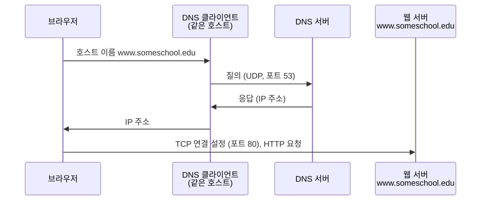

*그림 1. 브라우저가 웹 서버에 연결하기 전에 DNS로 IP 주소를 얻는 과정*

이 예에서 보듯이 DNS는 DNS를 이용하는 인터넷 응용에 추가 지연을 더하며, 이 지연은 때로 상당히 크다. 다행히 원하는 IP 주소는 가까운 DNS 서버에 캐시되어 있는 경우가 많고, 캐싱(4.4절)은 DNS 트래픽과 평균 DNS 지연을 함께 줄인다.

Forouzan은 같은 과정을 파일 전송 응용으로 설명한다. 사용자는 파일 전송 서버의 이름(예: forouzan.com)만 알지만, TCP/IP 프로토콜 묶음은 연결을 맺기 위해 그 서버의 IP 주소를 필요로 한다. 사용자가 호스트 이름을 파일 전송 클라이언트에 넘기면, 파일 전송 클라이언트가 이를 DNS 클라이언트에 넘기고, DNS 클라이언트가 부팅 때 알게 된 DNS 서버 주소로 질의를 보내 응답으로 IP 주소를 받아 파일 전송 클라이언트에 돌려준다. 파일 전송 클라이언트는 받은 IP 주소로 파일 전송 서버에 접속한다. 결국 파일 전송이라는 목적을 위한 연결 이전에, 이름을 주소로 바꾸기 위한 DNS 클라이언트와 DNS 서버 사이의 통신이 먼저 있어야 한다.

DNS는 종단 시스템 사이에서 클라이언트-서버 방식으로 동작하고 종단 간 전송 프로토콜로 메시지를 전달한다는 점에서 HTTP, FTP, SMTP와 같은 응용 계층 프로토콜이다. 그러나 역할은 이들과 크게 다르다. DNS는 사용자가 직접 다루는 응용이 아니라, 호스트 이름을 IP 주소로 바꾸는 인터넷의 핵심 기능을 사용자 응용과 다른 소프트웨어에 제공한다. Kurose는 인터넷 구조의 복잡성 대부분이 네트워크 가장자리에 있다고 설명하며, 핵심 기능인 이름과 주소의 변환을 가장자리에 있는 클라이언트와 서버로 구현한 DNS는 이 설계 철학의 또 다른 예이다.

### 1.3 DNS가 제공하는 서비스

DNS는 호스트 이름을 IP 주소로 바꾸는 일 외에도 몇 가지 중요한 서비스를 제공한다.

- **호스트 별칭(host aliasing):** 이름이 복잡한 호스트는 하나 이상의 별칭을 가질 수 있다. 예를 들어 relay1.west-coast.enterprise.com이라는 호스트가 enterprise.com과 www.enterprise.com이라는 두 별칭을 가질 수 있다. 이때 relay1.west-coast.enterprise.com을 **정식 호스트 이름(canonical hostname)** 이라 한다. 별칭은 대개 정식 호스트 이름보다 기억하기 쉽다. 응용은 DNS를 호출하여 별칭에 대한 정식 호스트 이름과 그 호스트의 IP 주소를 얻을 수 있다.
- **메일 서버 별칭(mail server aliasing):** 전자 메일 주소는 기억하기 쉬워야 한다. 앞의 회사에서 밥의 주소는 bob@enterprise.com처럼 간단할 수 있지만, 그 회사 메일 서버의 정식 호스트 이름은 relay1.west-coast.enterprise.com처럼 훨씬 복잡할 수 있다. 메일 응용은 DNS를 호출하여 별칭에 대한 메일 서버의 정식 호스트 이름과 IP 주소를 얻는다. 5.1절의 MX 레코드 덕분에 한 회사의 메일 서버와 웹 서버가 같은 별칭(예: enterprise.com)을 가질 수 있다.
- **부하 분산(load distribution):** 사용자가 많은 사이트는 서버를 여러 대로 복제하여 운영하며, 각 서버는 서로 다른 종단 시스템에서 실행되고 서로 다른 IP 주소를 가진다. 이때 정식 호스트 이름 하나에 IP 주소 집합이 대응되고, DNS 데이터베이스가 이 집합을 가진다. 클라이언트가 이 이름을 질의하면 서버는 주소 집합 전체로 응답하되 응답할 때마다 주소의 순서를 돌린다. 클라이언트는 대개 목록의 첫 번째 주소로 HTTP 요청을 보내므로, 이 순환이 복제된 서버들 사이에 트래픽을 나눈다. 같은 순환은 여러 메일 서버가 같은 별칭을 쓰게 할 때도 쓰인다. 콘텐츠 분배 회사들은 DNS를 더 정교하게 활용하여 웹 콘텐츠를 분배하며, 이는 23장의 CDN에서 다룬다.

| 서비스 | 질의하는 것 | DNS가 돌려주는 것 |
|:-----|:-----|:-----|
| 이름의 주소 변환 | 호스트 이름 | 그 호스트의 IP 주소 |
| 호스트 별칭 | 별칭 | 정식 호스트 이름과 IP 주소 |
| 메일 서버 별칭 | 메일 주소의 도메인 | 메일 서버의 정식 호스트 이름과 IP 주소 |
| 부하 분산 | 복제된 서버의 이름 | 순서를 돌린 IP 주소 집합 |

*표 1. DNS가 제공하는 서비스*

DNS는 RFC 1034와 RFC 1035에 정의되어 있고 이후 여러 RFC로 갱신되었다 [1]. DNS는 복잡한 시스템이며, 이 장은 그 동작의 핵심을 다룬다.

---

<br>

## 2. 이름 공간

### 2.1 평면 이름 공간과 계층적 이름 공간

모호함이 없으려면 컴퓨터에 붙이는 이름은 이름과 IP 주소의 대응을 완전히 통제하는 **이름 공간(name space)** 에서 신중하게 골라야 한다. 주소가 유일하므로 이름도 유일해야 한다. 각 주소를 유일한 이름에 대응시키는 이름 공간은 평면 구조와 계층 구조의 두 방식으로 구성할 수 있다.

**평면 이름 공간(flat name space)** 에서는 이름 하나가 주소 하나에 배정되며, 이름은 구조가 없는 문자열이다. 이름들에 공통 부분이 있을 수도 있지만 그 부분에는 아무 의미가 없다. 평면 이름 공간은 모호함과 중복을 피하려면 중앙에서 통제해야 하므로 인터넷처럼 큰 시스템에는 쓸 수 없다.

**계층적 이름 공간(hierarchical name space)** 에서는 이름이 여러 부분으로 이루어진다. 첫 부분은 조직의 성격을, 둘째 부분은 조직의 이름을, 셋째 부분은 조직 안의 부서를 나타내는 식이다. 그러면 이름을 배정하고 통제하는 권한을 분산할 수 있다. 중앙 기관은 조직의 성격과 조직의 이름을 나타내는 부분만 배정하고, 나머지 부분의 책임은 조직 자신에게 맡긴다. 조직은 받은 이름에 접두사나 접미사를 붙여 호스트나 자원의 이름을 정하며, 다른 조직이 같은 접두사를 고르더라도 전체 이름은 다르므로 걱정할 필요가 없다.

예를 들어 두 대학과 한 회사가 각자 컴퓨터 하나에 challenger라는 이름을 붙이려 한다고 가정한다. 중앙 기관이 첫째 대학에 fhda.edu, 둘째 대학에 berkeley.edu, 회사에 smart.com이라는 이름을 주었다면, 각 조직이 자신이 받은 이름 앞에 challenger를 붙인 challenger.fhda.edu, challenger.berkeley.edu, challenger.smart.com은 모두 구별된다. 중앙 기관은 이름 전체가 아니라 일부만 통제하며, 그래도 이름은 유일하다.

### 2.2 도메인 이름 공간

계층적 이름 공간을 위해 설계된 것이 **도메인 이름 공간(domain name space)** 이다. 이 설계에서 이름은 맨 위에 루트가 있는 뒤집힌 트리 구조로 정의된다. 트리는 수준 0(루트)부터 수준 127까지 최대 128개 수준을 가질 수 있다.

> **용어 정의:** **도메인 이름 공간(domain name space)** 은 인터넷의 모든 이름을 루트에서 시작하는 뒤집힌 트리로 조직한 계층적 이름 공간으로, 트리의 각 노드가 레이블을 가지고 노드마다 유일한 도메인 이름이 정해진다.

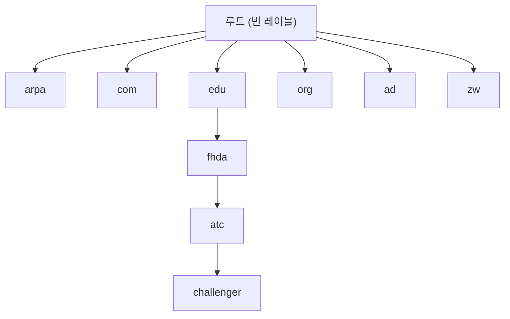

*그림 2. 도메인 이름 공간의 일부*

**레이블(label).** 트리의 각 노드는 최대 63자의 문자열인 레이블을 가진다. 루트의 레이블은 빈 문자열이다. DNS는 같은 노드에서 갈라져 나온 자식 노드들이 서로 다른 레이블을 가지도록 요구하며, 이것이 도메인 이름의 유일성을 보장한다.

**도메인 이름(domain name).** 트리의 각 노드는 도메인 이름을 가진다. 완전한 도메인 이름은 레이블들을 점(.)으로 구분하여 나열한 것으로, 항상 그 노드에서 시작하여 루트 쪽으로 올라가며 읽는다. 마지막 레이블은 루트의 레이블, 즉 빈 문자열이다. 따라서 완전한 도메인 이름은 항상 빈 레이블로 끝나며, 빈 문자열은 아무것도 아니므로 마지막 문자가 점이 된다.

```text
레이블        도메인 이름
edu           edu.
fhda          fhda.edu.
atc           atc.fhda.edu.
challenger    challenger.atc.fhda.edu.
```

*그림 3. 레이블과 도메인 이름*

> **[자료구조]** **트리(tree)** 는 루트 노드 하나에서 시작하여 각 노드가 0개 이상의 자식 노드를 가지는 계층적 자료 구조이며, 루트를 제외한 모든 노드는 부모가 정확히 하나이다. 따라서 어느 노드에서 루트까지 올라가는 경로는 하나뿐이다. 도메인 이름은 이 경로에 있는 노드들의 레이블을 차례로 이은 것이므로, 형제 노드끼리 레이블이 다르다는 조건만 지키면 서로 다른 노드의 도메인 이름은 반드시 다르다.

### 2.3 FQDN과 PQDN

레이블이 빈 문자열로 끝나는 도메인 이름을 **완전한 도메인 이름(fully qualified domain name, FQDN)** 이라 한다. FQDN은 호스트의 전체 이름을 담은 도메인 이름으로, 가장 구체적인 레이블부터 가장 일반적인 레이블까지 호스트를 유일하게 정하는 모든 레이블을 포함한다. 예를 들어 다음은 De Anza College의 ATC(Advanced Technology Center)에 설치된 challenger라는 컴퓨터의 FQDN이다.

```text
challenger.atc.fhda.edu.
```

DNS 서버는 FQDN만 주소에 대응시킬 수 있다. 이름은 빈 레이블로 끝나야 하지만 빈 레이블은 아무것도 아니므로, 이름은 점(.)으로 끝난다.

레이블이 빈 문자열로 끝나지 않는 도메인 이름은 **부분 도메인 이름(partially qualified domain name, PQDN)** 이라 한다. PQDN은 어떤 노드에서 시작하지만 루트까지 이르지 않는다. PQDN은 해석하려는 이름이 클라이언트와 같은 사이트에 속할 때 쓴다. 이때 리졸버(4.1절)가 빠진 부분인 **접미사(suffix)** 를 붙여 FQDN을 만든다. 예를 들어 fhda.edu. 사이트의 사용자가 challenger 컴퓨터의 IP 주소를 얻으려 할 때 부분 이름 challenger만 입력하면, DNS 클라이언트가 접미사 atc.fhda.edu.를 붙인 뒤 DNS 서버에 넘긴다.

DNS 클라이언트는 보통 접미사 목록을 가진다. De Anza College의 접미사 목록은 다음과 같을 수 있다. 마지막의 빈 접미사는 아무것도 붙이지 않는다는 뜻이며, 사용자가 FQDN을 입력했을 때 쓰인다.

```text
atc.fhda.edu
fhda.edu
null
```

| FQDN | PQDN |
|:-----|:-----|
| challenger.atc.fhda.edu. | challenger.atc.fhda.edu |
| cs.hmme.com. | cs.hmme |
| www.funny.int. | www |

*표 2. FQDN과 PQDN의 예*

### 2.4 도메인

**도메인(domain)** 은 도메인 이름 공간의 부분 트리이다. 도메인의 이름은 그 부분 트리의 맨 위에 있는 노드의 이름이다. 예를 들어 com 노드 아래의 부분 트리 전체가 도메인 com이고, edu 아래의 fhda 노드 아래 부분 트리 전체가 도메인 fhda.edu이다. 도메인은 다시 여러 도메인으로 나뉠 수 있으며, 이렇게 나뉜 도메인을 **하위 도메인(subdomain)** 이라고도 한다.

---

<br>

## 3. 이름 공간의 분산과 DNS 서버

### 3.1 중앙 집중 설계의 문제

DNS의 간단한 설계는 모든 대응을 가진 DNS 서버 하나를 두는 것이다. 이 중앙 집중 설계에서 클라이언트는 모든 질의를 그 서버에 보내고, 서버는 질의한 클라이언트에 직접 응답한다. 설계는 단순하지만 호스트 수가 막대하고 계속 늘어나는 오늘날의 인터넷에는 맞지 않는다. 중앙 집중 설계의 문제는 다음과 같다.

- **단일 장애점(single point of failure):** 그 DNS 서버가 멈추면 인터넷 전체가 멈춘다.
- **트래픽 양:** 수억 개의 호스트가 만드는 모든 HTTP 요청과 전자 메일 메시지에 필요한 DNS 질의를 서버 하나가 처리해야 한다.
- **멀리 떨어진 중앙 데이터베이스:** 서버 하나가 질의하는 모든 클라이언트와 가까울 수는 없다. 서버를 뉴욕에 두면 오스트레일리아에서 오는 모든 질의는 느리고 혼잡할 수 있는 링크를 거쳐 지구 반대편까지 가야 하므로 지연이 크게 늘어난다.
- **유지 관리:** 서버 하나가 인터넷의 모든 호스트에 대한 레코드를 가져야 한다. 이 데이터베이스는 거대할 뿐 아니라 새 호스트가 생길 때마다 자주 갱신해야 한다.

Forouzan도 같은 문제를 두 가지로 요약한다. 컴퓨터 한 대가 이 거대한 정보를 모두 저장하면, 전 세계에서 오는 요청에 응답하느라 부하가 커서 비효율적이고, 그 컴퓨터가 고장 나면 데이터에 접근할 수 없으므로 신뢰성이 없다. 결국 서버 하나에 둔 중앙 데이터베이스는 규모를 키울 수 없으며, DNS는 처음부터 분산 데이터베이스로 설계되었다.

### 3.2 서버의 계층과 영역

해결책은 정보를 **DNS 서버(DNS server)** 라 부르는 많은 컴퓨터에 나누어 두는 것이다. 한 가지 방법은 전체 이름 공간을 첫 번째 수준을 기준으로 나누는 것이다. 즉 루트는 따로 두고, 첫 번째 수준 노드의 수만큼 도메인(부분 트리)을 만든다. 이렇게 만든 도메인도 매우 클 수 있으므로, DNS는 도메인을 더 작은 하위 도메인으로 나눌 수 있게 한다. 각 서버는 크거나 작은 도메인 하나를 책임진다. 결과적으로 이름의 계층과 같은 모양의 서버 계층이 생긴다.

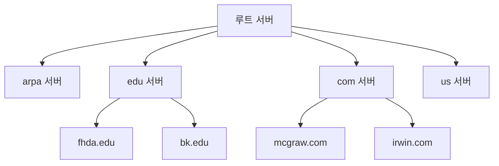

*그림 4. 이름의 계층과 같은 모양을 가진 서버의 계층*

전체 도메인 이름 계층은 서버 하나에 저장할 수 없으므로 여러 서버에 나누어 저장된다. 한 서버가 책임지는, 즉 권한을 가지는 범위를 **영역(zone)** 이라 한다.

> **용어 정의:** **영역(zone)** 은 도메인 이름 트리에서 한 서버가 책임지는 연속된 부분으로, 서버는 영역 안의 모든 노드에 대한 정보를 영역 파일로 유지한다.

서버가 어떤 도메인을 책임지면서 그 도메인을 더 작은 도메인으로 나누지 않으면, 도메인과 영역은 같은 것을 가리킨다. 서버는 **영역 파일(zone file)** 이라는 데이터베이스를 만들고 그 도메인 아래의 모든 노드에 대한 정보를 유지한다. 반면 서버가 도메인을 하위 도메인으로 나누고 권한의 일부를 다른 서버에 **위임(delegation)** 하면, 도메인과 영역은 다른 것이 된다. 하위 도메인의 노드에 대한 정보는 아래 수준의 서버에 저장되고, 원래 서버는 그 아래 수준 서버에 대한 참조만 유지한다. 그렇다고 원래 서버의 책임이 사라지는 것은 아니며, 원래 서버는 여전히 영역을 가지지만 자세한 정보는 아래 수준의 서버가 가진다. 서버가 도메인의 일부만 위임하고 나머지는 직접 가질 수도 있으며, 이때 서버의 영역은 위임하지 않은 부분의 자세한 정보와 위임한 부분에 대한 참조로 이루어진다.

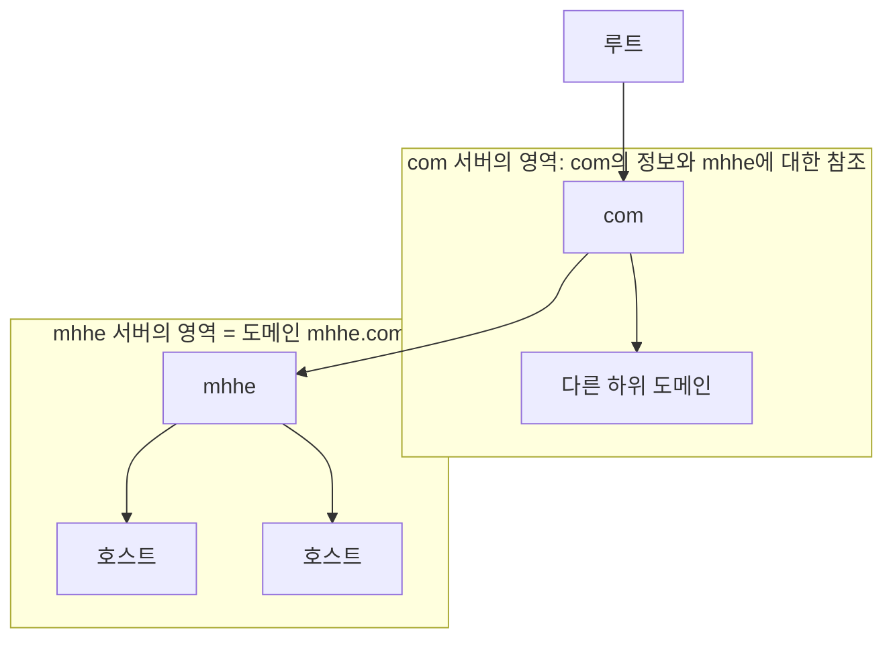

*그림 5. 영역과 도메인*

그림 5에서 com 서버는 도메인 com 중 mhhe.com을 mhhe 서버에 위임했으므로, com 서버의 영역은 도메인 com 전체보다 작다. 반면 mhhe 서버는 도메인을 더 나누지 않았으므로, mhhe 서버의 영역은 도메인 mhhe.com과 같다.

### 3.3 주 서버와 보조 서버

DNS는 두 종류의 서버를 정의한다. **주 서버(primary server)** 는 자신이 권한을 가진 영역에 대한 파일을 저장하는 서버로, 영역 파일을 만들고 유지하고 갱신하며 로컬 디스크에 저장한다. **보조 서버(secondary server)** 는 다른 서버(주 서버나 보조 서버)에서 한 영역에 대한 완전한 정보를 전송받아 로컬 디스크에 저장하는 서버이다. 보조 서버는 영역 파일을 만들거나 갱신하지 않으며, 갱신이 필요하면 주 서버가 갱신한 뒤 새 버전을 보조 서버에 보낸다.

주 서버와 보조 서버는 모두 자신이 서비스하는 영역에 대해 권한을 가진다. 보조 서버를 둔 목적은 권한을 낮추는 것이 아니라 데이터를 중복으로 두어, 한 서버가 고장 나도 다른 서버가 클라이언트에 계속 서비스하게 하는 것이다. 한 서버가 어떤 영역에서는 주 서버이고 다른 영역에서는 보조 서버일 수도 있으므로, 서버를 주 서버나 보조 서버라 부를 때는 어느 영역에 대한 것인지 분명히 해야 한다. 주 서버는 디스크의 파일에서 모든 정보를 읽어 들이고, 보조 서버는 주 서버에서 모든 정보를 받아 온다. 보조 서버가 주 서버에서 정보를 내려받는 것을 **영역 전송(zone transfer)** 이라 한다.

### 3.4 루트, TLD, 책임 DNS 서버

규모 문제를 해결하기 위해 DNS는 전 세계에 분산되고 계층적으로 조직된 많은 서버를 쓴다. 어떤 DNS 서버도 인터넷의 모든 호스트에 대한 대응을 모두 가지지 않으며, 대응은 여러 DNS 서버에 나뉘어 있다. Kurose는 DNS 서버를 대략 세 부류, 즉 루트 DNS 서버, 최상위 도메인(TLD) DNS 서버, 책임 DNS 서버로 나누며, 이들은 다음과 같은 계층을 이룬다.

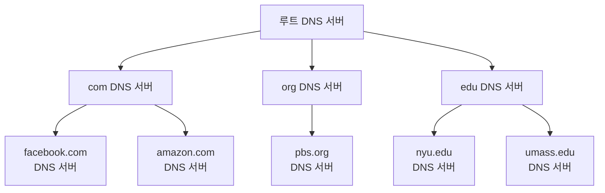

*그림 6. DNS 서버 계층의 일부*

세 부류의 서버가 어떻게 상호 작용하는지 보기 위해, DNS 클라이언트가 호스트 이름 www.amazon.com의 IP 주소를 알고 싶어 한다고 가정한다. 대략 다음 일이 일어난다. 클라이언트는 먼저 루트 서버 중 하나에 연락하고, 루트 서버는 최상위 도메인 com을 맡은 TLD 서버들의 IP 주소를 돌려준다. 클라이언트는 그중 한 TLD 서버에 연락하고, TLD 서버는 amazon.com의 책임 서버의 IP 주소를 돌려준다. 마지막으로 클라이언트는 amazon.com의 책임 서버 중 하나에 연락하고, 그 서버가 www.amazon.com의 IP 주소를 돌려준다.

> **용어 정의:** **루트 DNS 서버(root DNS server)** 는 DNS 서버 계층의 맨 위에서 최상위 도메인을 맡은 TLD 서버들의 IP 주소를 제공하는 서버이다.

Kurose에 따르면 2016년 기준으로 400개가 넘는 루트 네임 서버가 전 세계에 흩어져 있었다. 이들은 A부터 M까지 이름이 붙은 13개 루트 네임 서버의 인스턴스이며, 13개 루트 네임 서버는 12개의 독립 조직이 운영한다 [2]. Forouzan의 관점에서 루트 서버는 영역이 트리 전체인 서버이다. 루트 서버는 보통 도메인에 대한 정보를 직접 저장하지 않고 다른 서버에 권한을 위임하며 그 서버들에 대한 참조만 유지한다. 루트 서버는 여러 개이고 각각 도메인 이름 공간 전체를 담당한다.

> **용어 정의:** **TLD DNS 서버(top-level domain DNS server)** 는 com, org, net, edu, gov 같은 최상위 도메인이나 uk, fr, ca, jp 같은 국가 최상위 도메인 하나를 맡아, 그 아래 조직의 책임 DNS 서버의 IP 주소를 제공하는 서버이다.

최상위 도메인마다 TLD 서버(또는 서버 클러스터)가 있다. 예를 들어 Kurose는 Verisign Global Registry Services가 최상위 도메인 com의 TLD 서버를, Educause가 edu의 TLD 서버를 유지한다고 설명한다. TLD를 지원하는 네트워크 기반 시설은 크고 복잡할 수 있다.

> **용어 정의:** **책임 DNS 서버(authoritative DNS server)** 는 한 조직의 호스트 이름을 IP 주소에 대응시키는 DNS 레코드를 보관하고, 그 이름에 대한 질의에 최종 답을 주는 서버이다.

웹 서버나 메일 서버처럼 인터넷에서 공개적으로 접근할 수 있는 호스트를 가진 조직은 그 호스트의 이름을 IP 주소에 대응시키는 DNS 레코드를 공개적으로 제공해야 하며, 조직의 책임 DNS 서버가 이 레코드를 보관한다. 조직은 책임 DNS 서버를 직접 운영할 수도 있고, 요금을 내고 서비스 제공자의 책임 DNS 서버에 레코드를 맡길 수도 있다. 대부분의 대학과 큰 회사는 주 책임 DNS 서버와 보조(백업) 책임 DNS 서버를 직접 운영하며, 이는 3.3절의 주 서버와 보조 서버에 해당한다.

### 3.5 로컬 DNS 서버

DNS 구조에서 중요한 또 다른 서버가 **로컬 DNS 서버(local DNS server)** 이다. 로컬 DNS 서버는 엄밀히 말하면 서버 계층에 속하지 않지만 DNS 구조의 중심에 있다.

> **용어 정의:** **로컬 DNS 서버(local DNS server)** 는 각 ISP가 운영하며 호스트가 보낸 DNS 질의를 받아 대리인처럼 DNS 서버 계층에 전달하고 결과를 돌려주는 서버로, 기본 네임 서버(default name server)라고도 한다.

주거용 ISP든 기관 ISP든 모든 ISP는 로컬 DNS 서버를 가진다. 호스트가 ISP에 연결되면 ISP는 보통 DHCP(12장)를 통해 로컬 DNS 서버 하나 이상의 IP 주소를 호스트에 알려 준다. Forouzan의 표현으로는 각 컴퓨터가 부팅된 뒤 DNS 서버 하나의 주소를 알게 된다. 로컬 DNS 서버는 대개 호스트와 가깝다. 기관 ISP에서는 호스트와 같은 LAN에 있을 수 있고, 주거용 ISP에서는 대개 라우터 몇 개 이내의 거리에 있다. 호스트가 DNS 질의를 하면 질의는 로컬 DNS 서버로 가고, 로컬 DNS 서버는 대리인(proxy)처럼 질의를 DNS 서버 계층으로 전달한다(4.2절).

| 서버 | 계층에서의 위치 | 맡은 일 | 예 |
|:-----|:-----|:-----|:-----|
| 루트 DNS 서버 | 맨 위 | TLD 서버의 IP 주소 제공 | 12개 조직이 운영하는 루트 네임 서버 13개(A\~M), 2016년 기준 인스턴스 400개 이상 |
| TLD DNS 서버 | 최상위 도메인 | 책임 DNS 서버의 IP 주소 제공 | com, edu, uk, jp 서버 |
| 책임 DNS 서버 | 조직의 도메인 | 호스트 이름에 대한 최종 레코드 제공 | dns.umass.edu |
| 로컬 DNS 서버 | 계층 밖 (ISP) | 호스트의 질의를 받아 계층에 전달하고 결과를 캐시 | dns.nyu.edu |

*표 3. DNS 서버의 종류*

### 3.6 인터넷의 DNS: 일반 도메인, 국가 도메인, 역 도메인

DNS는 여러 플랫폼에서 쓸 수 있는 프로토콜이다. 인터넷에서 도메인 이름 공간(트리)은 **일반 도메인(generic domains)**, **국가 도메인(country domains)**, **역 도메인(inverse domain)** 의 세 부분으로 나뉜다.

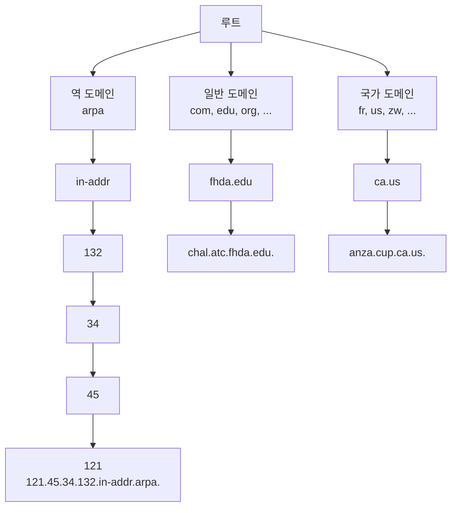

*그림 7. 인터넷의 도메인 이름 공간을 이루는 세 부분*

**일반 도메인.** 일반 도메인은 등록된 호스트를 그 일반적인 성격에 따라 정의한다. 트리의 각 노드는 도메인 이름 공간 데이터베이스의 색인 역할을 하는 도메인을 정의한다. Forouzan은 일반 도메인 부분의 첫 번째 수준에 다음 14개의 레이블을 제시한다.

| 레이블 | 설명 | 레이블 | 설명 |
|:-----|:-----|:-----|:-----|
| aero | 항공사와 항공 우주 회사 | int | 국제기구 |
| biz | 기업 (com과 비슷함) | mil | 군 조직 |
| com | 상업 조직 | museum | 박물관과 기타 비영리 조직 |
| coop | 협동조합 기업 | name | 개인 이름 |
| edu | 교육 기관 | net | 네트워크 지원 센터 |
| gov | 정부 기관 | org | 비영리 조직 |
| info | 정보 서비스 제공자 | pro | 전문 직업인 조직 |

*표 4. 일반 도메인의 레이블*

**국가 도메인.** 국가 도메인 부분은 두 글자로 된 국가 약어(예: 미국은 us)를 쓴다. 두 번째 레이블은 조직의 성격을 나타낼 수도 있고, 국가별로 더 구체적인 구분을 나타낼 수도 있다. 예를 들어 미국은 us의 하위 구분으로 주의 약어를 쓴다(예: ca.us.). 주소 anza.cup.ca.us는 미국 캘리포니아의 쿠퍼티노에 있는 De Anza College로 읽을 수 있다.

**역 도메인.** 역 도메인은 주소를 이름에 대응시킬 때 쓴다. 예를 들어 서버가 클라이언트에서 작업 요청을 받았을 때, 서버가 가진 허가된 클라이언트 목록에는 이름만 있고 받은 IP 패킷에서는 클라이언트의 IP 주소만 알 수 있는 경우가 있다. 서버는 클라이언트가 목록에 있는지 판단하기 위해 리졸버에 주소를 이름으로 바꾸는 질의를 DNS 서버에 보내게 한다. 이런 질의를 **역질의(inverse query)** 또는 **포인터 질의(pointer query, PTR 질의)** 라 한다.

포인터 질의를 처리하기 위해 도메인 이름 공간에 역 도메인이 추가되었다. 역 도메인의 첫 번째 수준 노드는 역사적인 이유로 arpa이고, 두 번째 수준은 in-addr(inverse address)라는 노드 하나이며, 그 아래가 IP 주소를 정의한다. 역 도메인을 처리하는 서버도 계층적이므로, 주소의 네트워크 부분이 서브넷 부분보다, 서브넷 부분이 호스트 부분보다 높은 수준에 있어야 한다. 그래야 사이트 전체를 맡는 서버가 각 서브넷을 맡는 서버보다 위에 있게 된다. 그 결과 역 도메인은 일반 도메인이나 국가 도메인과 비교하면 뒤집힌 모양이 된다. 도메인 레이블을 아래에서 위로 읽는 규칙을 따르기 위해, 132.34.45.121 같은 IP 주소는 121.45.34.132.in-addr.arpa.로 읽는다.

---

<br>

## 4. 이름 해석

이름을 주소로, 또는 주소를 이름으로 바꾸는 일을 **이름 해석(name-address resolution)** 이라 한다.

### 4.1 리졸버

DNS는 클라이언트-서버 응용으로 설계되었다. 주소를 이름으로 또는 이름을 주소로 바꾸어야 하는 호스트는 **리졸버(resolver)** 라는 DNS 클라이언트를 호출한다. 리졸버는 가장 가까운 DNS 서버에 대응 요청을 보낸다. 서버가 그 정보를 가지고 있으면 리졸버의 요청을 만족시키고, 그렇지 않으면 리졸버에게 다른 서버를 알려 주거나 다른 서버에 정보를 요청한다. 리졸버는 대응을 받으면 그것이 실제 해석 결과인지 오류인지 해석한 뒤 요청한 프로세스에 결과를 넘긴다.

Kurose의 설명으로 보면, 웹 브라우저나 메일 리더 같은 응용은 해석할 호스트 이름을 지정하여 DNS의 클라이언트 쪽을 호출한다. 많은 UNIX 기반 컴퓨터에서 응용이 이 변환을 위해 호출하는 함수가 `gethostbyname()`이다. 그러면 사용자 호스트의 DNS가 네트워크에 질의 메시지를 보내고, 수 밀리초에서 수 초에 이르는 지연 뒤에 원하는 대응을 담은 응답 메시지를 받아 응용에 넘긴다. 응용의 입장에서 DNS는 간단한 변환 서비스를 제공하는 블랙박스이다. 그러나 그 블랙박스는 전 세계에 분산된 수많은 DNS 서버와, DNS 서버와 질의하는 호스트가 통신하는 방법을 정한 응용 계층 프로토콜로 이루어진 복잡한 시스템이다.

### 4.2 반복 질의와 재귀 질의

Kurose의 예로 이름 해석 과정을 따라간다. 호스트 cse.nyu.edu가 gaia.cs.umass.edu의 IP 주소를 알고 싶어 한다고 가정한다. NYU의 로컬 DNS 서버는 dns.nyu.edu이고, gaia.cs.umass.edu의 책임 DNS 서버는 dns.umass.edu라고 가정한다.

1. 호스트 cse.nyu.edu는 먼저 로컬 DNS 서버 dns.nyu.edu에 DNS 질의 메시지를 보낸다. 질의 메시지에는 변환할 호스트 이름 gaia.cs.umass.edu가 들어 있다.
2. 로컬 DNS 서버는 질의 메시지를 루트 DNS 서버에 전달한다.
3. 루트 DNS 서버는 접미사 edu를 보고, edu를 맡은 TLD 서버들의 IP 주소 목록을 로컬 DNS 서버에 돌려준다.
4. 로컬 DNS 서버는 그중 한 TLD 서버에 질의 메시지를 다시 보낸다.
5. TLD 서버는 접미사 umass.edu를 보고, University of Massachusetts의 책임 DNS 서버 dns.umass.edu의 IP 주소로 응답한다.
6. 로컬 DNS 서버는 질의 메시지를 dns.umass.edu에 직접 보낸다.
7. dns.umass.edu는 gaia.cs.umass.edu의 IP 주소로 응답한다.
8. 로컬 DNS 서버는 이 대응을 요청한 호스트 cse.nyu.edu에 돌려준다.

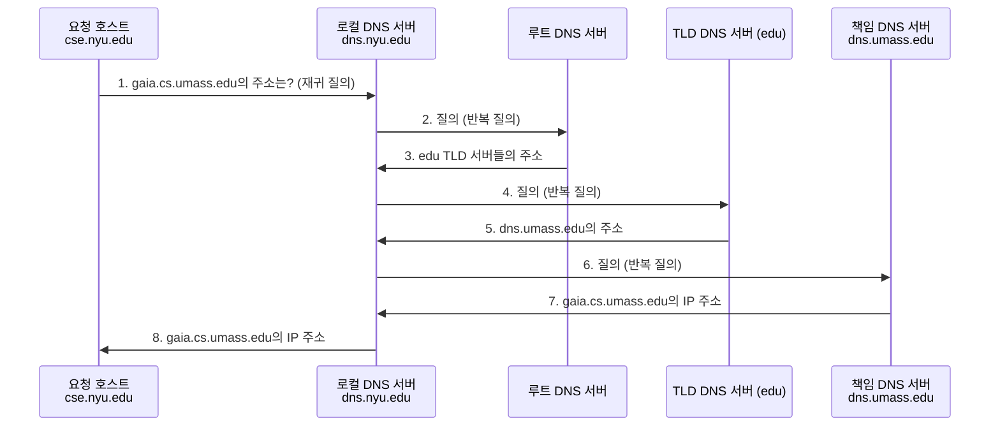

*그림 8. 여러 DNS 서버의 상호 작용: 재귀 질의 하나와 반복 질의 셋*

이 예에서는 호스트 이름 하나의 대응을 얻기 위해 질의 메시지 넷과 응답 메시지 넷, 모두 여덟 개의 DNS 메시지가 오갔다. 4.4절의 캐싱이 이 질의 트래픽을 줄인다.

이 예는 TLD 서버가 그 호스트 이름의 책임 DNS 서버를 안다고 가정했지만, 일반적으로는 그렇지 않을 수 있다. TLD 서버는 중간 DNS 서버만 알고, 그 중간 서버가 책임 DNS 서버를 알 수도 있다. 예를 들어 University of Massachusetts가 대학 전체의 DNS 서버 dns.umass.edu를 두고, 각 학과가 학과의 모든 호스트에 대해 권한을 가진 자체 DNS 서버를 둔다고 가정한다. 그러면 중간 DNS 서버 dns.umass.edu는 cs.umass.edu로 끝나는 호스트 이름에 대한 질의를 받았을 때, cs.umass.edu로 끝나는 모든 호스트 이름에 대해 권한을 가진 dns.cs.umass.edu의 IP 주소를 dns.nyu.edu에 돌려준다. 로컬 DNS 서버 dns.nyu.edu는 그 책임 DNS 서버에 질의를 보내고, 책임 DNS 서버가 원하는 대응을 로컬 DNS 서버에 돌려주면, 로컬 DNS 서버가 이를 요청한 호스트에 돌려준다. 이 경우에는 모두 10개의 DNS 메시지가 오간다.

그림 8의 예에는 재귀 질의와 반복 질의가 모두 쓰였다.

> **용어 정의:** **재귀 질의(recursive query)** 는 질의를 받은 서버가 질의한 쪽을 대신하여 최종 대응을 구해서 돌려주기를 요청하는 질의이다.

> **용어 정의:** **반복 질의(iterative query)** 는 질의를 받은 서버가 답을 알면 답을, 모르면 다음에 질의할 서버의 주소를 질의한 쪽에 직접 돌려주는 질의로, 질의한 쪽이 다음 서버에 질의를 반복한다.

cse.nyu.edu가 dns.nyu.edu에 보낸 질의는 dns.nyu.edu에게 자신을 대신하여 대응을 구해 달라고 요청하므로 재귀 질의이다. 그 뒤의 세 질의는 모든 응답이 dns.nyu.edu에 직접 돌아오므로 반복 질의이다. 이론적으로는 어떤 DNS 질의든 반복 질의일 수도 재귀 질의일 수도 있다. 다음 그림은 모든 질의가 재귀 질의인 질의 사슬이다.

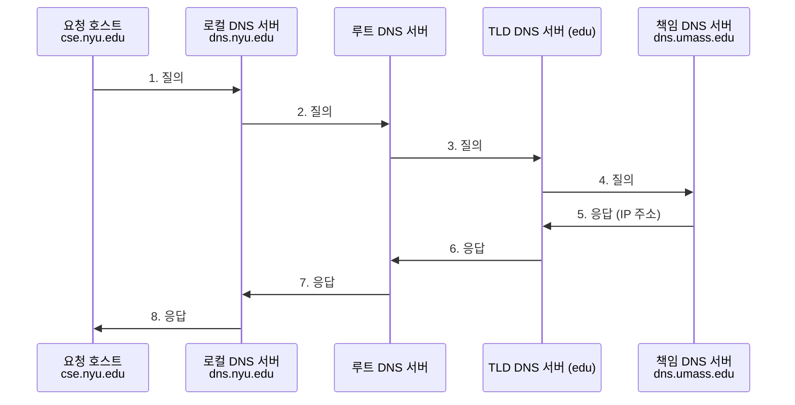

*그림 9. 모든 질의가 재귀 질의인 경우*

실제로는 대개 그림 8의 형태를 따른다. 요청 호스트에서 로컬 DNS 서버로 가는 질의는 재귀 질의이고, 나머지 질의는 반복 질의이다.

Forouzan도 같은 두 방식을 설명한다. **재귀 해석(recursive resolution)** 에서 리졸버는 서버가 최종 답을 주기를 기대한다. 서버가 그 도메인 이름에 대한 권한을 가지면 데이터베이스를 확인하여 응답하고, 그렇지 않으면 다른 서버(보통 부모 서버)에 요청을 보내고 응답을 기다린다. 질의가 마침내 해석되면 응답은 거꾸로 거슬러 올라가 요청한 클라이언트에 도착한다. **반복 해석(iterative resolution)** 에서는 서버가 그 이름에 대한 권한을 가지면 답을 보내고, 그렇지 않으면 질의를 해석할 수 있다고 생각하는 서버의 IP 주소를 클라이언트에 돌려준다. 그러면 클라이언트가 그 서버에 같은 질의를 반복한다. 클라이언트가 같은 질의를 여러 서버에 반복하므로 반복 해석이라 부른다. Forouzan의 예에서는 리졸버가 다섯 서버에 차례로 질의한 뒤에야 mcgraw.com 서버에서 답을 얻는다. Forouzan의 반복 해석 예에서는 리졸버 자신이 질의를 반복하고, Kurose의 예에서는 로컬 DNS 서버가 리졸버 대신 반복 질의를 한다는 점이 다르다.

> **핵심:** 실제 이름 해석에서 호스트는 로컬 DNS 서버에 재귀 질의를 보내고, 로컬 DNS 서버는 루트, TLD, 책임 DNS 서버에 차례로 반복 질의를 보낸다. 빈 캐시에서 이름 하나를 해석하는 데 이 경로로 여덟 개의 메시지가 필요하다.

### 4.3 주소를 이름으로 바꾸는 해석

대부분의 경우 리졸버는 서버에 도메인 이름을 주고 대응하는 주소를 요청하며, 서버는 일반 도메인이나 국가 도메인에서 대응을 찾는다. 도메인 이름이 일반 도메인 부분에 속하면 리졸버는 "chal.atc.fhda.edu." 같은 이름을 받아 로컬 DNS 서버에 해석을 요청한다. 로컬 서버가 질의를 해석하지 못하면 리졸버에게 다른 서버를 알려 주거나 다른 서버에 직접 묻는다. 도메인 이름이 "ch.fhda.cu.ca.us." 같은 국가 도메인 부분에 속해도 절차는 같다.

반대로 클라이언트가 IP 주소를 서버에 보내 도메인 이름으로 바꾸어 달라고 할 수도 있으며, 이것이 앞에서 본 PTR 질의이다. 이런 질의에 답하기 위해 DNS는 역 도메인을 쓴다. 요청에서 IP 주소의 순서를 뒤집고 두 레이블 in-addr와 arpa를 덧붙여 역 도메인 부분이 받아들일 수 있는 도메인 이름을 만든다. 예를 들어 리졸버가 IP 주소 132.34.45.121을 받으면, 주소를 뒤집고 두 레이블을 붙인 "121.45.34.132.in-addr.arpa."를 로컬 DNS 서버에 보내 해석을 요청한다.

UNIX와 Windows의 `nslookup` 유틸리티로 이름과 주소의 대응을 직접 얻을 수 있다. Kurose는 `nslookup`으로 루트, TLD, 책임 서버 중 어느 DNS 서버에든 질의를 보내고 응답에 담긴 레코드를 사람이 읽을 수 있는 형태로 볼 수 있다고 설명한다. 다음은 Forouzan이 제시한 출력으로, 첫째는 도메인 이름으로 주소를 얻고, 둘째는 주소로 도메인 이름을 얻는다. 둘째 출력에서 주소가 뒤집혀 in-addr.arpa 아래의 이름이 되는 것을 확인할 수 있다.

```text
$ nslookup fhda.edu
Name: fhda.edu
Address: 153.18.8.1

$ nslookup 153.18.8.1
1.8.18.153.in-addr.arpa name = tiptoe.fhda.edu.
```

### 4.4 DNS 캐싱과 TTL

지금까지는 DNS 시스템의 매우 중요한 기능인 캐싱을 무시했다. 실제로 DNS는 지연 성능을 높이고 인터넷을 오가는 DNS 메시지의 수를 줄이기 위해 캐싱을 광범위하게 쓴다.

> **용어 정의:** **DNS 캐싱(DNS caching)** 은 DNS 서버가 질의 사슬에서 받은 응답의 대응을 로컬 메모리에 저장해 두었다가, 같은 이름에 대한 이후의 질의에 다른 서버에 묻지 않고 답하는 기법이다.

캐싱의 생각은 매우 단순하다. 질의 사슬에서 DNS 서버는 DNS 응답(예: 호스트 이름에서 IP 주소로의 대응)을 받으면 그 대응을 로컬 메모리에 캐시할 수 있다. 예를 들어 그림 8에서 로컬 DNS 서버 dns.nyu.edu는 어떤 DNS 서버에서 응답을 받을 때마다 응답에 담긴 정보를 캐시할 수 있다. 호스트 이름과 IP 주소의 쌍이 DNS 서버에 캐시되어 있으면, 같은 호스트 이름에 대한 다른 질의가 왔을 때 그 서버는 그 이름에 대해 권한이 없더라도 원하는 IP 주소를 줄 수 있다.

예를 들어 호스트 apricot.nyu.edu가 dns.nyu.edu에 호스트 이름 cnn.com의 IP 주소를 질의했다고 가정한다. 몇 시간 뒤 다른 NYU 호스트 kiwi.nyu.edu가 같은 호스트 이름을 dns.nyu.edu에 질의하면, 로컬 DNS 서버는 캐싱 덕분에 다른 DNS 서버에 묻지 않고 cnn.com의 IP 주소를 바로 돌려줄 수 있다. 로컬 DNS 서버는 TLD 서버의 IP 주소도 캐시할 수 있으며, 그러면 질의 사슬에서 루트 DNS 서버를 건너뛸 수 있다. 실제로 캐싱 덕분에 루트 서버는 매우 적은 비율을 제외한 모든 DNS 질의에서 건너뛰어진다.

호스트와 대응은 영구적이지 않으므로, DNS 서버는 캐시한 정보를 일정 시간이 지나면 버린다. Kurose는 이 시간이 흔히 이틀로 정해진다고 설명한다. Forouzan은 캐싱이 해석을 빠르게 하지만 문제를 만들 수도 있다고 지적한다. 서버가 대응을 오래 캐시하면 오래된 대응을 클라이언트에 보낼 수 있기 때문이다. 이를 막기 위해 두 가지 기법을 쓴다.

1. 책임 서버는 대응에 항상 **TTL(time to live)** 이라는 정보를 덧붙인다. TTL은 받은 서버가 그 정보를 캐시할 수 있는 시간을 초 단위로 정한다. 그 시간이 지나면 대응은 무효가 되고, 이후의 질의는 다시 책임 서버로 보내야 한다.
2. DNS는 각 서버가 캐시한 대응마다 TTL 계수기를 유지하도록 요구한다. 캐시 메모리를 주기적으로 검사하여 TTL이 만료된 대응을 지운다.

또한 서버가 캐시에서 답할 때는 그 응답이 책임 있는 출처가 아니라 캐시에서 왔다는 것을 클라이언트에 알리기 위해 응답을 비책임(unauthoritative) 응답으로 표시한다. 이 표시가 6.2절의 AA 플래그이다.

> **핵심:** 캐싱은 자주 찾는 이름과 TLD 서버의 주소를 로컬 DNS 서버에 남겨 두어 루트 서버와 TLD 서버를 거치는 메시지를 없앤다. TTL은 캐시한 대응이 너무 오래되지 않도록 그 수명을 제한한다.

---

<br>

## 5. 자원 레코드

### 5.1 네 값으로 이루어진 자원 레코드

DNS 분산 데이터베이스를 함께 구현하는 DNS 서버들은 호스트 이름과 IP 주소의 대응을 제공하는 레코드를 비롯한 **자원 레코드(resource record, RR)** 를 저장한다. 모든 DNS 응답 메시지는 하나 이상의 자원 레코드를 실어 나른다.

> **용어 정의:** **자원 레코드(resource record)** 는 DNS 데이터베이스에 저장되고 DNS 응답으로 전달되는 기본 정보 단위로, Name, Value, Type, TTL의 네 값으로 이루어진다.

Kurose는 자원 레코드를 다음 네 값의 묶음으로 설명한다.

```text
(Name, Value, Type, TTL)
```

TTL은 자원 레코드의 유효 기간으로, 레코드를 캐시에서 언제 지워야 하는지를 정한다. 아래의 예에서는 TTL을 생략한다. Name과 Value의 뜻은 Type에 따라 달라진다.

- **Type = A:** Name은 호스트 이름이고 Value는 그 호스트 이름의 IP 주소이다. 따라서 A 레코드는 표준적인 호스트 이름과 IP 주소의 대응을 제공한다. 예: (relay1.bar.foo.com, 145.37.93.126, A)
- **Type = NS:** Name은 foo.com 같은 도메인이고 Value는 그 도메인에 속한 호스트의 IP 주소를 얻는 방법을 아는 책임 DNS 서버의 호스트 이름이다. 이 레코드는 질의 사슬에서 질의를 다음 서버로 보내는 데 쓰인다. 예: (foo.com, dns.foo.com, NS)
- **Type = CNAME:** Value는 별칭 호스트 이름 Name의 정식 호스트 이름이다. 이 레코드는 질의한 호스트에 어떤 호스트 이름의 정식 이름을 알려 준다. 예: (foo.com, relay1.bar.foo.com, CNAME)
- **Type = MX:** Value는 별칭 호스트 이름 Name을 가진 메일 서버의 정식 이름이다. 예: (foo.com, mail.bar.foo.com, MX)

MX 레코드는 메일 서버의 호스트 이름이 간단한 별칭을 가질 수 있게 한다. MX 레코드를 쓰면 회사는 메일 서버와 다른 서버(예: 웹 서버)에 같은 별칭을 줄 수 있다. 메일 서버의 정식 이름을 얻으려면 DNS 클라이언트는 MX 레코드를 질의하고, 다른 서버의 정식 이름을 얻으려면 CNAME 레코드를 질의한다. 위의 예에서 같은 이름 foo.com에 대해 CNAME 레코드는 웹 서버 relay1.bar.foo.com을, MX 레코드는 메일 서버 mail.bar.foo.com을 가리킨다. 4장의 SMTP 클라이언트가 수신자 메일 서버를 찾을 때 쓰는 것이 이 MX 레코드이다.

| Type | Name | Value | 예 |
|:-----|:-----|:-----|:-----|
| A | 호스트 이름 | IP 주소 | (relay1.bar.foo.com, 145.37.93.126, A) |
| NS | 도메인 | 그 도메인의 책임 DNS 서버의 호스트 이름 | (foo.com, dns.foo.com, NS) |
| CNAME | 별칭 호스트 이름 | 정식 호스트 이름 | (foo.com, relay1.bar.foo.com, CNAME) |
| MX | 메일 서버의 별칭 | 메일 서버의 정식 이름 | (foo.com, mail.bar.foo.com, MX) |

*표 5. 주요 자원 레코드의 Name과 Value*

### 5.2 책임 서버와 다른 서버가 가진 레코드

DNS 서버가 어떤 호스트 이름에 대해 권한을 가지면, 그 서버는 그 호스트 이름의 A 레코드를 가진다. 권한이 없는 서버도 캐시에 A 레코드를 가지고 있을 수 있다. 서버가 어떤 호스트 이름에 대해 권한이 없으면, 그 서버는 그 호스트 이름을 포함하는 도메인의 NS 레코드를 가지며, NS 레코드의 Value 필드에 있는 DNS 서버의 IP 주소를 제공하는 A 레코드도 함께 가진다.

예를 들어 edu TLD 서버가 호스트 gaia.cs.umass.edu에 대해 권한이 없다고 가정한다. 그러면 이 서버는 gaia.cs.umass.edu를 포함하는 도메인에 대한 레코드, 예를 들어 (umass.edu, dns.umass.edu, NS)를 가진다. 또한 DNS 서버 dns.umass.edu를 IP 주소에 대응시키는 A 레코드, 예를 들어 (dns.umass.edu, 128.119.40.111, A)도 가진다. 그림 8의 5단계에서 TLD 서버가 돌려준 응답이 바로 이 두 레코드이다. NS 레코드만 있으면 로컬 DNS 서버는 dns.umass.edu라는 이름을 다시 해석해야 하므로, A 레코드가 함께 있어야 질의를 바로 다음 서버로 보낼 수 있다.

### 5.3 레코드 형식 번호와 클래스

DNS 메시지 안에서 레코드의 형식은 이름이 아니라 16비트 번호로 표시된다. Forouzan이 제시하는 주요 형식은 다음과 같으며, 마지막 두 형식(AXFR, ANY)은 질의에만 쓸 수 있다.

| 번호 | 기호 | 설명 |
|:-----|:-----|:-----|
| 1 | A | 주소. 32비트 IPv4 주소로, 도메인 이름을 주소로 바꿈 |
| 2 | NS | 네임 서버. 영역의 책임 서버를 알려 줌 |
| 5 | CNAME | 정식 이름. 호스트의 공식 이름에 대한 별칭을 정의함 |
| 6 | SOA | 권한의 시작(start of authority). 영역의 시작을 표시함 |
| 11 | WKS | 잘 알려진 서비스. 호스트가 제공하는 네트워크 서비스를 정의함 |
| 12 | PTR | 포인터. IP 주소를 도메인 이름으로 바꿀 때 씀 |
| 13 | HINFO | 호스트 정보. 하드웨어와 운영 체제를 정의함 |
| 15 | MX | 메일 교환. 메일을 메일 서버로 보냄 |
| 16 | TXT | 설명 텍스트 [1] |
| 28 | AAAA | 주소. IPv6 주소이다 (24장) |
| 252 | AXFR | 영역 전체의 전송 요청 |
| 255 | ANY | 모든 레코드의 요청 |

*표 6. 자원 레코드의 형식*

레코드에는 형식과 함께 그 레코드를 쓰는 프로토콜을 나타내는 16비트 **클래스(class)** 도 있다. 이 장에서 다루는 것은 인터넷을 뜻하는 클래스 1(IN)뿐이다.

| 클래스 | 기호 | 설명 |
|:-----|:-----|:-----|
| 1 | IN | 인터넷 |
| 2 | CS | CSNET 클래스 (더 이상 쓰이지 않음) |
| 3 | CH | CHAOS 클래스 |
| 4 | HS | MIT가 개발한 Hesiod 서버 |

*표 7. 자원 레코드의 클래스*

---

<br>

## 6. DNS 메시지

### 6.1 메시지의 구조

DNS 메시지는 **질의(query)** 와 **응답(response)** 의 두 종류뿐이며, 두 메시지의 형식은 같다. 질의 메시지는 헤더와 질의 레코드로 이루어지고, 응답 메시지는 헤더, 질의 레코드, 답 레코드, 책임 레코드, 추가 레코드로 이루어진다.

```text
+--------------------------------+--------------------------------+
| Identification (16 bits)       | Flags (16 bits)                |
+--------------------------------+--------------------------------+  헤더
| Number of questions            | Number of answer RRs           |  (12바이트)
+--------------------------------+--------------------------------+
| Number of authority RRs        | Number of additional RRs       |
+--------------------------------+--------------------------------+
| Questions (variable number of questions)                        |  질의 부분
+-----------------------------------------------------------------+
| Answers (variable number of RRs)                                |  답 부분
+-----------------------------------------------------------------+
| Authority (variable number of RRs)                              |  책임 부분
+-----------------------------------------------------------------+
| Additional information (variable number of RRs)                 |  추가 부분
+-----------------------------------------------------------------+
```

*그림 10. DNS 메시지 형식*

- **헤더(header):** 처음 12바이트이며 여러 필드로 이루어진다(6.2절).
- **질의 부분(question section):** 질의하는 내용에 대한 정보로, 질의하는 이름을 담은 이름 필드와 그 이름에 대해 묻는 질의의 형식(예: 이름에 대응하는 호스트 주소인 A, 그 이름의 메일 서버인 MX)을 담은 형식 필드가 있다. 질의와 응답 모두에 있다.
- **답 부분(answer section):** 응답에서 원래 질의한 이름에 대한 자원 레코드를 담는다. 호스트 이름 하나에 IP 주소가 여럿일 수 있으므로(예: 1.3절의 복제된 웹 서버) 답 부분에는 자원 레코드가 여럿 있을 수 있다.
- **책임 부분(authority section):** 다른 책임 서버들의 레코드를 담는다. 질의에 대한 하나 이상의 책임 서버에 대한 정보(도메인 이름)를 준다.
- **추가 부분(additional section):** 그 밖에 도움이 되는 레코드를 담는다. 예를 들어 MX 질의에 대한 응답의 답 부분에는 메일 서버의 정식 호스트 이름을 주는 자원 레코드가 있고, 추가 부분에는 그 정식 호스트 이름의 IP 주소를 주는 A 레코드가 있다. 마찬가지로 서버는 책임 부분에 책임 서버의 도메인 이름을 주고, 추가 부분에 같은 서버의 IP 주소를 줄 수 있다.

### 6.2 헤더와 플래그

질의 메시지와 응답 메시지의 헤더 형식은 같으며, 질의 메시지에서는 일부 필드가 0이다.

- **식별자(identification):** 16비트 필드로, 클라이언트가 응답을 질의와 짝짓는 데 쓴다. 클라이언트는 질의를 보낼 때마다 다른 식별 번호를 쓰고, 서버는 그 번호를 대응하는 응답에 그대로 복사한다.
- **플래그(flags):** 16비트 필드로, 아래의 하위 필드로 이루어진다.
- **질의 레코드 수:** 질의 부분에 있는 질의의 수를 담는 16비트 필드이다.
- **답 레코드 수:** 응답 메시지의 답 부분에 있는 답 레코드의 수를 담는 16비트 필드로, 질의 메시지에서는 0이다.
- **책임 레코드 수:** 응답 메시지의 책임 부분에 있는 레코드의 수를 담는 16비트 필드로, 질의 메시지에서는 0이다.
- **추가 레코드 수:** 응답 메시지의 추가 부분에 있는 레코드의 수를 담는 16비트 필드로, 질의 메시지에서는 0이다.

```text
bits:  1     4      1    1    1    1     3      4
     +----+--------+----+----+----+----+-----+-------+
     | QR | OpCode | AA | TC | RD | RA | 000 | rCode |
     +----+--------+----+----+----+----+-----+-------+
```

*그림 11. 플래그 필드*

| 하위 필드 | 비트 | 뜻 |
|:-----|:-----|:-----|
| QR (query/response) | 1 | 메시지의 종류. 0이면 질의, 1이면 응답 |
| OpCode | 4 | 질의나 응답의 종류. 0이면 표준, 1이면 역질의, 2이면 서버 상태 요청 |
| AA (authoritative answer) | 1 | 1이면 응답한 서버가 질의한 이름의 책임 서버. 응답에만 쓰임 |
| TC (truncated) | 1 | 1이면 응답이 512바이트를 넘어 512바이트로 잘렸음. DNS가 UDP를 쓸 때 쓰임 (7절) |
| RD (recursion desired) | 1 | 1이면 클라이언트가 재귀 응답을 원함. 질의에서 설정되고 응답에 그대로 복사됨 |
| RA (recursion available) | 1 | 1이면 서버가 재귀 응답을 지원함. 응답에만 설정됨 |
| 예약 | 3 | 000으로 둠 |
| rCode | 4 | 응답의 오류 상태 |

*표 8. 플래그의 하위 필드*

Kurose의 설명으로 다시 정리하면, QR은 메시지가 질의(0)인지 응답(1)인지 나타내고, AA는 DNS 서버가 질의한 이름의 책임 서버일 때 응답에 설정되며, RD는 클라이언트(호스트나 DNS 서버)가 서버에게 레코드가 없을 때 재귀를 수행해 주기를 원할 때 설정되고, RA는 서버가 재귀를 지원할 때 응답에 설정된다. 4.2절의 재귀 질의는 RD 비트로 요청되고 RA 비트로 수락된다.

rCode는 응답의 오류 상태를 나타내며, 이런 판단은 책임 서버만 내릴 수 있다.

| 값 | 뜻 | 값 | 뜻 |
|:-----|:-----|:-----|:-----|
| 0 | 오류 없음 | 4 | 지원하지 않는 질의 형식 |
| 1 | 형식 오류 | 5 | 관리상 금지됨 |
| 2 | 네임 서버의 문제 | 6~15 | 예약됨 |
| 3 | 도메인 참조 문제 | | |

*표 9. rCode의 값*

### 6.3 질의 레코드와 자원 레코드의 형식

DNS는 두 종류의 레코드를 쓴다. **질의 레코드(question record)** 는 질의 메시지와 응답 메시지의 질의 부분에 쓰이고, **자원 레코드(resource record)** 는 응답 메시지의 답 부분, 책임 부분, 추가 부분에 쓰인다.

**질의 레코드.** 클라이언트가 서버에서 정보를 얻기 위해 쓰며, 도메인 이름을 담는다.

```text
+---------------------------------------------+
| Query name (variable length)                |
+----------------------+----------------------+
| Query type (16 bits) | Query class (16 bits)|
+----------------------+----------------------+
```

*그림 12. 질의 레코드 형식*

- **질의 이름(query name):** 도메인 이름을 담는 가변 길이 필드이다. 각 레이블 앞에 그 레이블의 글자 수를 나타내는 1바이트 계수(count)를 두고, 이름 끝은 루트의 빈 레이블을 뜻하는 계수 0으로 표시한다.
- **질의 형식(query type):** 질의의 종류를 정하는 16비트 필드로, 표 6의 번호를 쓴다.
- **질의 클래스(query class):** DNS를 쓰는 프로토콜을 정하는 16비트 필드로, 표 7의 번호를 쓴다.

예를 들어 admin.atc.fhda.edu의 질의 이름은 다음과 같이 20바이트로 표현된다.

```text
+---+-----------+---+-------+---+---------+---+-------+---+
| 5 | a d m i n | 3 | a t c | 4 | f h d a | 3 | e d u | 0 |
+---+-----------+---+-------+---+---------+---+-------+---+
```

*그림 13. 질의 이름의 형식*

**자원 레코드.** 도메인 이름 공간의 각 노드(각 도메인 이름)에는 자원 레코드가 연결되며, 서버의 데이터베이스는 자원 레코드로 이루어진다. 서버가 클라이언트에 돌려주는 것도 자원 레코드이다.

```text
+-----------------------------------------------+
| Domain name (variable length)                 |
+-----------------------+-----------------------+
| Domain type (16 bits) | Domain class (16 bits)|
+-----------------------+-----------------------+
| Time to live (32 bits)                        |
+-----------------------+-----------------------+
| Resource data length  |
| (16 bits)             |
+-----------------------+-----------------------+
| Resource data (variable length)               |
+-----------------------------------------------+
```

*그림 14. 자원 레코드 형식*

- **도메인 이름(domain name):** 도메인 이름을 담는 가변 길이 필드로, 대개 질의 레코드에 있는 도메인 이름의 반복이다. DNS는 이름이 반복되는 모든 곳에 압축을 쓰도록 요구하므로, 이 필드는 보통 질의 레코드의 도메인 이름을 가리키는 오프셋 포인터이다(6.4절).
- **도메인 형식(domain type):** 질의 레코드의 질의 형식 필드와 같지만, 질의에만 쓰는 마지막 두 형식(AXFR, ANY)은 쓸 수 없다.
- **도메인 클래스(domain class):** 질의 레코드의 질의 클래스 필드와 같다.
- **TTL(time to live):** 답이 유효한 시간을 초 단위로 정하는 32비트 필드이다. 받는 쪽은 이 시간 동안 답을 캐시할 수 있다. 값이 0이면 그 자원 레코드는 한 번의 트랜잭션에서만 쓰고 캐시하지 않는다.
- **자원 데이터 길이(resource data length):** 자원 데이터의 길이를 정하는 16비트 필드이다.
- **자원 데이터(resource data):** 질의에 대한 답(답 부분), 책임 서버의 도메인 이름(책임 부분), 추가 정보(추가 부분)를 담는 가변 길이 필드이다. 형식과 내용은 형식 필드의 값에 따라 다르며, 다음 중 하나이다.
  - **숫자:** 옥텟 단위로 쓴다. 예를 들어 IPv4 주소는 4옥텟 정수, IPv6 주소는 16옥텟 정수이다.
  - **도메인 이름:** 레이블의 나열로 쓰며, 각 레이블 앞에 글자 수를 나타내는 1바이트 길이 필드가 온다. 모든 도메인 이름은 빈 레이블로 끝나므로 마지막 바이트는 값이 0인 길이 필드이다. 길이 필드와 오프셋 포인터를 구별하기 위해 길이 필드의 상위 두 비트는 항상 00이다. 레이블의 길이는 63을 넘을 수 없고, 63은 6비트(111111)로 표현되므로 문제가 없다.
  - **오프셋 포인터:** 도메인 이름을 오프셋 포인터로 대신할 수 있다. 오프셋 포인터는 상위 두 비트가 모두 1(11)인 2바이트 필드이다.
  - **문자열:** 1바이트 길이 필드 뒤에 그 길이만큼의 문자가 온다. 길이 필드는 도메인 이름의 길이 필드처럼 제한되지 않으며, 문자열은 길이 필드를 포함하여 255자까지 될 수 있다.

### 6.4 압축

DNS는 도메인 이름이 반복되면 오프셋 포인터로 대신하도록 요구한다. 예를 들어 자원 레코드의 도메인 이름은 대개 질의 레코드의 도메인 이름의 반복이다. 효율을 위해 DNS는 앞에서 나온 도메인 이름이나 그 일부를 가리키는 2바이트 오프셋 포인터를 정의한다.

```text
+----+------------------------------------------+
| 11 | Address of the beginning byte (offset)   |
+----+------------------------------------------+
 2 bits                  14 bits
```

*그림 15. 오프셋 포인터의 형식*

상위 두 비트 11은 오프셋 포인터를 길이 필드와 구별한다. 나머지 14비트는 메시지 안의 바이트 번호를 가리키며, 바이트는 메시지의 처음부터 세고 첫 바이트를 0번으로 센다. 예를 들어 오프셋 포인터가 12번 바이트(13번째 바이트)를 가리키면, 값은 다음과 같다.

```math
11\;00000000001100_2 = 1100\,0000\,0000\,1100_2 = \text{0xC00C}
```

헤더가 정확히 12바이트이므로, 첫 번째 질의 레코드의 이름은 항상 12번 바이트에서 시작한다. 그래서 응답의 답 레코드에서 질의한 이름을 가리키는 포인터는 흔히 0xC00C가 된다.

### 6.5 메시지 해석의 예

**예제 19.1.** 리졸버가 호스트 "chal.fhda.edu."의 IP 주소를 찾기 위해 로컬 서버에 질의 메시지를 보내고 응답을 받는다. 다음 표는 두 메시지를 바이트 단위로 나란히 보인다. 바이트 번호는 메시지의 처음을 0으로 센다.

| 바이트 | 필드 | 질의 | 응답 |
|:-----|:-----|:-----|:-----|
| 0-1 | 식별자 | 0x1333 | 0x1333 |
| 2-3 | 플래그 | 0x0100 | 0x8180 |
| 4-5 | 질의 레코드 수 | 1 | 1 |
| 6-7 | 답 레코드 수 | 0 | 1 |
| 8-9 | 책임 레코드 수 | 0 | 0 |
| 10-11 | 추가 레코드 수 | 0 | 0 |
| 12-26 | 질의 이름 | 4 'c' 'h' 'a' 'l' 4 'f' 'h' 'd' 'a' 3 'e' 'd' 'u' 0 | 질의와 같음 |
| 27-28 | 질의 형식 | 1 (A) | 1 (A) |
| 29-30 | 질의 클래스 | 1 (IN) | 1 (IN) |
| 31-32 | 도메인 이름 | 없음 | 0xC00C (12번 바이트를 가리키는 포인터) |
| 33-34 | 도메인 형식 | 없음 | 1 (A) |
| 35-36 | 도메인 클래스 | 없음 | 1 (IN) |
| 37-40 | TTL | 없음 | 12000 |
| 41-42 | 자원 데이터 길이 | 없음 | 4 |
| 43-46 | 자원 데이터 | 없음 | 153.18.8.105 |

*표 10. 예제 19.1의 질의 메시지와 응답 메시지*

질의의 처음 2바이트는 식별자 0x1333이다. 이 값은 일련번호처럼 쓰여 응답을 질의와 연결한다. 리졸버는 같은 서버에 여러 질의를 보낼 수 있으므로, 식별자는 순서가 바뀌어 도착한 응답을 정리하는 데 도움이 된다. 다음 2바이트는 플래그로 값은 0x0100이다. 이를 이진수로 쓰고 필드별로 나누면 다음과 같다.

```text
QR  OpCode  AA  TC  RD  RA  Reserved  rCode
0   0000    0   0   1   0   000       0000
```

QR이 0이므로 질의이고, OpCode 0000은 표준 질의이며, 재귀를 원하는 RD 비트가 설정되어 있다. 질의 레코드는 하나이고 나머지 수는 0이다. 질의 이름은 각 레이블 앞에 글자 수를 붙인 4chal4fhda3edu0으로 15바이트이며, 헤더 바로 뒤인 12번 바이트에서 시작한다. 그다음 2바이트는 질의 형식 1(A, IP 주소), 마지막 2바이트는 클래스 1(인터넷)이다. 따라서 질의 메시지의 길이는 12 + 15 + 2 + 2 = 31바이트이다.

응답은 질의와 비슷하지만 플래그가 다르고 답 레코드 수가 1이다. 플래그 0x8180을 나누면 다음과 같다.

```text
QR  OpCode  AA  TC  RD  RA  Reserved  rCode
1   0000    0   0   1   1   000       0000
```

QR이 1이므로 응답이고, OpCode 0000은 표준 응답이며, RD와 RA가 모두 설정되어 재귀 응답이 이루어졌음을 보인다. AA가 0이므로 이 응답은 책임 서버가 아닌 서버(예: 캐시를 가진 로컬 서버)에서 왔다. 질의 레코드는 질의 메시지에서 그대로 반복된다. 답 레코드는 도메인 이름을 반복하는 대신 12번 바이트의 질의 이름을 가리키는 포인터 0xC00C로 시작한다. 그다음 필드는 도메인 형식 1(주소), 그다음은 클래스 1(인터넷), 그다음 32비트는 TTL 12,000초(약 3.3시간)이고, 자원 데이터 길이 4 뒤에 IP 주소 153.18.8.105가 온다.

답 레코드의 길이는 포인터 2, 형식 2, 클래스 2, TTL 4, 길이 2, 주소 4를 더한 16바이트이므로, 응답 메시지의 길이는 31 + 16 = 47바이트이다. 압축을 쓰지 않고 15바이트 이름을 그대로 반복했다면 답 레코드가 29바이트가 되어 응답은 60바이트가 된다. 이 짧은 예에서도 압축이 13바이트를 줄인다.

**예제 19.2.** FTP 서버가 IP 주소 153.2.7.9인 FTP 클라이언트에서 패킷을 받았다. FTP 서버는 이 클라이언트가 허가된 클라이언트인지 확인하려 하지만, 허가된 클라이언트 목록에는 도메인 이름만 있고 서버가 가진 것은 받은 IP 데이터그램의 출발지 IP 주소뿐이다. 그래서 FTP 서버는 리졸버에게 클라이언트의 이름을 묻는 역질의를 DNS 서버에 보내게 한다.

| 바이트 | 필드 | 역질의 | 응답 |
|:-----|:-----|:-----|:-----|
| 0-1 | 식별자 | 0x1200 | 0x1200 |
| 2-3 | 플래그 | 0x0900 | 0x8D80 |
| 4-5 | 질의 레코드 수 | 1 | 1 |
| 6-7 | 답 레코드 수 | 0 | 1 |
| 8-9 | 책임 레코드 수 | 0 | 0 |
| 10-11 | 추가 레코드 수 | 0 | 0 |
| 12-35 | 질의 이름 | 1 '9' 1 '7' 1 '2' 3 '1' '5' '3' 7 'i' 'n' '-' 'a' 'd' 'd' 'r' 4 'a' 'r' 'p' 'a' 0 | 질의와 같음 |
| 36-37 | 질의 형식 | 12 (PTR) | 12 (PTR) |
| 38-39 | 질의 클래스 | 1 (IN) | 1 (IN) |
| 40-41 | 도메인 이름 | 없음 | 0xC00C (12번 바이트를 가리키는 포인터) |
| 42-43 | 도메인 형식 | 없음 | 12 (PTR) |
| 44-45 | 도메인 클래스 | 없음 | 1 (IN) |
| 46-49 | TTL | 없음 | 24000 |
| 50-51 | 자원 데이터 길이 | 없음 | 10 |
| 52-61 | 자원 데이터 | 없음 | 4 'm' 'h' 'h' 'e' 3 'c' 'o' 'm' 0 |

*표 11. 예제 19.2의 역질의 메시지와 응답 메시지*

식별자는 0x1200이고 역질의의 플래그는 0x0900이다.

```text
QR  OpCode  AA  TC  RD  RA  Reserved  rCode
0   0001    0   0   1   0   000       0000
```

OpCode 0001은 역질의를 뜻한다. 질의 레코드는 하나이며, 질의 이름은 "9.7.2.153.in-addr.arpa."를 나타내는 24바이트이다. 그다음 2바이트는 질의 형식 12(PTR), 마지막 2바이트는 클래스 1(인터넷)이다.

응답의 플래그는 0x8D80이다.

```text
QR  OpCode  AA  TC  RD  RA  Reserved  rCode
1   0001    1   0   1   1   000       0000
```

응답에는 질의 레코드 하나와 답 레코드 하나가 있다. AA가 1이므로 책임 서버가 응답했다. 답 레코드는 0xC00C로 질의 레코드의 이름을 가리키고, 도메인 형식 12(PTR), 클래스 1(인터넷), TTL 24,000초가 이어진다. 자원 데이터 길이는 10이고, 자원 데이터는 도메인 이름 4mhhe3com0, 즉 "mhhe.com."이다. 역질의는 12 + 24 + 4 = 40바이트, 응답은 40 + 22 = 62바이트이다.

> **참고:** **PTR 질의와 OpCode.** 질의가 주소를 이름으로 바꾸는 질의라는 것은 질의 형식이 PTR(12)이고 질의 이름이 역 도메인 in-addr.arpa 아래의 이름이라는 점에서 이미 드러난다. OpCode는 질의의 종류를 따로 나타내는 헤더 필드이며, 예제 19.2는 두 표시를 함께 쓴 경우이다. 4.3절의 `nslookup` 출력에서 보듯이 역 도메인의 이름은 다른 도메인 이름과 같은 방식으로 트리를 따라 해석된다. 이후 RFC 3425는 역 도메인 레코드에 대한 PTR 질의가 더 바람직한 방식이라 보고 OpCode 1의 역질의(IQUERY)를 완전히 폐기하였으므로, 오늘날 PTR 조회는 질의 형식이 PTR인 표준 질의(OpCode 0)로 보낸다 [3].

---

<br>

## 7. 전송 프로토콜과 캡슐화

Kurose는 DNS의 질의 메시지와 응답 메시지가 모두 포트 53으로 가는 UDP 데이터그램에 실려 전송된다고 설명한다. Forouzan은 DNS가 UDP와 TCP를 모두 쓸 수 있으며, 어느 경우든 서버의 잘 알려진 포트는 53이라고 설명한다.

UDP는 응답 메시지가 512바이트보다 작을 때 쓴다. Forouzan은 그 이유를 대부분의 UDP 패키지가 512바이트의 패킷 크기 제한을 가지기 때문이라고 설명한다. 실제로 DNS 명세는 UDP로 보내는 DNS 메시지를 512옥텟 이하로 제한하고, 표준 질의에는 UDP를 권장한다 [1]. 이후의 EDNS(0) 확장에서는 요청자가 받을 수 있는 가장 큰 UDP 페이로드 크기를 질의에 실어 알리므로, 양쪽이 이 확장을 지원하면 512바이트를 넘는 응답도 UDP로 보낼 수 있다 [4]. 응답 메시지가 512바이트를 넘으면 TCP 연결을 쓰며, 다음 두 경우가 있다.

- **응답이 512바이트를 넘는다는 것을 미리 아는 경우:** 리졸버는 처음부터 TCP 연결을 쓴다. 예를 들어 보조 서버가 클라이언트로서 주 서버에 영역 전송을 요청할 때는 전송하는 정보가 대개 512바이트를 넘으므로 TCP 연결을 쓴다. DNS 명세도 영역 전송에는 TCP를 쓰도록 정한다 [1].
- **응답의 크기를 모르는 경우:** 리졸버는 UDP 포트를 쓴다. 응답이 512바이트를 넘으면 서버는 메시지를 잘라 보내고 TC 비트를 설정한다 [1]. 리졸버는 TC 비트를 보고 TCP 연결을 열어 같은 요청을 반복하여 완전한 응답을 받는다.

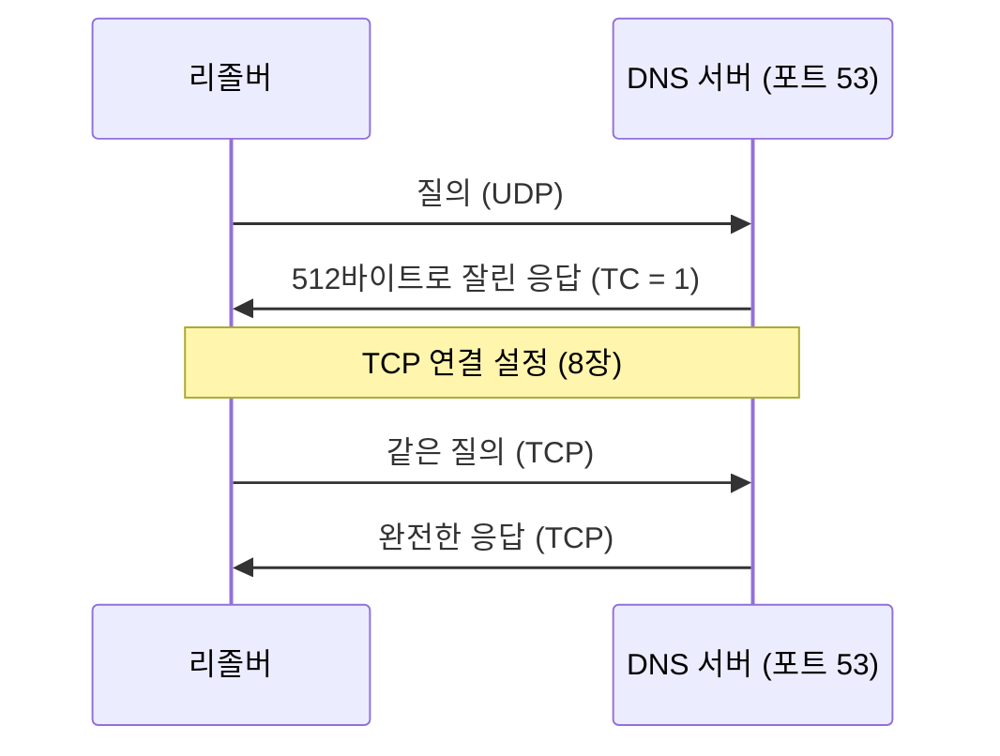

*그림 16. 잘린 UDP 응답 뒤에 TCP로 다시 질의하는 과정*

UDP는 연결 설정 없이 질의 하나와 응답 하나로 이름 해석을 끝내므로, 작은 질의와 응답에 TCP보다 빠르다. 질의나 응답이 손실되면 리졸버가 시간 초과 뒤에 질의를 다시 보내면 된다. UDP의 특징은 6장에서, TCP의 연결 설정은 8장에서 다룬다.

> **핵심:** DNS 서버는 UDP와 TCP 모두 포트 53을 쓴다. 보통의 질의와 응답은 연결 설정이 없는 UDP로 주고받고, UDP 크기 제한(EDNS(0)가 없으면 512바이트)을 넘는 응답(TC 비트로 알림)과 영역 전송에는 TCP를 쓴다.

---

<br>

## 8. 레코드의 등록과 갱신

### 8.1 등록 기관

지금까지는 DNS 데이터베이스에서 레코드를 꺼내는 방법을 보았다. 레코드가 처음에 데이터베이스에 들어가는 방법은 Kurose의 예로 살펴본다. 새로 Network Utopia라는 스타트업 회사를 만들었다고 가정한다. 가장 먼저 할 일은 도메인 이름 networkutopia.com을 **등록 기관(registrar)** 에 등록하는 것이다. 등록 기관은 도메인 이름이 유일한지 확인하고, 도메인 이름을 DNS 데이터베이스에 넣고, 그 서비스에 대한 약간의 수수료를 받는 상업적 기관이다. 1999년 이전에는 Network Solutions라는 한 등록 기관이 com, net, org 도메인의 이름 등록을 독점했지만, 지금은 많은 등록 기관이 경쟁하며 ICANN(Internet Corporation for Assigned Names and Numbers)이 등록 기관들을 인가한다.

networkutopia.com을 등록할 때는 주 책임 DNS 서버와 보조 책임 DNS 서버의 이름과 IP 주소도 등록 기관에 알려야 한다. 그 이름과 IP 주소가 dns1.networkutopia.com과 dns2.networkutopia.com, 212.212.212.1과 212.212.212.2라고 가정한다. 등록 기관은 두 책임 DNS 서버 각각에 대해 NS 레코드와 A 레코드가 com TLD 서버들에 들어가도록 한다. 예를 들어 networkutopia.com의 주 책임 서버에 대해 등록 기관은 다음 두 자원 레코드를 DNS 시스템에 넣는다.

```text
(networkutopia.com, dns1.networkutopia.com, NS)
(dns1.networkutopia.com, 212.212.212.1, A)
```

또한 웹 서버 www.networkutopia.com의 A 레코드와 메일 서버 mail.networkutopia.com의 MX 레코드가 회사의 책임 DNS 서버에 들어가도록 해야 한다. Forouzan도 같은 절차를 설명한다. 예를 들어 wonderful이라는 새 상업 조직이 이름이 ws이고 IP 주소가 200.200.200.5인 서버를 가진다면, 등록 기관에 도메인 이름 ws.wonderful.com과 IP 주소 200.200.200.5를 알려야 한다.

### 8.2 등록한 레코드로 이루어지는 이름 해석

이 단계가 모두 끝나면 사람들이 회사의 웹 사이트를 방문하고 직원들에게 전자 메일을 보낼 수 있다. 이것이 사실인지 확인하면서 지금까지 배운 내용을 정리한다. 오스트레일리아에 있는 앨리스가 웹 페이지 www.networkutopia.com을 보려 한다고 가정한다.

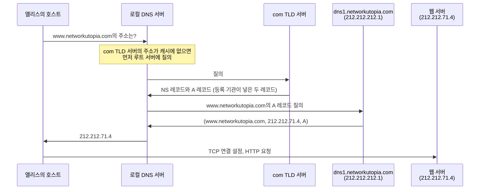

*그림 17. 등록한 레코드를 이용한 www.networkutopia.com의 이름 해석*

앨리스의 호스트는 먼저 로컬 DNS 서버에 DNS 질의를 보낸다. 로컬 DNS 서버는 com TLD 서버에 연락하며, com TLD 서버의 주소가 캐시에 없으면 먼저 루트 DNS 서버에도 연락해야 한다. 등록 기관이 모든 com TLD 서버에 앞의 NS 레코드와 A 레코드를 넣었으므로, TLD 서버는 이 두 자원 레코드를 담은 응답을 로컬 DNS 서버에 보낸다. 로컬 DNS 서버는 212.212.212.1에 www.networkutopia.com의 A 레코드를 묻는 DNS 질의를 보낸다. 이 레코드가 원하는 웹 서버의 IP 주소, 예를 들어 212.212.71.4를 주면, 로컬 DNS 서버는 이를 앨리스의 호스트에 돌려준다. 이제 앨리스의 브라우저는 호스트 212.212.71.4와 TCP 연결을 시작하고 그 연결로 HTTP 요청을 보낼 수 있다. 웹 페이지 하나를 볼 때도 눈에 보이는 것보다 훨씬 많은 일이 일어난다.

### 8.3 DDNS

예전에는 각 DNS 서버의 내용이 시스템 관리자가 만든 설정 파일 등으로 정적으로 구성되었다. DNS가 설계될 때는 주소가 이렇게 자주 바뀌리라고 아무도 예상하지 못했다. DNS에서 새 호스트를 추가하거나, 호스트를 없애거나, IP 주소를 바꾸면 그 변경을 DNS 주 파일(master file)에 반영해야 하며, 이는 많은 수작업을 필요로 한다. 오늘날 인터넷의 규모로는 이런 수작업이 불가능하므로 DNS 주 파일을 동적으로 갱신해야 한다.

이 필요에 맞추어 고안된 것이 **동적 도메인 이름 시스템(Dynamic Domain Name System, DDNS)** 이다. DDNS에서는 이름과 주소의 결합이 정해지면, 그 정보가 보통 DHCP(12장)를 통해 주 DNS 서버에 전달되고 주 서버가 영역을 갱신한다. 보조 서버는 능동적으로 또는 수동적으로 변경을 통보받는다. 능동적 통보에서는 주 서버가 영역의 변경에 대한 메시지를 보조 서버에 보내고, 수동적 통보에서는 보조 서버가 주기적으로 변경이 있는지 확인한다. 어느 경우든 변경을 알게 된 보조 서버는 영역 전체의 정보를 요청한다(영역 전송). DDNS는 권한 없는 변경을 막기 위해 인증 메커니즘을 쓸 수 있다. Kurose는 DNS 메시지로 데이터베이스에 데이터를 동적으로 추가하거나 삭제할 수 있게 하는 UPDATE 기능이 DNS 프로토콜에 추가되었으며, RFC 2136과 RFC 3007이 이 동적 갱신을 정의한다고 소개한다.

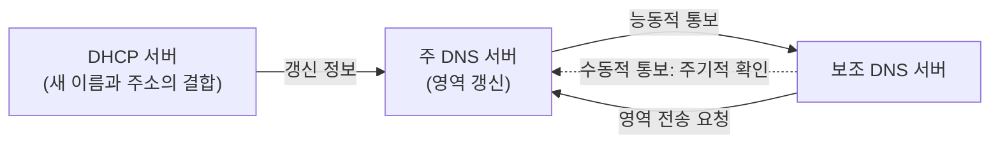

*그림 18. DDNS의 동작*

---

<br>

## 9. DNS 보안

DNS는 인터넷 기반 시설의 핵심 요소이며, 웹과 전자 메일을 비롯한 많은 중요한 서비스가 DNS 없이는 동작하지 못한다. 그렇다면 DNS는 어떻게 공격받을 수 있는지 살펴본다.

**DDoS 공격.** 가장 먼저 떠오르는 공격은 DNS 서버를 대상으로 한 DDoS 대역폭 범람 공격(1장)이다. 예를 들어 공격자가 각 루트 DNS 서버에 엄청난 양의 패킷을 보내 정상적인 DNS 질의의 대부분이 응답받지 못하게 할 수 있다. Kurose는 2002년 10월 21일에 DNS 루트 서버를 대상으로 이런 대규모 DDoS 공격이 실제로 일어났다고 소개한다. 공격자들은 봇넷을 이용하여 13개의 DNS 루트 IP 주소 각각에 대량의 ICMP ping 메시지(16장)를 보냈다. 이 공격의 피해는 매우 작아 사용자의 인터넷 경험에 거의 영향을 주지 못했다. 공격자들은 루트 서버에 패킷을 쏟아붓는 데는 성공했지만, 많은 루트 서버가 루트 서버로 향하는 ICMP ping 메시지를 항상 차단하도록 설정된 패킷 필터로 보호되어 정상적으로 동작했다. 또한 대부분의 로컬 DNS 서버가 TLD 서버의 IP 주소를 캐시하고 있어서 질의 과정이 루트 서버를 건너뛰는 경우가 많았다.

더 효과적일 수 있는 DDoS 공격은 TLD 서버, 예를 들어 .com 도메인을 처리하는 모든 TLD 서버에 DNS 질의를 대량으로 보내는 것이다. DNS 서버로 향하는 DNS 질의는 걸러 내기가 더 어렵고, TLD 서버는 루트 서버처럼 쉽게 건너뛸 수 없다. 그래도 로컬 DNS 서버의 캐싱이 이런 공격의 피해를 어느 정도 줄인다.

**중간자 공격과 DNS 오염.** **중간자 공격(man-in-the-middle attack)** 에서 공격자는 호스트의 질의를 가로채 가짜 응답을 돌려준다. **DNS 오염 공격(DNS poisoning attack)** 에서 공격자는 DNS 서버에 가짜 응답을 보내 서버가 가짜 레코드를 캐시에 받아들이게 만든다. 두 공격 모두 예를 들어 의심하지 않는 웹 사용자를 공격자의 웹 사이트로 보내는 데 쓰일 수 있다. 다만 이런 공격은 패킷을 가로채거나 서버를 마비시켜야 하므로 실행하기 어렵다. Kurose는 2016년 교재 기준으로 DNS가 공격에 놀라울 만큼 강건했으며, 그때까지 DNS 서비스를 실제로 방해한 공격은 없었다고 정리한다.

Forouzan은 DNS에 대한 공격을 세 가지로 정리하고 각각의 대책을 제시한다.

| 공격 | 내용 | 필요한 보호 |
|:-----|:-----|:-----|
| 응답 엿보기 | DNS 서버의 응답을 읽어 사용자가 주로 접속하는 사이트의 성격이나 이름을 알아내고, 사용자의 성향을 파악함 | DNS 메시지의 기밀성 |
| 응답 가로채기와 위조 | DNS 서버의 응답을 가로채 바꾸거나 완전히 새로운 가짜 응답을 만들어, 사용자를 공격자가 원하는 사이트나 도메인으로 보냄 | 메시지 출처 인증과 메시지 무결성 |
| 범람 | DNS 서버에 요청을 쏟아부어 과부하로 만들거나 결국 멈추게 함 | 서비스 거부 공격에 대한 대비 |

*표 12. DNS에 대한 공격과 필요한 보호*

DNS를 보호하기 위해 IETF는 **DNSSEC(DNS Security)** 이라는 기술을 만들었다. DNSSEC은 디지털 서명이라는 보안 서비스를 이용하여 메시지 출처 인증과 메시지 무결성을 제공한다. 그러나 DNSSEC은 DNS 메시지의 기밀성을 제공하지 않으며, DNSSEC의 명세에는 서비스 거부 공격에 대한 특별한 보호도 없다. 다만 캐싱 시스템이 위쪽 수준의 서버를 이 공격에서 어느 정도 보호한다.

> **[정보보호]** **디지털 서명(digital signature)** 은 송신자만 가진 개인 키로 메시지에 대한 값을 만들고, 누구나 얻을 수 있는 공개 키로 그 값을 검증하는 기법이다. 검증에 성공하면 메시지가 그 개인 키를 가진 송신자에게서 왔고(출처 인증) 전송 중에 바뀌지 않았다(무결성)는 것을 확인할 수 있다. 서명은 메시지의 내용을 숨기지 않으므로 기밀성은 별도의 암호화로 제공해야 한다. 공개 키 암호와 디지털 서명은 26장에서 다룬다.

---

<br>

## 요약

| 개념 | 핵심 요약 |
|:-----|:-----|
| DNS | 호스트 이름을 IP 주소로 바꾸는 분산 계층 데이터베이스이자 그 데이터베이스에 질의하는 응용 계층 프로토콜이다. |
| DNS의 서비스 | 이름의 주소 변환, 호스트 별칭, 메일 서버 별칭, 순서를 돌린 주소 집합을 이용한 부하 분산을 제공한다. |
| 도메인 이름 공간 | 최대 128개 수준의 뒤집힌 트리로, 레이블은 최대 63자이고 도메인 이름은 노드에서 루트까지 레이블을 점으로 이은 것이다. |
| FQDN과 PQDN | FQDN은 루트의 빈 레이블까지 포함하여 점으로 끝나고, PQDN은 리졸버가 접미사를 붙여 FQDN으로 만든다. |
| 도메인과 영역 | 도메인은 부분 트리이고, 영역은 한 서버가 책임지는 부분으로 위임이 있으면 도메인보다 작다. |
| 주 서버와 보조 서버 | 주 서버는 영역 파일을 만들고 갱신하며, 보조 서버는 영역 전송으로 사본을 받고, 둘 다 권한을 가진다. |
| DNS 서버 계층 | 루트 서버는 TLD 서버의 주소를, TLD 서버는 책임 서버의 주소를, 책임 서버는 최종 레코드를 준다. |
| 로컬 DNS 서버 | ISP가 운영하며 호스트의 재귀 질의를 받아 계층에 반복 질의를 보내고 결과를 캐시한다. |
| 인터넷의 도메인 | 일반 도메인, 국가 도메인, 주소를 이름으로 바꾸는 역 도메인(in-addr.arpa)의 세 부분으로 나뉜다. |
| 반복 질의와 재귀 질의 | 재귀 질의는 서버가 대신 최종 답을 구하고, 반복 질의는 서버가 다음 서버의 주소를 돌려준다. |
| DNS 캐싱과 TTL | 받은 대응을 TTL 동안 캐시하여 루트와 TLD 서버를 건너뛰고, TTL이 만료되면 지운다. |
| 자원 레코드 | (Name, Value, Type, TTL)로 이루어지며, A, NS, CNAME, MX 등의 형식이 번호로 표시된다. |
| DNS 메시지 | 질의와 응답은 같은 형식이며, 12바이트 헤더(식별자, 플래그, 네 개의 수)와 질의, 답, 책임, 추가 부분으로 이루어진다. |
| 압축 | 반복되는 도메인 이름을 상위 두 비트가 11인 2바이트 오프셋 포인터로 대신하며, 질의 이름을 가리키는 값은 흔히 0xC00C이다. |
| 전송 | UDP와 TCP 모두 포트 53을 쓰며, UDP 크기 제한(EDNS(0)가 없으면 512바이트)을 넘는 응답과 영역 전송에는 TCP를 쓴다. |
| 등록과 DDNS | 등록 기관이 TLD 서버에 NS 레코드와 A 레코드를 넣고, DDNS는 DHCP가 알린 변경으로 영역을 동적으로 갱신한다. |
| DNS 보안 | DDoS, 중간자 공격, DNS 오염의 위협이 있고, DNSSEC은 디지털 서명으로 출처 인증과 무결성을 제공하지만 기밀성은 제공하지 않는다. |

---

<br>

## 점검 문제

1. **반복 해석의 메시지 수:** 모든 DNS 서버의 캐시가 비어 있을 때, 호스트 cse.nyu.edu가 로컬 DNS 서버 dns.nyu.edu를 통해 gaia.cs.umass.edu의 주소를 얻는 데 필요한 DNS 메시지의 수를 구하라. umass.edu의 서버가 중간 서버이고 dns.cs.umass.edu가 책임 서버라면 메시지 수는 어떻게 되는가?

   <details>
   <summary>정답</summary>

   호스트와 로컬 서버 사이의 질의와 응답 2개, 로컬 서버와 루트 서버 사이 2개, 로컬 서버와 edu TLD 서버 사이 2개, 로컬 서버와 dns.umass.edu 사이 2개로 모두 8개이다. 중간 서버가 있으면 로컬 서버가 dns.cs.umass.edu에 한 번 더 질의하고 응답을 받으므로 2개가 늘어 10개가 된다.

   </details>

2. **TLD 서버 주소의 캐싱:** 1번 문제 뒤에 로컬 DNS 서버의 캐시에 edu TLD 서버의 주소만 남아 있다고 가정한다. NYU의 다른 호스트가 다른 대학의 웹 서버 www.someschool.edu를 질의하면 몇 개의 메시지가 필요한가? 같은 호스트가 gaia.cs.umass.edu를 다시 질의할 때 그 대응이 아직 캐시에 있다면 몇 개인가?

   <details>
   <summary>정답</summary>

   로컬 서버는 루트 서버를 건너뛰고 캐시한 edu TLD 서버에 바로 질의한다. 호스트와 로컬 서버 사이 2개, 로컬 서버와 TLD 서버 사이 2개, 로컬 서버와 someschool.edu의 책임 서버 사이 2개로 6개가 필요하다. gaia.cs.umass.edu의 대응이 캐시에 남아 있으면 로컬 서버가 바로 답하므로 호스트와 로컬 서버 사이의 2개뿐이다.

   </details>

3. **메일 서버 찾기:** SMTP 클라이언트가 bob@networkutopia.com으로 메일을 보내려 한다. 어떤 형식의 자원 레코드를 질의해야 하며, 그 응답만으로 TCP 연결을 열 수 있는가?

   <details>
   <summary>정답</summary>

   networkutopia.com에 대한 MX 레코드를 질의한다. MX 레코드의 Value는 메일 서버의 정식 이름(예: mail.networkutopia.com)이므로, TCP 연결을 열려면 그 이름의 A 레코드로 IP 주소도 알아야 한다. 서버가 응답의 추가 부분에 그 A 레코드를 함께 넣어 주면 추가 질의 없이 연결할 수 있고, 그렇지 않으면 정식 이름에 대해 A 레코드를 한 번 더 질의해야 한다.

   </details>

4. **UDP와 TCP의 사용:** DNS가 보통의 질의에는 UDP를 쓰면서 영역 전송에는 TCP를 쓰는 이유를 설명하라. 리졸버가 응답의 크기를 미리 모르는 경우에는 어떻게 하는가?

   <details>
   <summary>정답</summary>

   보통의 질의와 응답은 작아서 UDP 데이터그램 하나에 들어가고, 연결 설정 없이 질의 하나와 응답 하나로 끝나므로 빠르다. 영역 전송은 영역 전체의 정보를 옮기므로 대개 512바이트를 넘고, 많은 데이터를 신뢰성 있게 옮겨야 하므로 TCP를 쓴다. 크기를 모르면 먼저 UDP로 질의하고, 응답이 512바이트를 넘어 TC 비트가 설정된 잘린 응답이 오면 TCP 연결을 열어 같은 질의를 반복한다.

   </details>

5. **DNS와 전송 프로토콜의 지연:** 클라이언트와 DNS 서버 사이의 왕복 시간(RTT)이 40 ms이고, 질의와 응답은 각각 패킷 하나에 들어간다. 처리 시간과 전송 시간을 무시할 때, 클라이언트가 질의를 보내기로 한 시점부터 응답을 받을 때까지 걸리는 최소 시간을 UDP와 TCP 각각에 대해 구하라.

   <details>
   <summary>정답</summary>

   UDP는 연결 설정 없이 바로 질의를 보내므로 1 RTT = 40 ms가 걸린다. TCP는 질의 전에 연결을 설정해야 하며(8장의 3-way 핸드셰이크), SYN과 SYN+ACK가 오가는 데 1 RTT가 걸린다. 클라이언트는 세 번째 세그먼트인 ACK와 함께 질의를 보낼 수 있으므로 질의와 응답에 1 RTT가 더 걸려 최소 2 RTT = 80 ms가 필요하다. 그 뒤 연결 종료를 위한 세그먼트 교환도 추가로 일어난다. 작은 질의와 응답에 DNS가 UDP를 쓰는 이유가 여기에 있다.

   </details>

6. **플래그 해석:** 어떤 DNS 응답의 플래그가 0x8580이다. 각 하위 필드의 값을 구하고 응답의 성격을 설명하라.

   <details>
   <summary>정답</summary>

   0x8580을 이진수로 쓰면 1000 0101 1000 0000이다. 필드별로 나누면 QR = 1, OpCode = 0000, AA = 1, TC = 0, RD = 1, RA = 1, 예약 = 000, rCode = 0000이다. 따라서 표준 질의에 대한 응답이며, 응답한 서버는 그 이름의 책임 서버이고, 클라이언트가 재귀를 원했고 서버가 재귀를 지원하며, 응답은 잘리지 않았고 오류도 없다.

   </details>

7. **역 도메인과 포인터:** IP 주소 153.18.8.105의 이름을 찾는 PTR 질의에서 질의 이름은 무엇인가? 그 응답의 답 레코드가 이름을 반복하는 대신 0xC00C로 시작한다면, 이 값은 무엇을 뜻하는가?

   <details>
   <summary>정답</summary>

   주소의 네 부분을 뒤집고 in-addr와 arpa를 붙인 105.8.18.153.in-addr.arpa.이다. 0xC00C는 이진수로 11 00000000001100이며, 상위 두 비트 11은 오프셋 포인터라는 표시이고 나머지 14비트는 12이다. 즉 메시지의 12번 바이트, 헤더 바로 뒤에서 시작하는 질의 레코드의 이름을 다시 쓰라는 뜻이다.

   </details>

---

<br>

## 참고 문헌

1. P. Mockapetris, "Domain Names - Implementation and Specification," RFC 1035, Nov. 1987. [Online]. Available: https://www.rfc-editor.org/rfc/rfc1035
2. Root Server Technical Operations Association, "Root Servers." [Online]. Available: https://root-servers.org/ (accessed Nov. 18, 2026).
3. D. Lawrence, "Obsoleting IQUERY," RFC 3425, Nov. 2002. [Online]. Available: https://www.rfc-editor.org/rfc/rfc3425
4. J. Damas, M. Graff, and P. Vixie, "Extension Mechanisms for DNS (EDNS(0))," RFC 6891, Apr. 2013. [Online]. Available: https://www.rfc-editor.org/rfc/rfc6891
