# Chapter 5 — Domain Name System (DNS)

[Repository Guide](../../README.md) | [English](Concepts_Lecture.md) | [한국어](Concepts_Lecture.ko.md)

> **Last Updated:** 2026-11-18
>
> Computer Networking: A Top-Down Approach, Kurose and Ross, Ch 2; TCP/IP Protocol Suite, Forouzan, Ch 19

> **Learning Objectives:**
> 1. Explain why DNS is needed to translate hostnames into IP addresses and what services DNS provides
> 2. Explain the structure of the domain name space and the relationships among labels, FQDNs, PQDNs, domains, and zones
> 3. Explain the roles of root, TLD, authoritative, and local DNS servers and the generic, country, and inverse domains of the Internet
> 4. Trace how a name is resolved with iterative and recursive queries, and compute how caching reduces the number of messages
> 5. Interpret the format of resource records and the header, flags, and compression of DNS messages
> 6. Explain when DNS uses UDP and TCP, how records are registered and updated, and how DNS can be attacked

---

## Table of Contents

- [1. Why DNS Is Needed and Its Services](#1-why-dns-is-needed-and-its-services)
  - [1.1 Hostnames and IP Addresses](#11-hostnames-and-ip-addresses)
  - [1.2 Definition and Overview of DNS](#12-definition-and-overview-of-dns)
  - [1.3 Services Provided by DNS](#13-services-provided-by-dns)
- [2. Name Space](#2-name-space)
  - [2.1 Flat and Hierarchical Name Spaces](#21-flat-and-hierarchical-name-spaces)
  - [2.2 Domain Name Space](#22-domain-name-space)
  - [2.3 FQDN and PQDN](#23-fqdn-and-pqdn)
  - [2.4 Domains](#24-domains)
- [3. Distribution of the Name Space and DNS Servers](#3-distribution-of-the-name-space-and-dns-servers)
  - [3.1 Problems with a Centralized Design](#31-problems-with-a-centralized-design)
  - [3.2 Hierarchy of Servers and Zones](#32-hierarchy-of-servers-and-zones)
  - [3.3 Primary and Secondary Servers](#33-primary-and-secondary-servers)
  - [3.4 Root, TLD, and Authoritative DNS Servers](#34-root-tld-and-authoritative-dns-servers)
  - [3.5 Local DNS Servers](#35-local-dns-servers)
  - [3.6 DNS in the Internet: Generic, Country, and Inverse Domains](#36-dns-in-the-internet-generic-country-and-inverse-domains)
- [4. Name Resolution](#4-name-resolution)
  - [4.1 Resolvers](#41-resolvers)
  - [4.2 Iterative and Recursive Queries](#42-iterative-and-recursive-queries)
  - [4.3 Resolving Addresses to Names](#43-resolving-addresses-to-names)
  - [4.4 DNS Caching and TTL](#44-dns-caching-and-ttl)
- [5. Resource Records](#5-resource-records)
  - [5.1 Resource Records as Four-Tuples](#51-resource-records-as-four-tuples)
  - [5.2 Records Held by Authoritative and Other Servers](#52-records-held-by-authoritative-and-other-servers)
  - [5.3 Record Type Numbers and Classes](#53-record-type-numbers-and-classes)
- [6. DNS Messages](#6-dns-messages)
  - [6.1 Structure of a Message](#61-structure-of-a-message)
  - [6.2 Header and Flags](#62-header-and-flags)
  - [6.3 Formats of Question Records and Resource Records](#63-formats-of-question-records-and-resource-records)
  - [6.4 Compression](#64-compression)
  - [6.5 Examples of Message Interpretation](#65-examples-of-message-interpretation)
- [7. Transport Protocols and Encapsulation](#7-transport-protocols-and-encapsulation)
- [8. Registering and Updating Records](#8-registering-and-updating-records)
  - [8.1 Registrars](#81-registrars)
  - [8.2 Name Resolution with the Registered Records](#82-name-resolution-with-the-registered-records)
  - [8.3 DDNS](#83-ddns)
- [9. DNS Security](#9-dns-security)
- [Summary](#summary)
- [Self-Check Questions](#self-check-questions)
- [References](#references)

---

<br>

## 1. Why DNS Is Needed and Its Services

### 1.1 Hostnames and IP Addresses

People can be identified in many ways: by the names on their birth certificates, by identification numbers such as social security numbers, or by driver's license numbers, and depending on the context one identifier may be more appropriate than another. The computers of a tax agency prefer fixed-length numbers, while ordinary people prefer mnemonic names. Internet hosts are likewise identified in two ways.

The first is the **hostname**. Hostnames such as www.facebook.com, www.google.com, and gaia.cs.umass.edu are mnemonic and therefore convenient for people. However, a hostname gives little, if any, information about where in the Internet the host is located. www.eurecom.fr, which ends with the country code .fr, tells us that the host is probably in France, but not much more. Furthermore, hostnames consist of variable-length alphanumeric characters, so they would be difficult for routers to process.

The second is the **IP address**. An IP address consists of four bytes and has a rigid hierarchical structure. As in 121.7.106.83, each byte is written in decimal from 0 to 255 and separated by a period. An IP address is hierarchical because, as the address is scanned from left to right, one obtains more and more specific information about which network, in the network of networks, the host is located in. It is like a postal address, which reveals the addressee's location more and more specifically as it is read from the larger units to the smaller ones. Chapter 12 covers the structure of IP addresses in detail.

People prefer hostnames, while routers prefer fixed-length, hierarchically structured IP addresses. To reconcile these preferences, a directory service that translates hostnames into IP addresses is needed.

When the Internet was small, this translation was done with a **host file**. A host file is a table with only two columns, name and address. Every host stored the file on its disk and updated it periodically from a master host file, and when a program or a user wanted to map a name to an address, the host consulted the host file. Today this approach is impossible. A host file relating every address with a name would be too large to store in every host, and it would be impossible to update all the host files every time there is a change. Storing the entire host file on a single computer and letting every computer access it would also create a huge amount of traffic on the Internet. The approach used today divides this huge amount of information into smaller parts, stores each part on a different computer, and lets a host that needs a mapping contact the closest computer holding the needed information. This is the approach of the **Domain Name System (DNS)**.

### 1.2 Definition and Overview of DNS

> **Definition:** The **Domain Name System (DNS)** is a distributed database implemented in a hierarchy of DNS servers, together with an application-layer protocol that allows hosts to query that database.

DNS servers are often UNIX machines running the BIND (Berkeley Internet Name Domain) software. The DNS protocol runs over UDP and uses port 53 (Section 7). DNS is commonly employed by other application-layer protocols, such as HTTP and SMTP, to translate user-supplied hostnames into IP addresses.

As an example, consider a browser (an HTTP client) on a user's host requesting the URL www.someschool.edu/index.html. For the user's host to send an HTTP request message to the Web server www.someschool.edu, it must first obtain the IP address of www.someschool.edu, which is done as follows.

1. The same user machine runs the client side of the DNS application.
2. The browser extracts the hostname, www.someschool.edu, from the URL and passes it to the client side of the DNS application.
3. The DNS client sends a query containing the hostname to a DNS server.
4. The DNS client eventually receives a reply, which includes the IP address for the hostname.
5. Once the browser receives the IP address from DNS, it can initiate a TCP connection to the HTTP server process located at port 80 at that IP address.

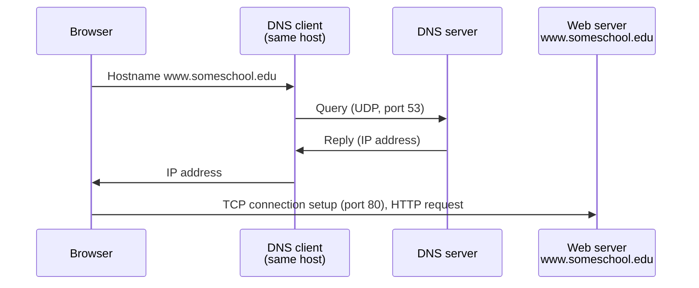

*Figure 1. A browser obtaining an IP address through DNS before connecting to a Web server*

As this example shows, DNS adds an additional delay, sometimes substantial, to the Internet applications that use it. Fortunately, the desired IP address is often cached in a nearby DNS server, and caching (Section 4.4) reduces both DNS network traffic and the average DNS delay.

Forouzan explains the same process with a file transfer application. The user knows only the name of the file transfer server (for example, forouzan.com), but the TCP/IP protocol suite needs the server's IP address to make the connection. The user passes the hostname to the file transfer client, which passes it to the DNS client; the DNS client sends a query to the DNS server whose address it learned at boot time, receives the IP address in the response, and returns it to the file transfer client. The file transfer client then uses the received IP address to access the file transfer server. Thus, before the connection that serves the purpose of file transfer, there must first be communication between the DNS client and the DNS server to map the name to an address.

DNS is an application-layer protocol like HTTP, FTP, and SMTP in that it runs between end systems using the client-server paradigm and relies on an end-to-end transport protocol to transfer its messages. Its role, however, is quite different from theirs. DNS is not an application with which users directly interact; instead, it provides a core Internet function, translating hostnames to IP addresses, for user applications and other software. Kurose explains that much of the complexity of the Internet architecture is located at the edges of the network, and DNS, which implements the critical name-to-address translation with clients and servers located at the edge, is yet another example of that design philosophy.

### 1.3 Services Provided by DNS

Besides translating hostnames to IP addresses, DNS provides a few other important services.

- **Host aliasing:** A host with a complicated hostname can have one or more alias names. For example, a host named relay1.west-coast.enterprise.com could have two aliases, enterprise.com and www.enterprise.com. In this case relay1.west-coast.enterprise.com is called the **canonical hostname**. Aliases are typically more mnemonic than canonical hostnames. An application can invoke DNS to obtain the canonical hostname for an alias as well as the IP address of the host.
- **Mail server aliasing:** E-mail addresses should be mnemonic. At the company above, Bob's address might be as simple as bob@enterprise.com, while the canonical hostname of the company's mail server might be much more complicated, such as relay1.west-coast.enterprise.com. A mail application invokes DNS to obtain the canonical hostname of the mail server for the alias as well as its IP address. Thanks to the MX record of Section 5.1, a company's mail server and Web server can have the same alias (for example, enterprise.com).
- **Load distribution:** Busy sites are replicated over multiple servers, each running on a different end system and having a different IP address. A set of IP addresses is then associated with one canonical hostname, and the DNS database contains this set. When a client queries this name, the server responds with the entire set of addresses but rotates their ordering within each reply. Because a client typically sends its HTTP request to the first address listed, this rotation distributes the traffic among the replicated servers. The same rotation is used to let multiple mail servers share the same alias. Content distribution companies use DNS in more sophisticated ways to distribute Web content, which Chapter 23 covers under CDNs.

| Service | What is queried | What DNS returns |
|:-----|:-----|:-----|
| Name-to-address translation | Hostname | IP address of the host |
| Host aliasing | Alias | Canonical hostname and IP address |
| Mail server aliasing | Domain of a mail address | Canonical hostname and IP address of the mail server |
| Load distribution | Name of replicated servers | Set of IP addresses in rotated order |

*Table 1. Services provided by DNS*

DNS is specified in RFC 1034 and RFC 1035 and has been updated in several later RFCs [1]. It is a complex system, and this chapter covers the key aspects of its operation.

---

<br>

## 2. Name Space

### 2.1 Flat and Hierarchical Name Spaces

To be unambiguous, the names assigned to machines must be carefully selected from a **name space** with complete control over the binding between names and IP addresses. Because addresses are unique, names must be unique too. A name space that maps each address to a unique name can be organized in two ways: flat or hierarchical.

In a **flat name space**, a name is assigned to an address, and a name is a sequence of characters without structure. Names may have a common section, but it has no meaning. A flat name space cannot be used in a large system such as the Internet, because it must be centrally controlled to avoid ambiguity and duplication.

In a **hierarchical name space**, each name is made of several parts. The first part can define the nature of the organization, the second the name of the organization, the third the departments in the organization, and so on. The authority to assign and control names can then be decentralized. A central authority assigns only the parts that define the nature and the name of the organization, and the responsibility for the rest of the name is given to the organization itself. The organization adds prefixes or suffixes to its name to define its hosts or resources, and it need not worry that another organization chooses the same prefix, because the whole name is different.

For example, suppose two colleges and a company each want to call one of their computers challenger. If the central authority gives the first college the name fhda.edu, the second college berkeley.edu, and the company smart.com, then the names each organization forms by adding challenger in front of its own name, challenger.fhda.edu, challenger.berkeley.edu, and challenger.smart.com, are all distinguishable. The central authority controls only part of the name, not the whole, and the names are still unique.

### 2.2 Domain Name Space

The **domain name space** was designed to provide a hierarchical name space. In this design, names are defined in an inverted-tree structure with the root at the top. The tree can have at most 128 levels, from level 0 (the root) to level 127.

> **Definition:** The **domain name space** is a hierarchical name space that organizes all names of the Internet as an inverted tree starting at the root, in which each node has a label and a unique domain name.

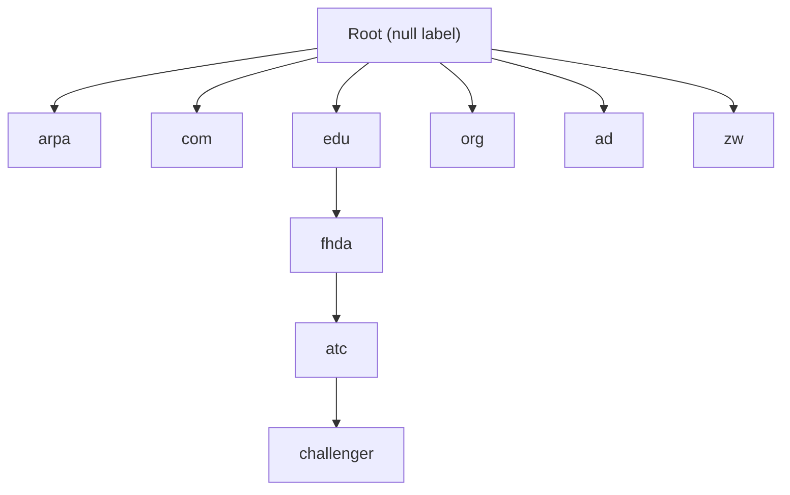

*Figure 2. Part of the domain name space*

**Label.** Each node in the tree has a label, a string of at most 63 characters. The label of the root is the null (empty) string. DNS requires that the children of a node (nodes that branch from the same node) have different labels, which guarantees the uniqueness of domain names.

**Domain name.** Each node in the tree has a domain name. A full domain name is a sequence of labels separated by periods (.), always read from the node up to the root. The last label is the label of the root, the null string. A full domain name therefore always ends in a null label, and because the null string is nothing, its last character is a period.

```text
Label         Domain name
edu           edu.
fhda          fhda.edu.
atc           atc.fhda.edu.
challenger    challenger.atc.fhda.edu.
```

*Figure 3. Labels and domain names*

> **[Data Structures]** A **tree** is a hierarchical data structure that starts at a single root node, in which each node has zero or more child nodes and every node except the root has exactly one parent. Hence there is exactly one path from any node up to the root. A domain name is the sequence of the labels of the nodes on this path, so as long as sibling nodes have different labels, the domain names of different nodes are always different.

### 2.3 FQDN and PQDN

A domain name whose labels end with the null string is called a **fully qualified domain name (FQDN)**. An FQDN is a domain name that contains the full name of a host: all the labels, from the most specific to the most general, that uniquely define the host. For example, the following is the FQDN of a computer named challenger installed at the Advanced Technology Center (ATC) of De Anza College.

```text
challenger.atc.fhda.edu.
```

A DNS server can only match an FQDN to an address. The name must end with a null label, but because the null label is nothing, the name ends with a period (.).

A domain name whose labels do not end with the null string is called a **partially qualified domain name (PQDN)**. A PQDN starts from a node but does not reach the root. It is used when the name to be resolved belongs to the same site as the client. The resolver (Section 4.1) then supplies the missing part, called the **suffix**, to create an FQDN. For example, if a user at the fhda.edu. site wants the IP address of the challenger computer and types only the partial name challenger, the DNS client adds the suffix atc.fhda.edu. before passing the name to the DNS server.

The DNS client normally holds a list of suffixes. The list at De Anza College could be as follows. The last, null suffix means adding nothing and is used when the user types an FQDN.

```text
atc.fhda.edu
fhda.edu
null
```

| FQDN | PQDN |
|:-----|:-----|
| challenger.atc.fhda.edu. | challenger.atc.fhda.edu |
| cs.hmme.com. | cs.hmme |
| www.funny.int. | www |

*Table 2. Examples of FQDNs and PQDNs*

### 2.4 Domains

A **domain** is a subtree of the domain name space. The name of a domain is the name of the node at the top of the subtree. For example, the whole subtree below the com node is the domain com, and the whole subtree below the fhda node under edu is the domain fhda.edu. A domain may itself be divided into domains, which are also called **subdomains**.

---

<br>

## 3. Distribution of the Name Space and DNS Servers

### 3.1 Problems with a Centralized Design

A simple design for DNS would have one DNS server containing all the mappings. In this centralized design, clients direct all queries to that server, and the server responds directly to the querying clients. Although simple, the design is inappropriate for today's Internet, with its vast and growing number of hosts. Its problems are the following.

- **A single point of failure:** If the DNS server crashes, so does the entire Internet.
- **Traffic volume:** A single server would have to handle the DNS queries for all the HTTP requests and e-mail messages generated by hundreds of millions of hosts.
- **Distant centralized database:** A single server cannot be close to all the querying clients. If it is placed in New York City, all queries from Australia must travel to the other side of the globe, perhaps over slow and congested links, which can lead to significant delays.
- **Maintenance:** The single server would have to keep records for all Internet hosts. This database would not only be huge but would also have to be updated frequently to account for every new host.

Forouzan summarizes the same problems in two words. If one computer stored this huge amount of information, it would be inefficient, because responding to requests from all over the world places a heavy load on it, and unreliable, because any failure would make the data inaccessible. In short, a centralized database on a single server does not scale, and DNS was distributed by design.

### 3.2 Hierarchy of Servers and Zones

The solution is to distribute the information among many computers called **DNS servers**. One way is to divide the whole name space by the first level: let the root stand alone and create as many domains (subtrees) as there are first-level nodes. Because a domain created this way could be very large, DNS allows domains to be divided further into smaller subdomains. Each server is responsible for either a large or a small domain. The result is a hierarchy of servers shaped like the hierarchy of names.

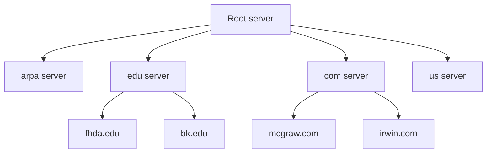

*Figure 4. A hierarchy of servers shaped like the hierarchy of names*

Because the complete domain name hierarchy cannot be stored on a single server, it is divided among many servers. What a server is responsible for, that is, what it has authority over, is called a **zone**.

> **Definition:** A **zone** is a contiguous part of the domain name tree for which one server is responsible, and the server keeps the information about every node in the zone in a zone file.

If a server accepts responsibility for a domain and does not divide it into smaller domains, the domain and the zone refer to the same thing. The server makes a database called a **zone file** and keeps all the information for every node under that domain. If, however, the server divides its domain into subdomains and **delegates** part of its authority to other servers, the domain and the zone refer to different things. The information about the nodes in the subdomains is stored in the servers at the lower levels, and the original server keeps only references to these lower-level servers. The original server does not free itself from responsibility entirely: it still has a zone, but the detailed information is kept by the lower-level servers. A server can also delegate only part of its domain and keep the rest for itself, in which case its zone consists of detailed information for the part that is not delegated and references to the parts that are.

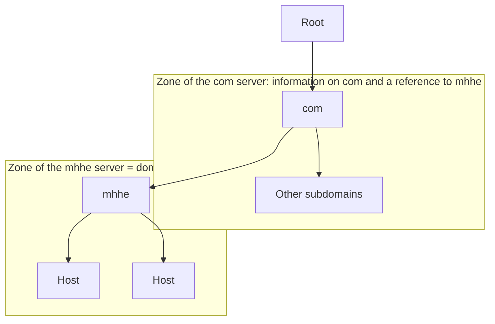

*Figure 5. Zones and domains*

In Figure 5, the com server has delegated mhhe.com, part of the domain com, to the mhhe server, so the zone of the com server is smaller than the whole domain com. The mhhe server, on the other hand, has not divided its domain further, so its zone is the same as the domain mhhe.com.

### 3.3 Primary and Secondary Servers

DNS defines two types of servers. A **primary server** stores a file about the zone for which it is an authority; it is responsible for creating, maintaining, and updating the zone file and stores it on a local disk. A **secondary server** transfers the complete information about a zone from another server (primary or secondary) and stores it on its local disk. The secondary server neither creates nor updates the zone files; if updating is required, the primary server does it and sends the updated version to the secondary.

Both the primary and the secondary servers are authoritative for the zones they serve. The purpose of a secondary server is not to create a lower level of authority but to make the data redundant, so that if one server fails, the other can continue serving clients. A server can be a primary server for one zone and a secondary server for another, so when calling a server primary or secondary, one must be clear about which zone is meant. A primary server loads all its information from the disk file, and a secondary server loads all its information from the primary server. The download of information from the primary by the secondary is called a **zone transfer**.

### 3.4 Root, TLD, and Authoritative DNS Servers

To deal with scale, DNS uses a large number of servers organized hierarchically and distributed around the world. No single DNS server has all the mappings for all the hosts in the Internet; the mappings are distributed across DNS servers. Kurose divides DNS servers, to a first approximation, into three classes, root DNS servers, top-level domain (TLD) DNS servers, and authoritative DNS servers, which form the following hierarchy.

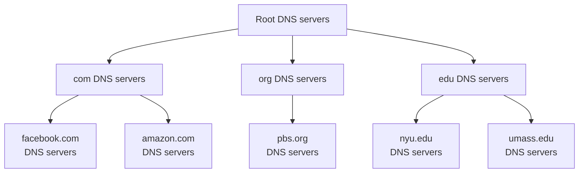

*Figure 6. Portion of the hierarchy of DNS servers*

To see how these three classes interact, suppose a DNS client wants the IP address for the hostname www.amazon.com. To a first approximation, the following events take place. The client first contacts one of the root servers, which returns IP addresses for the TLD servers of the top-level domain com. The client then contacts one of these TLD servers, which returns the IP address of an authoritative server for amazon.com. Finally, the client contacts one of the authoritative servers for amazon.com, which returns the IP address for www.amazon.com.

> **Definition:** A **root DNS server** is a server at the top of the DNS server hierarchy that provides the IP addresses of the TLD servers responsible for the top-level domains.

According to Kurose, as of 2016 there were over 400 root name servers scattered all over the world. These are instances of the 13 root name servers, named A through M, which are operated by 12 independent organizations [2]. From Forouzan's point of view, a root server is a server whose zone consists of the whole tree. A root server usually does not store information about domains itself but delegates its authority to other servers, keeping references to them. There are several root servers, each covering the whole domain name space.

> **Definition:** A **TLD DNS server** is a server responsible for one top-level domain such as com, org, net, edu, or gov, or a country top-level domain such as uk, fr, ca, or jp, that provides the IP addresses of the authoritative DNS servers of organizations under it.

There is a TLD server (or server cluster) for each top-level domain. Kurose explains, for example, that Verisign Global Registry Services maintains the TLD servers for the com top-level domain and Educause maintains those for edu. The network infrastructure supporting a TLD can be large and complex.

> **Definition:** An **authoritative DNS server** is a server that houses the DNS records mapping an organization's hostnames to IP addresses and gives the final answer to queries for those names.

Every organization with publicly accessible hosts on the Internet, such as Web servers and mail servers, must provide publicly accessible DNS records that map the names of those hosts to IP addresses, and the organization's authoritative DNS server houses these records. An organization can run its own authoritative DNS server or pay to have the records stored in an authoritative DNS server of a service provider. Most universities and large companies implement and maintain their own primary and secondary (backup) authoritative DNS servers, which correspond to the primary and secondary servers of Section 3.3.

### 3.5 Local DNS Servers

Another important type of DNS server in the DNS architecture is the **local DNS server**. A local DNS server does not strictly belong to the hierarchy of servers, but it is central to the DNS architecture.

> **Definition:** A **local DNS server** is a server run by each ISP that receives DNS queries from hosts, forwards them into the DNS server hierarchy as a proxy, and returns the results; it is also called a default name server.

Every ISP, residential or institutional, has a local DNS server. When a host connects to an ISP, the ISP provides the host with the IP addresses of one or more of its local DNS servers, typically through DHCP (Chapter 12). In Forouzan's words, each computer knows the address of one DNS server after being booted. A host's local DNS server is typically close to the host: for an institutional ISP it may be on the same LAN, and for a residential ISP it is typically separated from the host by no more than a few routers. When a host makes a DNS query, the query is sent to the local DNS server, which acts as a proxy and forwards the query into the DNS server hierarchy (Section 4.2).

| Server | Position in the hierarchy | Role | Example |
|:-----|:-----|:-----|:-----|
| Root DNS server | Top | Provides the IP addresses of TLD servers | 13 root name servers (A-M) run by 12 organizations, over 400 instances in 2016 |
| TLD DNS server | Top-level domain | Provides the IP addresses of authoritative DNS servers | com, edu, uk, jp servers |
| Authoritative DNS server | Organization's domain | Provides the final records for hostnames | dns.umass.edu |
| Local DNS server | Outside the hierarchy (ISP) | Receives hosts' queries, forwards them into the hierarchy, and caches results | dns.nyu.edu |

*Table 3. Kinds of DNS servers*

### 3.6 DNS in the Internet: Generic, Country, and Inverse Domains

DNS is a protocol that can be used on different platforms. In the Internet, the domain name space (tree) is divided into three sections: the **generic domains**, the **country domains**, and the **inverse domain**.

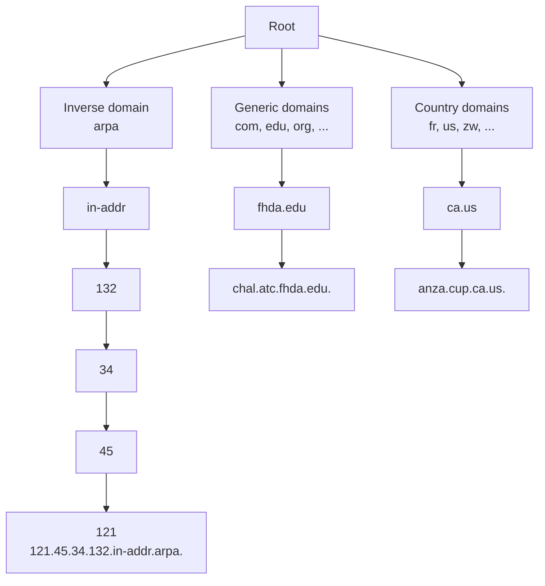

*Figure 7. The three sections of the domain name space in the Internet*

**Generic domains.** The generic domains define registered hosts according to their generic behavior. Each node in the tree defines a domain, which is an index to the domain name space database. Forouzan gives the following 14 labels at the first level of the generic domains section.

| Label | Description | Label | Description |
|:-----|:-----|:-----|:-----|
| aero | Airlines and aerospace companies | int | International organizations |
| biz | Businesses or firms (similar to com) | mil | Military groups |
| com | Commercial organizations | museum | Museums and other nonprofit organizations |
| coop | Cooperative business organizations | name | Personal names (individuals) |
| edu | Educational institutions | net | Network support centers |
| gov | Government institutions | org | Nonprofit organizations |
| info | Information service providers | pro | Professional individual organizations |

*Table 4. Labels of the generic domains*

**Country domains.** The country domains section uses two-character country abbreviations (for example, us for the United States). Second labels can be organizational or more specific national designations; the United States, for example, uses state abbreviations as a subdivision of us (for example, ca.us.). The address anza.cup.ca.us can be read as De Anza College in Cupertino, California, in the United States.

**Inverse domain.** The inverse domain is used to map an address to a name. This happens, for example, when a server receives a request from a client to do a task: the server's list of authorized clients contains only names, while from the received IP packet it knows only the client's IP address. To determine whether the client is on the list, the server has its resolver send a query to a DNS server to map the address to a name. This type of query is called an **inverse query** or a **pointer query (PTR query)**.

To handle pointer queries, the inverse domain was added to the domain name space. Its first-level node is called arpa (for historical reasons), its second level is a single node named in-addr (for inverse address), and the rest of the domain defines IP addresses. The servers that handle the inverse domain are also hierarchical, so the network part of an address must be at a higher level than the subnet part, and the subnet part higher than the host part. In this way, a server serving a whole site is at a higher level than the servers serving each subnet. This makes the inverse domain look inverted compared with a generic or country domain. To follow the convention of reading domain labels from the bottom to the top, an IP address such as 132.34.45.121 is read as 121.45.34.132.in-addr.arpa.

---

<br>

## 4. Name Resolution

Mapping a name to an address or an address to a name is called **name-address resolution**.

### 4.1 Resolvers

DNS is designed as a client-server application. A host that needs to map an address to a name or a name to an address calls a DNS client called a **resolver**. The resolver accesses the closest DNS server with a mapping request. If the server has the information, it satisfies the resolver; otherwise, it either refers the resolver to other servers or asks other servers to provide the information. After the resolver receives the mapping, it interprets the response to see whether it is a real resolution or an error and finally delivers the result to the process that requested it.

In Kurose's terms, an application such as a Web browser or a mail reader invokes the client side of DNS, specifying the hostname to be translated. On many UNIX-based machines, `gethostbyname()` is the function an application calls to perform this translation. DNS in the user's host then sends a query message into the network and, after a delay ranging from milliseconds to seconds, receives a reply message with the desired mapping, which it passes to the application. From the application's perspective, DNS is a black box providing a simple translation service. But the black box is a complex system consisting of a large number of DNS servers distributed around the globe and an application-layer protocol that specifies how DNS servers and querying hosts communicate.

### 4.2 Iterative and Recursive Queries

Let us follow the resolution process with Kurose's example. Suppose the host cse.nyu.edu wants the IP address of gaia.cs.umass.edu. Assume that NYU's local DNS server is dns.nyu.edu and that an authoritative DNS server for gaia.cs.umass.edu is dns.umass.edu.

1. The host cse.nyu.edu first sends a DNS query message to its local DNS server, dns.nyu.edu. The query message contains the hostname to be translated, gaia.cs.umass.edu.
2. The local DNS server forwards the query message to a root DNS server.
3. The root DNS server takes note of the edu suffix and returns to the local DNS server a list of IP addresses for TLD servers responsible for edu.
4. The local DNS server resends the query message to one of these TLD servers.
5. The TLD server takes note of the umass.edu suffix and responds with the IP address of the authoritative DNS server for the University of Massachusetts, dns.umass.edu.
6. The local DNS server resends the query message directly to dns.umass.edu.
7. dns.umass.edu responds with the IP address of gaia.cs.umass.edu.
8. The local DNS server returns this mapping to the requesting host cse.nyu.edu.

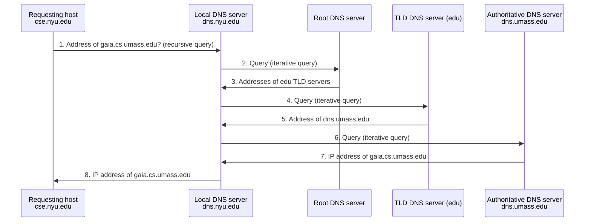

*Figure 8. Interaction of the various DNS servers: one recursive query and three iterative queries*

In this example, eight DNS messages were sent to obtain the mapping for one hostname: four query messages and four reply messages. The caching of Section 4.4 reduces this query traffic.

The example assumed that the TLD server knows the authoritative DNS server for the hostname, which is not always true. The TLD server may know only an intermediate DNS server, which in turn knows the authoritative DNS server. Suppose, for example, that the University of Massachusetts has a DNS server for the whole university, dns.umass.edu, and that each department has its own DNS server, authoritative for all hosts in the department. When the intermediate DNS server dns.umass.edu receives a query for a hostname ending with cs.umass.edu, it returns to dns.nyu.edu the IP address of dns.cs.umass.edu, which is authoritative for all hostnames ending with cs.umass.edu. The local DNS server dns.nyu.edu then sends the query to that authoritative DNS server, which returns the desired mapping to the local DNS server, which in turn returns it to the requesting host. In this case, a total of 10 DNS messages are sent.

The example of Figure 8 uses both recursive and iterative queries.

> **Definition:** A **recursive query** is a query that asks the queried server to obtain the final mapping on behalf of the querying party and return it.

> **Definition:** An **iterative query** is a query to which the queried server directly returns the answer if it knows it, or otherwise the address of the next server to ask, so that the querying party repeats the query to the next server.

The query sent from cse.nyu.edu to dns.nyu.edu is a recursive query, since it asks dns.nyu.edu to obtain the mapping on its behalf. The subsequent three queries are iterative, since all the replies are returned directly to dns.nyu.edu. In theory, any DNS query can be iterative or recursive. The following figure shows a query chain in which all the queries are recursive.

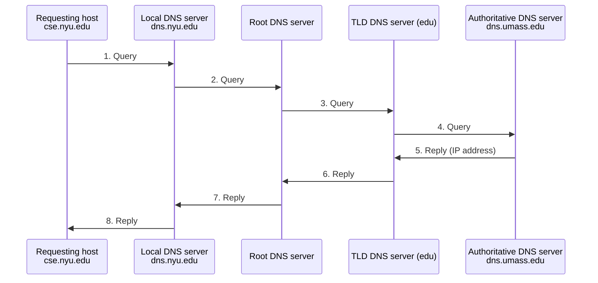

*Figure 9. A query chain in which all queries are recursive*

In practice, queries typically follow the pattern of Figure 8: the query from the requesting host to the local DNS server is recursive, and the remaining queries are iterative.

Forouzan describes the same two methods. In **recursive resolution**, the resolver expects the server to supply the final answer. If the server is the authority for the domain name, it checks its database and responds; otherwise, it sends the request to another server (usually the parent) and waits for the response. When the query is finally resolved, the response travels back until it reaches the requesting client. In **iterative resolution**, a server that is an authority for the name sends the answer; otherwise, it returns to the client the IP address of the server that it thinks can resolve the query, and the client repeats the query to that server. It is called iterative because the client repeats the same query to multiple servers. In Forouzan's example, the resolver queries five servers in turn before it gets an answer from the mcgraw.com server. The difference is that in Forouzan's iterative example the resolver itself repeats the query, while in Kurose's example the local DNS server sends the iterative queries on behalf of the resolver.

> **Key Point:** In practical name resolution, a host sends a recursive query to its local DNS server, and the local DNS server sends iterative queries to the root, TLD, and authoritative DNS servers in turn. With empty caches, resolving one name along this path takes eight messages.

### 4.3 Resolving Addresses to Names

Most of the time, the resolver gives the server a domain name and asks for the corresponding address, and the server looks for the mapping in the generic domains or the country domains. If the domain name belongs to the generic domains section, the resolver receives a name such as "chal.atc.fhda.edu." and asks the local DNS server to resolve it. If the local server cannot resolve the query, it either refers the resolver to other servers or asks other servers directly. The procedure is the same if the domain name belongs to the country domains section, such as "ch.fhda.cu.ca.us.".

Conversely, a client can send an IP address to a server to be mapped to a domain name; this is the PTR query seen earlier. To answer such queries, DNS uses the inverse domain. In the request, the IP address is reversed and the two labels in-addr and arpa are appended to create a domain name acceptable to the inverse domain section. For example, if the resolver receives the IP address 132.34.45.121, it reverses the address, adds the two labels, and sends "121.45.34.132.in-addr.arpa." to the local DNS server for resolution.

The `nslookup` utility in UNIX and Windows can retrieve name and address mappings directly. Kurose explains that with `nslookup` one can send a DNS query to any DNS server (root, TLD, or authoritative) and see the records in the reply in a human-readable format. The following is the output printed by Forouzan: the first retrieves an address from a domain name, and the second retrieves a domain name from an address. In the second output, the address is reversed to become a name under in-addr.arpa.

```text
$ nslookup fhda.edu
Name: fhda.edu
Address: 153.18.8.1

$ nslookup 153.18.8.1
1.8.18.153.in-addr.arpa name = tiptoe.fhda.edu.
```

### 4.4 DNS Caching and TTL

So far we have ignored caching, a critically important feature of the DNS system. In truth, DNS exploits caching extensively to improve delay performance and to reduce the number of DNS messages traveling around the Internet.

> **Definition:** **DNS caching** is a technique in which a DNS server stores the mappings in the replies it receives in a query chain in its local memory and answers later queries for the same name without asking other servers.

The idea behind caching is very simple. In a query chain, when a DNS server receives a DNS reply (containing, for example, a mapping from a hostname to an IP address), it can cache the mapping in its local memory. In Figure 8, for example, each time the local DNS server dns.nyu.edu receives a reply from some DNS server, it can cache any of the information in the reply. If a hostname and IP address pair is cached in a DNS server and another query for the same hostname arrives, the server can provide the desired IP address even if it is not authoritative for the hostname.

For example, suppose the host apricot.nyu.edu queries dns.nyu.edu for the IP address of the hostname cnn.com. If a few hours later another NYU host, kiwi.nyu.edu, queries dns.nyu.edu with the same hostname, the local DNS server can, thanks to caching, immediately return the IP address of cnn.com without querying any other DNS server. A local DNS server can also cache the IP addresses of TLD servers, which allows it to bypass the root DNS servers in a query chain. In fact, because of caching, root servers are bypassed for all but a very small fraction of DNS queries.

Because hosts and mappings are by no means permanent, DNS servers discard cached information after a period of time. Kurose notes that this period is often set to two days. Forouzan points out that caching speeds up resolution but can also be problematic: if a server caches a mapping for a long time, it may send an outdated mapping to the client. Two techniques are used to counter this.

1. The authoritative server always adds to a mapping a piece of information called the **TTL (time to live)**. The TTL defines, in seconds, how long the receiving server can cache the information. After that time, the mapping is invalid, and any query must be sent again to the authoritative server.
2. DNS requires each server to keep a TTL counter for each mapping it caches. The cache memory is searched periodically, and mappings whose TTL has expired are purged.

In addition, when a server answers from its cache, it marks the response as unauthoritative to inform the client that the response comes from the cache memory and not from an authoritative source. This marking is the AA flag of Section 6.2.

> **Key Point:** Caching keeps frequently requested names and the addresses of TLD servers in the local DNS server, eliminating messages to the root and TLD servers. The TTL limits the lifetime of cached mappings so that they do not become too old.

---

<br>

## 5. Resource Records

### 5.1 Resource Records as Four-Tuples

The DNS servers that together implement the DNS distributed database store **resource records (RRs)**, including RRs that provide hostname-to-IP-address mappings. Each DNS reply message carries one or more resource records.

> **Definition:** A **resource record** is the basic unit of information stored in the DNS database and carried in DNS replies, consisting of four values: Name, Value, Type, and TTL.

Kurose describes a resource record as the following four-tuple.

```text
(Name, Value, Type, TTL)
```

TTL is the time to live of the resource record; it determines when the record should be removed from a cache. The example records below ignore the TTL field. The meanings of Name and Value depend on Type.

- **Type = A:** Name is a hostname and Value is the IP address for the hostname. An A record thus provides the standard hostname-to-IP-address mapping. Example: (relay1.bar.foo.com, 145.37.93.126, A)
- **Type = NS:** Name is a domain such as foo.com, and Value is the hostname of an authoritative DNS server that knows how to obtain the IP addresses for hosts in the domain. This record is used to route DNS queries further along the query chain. Example: (foo.com, dns.foo.com, NS)
- **Type = CNAME:** Value is a canonical hostname for the alias hostname Name. This record gives querying hosts the canonical name for a hostname. Example: (foo.com, relay1.bar.foo.com, CNAME)
- **Type = MX:** Value is the canonical name of a mail server that has the alias hostname Name. Example: (foo.com, mail.bar.foo.com, MX)

MX records allow the hostnames of mail servers to have simple aliases. By using the MX record, a company can have the same alias for its mail server and for one of its other servers (such as its Web server). To obtain the canonical name of the mail server, a DNS client queries for an MX record; to obtain the canonical name of the other server, it queries for the CNAME record. In the examples above, for the same name foo.com, the CNAME record points to the Web server relay1.bar.foo.com and the MX record to the mail server mail.bar.foo.com. This MX record is what the SMTP client of Chapter 4 uses to find the recipient's mail server.

| Type | Name | Value | Example |
|:-----|:-----|:-----|:-----|
| A | Hostname | IP address | (relay1.bar.foo.com, 145.37.93.126, A) |
| NS | Domain | Hostname of the authoritative DNS server for the domain | (foo.com, dns.foo.com, NS) |
| CNAME | Alias hostname | Canonical hostname | (foo.com, relay1.bar.foo.com, CNAME) |
| MX | Alias of a mail server | Canonical name of the mail server | (foo.com, mail.bar.foo.com, MX) |

*Table 5. Name and Value of the main resource records*

### 5.2 Records Held by Authoritative and Other Servers

If a DNS server is authoritative for a particular hostname, the server contains an A record for the hostname. Even a server that is not authoritative may contain an A record in its cache. If a server is not authoritative for a hostname, it contains an NS record for the domain that includes the hostname, together with an A record that provides the IP address of the DNS server in the Value field of the NS record.

Suppose, for example, that an edu TLD server is not authoritative for the host gaia.cs.umass.edu. Then this server contains a record for a domain that includes the host, for example (umass.edu, dns.umass.edu, NS). It also contains an A record mapping the DNS server dns.umass.edu to an IP address, for example (dns.umass.edu, 128.119.40.111, A). These two records are exactly the reply the TLD server returned in step 5 of Figure 8. With only the NS record, the local DNS server would have to resolve the name dns.umass.edu again, so the A record must come along for the query to be sent directly to the next server.

### 5.3 Record Type Numbers and Classes

Inside a DNS message, the type of a record is indicated not by its name but by a 16-bit number. The main types given by Forouzan are as follows; the last two types (AXFR and ANY) can only be used in a query.

| Number | Mnemonic | Description |
|:-----|:-----|:-----|
| 1 | A | Address. A 32-bit IPv4 address; converts a domain name to an address |
| 2 | NS | Name server. Identifies the authoritative servers for a zone |
| 5 | CNAME | Canonical name. Defines an alias for the official name of a host |
| 6 | SOA | Start of authority. Marks the beginning of a zone |
| 11 | WKS | Well-known services. Defines the network services that a host provides |
| 12 | PTR | Pointer. Used to convert an IP address to a domain name |
| 13 | HINFO | Host information. Defines the hardware and operating system |
| 15 | MX | Mail exchange. Redirects mail to a mail server |
| 16 | TXT | Descriptive text [1] |
| 28 | AAAA | Address. An IPv6 address (Chapter 24) |
| 252 | AXFR | A request for the transfer of the entire zone |
| 255 | ANY | A request for all records |

*Table 6. Types of resource records*

Besides its type, a record has a 16-bit **class** that indicates the protocol using the record. This chapter is concerned only with class 1 (IN), the Internet.

| Class | Mnemonic | Description |
|:-----|:-----|:-----|
| 1 | IN | Internet |
| 2 | CS | The CSNET class (obsolete) |
| 3 | CH | The CHAOS class |
| 4 | HS | The Hesiod server developed by MIT |

*Table 7. Classes of resource records*

---

<br>

## 6. DNS Messages

### 6.1 Structure of a Message

There are only two kinds of DNS messages, **query** and **response**, and both have the same format. A query message consists of a header and question records; a response message consists of a header, question records, answer records, authoritative records, and additional records.

```text
+--------------------------------+--------------------------------+
| Identification (16 bits)       | Flags (16 bits)                |
+--------------------------------+--------------------------------+  Header
| Number of questions            | Number of answer RRs           |  (12 bytes)
+--------------------------------+--------------------------------+
| Number of authority RRs        | Number of additional RRs       |
+--------------------------------+--------------------------------+
| Questions (variable number of questions)                        |  Question section
+-----------------------------------------------------------------+
| Answers (variable number of RRs)                                |  Answer section
+-----------------------------------------------------------------+
| Authority (variable number of RRs)                              |  Authority section
+-----------------------------------------------------------------+
| Additional information (variable number of RRs)                 |  Additional section
+-----------------------------------------------------------------+
```

*Figure 10. DNS message format*

- **Header:** The first 12 bytes, consisting of several fields (Section 6.2).
- **Question section:** Information about the query being made: a name field containing the name being queried and a type field indicating the type of question asked about the name (for example, A for the host address associated with a name, or MX for the mail server of a name). It is present in both queries and responses.
- **Answer section:** In a response, the resource records for the name originally queried. A hostname can have multiple IP addresses (for example, the replicated Web servers of Section 1.3), so the answer section can contain multiple resource records.
- **Authority section:** Records of other authoritative servers. It gives information (domain names) about one or more authoritative servers for the query.
- **Additional section:** Other helpful records. For example, in a response to an MX query, the answer section contains a resource record giving the canonical hostname of a mail server, and the additional section contains an A record giving the IP address of that canonical hostname. Similarly, a server can give the domain name of an authoritative server in the authority section and the IP address of the same server in the additional section.

### 6.2 Header and Flags

Query and response messages have the same header format, with some fields set to zero in query messages.

- **Identification:** A 16-bit field used by the client to match a response with its query. The client uses a different identification number each time it sends a query, and the server copies the number into the corresponding response.
- **Flags:** A 16-bit field consisting of the subfields below.
- **Number of question records:** A 16-bit field containing the number of queries in the question section.
- **Number of answer records:** A 16-bit field containing the number of answer records in the answer section of a response message; zero in a query message.
- **Number of authoritative records:** A 16-bit field containing the number of records in the authority section of a response message; zero in a query message.
- **Number of additional records:** A 16-bit field containing the number of records in the additional section of a response message; zero in a query message.

```text
bits:  1     4      1    1    1    1     3      4
     +----+--------+----+----+----+----+-----+-------+
     | QR | OpCode | AA | TC | RD | RA | 000 | rCode |
     +----+--------+----+----+----+----+-----+-------+
```

*Figure 11. The flags field*

| Subfield | Bits | Meaning |
|:-----|:-----|:-----|
| QR (query/response) | 1 | Type of message: 0 for a query, 1 for a response |
| OpCode | 4 | Type of query or response: 0 for standard, 1 for inverse, 2 for a server status request |
| AA (authoritative answer) | 1 | 1 if the responding server is an authoritative server for the queried name; used only in responses |
| TC (truncated) | 1 | 1 if the response was more than 512 bytes and truncated to 512; used when DNS uses UDP (Section 7) |
| RD (recursion desired) | 1 | 1 if the client desires a recursive answer; set in the query and copied into the response |
| RA (recursion available) | 1 | 1 if the server supports recursive answers; set only in the response |
| Reserved | 3 | Set to 000 |
| rCode | 4 | Error status of the response |

*Table 8. Subfields of the flags*

Restated in Kurose's terms, QR indicates whether the message is a query (0) or a reply (1); AA is set in a reply when the DNS server is an authoritative server for the queried name; RD is set when a client (host or DNS server) desires that the server perform recursion when it does not have the record; and RA is set in a reply if the server supports recursion. The recursive query of Section 4.2 is requested with the RD bit and granted with the RA bit.

rCode shows the error status of the response, a judgment that only an authoritative server can make.

| Value | Meaning | Value | Meaning |
|:-----|:-----|:-----|:-----|
| 0 | No error | 4 | Query type not supported |
| 1 | Format error | 5 | Administratively prohibited |
| 2 | Problem at name server | 6-15 | Reserved |
| 3 | Domain reference problem | | |

*Table 9. Values of rCode*

### 6.3 Formats of Question Records and Resource Records

DNS uses two kinds of records. **Question records** are used in the question section of query and response messages, and **resource records** are used in the answer, authority, and additional sections of response messages.

**Question record.** A question record is used by the client to get information from a server and contains the domain name.

```text
+---------------------------------------------+
| Query name (variable length)                |
+----------------------+----------------------+
| Query type (16 bits) | Query class (16 bits)|
+----------------------+----------------------+
```

*Figure 12. Question record format*

- **Query name:** A variable-length field containing a domain name. Each label is preceded by a 1-byte count giving the number of characters in the label, and the end of the name is marked by a count of 0, which stands for the null label of the root.
- **Query type:** A 16-bit field defining the type of query, using the numbers of Table 6.
- **Query class:** A 16-bit field defining the protocol using DNS, using the numbers of Table 7.

For example, the query name of admin.atc.fhda.edu is represented in 20 bytes as follows.

```text
+---+-----------+---+-------+---+---------+---+-------+---+
| 5 | a d m i n | 3 | a t c | 4 | f h d a | 3 | e d u | 0 |
+---+-----------+---+-------+---+---------+---+-------+---+
```

*Figure 13. Format of a query name*

**Resource record.** Each node of the domain name space (each domain name) is associated with a resource record, and the server's database consists of resource records. Resource records are also what the server returns to the client.

```text
+-----------------------------------------------+
| Domain name (variable length)                 |
+-----------------------+-----------------------+
| Domain type (16 bits) | Domain class (16 bits)|
+-----------------------+-----------------------+
| Time to live (32 bits)                        |
+-----------------------+-----------------------+
| Resource data length  |
| (16 bits)             |
+-----------------------+-----------------------+
| Resource data (variable length)               |
+-----------------------------------------------+
```

*Figure 14. Resource record format*

- **Domain name:** A variable-length field containing the domain name, usually a repetition of the domain name in the question record. Because DNS requires compression wherever a name is repeated, this field is usually an offset pointer to the domain name in the question record (Section 6.4).
- **Domain type:** The same as the query type field of the question record, except that the last two types, which are used only in queries (AXFR and ANY), are not allowed.
- **Domain class:** The same as the query class field of the question record.
- **TTL (time to live):** A 32-bit field defining the number of seconds the answer is valid. The receiver can cache the answer for this period. A value of zero means that the resource record is used only in a single transaction and is not cached.
- **Resource data length:** A 16-bit field defining the length of the resource data.
- **Resource data:** A variable-length field containing the answer to the query (in the answer section), the domain name of the authoritative server (in the authority section), or additional information (in the additional section). Its format and contents depend on the value of the type field, and it is one of the following.
  - **A number:** Written in octets. For example, an IPv4 address is a 4-octet integer and an IPv6 address a 16-octet integer.
  - **A domain name:** Expressed as a sequence of labels, each preceded by a 1-byte length field giving the number of characters in the label. Since every domain name ends with the null label, the last byte is a length field with the value 0. To distinguish a length field from an offset pointer, the two high-order bits of a length field are always 00. This causes no problem because a label cannot be longer than 63 characters, and 63 fits in 6 bits (111111).
  - **An offset pointer:** A domain name can be replaced with an offset pointer, a 2-byte field whose two high-order bits are both 1 (11).
  - **A character string:** A 1-byte length field followed by the number of characters given in the length field. The length field is not restricted like the domain name length field, and the character string can be as long as 255 characters, including the length field.

### 6.4 Compression

DNS requires that a domain name be replaced by an offset pointer if it is repeated. In a resource record, for example, the domain name is usually a repetition of the domain name in the question record. For efficiency, DNS defines a 2-byte offset pointer that points to a previous occurrence of the domain name or part of it.

```text
+----+------------------------------------------+
| 11 | Address of the beginning byte (offset)   |
+----+------------------------------------------+
 2 bits                  14 bits
```

*Figure 15. Format of an offset pointer*

The two high-order bits, 11, distinguish an offset pointer from a length field. The remaining 14 bits give a byte number in the message, counting from the beginning of the message with the first byte numbered 0. For example, if an offset pointer refers to byte 12 (the 13th byte), its value is as follows.

```math
11\;00000000001100_2 = 1100\,0000\,0000\,1100_2 = \text{0xC00C}
```

Because the header is exactly 12 bytes, the name of the first question record always starts at byte 12. The pointer in a response's answer record that refers to the queried name is therefore often 0xC00C.

### 6.5 Examples of Message Interpretation

**Example 19.1.** A resolver sends a query message to a local server to find the IP address of the host "chal.fhda.edu." and receives a response. The following table shows the two messages side by side, byte by byte. Bytes are numbered from 0 at the beginning of the message.

| Bytes | Field | Query | Response |
|:-----|:-----|:-----|:-----|
| 0-1 | Identification | 0x1333 | 0x1333 |
| 2-3 | Flags | 0x0100 | 0x8180 |
| 4-5 | Number of question records | 1 | 1 |
| 6-7 | Number of answer records | 0 | 1 |
| 8-9 | Number of authoritative records | 0 | 0 |
| 10-11 | Number of additional records | 0 | 0 |
| 12-26 | Query name | 4 'c' 'h' 'a' 'l' 4 'f' 'h' 'd' 'a' 3 'e' 'd' 'u' 0 | Same as the query |
| 27-28 | Query type | 1 (A) | 1 (A) |
| 29-30 | Query class | 1 (IN) | 1 (IN) |
| 31-32 | Domain name | None | 0xC00C (pointer to byte 12) |
| 33-34 | Domain type | None | 1 (A) |
| 35-36 | Domain class | None | 1 (IN) |
| 37-40 | TTL | None | 12000 |
| 41-42 | Resource data length | None | 4 |
| 43-46 | Resource data | None | 153.18.8.105 |

*Table 10. Query and response messages of Example 19.1*

The first 2 bytes of the query are the identifier 0x1333. It is used like a sequence number to relate a response to a query; because a resolver may send many queries to the same server, the identifier helps to sort responses that arrive out of order. The next 2 bytes are the flags, with the value 0x0100. Written in binary and divided into fields, it is as follows.

```text
QR  OpCode  AA  TC  RD  RA  Reserved  rCode
0   0000    0   0   1   0   000       0000
```

QR is 0, so the message is a query; OpCode 0000 defines a standard query; and the RD bit, requesting recursion, is set. There is one question record, and the other counts are 0. The query name, 4chal4fhda3edu0 with the character count before each label, is 15 bytes and starts at byte 12, right after the header. The next 2 bytes define the query type 1 (A, an IP address) and the last 2 bytes the class 1 (Internet). The query message is therefore 12 + 15 + 2 + 2 = 31 bytes long.

The response is similar to the query, except that the flags are different and the number of answer records is 1. Dividing the flags value 0x8180 gives the following.

```text
QR  OpCode  AA  TC  RD  RA  Reserved  rCode
1   0000    0   0   1   1   000       0000
```

QR is 1, so the message is a response; OpCode 0000 defines a standard response; and both RD and RA are set, showing that a recursive answer was provided. AA is 0, so this response came from a server that is not authoritative (for example, a local server with a cache). The question record is repeated from the query message. The answer record begins with the pointer 0xC00C, which refers to the query name at byte 12 instead of repeating the domain name. The next field defines the domain type 1 (address), the one after that the class 1 (Internet), and the next 32 bits the TTL of 12,000 seconds (about 3.3 hours); after the resource data length 4 comes the IP address 153.18.8.105.

The answer record is 2 (pointer) + 2 (type) + 2 (class) + 4 (TTL) + 2 (length) + 4 (address) = 16 bytes, so the response message is 31 + 16 = 47 bytes long. Without compression, repeating the 15-byte name would make the answer record 29 bytes and the response 60 bytes. Even in this short example, compression saves 13 bytes.

**Example 19.2.** An FTP server has received a packet from an FTP client with IP address 153.2.7.9. The FTP server wants to verify that the client is authorized, but its list of authorized clients contains only domain names, and all the server has is the source IP address of the received IP datagram. The FTP server therefore has its resolver send an inverse query to a DNS server asking for the name of the client.

| Bytes | Field | Inverse query | Response |
|:-----|:-----|:-----|:-----|
| 0-1 | Identification | 0x1200 | 0x1200 |
| 2-3 | Flags | 0x0900 | 0x8D80 |
| 4-5 | Number of question records | 1 | 1 |
| 6-7 | Number of answer records | 0 | 1 |
| 8-9 | Number of authoritative records | 0 | 0 |
| 10-11 | Number of additional records | 0 | 0 |
| 12-35 | Query name | 1 '9' 1 '7' 1 '2' 3 '1' '5' '3' 7 'i' 'n' '-' 'a' 'd' 'd' 'r' 4 'a' 'r' 'p' 'a' 0 | Same as the query |
| 36-37 | Query type | 12 (PTR) | 12 (PTR) |
| 38-39 | Query class | 1 (IN) | 1 (IN) |
| 40-41 | Domain name | None | 0xC00C (pointer to byte 12) |
| 42-43 | Domain type | None | 12 (PTR) |
| 44-45 | Domain class | None | 1 (IN) |
| 46-49 | TTL | None | 24000 |
| 50-51 | Resource data length | None | 10 |
| 52-61 | Resource data | None | 4 'm' 'h' 'h' 'e' 3 'c' 'o' 'm' 0 |

*Table 11. Inverse query and response messages of Example 19.2*

The identifier is 0x1200, and the flags of the inverse query are 0x0900.

```text
QR  OpCode  AA  TC  RD  RA  Reserved  rCode
0   0001    0   0   1   0   000       0000
```

OpCode 0001 defines an inverse query. There is one question record, and the query name is the 24 bytes representing "9.7.2.153.in-addr.arpa.". The next 2 bytes define the query type 12 (PTR) and the last 2 bytes the class 1 (Internet).

The flags of the response are 0x8D80.

```text
QR  OpCode  AA  TC  RD  RA  Reserved  rCode
1   0001    1   0   1   1   000       0000
```

The response contains one question record and one answer record. AA is 1, so an authoritative server answered. The answer record refers to the name in the question record with 0xC00C and continues with the domain type 12 (PTR), the class 1 (Internet), and a TTL of 24,000 seconds. The resource data length is 10, and the resource data is the domain name 4mhhe3com0, that is, "mhhe.com.". The inverse query is 12 + 24 + 4 = 40 bytes, and the response is 40 + 22 = 62 bytes.

> **Note:** **PTR queries and OpCode.** That a query maps an address to a name is already evident from its query type, PTR (12), and from its query name, which lies under the inverse domain in-addr.arpa. OpCode is a separate header field indicating the kind of query, and Example 19.2 uses both indications together. As the `nslookup` output of Section 4.3 shows, a name in the inverse domain is resolved down the tree in the same way as any other domain name. RFC 3425 later declared the inverse query of OpCode 1 (IQUERY) entirely obsolete, regarding PTR queries on reverse-mapping records as the preferable approach, so a PTR lookup today is a standard query (OpCode 0) with query type PTR [3].

---

<br>

## 7. Transport Protocols and Encapsulation

Kurose explains that all DNS query and reply messages are sent within UDP datagrams to port 53. Forouzan explains that DNS can use either UDP or TCP and that in both cases the well-known port used by the server is 53.

UDP is used when the size of the response message is less than 512 bytes. Forouzan attributes this to the 512-byte packet size limit of most UDP packages. Indeed, the DNS specification limits DNS messages carried over UDP to 512 octets or less and recommends UDP for standard queries [1]. The later EDNS(0) extension lets a requester advertise in its query the largest UDP payload it can receive, so that responses larger than 512 bytes can also be carried over UDP when both sides support the extension [4]. If the response message is larger than 512 bytes, a TCP connection is used, in one of two scenarios.

- **The resolver knows in advance that the response will exceed 512 bytes:** It uses a TCP connection from the start. For example, when a secondary server, acting as a client, needs a zone transfer from a primary server, it uses a TCP connection because the information transferred usually exceeds 512 bytes. The DNS specification also requires TCP for zone transfers [1].
- **The resolver does not know the size of the response:** It uses the UDP port. If the response is larger than 512 bytes, the server truncates the message and turns on the TC bit [1]. Seeing the TC bit, the resolver opens a TCP connection and repeats the request to get the full response.

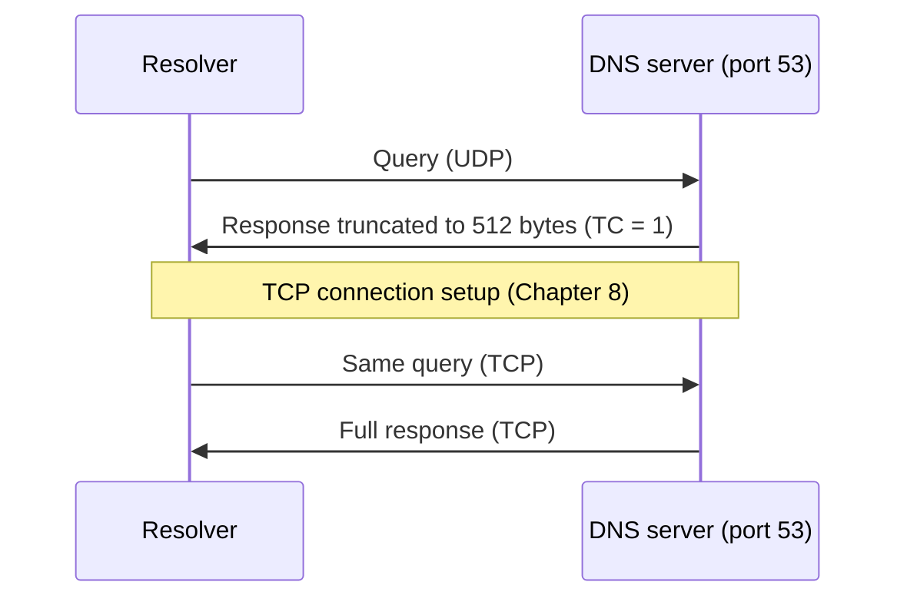

*Figure 16. Querying again over TCP after a truncated UDP response*

UDP completes a name resolution with one query and one response and no connection setup, so it is faster than TCP for small queries and responses. If a query or a response is lost, the resolver simply resends the query after a timeout. Chapter 6 covers the characteristics of UDP, and Chapter 8 covers TCP connection setup.

> **Key Point:** A DNS server uses port 53 for both UDP and TCP. Ordinary queries and responses are exchanged over UDP without connection setup, and TCP is used for responses that exceed the UDP size limit (512 bytes without EDNS(0), signaled by the TC bit) and for zone transfers.

---

<br>

## 8. Registering and Updating Records

### 8.1 Registrars

So far we have seen how records are retrieved from the DNS database. How records get into the database in the first place is examined with Kurose's example. Suppose you have just created a startup company called Network Utopia. The first thing to do is to register the domain name networkutopia.com at a **registrar**. A registrar is a commercial entity that verifies the uniqueness of the domain name, enters the domain name into the DNS database, and collects a small fee for its services. Prior to 1999, a single registrar, Network Solutions, had a monopoly on domain name registration for the com, net, and org domains, but now many registrars compete for customers, and ICANN (Internet Corporation for Assigned Names and Numbers) accredits the registrars.

When registering networkutopia.com, you also need to provide the registrar with the names and IP addresses of your primary and secondary authoritative DNS servers. Suppose these are dns1.networkutopia.com and dns2.networkutopia.com, with 212.212.212.1 and 212.212.212.2. For each of the two authoritative DNS servers, the registrar makes sure that an NS record and an A record are entered into the com TLD servers. For the primary authoritative server for networkutopia.com, for example, the registrar inserts the following two resource records into the DNS system.

```text
(networkutopia.com, dns1.networkutopia.com, NS)
(dns1.networkutopia.com, 212.212.212.1, A)
```

You also have to make sure that the A record for the Web server www.networkutopia.com and the MX record for the mail server mail.networkutopia.com are entered into your authoritative DNS servers. Forouzan describes the same procedure. For example, a new commercial organization named wonderful with a server named ws and IP address 200.200.200.5 must give one of the registrars the domain name ws.wonderful.com and the IP address 200.200.200.5.

### 8.2 Name Resolution with the Registered Records

Once all these steps are completed, people can visit the company's Web site and send e-mail to its employees. Verifying that this is true also helps to consolidate what has been learned so far. Suppose Alice in Australia wants to view the Web page www.networkutopia.com.

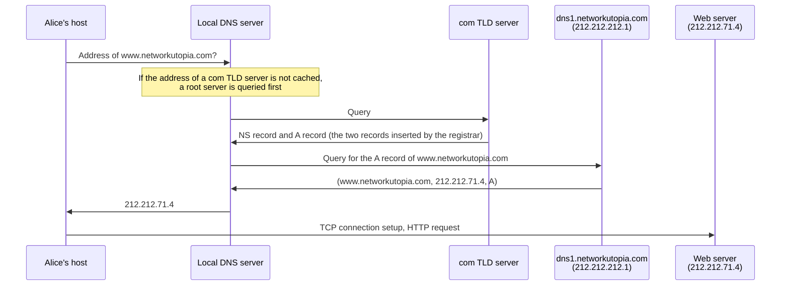

*Figure 17. Resolving www.networkutopia.com with the registered records*

Alice's host first sends a DNS query to her local DNS server. The local DNS server contacts a com TLD server; if the address of a com TLD server is not cached, it must also contact a root DNS server first. Because the registrar had the NS and A records above inserted into all the com TLD servers, the TLD server sends the local DNS server a reply containing these two resource records. The local DNS server then sends a DNS query to 212.212.212.1, asking for the A record of www.networkutopia.com. This record provides the IP address of the desired Web server, say 212.212.71.4, which the local DNS server passes back to Alice's host. Alice's browser can now initiate a TCP connection to the host 212.212.71.4 and send an HTTP request over it. Much more goes on than meets the eye when viewing a single Web page.

### 8.3 DDNS

The contents of each DNS server used to be configured statically, for example from a configuration file created by a system manager. When DNS was designed, no one predicted that addresses would change so often. In DNS, adding a new host, removing a host, or changing an IP address requires the change to be made to the DNS master file, which involves a lot of manual updating. The size of today's Internet does not allow this kind of manual operation, so the DNS master file must be updated dynamically.

The **Dynamic Domain Name System (DDNS)** was devised to meet this need. In DDNS, when a binding between a name and an address is determined, the information is sent, usually by DHCP (Chapter 12), to a primary DNS server, which updates the zone. The secondary servers are notified either actively or passively. In active notification, the primary server sends a message about the change in the zone to the secondary servers; in passive notification, the secondary servers periodically check for any changes. In either case, a secondary server that learns of the change requests the information about the entire zone (a zone transfer). To prevent unauthorized changes, DDNS can use an authentication mechanism. Kurose notes that an UPDATE option has been added to the DNS protocol to allow data to be dynamically added to or deleted from the database via DNS messages, and that RFC 2136 and RFC 3007 specify these dynamic updates.

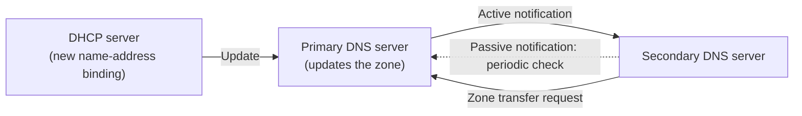

*Figure 18. Operation of DDNS*

---

<br>

## 9. DNS Security

DNS is a critical component of the Internet infrastructure, and many important services, including the Web and e-mail, cannot function without it. This section examines how DNS can be attacked.

**DDoS attacks.** The first type of attack that comes to mind is a DDoS bandwidth-flooding attack (Chapter 1) against DNS servers. For example, an attacker could send a deluge of packets to each DNS root server, so many that the majority of legitimate DNS queries never get answered. Kurose reports that such a large-scale DDoS attack against the DNS root servers actually took place on October 21, 2002. The attackers leveraged a botnet to send large volumes of ICMP ping messages (Chapter 16) to each of the 13 DNS root IP addresses. The attack caused minimal damage, having little or no impact on users' Internet experience. The attackers did succeed in directing a deluge of packets at the root servers, but many root servers were protected by packet filters configured to always block ICMP ping messages directed at them and thus functioned normally. In addition, most local DNS servers cache the IP addresses of TLD servers, so the query process often bypassed the root servers.

A potentially more effective DDoS attack would send a deluge of DNS queries to TLD servers, for example to all the TLD servers that handle the .com domain. DNS queries directed at DNS servers are harder to filter, and TLD servers are not as easily bypassed as root servers. Even so, caching in local DNS servers partially mitigates the severity of such an attack.

**Man-in-the-middle and DNS poisoning.** In a **man-in-the-middle attack**, the attacker intercepts queries from hosts and returns bogus replies. In a **DNS poisoning attack**, the attacker sends bogus replies to a DNS server, tricking the server into accepting bogus records into its cache. Either attack could be used, for example, to redirect an unsuspecting Web user to the attacker's Web site. These attacks, however, are difficult to implement, as they require intercepting packets or throttling servers. Kurose concluded that, as of 2016, DNS had demonstrated itself to be surprisingly robust against attacks and that no attack had yet successfully impeded the DNS service.

Forouzan classifies the attacks on DNS into three kinds and gives the protection each requires.

| Attack | Description | Protection needed |
|:-----|:-----|:-----|
| Reading responses | Reading the responses of a DNS server to learn the nature or names of the sites a user mostly accesses, building the user's profile | Confidentiality of DNS messages |
| Intercepting and forging responses | Intercepting a DNS server's response and changing it, or creating a totally new bogus response, to direct the user to the site or domain the attacker wishes | Message origin authentication and message integrity |
| Flooding | Flooding a DNS server to overwhelm it or eventually crash it | Provision against denial-of-service attacks |

*Table 12. Attacks on DNS and the protection needed*

To protect DNS, the IETF devised a technology named **DNSSEC (DNS Security)**. DNSSEC provides message origin authentication and message integrity using a security service called digital signature. DNSSEC, however, does not provide confidentiality for DNS messages, and its specification has no specific protection against denial-of-service attacks. The caching system does, to some extent, protect the upper-level servers against such attacks.

> **[Information Security]** A **digital signature** is a technique in which the sender creates a value for a message with a private key only it holds, and anyone verifies the value with the corresponding public key, which anyone can obtain. A successful verification confirms that the message came from the sender holding that private key (origin authentication) and was not changed in transit (integrity). A signature does not hide the content of a message, so confidentiality must be provided by separate encryption. Chapter 26 covers public-key cryptography and digital signatures.

---

<br>

## Summary

| Concept | Key Summary |
|:-----|:-----|
| DNS | A distributed hierarchical database that translates hostnames into IP addresses, and the application-layer protocol for querying it. |
| Services of DNS | It provides name-to-address translation, host aliasing, mail server aliasing, and load distribution with rotated sets of addresses. |
| Domain name space | An inverted tree of at most 128 levels, with labels of at most 63 characters; a domain name joins the labels from a node up to the root with periods. |
| FQDN and PQDN | An FQDN includes the null label of the root and ends with a period, and a resolver turns a PQDN into an FQDN by adding a suffix. |
| Domain and zone | A domain is a subtree, and a zone is the part for which one server is responsible, smaller than the domain when there is delegation. |
| Primary and secondary servers | The primary server creates and updates the zone file, the secondary receives a copy by zone transfer, and both are authoritative. |
| DNS server hierarchy | Root servers give the addresses of TLD servers, TLD servers the addresses of authoritative servers, and authoritative servers the final records. |
| Local DNS server | Run by an ISP, it receives hosts' recursive queries, sends iterative queries into the hierarchy, and caches the results. |
| Domains of the Internet | The name space is divided into the generic domains, the country domains, and the inverse domain (in-addr.arpa) that maps addresses to names. |
| Iterative and recursive queries | In a recursive query the server obtains the final answer on the client's behalf, and in an iterative query it returns the address of the next server. |
| DNS caching and TTL | Received mappings are cached for their TTL to bypass root and TLD servers, and they are purged when the TTL expires. |
| Resource record | It consists of (Name, Value, Type, TTL), with types such as A, NS, CNAME, and MX indicated by numbers. |
| DNS message | Queries and responses share one format: a 12-byte header (identifier, flags, four counts) and the question, answer, authority, and additional sections. |
| Compression | A repeated domain name is replaced by a 2-byte offset pointer whose two high-order bits are 11, and the pointer to the query name is often 0xC00C. |
| Transport | Both UDP and TCP use port 53, and TCP is used for responses exceeding the UDP size limit (512 bytes without EDNS(0)) and for zone transfers. |
| Registration and DDNS | A registrar inserts NS and A records into the TLD servers, and DDNS updates zones dynamically with changes reported by DHCP. |
| DNS security | DNS faces DDoS, man-in-the-middle, and poisoning threats; DNSSEC provides origin authentication and integrity with digital signatures but not confidentiality. |

---

<br>

## Self-Check Questions

1. **Messages in iterative resolution:** With all DNS server caches empty, find the number of DNS messages needed for the host cse.nyu.edu to obtain the address of gaia.cs.umass.edu through its local DNS server dns.nyu.edu. How does the number change if the umass.edu server is an intermediate server and dns.cs.umass.edu is the authoritative server?

   <details>
   <summary>Answer</summary>

   There are 2 messages (query and reply) between the host and the local server, 2 between the local server and the root server, 2 between the local server and the edu TLD server, and 2 between the local server and dns.umass.edu, for a total of 8. With the intermediate server, the local server queries dns.cs.umass.edu once more and receives a reply, adding 2 messages for a total of 10.

   </details>

2. **Caching TLD server addresses:** After Question 1, suppose only the address of the edu TLD server remains in the local DNS server's cache. How many messages are needed when another NYU host queries the Web server www.someschool.edu of another university? How many are needed if the same host queries gaia.cs.umass.edu again while that mapping is still cached?

   <details>
   <summary>Answer</summary>

   The local server skips the root server and queries the cached edu TLD server directly. With 2 messages between the host and the local server, 2 between the local server and the TLD server, and 2 between the local server and the authoritative server for someschool.edu, 6 messages are needed. If the mapping of gaia.cs.umass.edu is still cached, the local server answers immediately, so only the 2 messages between the host and the local server are needed.

   </details>

3. **Finding a mail server:** An SMTP client wants to send mail to bob@networkutopia.com. What type of resource record must it query, and can it open a TCP connection with that response alone?

   <details>
   <summary>Answer</summary>

   It queries the MX record for networkutopia.com. The Value of the MX record is the canonical name of the mail server (for example, mail.networkutopia.com), so to open a TCP connection the client also needs the IP address from the A record for that name. If the server includes that A record in the additional section of the response, the client can connect without another query; otherwise, it must query the A record for the canonical name once more.

   </details>

4. **Use of UDP and TCP:** Explain why DNS uses UDP for ordinary queries but TCP for zone transfers. What does a resolver do when it does not know the size of the response in advance?

   <details>
   <summary>Answer</summary>

   Ordinary queries and responses are small enough to fit in one UDP datagram, and they complete with one query and one response without connection setup, which is fast. A zone transfer moves the information of an entire zone, which usually exceeds 512 bytes and must be transferred reliably, so it uses TCP. When the size is unknown, the resolver first queries over UDP; if the response exceeds 512 bytes and a truncated response with the TC bit set arrives, it opens a TCP connection and repeats the same query.

   </details>

5. **Delay with DNS and the transport protocol:** The round-trip time (RTT) between a client and a DNS server is 40 ms, and the query and the response each fit in one packet. Ignoring processing and transmission time, find the minimum time from when the client decides to send the query until it receives the response, for UDP and for TCP.

   <details>
   <summary>Answer</summary>

   UDP sends the query immediately without connection setup, so it takes 1 RTT = 40 ms. TCP must establish a connection before the query (the three-way handshake of Chapter 8), and the exchange of SYN and SYN+ACK takes 1 RTT. The client can send the query together with the third segment, the ACK, so the query and response take one more RTT, for a minimum of 2 RTT = 80 ms. Segments for connection termination are also exchanged afterward. This is why DNS uses UDP for small queries and responses.

   </details>

6. **Interpreting flags:** The flags of a DNS response are 0x8580. Find the value of each subfield and describe the nature of the response.

   <details>
   <summary>Answer</summary>

   In binary, 0x8580 is 1000 0101 1000 0000. Divided into fields, QR = 1, OpCode = 0000, AA = 1, TC = 0, RD = 1, RA = 1, Reserved = 000, and rCode = 0000. It is therefore a response to a standard query from a server that is authoritative for the name; the client desired recursion and the server supports it, and the response is neither truncated nor in error.

   </details>

7. **Inverse domain and pointers:** What is the query name of a PTR query for the name of the IP address 153.18.8.105? If the answer record of the response begins with 0xC00C instead of repeating the name, what does this value mean?

   <details>
   <summary>Answer</summary>

   Reversing the four parts of the address and appending in-addr and arpa gives 105.8.18.153.in-addr.arpa. In binary, 0xC00C is 11 00000000001100: the two high-order bits 11 mark an offset pointer, and the remaining 14 bits are 12. It means that the name of the question record, which starts at byte 12 of the message right after the header, is to be used again.

   </details>

---

<br>

## References

1. P. Mockapetris, "Domain Names - Implementation and Specification," RFC 1035, Nov. 1987. [Online]. Available: https://www.rfc-editor.org/rfc/rfc1035
2. Root Server Technical Operations Association, "Root Servers." [Online]. Available: https://root-servers.org/ (accessed Nov. 18, 2026).
3. D. Lawrence, "Obsoleting IQUERY," RFC 3425, Nov. 2002. [Online]. Available: https://www.rfc-editor.org/rfc/rfc3425
4. J. Damas, M. Graff, and P. Vixie, "Extension Mechanisms for DNS (EDNS(0))," RFC 6891, Apr. 2013. [Online]. Available: https://www.rfc-editor.org/rfc/rfc6891
