# 6장 — 전송 계층 서비스와 UDP

[레포지토리 안내](../../README.ko.md) | [English](Concepts_Lecture.md) | [한국어](Concepts_Lecture.ko.md)

> **최종 수정일:** 2026-11-26
>
> Computer Networking: A Top-Down Approach, Kurose and Ross, Ch 3; TCP/IP Protocol Suite, Forouzan, Ch 13, 14

> **학습 목표:**
> 1. 전송 계층이 네트워크 계층 위에서 제공하는 논리적 통신과 두 계층의 관계를 설명할 수 있다
> 2. 포트 번호와 소켓 주소로 프로세스를 식별하는 방식을 설명하고 포트 번호의 범위를 구분할 수 있다
> 3. UDP와 TCP의 다중화, 역다중화 방식의 차이를 소켓 식별자로 설명할 수 있다
> 4. 비연결형 서비스와 연결형 서비스를 비교할 수 있다
> 5. UDP 사용자 데이터그램의 헤더를 해석하고 의사 헤더를 포함한 체크섬을 계산할 수 있다
> 6. UDP가 제공하는 서비스와 제공하지 않는 서비스를 근거로 응용에 맞는 전송 프로토콜을 고를 수 있다

---

## 목차

- [1. 전송 계층의 역할](#1-전송-계층의-역할)
  - [1.1 논리적 통신](#11-논리적-통신)
  - [1.2 전송 계층과 네트워크 계층의 관계](#12-전송-계층과-네트워크-계층의-관계)
  - [1.3 인터넷의 전송 계층 개요](#13-인터넷의-전송-계층-개요)
- [2. 프로세스 간 통신과 포트 번호](#2-프로세스-간-통신과-포트-번호)
  - [2.1 호스트 간 통신과 프로세스 간 통신](#21-호스트-간-통신과-프로세스-간-통신)
  - [2.2 포트 번호](#22-포트-번호)
  - [2.3 포트 번호의 범위](#23-포트-번호의-범위)
  - [2.4 소켓 주소](#24-소켓-주소)
  - [2.5 잘 알려진 포트](#25-잘-알려진-포트)
- [3. 다중화와 역다중화](#3-다중화와-역다중화)
  - [3.1 다중화와 역다중화의 개념](#31-다중화와-역다중화의-개념)
  - [3.2 비연결형 다중화와 역다중화](#32-비연결형-다중화와-역다중화)
  - [3.3 연결형 다중화와 역다중화](#33-연결형-다중화와-역다중화)
  - [3.4 웹 서버와 TCP 소켓](#34-웹-서버와-tcp-소켓)
- [4. 비연결형 서비스와 연결형 서비스](#4-비연결형-서비스와-연결형-서비스)
  - [4.1 비연결형 서비스](#41-비연결형-서비스)
  - [4.2 연결형 서비스](#42-연결형-서비스)
  - [4.3 유한 상태 기계로 본 두 서비스](#43-유한-상태-기계로-본-두-서비스)
  - [4.4 두 서비스의 비교](#44-두-서비스의-비교)
- [5. UDP 개요](#5-udp-개요)
  - [5.1 UDP의 위치와 성격](#51-udp의-위치와-성격)
  - [5.2 UDP를 선택하는 이유](#52-udp를-선택하는-이유)
  - [5.3 혼잡 제어가 없다는 문제](#53-혼잡-제어가-없다는-문제)
- [6. 사용자 데이터그램 형식](#6-사용자-데이터그램-형식)
  - [6.1 헤더 형식](#61-헤더-형식)
  - [6.2 길이 필드와 최대 데이터 크기](#62-길이-필드와-최대-데이터-크기)
  - [6.3 헤더 해석 예](#63-헤더-해석-예)
- [7. UDP 서비스](#7-udp-서비스)
  - [7.1 프로세스 간 통신과 비연결형 서비스](#71-프로세스-간-통신과-비연결형-서비스)
  - [7.2 흐름 제어, 오류 제어, 혼잡 제어](#72-흐름-제어-오류-제어-혼잡-제어)
  - [7.3 캡슐화와 역캡슐화](#73-캡슐화와-역캡슐화)
  - [7.4 큐잉](#74-큐잉)
  - [7.5 UDP의 다중화와 역다중화](#75-udp의-다중화와-역다중화)
  - [7.6 단순 프로토콜과의 비교](#76-단순-프로토콜과의-비교)
- [8. UDP 체크섬](#8-udp-체크섬)
  - [8.1 1의 보수 합과 체크섬](#81-1의-보수-합과-체크섬)
  - [8.2 16비트 워드 세 개의 계산 예](#82-16비트-워드-세-개의-계산-예)
  - [8.3 의사 헤더](#83-의사-헤더)
  - [8.4 의사 헤더를 포함한 계산 예](#84-의사-헤더를-포함한-계산-예)
  - [8.5 체크섬의 선택적 사용](#85-체크섬의-선택적-사용)
  - [8.6 종단 간 오류 검출이 필요한 이유](#86-종단-간-오류-검출이-필요한-이유)
- [9. UDP 응용](#9-udp-응용)
  - [9.1 응용 설계에서 본 UDP의 특성](#91-응용-설계에서-본-udp의-특성)
  - [9.2 응용 사례로 본 선택](#92-응용-사례로-본-선택)
  - [9.3 대표적인 UDP 응용](#93-대표적인-udp-응용)
  - [9.4 UDP와 TCP의 비교](#94-udp와-tcp의-비교)
- [10. UDP 패키지](#10-udp-패키지)
  - [10.1 구성 요소](#101-구성-요소)
  - [10.2 동작 예](#102-동작-예)
- [개념 적용](#개념-적용)
- [요약](#요약)
- [점검 문제](#점검-문제)
- [참고 문헌](#참고-문헌)

---

<br>

## 1. 전송 계층의 역할

### 1.1 논리적 통신

**전송 계층(transport layer)** 은 응용 계층과 네트워크 계층 사이에 위치한다. 전송 계층은 아래의 네트워크 계층으로부터 서비스를 받아, 위의 응용 계층에 서비스를 제공한다. 네트워크 계층 프로토콜인 IP는 메시지를 목적지 컴퓨터까지만 전달할 수 있으며, 그 컴퓨터 안에서 메시지를 받아야 할 올바른 프로세스에 넘기는 일은 전송 계층이 맡는다.

> **용어 정의:** **논리적 통신(logical communication)** 은 응용의 관점에서 서로 다른 호스트의 두 프로세스가 마치 직접 연결된 것처럼 통신하는 것을 말한다. 실제로는 두 호스트가 지구 반대편에 있고 수많은 라우터와 다양한 종류의 링크를 거치더라도, 응용 프로세스는 그 물리적 기반 구조를 신경 쓰지 않고 메시지를 주고받는다.

전송 계층 프로토콜은 종단 시스템(end system)에만 구현되고 네트워크 안의 라우터에는 구현되지 않는다. 송신 측 전송 계층은 응용 프로세스에게서 받은 메시지를 필요하면 작은 조각으로 나누고, 각 조각에 전송 계층 헤더를 붙여 전송 계층 패킷을 만든다. 인터넷 용어로 이 패킷을 **세그먼트(segment)** 라고 한다. 세그먼트는 네트워크 계층에서 데이터그램에 캡슐화되어 목적지로 보내지며, 수신 측 네트워크 계층은 데이터그램에서 세그먼트를 꺼내 전송 계층으로 올린다. 라우터는 데이터그램의 네트워크 계층 필드만 보고 동작하며, 그 안에 캡슐화된 세그먼트의 필드는 들여다보지 않는다.

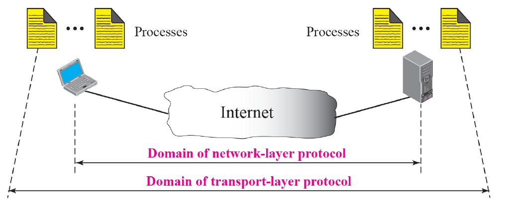

*그림 1. 네트워크 계층 프로토콜과 전송 계층 프로토콜이 담당하는 범위*

그림 1에서 네트워크 계층 프로토콜의 범위는 두 컴퓨터 사이(호스트 간)에서 끝나고, 전송 계층 프로토콜의 범위는 양쪽 컴퓨터 안의 프로세스까지(프로세스 간) 뻗어 있다.

> **참고:** **용어의 차이.** 인터넷 문서(RFC)는 TCP의 패킷을 세그먼트, UDP의 패킷을 데이터그램이라고 부르는 경우가 많다. 그런데 네트워크 계층 패킷도 데이터그램이라고 부르므로 혼동이 생긴다. Kurose와 Ross의 교재는 전송 계층 패킷을 모두 세그먼트라고 부르고 데이터그램이라는 말은 네트워크 계층 패킷에만 쓴다. Forouzan의 교재는 UDP 패킷을 사용자 데이터그램(user datagram), TCP 패킷을 세그먼트라고 부른다. 이 노트는 UDP를 다루는 절에서는 사용자 데이터그램, 일반적인 설명과 TCP에서는 세그먼트라는 말을 쓴다.

### 1.2 전송 계층과 네트워크 계층의 관계

전송 계층 프로토콜은 서로 다른 호스트에서 실행되는 **프로세스** 사이의 논리적 통신을 제공하고, 네트워크 계층 프로토콜은 **호스트** 사이의 논리적 통신을 제공한다. 이 미묘한 차이는 두 집안 사이의 편지 교환에 비유하면 이해하기 쉽다.

동부와 서부에 한 집씩 있고, 각 집에는 아이가 열두 명씩 산다. 두 집의 아이들은 사촌 사이이며, 아이마다 매주 상대 집의 사촌 모두에게 편지를 한 통씩 쓴다. 따라서 한 집에서 다른 집으로 매주 12 × 12 = 144통의 편지가 간다. 서부 집에서는 Ann이, 동부 집에서는 Bill이 형제자매의 편지를 모아 우편 집배원에게 건네고, 도착한 편지를 형제자매에게 나누어 준다.

| 비유 | 네트워크 |
|:-----|:-----|
| 봉투에 담긴 편지 | 응용 메시지 |
| 사촌 (아이 한 명) | 프로세스 |
| 집 | 호스트 (종단 시스템) |
| Ann과 Bill | 전송 계층 프로토콜 |
| 우편 서비스 (집배원 포함) | 네트워크 계층 프로토콜 |

*표 1. 두 집안의 편지 교환 비유와 네트워크의 대응*

우편 서비스는 집에서 집으로 편지를 옮길 뿐 사람에게 직접 전달하지 않는다. 사람 사이의 논리적 통신은 Ann과 Bill이 제공한다. Ann과 Bill은 각자의 집 안에서만 일하며 중간 우체국의 분류 작업에는 관여하지 않는다. 이와 같이 전송 계층 프로토콜은 종단 시스템 안에서 메시지를 응용 프로세스와 네트워크 가장자리(네트워크 계층) 사이에서 옮길 뿐, 네트워크 코어 안에서 메시지가 어떻게 이동하는지에는 관여하지 않는다.

Ann과 Bill이 휴가를 가서 더 어린 Susan과 Harvey가 대신 일한다고 가정한다. 두 아이는 편지를 덜 자주 모으고 가끔 잃어버리기도 한다. 즉 Susan과 Harvey는 Ann과 Bill과 다른 서비스 모델을 제공한다. 마찬가지로 한 네트워크가 서비스 모델이 서로 다른 전송 프로토콜을 여러 개 제공할 수 있다.

Ann과 Bill이 제공할 수 있는 서비스는 우편 서비스가 제공하는 서비스에 제약을 받는다. 우편 서비스가 배달 시간의 상한을 보장하지 않으면 Ann과 Bill도 사촌 사이의 편지 배달 시간을 보장할 수 없다. 마찬가지로 네트워크 계층이 지연이나 대역폭을 보장하지 않으면 전송 계층도 프로세스 사이의 메시지에 대해 그것을 보장할 수 없다. 그러나 네트워크 계층이 제공하지 않는 서비스라도 전송 계층이 제공할 수 있는 것이 있다. 네트워크 계층이 패킷을 잃어버리거나 손상시키거나 중복시키더라도 전송 계층은 신뢰적 데이터 전송을 제공할 수 있으며(7장, 8장), 네트워크 계층이 기밀성을 보장하지 않더라도 전송 계층은 암호화로 메시지를 보호할 수 있다(26장).

> **핵심:** 네트워크 계층은 호스트 사이의 논리적 통신을, 전송 계층은 프로세스 사이의 논리적 통신을 제공한다. 전송 계층의 서비스는 네트워크 계층의 서비스 모델에 제약을 받지만, 신뢰성이나 기밀성처럼 네트워크 계층에 없는 서비스를 그 위에 쌓을 수도 있다.

### 1.3 인터넷의 전송 계층 개요

인터넷의 네트워크 계층 프로토콜인 IP는 **최선형 전달 서비스(best-effort delivery service)** 를 제공한다. IP는 세그먼트를 전달하려고 최선을 다하지만 전달 자체, 전달 순서, 데이터의 무결성 가운데 어느 것도 보장하지 않으므로 비신뢰적 서비스라고 한다. 모든 호스트에는 적어도 하나의 IP 주소가 있다(12장).

인터넷은 응용 계층에 두 가지 전송 계층 프로토콜을 제공한다. 응용 개발자는 소켓을 만들 때 둘 가운데 하나를 고른다.

- **UDP(User Datagram Protocol)** 는 비신뢰적이고 비연결형인 서비스를 제공한다. UDP가 제공하는 서비스는 프로세스 간 데이터 전달과 오류 검사의 두 가지뿐이다.
- **TCP(Transmission Control Protocol)** 는 신뢰적이고 연결형인 서비스를 제공한다. TCP는 흐름 제어, 순서 번호, 확인 응답, 타이머를 이용하여 데이터를 송신 프로세스에서 수신 프로세스로 정확하게, 순서대로 전달한다. TCP는 또한 혼잡 제어를 제공한다.

IP가 제공하는 호스트 간 전달을 프로세스 간 전달로 확장하는 일을 전송 계층의 다중화와 역다중화라고 한다(3절). 혼잡 제어는 응용 하나에 제공하는 서비스라기보다 인터넷 전체를 위한 서비스이다. TCP 혼잡 제어는 한 연결이 경로상의 링크와 라우터를 지나친 트래픽으로 압도하지 못하게 하며, 혼잡한 링크를 지나는 연결들이 대역폭을 고르게 나누어 쓰도록 송신 속도를 조절한다(9장). UDP 트래픽에는 이런 조절이 없어서, UDP를 쓰는 응용은 원하는 속도로 원하는 만큼 보낼 수 있다.

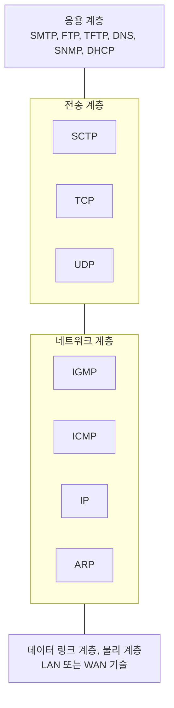

*그림 2. TCP/IP 프로토콜 스위트에서 전송 계층 프로토콜의 위치*

> **참고:** **SCTP.** 그림 2의 SCTP(Stream Control Transmission Protocol)는 UDP와 TCP의 특징을 결합한 세 번째 전송 계층 프로토콜로, Forouzan의 교재가 한 장(16장)을 할애해 다룬다. 이 노트는 인터넷에서 널리 쓰이는 UDP와 TCP만 다룬다.

---

<br>

## 2. 프로세스 간 통신과 포트 번호

### 2.1 호스트 간 통신과 프로세스 간 통신

> **용어 정의:** **프로세스 간 통신(process-to-process communication)** 은 한 호스트에서 실행되는 응용 프로세스가 다른 호스트에서 실행되는 응용 프로세스와 데이터를 주고받는 것을 말한다. 프로세스는 전송 계층의 서비스를 이용하는 응용 계층의 개체, 즉 실행 중인 프로그램이다.

네트워크 계층은 컴퓨터 수준의 통신, 즉 호스트 간 통신을 맡는다. 네트워크 계층 프로토콜은 메시지를 목적지 컴퓨터까지만 전달하므로 이 전달은 아직 불완전하다. 메시지를 그 컴퓨터의 올바른 프로세스에 넘기는 일이 남아 있으며, 이것이 전송 계층 프로토콜의 첫 번째 임무인 프로세스 간 통신이다.

프로세스 간 통신을 구현하는 방법은 여러 가지가 있지만 가장 흔한 것은 **클라이언트-서버 패러다임**이다. 로컬 호스트의 프로세스인 **클라이언트**는 보통 원격 호스트에서 실행되는 프로세스인 **서버**에게 서비스를 요청한다. 예를 들어 원격 컴퓨터에서 날짜와 시각을 받아 오려면 로컬 호스트에서 Daytime 클라이언트 프로세스가, 원격 컴퓨터에서 Daytime 서버 프로세스가 실행되어야 한다. 오늘날의 운영체제는 다중 사용자와 다중 프로그래밍을 지원하므로, 원격 컴퓨터 하나가 서버 프로그램 여러 개를 동시에 실행할 수 있고 로컬 컴퓨터도 클라이언트 프로그램 여러 개를 동시에 실행할 수 있다. 따라서 통신하려면 다음 네 가지를 모두 정해야 한다.

1. 로컬 호스트
2. 로컬 프로세스
3. 원격 호스트
4. 원격 프로세스

로컬 호스트와 원격 호스트는 IP 주소로 정한다. 프로세스를 정하려면 두 번째 식별자인 포트 번호가 필요하다.

### 2.2 포트 번호

> **용어 정의:** **포트 번호(port number)** 는 한 호스트 안에서 전송 계층 서비스를 이용하는 프로세스를 식별하는 16비트 정수이다. 값의 범위는 0부터 65,535까지이다.

클라이언트 프로그램은 자신을 임시 포트 번호로 식별한다.

> **용어 정의:** **임시 포트 번호(ephemeral port number)** 는 클라이언트 프로세스가 통신하는 동안만 쓰도록 운영체제가 골라 주는 포트 번호이다. 클라이언트의 수명은 보통 짧으므로 "짧게 사는"이라는 뜻의 ephemeral이라는 이름이 붙었다.

서버 프로세스도 포트 번호로 자신을 식별해야 한다. 그런데 서버의 포트 번호를 임의로 고르면 서버에 접속하려는 클라이언트가 그 번호를 알 방법이 없다. 서버에 포트 번호를 묻는 특별한 패킷을 보내는 방법도 있지만 부담이 커진다. 그래서 TCP/IP는 서버에 모두가 아는 고정 번호를 쓰기로 했으며, 이를 **잘 알려진 포트 번호(well-known port number)** 라고 한다. 모든 클라이언트 프로세스는 자신이 접속할 서버 프로세스의 잘 알려진 포트 번호를 알고 있다. 예를 들어 Daytime 클라이언트는 임시 포트 번호 52,000을 쓸 수 있지만 Daytime 서버는 반드시 잘 알려진 포트 번호 13을 쓴다.

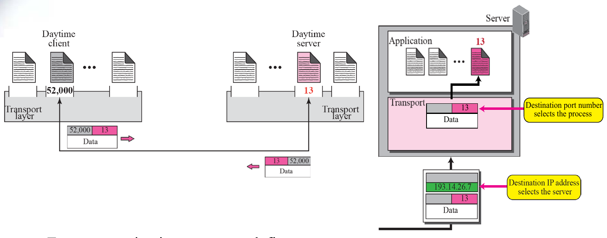

*그림 3. Daytime 클라이언트와 서버의 포트 번호, 그리고 IP 주소와 포트 번호의 역할 분담*

그림 3의 왼쪽은 클라이언트가 보내는 요청의 헤더에 출발지 포트 52,000과 목적지 포트 13이 들어가고, 서버의 응답에는 두 번호가 뒤바뀌어 들어가는 모습을 보여 준다. 오른쪽은 목적지 IP 주소(193.14.26.7)가 전 세계의 호스트 가운데 서버 하나를 고르고, 호스트가 정해진 뒤에는 목적지 포트 번호(13)가 그 호스트 안의 프로세스 하나를 고른다는 것을 보여 준다.

### 2.3 포트 번호의 범위

ICANN은 포트 번호를 세 범위로 나누었다.

| 범위 | 이름 | 관리 방식 |
|:-----|:-----|:-----|
| 0\~1,023 | 잘 알려진 포트 (well-known) | ICANN이 할당하고 관리 |
| 1,024\~49,151 | 등록 포트 (registered) | ICANN이 할당하거나 관리하지 않으며, 중복을 막기 위해 ICANN에 등록만 가능 |
| 49,152\~65,535 | 동적 또는 사설 포트 (dynamic, private) | 관리하지도 등록하지도 않으며, 임시 포트나 사설 포트로 사용 가능 |

*표 2. ICANN이 정한 포트 번호의 세 범위*

원래는 클라이언트의 임시 포트 번호를 동적 범위에서 고르도록 권고했지만, 대부분의 시스템은 이 권고를 따르지 않는다. 일부 클라이언트-서버 프로그램이 올바르게 동작하려면 임시 포트 번호는 1,023보다 커야 한다. Kurose와 Ross의 교재는 UDP 소켓을 만들 때 전송 계층이 그 호스트에서 쓰이지 않는 1,024\~65,535 범위의 포트 번호를 자동으로 할당한다고 설명한다.

### 2.4 소켓 주소

> **용어 정의:** **소켓 주소(socket address)** 는 IP 주소와 포트 번호의 조합이다. 클라이언트 소켓 주소는 클라이언트 프로세스를, 서버 소켓 주소는 서버 프로세스를 전 세계에서 하나로 식별한다.

```text
IP address:      200.23.56.8
Port number:     69
Socket address:  200.23.56.8:69
```

*그림 4. IP 주소와 포트 번호를 결합한 소켓 주소*

전송 계층 서비스를 이용하려면 클라이언트 소켓 주소와 서버 소켓 주소의 한 쌍, 즉 네 개의 정보가 필요하다. 이 가운데 IP 주소 두 개는 네트워크 계층 패킷의 헤더(IP 헤더)에, 포트 번호 두 개는 전송 계층 패킷의 헤더(UDP 헤더나 TCP 헤더)에 들어 있다.

> **[시스템프로그래밍]** 시스템프로그래밍에서 다루는 소켓 인터페이스는 응용 프로세스가 이 소켓 주소로 식별되는 통신 종단점을 만들고 쓰는 시스템 콜의 모음이다. 서버는 `bind`로 자신의 잘 알려진 포트를 소켓에 붙여 두고, 클라이언트는 보통 포트를 지정하지 않으므로 운영체제가 `connect`나 첫 송신 때 임시 포트를 골라 붙인다.

> **핵심:** IP 주소는 호스트를, 포트 번호는 그 호스트 안의 프로세스를 고른다. 두 값을 합한 소켓 주소가 통신의 한쪽 끝을 하나로 정하며, 통신에는 양쪽 끝의 소켓 주소가 모두 필요하다.

### 2.5 잘 알려진 포트

표 3은 자주 쓰이는 잘 알려진 포트와 그 포트를 쓰는 전송 프로토콜을 정리한 것이다. 같은 서비스가 UDP와 TCP를 모두 쓸 수 있으면 두 프로토콜에서 같은 포트 번호를 쓴다.

| 포트 | 서비스 | 전송 프로토콜 | 설명 |
|:-----|:-----|:-----|:-----|
| 7 | Echo | UDP, TCP | 받은 데이터를 송신자에게 그대로 돌려보냄 |
| 9 | Discard | UDP, TCP | 받은 데이터를 모두 버림 |
| 11 | Users | UDP, TCP | 활성 사용자 목록 |
| 13 | Daytime | UDP, TCP | 날짜와 시각을 돌려줌 |
| 17 | Quote | UDP, TCP | 오늘의 인용구를 돌려줌 |
| 19 | Chargen | UDP, TCP | 문자열을 생성해 돌려줌 |
| 20, 21 | FTP | TCP | 파일 전송 (20은 데이터, 21은 제어) |
| 22 | SSH | TCP | 보안 원격 로그인 [1] |
| 23 | TELNET | TCP | 원격 로그인 |
| 25 | SMTP | TCP | 전자 메일 전송 |
| 53 | DNS | UDP, TCP | 도메인 이름 시스템 |
| 67, 68 | BOOTP, DHCP | UDP | 부트스트랩 정보와 주소 설정 (67은 서버, 68은 클라이언트) |
| 69 | TFTP | UDP | 간이 파일 전송 |
| 79 | Finger | TCP | 사용자 정보 조회 |
| 80 | HTTP | TCP | 웹 |
| 110 | POP3 | TCP | 메일 서버에서 메일 내려받기 |
| 111 | RPC | UDP | 원격 프로시저 호출 |
| 123 | NTP | UDP | 네트워크 시간 동기화 |
| 143 | IMAP | TCP | 메일 서버의 메일 접근 [2] |
| 161, 162 | SNMP | UDP | 네트워크 관리 (162는 트랩 메시지) |
| 443 | HTTPS | TCP | TLS 위의 HTTP [3] |
| 520 | RIP | UDP | 거리 벡터 라우팅 정보 교환 |

*표 3. 잘 알려진 포트 번호와 전송 프로토콜*

DNS는 5장, HTTP는 3장, SMTP와 POP3, IMAP, FTP, TFTP, TELNET, SSH는 4장, DHCP는 12장, RIP는 15장, SNMP는 17장에서 다룬다. 표 3의 포트는 모두 1,023 이하인 잘 알려진 범위에 속한다.

---

<br>

## 3. 다중화와 역다중화

### 3.1 다중화와 역다중화의 개념

한 호스트에서 여러 응용 프로세스가 동시에 네트워크를 쓸 수 있다. 예를 들어 웹 페이지를 내려받으면서 FTP 세션 하나와 Telnet 세션 두 개를 실행하면 프로세스 네 개가 네트워크를 쓴다. 전송 계층은 네트워크 계층에서 받은 데이터를 이 네 프로세스 가운데 하나에 전달해야 한다.

프로세스는 하나 이상의 **소켓(socket)** 을 가진다. 소켓은 네트워크의 데이터가 프로세스로 들어오고 프로세스의 데이터가 네트워크로 나가는 문이다. 수신 호스트의 전송 계층은 데이터를 프로세스에 직접 넘기지 않고 중간에 있는 소켓에 넘긴다. 한 호스트에 소켓이 여러 개 있을 수 있으므로 소켓마다 고유한 식별자가 있으며, 그 형식은 UDP 소켓인지 TCP 소켓인지에 따라 다르다.

> **용어 정의:** **역다중화(demultiplexing)** 는 수신 측 전송 계층이 도착한 세그먼트의 헤더 필드를 보고 그 세그먼트의 데이터를 올바른 소켓에 전달하는 일이다.

> **용어 정의:** **다중화(multiplexing)** 는 송신 측 전송 계층이 여러 소켓에서 데이터 조각을 모아, 각 조각에 역다중화에 쓸 헤더 정보를 붙여 세그먼트를 만들고 네트워크 계층에 넘기는 일이다.

Forouzan의 교재는 같은 개념을 "여러 출발지에서 항목을 받는 것은 다중화(다대일), 여러 목적지로 항목을 나누어 주는 것은 역다중화(일대다)"라고 정의한다. 편지 비유에서 Ann이 형제자매의 편지를 모아 집배원에게 주는 일이 다중화이고, Bill이 받은 편지의 받는 사람을 보고 형제자매에게 나누어 주는 일이 역다중화이다. 다중화와 역다중화는 전송 계층만의 문제가 아니며, 한 계층의 프로토콜 하나를 바로 위 계층의 여러 프로토콜이 함께 쓰는 곳이라면 어디서나 필요하다.

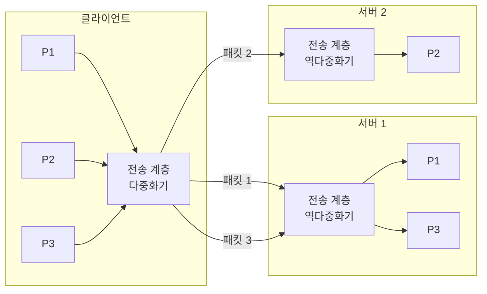

*그림 5. 클라이언트 한 대와 서버 두 대 사이의 다중화와 역다중화*

그림 5에서 클라이언트의 프로세스 P1, P2, P3이 각각 요청을 보낸다. P1과 P3의 요청은 첫 번째 서버로, P2의 요청은 두 번째 서버로 간다. 클라이언트의 전송 계층은 세 프로세스의 메시지를 받아 패킷 세 개를 만드는 다중화기로 동작한다. 첫 번째 서버의 전송 계층은 패킷 1과 3을 받아 서로 다른 두 프로세스에 나누어 주는 역다중화기로, 두 번째 서버의 전송 계층은 패킷 2를 해당 프로세스에 넘기는 역다중화기로 동작한다.

다중화가 가능하려면 두 가지가 필요하다. 첫째, 소켓마다 고유한 식별자가 있어야 한다. 둘째, 세그먼트마다 그 세그먼트를 전달할 소켓을 가리키는 특별한 필드가 있어야 한다. 이 필드가 출발지 포트 번호 필드와 목적지 포트 번호 필드이다. UDP 세그먼트와 TCP 세그먼트에는 이 밖에도 여러 필드가 있으며 각각 6절과 8장에서 다룬다.

### 3.2 비연결형 다중화와 역다중화

UDP 소켓을 만들면 전송 계층이 그 소켓에 사용 중이 아닌 포트 번호를 자동으로 할당하거나, 응용이 특정 포트 번호(예: 19157)를 소켓에 붙일 수 있다. 보통 클라이언트 쪽은 전송 계층이 자동으로 포트를 할당하게 두고, 서버 쪽은 잘 알려진 특정 포트 번호를 할당한다.

호스트 A에서 UDP 포트 19157을 쓰는 프로세스가 호스트 B에서 UDP 포트 46428을 쓰는 프로세스에 데이터를 보낸다고 가정한다. 호스트 A의 전송 계층은 응용 데이터, 출발지 포트 번호(19157), 목적지 포트 번호(46428), 그리고 다른 두 값(6절)을 담은 세그먼트를 만들어 네트워크 계층에 넘긴다. 세그먼트가 호스트 B에 도착하면 전송 계층은 목적지 포트 번호(46428)를 보고 그 번호로 식별되는 소켓에 세그먼트를 전달한다.

UDP 소켓은 **목적지 IP 주소와 목적지 포트 번호의 2-튜플**로 완전히 식별된다. 따라서 출발지 IP 주소나 출발지 포트 번호가 다르더라도 목적지 IP 주소와 목적지 포트 번호가 같은 UDP 세그먼트 두 개는 같은 소켓을 거쳐 같은 프로세스로 전달된다.

그렇다면 출발지 포트 번호는 무엇에 쓰는가. 출발지 포트 번호는 회신 주소의 일부이다. B가 A에게 세그먼트를 돌려보낼 때, B에서 A로 가는 세그먼트의 목적지 포트에는 A에서 B로 온 세그먼트의 출발지 포트 값이 들어간다. 완전한 회신 주소는 A의 IP 주소와 출발지 포트 번호이다. UDP 서버 프로그램은 받은 세그먼트에서 클라이언트 쪽(출발지) 포트 번호를 꺼내, 그 번호를 목적지 포트 번호로 하는 새 세그먼트를 보내는 방식으로 응답한다.

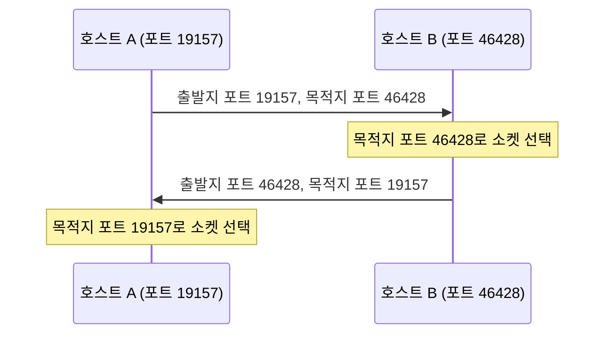

*그림 6. 요청과 응답에서 출발지 포트 번호와 목적지 포트 번호가 서로 뒤바뀌는 모습*

### 3.3 연결형 다중화와 역다중화

TCP 소켓은 UDP 소켓과 달리 **출발지 IP 주소, 출발지 포트 번호, 목적지 IP 주소, 목적지 포트 번호의 4-튜플**로 식별된다. TCP 세그먼트가 도착하면 호스트는 네 값을 모두 사용하여 세그먼트를 알맞은 소켓으로 역다중화한다. 따라서 UDP와 달리, 출발지 IP 주소나 출발지 포트 번호가 다른 두 TCP 세그먼트는 서로 다른 소켓으로 전달된다. 예외는 연결 설정 요청을 담은 첫 세그먼트이다.

TCP 서버 응용은 포트 12000에서 TCP 클라이언트의 연결 요청을 기다리는 **환영 소켓(welcoming socket)** 을 가진다. 연결 요청은 목적지 포트 번호가 12000이고 TCP 헤더의 특별한 연결 설정 비트(8장의 SYN)가 켜진 TCP 세그먼트일 뿐이며, 클라이언트가 고른 출발지 포트 번호도 담고 있다. 서버 호스트의 운영체제는 이 요청을 받으면 포트 12000에서 연결을 기다리는 서버 프로세스를 찾고, 서버 프로세스는 새 소켓을 만든다. 서버의 전송 계층은 연결 요청 세그먼트의 출발지 포트 번호, 출발지 호스트의 IP 주소, 목적지 포트 번호, 자신의 IP 주소를 기록한다. 새로 만든 **연결 소켓(connection socket)** 은 이 네 값으로 식별되며, 이후 네 값이 모두 일치하는 세그먼트는 이 소켓으로 역다중화된다.

| 구분 | UDP 소켓 | TCP 연결 소켓 |
|:-----|:-----|:-----|
| 식별자 | (목적지 IP 주소, 목적지 포트 번호) | (출발지 IP 주소, 출발지 포트 번호, 목적지 IP 주소, 목적지 포트 번호) |
| 출발지만 다른 두 세그먼트 | 같은 소켓으로 전달 | 서로 다른 소켓으로 전달 |
| 출발지 포트 번호의 역할 | 회신 주소의 일부 | 소켓 식별자의 일부이자 회신 주소의 일부 |

*표 4. UDP 소켓과 TCP 연결 소켓의 식별 방식*

서버 B가 포트 80에서 웹 서버를 실행하고, 호스트 C가 HTTP 세션 두 개를, 호스트 A가 HTTP 세션 하나를 연다고 가정한다. 호스트 C는 두 연결에 서로 다른 출발지 포트 번호 26145와 7532를 할당한다. 호스트 A는 C와 독립적으로 포트를 고르므로 A의 연결도 출발지 포트 26145를 쓸 수 있다. 그래도 문제가 없다. 출발지 포트 번호가 같은 두 연결은 출발지 IP 주소가 다르므로 서버 B가 올바르게 구분한다.

| 연결 | 출발지 IP 주소 | 출발지 포트 | 목적지 IP 주소 | 목적지 포트 |
|:-----|:-----|:-----|:-----|:-----|
| C의 첫 번째 연결 | C | 26145 | B | 80 |
| C의 두 번째 연결 | C | 7532 | B | 80 |
| A의 연결 | A | 26145 | B | 80 |

*표 5. 같은 웹 서버 포트를 쓰는 세 TCP 연결의 4-튜플*

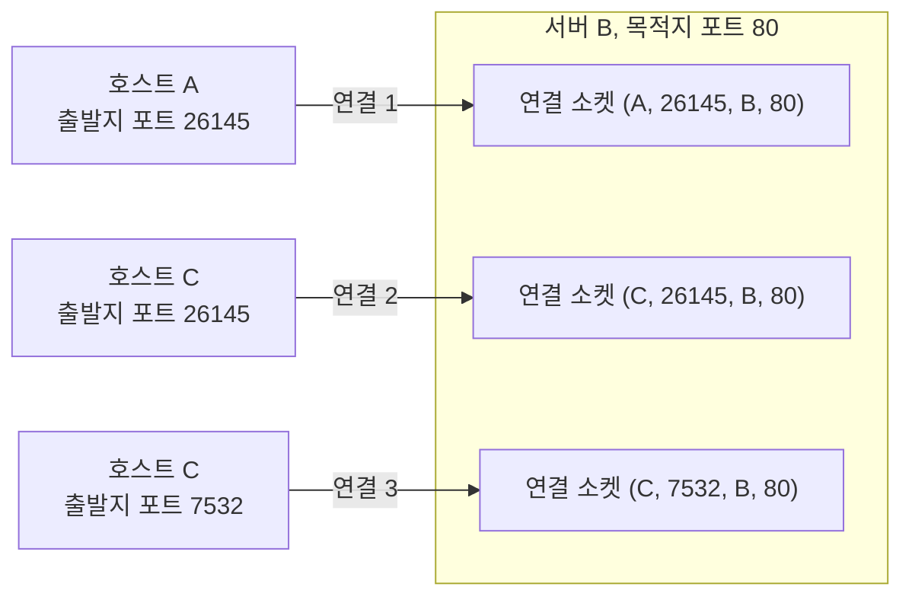

*그림 7. 4-튜플로 구분되는 웹 서버의 연결 소켓*

### 3.4 웹 서버와 TCP 소켓

포트 80에서 실행되는 웹 서버에 클라이언트가 보내는 세그먼트는 연결 설정 세그먼트든 HTTP 요청을 담은 세그먼트든 모두 목적지 포트가 80이다. 서버는 출발지 IP 주소와 출발지 포트 번호로 클라이언트들을 구분한다.

웹 서버가 연결마다 새 프로세스를 만들 수도 있지만, 연결 소켓과 프로세스가 항상 일대일로 대응하는 것은 아니다. 성능이 높은 웹 서버는 프로세스 하나만 쓰고 클라이언트 연결마다 새 연결 소켓을 가진 스레드를 만들기도 한다. 이 경우 한 프로세스에 식별자가 서로 다른 연결 소켓이 여러 개 붙어 있다.

> **[운영체제]** 운영체제에서 배우는 스레드는 같은 프로세스의 주소 공간과 자원을 공유하면서 독립적으로 실행되는 흐름이다. 연결마다 스레드를 만드는 서버는 연결마다 프로세스를 만드는 서버보다 생성과 문맥 교환 비용이 적으므로 동시에 많은 연결을 처리하기에 유리하다.

클라이언트와 서버가 지속 연결 HTTP를 쓰면 연결이 유지되는 동안 같은 서버 소켓으로 HTTP 메시지를 주고받는다. 비지속 연결 HTTP를 쓰면 요청과 응답마다 새 TCP 연결과 새 소켓을 만들고 닫으므로, 바쁜 웹 서버의 성능이 크게 떨어질 수 있다(3장).

> **참고:** **포트 스캐닝.** 서버 프로세스는 열린 포트에서 원격 클라이언트의 접속을 기다리며, 일부 포트는 잘 알려진 응용에 예약되어 있다. 따라서 어떤 호스트의 어떤 포트가 열려 있는지 알면 그 호스트에서 실행되는 응용을 짐작할 수 있다. 관리자는 이 정보로 자신의 네트워크에서 실행되는 응용을 파악하고, 공격자는 알려진 보안 결함이 있는 응용을 찾는 데 쓴다. nmap 같은 포트 스캐너는 TCP 포트에서는 연결을 받아들이는 포트를, UDP 포트에서는 응답하는 포트를 차례로 찾는다. TCP 포트 스캔의 세 가지 결과는 8장에서 다룬다.

---

<br>

## 4. 비연결형 서비스와 연결형 서비스

전송 계층 프로토콜은 네트워크 계층 프로토콜처럼 비연결형 서비스와 연결형 서비스의 두 가지를 제공할 수 있다. 그러나 두 계층에서 이 말의 뜻은 다르다. 네트워크 계층에서 비연결형 서비스는 같은 메시지에 속한 데이터그램들이 서로 다른 경로로 갈 수 있다는 뜻이다(10장). 전송 계층은 패킷의 물리적 경로에 관심이 없고 두 전송 계층 사이에 논리적 연결이 있다고 가정하므로, 전송 계층에서 비연결형은 패킷 사이의 독립성을, 연결형은 패킷 사이의 의존성을 뜻한다.

### 4.1 비연결형 서비스

비연결형 서비스에서 출발지 프로세스(응용 프로그램)는 메시지를 전송 계층이 받아들일 수 있는 크기의 데이터 조각으로 나누어 하나씩 전송 계층에 넘긴다. 전송 계층은 각 조각을 다른 조각과 관계없는 독립된 단위로 다루며, 조각이 오는 대로 패킷에 캡슐화하여 보낸다. 패킷 사이에 의존성이 없으므로 패킷은 목적지에 순서가 바뀌어 도착할 수 있고, 그 순서대로 서버 프로세스에 전달될 수 있다.

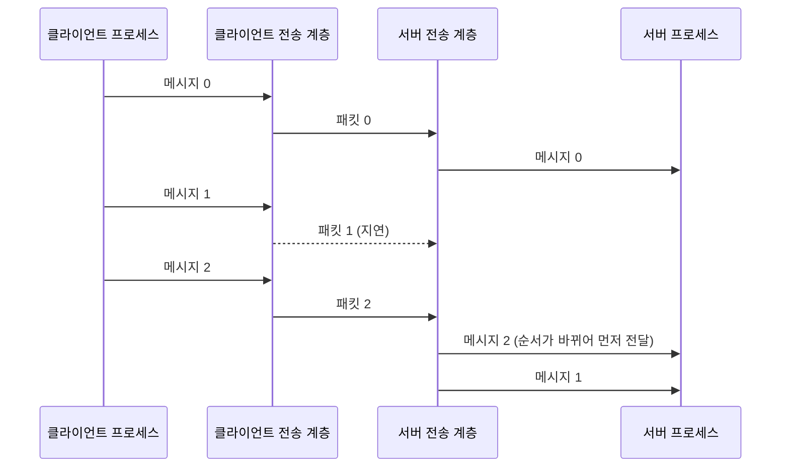

*그림 8. 비연결형 서비스에서 메시지가 순서가 바뀌어 전달되는 경우*

그림 8에서 세 메시지 조각은 클라이언트 전송 계층에 순서대로(0, 1, 2) 전달되지만, 두 번째 패킷이 더 늦게 도착하므로 서버에는 0, 2, 1의 순서로 전달된다. 세 조각이 한 메시지에 속한다면 서버 프로세스는 엉클어진 메시지를 받는다. 패킷 하나가 손실되면 상황은 더 나쁘다. 패킷에 번호가 없으므로 수신 전송 계층은 메시지 하나가 사라진 사실조차 모르고 남은 두 조각만 서버 프로세스에 넘긴다.

이 두 문제는 두 전송 계층이 서로 조율하지 않기 때문에 생긴다. 수신 전송 계층은 첫 패킷이 언제 올지도, 모든 패킷이 언제 도착했는지도 모른다. 따라서 비연결형 서비스에서는 흐름 제어, 오류 제어, 혼잡 제어를 효과적으로 구현할 수 없다.

### 4.2 연결형 서비스

연결형 서비스에서는 클라이언트와 서버가 먼저 둘 사이에 연결을 설정해야 하며, 데이터 교환은 연결 설정 뒤에만 일어난다. 데이터 교환이 끝나면 연결을 해제한다. 네트워크 계층의 연결형 서비스는 두 종단 호스트와 그 사이의 모든 라우터가 조율해야 하는 것과 달리, 전송 계층의 연결형 서비스에는 두 호스트만 관여하며 종단 간에 이루어진다. 따라서 비연결형 프로토콜 위에도, 연결형 프로토콜 위에도 연결형 전송 프로토콜을 만들 수 있다.

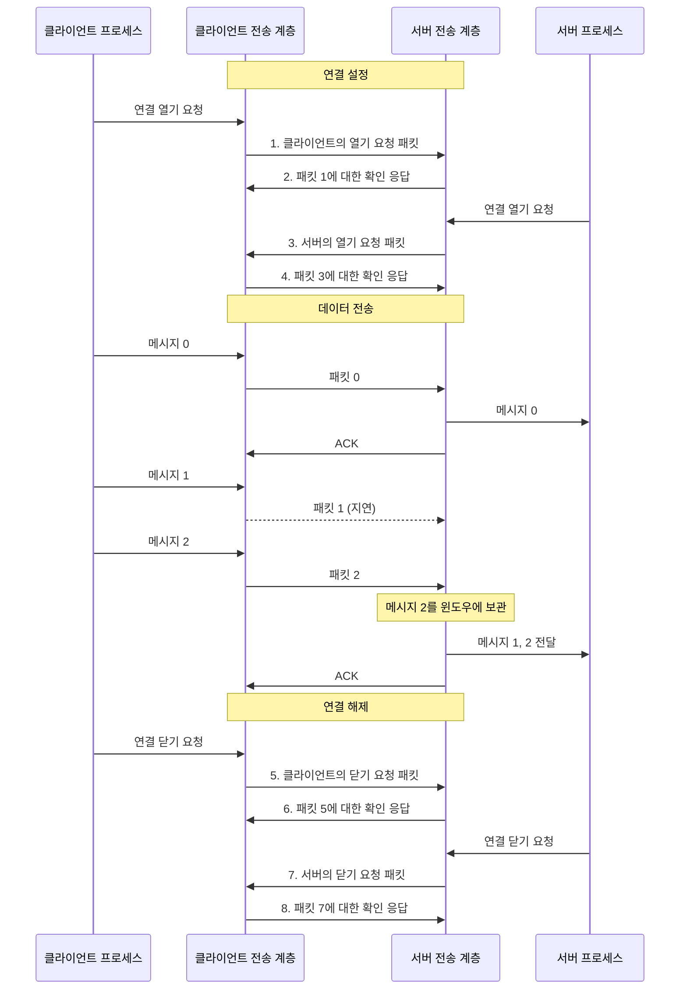

*그림 9. 연결형 서비스의 연결 설정, 데이터 전송, 연결 해제*

그림 9의 데이터 전송 단계에서 패킷 2가 패킷 1보다 먼저 도착하지만, 서버 전송 계층은 메시지 2를 윈도우에 보관하고 있다가 메시지 1이 도착한 뒤 두 메시지를 순서대로 전달한다. 연결형 서비스에서는 흐름 제어, 오류 제어, 혼잡 제어를 구현할 수 있다. 대부분의 프로토콜은 연결 설정의 세 번째와 네 번째 패킷, 즉 서버의 확인 응답과 서버의 열기 요청을 하나로 합치며, TCP의 3방향 핸드셰이크가 그 예이다(8장).

### 4.3 유한 상태 기계로 본 두 서비스

> **용어 정의:** **유한 상태 기계(finite state machine, FSM)** 는 유한한 수의 상태 가운데 항상 하나에 머물다가 사건이 일어나면 정해진 동작을 수행하고 다음 상태로 옮겨 가는 기계이다. 상태 가운데 하나는 기계가 켜질 때 머무는 초기 상태로 정한다.

전송 계층의 동작은 FSM으로 나타내면 이해하기 쉽다. 각 사건에는 두 가지 반응이 대응한다. 하나는 수행할 동작의 목록(비어 있을 수 있음)이고, 다른 하나는 다음 상태(현재 상태와 같을 수 있음)이다.

비연결형 전송 계층은 확립(established) 상태 하나만 있는 FSM으로 볼 수 있다. 클라이언트와 서버 양쪽의 기계는 항상 확립 상태에 있으며 언제든 전송 계층 패킷을 보내고 받을 준비가 되어 있다. 연결형 전송 계층의 FSM은 확립 상태에 이르기까지 세 상태를 거치고, 연결을 닫을 때도 세 상태를 거친다.

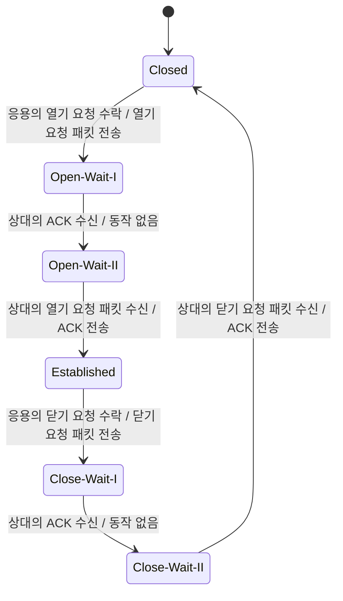

*그림 10. 연결형 전송 계층의 유한 상태 기계*

기계는 연결이 없을 때 Closed 상태에 있다. 로컬 프로세스가 연결 열기를 요청하면 원격 전송 계층에 열기 요청 패킷을 보내고 Open-Wait-I 상태로 간다. 상대의 확인 응답을 받으면 Open-Wait-II 상태로 간다. 이 상태에서는 한 방향 연결만 설정된 것이므로, 양방향 연결이 필요하면 상대도 연결을 요청할 때까지 기다린다. 상대의 요청이 오면 확인 응답을 보내고 Established 상태로 간다. 데이터와 데이터의 확인 응답은 양쪽이 모두 Established 상태일 때만 교환할 수 있으며, Established 상태는 실제로는 7장에서 다루는 데이터 전송 상태들의 묶음이다. 연결을 닫을 때는 응용의 닫기 요청을 받아 닫기 요청 패킷을 보내고 Close-Wait-I 상태로, 확인 응답을 받으면 Close-Wait-II 상태로 가서 상대의 닫기 요청을 기다리고, 그것이 오면 확인 응답을 보내고 Closed 상태로 돌아간다. 그림 10의 전이는 "사건 / 동작"의 형식으로 적었다. TCP는 이 기계를 변형하여 상태 이름을 바꾸고 일부 상태를 합치거나 나눈다(8장).

### 4.4 두 서비스의 비교

| 특징 | 비연결형 서비스 | 연결형 서비스 |
|:-----|:-----|:-----|
| 연결 설정과 해제 | 없음 | 데이터 교환 전에 설정하고 끝난 뒤 해제 |
| 패킷 사이의 관계 | 서로 독립 | 한 연결에 속한 패킷 사이에 의존성 존재 |
| 순서 | 순서가 바뀌어 전달될 수 있음 | 순서대로 전달 가능 |
| 손실 검출 | 번호가 없으므로 검출 불가 | 번호로 검출 가능 |
| 흐름, 오류, 혼잡 제어 | 효과적으로 구현할 수 없음 | 구현 가능 |
| FSM의 상태 | 확립 상태 하나 | 연결 설정과 해제를 위한 여러 상태 |
| 인터넷의 예 | UDP | TCP |

*표 6. 전송 계층의 비연결형 서비스와 연결형 서비스의 비교*

---

<br>

## 5. UDP 개요

### 5.1 UDP의 위치와 성격

> **용어 정의:** **사용자 데이터그램 프로토콜(User Datagram Protocol, UDP)** 은 프로세스 간 전달과 간단한 오류 검사만 제공하는 비연결형, 비신뢰적 전송 계층 프로토콜이다. RFC 768에 정의되어 있다.

UDP는 그림 2처럼 응용 계층과 IP 계층 사이에 위치하며, TCP와 마찬가지로 응용 프로그램과 네트워크 동작 사이의 중개자 역할을 한다. UDP는 IP의 서비스에 프로세스 간 통신 외에는 거의 아무것도 더하지 않는다.

- UDP는 포트 번호를 이용해 프로세스 간 통신을 제공한다.
- UDP는 비연결형이고 비신뢰적인 전송 프로토콜이다. 오류 검사는 체크섬 하나로 매우 제한적이며, 받은 패킷에 대한 확인 응답도 흐름 제어도 없다. 오류를 검출하면 패킷을 조용히 버린다.
- UDP는 부담(overhead)이 최소인 단순한 프로토콜이다. 프로세스가 작은 메시지를 보내려 하고 신뢰성을 크게 신경 쓰지 않는다면 UDP를 쓸 수 있다. UDP로 작은 메시지를 보내면 TCP로 보낼 때보다 송신자와 수신자 사이의 상호작용이 훨씬 적다.

UDP를 쓰는 대표적인 응용 계층 프로토콜이 DNS이다. 호스트의 DNS 응용이 질의를 보내려 하면 DNS 질의 메시지를 만들어 UDP에 넘긴다. UDP는 목적지의 UDP와 아무런 핸드셰이크 없이 헤더 필드를 붙여 세그먼트를 네트워크 계층에 넘기고, 네트워크 계층은 이를 데이터그램에 담아 네임 서버로 보낸다. 질의한 호스트의 DNS 응용은 응답을 기다리며, 질의나 응답이 손실되어 응답이 오지 않으면 질의를 다시 보내거나, 다른 네임 서버에 보내거나, 응답을 받을 수 없다고 응용에 알린다(5장).

### 5.2 UDP를 선택하는 이유

신뢰적 데이터 전송 서비스를 제공하는 TCP가 항상 더 나은 것은 아니다. 다음 이유로 UDP가 더 알맞은 응용이 있다.

1. **언제 무엇을 보낼지 응용이 세밀하게 제어할 수 있다.** 응용 프로세스가 데이터를 넘기면 UDP는 곧바로 세그먼트에 담아 네트워크 계층에 넘긴다. 반면 TCP는 경로상의 링크가 혼잡하면 송신자를 억제하는 혼잡 제어를 수행하고, 확인 응답을 받을 때까지 시간이 얼마가 걸리든 세그먼트를 다시 보낸다. 실시간 응용은 최소 송신 속도가 필요하고, 전송이 지나치게 늦어지는 것을 원하지 않으며, 약간의 손실은 견딜 수 있으므로 TCP의 서비스 모델이 잘 맞지 않는다.
2. **연결 설정이 없다.** TCP는 데이터 전송 전에 3방향 핸드셰이크를 하지만 UDP는 사전 절차 없이 곧바로 보낸다. 따라서 UDP는 연결 설정 지연이 없다. DNS가 TCP가 아닌 UDP 위에서 동작하는 주된 이유가 이것이다.
3. **연결 상태가 없다.** TCP는 종단 시스템에 송신 버퍼와 수신 버퍼, 혼잡 제어 매개변수, 순서 번호와 확인 응답 번호 매개변수 같은 연결 상태를 유지한다. UDP는 연결 상태를 유지하지 않으므로, 한 응용 전용 서버는 응용이 UDP 위에서 동작할 때 보통 훨씬 많은 활성 클라이언트를 지원할 수 있다.
4. **패킷 헤더 부담이 작다.** TCP 세그먼트의 헤더는 20바이트이지만 UDP의 헤더는 8바이트이다.

| 응용 | 응용 계층 프로토콜 | 전송 프로토콜 |
|:-----|:-----|:-----|
| 전자 메일 | SMTP | TCP |
| 원격 터미널 접속 | Telnet | TCP |
| 웹 | HTTP | TCP |
| 파일 전송 | FTP | TCP |
| 원격 파일 서버 | NFS | 대개 UDP |
| 스트리밍 멀티미디어 | 대개 독자 프로토콜 | UDP 또는 TCP |
| 인터넷 전화 | 대개 독자 프로토콜 | UDP 또는 TCP |
| 네트워크 관리 | SNMP | 대개 UDP |
| 이름 변환 | DNS | 대개 UDP |

*표 7. 대표적인 인터넷 응용과 그 응용이 쓰는 전송 프로토콜*

전자 메일, 원격 터미널 접속, 웹, 파일 전송은 신뢰적 데이터 전송이 필요하므로 TCP를 쓴다. 네트워크 관리(SNMP)는 네트워크가 과부하 상태일 때, 즉 신뢰적이고 혼잡 제어되는 데이터 전송이 어려운 바로 그때 동작해야 하므로 UDP를 쓴다. 멀티미디어 응용은 약간의 손실을 견딜 수 있고 실시간 응용은 TCP의 혼잡 제어에 나쁘게 반응하므로 UDP를 쓰는 경우가 많다. 다만 손실률이 낮고 보안 때문에 UDP 트래픽을 막는 조직도 있어서 스트리밍 미디어 전송에 TCP를 쓰는 경우도 늘고 있다.

UDP를 쓰더라도 응용 자체에 확인 응답과 재전송 같은 신뢰성 메커니즘(7장)을 넣으면 신뢰적 데이터 전송을 얻을 수 있다. Google의 Chrome 브라우저가 쓰는 QUIC 프로토콜이 그 예로, UDP를 전송 프로토콜로 쓰고 그 위의 응용 계층 프로토콜에서 신뢰성을 구현한다. 이렇게 하면 TCP의 혼잡 제어가 부과하는 전송 속도 제약을 받지 않으면서 신뢰적으로 통신할 수 있지만, 구현은 결코 간단하지 않다.

### 5.3 혼잡 제어가 없다는 문제

UDP 위에서 멀티미디어 응용을 실행하는 것은 흔하지만 논란이 있다. UDP에는 혼잡 제어가 없기 때문이다. 모두가 혼잡 제어 없이 높은 비트율의 비디오를 보내기 시작하면 라우터에서 패킷이 넘쳐 극소수의 UDP 패킷만 목적지에 도착하게 된다. 또한 제어되지 않는 UDP 송신자가 일으킨 높은 손실률 때문에, 혼잡에 대응하여 송신 속도를 낮추는 TCP 송신자들은 속도를 크게 낮추게 된다. 즉 UDP의 혼잡 제어 부재는 UDP 송신자와 수신자 사이의 높은 손실률과 TCP 세션의 밀려남을 낳을 수 있다. 그래서 UDP 송신자를 포함한 모든 송신자에게 적응형 혼잡 제어를 강제하는 메커니즘이 연구되어 왔다(9장).

---

<br>

## 6. 사용자 데이터그램 형식

> **용어 정의:** **사용자 데이터그램(user datagram)** 은 UDP 패킷을 가리키는 Forouzan 교재의 용어로, 8바이트 고정 헤더와 응용 데이터로 이루어진다.

### 6.1 헤더 형식

UDP 헤더는 각각 2바이트(16비트)인 네 개의 필드로 이루어진다.

```text
+------------- 8 to 65,535 bytes -------------+
| Header (8 bytes) |          Data            |
+------------------+--------------------------+

 0                   1                   2                   3
 0 1 2 3 4 5 6 7 8 9 0 1 2 3 4 5 6 7 8 9 0 1 2 3 4 5 6 7 8 9 0 1
+-+-+-+-+-+-+-+-+-+-+-+-+-+-+-+-+-+-+-+-+-+-+-+-+-+-+-+-+-+-+-+-+
|      Source port number       |   Destination port number     |
+-+-+-+-+-+-+-+-+-+-+-+-+-+-+-+-+-+-+-+-+-+-+-+-+-+-+-+-+-+-+-+-+
|         Total length          |           Checksum            |
+-+-+-+-+-+-+-+-+-+-+-+-+-+-+-+-+-+-+-+-+-+-+-+-+-+-+-+-+-+-+-+-+
```

*그림 11. UDP 사용자 데이터그램과 헤더 형식*

| 필드 | 크기 | 설명 |
|:-----|:-----|:-----|
| 출발지 포트 번호 (Source port number) | 16비트 | 출발지 호스트에서 실행되는 프로세스의 포트 번호. 클라이언트가 요청을 보내면 대개 UDP 소프트웨어가 고른 임시 포트 번호이고, 서버가 응답을 보내면 대개 잘 알려진 포트 번호 |
| 목적지 포트 번호 (Destination port number) | 16비트 | 목적지 호스트에서 실행되는 프로세스의 포트 번호. 서버가 응답을 보낼 때는 요청 패킷에서 받은 임시 포트 번호를 복사 |
| 전체 길이 (Total length) | 16비트 | 헤더와 데이터를 합한 사용자 데이터그램의 전체 길이(바이트) |
| 체크섬 (Checksum) | 16비트 | 헤더와 데이터를 포함한 사용자 데이터그램 전체의 오류 검출 (8절) |

*표 8. UDP 헤더의 필드*

포트 번호는 목적지 호스트가 응용 데이터를 올바른 프로세스에 넘기는 역다중화에 쓰인다. 데이터 필드에는 응용 데이터가 들어간다. 예를 들어 DNS에서는 질의 메시지나 응답 메시지가, 스트리밍 오디오 응용에서는 오디오 표본이 들어간다.

### 6.2 길이 필드와 최대 데이터 크기

데이터 필드의 크기는 세그먼트마다 다를 수 있으므로 길이를 명시하는 필드가 필요하다. 16비트 길이 필드는 0\~65,535바이트를 나타낼 수 있지만, 헤더만으로 8바이트이므로 사용자 데이터그램의 길이는 8바이트(데이터 없음)부터 65,535바이트까지이다.

사실 이 길이 필드가 반드시 있어야 하는 것은 아니다. 사용자 데이터그램은 IP 데이터그램에 캡슐화되며, IP 헤더에는 데이터그램의 전체 길이와 헤더 길이를 나타내는 필드가 있으므로 다음과 같이 구할 수 있다.

```math
\text{UDP length} = \text{IP total length} - \text{IP header length}
```

그러나 IP 소프트웨어가 사용자 데이터그램을 UDP에 넘길 때는 이미 IP 헤더를 떼어 낸 상태이므로, UDP 설계자들은 IP 소프트웨어에 길이를 묻기보다 사용자 데이터그램 안의 정보로 길이를 계산하는 편이 효율적이라고 보았다.

IPv4 데이터그램 전체도 65,535바이트를 넘을 수 없으므로, 옵션이 없는 20바이트 IP 헤더를 가정하면 사용자 데이터그램 하나에 담을 수 있는 데이터는 최대 다음과 같다.

```math
65{,}535 - 20 - 8 = 65{,}507 \text{ bytes}
```

UDP는 비연결형이므로 프로세스가 데이터 스트림을 UDP에 넘기고 UDP가 이를 서로 관련된 여러 사용자 데이터그램으로 잘라 주기를 기대할 수 없다. 각 요청은 사용자 데이터그램 하나에 들어갈 만큼 작아야 하며, 65,507바이트보다 짧은 메시지를 보내는 프로세스만 UDP를 쓸 수 있다.

### 6.3 헤더 해석 예

UDP 헤더를 16진수로 덤프한 값이 `CB84000D001C001C`라고 가정한다. 헤더는 16비트 필드 네 개이므로 16진수 네 자리씩 끊어 읽는다.

| 필드 | 16진수 | 10진수 | 해석 |
|:-----|:-----|:-----|:-----|
| 출발지 포트 번호 | `CB84` | 52,100 | 1,023보다 큰 임시 포트 |
| 목적지 포트 번호 | `000D` | 13 | Daytime의 잘 알려진 포트 |
| 전체 길이 | `001C` | 28 | 사용자 데이터그램 전체가 28바이트 |
| 체크섬 | `001C` | 28 | 오류 검출용 값 |

*표 9. 헤더 덤프 CB84000D001C001C의 해석*

데이터의 길이는 전체 길이에서 헤더 길이를 뺀 28 - 8 = 20바이트이다. 목적지 포트가 잘 알려진 포트 13이므로 이 패킷은 클라이언트에서 서버로 가며, 클라이언트 프로세스는 Daytime 클라이언트이다.

---

<br>

## 7. UDP 서비스

이 절은 3절과 4절에서 다룬 전송 계층의 일반적인 서비스 가운데 UDP가 무엇을 제공하고 무엇을 제공하지 않는지 정리한다.

### 7.1 프로세스 간 통신과 비연결형 서비스

UDP는 IP 주소와 포트 번호를 결합한 소켓 주소로 프로세스 간 통신을 제공한다(2절, 표 3). 또한 UDP는 비연결형 서비스를 제공한다. UDP가 보내는 사용자 데이터그램은 하나하나가 독립된 데이터그램이며, 같은 출발지 프로세스에서 같은 목적지 프로그램으로 가더라도 서로 아무 관계가 없다. 사용자 데이터그램에는 번호가 매겨지지 않고, TCP와 같은 연결 설정이나 연결 해제도 없으므로 각 사용자 데이터그램은 서로 다른 경로로 갈 수 있다.

### 7.2 흐름 제어, 오류 제어, 혼잡 제어

- **흐름 제어가 없다.** UDP에는 흐름 제어가 없으므로 윈도우 메커니즘도 없다. 들어오는 메시지가 많으면 수신자가 넘칠 수 있다. 흐름 제어가 필요하면 UDP를 쓰는 프로세스가 직접 제공해야 한다.
- **오류 제어는 체크섬뿐이다.** 송신자는 메시지가 손실되었는지 중복되었는지 알 수 없다. 수신자가 체크섬으로 오류를 검출하면 사용자 데이터그램을 조용히 버린다. 오류 제어가 필요하면 UDP를 쓰는 프로세스가 직접 제공해야 한다.
- **혼잡 제어가 없다.** UDP는 비연결형 프로토콜이므로 혼잡 제어를 제공하지 않는다. UDP는 보내는 패킷이 작고 산발적이어서 네트워크에 혼잡을 일으키지 않는다고 가정한다. 이 가정은 오디오와 비디오의 실시간 전송에 UDP를 쓰는 오늘날에는 맞을 수도 있고 맞지 않을 수도 있다(5.3절).

### 7.3 캡슐화와 역캡슐화

UDP는 한 프로세스에서 다른 프로세스로 메시지를 보내기 위해 메시지를 캡슐화하고 역캡슐화한다.

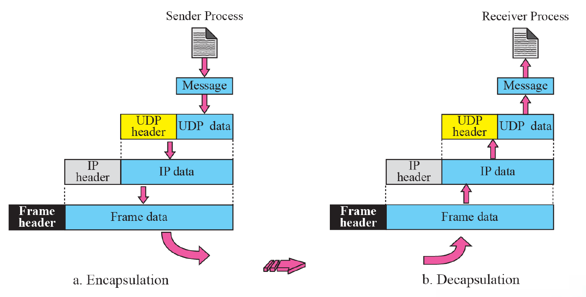

*그림 12. UDP 사용자 데이터그램의 캡슐화와 역캡슐화*

**캡슐화.** 보낼 메시지가 있는 프로세스는 메시지와 함께 소켓 주소 한 쌍과 데이터 길이를 UDP에 넘긴다. UDP는 UDP 헤더를 붙인 사용자 데이터그램을 소켓 주소와 함께 IP에 넘긴다. IP는 프로토콜 필드에 UDP를 뜻하는 값 17을 넣은 자신의 헤더를 붙이고, IP 데이터그램을 데이터 링크 계층에 넘긴다. 데이터 링크 계층은 헤더(와 트레일러)를 붙여 물리 계층에 넘기고, 물리 계층은 비트를 전기 신호나 광 신호로 바꾸어 원격 컴퓨터로 보낸다.

**역캡슐화.** 목적지 호스트의 물리 계층은 신호를 비트로 바꾸어 데이터 링크 계층에 넘기고, 데이터 링크 계층은 헤더(와 트레일러)로 데이터를 검사한다. 오류가 없으면 헤더와 트레일러를 떼어 데이터그램을 IP에 넘긴다. IP도 검사를 마친 뒤 헤더를 떼어 사용자 데이터그램을 송신자와 수신자의 IP 주소와 함께 UDP에 넘긴다. UDP는 체크섬으로 사용자 데이터그램 전체를 검사하고, 오류가 없으면 헤더를 떼어 응용 데이터를 송신자 소켓 주소와 함께 프로세스에 넘긴다. 송신자 소켓 주소를 넘기는 이유는 프로세스가 받은 메시지에 응답해야 할 수도 있기 때문이다.

### 7.4 큐잉

포트는 실제로 큐로 구현된다. UDP에서는 포트마다 큐가 연결된다.

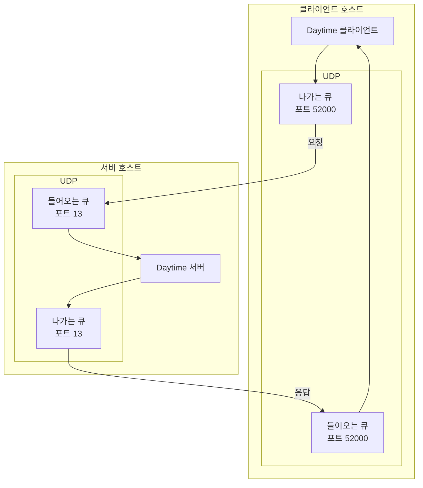

*그림 13. Daytime 클라이언트와 서버의 포트에 연결된 UDP 큐*

**클라이언트 쪽.** 클라이언트 프로세스는 시작할 때 운영체제에 포트 번호를 요청한다. 구현에 따라 프로세스마다 들어오는 큐와 나가는 큐를 모두 만들기도 하고 들어오는 큐만 만들기도 한다. 프로세스가 여러 프로세스와 통신하더라도 포트 번호는 하나만 받으므로 결국 나가는 큐와 들어오는 큐도 하나씩이다. 클라이언트가 연 큐는 대부분 임시 포트 번호로 식별되며, 프로세스가 실행되는 동안 유지되다가 프로세스가 끝나면 사라진다.

- 클라이언트 프로세스는 요청에 지정한 출발지 포트 번호로 나가는 큐에 메시지를 넣는다. UDP는 메시지를 하나씩 꺼내 UDP 헤더를 붙여 IP에 넘긴다. 나가는 큐가 넘치면 운영체제는 클라이언트 프로세스에 더 보내기 전에 기다리라고 요청할 수 있다.
- 클라이언트에게 메시지가 도착하면 UDP는 사용자 데이터그램의 목적지 포트 번호 필드에 해당하는 들어오는 큐가 있는지 확인한다. 큐가 있으면 사용자 데이터그램을 큐의 끝에 넣는다. 큐가 없으면 사용자 데이터그램을 버리고 ICMP에 서버로 포트 도달 불가(port unreachable) 메시지를 보내 달라고 요청한다(16장). 서버가 같든 다르든 한 클라이언트 프로그램으로 오는 메시지는 모두 같은 큐에 들어간다. 들어오는 큐가 넘치면 UDP는 사용자 데이터그램을 버리고 포트 도달 불가 메시지를 보내 달라고 요청한다.

**서버 쪽.** 가장 단순한 형태에서 서버는 실행을 시작할 때 잘 알려진 포트로 들어오는 큐와 나가는 큐를 요청하며, 이 큐들은 서버가 실행되는 동안 열려 있다. 서버에 메시지가 도착할 때의 처리는 클라이언트 쪽과 같고, 큐가 없거나 넘치면 클라이언트에게 포트 도달 불가 메시지가 간다. 서버가 응답할 때는 요청에 들어 있던 출발지 포트 번호를 목적지로 하여 나가는 큐에 메시지를 넣는다.

### 7.5 UDP의 다중화와 역다중화

TCP/IP 프로토콜 스위트를 실행하는 호스트에는 UDP가 하나뿐이지만 UDP의 서비스를 쓰려는 프로세스는 여러 개일 수 있다. 송신 측에서는 여러 프로세스가 하나의 UDP를 쓰는 다대일 관계이므로 다중화가 필요하다. UDP는 할당된 포트 번호로 구분되는 여러 프로세스의 메시지를 받아 헤더를 붙여 IP에 넘긴다. 수신 측에서는 하나의 UDP가 여러 프로세스에 사용자 데이터그램을 나누어 주는 일대다 관계이므로 역다중화가 필요하다. UDP는 IP에서 받은 사용자 데이터그램의 오류를 검사하고 헤더를 뗀 뒤 포트 번호에 따라 알맞은 프로세스에 메시지를 넘긴다(3.2절).

### 7.6 단순 프로토콜과의 비교

7장에서 다루는 단순 프로토콜(simple protocol)은 흐름 제어도 오류 제어도 없는 비연결형 프로토콜이다. UDP와 단순 프로토콜의 유일한 차이는 UDP가 수신 측에서 손상된 패킷을 검출하기 위한 체크섬을 선택적으로 제공한다는 점이다. 체크섬이 들어 있으면 수신 UDP는 패킷을 검사하고 손상된 패킷을 버리지만, 송신자에게 아무 피드백도 보내지 않는다.

> **핵심:** UDP는 오류 검출용 체크섬이 선택적으로 추가된 단순 프로토콜이다. 프로세스 간 전달 외에 흐름 제어, 오류 복구, 혼잡 제어가 필요하면 응용이 직접 구현해야 한다.

---

<br>

## 8. UDP 체크섬

UDP 체크섬은 사용자 데이터그램이 출발지에서 목적지로 가는 동안 비트가 바뀌었는지(예: 링크의 잡음이나 라우터 메모리에 저장되는 동안의 오류) 검출한다.

> **용어 정의:** **체크섬(checksum)** 은 송신자가 데이터의 16비트 워드들을 1의 보수 덧셈으로 더한 합의 1의 보수를 구해 헤더에 넣는 오류 검출용 값이다. 수신자는 체크섬을 포함한 모든 워드를 같은 방식으로 더해 결과가 모두 1인지 확인한다.

### 8.1 1의 보수 합과 체크섬

송신 측 UDP는 다음 순서로 체크섬을 계산한다.

1. 체크섬 필드를 0으로 둔다.
2. 계산 대상을 16비트 워드로 나누고, 바이트 수가 홀수이면 마지막에 0으로 채운 바이트 하나를 덧붙인다.
3. 모든 워드를 더한다. 덧셈에서 16비트를 넘는 자리올림이 생기면 그 자리올림을 맨 아래 비트에 다시 더한다(wraparound). 이렇게 구한 값이 1의 보수 합이다.
4. 합의 모든 비트를 뒤집은 1의 보수를 체크섬 필드에 넣는다.

수신자는 체크섬을 포함한 모든 16비트 워드를 같은 방식으로 더한다. 오류가 없으면 합은 `1111111111111111`이고, 한 비트라도 0이면 오류가 생긴 것이다. 합에 체크섬을 더하면 모든 비트가 1이 되는 이유는, 어떤 16비트 값과 그 값의 비트를 모두 뒤집은 값을 더하면 각 자리가 0 + 1 또는 1 + 0이 되어 자리올림 없이 모두 1이 되기 때문이다.

> **[논리설계]** 논리설계에서 배우는 1의 보수 표현에서는 수의 모든 비트를 뒤집어 음수를 만들고, 덧셈에서 맨 위 자리의 자리올림을 맨 아래에 다시 더하는 순환 자리올림(end-around carry)을 쓴다. 체크섬에서 자리올림을 맨 아래 비트에 다시 더하는 과정(wraparound)이 바로 이 순환 자리올림이다. 1의 보수 덧셈은 교환 법칙과 결합 법칙을 만족하므로 워드를 더하는 순서와 무관하게 같은 합을 얻는다.

### 8.2 16비트 워드 세 개의 계산 예

계산 대상이 다음 16비트 워드 세 개라고 가정한다.

```text
  0110011001100000
  0101010101010101
  1000111100001100
```

처음 두 워드의 합은 자리올림이 없다.

```text
  0110011001100000
+ 0101010101010101
------------------
  1011101110110101
```

여기에 세 번째 워드를 더하면 17번째 비트로 자리올림이 생기며, 이를 맨 아래 비트에 다시 더한다.

```text
  1011101110110101
+ 1000111100001100
------------------
 10100101011000001   (17 bits: carry out)
  0100101011000001
+                1   (wraparound)
------------------
  0100101011000010   sum
  1011010100111101   checksum (one's complement of sum)
```

*그림 14. 16비트 워드 세 개의 1의 보수 합과 체크섬 계산*

수신자가 네 워드(세 워드와 체크섬)를 모두 더하면 `0100101011000010` + `1011010100111101` = `1111111111111111`이 되어 오류가 없다고 판단한다.

### 8.3 의사 헤더

UDP 체크섬은 사용자 데이터그램뿐 아니라 IP 헤더의 일부 필드까지 포함하여 계산한다.

> **용어 정의:** **의사 헤더(pseudoheader)** 는 체크섬을 계산할 때만 사용자 데이터그램 앞에 임시로 붙이는 12바이트 구조로, 사용자 데이터그램이 담길 IP 패킷 헤더의 일부 필드(출발지 IP 주소, 목적지 IP 주소, 프로토콜 번호)와 UDP 전체 길이로 이루어진다. 의사 헤더는 전송되지 않는다.

```text
+-----------------------------------------------------------+
|                  32-bit source IP address                 |  Pseudoheader
+-----------------------------------------------------------+
|               32-bit destination IP address               |
+--------------+----------------+---------------------------+
|   All 0s     | 8-bit protocol |   16-bit UDP total length |
+--------------+----------------+---------------------------+
|    Source port address        |  Destination port address |  Header
|          16 bits              |         16 bits           |
+-------------------------------+---------------------------+
|      UDP total length         |         Checksum          |
|          16 bits              |         16 bits           |
+-------------------------------+---------------------------+
|                           Data                            |
|    (Padding must be added to make the data a multiple     |
|                      of 16 bits)                          |
+-----------------------------------------------------------+
```

*그림 15. 체크섬 계산에 쓰는 의사 헤더와 UDP 사용자 데이터그램*

의사 헤더를 넣는 이유는 다음 두 가지이다.

- **잘못 전달된 데이터그램의 검출.** 체크섬에 의사 헤더가 없으면, IP 헤더가 손상되어 사용자 데이터그램이 잘못된 호스트에 전달되더라도 사용자 데이터그램 자체는 멀쩡하므로 검사를 통과한다. 의사 헤더가 있으면 수신 호스트는 자신의 IP 주소로 의사 헤더를 만들어 합을 다시 계산하므로 주소가 다르면 오류를 검출한다.
- **다른 프로토콜로 잘못 전달되는 것의 방지.** 프로토콜 필드는 패킷이 TCP가 아니라 UDP의 것임을 보장한다. UDP와 TCP를 모두 쓸 수 있는 프로세스는 두 프로토콜에서 같은 목적지 포트 번호를 쓸 수 있으므로, 포트 번호만으로는 구분할 수 없다. UDP의 프로토콜 필드 값은 17이며, 이 값이 전송 중에 바뀌면 수신자의 체크섬 계산에서 검출되어 UDP가 패킷을 버린다. 따라서 패킷이 다른 프로토콜에 전달되지 않는다.

의사 헤더의 필드는 IPv4 헤더의 마지막 12바이트(프로토콜, 출발지 IP 주소, 목적지 IP 주소 등)와 비슷하다(11장).

### 8.4 의사 헤더를 포함한 계산 예

출발지 IP 주소 153.18.8.105, 목적지 IP 주소 171.2.14.10, 출발지 포트 1087, 목적지 포트 13, 데이터 `TESTING`(7바이트)인 사용자 데이터그램의 체크섬을 구한다. 전체 길이는 8 + 7 = 15바이트이고, 데이터 바이트 수가 홀수이므로 계산할 때만 0으로 채운 바이트 하나를 덧붙인다. 각 IP 주소는 16비트 워드 두 개가 되고, 의사 헤더의 셋째 줄은 0으로 채운 8비트와 프로토콜 번호 17을 합친 워드, 그리고 UDP 전체 길이 15이다.

```text
Pseudoheader:
  10011001 00010010   153.18
  00001000 01101001   8.105
  10101011 00000010   171.2
  00001110 00001010   14.10
  00000000 00010001   0 and 17
  00000000 00001111   15
UDP header:
  00000100 00111111   1087
  00000000 00001101   13
  00000000 00001111   15
  00000000 00000000   0 (checksum)
Data:
  01010100 01000101   T and E
  01010011 01010100   S and T
  01001001 01001110   I and N
  01000111 00000000   G and 0 (padding)
---------------------------------------
  10010110 11101011   Sum
  01101001 00010100   Checksum
```

*그림 16. 의사 헤더를 포함한 UDP 체크섬 계산*

합은 1의 보수 합 `10010110 11101011`(`0x96EB`)이고 체크섬은 그 1의 보수인 `01101001 00010100`(`0x6914`)이다. 의사 헤더와 덧붙인 바이트는 계산에만 쓰이며, 사용자 데이터그램을 IP에 넘길 때는 버린다.

### 8.5 체크섬의 선택적 사용

UDP 송신자는 체크섬을 계산하지 않기로 할 수 있다. 이 경우 체크섬 필드를 모두 0으로 채워 보낸다. 체크섬을 계산했는데 결과가 모두 0이면, 계산하지 않은 경우와 구분하기 위해 모두 1로 바꾸어 보낸다. 즉 합을 두 번 보수화한다. 정상적인 상황에서 체크섬 값이 모두 1이 되는 일은 없으므로 이 규칙은 혼동을 일으키지 않는다.

| 상황 | 보내는 체크섬 | 이유 |
|:-----|:-----|:-----|
| 송신자가 체크섬을 넣지 않기로 함 | 모두 0 | 체크섬을 계산하지 않았다는 표시 |
| 체크섬을 넣기로 했는데 합이 모두 1 | 모두 1 | 보수가 모두 0이 되므로 한 번 더 보수화하여 앞의 경우와 구분 |
| 체크섬을 넣기로 했는데 합이 모두 0 | 일어나지 않음 | 합이 0이려면 모든 항이 0이어야 하는데, 의사 헤더의 일부 필드는 0이 아님 |

*표 10. 체크섬 필드에 들어가는 특수한 값*

### 8.6 종단 간 오류 검출이 필요한 이유

이더넷 같은 많은 링크 계층 프로토콜도 오류를 검사하는데(18장), UDP가 굳이 체크섬을 제공하는 이유는 다음과 같다. 출발지와 목적지 사이의 모든 링크가 오류 검사를 한다는 보장이 없으며, 링크에서는 올바르게 전달되었더라도 세그먼트가 라우터의 메모리에 저장되는 동안 비트 오류가 생길 수 있다. 링크별 신뢰성도, 메모리 안의 오류 검출도 보장되지 않으므로, 종단 간 데이터 전송 서비스가 오류 검출을 제공하려면 UDP가 전송 계층에서 종단 간 기준으로 오류를 검출해야 한다. 이것은 시스템 설계의 **종단 간 원칙(end-end principle)** 의 한 예로, 어떤 기능을 종단 간에 구현해야 한다면 그 기능을 하위 계층에 두는 것은 상위 계층에서 제공하는 비용에 비해 불필요하거나 가치가 적다는 원칙이다. IP는 거의 모든 계층 2 프로토콜 위에서 동작해야 하므로 전송 계층의 오류 검사는 안전장치로서 의미가 있다.

UDP는 오류를 검사하지만 오류에서 복구하는 일은 하지 않는다. 일부 구현은 손상된 세그먼트를 단순히 버리고, 다른 구현은 경고와 함께 응용에 넘긴다.

---

<br>

## 9. UDP 응용

UDP는 신뢰적 전송 계층 프로토콜이 갖추어야 할 기준을 거의 충족하지 못하지만, 일부 응용에는 오히려 UDP가 낫다. 어떤 서비스에는 받아들일 수 없거나 바람직하지 않은 부작용이 따르기 때문이다. 일상에서 하루 배송이 사흘 배송보다 비싼 것처럼, 시간과 비용이 모두 바람직한 특성이면서도 서로 충돌하면 최적의 타협점을 골라야 하듯이, 응용 설계자도 때로는 타협해야 한다.

### 9.1 응용 설계에서 본 UDP의 특성

**비연결형 서비스.** 각 UDP 패킷은 같은 응용 프로그램이 보낸 다른 패킷과 독립이다. 이 특성은 응용의 요구에 따라 장점도 단점도 된다. 클라이언트가 짧은 요청을 보내고 짧은 응답을 받으며 요청과 응답이 각각 사용자 데이터그램 하나에 들어간다면, 비연결형 서비스가 낫다. 이때 연결을 설정하고 닫는 부담이 상당하기 때문이다. 연결형 서비스로 같은 일을 하려면 클라이언트와 서버 사이에 적어도 9개의 패킷이 오가지만, 비연결형 서비스에서는 2개만 오간다. 비연결형 서비스는 지연이 적고 연결형 서비스는 지연이 크므로, 지연이 중요한 응용에는 비연결형 서비스가 알맞다.

**오류 제어가 없음.** 대부분의 응용은 전송 계층에 신뢰적 서비스를 기대한다. 그러나 신뢰적 서비스에는 부작용이 있다. 메시지의 일부가 손실되거나 손상되면 다시 보내야 하므로, 수신 전송 계층은 그 부분을 즉시 응용에 넘기지 못하고, 메시지의 부분들이 응용 계층에 전달되는 간격이 고르지 않게 된다. 이 고르지 않은 지연을 알아채지도 못하는 응용이 있는 반면, 이것이 결정적인 문제가 되는 응용도 있다.

**혼잡 제어가 없음.** UDP는 혼잡 제어를 제공하지 않지만, 오류가 많은 네트워크에 추가 트래픽을 만들지도 않는다. TCP는 패킷을 여러 번 다시 보내 혼잡을 만들거나 악화시킬 수 있으므로, 혼잡이 큰 문제일 때는 UDP에 오류 제어가 없다는 점이 장점이 될 수도 있다.

### 9.2 응용 사례로 본 선택

| 응용 | 알맞은 전송 계층 | 근거 |
|:-----|:-----|:-----|
| DNS | UDP | 클라이언트가 짧은 요청을 보내고 빠른 응답을 받아야 하며, 요청과 응답이 각각 사용자 데이터그램 하나에 들어감. 방향마다 메시지가 하나뿐이므로 순서가 바뀌어 전달될 걱정이 없음 |
| SMTP (전자 메일) | TCP | 이미지, 오디오, 비디오를 포함한 긴 메일은 사용자 데이터그램 하나에 들어가지 않아 응용이 여러 개로 나누어야 하며, 순서가 바뀌어 도착하면 수신 응용이 다시 맞추지 못할 수 있음. 응답을 곧바로 기대하지 않으므로 연결형 서비스의 추가 지연은 문제가 되지 않음 |
| 매우 큰 텍스트 파일 내려받기 | TCP | 파일의 일부가 빠지거나 손상되면 안 되므로 신뢰적 서비스가 필요함. 파일 전체가 모인 뒤에 열어 보므로 부분 사이의 전달 지연은 중요하지 않음 |
| 실시간 스트리밍 비디오 | UDP | 손상되거나 손실된 프레임을 다시 보내면 전송 전체의 동기가 깨져 화면이 잠시 비게 됨. 작은 부분마다 사용자 데이터그램 하나로 보내면 수신 UDP가 손상되거나 손실된 패킷을 무시하고 나머지를 전달하므로 화면의 일부가 매우 짧은 시간 동안 빌 뿐임 |

*표 11. 응용의 요구에 따른 전송 계층의 선택*

실시간 비디오의 경우에도 비디오를 순서가 바뀐 채로 볼 수는 없으므로, UDP 위에서 동작하는 스트리밍 오디오, 비디오, 음성 응용은 순서가 어긋난 프레임을 직접 재정렬하거나 버려야 한다.

### 9.3 대표적인 UDP 응용

다음은 TCP보다 UDP의 서비스로 더 많은 이점을 얻는 대표적인 응용이다.

- 흐름 제어와 오류 제어에 크게 신경 쓰지 않는 단순한 요청-응답 통신을 하는 프로세스에 알맞다. 대량의 데이터를 보내야 하는 FTP 같은 프로세스에는 보통 쓰지 않는다.
- 자체적인 흐름 제어와 오류 제어 메커니즘을 가진 프로세스에 알맞다. 예를 들어 TFTP 프로세스는 흐름 제어와 오류 제어를 포함하므로 UDP를 쉽게 쓸 수 있다(4장).
- 멀티캐스트에 알맞다. 멀티캐스트 기능은 UDP 소프트웨어에 들어 있고 TCP 소프트웨어에는 없다.
- SNMP 같은 관리 프로세스에 쓰인다(17장).
- RIP 같은 일부 경로 갱신 프로토콜에 쓰인다(15장).
- 수신한 메시지의 부분 사이에 고르지 않은 지연을 견딜 수 없는 실시간 응용에 보통 쓰인다.

### 9.4 UDP와 TCP의 비교

| 특징 | UDP | TCP |
|:-----|:-----|:-----|
| 연결 | 비연결형 | 연결형 (8장의 3방향 핸드셰이크) |
| 신뢰성 | 비신뢰적, 체크섬으로 오류 검출만 함 | 신뢰적, 확인 응답과 재전송 |
| 순서 | 보장하지 않음 | 순서대로 전달 |
| 전달 단위 | 메시지 경계가 있는 사용자 데이터그램 | 메시지 경계가 없는 바이트 스트림 |
| 흐름 제어 | 없음 | 수신 윈도우를 이용한 흐름 제어 |
| 혼잡 제어 | 없음 | 있음 (9장) |
| 연결 상태 | 없음 | 버퍼, 순서 번호, 혼잡 제어 변수 유지 |
| 헤더 크기 | 8바이트 | 20\~60바이트 |
| 체크섬 | 선택 | 필수 |
| 대표 응용 | DNS, SNMP, TFTP, RIP, 실시간 멀티미디어 | HTTP, SMTP, FTP, TELNET, SSH |

*표 12. UDP와 TCP의 비교*

UDP가 "빠르다"는 말은 UDP 자체의 전송 속도가 빠르다는 뜻이 아니라, 연결 설정 지연이 없고 혼잡 제어가 송신 속도를 억제하지 않으며 재전송으로 인한 고르지 않은 지연이 없다는 뜻으로 이해해야 한다.

---

<br>

## 10. UDP 패키지

UDP가 사용자 데이터그램을 보내고 받는 과정을 구체적으로 보기 위해, Forouzan의 교재가 제시하는 단순화된 UDP 패키지를 살펴본다.

### 10.1 구성 요소

UDP 패키지는 제어 블록 테이블, 입력 큐, 제어 블록 모듈, 입력 모듈, 출력 모듈의 다섯 구성 요소로 이루어진다.

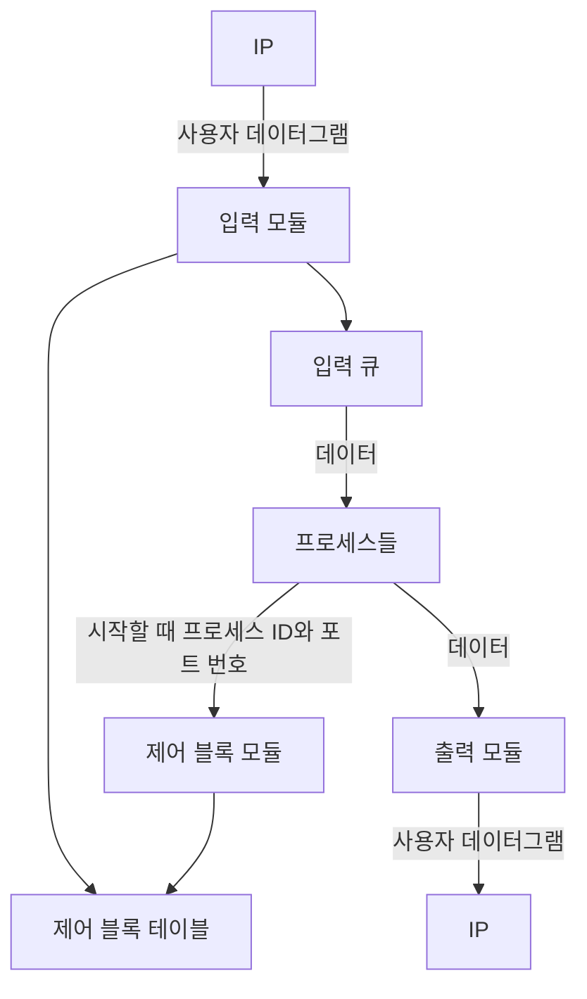

*그림 17. UDP 패키지의 다섯 구성 요소와 상호작용*

- **제어 블록 테이블.** 열린 포트를 추적하는 테이블이다. 각 항목은 적어도 상태(FREE 또는 IN-USE), 프로세스 ID, 포트 번호, 큐 번호의 네 필드를 가진다.
- **입력 큐.** 프로세스마다 하나씩 있는 큐이다. 이 설계는 출력 큐를 쓰지 않는다.
- **제어 블록 모듈.** 프로세스가 시작하면 운영체제에 포트 번호를 요청한다. 운영체제는 서버에는 잘 알려진 포트 번호를, 클라이언트에는 임시 포트 번호를 할당한다. 프로세스가 프로세스 ID와 포트 번호를 넘기면 제어 블록 모듈은 FREE 항목을 찾아 IN-USE로 바꾸고 두 값을 기록한다. FREE 항목이 없으면 미리 정한 전략으로 항목 하나를 지운다. 이 모듈은 큐를 만들지 않으므로 큐 번호 필드는 비어 있다.
- **입력 모듈.** IP에서 사용자 데이터그램을 받아, 같은 포트 번호를 가진 항목을 제어 블록 테이블에서 찾는다. 항목이 있으면 큐가 할당되어 있는지 보고, 없으면 큐를 할당한 뒤 데이터를 큐에 넣는다. 항목이 없으면 ICMP에 포트 도달 불가 메시지를 요청하고 사용자 데이터그램을 버린다.
- **출력 모듈.** 사용자 데이터그램을 만들어 보낸다.

### 10.2 동작 예

처음 제어 블록 테이블이 표 13과 같다고 가정한다.

| 상태 | 프로세스 ID | 포트 번호 | 큐 번호 |
|:-----|:-----|:-----|:-----|
| IN-USE | 2,345 | 52,010 | 34 |
| IN-USE | 3,422 | 52,011 | |
| FREE | | | |
| IN-USE | 4,652 | 52,012 | 38 |
| FREE | | | |

*표 13. 동작 예를 시작할 때의 제어 블록 테이블*

1. 목적지 포트가 52,012인 사용자 데이터그램이 도착한다. 입력 모듈은 이 포트를 찾고, 큐 38이 이미 할당되어 있으므로 데이터를 큐 38에 넣는다. 테이블은 바뀌지 않는다.
2. 몇 초 뒤 새 프로세스가 시작하여 운영체제에서 포트 번호 52,014를 받는다. 프로세스가 ID 4,978과 포트 번호를 제어 블록 모듈에 넘기면 모듈은 첫 번째 FREE 항목(셋째 줄)에 이 정보를 기록한다. 아직 이 목적지로 온 사용자 데이터그램이 없으므로 큐는 할당하지 않는다.
3. 포트 52,011로 사용자 데이터그램이 도착한다. 이 목적지로 온 첫 사용자 데이터그램이므로 큐가 없다. 입력 모듈은 큐를 만들어 번호 43을 주고 데이터를 넣는다.
4. 몇 초 뒤 포트 52,222로 사용자 데이터그램이 도착한다. 테이블에 이 포트의 항목이 없으므로 사용자 데이터그램을 버리고, ICMP에 출발지로 포트 도달 불가 메시지를 보내 달라고 요청한다.

| 상태 | 프로세스 ID | 포트 번호 | 큐 번호 |
|:-----|:-----|:-----|:-----|
| IN-USE | 2,345 | 52,010 | 34 |
| IN-USE | 3,422 | 52,011 | 43 |
| IN-USE | 4,978 | 52,014 | |
| IN-USE | 4,652 | 52,012 | 38 |
| FREE | | | |

*표 14. 네 사건이 모두 처리된 뒤의 제어 블록 테이블*

---

<br>

## 개념 적용

**T/F 점검:**

| 문장 | 판단과 근거 |
|:-----|:-----|
| 라우터는 세그먼트의 포트 번호를 보고 데이터그램을 포워딩한다. | **F.** 전송 계층 프로토콜은 종단 시스템에만 구현되며, 라우터는 데이터그램의 네트워크 계층 필드만 보고 동작한다. |
| 출발지 IP 주소가 서로 다른 두 UDP 세그먼트라도 목적지 IP 주소와 목적지 포트 번호가 같으면 같은 소켓에 전달된다. | **T.** UDP 소켓은 목적지 IP 주소와 목적지 포트 번호의 2-튜플로 식별된다. |
| 웹 서버에 접속한 두 클라이언트의 출발지 포트 번호가 같으면 서버는 두 연결을 구분할 수 없다. | **F.** TCP 연결 소켓은 4-튜플로 식별되므로 출발지 IP 주소가 다르면 출발지 포트 번호가 같아도 구분된다. |
| UDP의 길이 필드가 없어도 사용자 데이터그램의 길이를 구할 수 있다. | **T.** IP 전체 길이에서 IP 헤더 길이를 빼면 되지만, UDP는 IP 헤더가 이미 제거된 상태에서 계산하기 위해 길이 필드를 둔다. |
| UDP 체크섬이 맞으면 데이터그램이 올바른 호스트에 도착했다고 볼 수 있다. | **T.** 체크섬에 출발지와 목적지 IP 주소를 담은 의사 헤더가 포함되므로, 목적지 주소가 바뀐 채 다른 호스트에 도착하면 체크섬 검사가 실패한다. 다만 체크섬은 모든 오류를 잡지는 못하는 검출 기법이다. |
| UDP는 오류를 검출하면 송신자에게 재전송을 요청한다. | **F.** UDP는 손상된 사용자 데이터그램을 조용히 버릴 뿐 송신자에게 아무 피드백도 보내지 않는다. |
| 혼잡 제어가 없다는 점은 UDP 응용에 언제나 장점이다. | **F.** 응용은 속도 제약을 받지 않지만, 제어되지 않는 UDP 트래픽은 높은 손실률과 TCP 트래픽의 밀려남을 일으킬 수 있다. |

---

<br>

## 요약

| 개념 | 핵심 요약 |
|:-----|:-----|
| 전송 계층 | 전송 계층은 종단 시스템에만 구현되며 서로 다른 호스트의 프로세스 사이에 논리적 통신을 제공한다. |
| 두 계층의 관계 | 네트워크 계층은 호스트 사이를, 전송 계층은 프로세스 사이를 연결하며, 전송 계층의 서비스는 네트워크 계층의 서비스 모델에 제약을 받는다. |
| 포트 번호 | 포트 번호는 프로세스를 식별하는 16비트 정수이며, 0\~1,023은 잘 알려진 포트, 1,024\~49,151은 등록 포트, 49,152\~65,535는 동적 포트이다. |
| 소켓 주소 | IP 주소와 포트 번호를 결합한 소켓 주소가 통신의 한쪽 끝을 식별하며, 통신에는 양쪽의 소켓 주소가 필요하다. |
| 다중화와 역다중화 | 송신 측은 여러 소켓의 데이터를 모아 헤더를 붙이고(다중화), 수신 측은 헤더의 포트 번호로 세그먼트를 알맞은 소켓에 전달한다(역다중화). |
| 소켓 식별자 | UDP 소켓은 목적지 IP 주소와 목적지 포트 번호의 2-튜플로, TCP 연결 소켓은 출발지와 목적지의 IP 주소와 포트 번호로 이루어진 4-튜플로 식별된다. |
| 비연결형과 연결형 | 비연결형 서비스의 패킷은 서로 독립이고, 연결형 서비스는 연결 설정, 데이터 전송, 연결 해제의 세 단계를 거치며 흐름, 오류, 혼잡 제어를 구현할 수 있다. |
| UDP | UDP는 프로세스 간 전달과 체크섬만 제공하는 비연결형, 비신뢰적 프로토콜이다. |
| UDP를 쓰는 이유 | 응용의 세밀한 송신 제어, 연결 설정 지연 없음, 연결 상태 없음, 8바이트의 작은 헤더가 UDP를 선택하는 이유이다. |
| 사용자 데이터그램 | 사용자 데이터그램은 출발지 포트, 목적지 포트, 전체 길이, 체크섬으로 된 8바이트 헤더를 가지며 길이는 8\~65,535바이트이다. |
| 체크섬 | 체크섬은 의사 헤더, UDP 헤더, 데이터의 16비트 워드를 1의 보수로 더한 합의 1의 보수이며, 수신자의 합이 모두 1이면 오류가 없다고 판단한다. |
| 의사 헤더 | 의사 헤더는 IP 주소와 프로토콜 번호를 체크섬에 포함하여 잘못된 호스트나 잘못된 프로토콜로의 전달을 검출하게 한다. |
| 큐잉 | UDP는 포트마다 큐를 두며, 큐가 없거나 넘치면 데이터그램을 버리고 ICMP 포트 도달 불가 메시지를 요청한다. |
| UDP 응용 | DNS, SNMP, TFTP, RIP, 멀티캐스트, 실시간 멀티미디어처럼 짧은 요청과 응답이나 고른 지연이 중요한 응용이 UDP를 쓴다. |

---

<br>

## 점검 문제

1. **헤더 해석:** UDP 헤더를 16진수로 나타낸 값이 `0035C1A2002BA7E1`이다. 출발지 포트, 목적지 포트, 사용자 데이터그램의 전체 길이, 데이터 길이를 구하고, 이 데이터그램이 클라이언트에서 서버로 가는지 그 반대인지 판단하라.

   <details>
   <summary>정답</summary>

   네 자리씩 끊으면 출발지 포트는 `0x0035` = 53, 목적지 포트는 `0xC1A2` = 49,570, 전체 길이는 `0x002B` = 43바이트이고, 마지막 `0xA7E1`은 체크섬이다. 데이터는 43 - 8 = 35바이트이다. 출발지 포트 53은 DNS의 잘 알려진 포트이고 목적지 포트 49,570은 임시 포트이므로, DNS 서버가 클라이언트에게 보내는 응답이다.

   </details>

2. **체크섬 계산:** 체크섬 계산에 들어가는 16비트 워드가 `0xF0F0`, `0x1234`, `0x8001` 세 개뿐이라고 가정한다. 1의 보수 합과 체크섬을 구하고 수신 측 검산 결과를 보여라.

   <details>
   <summary>정답</summary>

   `0xF0F0` + `0x1234` = `0x10324`이다. 16비트를 넘는 자리올림 1을 맨 아래 비트에 다시 더하면 `0x0324` + 1 = `0x0325`이다. 여기에 `0x8001`을 더하면 `0x8326`이고 자리올림은 없다. 체크섬은 합의 모든 비트를 뒤집은 `0x7CD9`이다. 수신자가 세 워드와 체크섬을 더하면 `0x8326` + `0x7CD9` = `0xFFFF`로 모든 비트가 1이다.

   </details>

3. **의사 헤더의 역할:** IP 헤더의 목적지 주소가 손상되었는데 IP 계층에서 걸러지지 않아 데이터그램이 다른 호스트에 전달되었다고 가정한다. 체크섬 계산에 의사 헤더를 넣지 않는다면 그 호스트의 UDP가 이 오류를 검출할 수 있는지, 의사 헤더를 넣으면 무엇이 달라지는지 설명하라.

   <details>
   <summary>정답</summary>

   의사 헤더가 없으면 체크섬은 UDP 헤더와 데이터만 보호한다. 이 부분은 손상되지 않았으므로 체크섬 검사를 통과하고, 잘못 도착한 데이터그램이 같은 포트를 쓰는 프로세스에 전달될 수 있다. 의사 헤더를 넣으면 수신 호스트는 자신의 IP 주소로 의사 헤더를 만들어 합을 다시 계산한다. 이 주소는 송신자가 계산에 쓴 목적지 주소와 다르므로 합이 모두 1이 되지 않고, UDP는 오류를 검출하여 데이터그램을 폐기한다.

   </details>

4. **UDP 소켓과 TCP 소켓:** 서버 S의 포트 5000에 두 클라이언트 A(10.0.0.1, 출발지 포트 40000)와 B(10.0.0.2, 출발지 포트 40000)가 세그먼트를 보낸다. 서버의 응용이 UDP를 쓰는 경우와 TCP를 쓰는 경우(연결 설정은 끝났다고 가정) 각각 두 세그먼트가 몇 개의 소켓으로 전달되는지 쓰고, 서버가 각 클라이언트에게 응답할 때 목적지 포트를 어떻게 정하는지 설명하라.

   <details>
   <summary>정답</summary>

   UDP 소켓은 (목적지 IP 주소, 목적지 포트 번호)로 식별되므로 두 세그먼트는 모두 (S, 5000) 소켓 하나로 전달된다. 서버는 `recvfrom` 같은 호출로 각 세그먼트의 출발지 IP 주소와 출발지 포트를 얻어 그 값을 응답의 목적지로 쓴다. TCP 연결 소켓은 4-튜플로 식별되므로 (10.0.0.1, 40000, S, 5000)과 (10.0.0.2, 40000, S, 5000)의 서로 다른 두 연결 소켓으로 전달된다. 출발지 포트가 같아도 출발지 IP 주소가 다르기 때문이다. 각 연결 소켓으로 보내는 응답의 목적지 포트는 그 연결의 상대 포트인 40000이다.

   </details>

5. **포트 번호의 범위와 연결 구분:** 포트 53, 1,023, 8,080, 49,152, 52,000이 각각 어느 범위에 속하는지 쓰라. 또한 호스트 10.0.0.1의 두 클라이언트 프로세스가 같은 웹 서버 200.23.56.8:80에 동시에 연결할 때 서버가 두 연결을 어떻게 구분하는지 설명하라.

   <details>
   <summary>정답</summary>

   표 2에 따라 53과 1,023은 잘 알려진 범위, 8,080은 등록 범위, 49,152와 52,000은 동적 범위에 속한다. 1,023은 잘 알려진 범위의 마지막 번호이고, 49,152는 동적 범위의 첫 번호이다. 두 클라이언트 프로세스는 운영체제로부터 서로 다른 임시 포트를 받으므로(예: 52,000과 52,001), 두 연결의 4-튜플은 출발지 포트 번호만 다르다. 서버는 이 차이로 두 연결을 서로 다른 연결 소켓으로 구분한다.

   </details>

6. **응용별 전송 프로토콜:** DNS 질의, 전자 메일 전송, 대용량 파일 내려받기, 실시간 영상 통화에 각각 UDP와 TCP 가운데 무엇이 알맞은지 근거와 함께 쓰라.

   <details>
   <summary>정답</summary>

   DNS 질의는 짧은 요청과 응답이 각각 사용자 데이터그램 하나에 들어가고 연결 설정 지연을 피해야 하므로 UDP가 알맞다. 전자 메일은 메시지가 길어 여러 조각으로 나뉘면 순서가 중요하고, 즉각적인 응답을 기대하지 않으므로 연결 설정 지연이 문제되지 않아 TCP가 알맞다. 대용량 파일은 일부라도 빠지거나 손상되면 안 되고 부분 사이의 지연은 중요하지 않으므로 TCP가 알맞다. 실시간 영상 통화는 재전송으로 생기는 고르지 않은 지연이 더 해로우며 약간의 손실은 견딜 수 있으므로 UDP가 알맞다. 다만 순서가 어긋난 프레임은 응용이 재정렬하거나 버려야 한다.

   </details>

7. **UDP 큐와 ICMP:** 표 14의 상태에서 포트 52,014로 사용자 데이터그램이 도착한 뒤 포트 52,013으로 다른 사용자 데이터그램이 도착한다. 각 사건에서 UDP 패키지가 하는 일과 테이블의 변화를 쓰라.

   <details>
   <summary>정답</summary>

   포트 52,014의 항목은 있지만 큐가 할당되어 있지 않으므로, 입력 모듈은 새 큐를 할당하여 그 번호를 항목의 큐 번호 필드에 기록하고 데이터를 넣는다. 포트 52,013의 항목은 테이블에 없으므로 사용자 데이터그램을 버리고 ICMP에 출발지로 포트 도달 불가 메시지를 보내 달라고 요청하며, 테이블은 바뀌지 않는다.

   </details>

---

<br>

## 참고 문헌

1. T. Ylonen and C. Lonvick, Ed., "The Secure Shell (SSH) Transport Layer Protocol," RFC 4253, Jan. 2006. [Online]. Available: https://www.rfc-editor.org/rfc/rfc4253
2. A. Melnikov, Ed., and B. Leiba, Ed., "Internet Message Access Protocol (IMAP) - Version 4rev2," RFC 9051, Aug. 2021. [Online]. Available: https://www.rfc-editor.org/rfc/rfc9051
3. E. Rescorla, "HTTP Over TLS," RFC 2818, May 2000. [Online]. Available: https://www.rfc-editor.org/rfc/rfc2818
