# Chapter 6 — Transport-Layer Services and UDP

[Repository Guide](../../README.md) | [English](Concepts_Lecture.md) | [한국어](Concepts_Lecture.ko.md)

> **Last Updated:** 2026-11-18
>
> Computer Networking: A Top-Down Approach, Kurose and Ross, Ch 3; TCP/IP Protocol Suite, Forouzan, Ch 13, 14

> **Learning Objectives:**
> 1. Explain the logical communication that the transport layer provides on top of the network layer and the relationship between the two layers
> 2. Explain how port numbers and socket addresses identify processes, and distinguish the ranges of port numbers
> 3. Explain the difference between UDP and TCP multiplexing and demultiplexing in terms of socket identifiers
> 4. Compare connectionless and connection-oriented services
> 5. Interpret a UDP user datagram header and compute the checksum including the pseudoheader
> 6. Choose the transport protocol that suits an application based on the services UDP does and does not provide

---

## Table of Contents

- [1. Role of the Transport Layer](#1-role-of-the-transport-layer)
  - [1.1 Logical Communication](#11-logical-communication)
  - [1.2 Relationship Between the Transport and Network Layers](#12-relationship-between-the-transport-and-network-layers)
  - [1.3 Overview of the Transport Layer in the Internet](#13-overview-of-the-transport-layer-in-the-internet)
- [2. Process-to-Process Communication and Port Numbers](#2-process-to-process-communication-and-port-numbers)
  - [2.1 Host-to-Host and Process-to-Process Communication](#21-host-to-host-and-process-to-process-communication)
  - [2.2 Port Numbers](#22-port-numbers)
  - [2.3 Ranges of Port Numbers](#23-ranges-of-port-numbers)
  - [2.4 Socket Addresses](#24-socket-addresses)
  - [2.5 Well-Known Ports](#25-well-known-ports)
- [3. Multiplexing and Demultiplexing](#3-multiplexing-and-demultiplexing)
  - [3.1 The Concepts of Multiplexing and Demultiplexing](#31-the-concepts-of-multiplexing-and-demultiplexing)
  - [3.2 Connectionless Multiplexing and Demultiplexing](#32-connectionless-multiplexing-and-demultiplexing)
  - [3.3 Connection-Oriented Multiplexing and Demultiplexing](#33-connection-oriented-multiplexing-and-demultiplexing)
  - [3.4 Web Servers and TCP Sockets](#34-web-servers-and-tcp-sockets)
- [4. Connectionless and Connection-Oriented Services](#4-connectionless-and-connection-oriented-services)
  - [4.1 Connectionless Service](#41-connectionless-service)
  - [4.2 Connection-Oriented Service](#42-connection-oriented-service)
  - [4.3 The Two Services as Finite State Machines](#43-the-two-services-as-finite-state-machines)
  - [4.4 Comparison of the Two Services](#44-comparison-of-the-two-services)
- [5. Overview of UDP](#5-overview-of-udp)
  - [5.1 Position and Nature of UDP](#51-position-and-nature-of-udp)
  - [5.2 Reasons for Choosing UDP](#52-reasons-for-choosing-udp)
  - [5.3 The Problem of Missing Congestion Control](#53-the-problem-of-missing-congestion-control)
- [6. User Datagram Format](#6-user-datagram-format)
  - [6.1 Header Format](#61-header-format)
  - [6.2 The Length Field and the Maximum Data Size](#62-the-length-field-and-the-maximum-data-size)
  - [6.3 An Example of Header Interpretation](#63-an-example-of-header-interpretation)
- [7. UDP Services](#7-udp-services)
  - [7.1 Process-to-Process Communication and Connectionless Service](#71-process-to-process-communication-and-connectionless-service)
  - [7.2 Flow Control, Error Control, and Congestion Control](#72-flow-control-error-control-and-congestion-control)
  - [7.3 Encapsulation and Decapsulation](#73-encapsulation-and-decapsulation)
  - [7.4 Queuing](#74-queuing)
  - [7.5 Multiplexing and Demultiplexing in UDP](#75-multiplexing-and-demultiplexing-in-udp)
  - [7.6 Comparison with the Simple Protocol](#76-comparison-with-the-simple-protocol)
- [8. The UDP Checksum](#8-the-udp-checksum)
  - [8.1 One's Complement Sum and the Checksum](#81-ones-complement-sum-and-the-checksum)
  - [8.2 An Example with Three 16-Bit Words](#82-an-example-with-three-16-bit-words)
  - [8.3 The Pseudoheader](#83-the-pseudoheader)
  - [8.4 An Example Including the Pseudoheader](#84-an-example-including-the-pseudoheader)
  - [8.5 Optional Use of the Checksum](#85-optional-use-of-the-checksum)
  - [8.6 Why End-to-End Error Detection Is Needed](#86-why-end-to-end-error-detection-is-needed)
- [9. UDP Applications](#9-udp-applications)
  - [9.1 Features of UDP from the Viewpoint of Application Design](#91-features-of-udp-from-the-viewpoint-of-application-design)
  - [9.2 Choices Illustrated by Applications](#92-choices-illustrated-by-applications)
  - [9.3 Typical UDP Applications](#93-typical-udp-applications)
  - [9.4 Comparison of UDP and TCP](#94-comparison-of-udp-and-tcp)
- [10. The UDP Package](#10-the-udp-package)
  - [10.1 Components](#101-components)
  - [10.2 An Example of Operation](#102-an-example-of-operation)
- [Concept Applications](#concept-applications)
- [Summary](#summary)
- [Self-Check Questions](#self-check-questions)
- [References](#references)

---

<br>

## 1. Role of the Transport Layer

### 1.1 Logical Communication

The **transport layer** is located between the application layer and the network layer. It receives services from the network layer below and provides services to the application layer above. IP, the network-layer protocol, can deliver a message only to the destination computer; handing the message to the correct process inside that computer is the job of the transport layer.

> **Definition:** **Logical communication** means that, from an application's perspective, two processes on different hosts communicate as if they were directly connected. Even when the hosts are on opposite sides of the planet and the messages cross numerous routers and many kinds of links, the application processes exchange messages without worrying about that physical infrastructure.

Transport-layer protocols are implemented in end systems and not in the routers inside the network. The sending-side transport layer breaks the messages it receives from an application process into smaller chunks when necessary and adds a transport-layer header to each chunk to form a transport-layer packet. In Internet terminology this packet is called a **segment**. At the network layer the segment is encapsulated in a datagram and sent to the destination, and the receiving-side network layer extracts the segment from the datagram and passes it up to the transport layer. Routers act only on the network-layer fields of the datagram and do not examine the fields of the segment encapsulated in it.

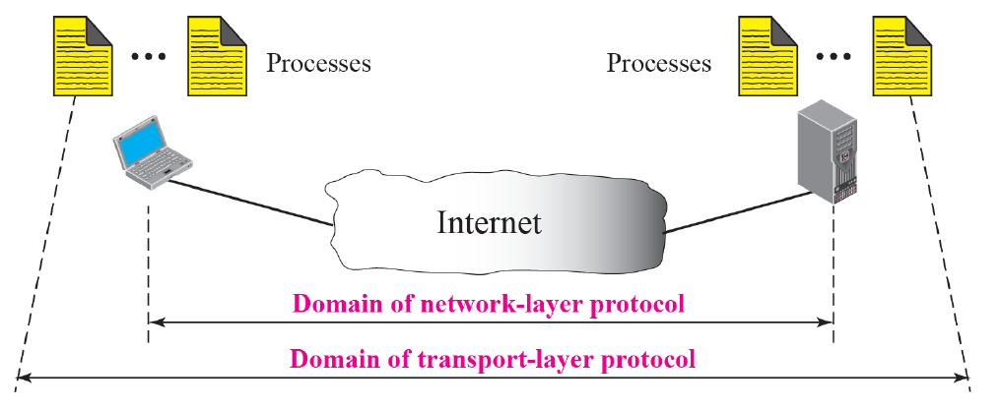

*Figure 1. Domains of the network-layer protocol and the transport-layer protocol*

In Figure 1 the domain of the network-layer protocol ends between the two computers (host to host), while the domain of the transport-layer protocol extends to the processes inside the two computers (process to process).

> **Note:** **Differences in terminology.** Internet documents (RFCs) often call a TCP packet a segment and a UDP packet a datagram. Because the network-layer packet is also called a datagram, this causes confusion. The textbook by Kurose and Ross calls every transport-layer packet a segment and reserves the word datagram for the network-layer packet. The textbook by Forouzan calls a UDP packet a user datagram and a TCP packet a segment. These notes use the term user datagram in the sections on UDP and the term segment in general discussions and for TCP.

### 1.2 Relationship Between the Transport and Network Layers

A transport-layer protocol provides logical communication between **processes** running on different hosts, whereas a network-layer protocol provides logical communication between **hosts**. This subtle distinction is easy to see with an analogy of letters exchanged between two households.

Suppose there is one house on the East Coast and one on the West Coast, and twelve children live in each house. The children in the two houses are cousins, and every child writes one letter each week to every cousin in the other house. Thus 12 × 12 = 144 letters go from one house to the other every week. In the West Coast house Ann, and in the East Coast house Bill, collects the letters of the brothers and sisters, hands them to the postal carrier, and distributes the arriving letters to the brothers and sisters.

| Analogy | Network |
|:-----|:-----|
| Letters in envelopes | Application messages |
| Cousins (each child) | Processes |
| Houses | Hosts (end systems) |
| Ann and Bill | Transport-layer protocol |
| Postal service (including mail carriers) | Network-layer protocol |

*Table 1. The letter-exchange analogy and its counterparts in a network*

The postal service moves letters from house to house and never delivers them to a person directly; the logical communication between persons is provided by Ann and Bill. Ann and Bill work only inside their own houses and take no part in sorting mail at intermediate post offices. In the same way, a transport-layer protocol only moves messages within an end system between the application processes and the network edge (the network layer); it has no say in how the messages are moved within the network core.

Suppose Ann and Bill go on vacation and the younger Susan and Harvey take over. They pick up the letters less often and occasionally lose some. That is, Susan and Harvey provide a different service model from Ann and Bill. Likewise, one network can offer several transport protocols with different service models.

The services Ann and Bill can provide are constrained by the services the postal service provides. If the postal service does not guarantee an upper bound on delivery time, Ann and Bill cannot guarantee the delivery time of letters between cousins either. In the same way, if the network layer guarantees neither delay nor bandwidth, the transport layer cannot guarantee them for messages between processes. Some services, however, can be offered by the transport layer even when the network layer does not offer them. Even when the network layer loses, corrupts, or duplicates packets, the transport layer can provide reliable data transfer (Chapters 7 and 8), and even when the network layer does not guarantee confidentiality, the transport layer can protect messages with encryption (Chapter 26).

> **Key Point:** The network layer provides logical communication between hosts, and the transport layer provides logical communication between processes. The services of the transport layer are constrained by the service model of the network layer, but services that the network layer lacks, such as reliability and confidentiality, can also be built on top of it.

### 1.3 Overview of the Transport Layer in the Internet

IP, the network-layer protocol of the Internet, provides a **best-effort delivery service**. IP makes its best effort to deliver segments but guarantees neither delivery itself, nor the order of delivery, nor the integrity of the data, so it is called an unreliable service. Every host has at least one IP address (Chapter 12).

The Internet makes two transport-layer protocols available to the application layer, and the application developer chooses one of them when creating a socket.

- **UDP (User Datagram Protocol)** provides an unreliable, connectionless service. The only two services UDP provides are process-to-process data delivery and error checking.
- **TCP (Transmission Control Protocol)** provides a reliable, connection-oriented service. Using flow control, sequence numbers, acknowledgments, and timers, TCP delivers data from the sending process to the receiving process correctly and in order. TCP also provides congestion control.

Extending the host-to-host delivery provided by IP to process-to-process delivery is called transport-layer multiplexing and demultiplexing (Section 3). Congestion control is less a service to an individual application than a service to the Internet as a whole. TCP congestion control keeps one connection from swamping the links and routers on its path with excessive traffic and regulates the sending rate so that connections crossing a congested link share its bandwidth equally (Chapter 9). UDP traffic has no such regulation, and an application using UDP can send at any rate it pleases, for as long as it pleases.

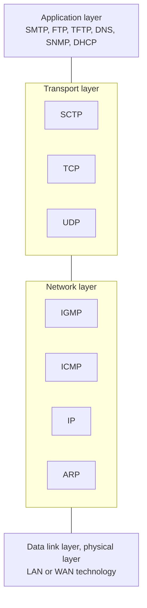

*Figure 2. Position of the transport-layer protocols in the TCP/IP protocol suite*

> **Note:** **SCTP.** SCTP (Stream Control Transmission Protocol) in Figure 2 is a third transport-layer protocol that combines features of UDP and TCP, and the textbook by Forouzan devotes a chapter (Chapter 16) to it. These notes cover only UDP and TCP, which are widely used in the Internet.

---

<br>

## 2. Process-to-Process Communication and Port Numbers

### 2.1 Host-to-Host and Process-to-Process Communication

> **Definition:** **Process-to-process communication** is the exchange of data between an application process running on one host and an application process running on another host. A process is an application-layer entity, that is, a running program, that uses the services of the transport layer.

The network layer is responsible for communication at the computer level, that is, host-to-host communication. A network-layer protocol delivers a message only to the destination computer, so the delivery is still incomplete. The message must still be handed to the correct process on that computer, and this is the first duty of a transport-layer protocol: process-to-process communication.

There are several ways to achieve process-to-process communication, but the most common is the **client-server paradigm**. A **client**, a process on the local host, requests a service from a **server**, a process usually running on a remote host. For example, to get the date and time from a remote computer, a Daytime client process must run on the local host and a Daytime server process on the remote computer. Today's operating systems support multiuser and multiprogramming environments, so one remote computer can run several server programs at the same time and a local computer can run several client programs at the same time. Communication therefore requires all four of the following to be defined.

1. Local host
2. Local process
3. Remote host
4. Remote process

The local host and the remote host are defined by IP addresses. To define the processes, a second identifier called the port number is needed.

### 2.2 Port Numbers

> **Definition:** A **port number** is a 16-bit integer that identifies a process using the transport-layer services within one host. Its value ranges from 0 to 65,535.

A client program identifies itself with an ephemeral port number.

> **Definition:** An **ephemeral port number** is a port number that the operating system picks for a client process to use only while it communicates. The lifetime of a client is normally short, so it is named ephemeral, meaning "short-lived."

A server process must also identify itself with a port number. If the server's port number were chosen at random, however, a client that wants to reach the server would have no way of knowing it. One could send a special packet asking the server for its port number, but that adds overhead. TCP/IP therefore decided to use fixed numbers that everyone knows for servers; these are called **well-known port numbers**. Every client process knows the well-known port number of the server process it contacts. For example, a Daytime client may use the ephemeral port number 52,000, but the Daytime server must use the well-known port number 13.

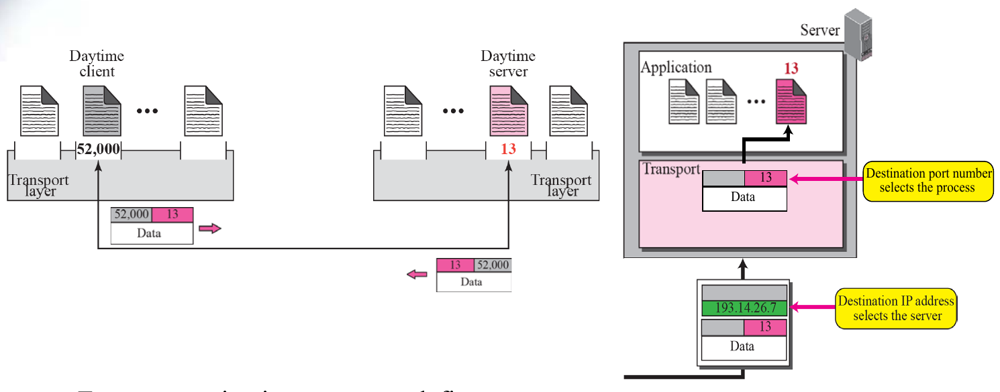

*Figure 3. Port numbers of a Daytime client and server, and the division of roles between IP addresses and port numbers*

The left side of Figure 3 shows that the header of the client's request carries source port 52,000 and destination port 13, and that the server's response carries the two numbers swapped. The right side shows that the destination IP address (193.14.26.7) selects one server among the hosts of the world, and that once the host is selected, the destination port number (13) selects one process within that host.

### 2.3 Ranges of Port Numbers

ICANN has divided the port numbers into three ranges.

| Range | Name | Management |
|:-----|:-----|:-----|
| 0-1,023 | Well-known ports | Assigned and controlled by ICANN |
| 1,024-49,151 | Registered ports | Neither assigned nor controlled by ICANN; can only be registered with ICANN to prevent duplication |
| 49,152-65,535 | Dynamic or private ports | Neither controlled nor registered; can be used as temporary or private port numbers |

*Table 2. The three ranges of port numbers defined by ICANN*

The original recommendation was that ephemeral port numbers for clients be chosen from the dynamic range, but most systems do not follow it. For some client-server programs to work properly, an ephemeral port number should be greater than 1,023. The textbook by Kurose and Ross explains that when a UDP socket is created, the transport layer automatically assigns it a port number in the range 1,024-65,535 that is not currently used on the host.

### 2.4 Socket Addresses

> **Definition:** A **socket address** is the combination of an IP address and a port number. A client socket address identifies the client process, and a server socket address identifies the server process, uniquely in the world.

```text
IP address:      200.23.56.8
Port number:     69
Socket address:  200.23.56.8:69
```

*Figure 4. A socket address combining an IP address and a port number*

Using the transport-layer services requires a pair of socket addresses, the client socket address and the server socket address, that is, four pieces of information. The two IP addresses are in the header of the network-layer packet (the IP header), and the two port numbers are in the header of the transport-layer packet (the UDP or TCP header).

> **[Systems Programming]** The socket interface covered in systems programming is a set of system calls with which an application process creates and uses a communication endpoint identified by such a socket address. A server attaches its well-known port to a socket with `bind`, whereas a client usually does not specify a port, so the operating system picks an ephemeral port and attaches it at `connect` or at the first send.

> **Key Point:** The IP address selects the host and the port number selects the process within that host. The socket address that combines the two identifies one end of a communication, and a communication needs the socket addresses of both ends.

### 2.5 Well-Known Ports

Table 3 lists frequently used well-known ports and the transport protocols that use them. When a service can use both UDP and TCP, it uses the same port number with both protocols.

| Port | Service | Transport protocol | Description |
|:-----|:-----|:-----|:-----|
| 7 | Echo | UDP, TCP | Echoes received data back to the sender |
| 9 | Discard | UDP, TCP | Discards all received data |
| 11 | Users | UDP, TCP | List of active users |
| 13 | Daytime | UDP, TCP | Returns the date and the time |
| 17 | Quote | UDP, TCP | Returns a quote of the day |
| 19 | Chargen | UDP, TCP | Generates and returns a string of characters |
| 20, 21 | FTP | TCP | File transfer (20 for data, 21 for control) |
| 22 | SSH | TCP | Secure remote login [1] |
| 23 | TELNET | TCP | Remote login |
| 25 | SMTP | TCP | Electronic mail transfer |
| 53 | DNS | UDP, TCP | Domain Name System |
| 67, 68 | BOOTP, DHCP | UDP | Bootstrap information and address configuration (67 for the server, 68 for the client) |
| 69 | TFTP | UDP | Trivial file transfer |
| 79 | Finger | TCP | User information lookup |
| 80 | HTTP | TCP | Web |
| 110 | POP3 | TCP | Downloading mail from a mail server |
| 111 | RPC | UDP | Remote procedure call |
| 123 | NTP | UDP | Network time synchronization |
| 143 | IMAP | TCP | Access to mail on a mail server [2] |
| 161, 162 | SNMP | UDP | Network management (162 for trap messages) |
| 443 | HTTPS | TCP | HTTP over TLS [3] |
| 520 | RIP | UDP | Exchange of distance-vector routing information |

*Table 3. Well-known port numbers and their transport protocols*

DNS is covered in Chapter 5, HTTP in Chapter 3, SMTP, POP3, IMAP, FTP, TFTP, TELNET, and SSH in Chapter 4, DHCP in Chapter 12, RIP in Chapter 15, and SNMP in Chapter 17. All the ports in Table 3 belong to the well-known range of 1,023 and below.

---

<br>

## 3. Multiplexing and Demultiplexing

### 3.1 The Concepts of Multiplexing and Demultiplexing

Several application processes on one host can use the network at the same time. For example, if you download Web pages while running one FTP session and two Telnet sessions, four processes use the network. The transport layer must deliver the data it receives from the network layer to one of these four processes.

A process has one or more **sockets**. A socket is the door through which data passes from the network into the process and from the process into the network. The transport layer of the receiving host does not deliver data directly to a process but to an intermediary socket. Because a host can have several sockets, each socket has a unique identifier, whose format depends on whether it is a UDP socket or a TCP socket.

> **Definition:** **Demultiplexing** is the job of the receiving-side transport layer of examining the header fields of an arriving segment and delivering the data in that segment to the correct socket.

> **Definition:** **Multiplexing** is the job of the sending-side transport layer of gathering data chunks from several sockets, adding to each chunk the header information to be used for demultiplexing to create segments, and passing the segments to the network layer.

The textbook by Forouzan defines the same concepts as follows: accepting items from several sources is multiplexing (many to one), and delivering items to several destinations is demultiplexing (one to many). In the letter analogy, Ann collecting the letters of her brothers and sisters and handing them to the carrier is multiplexing, and Bill looking at the addressee of each received letter and handing it to the right brother or sister is demultiplexing. Multiplexing and demultiplexing are not a concern of the transport layer alone; they are needed wherever one protocol at one layer is used by several protocols at the layer directly above.

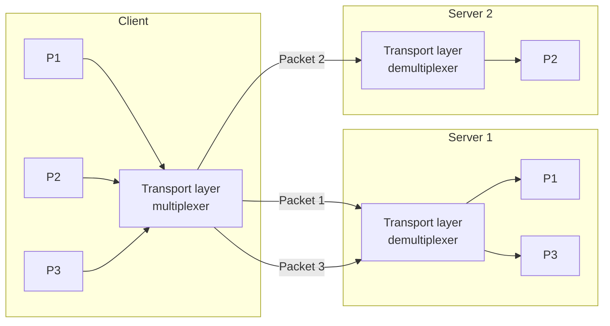

*Figure 5. Multiplexing and demultiplexing between one client and two servers*

In Figure 5 the client processes P1, P2, and P3 each send a request. The requests of P1 and P3 go to the first server, and the request of P2 goes to the second server. The client's transport layer acts as a multiplexer that accepts the messages of the three processes and creates three packets. The transport layer of the first server acts as a demultiplexer that receives packets 1 and 3 and hands them to two different processes, and the transport layer of the second server acts as a demultiplexer that hands packet 2 to the corresponding process.

Multiplexing requires two things. First, each socket must have a unique identifier. Second, each segment must have special fields that indicate the socket to which it is to be delivered. These fields are the source port number field and the destination port number field. UDP and TCP segments have other fields as well, covered in Section 6 and Chapter 8, respectively.

### 3.2 Connectionless Multiplexing and Demultiplexing

When a UDP socket is created, the transport layer can automatically assign it a port number that is not in use, or the application can attach a specific port number (for example, 19157) to the socket. Typically the client side lets the transport layer assign the port automatically, whereas the server side assigns a specific well-known port number.

Suppose a process on Host A using UDP port 19157 sends data to a process on Host B using UDP port 46428. The transport layer of Host A creates a segment containing the application data, the source port number (19157), the destination port number (46428), and two other values (Section 6), and passes it to the network layer. When the segment arrives at Host B, the transport layer examines the destination port number (46428) and delivers the segment to the socket identified by that number.

A UDP socket is fully identified by a **two-tuple of the destination IP address and the destination port number**. Consequently, two UDP segments that have the same destination IP address and destination port number are delivered to the same process through the same socket even if their source IP addresses or source port numbers differ.

What, then, is the source port number for? The source port number serves as part of a return address. When B sends a segment back to A, the destination port of the B-to-A segment takes the value of the source port of the A-to-B segment. The complete return address is A's IP address and the source port number. A UDP server program responds by extracting the client-side (source) port number from a received segment and sending a new segment with that number as the destination port number.

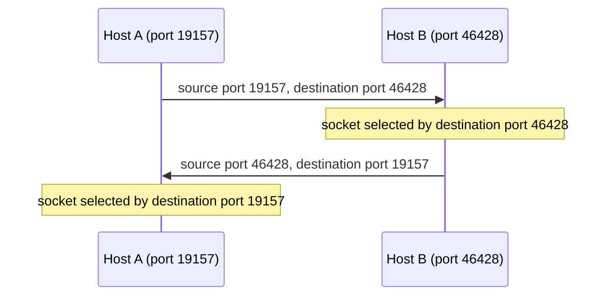

*Figure 6. Source and destination port numbers swapped between a request and its response*

### 3.3 Connection-Oriented Multiplexing and Demultiplexing

Unlike a UDP socket, a TCP socket is identified by a **four-tuple of the source IP address, source port number, destination IP address, and destination port number**. When a TCP segment arrives, the host uses all four values to demultiplex the segment to the appropriate socket. Therefore, unlike in UDP, two TCP segments with different source IP addresses or source port numbers are delivered to two different sockets. The exception is the first segment carrying a connection-establishment request.

A TCP server application has a **welcoming socket** that waits for connection-establishment requests from TCP clients on port 12000. A connection-establishment request is nothing more than a TCP segment with destination port number 12000 and a special connection-establishment bit (the SYN of Chapter 8) set in the TCP header, and it also carries a source port number chosen by the client. When the operating system of the server host receives this request, it locates the server process waiting for connections on port 12000, and the server process creates a new socket. The server's transport layer records the source port number of the connection-request segment, the IP address of the source host, the destination port number, and its own IP address. The newly created **connection socket** is identified by these four values, and every subsequently arriving segment whose four values all match is demultiplexed to this socket.

| Item | UDP socket | TCP connection socket |
|:-----|:-----|:-----|
| Identifier | (destination IP address, destination port number) | (source IP address, source port number, destination IP address, destination port number) |
| Two segments differing only in their source | Delivered to the same socket | Delivered to different sockets |
| Role of the source port number | Part of the return address | Part of the socket identifier and part of the return address |

*Table 4. How UDP sockets and TCP connection sockets are identified*

Suppose server B runs a Web server on port 80, Host C opens two HTTP sessions, and Host A opens one HTTP session. Host C assigns different source port numbers, 26145 and 7532, to its two connections. Host A chooses its ports independently of C, so A's connection may also use source port 26145. This is not a problem: the two connections with the same source port number have different source IP addresses, so server B distinguishes them correctly.

| Connection | Source IP address | Source port | Destination IP address | Destination port |
|:-----|:-----|:-----|:-----|:-----|
| First connection of C | C | 26145 | B | 80 |
| Second connection of C | C | 7532 | B | 80 |
| Connection of A | A | 26145 | B | 80 |

*Table 5. Four-tuples of three TCP connections to the same Web server port*

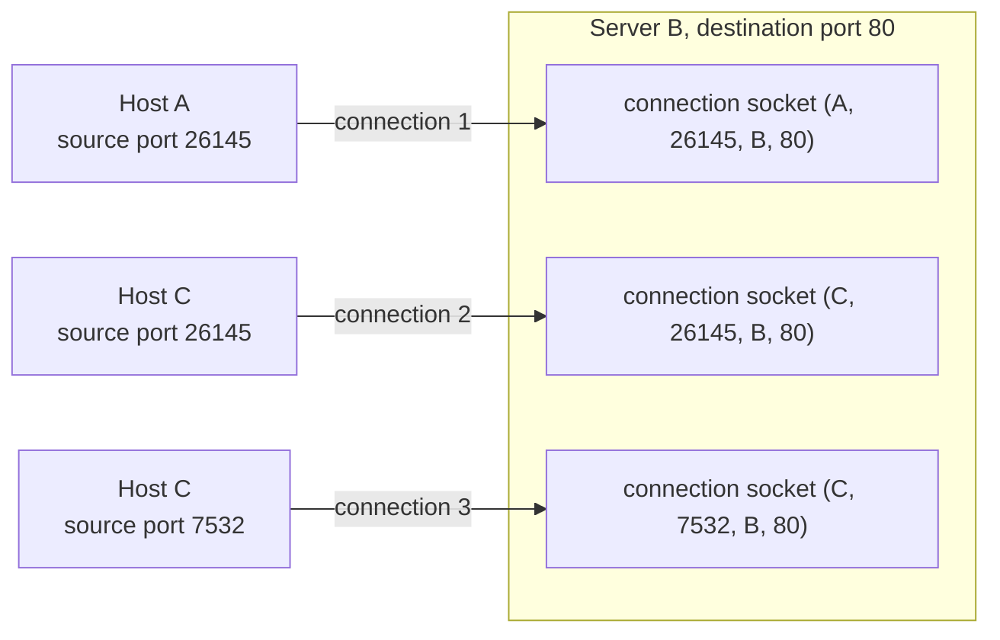

*Figure 7. Connection sockets of a Web server distinguished by four-tuples*

### 3.4 Web Servers and TCP Sockets

All segments that clients send to a Web server running on port 80, whether connection-establishment segments or segments carrying HTTP requests, have destination port 80. The server distinguishes the clients by their source IP addresses and source port numbers.

A Web server may spawn a new process for each connection, but connection sockets and processes do not always correspond one to one. A high-performing Web server may use only one process and create a new thread with a new connection socket for each client connection. In that case many connection sockets with different identifiers are attached to one process.

> **[Operating Systems]** A thread, studied in operating systems, is a flow of execution that runs independently while sharing the address space and resources of its process. A server that creates a thread per connection pays less for creation and context switching than a server that creates a process per connection, which helps it handle many connections at once.

If the client and server use persistent HTTP, they exchange HTTP messages through the same server socket for as long as the connection lasts. If they use non-persistent HTTP, a new TCP connection and a new socket are created and closed for every request and response, which can severely impact the performance of a busy Web server (Chapter 3).

> **Note:** **Port scanning.** A server process waits on an open port for contact from remote clients, and some ports are reserved for well-known applications. Knowing which ports of a host are open therefore suggests which applications run on the host. Administrators use this information to learn which applications run in their networks, and attackers use it to find applications with known security flaws. Port scanners such as nmap scan TCP ports looking for ports that accept connections and scan UDP ports looking for ports that respond. The three possible outcomes of a TCP port scan are covered in Chapter 8.

---

<br>

## 4. Connectionless and Connection-Oriented Services

Like a network-layer protocol, a transport-layer protocol can provide two kinds of service: connectionless and connection-oriented. The meaning of these words differs between the two layers, however. At the network layer, a connectionless service means that datagrams belonging to the same message may take different paths (Chapter 10). The transport layer is not concerned with the physical paths of packets and assumes a logical connection between the two transport layers, so at the transport layer connectionless means independence between packets and connection-oriented means dependency between packets.

### 4.1 Connectionless Service

In a connectionless service, the source process (application program) divides its message into chunks of data of a size acceptable to the transport layer and delivers them to the transport layer one by one. The transport layer treats each chunk as an independent unit with no relation to the other chunks and encapsulates each chunk in a packet and sends it as it arrives. Because the packets do not depend on one another, they may arrive at the destination out of order and be delivered to the server process in that order.

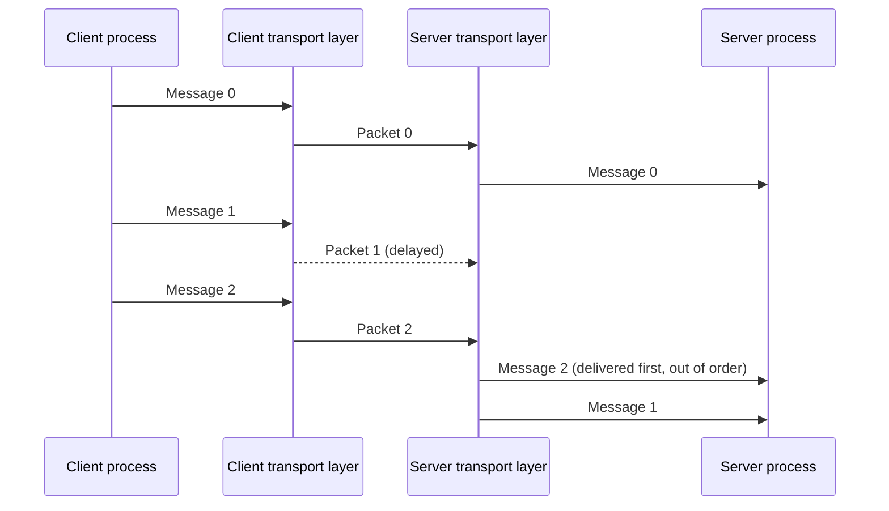

*Figure 8. Messages delivered out of order in a connectionless service*

In Figure 8 the three message chunks are delivered to the client transport layer in order (0, 1, 2), but because the second packet arrives later, they are delivered to the server in the order 0, 2, 1. If the three chunks belong to one message, the server process receives a garbled message. The situation is worse if a packet is lost. Because the packets are not numbered, the receiving transport layer does not even know that a message has disappeared and passes only the remaining two chunks to the server process.

Both problems arise because the two transport layers do not coordinate with each other. The receiving transport layer knows neither when the first packet will come nor when all the packets have arrived. Therefore flow control, error control, and congestion control cannot be implemented effectively in a connectionless service.

### 4.2 Connection-Oriented Service

In a connection-oriented service, the client and the server must first establish a connection between them, and data can be exchanged only after the connection is established. When the data exchange is over, the connection is torn down. Unlike a connection-oriented service at the network layer, which requires coordination between the two end hosts and all the routers in between, a connection-oriented service at the transport layer involves only the two hosts and is end to end. A connection-oriented transport protocol can therefore be built over either a connectionless or a connection-oriented protocol.

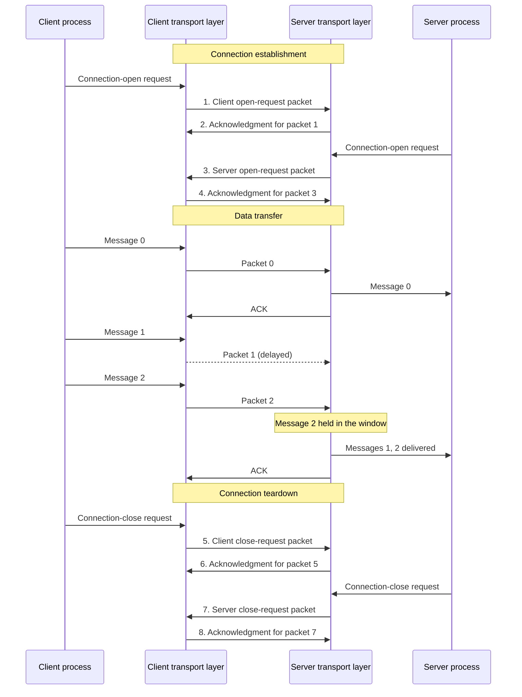

*Figure 9. Connection establishment, data transfer, and connection teardown in a connection-oriented service*

In the data-transfer phase of Figure 9, packet 2 arrives before packet 1, but the server transport layer holds message 2 in its window and delivers both messages in order after message 1 arrives. Flow control, error control, and congestion control can be implemented in a connection-oriented service. Most protocols combine the third and fourth packets of connection establishment, the server's acknowledgment and the server's open request, into one packet; TCP's three-way handshake is an example (Chapter 8).

### 4.3 The Two Services as Finite State Machines

> **Definition:** A **finite state machine (FSM)** is a machine that is always in one of a finite number of states and, when an event occurs, performs the specified actions and moves to the next state. One of the states is designated as the initial state, in which the machine starts when it is turned on.

The behavior of a transport layer is easier to understand when expressed as an FSM. Each event is associated with two reactions: a list of actions to perform (possibly empty) and the next state (possibly the same as the current state).

A connectionless transport layer can be viewed as an FSM with a single state, the established state. The machines on both the client and the server are always in the established state, ready to send and receive transport-layer packets at any time. The FSM of a connection-oriented transport layer goes through three states before reaching the established state and through three states when closing the connection.

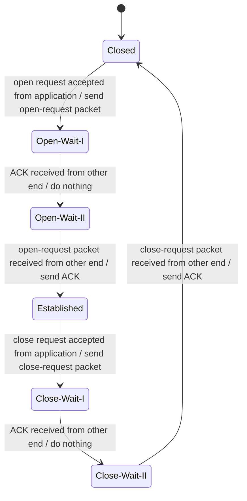

*Figure 10. Finite state machine of a connection-oriented transport layer*

The machine is in the Closed state when there is no connection. When the local process requests that a connection be opened, it sends an open-request packet to the remote transport layer and moves to the Open-Wait-I state. When it receives the acknowledgment from the other end, it moves to the Open-Wait-II state. In this state only a one-way connection has been established, so if a bidirectional connection is needed, the machine waits until the other end also requests a connection. When that request arrives, it sends an acknowledgment and moves to the Established state. Data and data acknowledgments can be exchanged only when both ends are in the Established state, and the Established state is in fact a group of data-transfer states covered in Chapter 7. To close the connection, the machine accepts a close request from the application, sends a close-request packet, and moves to the Close-Wait-I state; on receiving the acknowledgment it moves to the Close-Wait-II state and waits for the close request from the other end, and when that arrives it sends an acknowledgment and returns to the Closed state. The transitions in Figure 10 are written in the form "event / action". TCP modifies this machine by renaming states and by merging or splitting some of them (Chapter 8).

### 4.4 Comparison of the Two Services

| Feature | Connectionless service | Connection-oriented service |
|:-----|:-----|:-----|
| Connection setup and teardown | None | Set up before data exchange and torn down afterward |
| Relation between packets | Independent | Packets of one connection depend on one another |
| Order | May be delivered out of order | Can be delivered in order |
| Loss detection | Impossible, since packets are not numbered | Possible through numbering |
| Flow, error, and congestion control | Cannot be implemented effectively | Can be implemented |
| States of the FSM | A single established state | Several states for connection setup and teardown |
| Example in the Internet | UDP | TCP |

*Table 6. Comparison of connectionless and connection-oriented services at the transport layer*

---

<br>

## 5. Overview of UDP

### 5.1 Position and Nature of UDP

> **Definition:** The **User Datagram Protocol (UDP)** is a connectionless, unreliable transport-layer protocol that provides only process-to-process delivery and light error checking. It is defined in RFC 768.

As Figure 2 shows, UDP lies between the application layer and the IP layer and, like TCP, serves as an intermediary between application programs and network operations. UDP adds almost nothing to the services of IP except process-to-process communication.

- UDP provides process-to-process communication using port numbers.
- UDP is a connectionless, unreliable transport protocol. Its error checking is very limited, consisting of a single checksum, and it has neither acknowledgments for received packets nor flow control. When it detects an error, it silently discards the packet.
- UDP is a simple protocol with minimal overhead. If a process wants to send a small message and does not care much about reliability, it can use UDP. Sending a small message with UDP takes much less interaction between the sender and the receiver than sending it with TCP.

DNS is a typical application-layer protocol that uses UDP. When the DNS application on a host wants to make a query, it constructs a DNS query message and passes it to UDP. Without any handshake with the UDP at the destination, UDP adds header fields and passes the segment to the network layer, which places it in a datagram and sends it to a name server. The DNS application at the querying host then waits for a reply, and if no reply arrives because the query or the reply was lost, it resends the query, sends it to another name server, or tells the application that it cannot get a reply (Chapter 5).

### 5.2 Reasons for Choosing UDP

TCP, which provides a reliable data transfer service, is not always preferable. For the following reasons, UDP suits some applications better.

1. **The application has finer control over what data is sent and when.** As soon as an application process passes data, UDP packages it in a segment and immediately passes it to the network layer. TCP, on the other hand, performs congestion control that throttles the sender when links on the path are congested, and it keeps resending a segment until it is acknowledged, however long that takes. Real-time applications require a minimum sending rate, do not want transmissions overly delayed, and can tolerate some loss, so TCP's service model does not suit them well.
2. **There is no connection establishment.** TCP performs a three-way handshake before transferring data, whereas UDP sends right away without formal preliminaries. UDP therefore introduces no connection-establishment delay. This is the principal reason why DNS runs over UDP rather than TCP.
3. **There is no connection state.** TCP maintains connection state in the end systems, such as send and receive buffers, congestion-control parameters, and sequence and acknowledgment number parameters. UDP maintains no connection state, so a server devoted to one application can typically support many more active clients when the application runs over UDP.
4. **The packet header overhead is small.** A TCP segment has a 20-byte header, whereas UDP has an 8-byte header.

| Application | Application-layer protocol | Transport protocol |
|:-----|:-----|:-----|
| Electronic mail | SMTP | TCP |
| Remote terminal access | Telnet | TCP |
| Web | HTTP | TCP |
| File transfer | FTP | TCP |
| Remote file server | NFS | Typically UDP |
| Streaming multimedia | Typically proprietary | UDP or TCP |
| Internet telephony | Typically proprietary | UDP or TCP |
| Network management | SNMP | Typically UDP |
| Name translation | DNS | Typically UDP |

*Table 7. Popular Internet applications and the transport protocols they use*

Electronic mail, remote terminal access, the Web, and file transfer need reliable data transfer and therefore use TCP. Network management (SNMP) uses UDP because it must run when the network is overloaded, precisely when reliable, congestion-controlled data transfer is difficult. Multimedia applications often use UDP because they can tolerate a small amount of loss and real-time applications react poorly to TCP's congestion control. When loss rates are low, however, and because some organizations block UDP traffic for security reasons, TCP is increasingly used for streaming media as well.

Even with UDP, an application can obtain reliable data transfer by building reliability mechanisms such as acknowledgments and retransmissions (Chapter 7) into the application itself. The QUIC protocol used in Google's Chrome browser is an example: it uses UDP as its transport protocol and implements reliability in an application-layer protocol on top of it. This allows reliable communication without the transmission-rate constraints imposed by TCP's congestion control, but the implementation is by no means simple.

### 5.3 The Problem of Missing Congestion Control

Running multimedia applications over UDP is common but controversial, because UDP has no congestion control. If everyone started streaming high-bit-rate video without congestion control, packets would overflow at routers so much that very few UDP packets would reach their destinations. Moreover, the high loss rates caused by uncontrolled UDP senders would make TCP senders, which reduce their sending rates in response to congestion, cut their rates drastically. Thus the lack of congestion control in UDP can cause high loss rates between UDP senders and receivers and the crowding out of TCP sessions. For this reason, mechanisms that force all senders, including UDP senders, to perform adaptive congestion control have been studied (Chapter 9).

---

<br>

## 6. User Datagram Format

> **Definition:** A **user datagram** is Forouzan's term for a UDP packet, which consists of an 8-byte fixed header and application data.

### 6.1 Header Format

The UDP header consists of four fields of 2 bytes (16 bits) each.

```text
+------------- 8 to 65,535 bytes -------------+
| Header (8 bytes) |          Data            |
+------------------+--------------------------+

 0                   1                   2                   3
 0 1 2 3 4 5 6 7 8 9 0 1 2 3 4 5 6 7 8 9 0 1 2 3 4 5 6 7 8 9 0 1
+-+-+-+-+-+-+-+-+-+-+-+-+-+-+-+-+-+-+-+-+-+-+-+-+-+-+-+-+-+-+-+-+
|      Source port number       |   Destination port number     |
+-+-+-+-+-+-+-+-+-+-+-+-+-+-+-+-+-+-+-+-+-+-+-+-+-+-+-+-+-+-+-+-+
|         Total length          |           Checksum            |
+-+-+-+-+-+-+-+-+-+-+-+-+-+-+-+-+-+-+-+-+-+-+-+-+-+-+-+-+-+-+-+-+
```

*Figure 11. The UDP user datagram and its header format*

| Field | Size | Description |
|:-----|:-----|:-----|
| Source port number | 16 bits | Port number of the process running on the source host; usually an ephemeral port number chosen by the UDP software when a client sends a request, and usually a well-known port number when a server sends a response |
| Destination port number | 16 bits | Port number of the process running on the destination host; when a server sends a response, it copies the ephemeral port number received in the request packet |
| Total length | 16 bits | Total length of the user datagram, header plus data, in bytes |
| Checksum | 16 bits | Error detection over the entire user datagram including header and data (Section 8) |

*Table 8. Fields of the UDP header*

The port numbers are used for demultiplexing, that is, for the destination host to pass the application data to the correct process. The data field carries the application data. For DNS, for example, it carries a query or response message, and for a streaming audio application it carries audio samples.

### 6.2 The Length Field and the Maximum Data Size

Because the size of the data field can differ from segment to segment, a field that states the length explicitly is needed. A 16-bit length field can express 0-65,535 bytes, but the header alone is 8 bytes, so the length of a user datagram ranges from 8 bytes (no data) to 65,535 bytes.

Strictly speaking, this length field is not necessary. A user datagram is encapsulated in an IP datagram, and the IP header has fields for the total length of the datagram and the length of the header, so the length can be obtained as follows.

```math
\text{UDP length} = \text{IP total length} - \text{IP header length}
```

However, when the IP software delivers a user datagram to UDP, it has already dropped the IP header, so the designers of UDP considered it more efficient to compute the length from information in the user datagram than to ask the IP software for it.

An entire IPv4 datagram also cannot exceed 65,535 bytes, so assuming a 20-byte IP header without options, the maximum amount of data one user datagram can carry is as follows.

```math
65{,}535 - 20 - 8 = 65{,}507 \text{ bytes}
```

Because UDP is connectionless, a process cannot pass a stream of data to UDP and expect UDP to chop it into several related user datagrams. Each request must be small enough to fit in one user datagram, and only processes that send messages shorter than 65,507 bytes can use UDP.

### 6.3 An Example of Header Interpretation

Suppose a hexadecimal dump of a UDP header is `CB84000D001C001C`. The header consists of four 16-bit fields, so it is read four hexadecimal digits at a time.

| Field | Hexadecimal | Decimal | Interpretation |
|:-----|:-----|:-----|:-----|
| Source port number | `CB84` | 52,100 | Ephemeral port greater than 1,023 |
| Destination port number | `000D` | 13 | Well-known port of Daytime |
| Total length | `001C` | 28 | The entire user datagram is 28 bytes |
| Checksum | `001C` | 28 | Value used for error detection |

*Table 9. Interpretation of the header dump CB84000D001C001C*

The length of the data is the total length minus the header length, 28 - 8 = 20 bytes. Because the destination port is the well-known port 13, the packet goes from the client to the server, and the client process is a Daytime client.

---

<br>

## 7. UDP Services

This section summarizes which of the general transport-layer services covered in Sections 3 and 4 UDP provides and which it does not.

### 7.1 Process-to-Process Communication and Connectionless Service

UDP provides process-to-process communication with socket addresses that combine IP addresses and port numbers (Section 2, Table 3). UDP also provides a connectionless service. Each user datagram sent by UDP is an independent datagram, and there is no relationship between user datagrams even if they come from the same source process and go to the same destination program. User datagrams are not numbered, and there is no connection establishment or termination as in TCP, so each user datagram can travel on a different path.

### 7.2 Flow Control, Error Control, and Congestion Control

- **There is no flow control.** UDP has no flow control and hence no window mechanism. The receiver may overflow with incoming messages. If flow control is needed, the process using UDP must provide it.
- **Error control consists only of the checksum.** The sender does not know whether a message has been lost or duplicated. When the receiver detects an error through the checksum, it silently discards the user datagram. If error control is needed, the process using UDP must provide it.
- **There is no congestion control.** UDP is a connectionless protocol and does not provide congestion control. UDP assumes that the packets it sends are small and sporadic and cannot create congestion in the network. This assumption may or may not hold today, when UDP is used for the real-time transfer of audio and video (Section 5.3).

### 7.3 Encapsulation and Decapsulation

To send a message from one process to another, UDP encapsulates and decapsulates messages.

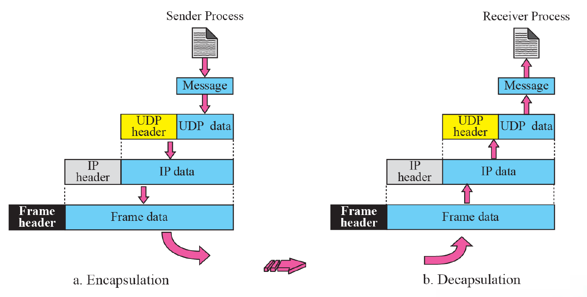

*Figure 12. Encapsulation and decapsulation of a UDP user datagram*

**Encapsulation.** A process with a message to send passes the message to UDP along with a pair of socket addresses and the length of the data. UDP passes the user datagram with the UDP header added to IP together with the socket addresses. IP adds its own header with the value 17, meaning UDP, in the protocol field and passes the IP datagram to the data-link layer. The data-link layer adds its header (and trailer) and passes it to the physical layer, which encodes the bits into electrical or optical signals and sends them to the remote computer.

**Decapsulation.** The physical layer of the destination host decodes the signals into bits and passes them to the data-link layer, which checks the data using the header (and trailer). If there is no error, the header and trailer are dropped and the datagram is passed to IP. IP also performs its checks, drops the header, and passes the user datagram to UDP together with the sender and receiver IP addresses. UDP checks the entire user datagram with the checksum, and if there is no error, it drops the header and passes the application data to the process together with the sender socket address. The sender socket address is passed because the process may need to respond to the received message.

### 7.4 Queuing

Ports are actually implemented as queues. In UDP, a queue is associated with each port.

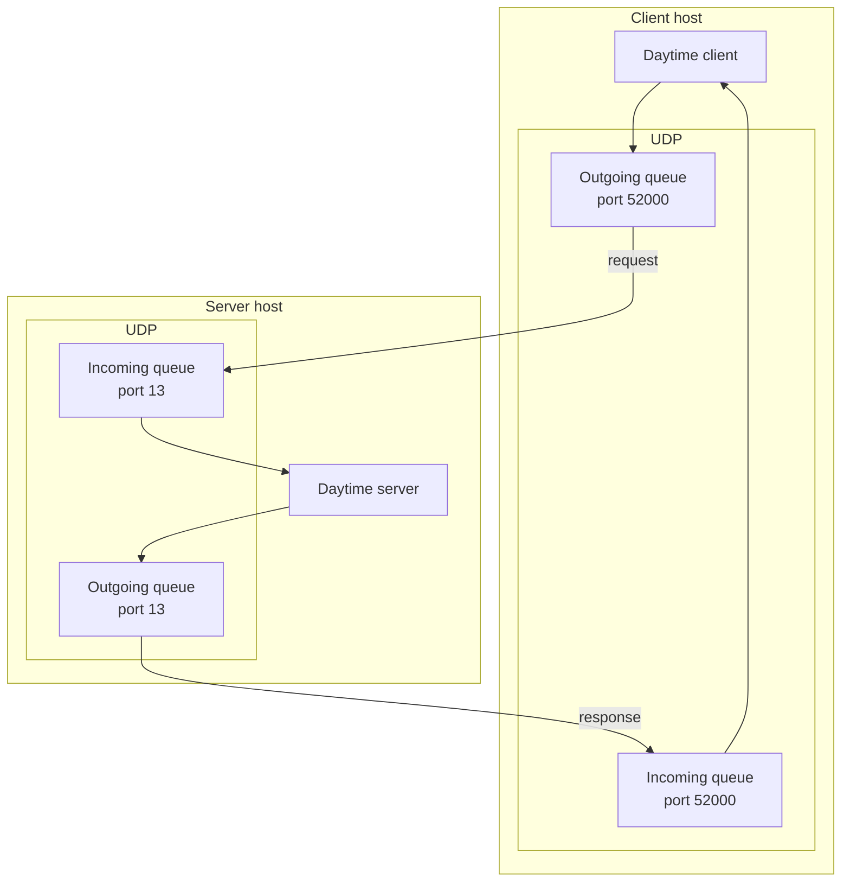

*Figure 13. UDP queues associated with the ports of a Daytime client and server*

**Client side.** When a client process starts, it requests a port number from the operating system. Depending on the implementation, both an incoming and an outgoing queue are created for each process, or only an incoming queue. Even if a process communicates with several processes, it obtains only one port number and therefore one outgoing and one incoming queue. The queues opened by a client are in most cases identified by ephemeral port numbers; they function while the process runs and are destroyed when the process terminates.

- The client process sends messages to the outgoing queue using the source port number specified in the request. UDP removes the messages one by one, adds the UDP header, and delivers them to IP. If the outgoing queue overflows, the operating system can ask the client process to wait before sending more.
- When a message arrives for a client, UDP checks whether an incoming queue exists for the port number in the destination port number field of the user datagram. If there is such a queue, UDP places the user datagram at the end of the queue. If there is no such queue, UDP discards the user datagram and asks ICMP to send a port unreachable message to the server (Chapter 16). All incoming messages for one client program, whether from the same server or a different one, go to the same queue. If the incoming queue overflows, UDP drops the user datagram and asks for a port unreachable message to be sent.

**Server side.** In its simplest form, a server asks for incoming and outgoing queues using its well-known port when it starts running, and the queues remain open while the server runs. Messages arriving for a server are handled as on the client side, and if there is no queue or the queue overflows, a port unreachable message goes to the client. When the server responds, it places messages in the outgoing queue with the source port number found in the request as the destination.

### 7.5 Multiplexing and Demultiplexing in UDP

A host running the TCP/IP protocol suite has only one UDP, but there may be several processes that want to use its services. On the sending side, several processes use one UDP, a many-to-one relationship that requires multiplexing. UDP accepts messages from processes distinguished by their assigned port numbers, adds headers, and passes them to IP. On the receiving side, one UDP distributes user datagrams to several processes, a one-to-many relationship that requires demultiplexing. UDP checks the user datagrams it receives from IP for errors, drops the headers, and passes each message to the appropriate process according to the port numbers (Section 3.2).

### 7.6 Comparison with the Simple Protocol

The simple protocol covered in Chapter 7 is a connectionless protocol with neither flow control nor error control. The only difference between UDP and the simple protocol is that UDP optionally provides a checksum to detect corrupted packets at the receiving side. If a checksum is included, the receiving UDP checks the packet and discards it if it is corrupted, but sends no feedback to the sender.

> **Key Point:** UDP is the simple protocol with an optional checksum added for error detection. If anything beyond process-to-process delivery, such as flow control, error recovery, or congestion control, is needed, the application must implement it.

---

<br>

## 8. The UDP Checksum

The UDP checksum detects whether bits in a user datagram have been altered on the way from the source to the destination (for example, by noise on a link or while stored in a router's memory).

> **Definition:** A **checksum** is an error-detection value that the sender computes as the one's complement of the one's complement sum of the 16-bit words of the data and places in the header. The receiver adds all the words, including the checksum, in the same way and checks whether the result is all 1s.

### 8.1 One's Complement Sum and the Checksum

The sending UDP computes the checksum in the following order.

1. Set the checksum field to 0.
2. Divide the data to be covered into 16-bit words, and if the number of bytes is odd, append one byte filled with 0 at the end.
3. Add all the words. Whenever an addition produces a carry beyond 16 bits, add that carry back into the lowest bit (wraparound). The value obtained this way is the one's complement sum.
4. Place the one's complement of the sum, with every bit inverted, in the checksum field.

The receiver adds all the 16-bit words, including the checksum, in the same way. If there is no error, the sum is `1111111111111111`; if any bit is 0, an error has occurred. Adding the checksum to the sum gives all 1s because when a 16-bit value is added to the value with all its bits inverted, every position becomes 0 + 1 or 1 + 0, giving all 1s without any carry.

> **[Digital Logic Design]** In the one's complement representation learned in digital logic design, a negative number is formed by inverting every bit, and addition uses the end-around carry, which adds the carry out of the top position back into the bottom. The wraparound of the checksum is exactly this end-around carry. One's complement addition is commutative and associative, so the same sum is obtained regardless of the order in which the words are added.

### 8.2 An Example with Three 16-Bit Words

Suppose the data to be covered consists of the following three 16-bit words.

```text
  0110011001100000
  0101010101010101
  1000111100001100
```

The sum of the first two words has no carry.

```text
  0110011001100000
+ 0101010101010101
------------------
  1011101110110101
```

Adding the third word produces a carry into a 17th bit, which is added back into the lowest bit.

```text
  1011101110110101
+ 1000111100001100
------------------
 10100101011000001   (17 bits: carry out)
  0100101011000001
+                1   (wraparound)
------------------
  0100101011000010   sum
  1011010100111101   checksum (one's complement of sum)
```

*Figure 14. One's complement sum and checksum of three 16-bit words*

When the receiver adds all four words (the three words and the checksum), it gets `0100101011000010` + `1011010100111101` = `1111111111111111` and concludes that there is no error.

### 8.3 The Pseudoheader

The UDP checksum is computed over some fields of the IP header as well as the user datagram.

> **Definition:** A **pseudoheader** is a 12-byte structure temporarily prepended to a user datagram only for checksum computation; it consists of some fields of the header of the IP packet that will carry the user datagram (the source IP address, the destination IP address, and the protocol number) and the UDP total length. The pseudoheader is not transmitted.

```text
+-----------------------------------------------------------+
|                  32-bit source IP address                 |  Pseudoheader
+-----------------------------------------------------------+
|               32-bit destination IP address               |
+--------------+----------------+---------------------------+
|   All 0s     | 8-bit protocol |   16-bit UDP total length |
+--------------+----------------+---------------------------+
|    Source port address        |  Destination port address |  Header
|          16 bits              |         16 bits           |
+-------------------------------+---------------------------+
|      UDP total length         |         Checksum          |
|          16 bits              |         16 bits           |
+-------------------------------+---------------------------+
|                           Data                            |
|    (Padding must be added to make the data a multiple     |
|                      of 16 bits)                          |
+-----------------------------------------------------------+
```

*Figure 15. The pseudoheader and the UDP user datagram used for checksum computation*

The pseudoheader is included for two reasons.

- **Detecting misdelivered datagrams.** Without the pseudoheader in the checksum, a user datagram delivered to the wrong host because its IP header was corrupted would still pass the check, since the user datagram itself is intact. With the pseudoheader, the receiving host builds the pseudoheader with its own IP address and recomputes the sum, so it detects the error when the addresses differ.
- **Preventing delivery to another protocol.** The protocol field ensures that the packet belongs to UDP and not to TCP. A process that can use both UDP and TCP may use the same destination port number with both protocols, so the port number alone cannot distinguish them. The value of the protocol field for UDP is 17, and if this value changes in transit, the receiver's checksum computation detects it and UDP drops the packet. The packet is therefore not delivered to the wrong protocol.

The fields of the pseudoheader are similar to the last 12 bytes of the IPv4 header (the protocol, source IP address, destination IP address, and so on) (Chapter 11).

### 8.4 An Example Including the Pseudoheader

We compute the checksum of a user datagram with source IP address 153.18.8.105, destination IP address 171.2.14.10, source port 1087, destination port 13, and data `TESTING` (7 bytes). The total length is 8 + 7 = 15 bytes, and because the number of data bytes is odd, one byte filled with 0 is appended for the computation only. Each IP address becomes two 16-bit words, and the third row of the pseudoheader becomes a word combining 8 bits of 0s with protocol number 17, followed by the UDP total length 15.

```text
Pseudoheader:
  10011001 00010010   153.18
  00001000 01101001   8.105
  10101011 00000010   171.2
  00001110 00001010   14.10
  00000000 00010001   0 and 17
  00000000 00001111   15
UDP header:
  00000100 00111111   1087
  00000000 00001101   13
  00000000 00001111   15
  00000000 00000000   0 (checksum)
Data:
  01010100 01000101   T and E
  01010011 01010100   S and T
  01001001 01001110   I and N
  01000111 00000000   G and 0 (padding)
---------------------------------------
  10010110 11101011   Sum
  01101001 00010100   Checksum
```

*Figure 16. UDP checksum computation including the pseudoheader*

The sum is the one's complement sum `10010110 11101011` (`0x96EB`), and the checksum is its one's complement `01101001 00010100` (`0x6914`). The pseudoheader and the appended byte are used only for the computation and are dropped when the user datagram is passed to IP.

### 8.5 Optional Use of the Checksum

A UDP sender may choose not to compute the checksum. In that case it fills the checksum field with all 0s before sending. If the sender computes the checksum and the result happens to be all 0s, it changes the value to all 1s so that it can be distinguished from the case where no checksum was computed; in other words, the sum is complemented twice. In a normal situation the checksum value is never all 1s, so this rule creates no confusion.

| Situation | Checksum sent | Reason |
|:-----|:-----|:-----|
| The sender decides not to include the checksum | All 0s | Indicates that the checksum was not computed |
| The sender includes the checksum and the sum is all 1s | All 1s | The complement is all 0s, so it is complemented once more to distinguish it from the previous case |
| The sender includes the checksum and the sum is all 0s | Never happens | A sum of 0 would require every term to be 0, but some fields of the pseudoheader are nonzero |

*Table 10. Special values placed in the checksum field*

### 8.6 Why End-to-End Error Detection Is Needed

Many link-layer protocols such as Ethernet also check for errors (Chapter 18), and UDP still provides a checksum for the following reasons. There is no guarantee that every link between the source and the destination performs error checking, and even if a segment is transferred correctly over a link, bit errors can be introduced while the segment is stored in a router's memory. Since neither link-by-link reliability nor in-memory error detection is guaranteed, UDP must detect errors at the transport layer on an end-to-end basis if the end-to-end data transfer service is to provide error detection. This is an example of the **end-end principle** in system design: if some function must be implemented end to end, placing it at lower layers may be redundant or of little value compared with the cost of providing it at the higher level. Because IP is supposed to run over just about any layer-2 protocol, error checking at the transport layer is useful as a safety measure.

UDP checks for errors but does nothing to recover from them. Some implementations simply discard the damaged segment, and others pass it to the application with a warning.

---

<br>

## 9. UDP Applications

UDP meets almost none of the criteria for a reliable transport-layer protocol, yet for some applications UDP is preferable, because some services come with side effects that are unacceptable or undesirable. Just as in daily life one-day delivery costs more than three-day delivery, so that when time and cost are both desirable but conflict one must choose the optimum, an application designer sometimes has to compromise.

### 9.1 Features of UDP from the Viewpoint of Application Design

**Connectionless service.** Each UDP packet is independent of the other packets sent by the same application program. This feature is an advantage or a disadvantage depending on the application's requirements. If a client sends a short request and receives a short response, and the request and the response each fit in one user datagram, a connectionless service is preferable, because the overhead of establishing and closing a connection is significant in this case. Achieving the same goal with a connection-oriented service requires at least 9 packets to be exchanged between the client and the server, whereas a connectionless service exchanges only 2. The connectionless service has less delay and the connection-oriented service more, so a connectionless service suits applications for which delay is important.

**Lack of error control.** Most applications expect a reliable service from the transport layer. A reliable service has side effects, however. If part of a message is lost or corrupted, it must be resent, so the receiving transport layer cannot pass that part to the application immediately, and the parts of the message are delivered to the application layer with uneven delays. Some applications do not even notice these uneven delays, but for others they are crucial.

**Lack of congestion control.** UDP does not provide congestion control, but it also does not create additional traffic in an error-prone network. TCP may resend a packet several times and thus create or worsen congestion, so when congestion is a big issue, the lack of error control in UDP can be an advantage.

### 9.2 Choices Illustrated by Applications

| Application | Suitable transport layer | Reason |
|:-----|:-----|:-----|
| DNS | UDP | The client sends a short request and needs a quick response, and the request and response each fit in one user datagram; with only one message in each direction, there is no worry about out-of-order delivery |
| SMTP (electronic mail) | TCP | A long message with images, audio, or video does not fit in one user datagram and must be split by the application, and if the pieces arrive out of order the receiving application may not be able to reorder them; a quick response is not expected, so the extra delay of connection-oriented service does not matter |
| Downloading a very large text file | TCP | No part of the file may be missing or corrupted, so a reliable service is needed; the file is opened only after it is complete, so the delay between parts does not matter |
| Real-time streaming video | UDP | Resending a corrupted or lost frame would break the synchronization of the whole transmission and leave the screen blank for a while; if each small part is sent in one user datagram, the receiving UDP ignores corrupted or lost packets and delivers the rest, so part of the screen is blank only for a very short time |

*Table 11. Choice of transport layer according to application requirements*

Even for real-time video, the video cannot be viewed out of order, so streaming audio, video, and voice applications running over UDP must themselves reorder or drop frames that arrive out of sequence.

### 9.3 Typical UDP Applications

The following are typical applications that benefit more from the services of UDP than from those of TCP.

- UDP suits a process that requires simple request-response communication with little concern for flow and error control. It is not usually used for a process such as FTP that must send bulk data.
- UDP suits a process with its own internal flow-control and error-control mechanisms. For example, the TFTP process includes flow and error control and can easily use UDP (Chapter 4).
- UDP suits multicasting. Multicasting capability is built into the UDP software but not into the TCP software.
- UDP is used for management processes such as SNMP (Chapter 17).
- UDP is used for some route-updating protocols such as RIP (Chapter 15).
- UDP is normally used for real-time applications that cannot tolerate uneven delays between the parts of a received message.

### 9.4 Comparison of UDP and TCP

| Feature | UDP | TCP |
|:-----|:-----|:-----|
| Connection | Connectionless | Connection-oriented (three-way handshake of Chapter 8) |
| Reliability | Unreliable; only detects errors with the checksum | Reliable; acknowledgments and retransmissions |
| Order | Not guaranteed | Delivered in order |
| Unit of delivery | User datagrams with message boundaries | A byte stream without message boundaries |
| Flow control | None | Flow control with the receive window |
| Congestion control | None | Yes (Chapter 9) |
| Connection state | None | Buffers, sequence numbers, and congestion-control variables maintained |
| Header size | 8 bytes | 20-60 bytes |
| Checksum | Optional | Mandatory |
| Typical applications | DNS, SNMP, TFTP, RIP, real-time multimedia | HTTP, SMTP, FTP, TELNET, SSH |

*Table 12. Comparison of UDP and TCP*

The claim that UDP is "fast" should be understood not as saying that UDP itself transmits faster, but as saying that it has no connection-setup delay, that no congestion control throttles its sending rate, and that it suffers no uneven delays caused by retransmissions.

---

<br>

## 10. The UDP Package

To see concretely how UDP sends and receives user datagrams, we examine the simplified UDP package presented in the textbook by Forouzan.

### 10.1 Components

The UDP package consists of five components: a control-block table, input queues, a control-block module, an input module, and an output module.

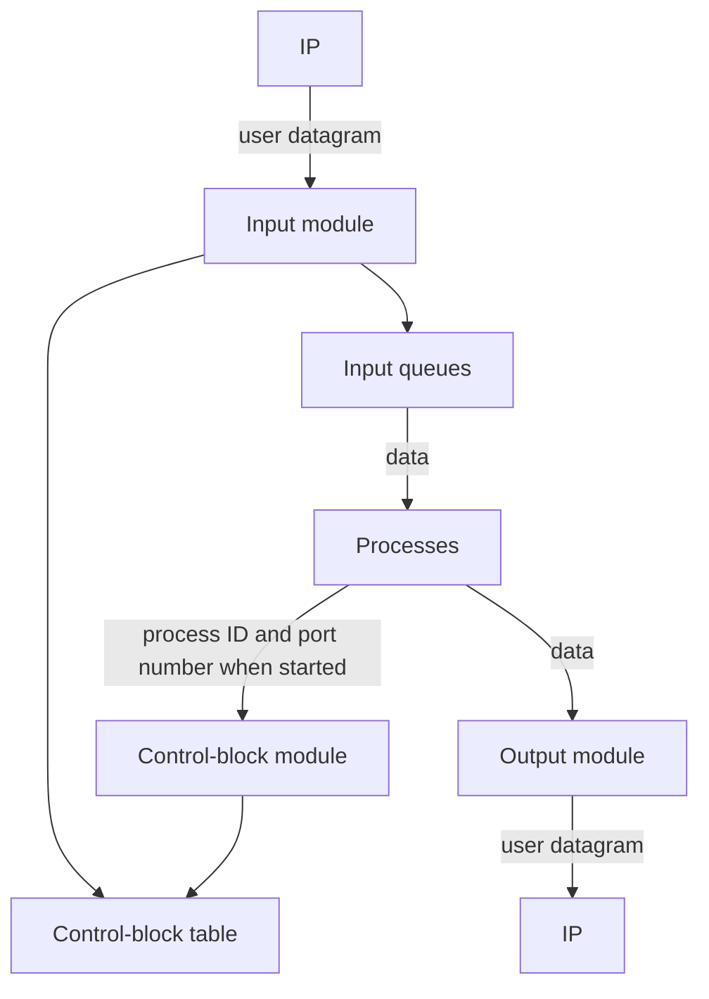

*Figure 17. The five components of the UDP package and their interactions*

- **Control-block table.** A table that keeps track of open ports. Each entry has at least four fields: the state (FREE or IN-USE), the process ID, the port number, and the queue number.
- **Input queues.** One queue per process. This design does not use output queues.
- **Control-block module.** When a process starts, it asks the operating system for a port number. The operating system assigns well-known port numbers to servers and ephemeral port numbers to clients. When the process passes its process ID and port number, the control-block module finds a FREE entry, changes it to IN-USE, and records the two values. If there is no FREE entry, it deletes one entry using a predefined strategy. This module does not create queues, so the queue number field is empty.
- **Input module.** It receives a user datagram from IP and searches the control-block table for an entry with the same port number. If the entry is found, it checks whether a queue is allocated, allocates one if not, and then places the data in the queue. If the entry is not found, it asks ICMP for a port unreachable message and discards the user datagram.
- **Output module.** It creates and sends user datagrams.

### 10.2 An Example of Operation

Suppose the control-block table is initially as shown in Table 13.

| State | Process ID | Port number | Queue number |
|:-----|:-----|:-----|:-----|
| IN-USE | 2,345 | 52,010 | 34 |
| IN-USE | 3,422 | 52,011 | |
| FREE | | | |
| IN-USE | 4,652 | 52,012 | 38 |
| FREE | | | |

*Table 13. The control-block table at the beginning of the example*

1. A user datagram with destination port 52,012 arrives. The input module finds this port, and because queue 38 is already allocated, it places the data in queue 38. The table does not change.
2. A few seconds later a new process starts and receives port number 52,014 from the operating system. When the process passes its ID 4,978 and the port number to the control-block module, the module records this information in the first FREE entry (the third row). No user datagram has yet arrived for this destination, so no queue is allocated.
3. A user datagram arrives for port 52,011. This is the first user datagram for this destination, so there is no queue. The input module creates a queue, gives it the number 43, and places the data in it.
4. A few seconds later a user datagram arrives for port 52,222. The table has no entry for this port, so the user datagram is discarded and ICMP is asked to send a port unreachable message to the source.

| State | Process ID | Port number | Queue number |
|:-----|:-----|:-----|:-----|
| IN-USE | 2,345 | 52,010 | 34 |
| IN-USE | 3,422 | 52,011 | 43 |
| IN-USE | 4,978 | 52,014 | |
| IN-USE | 4,652 | 52,012 | 38 |
| FREE | | | |

*Table 14. The control-block table after all four events are processed*

---

<br>

## Concept Applications

**True/False Check:**

| Statement | Judgment and Reason |
|:-----|:-----|
| A router forwards a datagram by looking at the port numbers of the segment. | **F.** Transport-layer protocols are implemented only in end systems, and routers act only on the network-layer fields of the datagram. |
| Two UDP segments with different source IP addresses are delivered to the same socket if their destination IP address and destination port number are the same. | **T.** A UDP socket is identified by the two-tuple of the destination IP address and the destination port number. |
| If two clients connected to a Web server have the same source port number, the server cannot distinguish the two connections. | **F.** A TCP connection socket is identified by a four-tuple, so connections with different source IP addresses are distinguished even when their source port numbers are the same. |
| The length of a user datagram can be obtained even without the UDP length field. | **T.** It can be obtained by subtracting the IP header length from the IP total length, but UDP keeps the length field so that it can compute the length after the IP header has been removed. |
| If the UDP checksum is correct, the datagram can be regarded as having arrived at the correct host. | **T.** The checksum includes the pseudoheader with the source and destination IP addresses, so a datagram that arrives at another host because its destination address changed fails the checksum test. The checksum is, however, a detection technique that does not catch every error. |
| When UDP detects an error, it asks the sender to retransmit. | **F.** UDP silently discards a corrupted user datagram and sends no feedback to the sender. |
| The absence of congestion control is always an advantage for UDP applications. | **F.** The application is free of rate constraints, but uncontrolled UDP traffic can cause high loss rates and crowd out TCP traffic. |

---

<br>

## Summary

| Concept | Key Summary |
|:-----|:-----|
| Transport layer | The transport layer is implemented only in end systems and provides logical communication between processes on different hosts. |
| Relationship of the two layers | The network layer connects hosts and the transport layer connects processes, and the services of the transport layer are constrained by the service model of the network layer. |
| Port number | A port number is a 16-bit integer that identifies a process; 0-1,023 are well-known ports, 1,024-49,151 registered ports, and 49,152-65,535 dynamic ports. |
| Socket address | A socket address combining an IP address and a port number identifies one end of a communication, and a communication needs the socket addresses of both ends. |
| Multiplexing and demultiplexing | The sending side gathers data from several sockets and adds headers (multiplexing), and the receiving side delivers each segment to the right socket using the port numbers in the header (demultiplexing). |
| Socket identifiers | A UDP socket is identified by the two-tuple of the destination IP address and destination port number, and a TCP connection socket by the four-tuple of the source and destination IP addresses and port numbers. |
| Connectionless and connection-oriented | Packets of a connectionless service are independent, while a connection-oriented service goes through connection setup, data transfer, and teardown and can implement flow, error, and congestion control. |
| UDP | UDP is a connectionless, unreliable protocol that provides only process-to-process delivery and a checksum. |
| Reasons for using UDP | Fine application control over sending, no connection-setup delay, no connection state, and a small 8-byte header are the reasons for choosing UDP. |
| User datagram | A user datagram has an 8-byte header with the source port, destination port, total length, and checksum, and its length ranges from 8 to 65,535 bytes. |
| Checksum | The checksum is the one's complement of the one's complement sum of the 16-bit words of the pseudoheader, UDP header, and data, and the receiver judges that there is no error if its sum is all 1s. |
| Pseudoheader | The pseudoheader brings the IP addresses and the protocol number into the checksum so that delivery to the wrong host or the wrong protocol is detected. |
| Queuing | UDP keeps a queue per port, and if there is no queue or the queue overflows, it discards the datagram and requests an ICMP port unreachable message. |
| UDP applications | Applications for which short requests and responses or even delays matter, such as DNS, SNMP, TFTP, RIP, multicasting, and real-time multimedia, use UDP. |

---

<br>

## Self-Check Questions

1. **Header interpretation:** The hexadecimal value of a UDP header is `0035C1A2002BA7E1`. Find the source port, the destination port, the total length of the user datagram, and the length of the data, and decide whether the datagram goes from a client to a server or the reverse.

   <details>
   <summary>Answer</summary>

   Splitting the value into groups of four digits, the source port is `0x0035` = 53, the destination port is `0xC1A2` = 49,570, the total length is `0x002B` = 43 bytes, and the last group, `0xA7E1`, is the checksum. The data is 43 - 8 = 35 bytes. Source port 53 is the well-known port of DNS and destination port 49,570 is an ephemeral port, so this is a response sent by a DNS server to a client.

   </details>

2. **Checksum computation:** Assume that only three 16-bit words, `0xF0F0`, `0x1234`, and `0x8001`, enter the checksum computation. Find the one's complement sum and the checksum, and show the receiver's check.

   <details>
   <summary>Answer</summary>

   `0xF0F0` + `0x1234` = `0x10324`. Adding the carry 1 beyond 16 bits back into the lowest bit gives `0x0324` + 1 = `0x0325`. Adding `0x8001` gives `0x8326` with no carry. The checksum is `0x7CD9`, the sum with every bit inverted. When the receiver adds the three words and the checksum, `0x8326` + `0x7CD9` = `0xFFFF`, so every bit is 1.

   </details>

3. **Role of the pseudoheader:** Assume that the destination address in an IP header is corrupted, the IP layer does not catch it, and the datagram is delivered to another host. Explain whether that host's UDP can detect the error if the pseudoheader is not included in the checksum computation, and what changes if it is included.

   <details>
   <summary>Answer</summary>

   Without the pseudoheader, the checksum protects only the UDP header and data. These parts are not corrupted, so the datagram passes the checksum test, and the misdelivered datagram may be delivered to a process using the same port. With the pseudoheader, the receiving host builds the pseudoheader with its own IP address and recomputes the sum. This address differs from the destination address the sender used in the computation, so the sum is not all 1s, and UDP detects the error and discards the datagram.

   </details>

4. **UDP sockets and TCP sockets:** Two clients, A (10.0.0.1, source port 40000) and B (10.0.0.2, source port 40000), send segments to port 5000 of server S. For the cases where the server application uses UDP and where it uses TCP (assume the connections are already established), state how many sockets the two segments are delivered to, and explain how the server sets the destination port when responding to each client.

   <details>
   <summary>Answer</summary>

   A UDP socket is identified by (destination IP address, destination port number), so both segments are delivered to the single socket (S, 5000). The server obtains the source IP address and source port of each segment with a call such as `recvfrom` and uses them as the destination of its response. A TCP connection socket is identified by a four-tuple, so the segments are delivered to two different connection sockets, (10.0.0.1, 40000, S, 5000) and (10.0.0.2, 40000, S, 5000), because their source IP addresses differ even though their source ports are the same. The destination port of a response sent through each connection socket is 40000, the peer port of that connection.

   </details>

5. **Port ranges and distinguishing connections:** State the range to which each of the ports 53, 1,023, 8,080, 49,152, and 52,000 belongs. Also explain how the server distinguishes two connections when two client processes on host 10.0.0.1 connect to the same Web server 200.23.56.8:80 at the same time.

   <details>
   <summary>Answer</summary>

   According to Table 2, 53 and 1,023 are in the well-known range, 8,080 is in the registered range, and 49,152 and 52,000 are in the dynamic range. 1,023 is the last number of the well-known range, and 49,152 is the first number of the dynamic range. The two client processes receive different ephemeral ports from the operating system (for example, 52,000 and 52,001), so the four-tuples of the two connections differ only in the source port number. The server uses this difference to keep the two connections in different connection sockets.

   </details>

6. **Transport protocol per application:** For a DNS query, sending electronic mail, downloading a large file, and a real-time video call, state whether UDP or TCP is suitable and give the reason.

   <details>
   <summary>Answer</summary>

   For a DNS query, UDP is suitable because the short request and response each fit in one user datagram and the connection-setup delay should be avoided. For electronic mail, TCP is suitable because long messages split into several pieces need ordering, and because no immediate response is expected, the connection-setup delay does not matter. For a large file, TCP is suitable because no part may be missing or corrupted and the delay between parts does not matter. For a real-time video call, UDP is suitable because the uneven delay caused by retransmission is more harmful and some loss can be tolerated, although the application must reorder or drop frames that arrive out of sequence.

   </details>

7. **DNS and transport protocols:** The round-trip time (RTT) between a client and a DNS server is 40 ms, and the query and the response each fit in one packet. Ignoring processing and transmission times, find the minimum time from when the client decides to send the query until it receives the response, for UDP and for TCP.

   <details>
   <summary>Answer</summary>

   UDP sends the query right away without connection setup, so it takes 1 RTT = 40 ms. TCP must establish a connection before the query (the three-way handshake of Chapter 8), and the exchange of SYN and SYN+ACK takes 1 RTT. The client can send the query with the third segment, the ACK, so the query and response take one more RTT, for a minimum of 2 RTT = 80 ms. Segments for connection teardown are also exchanged afterward. This is why DNS uses UDP for small queries and responses.

   </details>

8. **UDP queues and ICMP:** In the state of Table 14, a user datagram arrives for port 52,014 and then another user datagram arrives for port 52,013. For each event, state what the UDP package does and how the table changes.

   <details>
   <summary>Answer</summary>

   There is an entry for port 52,014 but no queue is allocated, so the input module allocates a new queue, records its number in the queue number field of the entry, and places the data in it. There is no entry for port 52,013 in the table, so the user datagram is discarded and ICMP is asked to send a port unreachable message to the source; the table does not change.

   </details>

---

<br>

## References

1. T. Ylonen and C. Lonvick, Ed., "The Secure Shell (SSH) Transport Layer Protocol," RFC 4253, Jan. 2006. [Online]. Available: https://www.rfc-editor.org/rfc/rfc4253
2. A. Melnikov, Ed., and B. Leiba, Ed., "Internet Message Access Protocol (IMAP) - Version 4rev2," RFC 9051, Aug. 2021. [Online]. Available: https://www.rfc-editor.org/rfc/rfc9051
3. E. Rescorla, "HTTP Over TLS," RFC 2818, May 2000. [Online]. Available: https://www.rfc-editor.org/rfc/rfc2818
