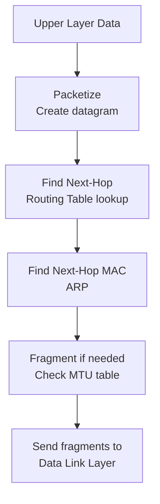
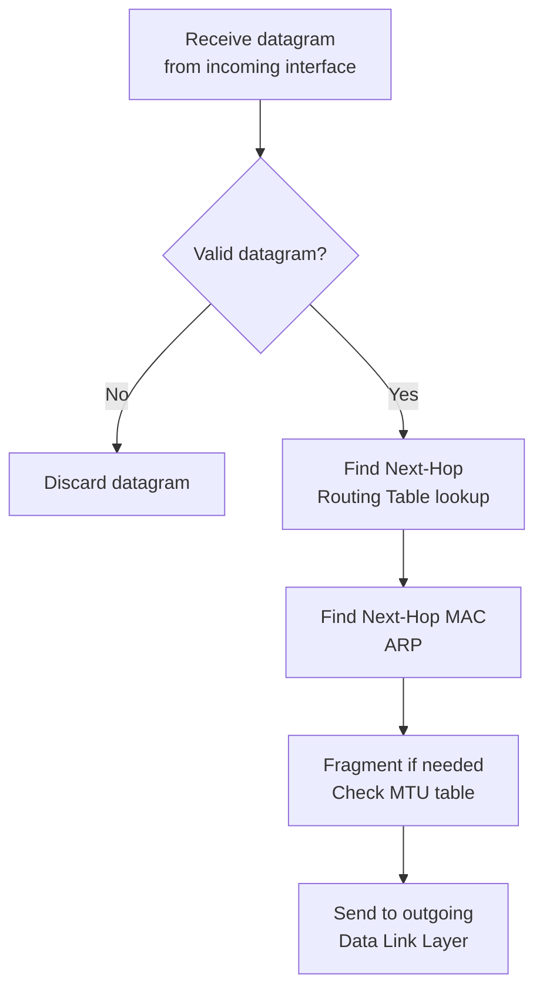
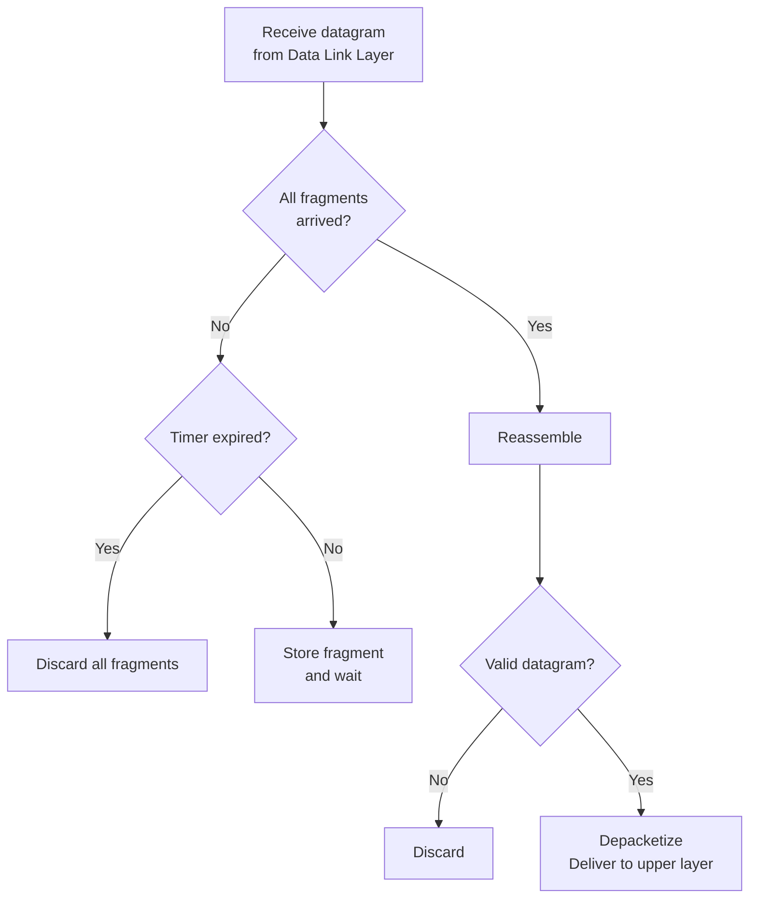

# 7장 — 인터넷 프로토콜 버전 4 (IPv4)

[레포지토리 안내](../../README.ko.md) | [English](Concepts_Lecture.md) | [한국어](Concepts_Lecture.ko.md)

> **최종 수정일:** 2026-10-26
>
> TCP/IP Protocol Suite, Forouzan, Ch 7

> **학습 목표:**
> 1. IPv4 패킷 헤더 필드와 목적을 분석할 수 있다
> 2. IP 단편화와 재조립을 설명할 수 있다
> 3. IPv4 옵션과 용도를 설명할 수 있다

---

## 목차

- [1. 개요](#1-개요)
- [2. 데이터그램](#2-데이터그램)
  - [2.1 데이터그램 구조](#21-데이터그램-구조)
  - [2.2 헤더 필드](#22-헤더-필드)
- [3. 단편화](#3-단편화)
  - [3.1 최대 전송 단위 (MTU)](#31-최대-전송-단위-mtu)
  - [3.2 단편화 관련 필드](#32-단편화-관련-필드)
  - [3.3 단편화 예제](#33-단편화-예제)
  - [3.4 재조립](#34-재조립)
- [4. 옵션](#4-옵션)
- [5. 체크섬](#5-체크섬)
- [6. IP 처리](#6-ip-처리)
  - [6.1 출발지에서](#61-출발지에서)
  - [6.2 각 라우터에서](#62-각-라우터에서)
  - [6.3 목적지에서](#63-목적지에서)
- [7. 부록](#7-부록)
  - [7.1 HLEN 계산](#71-hlen-계산)
  - [7.2 단편화 계산 단계](#72-단편화-계산-단계)
  - [7.3 경로 MTU 탐색](#73-경로-mtu-탐색)
- [요약](#요약)
- [점검 문제](#점검-문제)

---

<br>

## 1. 개요

**인터넷 프로토콜(IP)** 은 TCP/IP 프로토콜이 사용하는 전송 메커니즘이다. IP는 네트워크 계층에 위치한다.

주요 특성:
- **비신뢰적(Unreliable)**: 전달을 보장하지 않으며, 패킷이 손실, 중복되거나 순서가 바뀔 수 있다.
- **비연결형(Connectionless)**: 각 데이터그램을 독립적으로 처리하며, 연결 설정이 없다.
- **최선형 전달(Best-effort delivery)**: IP는 전달을 위해 최선을 다하지만 보장하지는 않는다.

```text
+-------------------+
| Application Layer |  SMTP, FTP, DNS, SNMP, DHCP
+-------------------+
| Transport Layer   |  SCTP, TCP, UDP
+---+-------+-------+
|IGMP|ICMP |   IP    |  ARP
+---+-------+---------+
| Data Link Layer   |  Underlying LAN or WAN
+-------------------+
| Physical Layer    |
+-------------------+
```

*그림 1. TCP/IP 프로토콜 스위트에서 IP와 관련 프로토콜의 위치*

> **핵심:** IP는 모든 인터넷 통신의 기반을 제공한다. 그 단순함과 비연결형 특성 덕분에 인터넷이 확장될 수 있으며, 상위 계층 프로토콜(TCP)이 필요 시 신뢰성을 추가한다.

---

<br>

## 2. 데이터그램

### 2.1 데이터그램 구조

IP 계층의 패킷을 **데이터그램**이라 한다. 데이터그램은 **헤더**(20~60바이트)와 **데이터** 두 부분으로 구성된 가변 길이 패킷이다.

```text
+------ 20-65,535 bytes total ------+
| Header (20-60 bytes) |    Data    |
+---------------------+------------+
```

*그림 2. IPv4 데이터그램의 헤더와 데이터*

### 2.2 헤더 필드

IPv4 헤더 형식 (최소 20바이트, 최대 60바이트):

```text
 0                   1                   2                   3
 0 1 2 3 4 5 6 7 8 9 0 1 2 3 4 5 6 7 8 9 0 1 2 3 4 5 6 7 8 9 0 1
+-+-+-+-+-+-+-+-+-+-+-+-+-+-+-+-+-+-+-+-+-+-+-+-+-+-+-+-+-+-+-+-+
| VER   | HLEN  | Service Type  |         Total Length          |
+-+-+-+-+-+-+-+-+-+-+-+-+-+-+-+-+-+-+-+-+-+-+-+-+-+-+-+-+-+-+-+-+
|        Identification         |Flags|   Fragmentation Offset  |
+-+-+-+-+-+-+-+-+-+-+-+-+-+-+-+-+-+-+-+-+-+-+-+-+-+-+-+-+-+-+-+-+
| Time to Live  |   Protocol    |       Header Checksum         |
+-+-+-+-+-+-+-+-+-+-+-+-+-+-+-+-+-+-+-+-+-+-+-+-+-+-+-+-+-+-+-+-+
|                    Source IP Address                           |
+-+-+-+-+-+-+-+-+-+-+-+-+-+-+-+-+-+-+-+-+-+-+-+-+-+-+-+-+-+-+-+-+
|                 Destination IP Address                         |
+-+-+-+-+-+-+-+-+-+-+-+-+-+-+-+-+-+-+-+-+-+-+-+-+-+-+-+-+-+-+-+-+
|                  Options + Padding (0-40 bytes)                |
+-+-+-+-+-+-+-+-+-+-+-+-+-+-+-+-+-+-+-+-+-+-+-+-+-+-+-+-+-+-+-+-+
```

*그림 3. IPv4 헤더 형식*

| 필드 | 비트 | 설명 |
|-------|------|-------------|
| VER (Version) | 4 | IP 프로토콜 버전 (IPv4의 경우 4) |
| HLEN (Header Length) | 4 | 4바이트 워드 단위의 헤더 길이 (최소 5 = 20바이트, 최대 15 = 60바이트) |
| Service Type | 8 | 차별화 서비스 (DSCP + ECN) |
| Total Length | 16 | 헤더를 포함한 전체 데이터그램 길이 (최대 65,535바이트) |
| Identification | 16 | 단편화/재조립을 위한 고유 식별자 |
| Flags | 3 | 단편화 제어 비트 |
| Fragmentation Offset | 13 | 원래 데이터그램에서 단편의 위치 (8바이트 단위) |
| Time to Live (TTL) | 8 | 폐기되기 전 최대 홉 수 |
| Protocol | 8 | 상위 계층 프로토콜 식별자 |
| Header Checksum | 16 | 헤더 전용 오류 검출 |
| Source Address | 32 | 송신자의 IP 주소 |
| Destination Address | 32 | 수신자의 IP 주소 |

*표 1. IPv4 헤더 필드*

**서비스 유형 (차별화 서비스):**

```text
+---+---+---+---+---+---+---+---+
|     Codepoint (6 bits)  | ECN (Explicit Congestion Notification)|
+---+---+---+---+---+---+---+---+
```

*그림 4. 서비스 유형(차별화 서비스) 필드*

| 범주 | Codepoint | 할당 기관 |
|----------|-----------|-------------------|
| 1 | XXXXX0 | Internet |
| 2 | XXXX11 | Local |
| 3 | XXXX01 | Temporary/Experimental |

*표 2. 코드포인트 범주와 할당 기관*

**Protocol 필드 값 (다중화):**

| 값 | 프로토콜 |
|-------|----------|
| 1 | ICMP |
| 2 | IGMP |
| 6 | TCP |
| 17 | UDP |
| 89 | OSPF |

*표 3. Protocol 필드 값과 상위 계층 프로토콜*

**Total Length와 MTU:**
- Total Length 필드는 **헤더를 포함한** 데이터그램의 전체 길이를 정의한다.
- 데이터의 길이는 Total Length - Header Length (HLEN x 4)이다.
- 최대 전체 길이는 65,535바이트($2^{16} - 1$)이다.
- Ethernet 프레임의 데이터 필드는 46~1500바이트이다.
- 데이터그램이 46바이트 미만이면 Ethernet 프레임 수준에서 패딩이 추가된다.

**TTL (Time to Live):**
- 방문하는 **홉**(라우터)의 최대 수를 제어한다.
- 각 라우터가 TTL을 1만큼 감소시킨다.
- TTL이 0에 도달하면 라우터가 데이터그램을 **폐기**하고 ICMP Time Exceeded 메시지(9장)를 전송한다.
- 출발지가 설정하는 초기값은 대략 두 호스트 간 최대 라우터 수의 두 배이다.
- TTL을 1로 설정하면 패킷이 **로컬 네트워크**로 제한된다.

**출발지 및 목적지 주소:**
- 둘 다 32비트이며, 출발지와 목적지의 IP 주소를 정의한다.
- 이 주소들은 출발지에서 목적지까지의 전체 여정 동안 **변경되지 않는다**.

---

<br>

## 3. 단편화

### 3.1 최대 전송 단위 (MTU)

각 네트워크 기술은 프레임에 캡슐화될 수 있는 최대 데이터 크기인 **최대 전송 단위(Maximum Transfer Unit, MTU)** 를 가진다:

| 네트워크 | MTU (바이트) |
|---------|-------------|
| Ethernet | 1500 |
| PPP | 296~1500 |
| FDDI | 4352 |
| Token Ring | 4464 |

*표 4. 네트워크 기술별 MTU*

데이터그램이 나가는 링크의 MTU보다 크면 **단편화** 되어야 한다. 단, DF 비트가 1이면 단편화하지 않고 데이터그램을 폐기한다.

### 3.2 단편화 관련 필드

세 개의 헤더 필드가 단편화를 처리한다:

**1. Identification (16비트):**
- 같은 원본 데이터그램의 모든 단편에서 값이 같다.
- 목적지가 재조립을 위해 단편을 묶는 데 사용한다.

**2. Flags (3비트):**

| 비트 | 이름 | 의미 |
|-----|------|---------|
| 0 | Reserved | 항상 0 |
| 1 | DF (Don't Fragment) | 0 = 단편화 가능, 1 = 단편화 금지 |
| 2 | MF (More Fragments) | 0 = 마지막 단편, 1 = 더 많은 단편이 뒤따름 |

*표 5. Flags 필드의 세 비트*

**3. Fragmentation Offset (13비트):**
- 원본 데이터그램에서 단편 데이터의 위치를 지정한다.
- **8바이트 단위**로 측정한다(바이트 오프셋을 얻으려면 8을 곱한다).
- 따라서 마지막 단편을 제외한 단편의 데이터 크기는 **8바이트의 배수**여야 한다.

### 3.3 단편화 예제

원본 데이터그램: 총 4000바이트 (20바이트 헤더 + 3980바이트 데이터), MTU = 1500:

```text
Maximum data per fragment = MTU - header = 1500 - 20 = 1480 bytes
Number of fragments = ceil(3980 / 1480) = 3
```

| 단편 | Total Length | 데이터 크기 | Offset | MF | Identification |
|----------|-------------|-----------|--------|-----|---------------|
| 1 | 1500 | 1480 | 0 | 1 | x |
| 2 | 1500 | 1480 | 185 (1480/8) | 1 | x |
| 3 | 1040 | 1020 | 370 (2960/8) | 0 | x |

*표 6. MTU 1500 링크에서 4000바이트 데이터그램의 단편*

### 3.4 재조립

재조립은 **목적지에서만** 수행된다 (중간 라우터에서는 수행되지 않음):
- 단편들은 서로 다른 경로를 거쳐 순서가 바뀐 채 도착할 수 있다.
- 목적지는 Identification 필드를 사용하여 단편을 묶는다.
- Offset 필드가 순서를 결정한다.
- MF 플래그가 마지막 단편을 표시한다.
- **재조립 타이머**는 단편들이 무한정 대기하지 않도록 한다.
- 모든 단편이 도착하기 전에 타이머가 만료되면 수집된 모든 단편이 **폐기**된다.

> **핵심:** DF = 0인 데이터그램이 나가는 링크의 MTU보다 크면 출발지 호스트든 경로의 어느 라우터든 그 지점에서 단편화가 일어날 수 있지만, 재조립은 최종 목적지에서만 수행된다.

---

<br>

## 4. 옵션

IP 옵션은 추가 기능을 제공하지만 거의 사용되지 않는다. 표준 20바이트 헤더 뒤에 나타난다:

| 옵션 | 설명 |
|--------|-------------|
| No Operation | 1바이트 패딩 |
| End of Options | 옵션 목록의 끝을 표시 |
| Record Route | 데이터그램이 지나간 경로를 기록 |
| Strict Source Route | 따라야 할 정확한 경로를 지정 |
| Loose Source Route | 반드시 방문해야 할 중간 라우터를 지정 |
| Timestamp | 각 라우터에서 타임스탬프를 기록 |

*표 7. IPv4 옵션*

---

<br>

## 5. 체크섬

**헤더 체크섬**은 전송 중 IP 헤더에 생긴 손상을 검출하여 헤더를 보호한다:
- 패킷에 추가되는 **중복 정보**이다.
- 수신자는 같은 계산을 반복하여 결과를 비교한다.
- 결과가 만족스럽지 않으면 패킷은 **거부**된다.
- 체크섬은 **헤더만** 포함하고 데이터는 포함하지 않는다.
- TTL이 변경되므로 **각 라우터에서 체크섬을 재계산**해야 한다.

**체크섬 계산:**
1. 헤더를 16비트 워드로 나눈다.
2. 체크섬 필드를 0으로 설정한다.
3. 1의 보수 산술을 사용하여 모든 16비트 워드를 더한다.
4. 합계의 1의 보수를 취한다.

> **[논리설계]** 1의 보수(one's complement)는 논리설계에서 2진수의 보수 표현으로 배우는 개념으로, 모든 비트를 반전한 값이다. 체크섬의 1의 보수 덧셈은 최상위 비트에서 넘친 자리올림을 버리지 않고 합의 최하위 비트에 다시 더하며, 이 방식으로 계산한 예는 14장의 4.2절에 있다.

---

<br>

## 6. IP 처리

### 6.1 출발지에서



*그림 5. 출발지에서의 IP 처리 과정*

### 6.2 각 라우터에서



*그림 6. 각 라우터에서의 IP 처리 과정*

### 6.3 목적지에서



*그림 7. 목적지에서의 IP 처리 과정*

---

<br>

## 7. 부록

### 7.1 HLEN 계산

- HLEN 값이 5(이진수 0101)이면 헤더 길이는 5 x 4 = **20바이트**이다(최소, 옵션 없음).
- HLEN 값이 15(이진수 1111)이면 헤더 길이는 15 x 4 = **60바이트**이다(최대, 옵션 40바이트 포함).

### 7.2 단편화 계산 단계

주어진 조건: 원본 데이터그램 = 4000바이트(헤더 20바이트), MTU = 1400

1. 원본 데이터는 4000 - 20 = 3980바이트이다.
2. 단편당 최대 데이터는 1400 - 20 = 1380바이트이다.
3. 8의 배수로 내리면 1380 -> 1376바이트이다(1376 / 8 = 172).
4. 완전한 단편 수는 floor(3980 / 1376) = 2이다.
5. 마지막 단편의 데이터는 3980 - 2 x 1376 = 1228바이트이다.

| 단편 | 데이터 크기 | Offset | MF |
|----------|-----------|--------|-----|
| 1 | 1376 | 0 | 1 |
| 2 | 1376 | 172 | 1 |
| 3 | 1228 | 344 | 0 |

*표 8. MTU 1400 링크에서 4000바이트 데이터그램의 단편*

### 7.3 경로 MTU 탐색

**경로 MTU 탐색(Path MTU Discovery, PMTUD)** 은 전체 경로에서 가장 작은 MTU를 결정한다:
1. 출발지가 DF (Don't Fragment) 플래그를 설정하여 데이터그램을 전송한다.
2. 라우터가 데이터그램보다 작은 MTU를 만나면 패킷을 폐기하고 ICMP "Fragmentation Needed" 메시지(9장)를 전송한다.
3. 출발지가 데이터그램 크기를 줄이고 다시 시도한다.
4. 데이터그램이 단편화 없이 전체 경로를 통과할 수 있을 때까지 이 과정을 반복한다.

---

<br>

## 요약

| 개념 | 핵심 요약 |
|---------|-----------|
| IPv4 | 비신뢰적이고 비연결형인 최선형 전달 프로토콜이다. |
| 데이터그램 | 헤더(20~60바이트)와 데이터로 이루어진 가변 길이 패킷이다. |
| TTL | 홉 카운터이며, 각 라우터에서 1씩 감소하고 0이 되면 데이터그램이 폐기된다. |
| Protocol 필드 | 상위 계층 프로토콜을 식별한다(1=ICMP, 6=TCP, 17=UDP). |
| 체크섬 | 헤더만 포함하며, 각 홉에서 재계산된다. |
| 단편화 | 데이터그램이 MTU보다 클 때 분할하며, 오프셋은 8바이트 단위이다. |
| 재조립 | 목적지에서만 수행되며, ID, 오프셋, MF 플래그를 사용한다. |
| Source/Dest IP | 전체 전송 과정에서 변경되지 않는다. |

---

<br>

## 점검 문제

1. **헤더 길이와 데이터 길이:** HLEN 필드가 7이고 Total Length 필드가 0x0050인 데이터그램의 헤더 길이, 옵션 길이, 데이터 길이를 구하라.

   <details>
   <summary>정답</summary>

   헤더 길이는 7 x 4 = 28바이트이므로 옵션은 28 - 20 = 8바이트이다. Total Length 0x0050은 80바이트이므로 데이터 길이는 80 - 28 = 52바이트이다.

   </details>

2. **단편화:** 데이터 2400바이트와 20바이트 헤더로 이루어진 데이터그램(DF = 0)이 MTU가 1006인 링크를 지나야 한다. 각 단편의 데이터 크기, Total Length, Offset, MF 값을 구하라.

   <details>
   <summary>정답</summary>

   단편당 최대 데이터는 1006 - 20 = 986바이트이지만, 마지막이 아닌 단편의 데이터 크기는 8의 배수여야 하므로 984바이트(984 / 8 = 123)로 내린다. 2400 = 984 + 984 + 432이므로 단편은 세 개이다. 첫 번째 단편은 데이터 984바이트, Total Length 1004, Offset 0, MF 1이다. 두 번째 단편은 데이터 984바이트, Total Length 1004, Offset 123, MF 1이다. 세 번째 단편은 데이터 432바이트, Total Length 452, Offset 246(1968 / 8), MF 0이다.

   </details>

3. **단편의 위치:** 어떤 단편의 MF = 0, Offset = 100, HLEN = 5, Total Length = 1020이다. 이 단편은 첫 번째, 중간, 마지막 단편 중 어느 것이며, 데이터의 첫 바이트와 마지막 바이트 번호(0부터 셈)는 무엇인가? 원본 데이터그램의 데이터 길이는 얼마인가?

   <details>
   <summary>정답</summary>

   MF = 0이고 Offset이 0이 아니므로 마지막 단편이다. 첫 바이트 번호는 100 x 8 = 800이다. 데이터 길이는 1020 - 5 x 4 = 1000바이트이므로 마지막 바이트 번호는 800 + 1000 - 1 = 1799이다. 마지막 단편이 1799번 바이트에서 끝나므로 원본 데이터의 길이는 1800바이트이다.

   </details>

4. **TTL과 체크섬:** 라우터가 다른 네트워크로 포워딩해야 하는 데이터그램 두 개를 받았다. 하나는 TTL이 5이고 다른 하나는 TTL이 1이다. 각각을 어떻게 처리하는가? 또 라우터가 데이터그램을 포워딩할 때마다 헤더 체크섬을 다시 계산해야 하는 이유는 무엇인가?

   <details>
   <summary>정답</summary>

   TTL이 5인 데이터그램은 TTL을 4로 줄여 다음 홉으로 포워딩한다. TTL이 1인 데이터그램은 TTL을 줄이면 0이 되므로 폐기하고 출발지에 ICMP Time Exceeded 메시지를 보낸다. 체크섬은 헤더 전체를 대상으로 계산하는데 TTL 필드가 라우터마다 바뀌므로 체크섬도 다시 계산해야 한다. 단편화가 일어나면 Flags, Offset, Total Length 필드도 바뀐다.

   </details>
