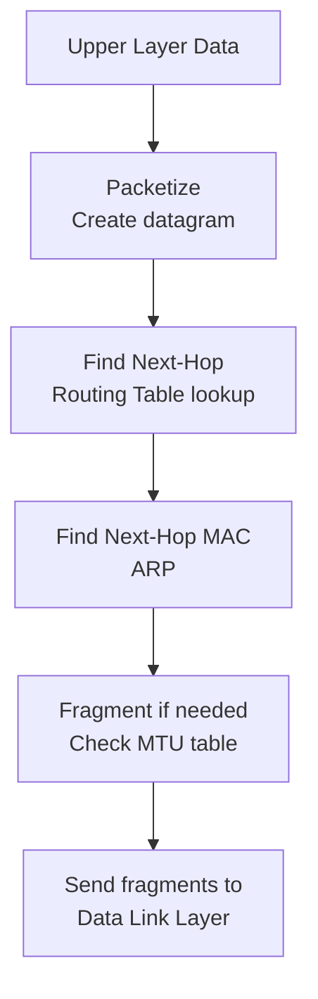
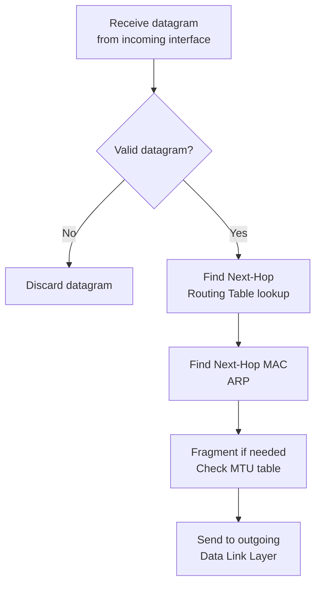
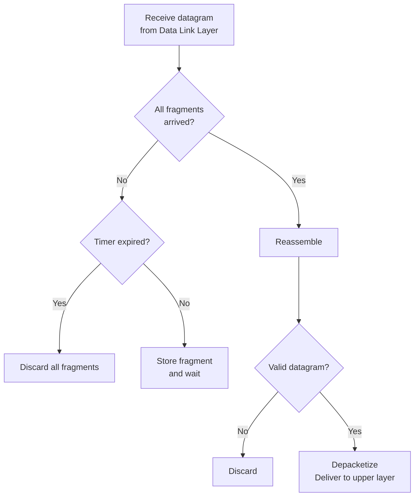

# Chapter 7 — Internet Protocol Version 4 (IPv4)

[Repository Guide](../../README.md) | [English](Concepts_Lecture.md) | [한국어](Concepts_Lecture.ko.md)

> **Last Updated:** 2026-10-26
>
> TCP/IP Protocol Suite, Forouzan, Ch 7

> **Learning Objectives:**
> 1. Analyze IPv4 packet header fields and their purposes
> 2. Explain IP fragmentation and reassembly
> 3. Describe IPv4 options and their uses

---

## Table of Contents

- [1. Introduction](#1-introduction)
- [2. Datagram](#2-datagram)
  - [2.1 Datagram Structure](#21-datagram-structure)
  - [2.2 Header Fields](#22-header-fields)
- [3. Fragmentation](#3-fragmentation)
  - [3.1 Maximum Transfer Unit (MTU)](#31-maximum-transfer-unit-mtu)
  - [3.2 Fragmentation Fields](#32-fragmentation-fields)
  - [3.3 Fragmentation Example](#33-fragmentation-example)
  - [3.4 Reassembly](#34-reassembly)
- [4. Options](#4-options)
- [5. Checksum](#5-checksum)
- [6. IP Processing](#6-ip-processing)
  - [6.1 At the Source](#61-at-the-source)
  - [6.2 At Each Router](#62-at-each-router)
  - [6.3 At the Destination](#63-at-the-destination)
- [7. Appendix](#7-appendix)
  - [7.1 HLEN Calculation](#71-hlen-calculation)
  - [7.2 Fragmentation Calculation Steps](#72-fragmentation-calculation-steps)
  - [7.3 Path MTU Discovery](#73-path-mtu-discovery)
- [Summary](#summary)
- [Self-Check Questions](#self-check-questions)

---

<br>

## 1. Introduction

The **Internet Protocol (IP)** is the transmission mechanism used by the TCP/IP protocols. IP is located at the network layer.

Key characteristics:
- **Unreliable**: There is no guarantee of delivery, and packets may be lost, duplicated, or delivered out of order.
- **Connectionless**: Each datagram is treated independently, and there is no connection setup.
- **Best-effort delivery**: IP makes its best effort to deliver but does not guarantee it.

```text
+-------------------+
| Application Layer |  SMTP, FTP, DNS, SNMP, DHCP
+-------------------+
| Transport Layer   |  SCTP, TCP, UDP
+---+-------+-------+
|IGMP|ICMP |   IP    |  ARP
+---+-------+---------+
| Data Link Layer   |  Underlying LAN or WAN
+-------------------+
| Physical Layer    |
+-------------------+
```

*Figure 1. Position of IP and related protocols in the TCP/IP protocol suite*

> **Key Point:** IP provides the foundation for all Internet communication. Its simplicity and connectionless nature allow the Internet to scale, while upper-layer protocols (TCP) add reliability when needed.

---

<br>

## 2. Datagram

### 2.1 Datagram Structure

Packets in the IP layer are called **datagrams**. A datagram is a variable-length packet consisting of two parts: **header** (20-60 bytes) and **data**.

```text
+------ 20-65,535 bytes total ------+
| Header (20-60 bytes) |    Data    |
+---------------------+------------+
```

*Figure 2. Header and data of an IPv4 datagram*

### 2.2 Header Fields

The IPv4 header format (minimum 20 bytes, maximum 60 bytes):

```text
 0                   1                   2                   3
 0 1 2 3 4 5 6 7 8 9 0 1 2 3 4 5 6 7 8 9 0 1 2 3 4 5 6 7 8 9 0 1
+-+-+-+-+-+-+-+-+-+-+-+-+-+-+-+-+-+-+-+-+-+-+-+-+-+-+-+-+-+-+-+-+
| VER   | HLEN  | Service Type  |         Total Length          |
+-+-+-+-+-+-+-+-+-+-+-+-+-+-+-+-+-+-+-+-+-+-+-+-+-+-+-+-+-+-+-+-+
|        Identification         |Flags|   Fragmentation Offset  |
+-+-+-+-+-+-+-+-+-+-+-+-+-+-+-+-+-+-+-+-+-+-+-+-+-+-+-+-+-+-+-+-+
| Time to Live  |   Protocol    |       Header Checksum         |
+-+-+-+-+-+-+-+-+-+-+-+-+-+-+-+-+-+-+-+-+-+-+-+-+-+-+-+-+-+-+-+-+
|                    Source IP Address                           |
+-+-+-+-+-+-+-+-+-+-+-+-+-+-+-+-+-+-+-+-+-+-+-+-+-+-+-+-+-+-+-+-+
|                 Destination IP Address                         |
+-+-+-+-+-+-+-+-+-+-+-+-+-+-+-+-+-+-+-+-+-+-+-+-+-+-+-+-+-+-+-+-+
|                  Options + Padding (0-40 bytes)                |
+-+-+-+-+-+-+-+-+-+-+-+-+-+-+-+-+-+-+-+-+-+-+-+-+-+-+-+-+-+-+-+-+
```

*Figure 3. IPv4 header format*

| Field | Bits | Description |
|-------|------|-------------|
| VER (Version) | 4 | IP protocol version (4 for IPv4) |
| HLEN (Header Length) | 4 | Header length in 4-byte words (min 5 = 20 bytes, max 15 = 60 bytes) |
| Service Type | 8 | Differentiated services (DSCP + ECN) |
| Total Length | 16 | Total datagram length including header (max 65,535 bytes) |
| Identification | 16 | Unique identifier for fragmentation/reassembly |
| Flags | 3 | Fragmentation control bits |
| Fragmentation Offset | 13 | Position of fragment in original datagram (in 8-byte units) |
| Time to Live (TTL) | 8 | Maximum number of hops before discard |
| Protocol | 8 | Upper-layer protocol identifier |
| Header Checksum | 16 | Error detection for the header only |
| Source Address | 32 | IP address of the sender |
| Destination Address | 32 | IP address of the receiver |

*Table 1. IPv4 header fields*

**Service Type (Differentiated Services):**

```text
+---+---+---+---+---+---+---+---+
|     Codepoint (6 bits)  | ECN (Explicit Congestion Notification)|
+---+---+---+---+---+---+---+---+
```

*Figure 4. Service type (differentiated services) field*

| Category | Codepoint | Assigning Authority |
|----------|-----------|-------------------|
| 1 | XXXXX0 | Internet |
| 2 | XXXX11 | Local |
| 3 | XXXX01 | Temporary/Experimental |

*Table 2. Codepoint categories and assigning authorities*

**Protocol field values (multiplexing):**

| Value | Protocol |
|-------|----------|
| 1 | ICMP |
| 2 | IGMP |
| 6 | TCP |
| 17 | UDP |
| 89 | OSPF |

*Table 3. Protocol field values and upper-layer protocols*

**Total Length and MTU:**
- The total length field defines the total length of the datagram **including the header**.
- The length of data is Total Length - Header Length (HLEN x 4).
- The maximum total length is 65,535 bytes ($2^{16} - 1$).
- The Ethernet frame data field is 46-1500 bytes.
- If the datagram is shorter than 46 bytes, padding is added at the Ethernet frame level.

**TTL (Time to Live):**
- It controls the maximum number of **hops** (routers) visited.
- Each router decrements TTL by one.
- If TTL reaches zero, the router **discards** the datagram and sends an ICMP Time Exceeded message (Chapter 9).
- The initial value set by the source is approximately twice the maximum number of routers between any two hosts.
- Setting TTL to 1 limits the packet to the **local network**.

**Source and Destination Addresses:**
- Both are 32 bits and define the IP addresses of the source and destination.
- These addresses remain **unchanged** during the entire journey from source to destination.

---

<br>

## 3. Fragmentation

### 3.1 Maximum Transfer Unit (MTU)

Each network technology has a **Maximum Transfer Unit (MTU)**, the maximum data size that can be encapsulated in a frame:

| Network | MTU (bytes) |
|---------|-------------|
| Ethernet | 1500 |
| PPP | 296-1500 |
| FDDI | 4352 |
| Token Ring | 4464 |

*Table 4. MTU by network technology*

When a datagram is larger than the MTU of the outgoing link, it must be **fragmented**. If its DF bit is 1, however, it is discarded instead of fragmented.

### 3.2 Fragmentation Fields

Three header fields handle fragmentation:

**1. Identification (16 bits):**
- It is the same for all fragments of the same original datagram.
- The destination uses it to group fragments for reassembly.

**2. Flags (3 bits):**

| Bit | Name | Meaning |
|-----|------|---------|
| 0 | Reserved | Always 0 |
| 1 | DF (Don't Fragment) | 0 = may fragment, 1 = do not fragment |
| 2 | MF (More Fragments) | 0 = last fragment, 1 = more fragments follow |

*Table 5. The three bits of the Flags field*

**3. Fragmentation Offset (13 bits):**
- It specifies the position of the fragment's data relative to the original datagram.
- It is measured in **8-byte units** (multiply by 8 to get the byte offset).
- Therefore, every fragment except the last must have a data size that is a **multiple of 8 bytes**.

### 3.3 Fragmentation Example

Original datagram: 4000 bytes total (20-byte header + 3980 bytes data), MTU = 1500:

```text
Maximum data per fragment = MTU - header = 1500 - 20 = 1480 bytes
Number of fragments = ceil(3980 / 1480) = 3
```

| Fragment | Total Length | Data Size | Offset | MF | Identification |
|----------|-------------|-----------|--------|-----|---------------|
| 1 | 1500 | 1480 | 0 | 1 | x |
| 2 | 1500 | 1480 | 185 (1480/8) | 1 | x |
| 3 | 1040 | 1020 | 370 (2960/8) | 0 | x |

*Table 6. Fragments of a 4000-byte datagram on a link with MTU 1500*

### 3.4 Reassembly

Reassembly is performed **only at the destination** (not at intermediate routers):
- Fragments may take different paths and arrive out of order.
- The destination uses the Identification field to group fragments.
- The Offset field determines the order.
- The MF flag indicates the last fragment.
- A **reassembly timer** ensures fragments do not wait indefinitely.
- If the timer expires before all fragments arrive, all collected fragments are **discarded**.

> **Key Point:** When a datagram with DF = 0 is larger than the MTU of the outgoing link, fragmentation can occur at that point, whether it is the source host or any router on the path, but reassembly occurs only at the final destination.

---

<br>

## 4. Options

IP options provide additional functionality but are rarely used. They appear after the standard 20-byte header:

| Option | Description |
|--------|-------------|
| No Operation | 1-byte padding |
| End of Options | Marks the end of options list |
| Record Route | Records the route taken by the datagram |
| Strict Source Route | Specifies the exact route to follow |
| Loose Source Route | Specifies intermediate routers that must be visited |
| Timestamp | Records timestamps at each router |

*Table 7. IPv4 options*

---

<br>

## 5. Checksum

The **header checksum** protects the IP header by detecting corruption that occurs during transmission:
- It is **redundant information** added to the packet.
- The receiver repeats the calculation and compares the result.
- If the result is not satisfactory, the packet is **rejected**.
- The checksum covers **only the header**, not the data.
- The checksum must be **recalculated at each router** because TTL changes.

**Checksum calculation:**
1. Divide the header into 16-bit words.
2. Set the checksum field to zero.
3. Add all 16-bit words using one's complement arithmetic.
4. Take the one's complement of the sum.

> **[Digital Logic Design]** The one's complement, studied in Digital Logic Design as a complement representation of binary numbers, is the value obtained by inverting every bit. One's complement addition in the checksum does not discard a carry out of the most significant bit but adds it back to the least significant bit of the sum, and a worked example of this calculation is in Section 4.2 of Chapter 14.

---

<br>

## 6. IP Processing

### 6.1 At the Source



*Figure 5. IP processing at the source*

### 6.2 At Each Router



*Figure 6. IP processing at each router*

### 6.3 At the Destination



*Figure 7. IP processing at the destination*

---

<br>

## 7. Appendix

### 7.1 HLEN Calculation

- If HLEN is 5 (binary 0101), the header length is 5 x 4 = **20 bytes** (minimum, no options).
- If HLEN is 15 (binary 1111), the header length is 15 x 4 = **60 bytes** (maximum, including 40 bytes of options).

### 7.2 Fragmentation Calculation Steps

Given: Original datagram = 4000 bytes (20-byte header), MTU = 1400

1. The original data is 4000 - 20 = 3980 bytes.
2. The maximum data per fragment is 1400 - 20 = 1380 bytes.
3. Rounding down to a multiple of 8 gives 1380 -> 1376 bytes (1376 / 8 = 172).
4. The number of full fragments is floor(3980 / 1376) = 2.
5. The last fragment carries 3980 - 2 x 1376 = 1228 bytes of data.

| Fragment | Data Size | Offset | MF |
|----------|-----------|--------|-----|
| 1 | 1376 | 0 | 1 |
| 2 | 1376 | 172 | 1 |
| 3 | 1228 | 344 | 0 |

*Table 8. Fragments of a 4000-byte datagram on a link with MTU 1400*

### 7.3 Path MTU Discovery

**Path MTU Discovery (PMTUD)** determines the smallest MTU along the entire path:
1. The source sends datagrams with the DF (Don't Fragment) flag set.
2. If a router encounters an MTU smaller than the datagram, it drops the packet and sends an ICMP "Fragmentation Needed" message (Chapter 9).
3. The source reduces the datagram size and retries.
4. The process repeats until the datagram can traverse the entire path without fragmentation.

---

<br>

## Summary

| Concept | Key Summary |
|---------|-----------|
| IPv4 | It is an unreliable, connectionless, best-effort delivery protocol. |
| Datagram | It is a variable-length packet made of a header (20-60 bytes) and data. |
| TTL | It is a hop counter that each router decrements by 1, and the datagram is discarded when it reaches 0. |
| Protocol Field | It identifies the upper-layer protocol (1=ICMP, 6=TCP, 17=UDP). |
| Checksum | It covers only the header and is recalculated at each hop. |
| Fragmentation | A datagram larger than the MTU is split, and the offset is given in 8-byte units. |
| Reassembly | It is performed only at the destination, using the ID, offset, and MF flag. |
| Source/Dest IP | They remain unchanged during the entire transit. |

---

<br>

## Self-Check Questions

1. **Header length and data length:** For a datagram whose HLEN field is 7 and whose Total Length field is 0x0050, find the header length, the options length, and the data length.

   <details>
   <summary>Answer</summary>

   The header length is 7 x 4 = 28 bytes, so the options take 28 - 20 = 8 bytes. Total Length 0x0050 is 80 bytes, so the data length is 80 - 28 = 52 bytes.

   </details>

2. **Fragmentation:** A datagram with 2400 bytes of data and a 20-byte header (DF = 0) must cross a link whose MTU is 1006. Find the data size, Total Length, Offset, and MF value of each fragment.

   <details>
   <summary>Answer</summary>

   The maximum data per fragment is 1006 - 20 = 986 bytes, but the data size of every fragment except the last must be a multiple of 8, so it is rounded down to 984 bytes (984 / 8 = 123). Since 2400 = 984 + 984 + 432, there are three fragments. The first fragment has 984 bytes of data, Total Length 1004, Offset 0, and MF 1. The second has 984 bytes of data, Total Length 1004, Offset 123, and MF 1. The third has 432 bytes of data, Total Length 452, Offset 246 (1968 / 8), and MF 0.

   </details>

3. **Position of a fragment:** A fragment has MF = 0, Offset = 100, HLEN = 5, and Total Length = 1020. Is it the first, a middle, or the last fragment, and what are the numbers of the first and last data bytes (counting from 0)? What is the data length of the original datagram?

   <details>
   <summary>Answer</summary>

   MF = 0 and the Offset is not 0, so it is the last fragment. The first byte number is 100 x 8 = 800. The data length is 1020 - 5 x 4 = 1000 bytes, so the last byte number is 800 + 1000 - 1 = 1799. Since the last fragment ends at byte 1799, the original data is 1800 bytes long.

   </details>

4. **TTL and checksum:** A router receives two datagrams that must be forwarded to another network. One has TTL 5 and the other has TTL 1. How does the router handle each? Why must the router recalculate the header checksum every time it forwards a datagram?

   <details>
   <summary>Answer</summary>

   The datagram with TTL 5 has its TTL reduced to 4 and is forwarded to the next hop. For the datagram with TTL 1, decrementing makes the TTL 0, so the router discards it and sends an ICMP Time Exceeded message to the source. The checksum is computed over the whole header, and the TTL field changes at every router, so the checksum must be recalculated as well. If fragmentation occurs, the Flags, Offset, and Total Length fields also change.

   </details>
