# 7장 — 신뢰적 데이터 전송의 원리

[레포지토리 안내](../../README.ko.md) | [English](Concepts_Lecture.md) | [한국어](Concepts_Lecture.ko.md)

> **최종 수정일:** 2026-11-26
>
> Computer Networking: A Top-Down Approach, Kurose and Ross, Ch 3; TCP/IP Protocol Suite, Forouzan, Ch 13

> **학습 목표:**
> 1. 신뢰적 데이터 전송의 서비스 모델과 흐름 제어, 오류 제어의 기본 도구(순서 번호, 확인 응답, 슬라이딩 윈도우)를 설명할 수 있다
> 2. 채널 가정이 바뀔 때 rdt1.0에서 rdt3.0까지 프로토콜이 발전하는 과정을 유한 상태 기계로 설명할 수 있다
> 3. 정지 후 대기 프로토콜과 파이프라이닝 프로토콜의 송신자 이용률을 계산할 수 있다
> 4. Go-Back-N과 Selective Repeat의 송신 윈도우, 수신 윈도우, 타이머, 확인 응답 동작을 비교할 수 있다
> 5. 순서 번호 필드의 비트 수로부터 각 프로토콜의 최대 윈도우 크기를 구하고 그 이유를 설명할 수 있다
> 6. 패킷 손실이 일어난 동작 예를 송신자와 수신자의 윈도우 변화와 함께 추적할 수 있다

---

## 목차

- [1. 신뢰적 데이터 전송의 문제](#1-신뢰적-데이터-전송의-문제)
  - [1.1 서비스 모델과 구현](#11-서비스-모델과-구현)
  - [1.2 이 장의 가정과 FSM 표기](#12-이-장의-가정과-fsm-표기)
- [2. 흐름 제어와 오류 제어의 기본](#2-흐름-제어와-오류-제어의-기본)
  - [2.1 흐름 제어: 밀어 넣기와 끌어오기](#21-흐름-제어-밀어-넣기와-끌어오기)
  - [2.2 전송 계층의 흐름 제어와 버퍼](#22-전송-계층의-흐름-제어와-버퍼)
  - [2.3 오류 제어](#23-오류-제어)
  - [2.4 순서 번호](#24-순서-번호)
  - [2.5 확인 응답](#25-확인-응답)
  - [2.6 흐름 제어와 오류 제어의 결합과 슬라이딩 윈도우](#26-흐름-제어와-오류-제어의-결합과-슬라이딩-윈도우)
- [3. rdt 프로토콜의 단계적 구성](#3-rdt-프로토콜의-단계적-구성)
  - [3.1 rdt1.0: 완전히 신뢰적인 채널](#31-rdt10-완전히-신뢰적인-채널)
  - [3.2 rdt2.0: 비트 오류가 있는 채널](#32-rdt20-비트-오류가-있는-채널)
  - [3.3 rdt2.1: 손상된 ACK와 NAK의 처리](#33-rdt21-손상된-ack와-nak의-처리)
  - [3.4 rdt2.2: NAK를 쓰지 않는 프로토콜](#34-rdt22-nak를-쓰지-않는-프로토콜)
  - [3.5 rdt3.0: 손실과 비트 오류가 있는 채널](#35-rdt30-손실과-비트-오류가-있는-채널)
  - [3.6 rdt 프로토콜의 정리](#36-rdt-프로토콜의-정리)
- [4. 단순 프로토콜과 정지 후 대기 프로토콜](#4-단순-프로토콜과-정지-후-대기-프로토콜)
  - [4.1 단순 프로토콜](#41-단순-프로토콜)
  - [4.2 정지 후 대기 프로토콜의 구성](#42-정지-후-대기-프로토콜의-구성)
  - [4.3 순서 번호와 확인 응답 번호](#43-순서-번호와-확인-응답-번호)
  - [4.4 정지 후 대기 프로토콜의 FSM과 동작 예](#44-정지-후-대기-프로토콜의-fsm과-동작-예)
  - [4.5 정지 후 대기 프로토콜의 효율](#45-정지-후-대기-프로토콜의-효율)
- [5. 파이프라이닝](#5-파이프라이닝)
  - [5.1 파이프라이닝과 이용률](#51-파이프라이닝과-이용률)
  - [5.2 파이프라이닝이 요구하는 것](#52-파이프라이닝이-요구하는-것)
- [6. Go-Back-N](#6-go-back-n)
  - [6.1 송신자의 순서 번호 공간](#61-송신자의-순서-번호-공간)
  - [6.2 두 교재의 표기와 송신 윈도우](#62-두-교재의-표기와-송신-윈도우)
  - [6.3 수신 윈도우와 수신자의 동작](#63-수신-윈도우와-수신자의-동작)
  - [6.4 송신자의 동작과 확장 FSM](#64-송신자의-동작과-확장-fsm)
  - [6.5 동작 예](#65-동작-예)
  - [6.6 송신 윈도우 크기의 제한](#66-송신-윈도우-크기의-제한)
- [7. Selective Repeat](#7-selective-repeat)
  - [7.1 개별 재전송의 아이디어](#71-개별-재전송의-아이디어)
  - [7.2 송신 윈도우와 수신 윈도우](#72-송신-윈도우와-수신-윈도우)
  - [7.3 송신자와 수신자의 사건과 동작](#73-송신자와-수신자의-사건과-동작)
  - [7.4 확인 응답과 타이머](#74-확인-응답과-타이머)
  - [7.5 동작 예](#75-동작-예)
  - [7.6 윈도우 크기의 제한](#76-윈도우-크기의-제한)
  - [7.7 Go-Back-N과 Selective Repeat의 비교](#77-go-back-n과-selective-repeat의-비교)
- [8. 양방향 전송과 피기백](#8-양방향-전송과-피기백)
- [9. 패킷 재정렬과 순서 번호의 재사용](#9-패킷-재정렬과-순서-번호의-재사용)
- [10. 신뢰적 데이터 전송 메커니즘의 정리](#10-신뢰적-데이터-전송-메커니즘의-정리)
- [개념 적용](#개념-적용)
- [요약](#요약)
- [점검 문제](#점검-문제)

---

<br>

## 1. 신뢰적 데이터 전송의 문제

신뢰적 데이터 전송을 구현하는 문제는 전송 계층뿐 아니라 링크 계층과 응용 계층에서도 생긴다. 네트워킹에서 가장 근본적인 문제를 열 가지 꼽는다면 첫머리에 올 만한 문제이다. 이 장은 이 문제를 특정 프로토콜과 떨어진 일반적인 맥락에서 다루며, 여기서 얻은 원리는 8장의 TCP에 그대로 쓰인다.

### 1.1 서비스 모델과 구현

> **용어 정의:** **신뢰적 데이터 전송(reliable data transfer)** 은 전송된 데이터의 비트가 손상되거나(0이 1로, 1이 0으로 바뀌거나) 손실되지 않고, 보낸 순서대로 모두 전달되는 서비스이다. 이런 서비스를 제공하는 추상적인 통로를 신뢰적 채널이라고 한다.

신뢰적 채널은 TCP가 인터넷 응용에 제공하는 서비스 모델 그 자체이다. 신뢰적 데이터 전송 프로토콜의 임무는 이 서비스 추상화를 구현하는 것이며, 어려움은 프로토콜 아래 계층이 비신뢰적일 수 있다는 데서 온다. 예를 들어 TCP는 비신뢰적인 IP 위에 구현된다. 아래 계층은 링크 계층 프로토콜이라면 물리적 링크 하나일 수도 있고 전송 계층 프로토콜이라면 전 세계의 인터네트워크일 수도 있지만, 이 장에서는 단순히 비신뢰적인 점대점 채널로 본다.

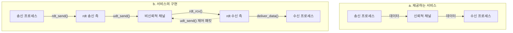

*그림 1. 신뢰적 데이터 전송의 서비스 모델과 서비스 구현*

그림 1의 인터페이스는 다음과 같다. 여기서 rdt는 신뢰적 데이터 전송(reliable data transfer) 프로토콜, udt는 비신뢰적 데이터 전송(unreliable data transfer)을 뜻한다.

| 인터페이스 | 호출하는 쪽 | 의미 |
|:-----|:-----|:-----|
| `rdt_send()` | 상위 계층(송신 응용) | 수신 측 상위 계층에 전달할 데이터를 rdt 송신 측에 넘김 |
| `udt_send()` | rdt 송신 측과 수신 측 | 비신뢰적 채널로 패킷을 보냄 |
| `rdt_rcv()` | 하위 계층(채널) | 채널의 수신 측에 패킷이 도착했음을 rdt에 알림 |
| `deliver_data()` | rdt 수신 측 | 데이터를 상위 계층에 넘김 |

*표 1. 신뢰적 데이터 전송 프로토콜의 인터페이스*

### 1.2 이 장의 가정과 FSM 표기

이 장은 다음 가정을 따른다.

- **단방향 데이터 전송.** 데이터는 송신 측에서 수신 측으로만 흐른다. 양방향(전이중) 신뢰적 전송은 개념적으로 더 어렵지 않지만 설명이 번거롭다(8절). 다만 데이터가 단방향이더라도 송신 측과 수신 측은 제어 패킷을 양방향으로 주고받으므로 양쪽 모두 `udt_send()`를 호출한다.
- **채널은 패킷 순서를 바꾸지 않는다.** 패킷은 일부가 손실되더라도 보낸 순서대로 전달된다고 가정한다(이 가정의 의미는 9절에서 다시 본다).
- 이 장의 이론은 인터넷 전송 계층에만 해당하지 않으므로 세그먼트 대신 일반적인 용어인 **패킷**을 쓴다.

송신자와 수신자의 동작은 유한 상태 기계(FSM, 6장)로 나타낸다. 송신자와 수신자는 별개의 FSM을 가진다. Kurose와 Ross의 교재는 전이 화살표에 가로줄을 긋고 그 위에 전이를 일으키는 사건을, 그 아래에 사건이 일어날 때 수행하는 동작을 적는다. 사건이 일어나도 아무 동작을 하지 않거나 사건 없이 동작을 수행하면 그 자리에 Λ를 써서 동작이나 사건이 없음을 명시하고, 초기 상태는 점선 화살표로 표시한다. 이 노트의 상태 전이도는 같은 내용을 "사건 / 동작"의 형식으로 적고 초기 상태를 검은 점에서 나오는 화살표로 표시한다. 한 상태에서 자기 자신으로 돌아오는 전이가 여럿이면 화살표 하나에 줄을 바꾸어 함께 적는다.

---

<br>

## 2. 흐름 제어와 오류 제어의 기본

신뢰적 전송 프로토콜을 구체적으로 만들기 전에, 전송 계층이 제공할 수 있는 두 서비스인 흐름 제어와 오류 제어의 기본 개념과 도구를 정리한다.

### 2.1 흐름 제어: 밀어 넣기와 끌어오기

어떤 개체가 항목을 생산하고 다른 개체가 그것을 소비할 때는 생산 속도와 소비 속도가 균형을 이루어야 한다. 소비보다 생산이 빠르면 소비자가 압도되어 일부 항목을 버려야 하고, 생산이 느리면 소비자가 기다려야 하므로 시스템의 효율이 떨어진다. 흐름 제어는 앞의 문제, 즉 소비자 쪽에서 데이터 항목을 잃는 것을 막는 일이다.

> **용어 정의:** **흐름 제어(flow control)** 는 생산자가 데이터를 만드는 속도와 소비자가 데이터를 쓰는 속도의 균형을 맞추어, 소비자가 감당하지 못할 만큼의 데이터를 받지 않게 하는 기법이다.

생산자에서 소비자로 항목을 전달하는 방식에는 두 가지가 있다.

- **밀어 넣기(pushing).** 생산자가 소비자의 사전 요청 없이 항목이 만들어지는 대로 보낸다. 소비자가 압도될 수 있으므로, 소비자가 생산자에게 전달을 멈추라고 경고하고 다시 받을 준비가 되면 알리는 반대 방향의 흐름 제어가 필요하다.
- **끌어오기(pulling).** 소비자가 요청할 때만 생산자가 항목을 보낸다. 소비자는 준비가 되었을 때 요청하므로 흐름 제어가 필요 없다.

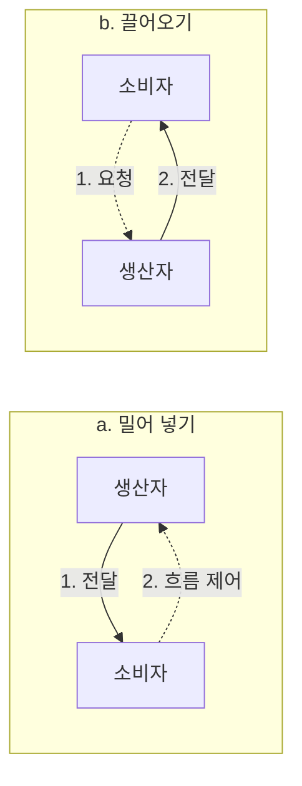

*그림 2. 밀어 넣기 방식과 끌어오기 방식의 전달*

### 2.2 전송 계층의 흐름 제어와 버퍼

전송 계층의 통신에는 송신 프로세스, 송신 전송 계층, 수신 전송 계층, 수신 프로세스의 네 개체가 관여한다.

- 응용 계층의 송신 프로세스는 생산자일 뿐이다. 메시지 조각을 만들어 전송 계층에 밀어 넣는다.
- 송신 전송 계층은 소비자이자 생산자이다. 송신 프로세스가 밀어 넣은 메시지를 소비하고, 메시지를 패킷에 캡슐화하여 수신 전송 계층에 밀어 넣는다.
- 수신 전송 계층도 소비자이자 생산자이다. 송신자에게서 받은 패킷의 소비자이고, 메시지를 꺼내 응용 계층에 넘기는 생산자이다. 다만 이 마지막 전달은 보통 끌어오기 방식이어서, 전송 계층은 응용 계층 프로세스가 메시지를 요청할 때까지 기다린다.

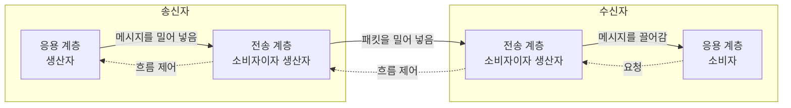

*그림 3. 전송 계층에서 흐름 제어가 필요한 두 곳*

그림 3에서 보듯이 흐름 제어는 적어도 두 곳, 즉 송신 전송 계층에서 송신 응용 계층으로, 그리고 수신 전송 계층에서 송신 전송 계층으로 필요하다. 흐름 제어를 구현하는 방법은 여러 가지이지만, 보통은 송신 전송 계층과 수신 전송 계층에 하나씩 두 개의 버퍼를 둔다. 버퍼는 송신자와 수신자에서 패킷을 담아 두는 메모리 위치의 집합이며, 흐름 제어 통신은 소비자가 생산자에게 신호를 보내는 방식으로 이루어진다.

- 송신 전송 계층의 버퍼가 가득 차면 응용 계층에 메시지 조각을 그만 넘기라고 알리고, 빈자리가 생기면 다시 넘겨도 된다고 알린다.
- 수신 전송 계층의 버퍼가 가득 차면 송신 전송 계층에 패킷을 그만 보내라고 알리고, 빈자리가 생기면 다시 보내도 된다고 알린다.

이 방식에서 소비자는 버퍼가 가득 찼을 때와 빈자리가 생겼을 때 두 번 생산자와 통신해야 한다. 양쪽이 한 칸짜리 버퍼를 쓰면 통신이 더 간단하다. 송신 전송 계층의 한 칸이 비면 응용 계층에 다음 조각을 보내라고 알리고, 수신 전송 계층의 한 칸이 비면 송신 전송 계층에 다음 패킷을 보내라는 확인 응답을 보낸다. 그러나 4.5절에서 보듯이 송신자와 수신자에 한 칸짜리 버퍼를 쓰는 흐름 제어는 비효율적이다.

### 2.3 오류 제어

인터넷에서 송신 전송 계층의 패킷을 수신 전송 계층까지 나르는 네트워크 계층(IP)은 비신뢰적이므로, 응용이 신뢰성을 요구하면 전송 계층이 신뢰적이어야 한다. 신뢰성은 전송 계층에 오류 제어 서비스를 더해서 얻는다.

> **용어 정의:** **오류 제어(error control)** 는 손상되거나 손실되거나 중복되거나 순서가 어긋난 패킷을 검출하고 바로잡아 데이터를 정확하게 전달하는 기법이다.

전송 계층의 오류 제어는 다음 일을 맡는다.

1. 손상된 패킷을 검출하여 버린다.
2. 손실되거나 버려진 패킷을 추적하여 다시 보낸다.
3. 중복된 패킷을 인식하여 버린다.
4. 빠진 패킷이 도착할 때까지 순서가 어긋난 패킷을 버퍼에 보관한다.

오류 제어는 흐름 제어와 달리 송신 전송 계층과 수신 전송 계층만 관여한다. 응용 계층과 전송 계층 사이에 오가는 메시지 조각에는 오류가 없다고 가정한다. 흐름 제어와 마찬가지로 대부분의 경우 수신 전송 계층이 송신 전송 계층에 문제를 알리는 방식으로 오류 제어를 수행한다.

### 2.4 순서 번호

오류 제어를 하려면 송신 전송 계층은 어느 패킷을 다시 보낼지, 수신 전송 계층은 어느 패킷이 중복인지, 어느 패킷이 순서가 어긋나 도착했는지 알아야 한다. 패킷에 번호를 매기면 이것이 가능하다.

> **용어 정의:** **순서 번호(sequence number)** 는 송신자가 패킷 헤더의 필드에 넣어 각 패킷에 붙이는 일련번호이다. 수신자는 순서 번호로 다시 보내야 할 패킷, 중복된 패킷, 순서가 어긋나 도착한 패킷을 알아낸다.

- 패킷이 손상되거나 손실되면 수신 전송 계층은 순서 번호로 송신 전송 계층에 그 패킷을 다시 보내라고 알릴 수 있다.
- 순서 번호가 같은 패킷 두 개가 도착하면 중복을 검출할 수 있다.
- 순서 번호에 빈틈이 있으면 순서가 어긋난 패킷을 알아낼 수 있다.

순서 번호는 헤더에 들어가야 하므로 한계를 정해야 한다. 헤더에서 순서 번호에 $`m`$비트를 쓰면 순서 번호는 $`0`$부터 $`2^m - 1`$까지이다. 예를 들어 $`m = 4`$이면 순서 번호는 0부터 15까지뿐이다. 그러나 번호를 다 쓰면 처음으로 돌아가 다시 쓸 수 있으므로 순서 번호는 다음과 같이 이어진다.

```text
0, 1, 2, 3, 4, 5, 6, 7, 8, 9, 10, 11, 12, 13, 14, 15, 0, 1, 2, 3, 4, 5, ...
```

즉 오류 제어에서 순서 번호는 $`m`$이 순서 번호 필드의 비트 수일 때 모듈로(modulo) $`2^m`$으로 매긴다. 순서 번호 공간은 $`2^m - 1`$ 바로 다음에 0이 오는 크기 $`2^m`$의 고리로 생각할 수 있으며, 순서 번호에 관한 모든 계산은 모듈로 $`2^m`$ 산술로 한다.

> **[이산수학]** 이산수학의 합동 산술에서 $`a \equiv b \pmod{n}`$은 $`a - b`$가 $`n`$의 배수라는 뜻이다. 모듈로 $`2^m`$ 순서 번호에서 번호 $`x`$ 다음 번호는 $`(x + 1) \bmod 2^m`$이고, 패킷 번호 $`k`$번째(0부터 셈) 패킷의 순서 번호는 $`k \bmod 2^m`$이다. 같은 순서 번호가 $`2^m`$ 패킷마다 되풀이되므로, 6.6절과 7.6절에서 보듯이 윈도우 크기를 제한하지 않으면 새 패킷과 옛 패킷을 구분하지 못한다.

### 2.5 확인 응답

오류 제어에는 긍정 신호와 부정 신호를 모두 쓸 수 있다.

> **용어 정의:** **확인 응답(acknowledgment, ACK)** 은 수신자가 패킷이나 패킷 묶음을 올바르게 받았음을 송신자에게 알리는 제어 패킷이다. 보통 확인하는 패킷의 순서 번호를 담는다.

> **용어 정의:** **부정 확인 응답(negative acknowledgment, NAK)** 은 수신자가 패킷을 올바르게 받지 못했음을 송신자에게 알리는 제어 패킷이다. 보통 올바르게 받지 못한 패킷의 순서 번호를 담는다.

확인 응답은 패킷마다 하나씩 보내는 개별 확인 응답일 수도 있고, 어떤 순서 번호까지의 모든 패킷을 한 번에 확인하는 **누적 확인 응답(cumulative acknowledgment)** 일 수도 있다. 수신자는 손상된 패킷을 버리기만 해도 된다. 송신자는 타이머로 손실된 패킷을 검출할 수 있다. 패킷을 보낼 때 타이머를 시작하고, 타이머가 끝날 때까지 ACK가 오지 않으면 패킷을 다시 보낸다. 중복된 패킷은 수신자가 조용히 버리면 된다. 순서가 어긋난 패킷은 버려서 송신자가 손실된 패킷처럼 다루게 하거나, 빠진 패킷이 도착할 때까지 보관할 수 있다.

> **핵심:** 순서 번호와 확인 응답은 비신뢰적 네트워크 위에서 신뢰적 데이터 전송을 이루는 기반이다. 순서 번호는 수신자가 무엇을 받았는지 알게 하고, 확인 응답은 송신자가 수신자의 상태를 알게 한다.

### 2.6 흐름 제어와 오류 제어의 결합과 슬라이딩 윈도우

흐름 제어에는 송신자와 수신자에 하나씩 두 개의 버퍼가 필요하고, 오류 제어에는 양쪽이 순서 번호와 확인 응답 번호를 써야 한다. 두 요구는 번호가 매겨진 버퍼 두 개를 쓰면 함께 만족할 수 있다.

- 송신자에서는 패킷을 보낼 준비가 되면 버퍼에서 다음 빈 위치의 번호 $`x`$를 그 패킷의 순서 번호로 쓴다. 패킷을 보내면 사본을 메모리 위치 $`x`$에 보관하고 상대의 확인 응답을 기다린다. 보낸 패킷에 대한 확인 응답이 오면 패킷을 지우고 그 위치를 비운다.
- 수신자에서는 순서 번호 $`y`$인 패킷이 도착하면 응용 계층이 받을 준비가 될 때까지 메모리 위치 $`y`$에 보관하며, 패킷 $`y`$의 도착을 알리는 확인 응답을 보낼 수 있다.

순서 번호는 모듈로 $`2^m`$이므로 0부터 $`2^m - 1`$까지의 순서 번호를 원으로 나타낼 수 있다.

> **용어 정의:** **슬라이딩 윈도우(sliding window)** 는 순서 번호 공간 가운데 지금 보내거나 받을 수 있는 범위를 나타내는 구간으로, 확인 응답이 오면 순서 번호가 커지는 방향으로 미끄러지듯 이동한다. 실제로는 다음에 보낼 패킷과 확인을 기다리는 첫 패킷의 순서 번호를 담는 변수로 구현되는 추상적 개념이다.

버퍼는 원의 일부를 차지하는 조각들, 즉 슬라이딩 윈도우로 나타낸다. 송신자에서는 패킷을 보내면 해당 조각에 표시를 한다. 모든 조각에 표시가 되면 버퍼가 가득 찬 것이므로 응용 계층에서 메시지를 더 받을 수 없다. 확인 응답이 도착하면 해당 조각의 표시를 지운다. 윈도우 앞쪽부터 연속된 조각들의 표시가 지워지면, 윈도우가 그만큼 순서 번호를 따라 미끄러져 윈도우 끝에 빈 조각이 더 생긴다.

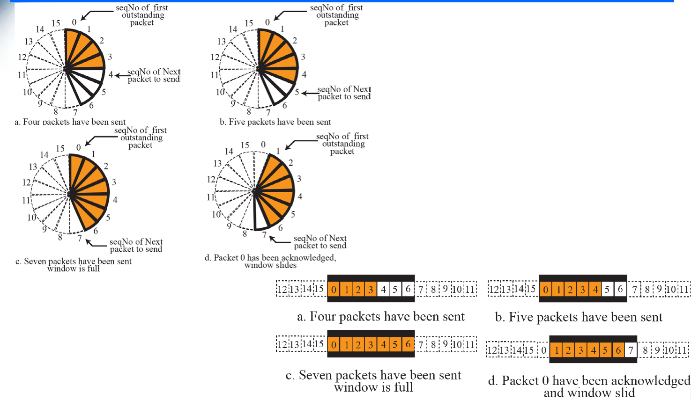

*그림 4. 순서 번호가 모듈로 16이고 크기가 7인 송신 슬라이딩 윈도우의 원형 표현과 선형 표현*

그림 4는 순서 번호가 모듈로 16($`m = 4`$)이고 윈도우 크기가 7인 송신 측 슬라이딩 윈도우를 네 단계로 보여 준다. 윗부분은 원형 표현이고 아랫부분은 같은 상황의 선형 표현이다. 원의 양쪽을 위로 구부려 펴면 선형 표현이 된다.

| 단계 | 상황 | 윈도우가 덮는 순서 번호 | 확인을 기다리는 패킷 | 다음에 보낼 순서 번호 |
|:-----|:-----|:-----|:-----|:-----|
| a | 패킷 네 개를 보냄 | 0\~6 | 0, 1, 2, 3 | 4 |
| b | 패킷 다섯 개를 보냄 | 0\~6 | 0, 1, 2, 3, 4 | 5 |
| c | 패킷 일곱 개를 보내 윈도우가 가득 참 | 0\~6 | 0\~6 | 7 (윈도우 밖이므로 보낼 수 없음) |
| d | 패킷 0이 확인되어 윈도우가 한 칸 이동 | 1\~7 | 1\~6 | 7 |

*표 2. 그림 4의 네 단계에서 송신 윈도우의 상태*

대부분의 프로토콜은 지면을 덜 차지하는 선형 표현을 쓴다. 이 장의 나머지는 선형 표현을 텍스트 그림으로 쓴다.

---

<br>

## 3. rdt 프로토콜의 단계적 구성

이 절은 Kurose와 Ross의 방식대로, 아래 채널에 대한 가정을 점점 현실에 가깝게 바꾸면서 송신 측과 수신 측 프로토콜을 하나씩 발전시켜 결함 없는 신뢰적 데이터 전송 프로토콜에 이른다.

### 3.1 rdt1.0: 완전히 신뢰적인 채널

먼저 아래 채널이 완전히 신뢰적인 가장 단순한 경우를 생각한다. 이때의 프로토콜 rdt1.0은 자명하다.

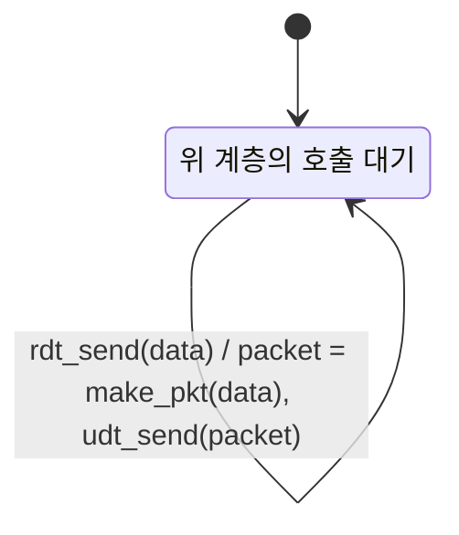

*그림 5. rdt1.0의 송신 측 FSM*

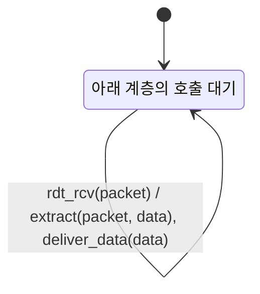

*그림 6. rdt1.0의 수신 측 FSM*

송신 측은 `rdt_send(data)` 사건으로 위 계층의 데이터를 받아 `make_pkt(data)`로 그 데이터를 담은 패킷을 만들어 채널로 보낸다. 수신 측은 `rdt_rcv(packet)` 사건으로 채널에서 패킷을 받아 `extract(packet, data)`로 데이터를 꺼내 `deliver_data(data)`로 위 계층에 넘긴다. 각 FSM은 상태가 하나뿐이므로 전이는 그 상태에서 자기 자신으로 돌아온다.

이 프로토콜에서는 데이터 단위와 패킷의 구분이 없고, 모든 패킷은 송신자에서 수신자로만 흐른다. 채널이 완전히 신뢰적이므로 잘못될 일이 없어 수신 측이 송신 측에 피드백을 줄 필요가 없다. 또한 수신자가 송신자의 송신 속도만큼 빠르게 데이터를 받을 수 있다고 가정했으므로, 수신자가 송신자에게 속도를 늦추라고 요청할 필요도 없다.

### 3.2 rdt2.0: 비트 오류가 있는 채널

더 현실적인 채널 모델은 패킷의 비트가 손상될 수 있는 채널이다. 비트 오류는 보통 패킷이 전송되거나 전파되거나 버퍼에 저장되는 동안 네트워크의 물리적 구성 요소에서 생긴다. 당분간은 전송된 패킷이 비트는 손상될 수 있어도 모두 보낸 순서대로 도착한다고 가정한다.

사람이 전화로 긴 메시지를 불러 줄 때를 생각해 보면 해결책이 보인다. 받아 적는 사람은 한 문장을 듣고 이해하고 적을 때마다 "알겠습니다"라고 말하고, 문장을 잘못 들으면 다시 말해 달라고 한다. 이 받아쓰기 프로토콜은 긍정 확인 응답("알겠습니다")과 부정 확인 응답("다시 말해 주세요")을 모두 쓴다. 이런 재전송에 기반한 신뢰적 데이터 전송 프로토콜을 ARQ 프로토콜이라고 한다.

> **용어 정의:** **자동 반복 요청(Automatic Repeat reQuest, ARQ)** 은 수신자가 오류를 검출하여 송신자에게 피드백을 보내고, 송신자가 오류가 난 패킷을 다시 보내는 방식으로 신뢰성을 얻는 프로토콜의 부류이다.

ARQ 프로토콜이 비트 오류를 다루려면 다음 세 기능이 필요하다.

1. **오류 검출.** 수신자가 비트 오류가 생겼는지 알아낼 메커니즘이 필요하다. UDP가 쓰는 인터넷 체크섬(6장)이 그 예이다. 이런 기법은 원래 데이터 외에 추가 비트를 보내야 하며, 이 비트를 rdt2.0 데이터 패킷의 체크섬 필드에 넣는다. 오류 검출과 정정 기법은 18장에서 자세히 다룬다.
2. **수신자 피드백.** 송신자와 수신자는 보통 수천 킬로미터 떨어진 서로 다른 종단 시스템에서 실행되므로, 송신자가 수신자의 상황(패킷을 올바르게 받았는지)을 알 유일한 방법은 수신자가 명시적인 피드백을 보내는 것이다. rdt2.0은 수신자에서 송신자로 ACK와 NAK 패킷을 보낸다. 원리상 이 패킷은 1비트면 충분하다(예: 0은 NAK, 1은 ACK).
3. **재전송.** 수신자에서 오류가 난 패킷은 송신자가 다시 보낸다.

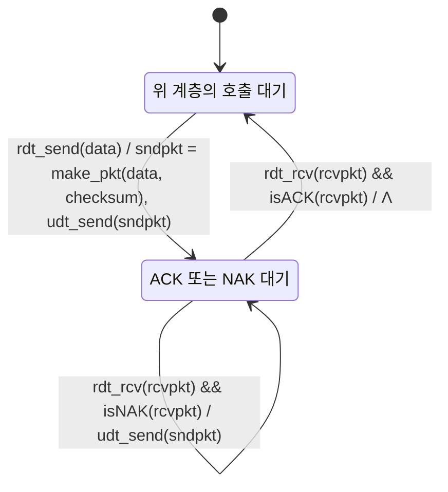

*그림 7. rdt2.0의 송신 측 FSM*

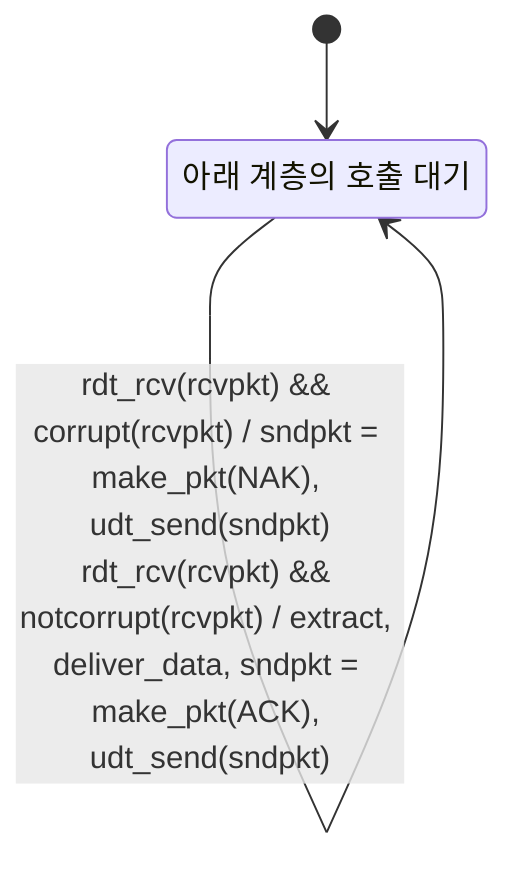

*그림 8. rdt2.0의 수신 측 FSM*

rdt2.0의 송신 측은 상태가 두 개이다. 왼쪽 상태에서는 위 계층에서 데이터가 내려오기를 기다린다. `rdt_send(data)` 사건이 일어나면 보낼 데이터와 체크섬을 담은 패킷 `sndpkt`를 만들어 `udt_send(sndpkt)`로 보낸다. 오른쪽 상태에서는 수신자의 ACK나 NAK를 기다린다. ACK가 오면(`rdt_rcv(rcvpkt) && isACK(rcvpkt)`) 가장 최근에 보낸 패킷을 수신자가 올바르게 받았으므로 데이터를 기다리는 상태로 돌아간다. NAK가 오면 마지막 패킷을 다시 보내고, 재전송한 패킷에 대한 ACK나 NAK를 다시 기다린다.

송신자가 ACK나 NAK를 기다리는 동안에는 위 계층에서 데이터를 더 받을 수 없다. 즉 `rdt_send()` 사건은 송신자가 ACK를 받고 이 상태를 떠난 뒤에만 일어날 수 있다. 따라서 송신자는 수신자가 현재 패킷을 올바르게 받았다고 확신하기 전에는 새 데이터를 보내지 않는다. 이런 방식으로 동작하는 프로토콜을 정지 후 대기 프로토콜이라고 한다.

> **용어 정의:** **정지 후 대기 프로토콜(stop-and-wait protocol)** 은 송신자가 패킷 하나를 보낸 뒤 그 패킷의 확인 응답을 받을 때까지 다음 패킷을 보내지 않고 기다리는 프로토콜이다.

rdt2.0의 수신 측은 상태가 하나뿐이다. 패킷이 도착하면 손상 여부에 따라 ACK나 NAK로 응답한다.

rdt2.0은 제대로 동작하는 것처럼 보이지만 치명적인 결함이 있다. **ACK나 NAK 패킷 자체가 손상될 가능성**을 고려하지 않았다. 최소한 ACK와 NAK 패킷에도 체크섬 비트를 넣어 손상을 검출해야 한다. 더 어려운 문제는 ACK나 NAK가 손상되었을 때 어떻게 복구하느냐이다. ACK나 NAK가 손상되면 송신자는 수신자가 마지막 데이터를 올바르게 받았는지 알 방법이 없다.

### 3.3 rdt2.1: 손상된 ACK와 NAK의 처리

손상된 ACK와 NAK를 처리하는 방법으로 세 가지를 생각할 수 있다.

1. 받아쓰기에서 말하는 사람이 "알겠습니다"나 "다시 말해 주세요"를 알아듣지 못하면 "뭐라고 하셨어요?"라고 물을 것이다. 이는 송신자에서 수신자로 가는 새로운 종류의 패킷을 더하는 것이다. 그런데 "뭐라고 하셨어요?"가 손상되면 받아 적는 사람은 그 말이 받아쓰기의 일부인지 응답을 다시 해 달라는 요청인지 몰라 다시 "뭐라고 하셨어요?"라고 답할 것이고, 그 응답도 손상될 수 있다. 이 길은 끝없이 어려워진다.
2. 체크섬 비트를 충분히 넣어 송신자가 비트 오류를 검출할 뿐 아니라 복구까지 할 수 있게 한다. 이 방법은 패킷을 손상시키지만 잃어버리지는 않는 채널에서는 당장의 문제를 해결한다.
3. 송신자가 손상된 ACK나 NAK를 받으면 현재 데이터 패킷을 단순히 다시 보낸다. 이 방법은 송신자에서 수신자로 가는 채널에 **중복 패킷**을 만든다. 수신자는 자신이 마지막으로 보낸 ACK나 NAK를 송신자가 올바르게 받았는지 모르므로, 도착한 패킷이 새 데이터인지 재전송인지 미리 알 수 없다는 것이 근본적인 어려움이다.

TCP를 포함한 거의 모든 데이터 전송 프로토콜이 채택한 간단한 해결책은 데이터 패킷에 새 필드를 더하고 송신자가 그 필드에 순서 번호를 넣어 데이터 패킷에 번호를 매기는 것이다. 수신자는 순서 번호만 보면 받은 패킷이 재전송인지 알 수 있다. 정지 후 대기 프로토콜에서는 1비트 순서 번호면 충분하다. 받은 패킷의 순서 번호가 가장 최근에 받은 패킷과 같으면 송신자가 이전 패킷을 다시 보낸 것이고, 순서 번호가 모듈로 2 산술로 앞으로 나아갔으면 새 패킷이다. 지금은 패킷을 잃지 않는 채널을 가정하므로, ACK와 NAK 패킷은 자신이 확인하는 패킷의 순서 번호를 담을 필요가 없다. 송신자는 받은 ACK나 NAK가 (손상되었든 아니든) 가장 최근에 보낸 데이터 패킷에 대한 응답임을 안다.

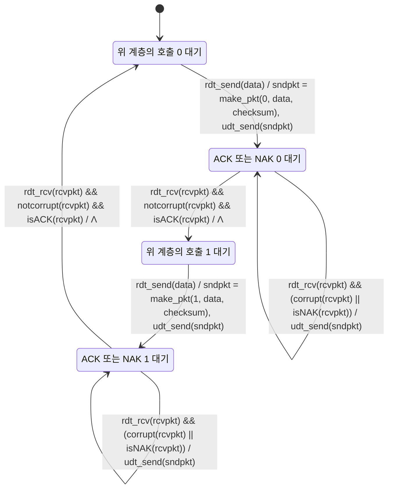

*그림 9. rdt2.1의 송신 측 FSM*

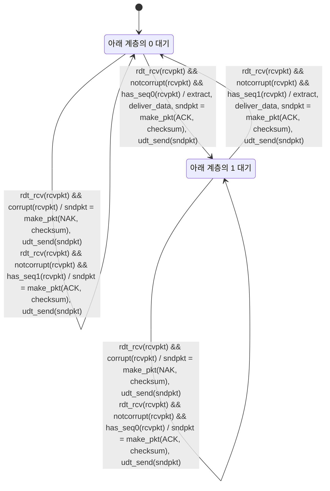

*그림 10. rdt2.1의 수신 측 FSM*

rdt2.1의 송신자와 수신자 FSM은 상태 수가 rdt2.0의 두 배이다. 지금 보내는 패킷(송신자)이나 기다리는 패킷(수신자)의 순서 번호가 0인지 1인지를 상태가 기억해야 하기 때문이다. 0번 패킷을 보내거나 기다리는 상태의 동작과 1번 패킷을 보내거나 기다리는 상태의 동작은 순서 번호를 다루는 부분만 다르고 서로 대칭이다.

수신자는 기다리던 것과 다른 순서 번호의 패킷, 즉 이미 받은 패킷의 재전송을 받으면 그 패킷에 대해 긍정 확인 응답(ACK)을 보낸다. 송신자가 이전 ACK를 손상된 상태로 받아 패킷을 다시 보냈기 때문이므로, 다시 ACK를 보내야 송신자가 다음 패킷으로 넘어간다. 손상된 패킷을 받으면 부정 확인 응답(NAK)을 보낸다.

### 3.4 rdt2.2: NAK를 쓰지 않는 프로토콜

NAK를 보내는 대신 마지막으로 올바르게 받은 패킷에 대한 ACK를 보내도 같은 효과를 얻을 수 있다.

> **용어 정의:** **중복 확인 응답(duplicate ACK)** 은 송신자가 이미 확인 응답을 받은 패킷을 다시 확인하는 ACK이다. 같은 패킷에 대한 ACK를 두 번 받은 송신자는 수신자가 두 번 확인된 패킷의 다음 패킷을 올바르게 받지 못했음을 안다.

NAK를 쓰지 않는 rdt2.2와 rdt2.1의 미묘한 차이는 다음 두 가지이다. 수신자는 ACK 메시지에 자신이 확인하는 패킷의 순서 번호를 넣어야 하고(`make_pkt(ACK, 0, checksum)`처럼 인자를 하나 더 넣음), 송신자는 받은 ACK가 확인하는 패킷의 순서 번호를 검사해야 한다(`isACK(rcvpkt, 0)`처럼 인자를 하나 더 넣음).

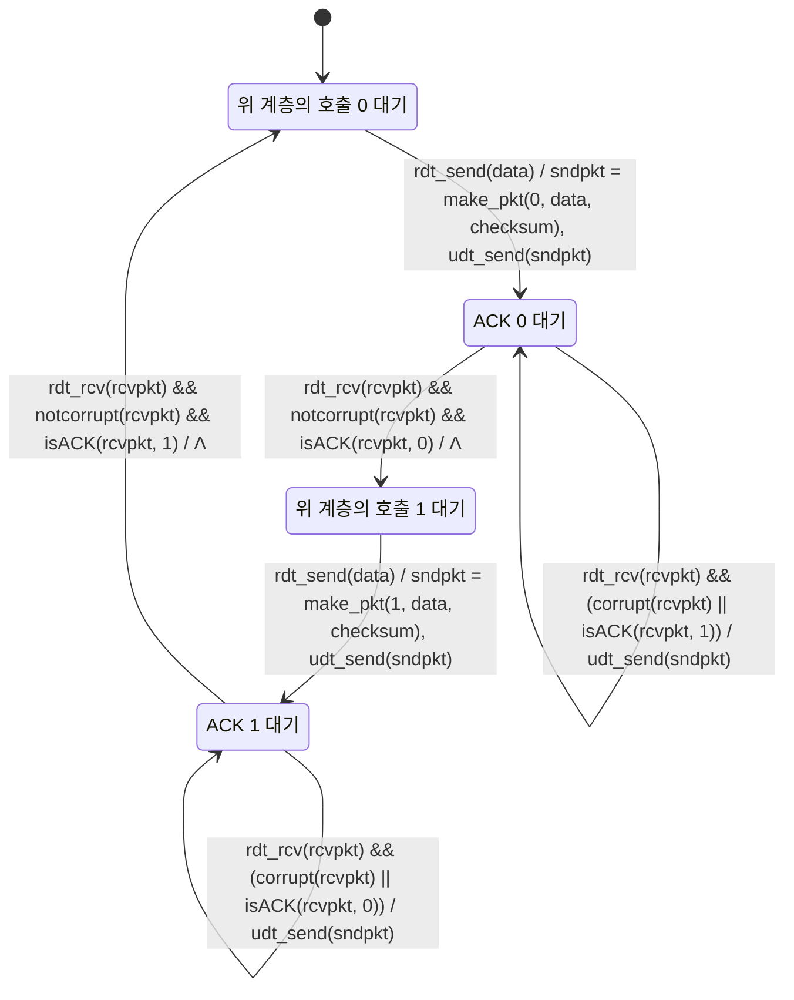

*그림 11. rdt2.2의 송신 측 FSM*

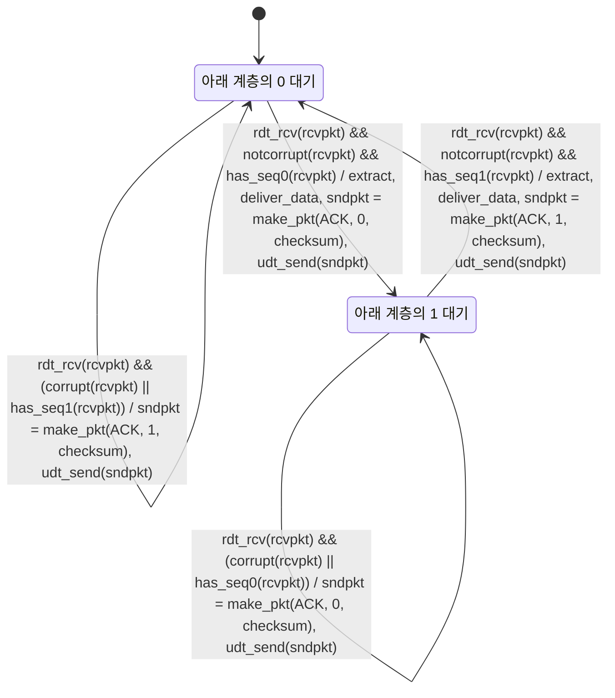

*그림 12. rdt2.2의 수신 측 FSM*

예를 들어 수신자가 0번 패킷을 기다리는데 손상된 패킷이나 1번 패킷(재전송)이 오면, 마지막으로 올바르게 받은 1번 패킷에 대한 ACK 1을 다시 보낸다. 0번 패킷의 ACK를 기다리던 송신자는 ACK 1을 받으면 이를 0번 패킷이 제대로 도착하지 않았다는 뜻의 중복 ACK로 해석하여 0번 패킷을 다시 보낸다.

### 3.5 rdt3.0: 손실과 비트 오류가 있는 채널

이제 아래 채널이 비트를 손상시킬 뿐 아니라 패킷을 잃어버릴 수도 있다고 하자. 이는 인터넷을 포함한 오늘날의 컴퓨터 네트워크에서 드물지 않은 일이다. 프로토콜은 두 가지 문제를 새로 해결해야 한다. 패킷 손실을 어떻게 검출하는가, 그리고 손실이 일어나면 무엇을 하는가이다. 두 번째 문제는 rdt2.2에서 이미 만든 체크섬, 순서 번호, ACK 패킷, 재전송으로 해결된다. 첫 번째 문제에는 새 메커니즘이 필요하다.

손실을 검출하는 방법은 여러 가지이지만, 여기서는 손실의 검출과 복구를 송신자가 맡는다. 송신자가 데이터 패킷을 보냈는데 그 패킷이나 그 패킷에 대한 수신자의 ACK가 손실되면, 어느 경우든 수신자로부터 응답이 오지 않는다. 송신자가 패킷이 손실되었다고 확신할 만큼 충분히 기다린다면 데이터 패킷을 다시 보내기만 하면 된다.

그렇다면 손실을 확신하려면 얼마나 기다려야 하는가. 적어도 송신자와 수신자 사이의 왕복 지연(중간 라우터의 버퍼링 포함)에 수신자가 패킷을 처리하는 시간을 더한 만큼은 기다려야 한다. 그러나 많은 네트워크에서 이 최악의 지연은 확실히 알기는커녕 추정하기도 어렵다. 게다가 프로토콜은 손실에서 되도록 빨리 복구해야 하므로 최악의 지연만큼 기다리는 것은 바람직하지 않다. 그래서 실제로는 송신자가 손실이 일어났을 가능성이 높은(그러나 보장되지는 않는) 시간을 신중하게 골라, 그 시간 안에 ACK가 오지 않으면 패킷을 다시 보낸다. 패킷이 특히 오래 지연되면 데이터 패킷도 ACK도 손실되지 않았는데 재전송이 일어날 수 있으므로 송신자에서 수신자로 가는 채널에 중복 데이터 패킷이 생길 수 있다. 다행히 rdt2.2에는 중복 패킷을 처리할 순서 번호가 이미 있다.

송신자의 관점에서 재전송은 만능 해결책이다. 송신자는 데이터 패킷이 손실되었는지, ACK가 손실되었는지, 둘 다 지나치게 지연되었을 뿐인지 모른다. 어느 경우든 동작은 같다. 다시 보낸다. 시간에 기반한 재전송을 구현하려면 정해진 시간이 지나면 송신자를 깨우는 카운트다운 타이머가 필요하다.

> **용어 정의:** **재전송 타이머(retransmission timer)** 는 송신자가 패킷을 보낼 때 시작하여 정해진 시간이 지나면 송신자를 깨우는 카운트다운 타이머이다. 그 시간 안에 확인 응답이 오지 않으면 송신자는 패킷을 다시 보낸다.

송신자는 (1) 패킷(처음 보내는 패킷이든 재전송이든)을 보낼 때마다 타이머를 시작하고, (2) 타이머 인터럽트에 응답하여 적절한 동작을 하고, (3) 타이머를 멈출 수 있어야 한다.

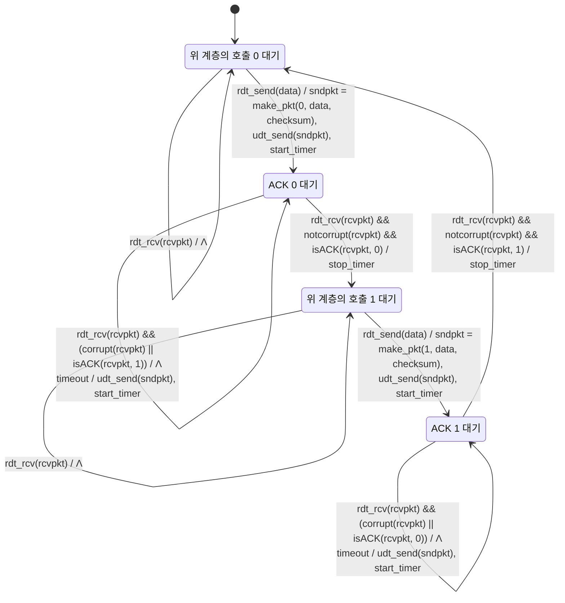

*그림 13. rdt3.0의 송신 측 FSM*

rdt2.2 송신자와 비교하면 차이가 세 가지 있다. 첫째, 패킷을 보낼 때마다 `start_timer`로 타이머를 시작하고, 올바른 ACK를 받으면 `stop_timer`로 멈춘다. 둘째, 타이머가 끝나면(`timeout`) 패킷을 다시 보내고 타이머를 다시 시작한다. 셋째, 손상된 ACK나 다른 순서 번호의 ACK를 받으면 곧바로 재전송하지 않고 아무 동작도 하지 않는다(Λ). 재전송은 타이머가 맡기 때문이다. 또한 데이터를 기다리는 상태에서 늦게 도착한 중복 ACK 같은 패킷이 오면 무시한다. rdt3.0의 수신자는 rdt2.2의 수신자와 같다.

그림 14는 rdt3.0의 네 가지 동작을 보여 준다. 시간은 위에서 아래로 흐르며, 전송 지연과 전파 지연 때문에 패킷을 받는 시각은 보내는 시각보다 반드시 늦다.

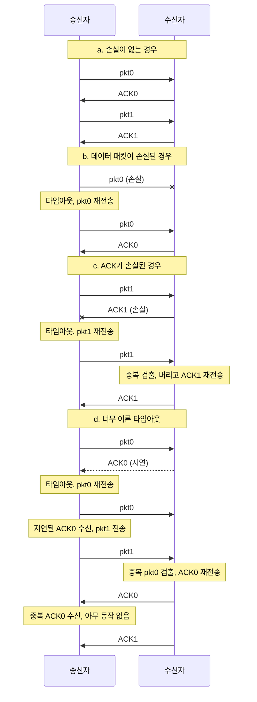

*그림 14. rdt3.0의 네 가지 동작: 손실 없음, 패킷 손실, ACK 손실, 너무 이른 타임아웃*

(d)에서 송신자는 타이머가 너무 일찍 끝나 pkt0을 다시 보내지만, 곧 지연된 ACK0을 받고 pkt1을 보낸다. 수신자는 다시 온 pkt0을 중복으로 검출하여 버리고 ACK0을 다시 보내며, 송신자는 이 ACK0을 이미 확인된 패킷에 대한 중복 ACK로 보고 무시한다. 패킷의 순서 번호가 0과 1을 번갈아 쓰므로 rdt3.0을 **교대 비트 프로토콜(alternating-bit protocol)** 이라고도 한다.

### 3.6 rdt 프로토콜의 정리

| 프로토콜 | 채널 가정 | 새로 더한 메커니즘 | 남은 문제 |
|:-----|:-----|:-----|:-----|
| rdt1.0 | 완전히 신뢰적 | 없음 (패킷을 만들어 보내고 꺼내 전달) | 없음 |
| rdt2.0 | 비트 오류 가능, 손실 없음 | 체크섬, ACK와 NAK, 재전송 | ACK와 NAK가 손상되면 대처 불가 |
| rdt2.1 | 비트 오류 가능 (ACK와 NAK 포함), 손실 없음 | 1비트 순서 번호, 중복 검출 | 없음 (NAK를 씀) |
| rdt2.2 | rdt2.1과 같음 | ACK에 순서 번호를 넣어 NAK를 대체 (중복 ACK) | 없음 |
| rdt3.0 | 비트 오류와 패킷 손실 가능 | 카운트다운 타이머와 타임아웃 재전송 | 정지 후 대기라서 성능이 나쁨 (4.5절) |

*표 3. rdt1.0에서 rdt3.0까지 채널 가정과 메커니즘의 변화*

> **핵심:** 체크섬, 순서 번호, 타이머, 긍정 확인 응답과 부정 확인 응답은 각각 신뢰적 데이터 전송 프로토콜에서 반드시 필요한 역할을 한다. rdt3.0은 이 요소들을 모두 갖춘, 기능적으로 올바른 신뢰적 데이터 전송 프로토콜이다.

---

<br>

## 4. 단순 프로토콜과 정지 후 대기 프로토콜

Forouzan의 교재는 같은 문제를 가장 단순한 프로토콜에서 출발하여 점점 복잡한 기능을 더하는 방식으로 다룬다. TCP/IP의 전송 계층 프로토콜은 이 일반 프로토콜들을 변형하거나 결합한 것이다. 이 절과 6절, 7절은 Forouzan의 네 프로토콜(단순, 정지 후 대기, Go-Back-N, Selective Repeat)을 3절의 rdt 프로토콜과 연결하여 설명한다. 모두 데이터 패킷이 한 방향으로 흐르는 단방향 프로토콜로 다룬다.

### 4.1 단순 프로토콜

첫 번째 프로토콜은 흐름 제어도 오류 제어도 없는 단순한 비연결형 프로토콜이다. 수신자는 받는 패킷을 즉시 처리할 수 있어서 결코 압도되지 않는다고 가정한다.

> **핵심:** 단순 프로토콜은 흐름 제어도 오류 제어도 제공하지 않는 비연결형 프로토콜이다.

송신 측 전송 계층은 응용 계층에서 메시지를 받아 패킷을 만들어 보낸다. 수신 측 전송 계층은 네트워크 계층에서 패킷을 받아 메시지를 꺼내 응용 계층에 넘긴다. 송신 측은 응용 계층에 보낼 메시지가 있기 전에는 패킷을 보내지 않고, 수신 측은 패킷이 도착하기 전에는 메시지를 넘길 수 없다. 이 요구는 상태가 Ready 하나뿐인 FSM 두 개로 나타낼 수 있다.

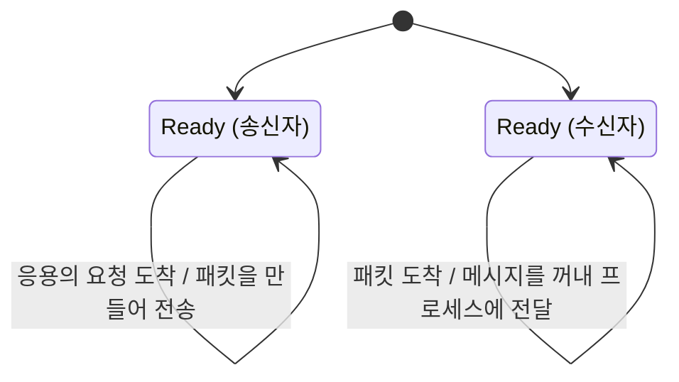

*그림 15. 단순 프로토콜의 송신자와 수신자 FSM*

단순 프로토콜은 3.1절의 rdt1.0과 같다. 6장에서 본 것처럼 UDP는 이 프로토콜에 선택적 체크섬을 더한 것이다. 그림 16은 단순 프로토콜로 통신하는 예로, 송신자는 수신자를 전혀 고려하지 않고 패킷을 하나씩 보낸다.

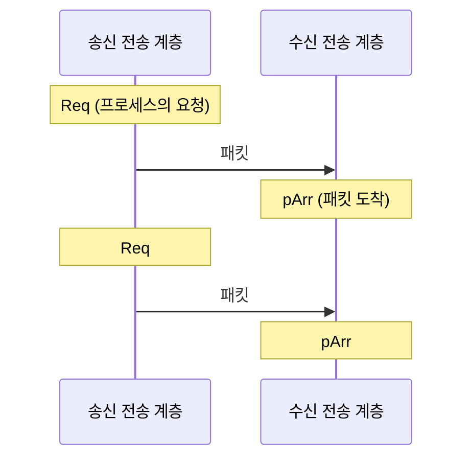

*그림 16. 단순 프로토콜의 통신 예*

### 4.2 정지 후 대기 프로토콜의 구성

두 번째 프로토콜은 흐름 제어와 오류 제어를 모두 쓰는 연결형 프로토콜인 정지 후 대기 프로토콜이다(3.2절의 정의). 송신자와 수신자는 모두 크기 1인 슬라이딩 윈도우를 쓴다.

- 송신자는 패킷을 한 번에 하나씩 보내고 다음 패킷을 보내기 전에 확인 응답을 기다린다. 따라서 채널에는 언제나 패킷 하나와 확인 응답 하나만 있을 수 있다.
- 손상된 패킷을 검출하기 위해 데이터 패킷마다 체크섬을 더한다. 패킷이 수신자에 도착하면 검사하여, 체크섬이 맞지 않으면 손상된 것으로 보고 조용히 버린다. 수신자의 침묵은 송신자에게 패킷이 손상되었거나 손실되었다는 신호가 된다.
- 송신자는 패킷을 보낼 때마다 타이머를 시작한다. 타이머가 끝나기 전에 확인 응답이 오면 타이머를 멈추고 (보낼 것이 있으면) 다음 패킷을 보낸다. 타이머가 끝나면 패킷이 손실되었거나 손상되었다고 보고 이전 패킷을 다시 보낸다. 따라서 송신자는 확인 응답이 올 때까지 패킷의 사본을 보관해야 한다.

```text
            Sender                                    Receiver
  +------------------------+  data: [seqNo|data|checksum] -->  +------------------------+
  | Application            |                                   | Application            |
  | Transport              |  <-- ACK: [ackNo|checksum]        | Transport              |
  +------------------------+                                   +------------------------+
     S                                                            R  next packet
     |                                                            |  to receive
  ...[ ]...   timer                                            ...[ ]...
  send window (size 1)                                         receive window (size 1)
```

*그림 17. 정지 후 대기 프로토콜의 구성과 크기 1인 송신 윈도우와 수신 윈도우*

> **핵심:** 정지 후 대기 프로토콜에서 흐름 제어는 송신자가 확인 응답을 기다리게 하여 이루고, 오류 제어는 손상된 패킷을 버리고 타이머가 끝나면 송신자가 확인되지 않은 패킷을 다시 보내게 하여 이룬다.

같은 방식은 응용 계층에서도 쓰인다. UDP 위에서 동작하는 TFTP(4장)는 DATA 메시지로 데이터 블록 하나를 보내고, 타임아웃 전에 그 블록의 ACK가 도착한 뒤에야 다음 블록을 보낸다.

### 4.3 순서 번호와 확인 응답 번호

중복 패킷을 막기 위해 프로토콜은 순서 번호와 확인 응답 번호를 쓴다. 패킷 헤더에 그 패킷의 순서 번호를 담는 필드를 더한다. 패킷 크기를 줄이려면 모호함 없이 통신할 수 있는 가장 작은 순서 번호 범위를 찾아야 한다.

순서 번호 $`x`$를 썼다면 그다음에는 $`x + 1`$만 필요하고 $`x + 2`$는 필요 없다. 송신자가 순서 번호 $`x`$인 패킷을 보낸 뒤 일어날 수 있는 일은 다음 세 가지이다.

1. 패킷이 수신자에 무사히 도착하고, 수신자가 보낸 확인 응답이 송신자에 도착한다. 송신자는 $`x + 1`$번 패킷을 보낸다.
2. 패킷이 손상되거나 수신자에 도착하지 않는다. 송신자는 타임아웃 뒤 $`x`$번 패킷을 다시 보내고, 수신자는 확인 응답을 보낸다.
3. 패킷이 수신자에 무사히 도착하고 수신자가 확인 응답을 보내지만, 확인 응답이 손상되거나 손실된다. 송신자는 타임아웃 뒤 $`x`$번 패킷을 다시 보낸다. 이 패킷은 중복이다. 수신자는 $`x + 1`$번 패킷을 기다리는데 $`x`$번이 왔으므로 중복임을 알아챌 수 있다.

수신자가 경우 1과 경우 3을 구분해야 하므로 순서 번호 $`x`$와 $`x + 1`$이 필요하다. 그러나 $`x + 2`$는 필요 없다. 경우 1에서는 $`x`$번과 $`x + 1`$번이 모두 확인되어 어느 쪽에도 모호함이 없으므로 다음 패킷에 다시 $`x`$를 쓸 수 있고, 경우 2와 3에서 새 패킷은 $`x + 2`$가 아니라 $`x + 1`$이다. 두 값만 필요하므로 $`x = 0`$, $`x + 1 = 1`$로 두면 순서 번호는 0, 1, 0, 1, 0, ...으로 이어지며 이것이 모듈로 2 산술이다. 따라서 정지 후 대기 프로토콜은 1비트 필드로 패킷에 번호를 매길 수 있다.

순서 번호는 데이터 패킷과 확인 응답 모두에 알맞아야 하므로, Forouzan은 확인 응답 번호가 항상 수신자가 다음에 기다리는 패킷의 순서 번호를 알리도록 정한다. 예를 들어 0번 패킷이 무사히 도착하면 수신자는 확인 응답 번호 1인 ACK(다음에 1번을 기다린다는 뜻)를 보내고, 1번 패킷이 무사히 도착하면 확인 응답 번호 0인 ACK를 보낸다.

> **핵심:** 정지 후 대기 프로토콜에서 순서 번호는 모듈로 2이며, 확인 응답 번호는 수신자가 다음에 기다리는 패킷의 순서 번호를 모듈로 2로 알린다. 모든 계산은 모듈로 2로 한다.

> **참고:** **두 교재의 ACK 번호 규칙.** Kurose와 Ross의 rdt2.2와 rdt3.0에서 ACK에 담긴 번호는 수신자가 받은 패킷의 순서 번호이다(0번 패킷을 받으면 ACK 0). Forouzan의 정지 후 대기 프로토콜에서 ACK 번호는 다음에 기다리는 패킷의 순서 번호이다(0번 패킷을 받으면 ACK 1). 두 규칙은 같은 정보를 다르게 표현할 뿐이며, 송신자가 ACK를 해석하는 방식만 그에 맞추면 된다. 8장의 TCP는 Forouzan의 규칙처럼 다음에 기다리는 바이트 번호를 확인 응답 번호로 쓴다.

### 4.4 정지 후 대기 프로토콜의 FSM과 동작 예

송신자에는 송신 윈도우의 유일한 칸을 가리키는 제어 변수 $`S`$(sender)가, 수신자에는 수신 윈도우의 유일한 칸을 가리키는 제어 변수 $`R`$(receiver)이 있다. 이 프로토콜은 연결형이므로 데이터 패킷을 주고받기 전에 양쪽이 확립 상태에 있어야 하며, 아래의 상태들은 실제로는 확립 상태 안에 들어 있다.

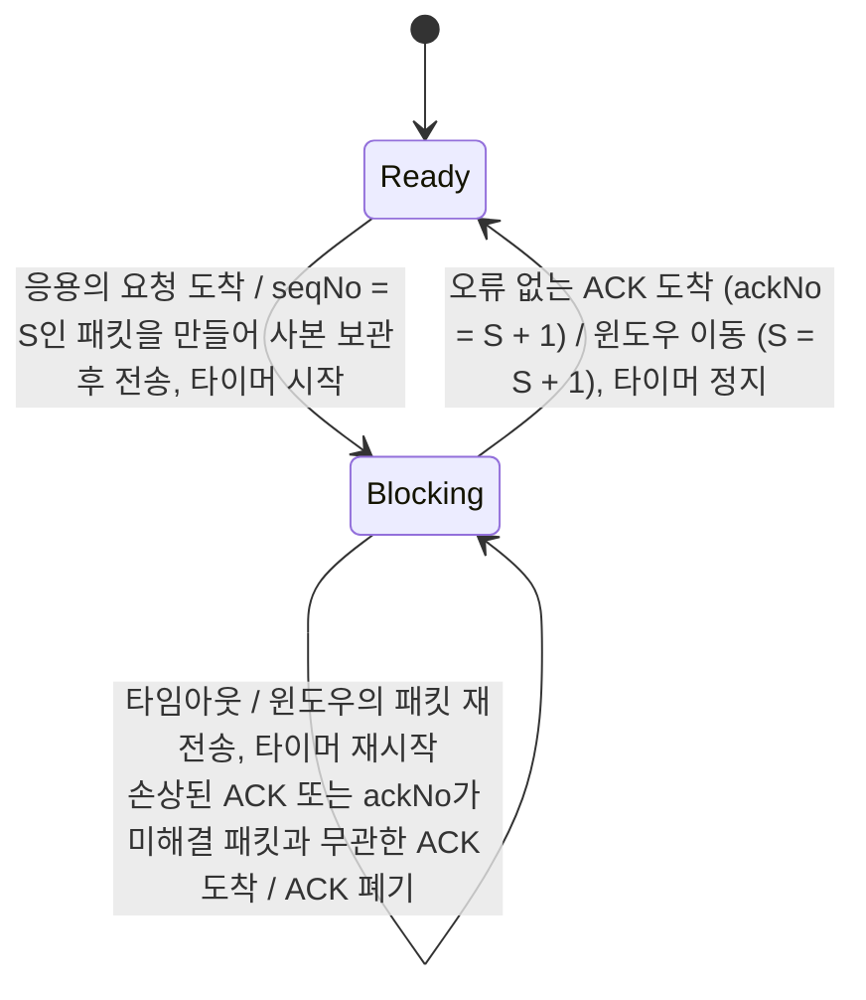

*그림 18. 정지 후 대기 프로토콜의 송신자 FSM (모든 계산은 모듈로 2)*

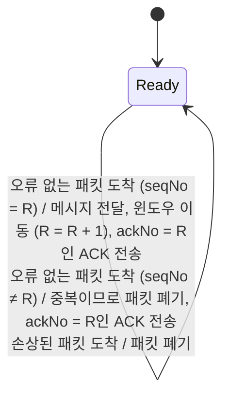

*그림 19. 정지 후 대기 프로토콜의 수신자 FSM (모든 계산은 모듈로 2)*

**송신자.** 처음에는 Ready 상태에 있고 $`S`$는 0으로 시작한다. Ready 상태에서는 응용의 요청만 기다린다. 요청이 오면 순서 번호를 $`S`$로 한 패킷을 만들어 사본을 보관하고 보낸 뒤 유일한 타이머를 시작하고 Blocking 상태로 간다. Blocking 상태에서는 세 사건이 일어날 수 있다.

1. 다음에 보낼 패킷에 해당하는 확인 응답 번호, 즉 $`(S + 1) \bmod 2`$를 담은 오류 없는 ACK가 오면 타이머를 멈추고 윈도우를 $`S = (S + 1) \bmod 2`$로 옮긴 뒤 Ready 상태로 간다.
2. 손상된 ACK나 확인 응답 번호가 $`(S + 1) \bmod 2`$가 아닌 오류 없는 ACK가 오면 그 ACK를 버린다.
3. 타임아웃이 일어나면 유일한 미해결 패킷을 다시 보내고 타이머를 다시 시작한다.

**수신자.** 항상 Ready 상태에 있으며 $`R`$은 0으로 시작한다. 세 사건이 일어날 수 있다.

1. 순서 번호가 $`R`$인 오류 없는 패킷이 오면 메시지를 응용 계층에 넘기고, 윈도우를 $`R = (R + 1) \bmod 2`$로 옮긴 뒤 확인 응답 번호가 $`R`$인 ACK를 보낸다.
2. 순서 번호가 $`R`$이 아닌 오류 없는 패킷이 오면 패킷을 버리지만 확인 응답 번호가 $`R`$인 ACK는 보낸다.
3. 손상된 패킷이 오면 패킷을 버린다.

그림 20은 정지 후 대기 프로토콜의 동작 예이다. 0번 패킷이 보내지고 확인된다. 1번 패킷은 손실되어 타임아웃 뒤 다시 보내지고, 재전송된 1번 패킷이 확인되면 타이머가 멈춘다. 다시 0번 패킷이 보내지고 수신되지만 확인 응답이 손실된다. 송신자는 패킷이 손실되었는지 확인 응답이 손실되었는지 모르므로 타임아웃 뒤 0번 패킷을 다시 보내고, 수신자는 이를 중복으로 보고 버리면서 확인 응답을 다시 보낸다.

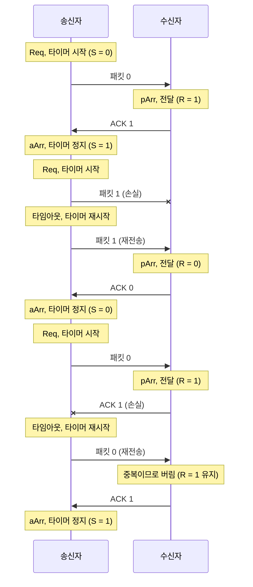

*그림 20. 정지 후 대기 프로토콜에서 패킷 손실과 확인 응답 손실의 처리*

정지 후 대기 프로토콜은 3.5절의 rdt3.0(교대 비트 프로토콜)과 같은 프로토콜이며, ACK 번호를 붙이는 규칙만 다르다(4.3절의 참고).

### 4.5 정지 후 대기 프로토콜의 효율

rdt3.0은 기능적으로 올바르지만, 특히 오늘날의 고속 네트워크에서 성능에 만족할 사람은 없을 것이다. 성능 문제의 핵심은 정지 후 대기 방식에 있다.

미국 서부와 동부에 있는 두 호스트를 생각한다. 두 종단 시스템 사이의 광속 왕복 전파 지연 RTT는 약 30 ms이고, 전송 속도 $`R`$이 1 Gbps($`10^9`$ bps)인 채널로 연결되어 있다. 헤더와 데이터를 합한 패킷 크기 $`L`$이 1,000바이트(8,000비트)이면 패킷 하나를 1 Gbps 링크에 실제로 내보내는 데 걸리는 시간은 다음과 같다.

```math
d_{\text{trans}} = \frac{L}{R} = \frac{8000 \text{ bits}}{10^9 \text{ bits/s}} = 8 \ \mu\text{s}
```

송신자가 $`t = 0`$에 패킷을 보내기 시작하면 $`t = L/R = 8 \ \mu\text{s}`$에 마지막 비트가 채널에 들어간다. 패킷은 15 ms 동안 대륙을 가로질러, 마지막 비트가 $`t = RTT/2 + L/R = 15.008`$ ms에 수신자에 도착한다. ACK 패킷이 매우 작아 전송 시간을 무시할 수 있고 수신자가 데이터 패킷의 마지막 비트를 받자마자 ACK를 보낸다고 하면, ACK는 $`t = RTT + L/R = 30.008`$ ms에 송신자에 돌아오며, 이때 비로소 송신자가 다음 메시지를 보낼 수 있다. 즉 30.008 ms 가운데 송신자가 실제로 비트를 보낸 시간은 0.008 ms뿐이다.

> **용어 정의:** **송신자 이용률(sender utilization)** 은 송신자(또는 채널)가 실제로 비트를 채널로 내보내느라 바쁜 시간의 비율이다.

```math
U_{\text{sender}} = \frac{L/R}{RTT + L/R} = \frac{0.008}{30.008} \approx 0.00027
```

송신자는 시간의 0.027%만 바쁘다. 달리 보면 송신자는 30.008 ms 동안 1,000바이트만 보냈으므로, 1 Gbps 링크가 있는데도 실효 처리량은 8,000비트 / 30.008 ms ≈ 267 kbps에 불과하다. 여기에 송신자와 수신자의 하위 계층 처리 시간과 중간 라우터의 처리 지연, 큐잉 지연까지 넣으면 지연은 더 커지고 성능은 더 나빠진다. 이는 네트워크 프로토콜이 하드웨어의 능력을 얼마나 제한할 수 있는지 보여 주는 예이다.

Forouzan은 같은 문제를 대역폭-지연 곱으로 설명한다. 대역폭이 크고(굵고) 왕복 지연이 긴(긴) 채널에서 정지 후 대기 프로토콜은 매우 비효율적이다.

> **용어 정의:** **대역폭-지연 곱(bandwidth-delay product)** 은 채널의 대역폭(데이터 전송률)과 왕복 지연의 곱으로, 송신자가 수신자의 확인 응답을 기다리는 동안 시스템에 내보낼 수 있는 비트 수이다. 채널을 파이프로 보면 그 파이프의 부피에 해당한다.

예를 들어 정지 후 대기 시스템에서 회선의 대역폭이 1 Mbps이고 1비트가 왕복하는 데 20 ms가 걸린다면 대역폭-지연 곱은 다음과 같다.

```math
(1 \times 10^6 \text{ bps}) \times (20 \times 10^{-3} \text{ s}) = 20{,}000 \text{ bits}
```

시스템은 데이터가 수신자에 갔다가 확인 응답이 돌아오는 동안 20,000비트를 보낼 수 있지만, 데이터 패킷이 1,000비트이면 그중 1,000비트만 보낸다. 따라서 링크 이용률은 1,000 / 20,000 = 5%이다. 같은 링크에서 확인 응답을 신경 쓰기 전에 패킷을 15개까지 보낼 수 있는 프로토콜을 쓰면 왕복 시간 동안 15,000비트를 보낼 수 있으므로 이용률은 15,000 / 20,000 = 75%가 된다. 물론 손상된 패킷이 있으면 다시 보내야 하므로 이용률은 훨씬 낮아진다.

> **참고:** **두 계산 방식의 차이.** Forouzan의 계산은 패킷의 비트 수를 대역폭-지연 곱으로 나눈 것으로, Kurose의 식에서 분모의 $`L/R`$을 무시한 근삿값이다. 위 예에 Kurose의 식을 그대로 쓰면 $`L/R = 1`$ ms이므로 이용률은 $`1/(20 + 1) \approx 4.8\%`$, 패킷 15개를 보내면 $`15/(20 + 1) \approx 71.4\%`$이다. $`L/R`$이 RTT보다 훨씬 작으면 두 값의 차이는 무시할 만하다.

---

<br>

## 5. 파이프라이닝

### 5.1 파이프라이닝과 이용률

정지 후 대기의 성능 문제는 간단히 해결된다. 송신자가 확인 응답을 기다리지 않고 여러 패킷을 보낼 수 있게 하면 된다.

> **용어 정의:** **파이프라이닝(pipelining)** 은 송신자가 확인 응답을 기다리지 않고 여러 패킷을 연달아 보내, 전송 중인 패킷들이 송신자와 수신자 사이의 파이프를 채우게 하는 기법이다.

```text
Stop-and-wait                          Pipelined (3 packets)

sender            receiver             sender            receiver
t=0      |--pkt-->                     t=0      |--pkt1-->
t=L/R    |   \                                  |--pkt2-->
         |    \                                 |--pkt3-->
         |     \--> RTT/2+L/R          t=3L/R   |   \\\
         |     /    (send ACK)                  |    \\\--> first bit arrives
         |    /                                 |    ///    (send ACKs)
t=RTT+L/R|<-ACK, send next packet      t=RTT+L/R|<-ACK1, send next packet
```

*그림 21. 정지 후 대기와 패킷 세 개를 연달아 보내는 파이프라이닝의 송신 시간*

그림 21처럼 송신자가 확인 응답을 기다리기 전에 패킷 세 개를 보낼 수 있으면 이용률은 거의 세 배가 된다.

```math
U_{\text{sender}} = \frac{3L/R}{RTT + L/R} = \frac{0.024}{30.008} \approx 0.0008
```

일반적으로 확인 응답을 기다리지 않고 보낼 수 있는 패킷 수(윈도우 크기)가 $`N`$이면 이용률은 $`\min(1, \; N \cdot (L/R)/(RTT + L/R))`$이다. 위 예에서 파이프를 가득 채워 이용률 1에 이르려면 $`N \geq (RTT + L/R)/(L/R) = 30.008/0.008 = 3751`$개의 패킷이 동시에 전송 중이어야 한다.

Forouzan의 표현으로는, 네트워킹을 비롯한 여러 분야에서 앞의 작업이 끝나기 전에 다음 작업을 시작하는 것을 파이프라이닝이라고 한다. 정지 후 대기 프로토콜은 패킷이 목적지에 도달하여 확인될 때까지 다음 패킷을 보낼 수 없으므로 파이프라이닝이 없다. 파이프라이닝은 전송 중인 비트 수가 대역폭-지연 곱에 비해 클 때 전송 효율을 높인다.

### 5.2 파이프라이닝이 요구하는 것

파이프라이닝은 신뢰적 데이터 전송 프로토콜에 다음과 같은 결과를 낳는다.

- **순서 번호의 범위를 늘려야 한다.** 전송 중인 패킷마다(재전송은 세지 않고) 고유한 순서 번호가 있어야 하는데, 전송 중이고 아직 확인되지 않은 패킷이 여러 개일 수 있기 때문이다.
- **송신 측과 수신 측이 패킷을 둘 이상 버퍼에 보관해야 할 수 있다.** 송신자는 적어도 보냈지만 아직 확인되지 않은 패킷을 보관해야 한다. 수신자도 올바르게 받은 패킷을 보관해야 할 수 있다.
- 필요한 순서 번호의 범위와 버퍼의 양은 프로토콜이 손실되거나 손상되거나 지나치게 지연된 패킷에 어떻게 대응하느냐에 달려 있다. 파이프라이닝 오류 복구에는 Go-Back-N과 Selective Repeat의 두 가지 기본 방식이 있다.

---

<br>

## 6. Go-Back-N

> **용어 정의:** **Go-Back-N(GBN)** 은 송신자가 확인 응답을 기다리지 않고 최대 $`N`$개까지 미확인 패킷을 보낼 수 있고, 수신자는 순서대로 도착한 패킷만 받으며, 타임아웃이 일어나면 송신자가 미확인 패킷을 모두 다시 보내는 파이프라이닝 프로토콜이다.

GBN의 핵심은 송신자가 확인 응답을 받기 전에 여러 패킷을 보낼 수 있지만 수신자는 패킷을 하나만 버퍼에 담을 수 있다는 점이다. 송신자는 확인 응답이 올 때까지 보낸 패킷의 사본을 보관한다.

### 6.1 송신자의 순서 번호 공간

Kurose와 Ross는 송신자의 관점에서 순서 번호 공간을 두 변수로 네 구간으로 나눈다. `base`는 가장 오래된 미확인 패킷의 순서 번호이고, `nextseqnum`은 아직 쓰지 않은 가장 작은 순서 번호, 즉 다음에 보낼 패킷의 순서 번호이다.

```text
                 base                 nextseqnum
                   |                      |
                   v                      v
 [ acked ......... | sent, not yet acked  | usable, not yet sent | not usable ...
                   |<------------- window size N -------------->|
```

*그림 22. Go-Back-N에서 송신자가 보는 순서 번호의 네 구간*

| 구간 | 의미 |
|:-----|:-----|
| [0, base-1] | 이미 보냈고 확인된 패킷 |
| [base, nextseqnum-1] | 보냈지만 아직 확인되지 않은 패킷 |
| [nextseqnum, base+N-1] | 위 계층에서 데이터가 오면 곧바로 보낼 수 있는 순서 번호 |
| base+N 이상 | 파이프라인의 미확인 패킷(특히 base번 패킷)이 확인될 때까지 쓸 수 없는 순서 번호 |

*표 4. Go-Back-N 송신자의 순서 번호 구간*

보냈지만 아직 확인되지 않은 패킷에 허용되는 순서 번호의 범위는 순서 번호 공간 위의 크기 $`N`$인 윈도우로 볼 수 있다. 프로토콜이 동작하면서 이 윈도우가 순서 번호 공간 위를 앞으로 미끄러지므로, $`N`$을 윈도우 크기라고 하고 GBN 프로토콜 자체를 슬라이딩 윈도우 프로토콜이라고 한다. 미확인 패킷 수를 $`N`$으로 제한하는 이유로는 흐름 제어(8장)와 혼잡 제어(9장)가 있다.

실제로는 패킷의 순서 번호가 헤더의 고정 길이 필드에 들어간다. 순서 번호 필드가 $`k`$비트이면 순서 번호의 범위는 $`[0, 2^k - 1]`$이고, 순서 번호에 관한 모든 산술은 모듈로 $`2^k`$로 한다(2.4절의 $`m`$과 같은 뜻). rdt3.0은 1비트 순서 번호, 즉 범위 [0, 1]을 썼다. TCP는 32비트 순서 번호 필드를 쓰며, TCP의 순서 번호는 패킷이 아니라 바이트 스트림의 바이트를 센다(8장).

### 6.2 두 교재의 표기와 송신 윈도우

Forouzan은 같은 송신 윈도우를 세 변수로 정의한다. $`S_f`$(send window, first outstanding packet)는 가장 오래된 미해결 패킷의 순서 번호, $`S_n`$(send window, next packet to be sent)은 다음에 보낼 패킷에 줄 순서 번호, $`S_{size}`$는 윈도우의 크기이다.

| 의미 | Kurose와 Ross | Forouzan |
|:-----|:-----|:-----|
| 가장 오래된 미확인 패킷의 순서 번호 | `base` | $`S_f`$ |
| 다음에 보낼 패킷의 순서 번호 | `nextseqnum` | $`S_n`$ |
| 송신 윈도우 크기 | $`N`$ | $`S_{size}`$ |
| 수신자가 다음에 기다리는 패킷의 순서 번호 | `expectedseqnum` | $`R_n`$ |
| ACK에 담긴 번호 $`n`$의 뜻 | $`n`$번까지(포함) 모두 받았음 | $`n - 1`$번까지 모두 받았고 다음에 $`n`$번을 기다림 |

*표 5. Go-Back-N의 두 교재 표기 대응*

> **주의:** 표 5의 마지막 행처럼 두 교재는 누적 ACK의 번호를 다르게 매긴다. Kurose의 ACK $`n`$은 "$`n`$번 패킷까지 받았다"는 뜻이고, Forouzan의 ackNo = $`n`$은 "$`n`$번 패킷을 기다린다"는 뜻이다. 같은 상황에서 Kurose의 ACK 2는 Forouzan의 ackNo = 3에 해당한다. 문제를 풀 때는 어느 규칙을 쓰는지 먼저 확인해야 한다.

Forouzan의 송신 윈도우는 최대 크기가 $`2^m - 1`$인 가상의 상자이며(이유는 6.6절), 아래 예는 $`m = 3`$이고 크기가 7인 송신 윈도우이다.

```text
               Sf: first outstanding
               |               Sn: next to send
               v               v
 ... | 6 | 7 [ 0 | 1 | 2 | 3 | 4 | 5 | 6 ] 7 | 0 | ...
     sent, acked,  outstanding     can be sent when    cannot be accepted
     and purged    (sent, not      accepted from       from process
                   acknowledged)   process
             |<-- Ssize = window size -->|
```

*그림 23. Go-Back-N의 송신 윈도우 (m = 3, 크기 7)*

송신 윈도우는 언제나 가능한 순서 번호를 네 영역으로 나눈다. 윈도우 왼쪽은 이미 확인되어 송신자가 더 신경 쓰지 않고 사본도 보관하지 않는 패킷이다. 윈도우 안 왼쪽(그림 23에서 0\~3)은 보냈지만 상태를 모르는 미해결(outstanding) 패킷으로, 송신자는 이 패킷들이 도착했는지 손실되었는지 알 때까지 기다린다. 윈도우 안 오른쪽(4\~6)은 보낼 수 있지만 아직 응용 계층에서 해당 데이터를 받지 않은 순서 번호이다. 윈도우 오른쪽은 윈도우가 미끄러질 때까지 쓸 수 없는 순서 번호이다.

> **핵심:** Go-Back-N의 송신 윈도우는 $`S_f`$, $`S_n`$, $`S_{size}`$의 세 변수로 정의되는, 최대 크기가 $`2^m - 1`$인 추상적인 상자이다.

확인 응답이 도착하면 송신 윈도우는 한 칸 이상 미끄러질 수 있다. 그림 24에서는 확인 응답 번호 ackNo = 6인 ACK가 도착했다. 이는 수신자가 6번 패킷을 기다린다는 뜻, 즉 5번까지 모두 받았다는 뜻이다.

```text
a. Window before sliding
                  Sf              Sn
                  v               v
  0   1   2   3 [ 4   5   6   7 | 0   1   2 ] 3   4   5   6

b. Window after sliding (an ACK with ackNo = 6 has arrived)
                          Sf      Sn
                          v       v
  0   1   2   3   4   5 [ 6   7 | 0   1   2   3   4 ] 5   6
```

*그림 24. ackNo = 6인 ACK가 도착하여 송신 윈도우가 두 칸 미끄러지는 모습*

> **핵심:** 송신 윈도우는 확인 응답 번호가 (모듈로 산술로) $`S_f`$와 $`S_n`$ 사이에 있는 오류 없는 ACK가 도착하면 한 칸 이상 미끄러질 수 있다.

### 6.3 수신 윈도우와 수신자의 동작

수신 윈도우는 올바른 데이터 패킷을 받고 올바른 확인 응답을 보내도록 보장한다. GBN에서 수신 윈도우의 크기는 항상 1이다. 수신자는 언제나 특정한 패킷 하나의 도착을 기다리며, 순서가 어긋나 도착한 패킷은 버리므로 송신자가 다시 보내야 한다. 이 추상화에는 변수 $`R_n`$(receive window, next packet expected) 하나만 있으면 된다.

```text
                         Rn  next expected
                         |
                         v
 ... 0 | 1 | 2 | 3 | 4 [ 5 ] 6 | 7 | 0 | 1 | 2 ...
     already received        cannot be received
     and acknowledged
                       Rsize = 1
```

*그림 25. Go-Back-N의 수신 윈도우 (크기 1)*

윈도우 왼쪽의 순서 번호는 이미 받아 확인한 패킷이고, 윈도우 오른쪽의 순서 번호는 받을 수 없는 패킷이다. 이 두 영역의 순서 번호를 가진 패킷은 버린다. 순서 번호가 $`R_n`$과 같은 패킷만 받아들이고 확인한다. 수신 윈도우도 미끄러지지만 한 번에 한 칸씩만 움직이며, 올바른 패킷을 받으면 $`R_n = (R_n + 1) \bmod 2^m`$이 된다.

> **핵심:** 수신 윈도우는 변수 $`R_n`$ 하나로 정의되는 크기 1인 추상적인 상자이다. 올바른 패킷이 도착하면 윈도우가 미끄러지며, 한 번에 한 칸씩만 움직인다.

Kurose와 Ross의 수신자도 같다. 순서 번호 $`n`$인 패킷을 올바르게, 그리고 순서대로(마지막으로 위 계층에 넘긴 데이터가 $`n - 1`$번 패킷에서 왔을 때) 받으면 $`n`$번 패킷에 대한 ACK를 보내고 데이터 부분을 위 계층에 넘긴다. 그 밖의 모든 경우에는 패킷을 버리고 가장 최근에 순서대로 받은 패킷에 대한 ACK를 다시 보낸다. 패킷을 하나씩 순서대로 위 계층에 넘기므로, $`k`$번 패킷을 받아 넘겼다면 $`k`$보다 작은 순서 번호의 패킷도 모두 넘긴 것이다. 따라서 누적 확인 응답이 GBN에 자연스럽다.

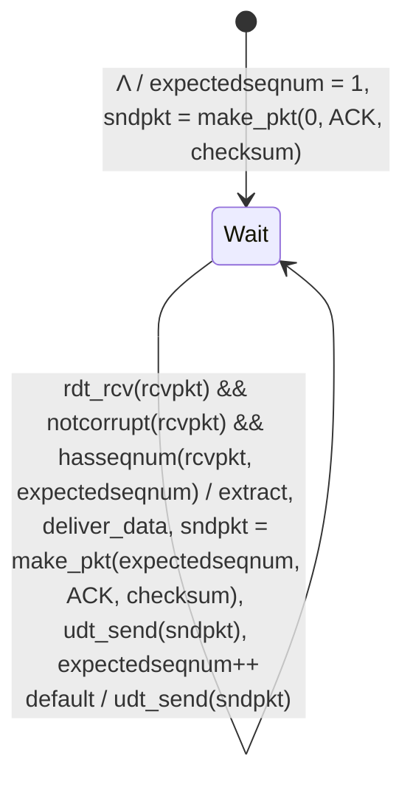

*그림 26. Kurose와 Ross의 Go-Back-N 수신자 확장 FSM*

GBN 수신자는 순서가 어긋난 패킷을 버린다. 올바르게 받은 패킷을 버리는 것이 어리석고 낭비처럼 보이지만 이유가 있다. 수신자는 데이터를 순서대로 위 계층에 넘겨야 한다. $`n`$번 패킷을 기다리는데 $`n + 1`$번이 왔다고 하자. $`n + 1`$번을 보관했다가 나중에 $`n`$번을 받아 넘긴 뒤 넘길 수도 있다. 그러나 $`n`$번이 손실되었다면 GBN의 재전송 규칙에 따라 $`n`$번과 $`n + 1`$번이 결국 모두 다시 오므로, 수신자는 $`n + 1`$번을 버려도 된다. 이 방식의 장점은 수신자의 버퍼 관리가 단순하다는 것이다. 순서가 어긋난 패킷을 보관할 필요가 없으므로, 송신자가 윈도우의 위아래 경계와 `nextseqnum`의 위치를 유지해야 하는 것과 달리 수신자는 다음에 순서대로 올 패킷의 순서 번호 `expectedseqnum`만 유지하면 된다. 단점은 버린 패킷을 다시 보낼 때 그 재전송이 손실되거나 손상되어 재전송이 더 필요해질 수 있다는 것이다.

### 6.4 송신자의 동작과 확장 FSM

Kurose와 Ross는 `base`와 `nextseqnum`이라는 변수와 이 변수에 대한 연산, 조건부 동작을 더한 **확장 FSM**으로 GBN 송신자를 기술한다. 확장 FSM은 프로그래밍 언어로 쓴 명세와 비슷해 보인다.

```text
initial:  base = 1, nextseqnum = 1                     (state: Wait)

event: rdt_send(data)
    if (nextseqnum < base + N) {
        sndpkt[nextseqnum] = make_pkt(nextseqnum, data, checksum)
        udt_send(sndpkt[nextseqnum])
        if (base == nextseqnum)
            start_timer
        nextseqnum++
    }
    else
        refuse_data(data)

event: timeout
    start_timer
    udt_send(sndpkt[base])
    udt_send(sndpkt[base+1])
    ...
    udt_send(sndpkt[nextseqnum-1])

event: rdt_rcv(rcvpkt) && notcorrupt(rcvpkt)
    base = getacknum(rcvpkt) + 1
    if (base == nextseqnum)
        stop_timer
    else
        start_timer

event: rdt_rcv(rcvpkt) && corrupt(rcvpkt)
    (no action)
```

*그림 27. Kurose와 Ross의 Go-Back-N 송신자 확장 FSM*

GBN 송신자는 세 종류의 사건에 응답한다.

1. **위 계층의 호출.** `rdt_send()`가 호출되면 먼저 윈도우가 가득 찼는지, 즉 미확인 패킷이 $`N`$개인지 확인한다. 가득 차지 않았으면 패킷을 만들어 보내고 변수를 갱신한다. 가득 찼으면 데이터를 위 계층에 그대로 돌려주어 윈도우가 가득 찼음을 암묵적으로 알리며, 위 계층은 나중에 다시 시도해야 한다. 실제 구현은 이 데이터를 버퍼에 두었다가 나중에 보내거나, 세마포어나 플래그 같은 동기화 메커니즘을 두어 윈도우가 가득 차지 않았을 때만 위 계층이 `rdt_send()`를 호출하게 할 것이다.
2. **ACK 수신.** 순서 번호 $`n`$인 패킷에 대한 ACK는 $`n`$번까지(포함) 모든 패킷을 수신자가 올바르게 받았다는 누적 확인 응답으로 본다.
3. **타임아웃.** 프로토콜의 이름 Go-Back-N은 패킷이 손실되거나 지나치게 지연되었을 때의 송신자 동작에서 왔다. 타임아웃이 일어나면 송신자는 보냈지만 아직 확인되지 않은 패킷을 모두 다시 보낸다. 그림 27의 송신자는 타이머 하나만 쓰며, 이 타이머는 가장 오래된 미확인 패킷의 타이머로 볼 수 있다. ACK를 받았는데 아직 미확인 패킷이 남아 있으면 타이머를 다시 시작하고, 미확인 패킷이 없으면 타이머를 멈춘다.

Forouzan도 같은 이유로 타이머를 하나만 쓴다. 미해결 패킷 가운데 첫 패킷의 타이머가 항상 가장 먼저 끝나기 때문이다. 타이머가 끝나면 송신자는 미해결 패킷을 모두 다시 보낸다. 예를 들어 송신자가 이미 6번 패킷까지 보냈는데($`S_n = 7`$) 유일한 타이머가 끝났고 $`S_f = 3`$이면, 3, 4, 5, 6번 패킷이 확인되지 않은 것이므로 송신자는 되돌아가 3, 4, 5, 6번을 다시 보낸다.

> **핵심:** 타임아웃이 일어나면 기계는 N칸 되돌아가 모든 패킷을 다시 보낸다. 이것이 Go-Back-N이라는 이름의 유래이다.

Forouzan의 GBN FSM은 송신자에 Ready와 Blocking 두 상태를 둔다.

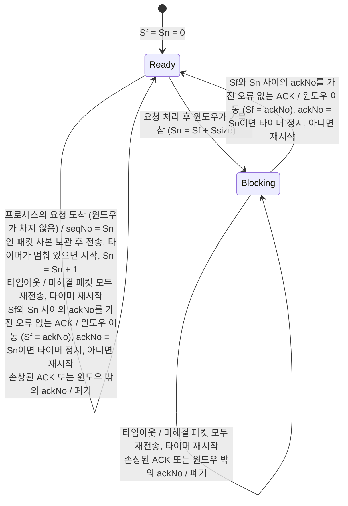

*그림 28. Forouzan의 Go-Back-N 송신자 FSM (모든 계산은 모듈로 2의 m제곱)*

수신자는 항상 Ready 상태이고 $`R_n`$은 0으로 시작한다. 순서 번호가 $`R_n`$인 오류 없는 패킷이 오면 메시지를 응용 계층에 넘기고 $`R_n = (R_n + 1) \bmod 2^m`$으로 윈도우를 옮긴 뒤 ackNo = $`R_n`$인 ACK를 보낸다. 순서 번호가 윈도우 밖인 오류 없는 패킷이 오면 패킷을 버리지만 ackNo = $`R_n`$인 ACK는 보낸다. 손상된 패킷은 버린다.

> **참고:** **GBN과 정지 후 대기의 관계.** 정지 후 대기 프로토콜은 순서 번호가 두 개뿐이고 송신 윈도우 크기가 1인 Go-Back-N 프로토콜이다. 즉 $`m = 1`$이고 $`2^m - 1 = 1`$이며, GBN의 모듈로 $`2^m`$ 산술은 $`m = 1`$일 때 정지 후 대기의 모듈로 2 산술과 같다.

### 6.5 동작 예

**Kurose와 Ross의 예 (윈도우 크기 4, 2번 패킷 손실).** 윈도우 크기 때문에 송신자는 0\~3번 패킷을 보낸 뒤 하나 이상이 확인될 때까지 기다려야 한다. ACK0과 ACK1이 차례로 도착할 때마다 윈도우가 앞으로 미끄러져 새 패킷(4번, 5번)을 하나씩 보낼 수 있다. 수신 측에서는 2번 패킷이 손실되었으므로 3, 4, 5번 패킷이 순서가 어긋난 것으로 판단되어 버려진다.

```mermaid
sequenceDiagram
    participant S as 송신자
    participant R as 수신자
    S->>R: pkt0
    S->>R: pkt1
    S-xR: pkt2 (손실)
    S->>R: pkt3
    Note over S: 윈도우가 가득 차서 대기
    R->>S: ACK0 (pkt0 수신)
    Note over S: ACK0 수신, pkt4 전송
    S->>R: pkt4
    R->>S: ACK1 (pkt1 수신)
    Note over S: ACK1 수신, pkt5 전송
    S->>R: pkt5
    R->>S: ACK1 (pkt3 버림)
    R->>S: ACK1 (pkt4 버림)
    R->>S: ACK1 (pkt5 버림)
    Note over S: pkt2 타임아웃
    S->>R: pkt2
    S->>R: pkt3
    S->>R: pkt4
    S->>R: pkt5
    R->>S: ACK2 (pkt2 전달)
    R->>S: ACK3 (pkt3 전달)
```

*그림 29. 윈도우 크기 4인 Go-Back-N에서 2번 패킷이 손실된 경우 (Kurose의 ACK 번호)*

GBN 프로토콜은 8장에서 다룰 TCP의 신뢰적 데이터 전송 요소에서 만나게 될 기법을 거의 모두 포함한다. 순서 번호, 누적 확인 응답, 체크섬, 타임아웃과 재전송이 그것이다.

**Forouzan의 예 1 (ACK 손실, 누적 확인 응답의 효과).** 순방향 채널은 신뢰적이지만 역방향 채널은 그렇지 않은 경우이다. 데이터 패킷은 손실되지 않지만 일부 ACK가 지연되고 하나가 손실된다. 이 예는 ACK가 지연되거나 손실될 때 누적 확인 응답이 어떻게 도움이 되는지 보여 준다.

```mermaid
sequenceDiagram
    participant S as 송신자 (Sf, Sn)
    participant R as 수신자 (Rn)
    Note over S: 초기 Sf = 0, Sn = 0, 타이머 시작
    Note over R: 초기 Rn = 0
    S->>R: 패킷 0 (Sn = 1)
    Note over R: pArr, Rn = 1
    R->>S: ACK 1
    Note over S: aArr, Sf = 1
    S->>R: 패킷 1 (Sn = 2)
    Note over R: pArr, Rn = 2
    R-xS: ACK 2 (손실)
    S->>R: 패킷 2 (Sn = 3)
    Note over R: pArr, Rn = 3
    R->>S: ACK 3
    S->>R: 패킷 3 (Sn = 4)
    Note over R: pArr, Rn = 4
    R->>S: ACK 4
    Note over S: ACK 3 도착, Sf = 3, 타이머 재시작
    Note over S: ACK 4 도착, Sf = 4 = Sn, 타이머 정지
```

*그림 30. Go-Back-N에서 ACK 2가 손실되어도 누적 ACK 3이 이를 대신하는 경우 (Forouzan의 ackNo)*

초기화 뒤 송신자에서 일어나는 사건은 응용 계층의 메시지 조각이 일으키는 요청 사건과 네트워크 계층에서 받은 ACK가 일으키는 도착 사건이다. 모든 미해결 패킷이 타이머가 끝나기 전에 확인되므로 타임아웃 사건은 없다. ACK 2가 손실되었지만 ACK 3이 누적 확인 응답이므로 ACK 2와 ACK 3의 역할을 모두 한다. 수신자에서는 패킷 도착 사건이 네 번 일어난다.

**Forouzan의 예 2 (패킷 손실).** 0, 1, 2, 3번 패킷을 보냈는데 1번 패킷이 손실된다. 수신자는 2번과 3번 패킷을 받지만 순서가 어긋났으므로(1번을 기다림) 버린다. 수신자는 2번과 3번 패킷을 받을 때마다 1번을 기다린다는 뜻의 ACK1을 보내지만, 이 ACK는 ackNo가 $`S_f`$와 같아 $`S_f`$보다 크지 않으므로 송신자에게 쓸모가 없어 버려진다. 타임아웃이 일어나면 송신자는 1, 2, 3번 패킷을 다시 보내고 이들은 확인된다.

```mermaid
sequenceDiagram
    participant S as 송신자 (Sf, Sn)
    participant R as 수신자 (Rn)
    Note over S: 타이머 시작
    S->>R: 패킷 0
    Note over R: pArr, Rn = 1
    R->>S: ACK 1
    Note over S: aArr, Sf = 1, 타이머 정지
    Note over S: 타이머 시작
    S-xR: 패킷 1 (손실)
    S->>R: 패킷 2
    Note over R: 순서가 어긋나 버림
    R->>S: ACK 1
    S->>R: 패킷 3
    Note over R: 순서가 어긋나 버림
    R->>S: ACK 1
    Note over S: ACK 1 두 개 모두 ackNo = Sf 이므로 버림
    Note over S: 타임아웃
    S->>R: 패킷 1 (재전송)
    Note over R: pArr, Rn = 2
    R->>S: ACK 2
    S->>R: 패킷 2 (재전송)
    Note over R: pArr, Rn = 3
    R->>S: ACK 3
    S->>R: 패킷 3 (재전송)
    Note over R: pArr, Rn = 4
    R->>S: ACK 4
    Note over S: ACK 2, ACK 3 도착 시 타이머 재시작, ACK 4 도착 시 정지
```

*그림 31. Go-Back-N에서 1번 패킷이 손실되어 1, 2, 3번을 다시 보내는 경우 (Forouzan의 ackNo)*

### 6.6 송신 윈도우 크기의 제한

송신 윈도우의 크기가 $`2^m`$보다 작아야 하는 이유를 $`m = 2`$인 예로 보인다. 이때 윈도우 크기는 $`2^m - 1 = 3`$까지 가능하다. 그림 32는 윈도우 크기가 3인 경우와 4인 경우를 비교한다.

```mermaid
sequenceDiagram
    participant S as 송신자
    participant R as 수신자
    Note over S,R: a. 송신 윈도우 크기 3 (2의 m제곱보다 작음)
    S->>R: 패킷 0
    R-xS: ACK1 (손실)
    S->>R: 패킷 1
    R-xS: ACK2 (손실)
    S->>R: 패킷 2
    R-xS: ACK3 (손실)
    Note over R: Rn = 3
    Note over S: 타임아웃, 재시작
    S->>R: 패킷 0 (재전송)
    Note over R: 3번을 기다리므로 중복으로 올바르게 버림
    Note over S,R: b. 송신 윈도우 크기 4 (2의 m제곱과 같음)
    S->>R: 패킷 0
    R-xS: ACK1 (손실)
    S->>R: 패킷 1
    R-xS: ACK2 (손실)
    S->>R: 패킷 2
    R-xS: ACK3 (손실)
    S->>R: 패킷 3
    R-xS: ACK0 (손실)
    Note over R: Rn = 0 (다음 순환)
    Note over S: 타임아웃, 재시작
    S->>R: 패킷 0 (재전송)
    Note over R: 다음 순환의 0번으로 잘못 받아들여 새 데이터로 전달
```

*그림 32. Go-Back-N에서 송신 윈도우 크기가 3일 때와 4일 때 (m = 2)*

윈도우 크기가 3($`2^m`$보다 작음)이고 확인 응답 세 개가 모두 손실되면, 유일한 타이머가 끝나 세 패킷을 모두 다시 보낸다. 수신자는 이제 0번이 아니라 3번을 기다리므로 중복 패킷을 올바르게 버린다. 반면 윈도우 크기가 4($`2^2`$와 같음)이고 확인 응답이 모두 손실되면, 송신자는 0번 패킷의 사본을 다시 보낸다. 그런데 이번에는 수신자의 윈도우가 (다음 순환의) 0번 패킷을 기다리므로 이 패킷을 중복이 아니라 다음 순환의 첫 패킷으로 받아들인다. 이는 오류이다.

> **핵심:** Go-Back-N 프로토콜에서 송신 윈도우의 크기는 $`2^m`$보다 작아야 하며(최대 $`2^m - 1`$), 수신 윈도우의 크기는 항상 1이다.

---

<br>

## 7. Selective Repeat

### 7.1 개별 재전송의 아이디어

GBN은 송신자가 파이프라인을 패킷으로 채울 수 있게 하여 정지 후 대기의 채널 이용률 문제를 피한다. 그러나 GBN에도 성능 문제가 있다. 윈도우 크기와 대역폭-지연 곱이 모두 크면 파이프라인에 패킷이 많을 수 있는데, 패킷 하나에 오류가 생기면 GBN은 많은 패킷을, 그것도 불필요하게 다시 보낸다. 채널 오류의 확률이 커질수록 파이프라인은 이런 불필요한 재전송으로 채워진다. 받아쓰기에서 단어 하나가 깨질 때마다 주변의 단어 1,000개(윈도우 크기 1,000)를 다시 불러야 한다면 받아쓰기는 반복되는 단어들 때문에 매우 느려질 것이다.

Forouzan은 이 문제를 혼잡과 연결 짓는다. 네트워크 계층이 혼잡 때문에 많은 패킷을 잃는다면, 미해결 패킷을 모두 다시 보내는 것은 혼잡을 더 악화시켜 결국 더 많은 패킷을 잃게 만든다. 이 눈사태 효과는 네트워크 전체의 붕괴로 이어질 수 있다(9장).

> **용어 정의:** **Selective Repeat(SR)** 은 송신자가 수신자에서 오류가 났다고 의심되는(손실되거나 손상된) 패킷만 골라 다시 보내고, 수신자가 순서와 관계없이 올바르게 받은 패킷을 개별적으로 확인하고 버퍼에 보관하는 파이프라이닝 프로토콜이다.

이렇게 필요할 때 개별적으로 재전송하려면 수신자가 올바르게 받은 패킷을 하나하나 확인해야 한다. 미확인 패킷의 수는 다시 윈도우 크기 $`N`$으로 제한하지만, GBN과 달리 송신자는 윈도우 안의 일부 패킷에 대해 이미 ACK를 받았을 수 있다.

### 7.2 송신 윈도우와 수신 윈도우

SR도 송신 윈도우와 수신 윈도우를 쓰지만, GBN의 윈도우와 두 가지가 다르다. 첫째, 송신 윈도우의 최대 크기가 훨씬 작아 $`2^{m-1}`$이다(이유는 7.6절). 예를 들어 $`m = 4`$이면 순서 번호는 0\~15이지만 윈도우의 최대 크기는 8뿐이다(GBN에서는 15). 둘째, 수신 윈도우의 크기가 송신 윈도우의 크기와 같다.

```text
              Sf: first outstanding
              |               Sn: next to send
              v               v
 13  14  15 [ 0*  1*  2+  3*  4   5   6   7 ] 8   9   10  11  12
  packets    outstanding packets,  packets that     packets that
  already    some acknowledged     can be sent      cannot be sent
  acked
            |<------ Ssize = 2^(m-1) ------>|

  * outstanding packet, not acknowledged
  + packet acknowledged out of order
```

*그림 33. Selective Repeat의 송신 윈도우 (m = 4, 크기 8)*

그림 33에서 0, 1, 3번은 보냈지만 확인되지 않았고, 2번은 순서와 관계없이 먼저 확인되었다. 윈도우는 가장 오래된 미확인 패킷인 0번에서 시작하므로, 0번과 1번이 확인되어야 윈도우가 미끄러진다.

SR의 수신 윈도우는 GBN의 것과 전혀 다르다. 수신 윈도우의 크기는 송신 윈도우와 같으며(최대 $`2^{m-1}`$), 수신 윈도우 크기만큼의 패킷이 순서가 어긋나 도착하더라도 위 계층에 넘길 수 있는 연속된 패킷 묶음이 생길 때까지 보관할 수 있다. 송신 윈도우와 수신 윈도우의 크기가 같으므로, 송신 윈도우의 모든 패킷이 순서가 어긋나 도착해도 보관했다가 넘길 수 있다. 그러나 신뢰적 프로토콜의 수신자는 결코 패킷을 순서가 어긋난 채로 응용 계층에 넘기지 않는다.

```text
             Rn  next packet expected
              |
              v
  0   1   2 [ 3   4+  5   6+  7   8   9+  10 ] 11  12  13  14  15
  packets      packets that can be received     packets that
  already      and stored for later delivery    cannot be received
  received     (+ already received out of order)
            |<------ Rsize = 2^(m-1) ------->|
```

*그림 34. Selective Repeat의 수신 윈도우 (m = 4, 크기 8)*

그림 34의 수신 윈도우는 3\~10번을 덮고, 4, 6, 9번은 순서가 어긋나 도착하여 보관되어 있다. 앞서 보낸 3번 패킷이 도착해야 3, 4번을 위 계층에 넘기고 윈도우가 미끄러진다.

Kurose와 Ross는 송신 윈도우의 시작을 `send_base`, 수신 윈도우의 시작을 `rcv_base`라고 부른다. 각각 Forouzan의 $`S_f`$와 $`R_n`$에 해당한다.

### 7.3 송신자와 수신자의 사건과 동작

**SR 송신자의 사건과 동작**

1. **위에서 데이터를 받음.** 송신자는 그 패킷에 쓸 수 있는 다음 순서 번호를 확인한다. 그 순서 번호가 송신 윈도우 안에 있으면 데이터를 패킷에 담아 보낸다. 그렇지 않으면 GBN처럼 데이터를 버퍼에 두거나 위 계층에 돌려주어 나중에 보내게 한다.
2. **타임아웃.** 손실된 패킷을 지키기 위해 다시 타이머를 쓰지만, 타임아웃 때 패킷 하나만 다시 보내야 하므로 이제 패킷마다 자신의 논리적 타이머가 있어야 한다. 하드웨어 타이머 하나로 여러 논리적 타이머를 흉내 낼 수 있다.
3. **ACK 수신.** ACK를 받으면 그 패킷이 윈도우 안에 있는 한 해당 패킷을 받은 것으로 표시한다. 그 패킷의 순서 번호가 `send_base`와 같으면 윈도우의 시작을 가장 작은 순서 번호의 미확인 패킷으로 옮긴다. 윈도우가 이동하여 이제 윈도우 안에 들어온, 아직 보내지 않은 순서 번호의 패킷이 있으면 그 패킷들을 보낸다.

**SR 수신자의 사건과 동작**

1. **순서 번호가 [rcv_base, rcv_base+N-1]인 패킷을 올바르게 받음.** 받은 패킷이 수신 윈도우 안에 있으므로 송신자에게 선택적 ACK를 보낸다. 처음 받은 패킷이면 버퍼에 보관한다. 이 패킷의 순서 번호가 수신 윈도우의 시작(`rcv_base`)과 같으면, 이 패킷과 앞서 보관해 둔 연속된(`rcv_base`부터 시작하는) 패킷들을 위 계층에 넘기고, 넘긴 패킷 수만큼 수신 윈도우를 앞으로 옮긴다.
2. **순서 번호가 [rcv_base-N, rcv_base-1]인 패킷을 올바르게 받음.** 수신자가 이미 확인한 패킷이라도 ACK를 만들어 보내야 한다.
3. **그 밖의 경우.** 패킷을 무시한다.

수신자 동작 2에서 이미 받은 패킷을 무시하지 않고 다시 확인해야 하는 이유는 다음과 같다. `send_base` 패킷에 대한 ACK가 수신자에서 송신자로 전달되지 않으면, 수신자가 이미 그 패킷을 받았는데도 송신자는 결국 그 패킷을 다시 보낸다. 수신자가 이 패킷을 확인하지 않으면 송신자의 윈도우는 결코 앞으로 움직이지 않는다. 이 예는 SR을 비롯한 많은 프로토콜의 중요한 성질을 보여 준다. 송신자와 수신자는 무엇이 올바르게 수신되었는지에 대해 항상 같은 견해를 갖지는 않으며, SR에서는 송신 윈도우와 수신 윈도우가 항상 일치하지는 않는다.

Forouzan의 SR FSM도 같은 내용을 담는다. 송신자는 Ready와 Blocking 상태를 오가며, 미해결 패킷 가운데 하나를 확인하는 오류 없는 ACK가 오면 해당 패킷에 표시하고, ackNo = $`S_f`$이면 확인된 연속 패킷들을 모두 지나 윈도우를 미끄러뜨린다. 수신자는 윈도우 안의 순서 번호를 가진 오류 없는 패킷이 오면 중복이 아닌 한 보관하고 ackNo = seqNo인 ACK를 보내며, seqNo = $`R_n`$이면 그 패킷과 앞서 도착해 보관된 연속 패킷을 모두 응용에 넘기고 윈도우를 첫 빈칸까지 옮긴다. 윈도우 밖의 순서 번호를 가진 오류 없는 패킷이 오면 버리지만 ackNo = $`R_n`$인 ACK를 돌려보낸다. 이는 $`R_n`$보다 작은 순서 번호의 패킷에 대한 ACK가 손실되었을 때 송신자가 윈도우를 옮길 수 있게 하기 위해서이다.

### 7.4 확인 응답과 타이머

GBN에서 ackNo는 누적적이어서 다음에 기다리는 패킷의 순서 번호를 나타내며, 그 앞의 모든 패킷을 무사히 받았음을 확인한다. SR에서 확인 응답의 의미는 다르다. SR의 ackNo는 무사히 받은 패킷 하나의 순서 번호를 나타내며 다른 패킷에 대해서는 아무것도 알려 주지 않는다.

> **핵심:** Selective Repeat 프로토콜에서 확인 응답 번호는 오류 없이 받은 패킷의 순서 번호를 나타낸다.

예를 들어 송신자가 0, 1, 2, 3, 4, 5번 패킷 여섯 개를 보내고 ackNo = 3인 ACK를 받았다고 하자. 시스템이 GBN이면 0, 1, 2번 패킷이 손상 없이 도착했고 수신자가 3번 패킷을 기다린다는 뜻이다. 시스템이 SR이면 3번 패킷이 손상 없이 도착했다는 뜻이며, 이 ACK는 다른 패킷에 대해서는 아무것도 말하지 않는다.

타이머에 대해서는, 이론적으로 SR은 미해결 패킷마다 타이머를 하나씩 쓰며 타이머가 끝나면 해당 패킷만 다시 보낸다. 즉 GBN은 미해결 패킷을 한 묶음으로 다루고 SR은 하나하나 다룬다. 다만 Forouzan은 SR을 구현하는 대부분의 전송 계층 프로토콜이 타이머를 하나만 쓴다는 이유로 타이머 하나를 쓰는 SR을 기술하며, 그 경우 타임아웃이 일어나면 윈도우 안의 미확인 패킷을 모두 다시 보낸다.

### 7.5 동작 예

**Kurose와 Ross의 예 (윈도우 크기 4, 2번 패킷 손실).** 수신자는 처음에 3, 4, 5번 패킷을 버퍼에 보관하고, 2번 패킷이 마침내 도착하면 2번과 함께 이들을 위 계층에 넘긴다. 아래에서 대괄호는 각 시점의 윈도우가 덮는 순서 번호이다.

```mermaid
sequenceDiagram
    participant S as 송신자
    participant R as 수신자
    S->>R: pkt0 [0 1 2 3]
    Note over R: pkt0 수신, 전달, ACK0 전송 [1 2 3 4]
    R->>S: ACK0
    S->>R: pkt1 [0 1 2 3]
    Note over R: pkt1 수신, 전달, ACK1 전송 [2 3 4 5]
    R->>S: ACK1
    S-xR: pkt2 (손실) [0 1 2 3]
    S->>R: pkt3, 윈도우 가득 참 [0 1 2 3]
    Note over R: pkt3 수신, 보관, ACK3 전송 [2 3 4 5]
    R->>S: ACK3
    Note over S: ACK0 수신, pkt4 전송 [1 2 3 4]
    S->>R: pkt4
    Note over S: ACK1 수신, pkt5 전송 [2 3 4 5]
    S->>R: pkt5
    Note over R: pkt4 수신, 보관, ACK4 전송 [2 3 4 5]
    R->>S: ACK4
    Note over R: pkt5 수신, 보관, ACK5 전송 [2 3 4 5]
    R->>S: ACK5
    Note over S: pkt2 타임아웃, pkt2 재전송 [2 3 4 5]
    S->>R: pkt2
    Note over R: pkt2 수신, pkt2부터 pkt5까지 전달, ACK2 전송 [6 7 8 9]
    R->>S: ACK2
    Note over S: ACK3 수신, 보낼 것 없음 [2 3 4 5]
```

*그림 35. 윈도우 크기 4인 Selective Repeat에서 2번 패킷이 손실된 경우*

**Forouzan의 예 (1번 패킷 손실, 6.5절의 GBN 예 2와 같은 상황).** 송신자에서 0번 패킷이 전송되고 확인된다. 1번 패킷은 손실된다. 2번과 3번 패킷은 순서가 어긋나 도착하지만 확인된다. 타이머가 끝나면 유일한 미확인 패킷인 1번이 다시 보내지고 확인되며, 송신 윈도우가 미끄러진다.

```mermaid
sequenceDiagram
    participant S as 송신자 (Sf, Sn)
    participant R as 수신자 (Rn)
    Note over S: 타이머 시작
    S->>R: 패킷 0
    Note over R: pArr, 0번 전달, Rn = 1
    R->>S: ACK 0
    Note over S: aArr, Sf = 1, 타이머 정지
    Note over S: 타이머 시작
    S-xR: 패킷 1 (손실)
    S->>R: 패킷 2
    Note over R: pArr, 2번 보관 (전달 불가)
    R->>S: ACK 2
    Note over S: aArr, 2번 표시, Sf = 1 유지
    S->>R: 패킷 3
    Note over R: pArr, 3번 보관 (전달 불가)
    R->>S: ACK 3
    Note over S: aArr, 3번 표시, Sf = 1 유지
    Note over S: 타임아웃, 재시작
    S->>R: 패킷 1 (재전송)
    Note over R: pArr, 1, 2, 3번 전달, Rn = 4
    R->>S: ACK 1
    Note over S: aArr, Sf = 4, 타이머 정지
```

*그림 36. Selective Repeat에서 1번 패킷이 손실된 경우 (Forouzan의 예)*

수신자에서는 패킷의 받아들임과 응용 계층으로의 전달을 구분해야 한다. 두 번째 도착에서 2번 패킷은 보관되고 표시되지만 1번이 빠져 있으므로 넘길 수 없다. 다음 도착에서 3번 패킷도 표시되고 보관되지만 여전히 아무 패킷도 넘길 수 없다. 마지막 도착에서 1번 패킷의 사본이 도착해야 비로소 1, 2, 3번을 응용 계층에 넘길 수 있다. 응용 계층에 패킷을 넘기려면 두 조건이 필요하다. 첫째, 연속된 패킷 묶음이 도착해야 한다. 둘째, 그 묶음이 윈도우의 시작에서 시작해야 한다. 신뢰적 전송 계층은 패킷을 순서대로 넘긴다는 약속을 지켜야 하기 때문이다.

### 7.6 윈도우 크기의 제한

SR에서 송신 윈도우와 수신 윈도우가 항상 일치하지 않는다는 사실은 순서 번호의 범위가 유한하다는 현실과 만나 중요한 결과를 낳는다. 순서 번호가 0, 1, 2, 3의 네 개이고 윈도우 크기가 3인 경우를 Kurose와 Ross의 예로 본다. 0\~2번 패킷이 전송되어 수신자에 올바르게 도착하고 확인되었다고 하자. 이때 수신자의 윈도우는 네 번째, 다섯 번째, 여섯 번째 패킷, 즉 순서 번호 3, 0, 1을 덮는다.

```mermaid
sequenceDiagram
    participant S as 송신자
    participant R as 수신자
    Note over S,R: a. 처음 세 패킷의 ACK가 모두 손실된 경우
    S->>R: pkt0
    R-xS: ACK0 (손실)
    S->>R: pkt1
    R-xS: ACK1 (손실)
    S->>R: pkt2
    R-xS: ACK2 (손실)
    Note over R: 수신 윈도우 [3 0 1]
    Note over S: 타임아웃, pkt0 재전송
    S->>R: pkt0
    Note over R: 순서 번호 0인 패킷을 받음 (사실은 첫 패킷의 사본)
    Note over S,R: b. ACK가 모두 도착하여 송신자가 다음 패킷을 보낸 경우
    S->>R: pkt0
    R->>S: ACK0
    S->>R: pkt1
    R->>S: ACK1
    S->>R: pkt2
    R->>S: ACK2
    Note over R: 수신 윈도우 [3 0 1]
    S-xR: pkt3 (손실)
    S->>R: pkt0
    Note over R: 순서 번호 0인 패킷을 받음 (새 데이터인 다섯 번째 패킷)
```

*그림 37. 윈도우가 너무 큰 Selective Repeat 수신자의 딜레마: 새 패킷인가 재전송인가*

첫 번째 시나리오(a)에서는 처음 세 패킷의 ACK가 손실되어 송신자가 이 패킷들을 다시 보낸다. 따라서 수신자는 다음으로 순서 번호 0인 패킷, 즉 첫 번째 패킷의 사본을 받는다. 두 번째 시나리오(b)에서는 처음 세 패킷의 ACK가 모두 올바르게 전달되어 송신자가 윈도우를 옮기고 네 번째, 다섯 번째, 여섯 번째 패킷을 순서 번호 3, 0, 1로 보낸다. 순서 번호 3인 패킷은 손실되고, 새 데이터를 담은 순서 번호 0인 패킷이 도착한다.

수신자는 송신자의 동작을 볼 수 없으며, 자신이 채널에서 받고 채널로 보내는 메시지의 순서만 관찰한다. 수신자의 입장에서 두 시나리오는 똑같다. 첫 번째 패킷의 재전송과 다섯 번째 패킷의 처음 전송을 구분할 방법이 없다. 즉 순서 번호 공간보다 1 작은 윈도우 크기로는 안 된다. Kurose와 Ross는 SR의 윈도우 크기가 순서 번호 공간 크기의 절반 이하여야 함을 연습 문제로 보이게 한다.

Forouzan은 $`m = 2`$인 예로 같은 결론을 보인다. 이때 윈도우 크기는 $`2^m / 2 = 2`$까지 가능하다.

```mermaid
sequenceDiagram
    participant S as 송신자
    participant R as 수신자
    Note over S,R: a. 송신 윈도우와 수신 윈도우의 크기 2 (2의 m-1제곱)
    S->>R: 패킷 0
    R-xS: ACK 0 (손실)
    S->>R: 패킷 1
    R-xS: ACK 1 (손실)
    Note over R: 수신 윈도우 [2 3]
    Note over S: 타임아웃, 재시작
    S->>R: 패킷 0 (재전송)
    Note over R: 0이 윈도우 밖이므로 올바르게 버림
    Note over S,R: b. 송신 윈도우와 수신 윈도우의 크기 3 (2의 m-1제곱보다 큼)
    S->>R: 패킷 0
    R-xS: ACK 0 (손실)
    S->>R: 패킷 1
    R-xS: ACK 1 (손실)
    S->>R: 패킷 2
    R-xS: ACK 2 (손실)
    Note over R: 수신 윈도우 [3 0 1]
    Note over S: 타임아웃, 재시작
    S->>R: 패킷 0 (재전송)
    Note over R: 0이 윈도우 안이므로 새 데이터로 잘못 받아 보관
```

*그림 38. Selective Repeat에서 윈도우 크기가 2일 때와 3일 때 (m = 2)*

윈도우 크기가 2이고 확인 응답이 모두 손실되면 0번 패킷의 타이머가 끝나 0번 패킷을 다시 보낸다. 그러나 수신자의 윈도우는 이제 0번이 아니라 2번을 기다리므로(순서 번호 0은 윈도우 밖) 이 중복 패킷을 올바르게 버린다. 윈도우 크기가 3이고 확인 응답이 모두 손실되면 송신자는 0번 패킷의 사본을 보내는데, 이번에는 수신자의 윈도우가 0번을 받을 수 있으므로(0이 윈도우 안) 이 패킷을 중복이 아니라 다음 순환의 패킷으로 받아들인다. 이는 명백한 오류이다.

> **핵심:** Selective Repeat에서 송신 윈도우와 수신 윈도우의 크기는 최대 $`2^m`$의 절반, 즉 $`2^{m-1}`$이다.

두 제한을 비교하면, GBN의 수신자는 $`R_n`$ 하나만 받아들이므로 송신자가 $`2^m - 1`$개까지 보내도 다음 순환의 첫 번호와 겹치지 않지만, SR의 수신자는 윈도우 전체의 순서 번호를 받아들이므로 송신자가 다시 보낼 수 있는 옛 순서 번호들과 수신 윈도우가 새로 덮는 순서 번호들이 겹치지 않으려면 두 윈도우를 합한 크기가 순서 번호 공간 $`2^m`$을 넘지 않아야 한다.

### 7.7 Go-Back-N과 Selective Repeat의 비교

| 특징 | Go-Back-N | Selective Repeat |
|:-----|:-----|:-----|
| 재전송 | 손실된 패킷부터 이후의 미확인 패킷 모두 | 손실된(또는 손상된) 패킷만 |
| 수신 윈도우 크기 | 1 | 송신 윈도우와 같음 |
| 순서가 어긋난 패킷 | 버림 | 윈도우 안이면 보관 |
| 확인 응답 | 누적 (다음에 기다리는 번호 또는 마지막으로 순서대로 받은 번호) | 개별 (받은 패킷의 번호) |
| 타이머 | 가장 오래된 미확인 패킷의 타이머 하나 | 이론적으로 패킷마다 하나 |
| 최대 송신 윈도우 크기 | $`2^m - 1`$ | $`2^{m-1}`$ |
| 수신자 구현 | 변수 하나로 단순 | 버퍼와 표시가 필요하여 복잡 |
| 오류가 잦을 때의 효율 | 불필요한 재전송이 많아 낮음 | 높음 |

*표 6. Go-Back-N과 Selective Repeat의 비교*

---

<br>

## 8. 양방향 전송과 피기백

지금까지 다룬 네 프로토콜은 모두 단방향이다. 데이터 패킷은 한 방향으로만 흐르고 확인 응답은 반대 방향으로 흐른다. 실제로는 데이터 패킷이 보통 클라이언트에서 서버로, 서버에서 클라이언트로 양방향으로 흐르므로 확인 응답도 양방향으로 흘러야 한다.

> **용어 정의:** **피기백(piggybacking)** 은 한 방향으로 데이터를 실어 나르는 패킷에 반대 방향 데이터에 대한 확인 응답을 함께 실어 보내는 기법이다. 확인 응답만 담은 패킷을 따로 보내지 않아도 되므로 양방향 프로토콜의 효율이 높아진다.

A에서 B로 데이터를 나르는 패킷은 B에서 도착한 패킷에 대한 확인 응답 피드백도 함께 나를 수 있고, B에서 A로 데이터를 나르는 패킷은 A에서 도착한 패킷에 대한 확인 응답 피드백도 함께 나를 수 있다. 그림 39는 피기백을 이용하여 양방향으로 구현한 GBN의 구성이다. 클라이언트와 서버는 각각 독립된 두 윈도우, 즉 송신 윈도우와 수신 윈도우를 쓴다.

```mermaid
graph LR
    subgraph C["클라이언트"]
        CS["송신 윈도우<br/>Sf, Sn"]
        CR["수신 윈도우<br/>Rn"]
    end
    subgraph SV["서버"]
        SR["수신 윈도우<br/>Rn"]
        SS["송신 윈도우<br/>Sf, Sn"]
    end
    CS -->|"seqNo, 데이터, ackNo (서버 방향 데이터에 대한 확인)"| SR
    SS -->|"seqNo, 데이터, ackNo (클라이언트 방향 데이터에 대한 확인)"| CR
```

*그림 39. 피기백을 쓰는 양방향 Go-Back-N에서 클라이언트와 서버가 가지는 네 윈도우*

클라이언트에서 서버로 가는 통신에는 클라이언트의 송신 윈도우와 서버의 수신 윈도우가, 서버에서 클라이언트로 가는 통신에는 서버의 송신 윈도우와 클라이언트의 수신 윈도우가 쓰인다. 각 패킷은 자신이 나르는 데이터의 순서 번호(seqNo)와 반대 방향 데이터에 대한 확인 응답 번호(ackNo)를 모두 담는다. 8장의 TCP는 이 방식을 쓴다.

---

<br>

## 9. 패킷 재정렬과 순서 번호의 재사용

지금까지 채널이 패킷의 순서를 바꾸지 않는다고 가정했다. 송신자와 수신자가 물리적 선 하나로 연결되어 있다면 합리적인 가정이지만, 송신자와 수신자를 잇는 "채널"이 네트워크이면 패킷 재정렬이 일어날 수 있다. 재정렬의 한 형태로, 순서 번호나 확인 응답 번호가 $`x`$인 패킷의 옛 사본이 송신 윈도우에도 수신 윈도우에도 $`x`$가 없는 시점에 나타날 수 있다. 재정렬이 있으면 채널이 패킷을 버퍼에 담아 두었다가 미래의 아무 시점에나 내보낸다고 볼 수 있다.

순서 번호는 재사용되므로 이런 중복 패킷을 막을 대책이 필요하다. 실제로 쓰는 방법은 순서 번호 $`x`$로 보낸 이전 패킷이 더 이상 네트워크에 없다고 송신자가 "확신"할 때까지 그 순서 번호를 다시 쓰지 않는 것이다. 이를 위해 패킷이 네트워크 안에서 일정한 최대 시간보다 오래 "살" 수 없다고 가정한다. 고속 네트워크를 위한 TCP 확장에서는 최대 패킷 수명을 약 3분으로 가정한다. 8장에서 다룰 TCP의 무작위 초기 순서 번호와 TIME-WAIT 상태도 같은 문제를 다룬다.

---

<br>

## 10. 신뢰적 데이터 전송 메커니즘의 정리

| 메커니즘 | 용도와 설명 |
|:-----|:-----|
| 체크섬 | 전송된 패킷의 비트 오류를 검출한다. |
| 타이머 | 패킷이나 그 ACK가 채널에서 손실되었을 수 있을 때 타임아웃 후 패킷을 다시 보낸다. 패킷이 손실되지 않고 지연되었을 때(너무 이른 타임아웃)나 수신자가 패킷을 받았는데 ACK가 손실되었을 때도 타임아웃이 일어나므로, 수신자는 패킷의 중복 사본을 받을 수 있다. |
| 순서 번호 | 송신자에서 수신자로 흐르는 데이터 패킷에 차례로 번호를 매긴다. 받은 패킷의 순서 번호에 빈틈이 있으면 수신자는 손실된 패킷을 검출하고, 순서 번호가 같은 패킷이 오면 중복 사본을 검출한다. |
| 확인 응답 | 수신자가 패킷이나 패킷 묶음을 올바르게 받았음을 송신자에게 알린다. 보통 확인하는 패킷의 순서 번호를 담으며, 프로토콜에 따라 개별적일 수도 누적적일 수도 있다. |
| 부정 확인 응답 | 수신자가 패킷을 올바르게 받지 못했음을 송신자에게 알린다. 보통 올바르게 받지 못한 패킷의 순서 번호를 담는다. |
| 윈도우, 파이프라이닝 | 송신자가 주어진 범위 안의 순서 번호를 가진 패킷만 보내도록 제한한다. 여러 패킷을 보내고 아직 확인되지 않은 상태를 허용하면 정지 후 대기보다 송신자 이용률이 높아진다. 윈도우 크기는 수신자가 메시지를 받아 버퍼에 담을 수 있는 능력이나 네트워크의 혼잡 수준, 또는 둘 다에 따라 정할 수 있다(8장, 9장). |

*표 7. 신뢰적 데이터 전송 메커니즘과 그 용도*

---

<br>

## 개념 적용

**T/F 점검:**

| 문장 | 판단과 근거 |
|:-----|:-----|
| rdt2.0은 비트 오류가 있는 채널에서 항상 올바르게 동작한다. | **F.** ACK나 NAK 자체가 손상되면 송신자는 수신자의 상태를 알 수 없으므로, 순서 번호를 더한 rdt2.1이 필요하다. |
| 패킷 손실이 없는 채널의 정지 후 대기 프로토콜에서는 1비트 순서 번호로 충분하다. | **T.** 수신자는 새 패킷과 바로 이전 패킷의 재전송만 구분하면 되므로 모듈로 2 순서 번호로 충분하다. |
| rdt3.0 송신자는 손상된 ACK를 받으면 곧바로 패킷을 다시 보낸다. | **F.** rdt3.0은 손상된 ACK나 다른 순서 번호의 ACK를 받으면 아무 동작도 하지 않고, 재전송은 타임아웃이 일어날 때 한다. |
| 1 Gbps, RTT 30 ms, 1,000바이트 패킷의 정지 후 대기에서 송신자 이용률은 약 0.027%이다. | **T.** $`U = 0.008/30.008 \approx 0.00027`$이다. |
| GBN의 수신 윈도우 크기는 1이다. | **T.** GBN 수신자는 순서대로 도착한 패킷 하나($`R_n`$)만 받아들이고 나머지는 버린다. |
| 순서 번호 필드가 m비트이면 SR의 송신 윈도우 크기는 $`2^m - 1`$까지 허용된다. | **F.** SR의 송신 윈도우와 수신 윈도우는 최대 $`2^{m-1}`$이며, $`2^m - 1`$은 GBN의 한계이다. |
| SR에서 ackNo = 3인 ACK는 0, 1, 2번 패킷이 모두 도착했다는 뜻이다. | **F.** SR의 확인 응답은 개별적이므로 3번 패킷이 도착했다는 뜻일 뿐 다른 패킷에 대해서는 아무것도 알려 주지 않는다. |
| SR 수신자는 수신 윈도우보다 앞선 순서 번호의 패킷을 받으면 무시한다. | **F.** [rcv_base-N, rcv_base-1] 범위의 패킷은 다시 확인해야 한다. 그렇지 않으면 ACK를 잃은 송신자의 윈도우가 앞으로 움직이지 못한다. |

---

<br>

## 요약

| 개념 | 핵심 요약 |
|:-----|:-----|
| 신뢰적 데이터 전송 | 데이터가 손상이나 손실 없이 보낸 순서대로 모두 전달되는 서비스이며, 비신뢰적 채널 위에 프로토콜로 구현한다. |
| 흐름 제어 | 생산 속도와 소비 속도의 균형을 맞추는 기법으로, 밀어 넣기 방식에서 필요하며 보통 송신 측과 수신 측의 두 버퍼로 구현한다. |
| 오류 제어 | 손상된 패킷 폐기, 손실 패킷 재전송, 중복 패킷 폐기, 순서가 어긋난 패킷 보관의 네 가지를 맡는다. |
| 순서 번호 | m비트 필드의 순서 번호는 모듈로 $`2^m`$으로 매기며, 재전송, 중복, 순서 어긋남을 알아내는 데 쓴다. |
| 슬라이딩 윈도우 | 보내거나 받을 수 있는 순서 번호의 범위를 나타내며, 확인 응답에 따라 앞으로 미끄러지는 추상적인 상자이다. |
| rdt1.0\~rdt3.0 | 채널 가정이 완전한 신뢰, 비트 오류, 손실로 바뀌면서 체크섬, ACK와 NAK, 순서 번호, 중복 ACK, 타이머가 차례로 더해진다. |
| 정지 후 대기 | 패킷 하나를 보내고 확인 응답을 기다리는 프로토콜로, 이용률은 $`(L/R)/(RTT + L/R)`$이어서 대역폭-지연 곱이 크면 매우 낮다. |
| 파이프라이닝 | 확인 응답 없이 여러 패킷을 보내 이용률을 높이며, 더 넓은 순서 번호 범위와 버퍼를 요구한다. |
| Go-Back-N | 송신자는 최대 $`2^m - 1`$개의 미확인 패킷을 보내고 타이머 하나로 미확인 패킷을 모두 재전송하며, 수신자는 크기 1의 윈도우로 순서대로 온 패킷만 받는다. |
| Selective Repeat | 손실된 패킷만 다시 보내고 수신자가 순서가 어긋난 패킷을 보관하며, 송신 윈도우와 수신 윈도우는 최대 $`2^{m-1}`$이다. |
| 확인 응답의 의미 | GBN의 ACK는 누적적이고 SR의 ACK는 개별적이며, Kurose는 받은 번호를, Forouzan의 GBN은 다음에 기다리는 번호를 ACK에 넣는다. |
| 피기백 | 반대 방향 데이터 패킷에 확인 응답을 실어 보내는 기법으로, 양방향 프로토콜의 각 끝은 송신 윈도우와 수신 윈도우를 하나씩 가진다. |

---

<br>

## 점검 문제

1. **이용률 계산:** 패킷 크기 $`L`$ = 1,500바이트, 전송 속도 $`R`$ = 100 Mbps, RTT = 20 ms이다. 정지 후 대기 프로토콜과 윈도우 크기 10인 파이프라이닝 프로토콜의 송신자 이용률과 처리량을 각각 구하고, 이용률이 1이 되려면 윈도우 크기가 얼마 이상이어야 하는지 쓰라.

   <details>
   <summary>정답</summary>

   $`L/R`$ = 12,000비트 / $`10^8`$ bps = 0.12 ms이다. 정지 후 대기의 이용률은 0.12 / (20 + 0.12) ≈ 0.00596, 즉 약 0.6%이고, 처리량은 12,000비트 / 20.12 ms ≈ 596 kbps이다. 윈도우 크기 10이면 이용률은 10 × 0.12 / 20.12 ≈ 0.0596, 즉 약 6%이고 처리량은 약 5.96 Mbps이다. 이용률이 1이 되려면 $`N \geq 20.12/0.12 \approx 167.7`$, 즉 윈도우 크기가 168 이상이어야 한다.

   </details>

2. **GBN의 재전송:** 윈도우 크기 4인 GBN 송신자가 0\~5번 패킷을 보내야 한다. 2번 패킷만 손실되고 다른 패킷과 ACK는 모두 제때 도착하며, 2번 패킷의 타이머가 끝나기 전에 송신자는 윈도우가 허용하는 패킷을 모두 보낸다. 타임아웃 때 다시 보내는 패킷과 수신자가 버리는 패킷을 쓰라.

   <details>
   <summary>정답</summary>

   송신자는 0\~3번을 보내고, ACK0과 ACK1이 도착하면 윈도우가 미끄러져 4번과 5번을 보낸다. 수신자는 2번을 기다리므로 3, 4, 5번을 순서가 어긋난 것으로 보고 버리며, 그때마다 마지막으로 순서대로 받은 1번에 대한 ACK를 다시 보낸다. 2번의 타이머가 끝나면 미확인 패킷인 2, 3, 4, 5번의 네 개를 모두 다시 보낸다.

   </details>

3. **SR의 재전송:** 2번 문제와 같은 상황에서 SR을 쓰면 다시 보내는 패킷은 무엇이고, 수신자는 언제 어떤 패킷들을 위 계층에 넘기는가?

   <details>
   <summary>정답</summary>

   SR 수신자는 3, 4, 5번을 버퍼에 보관하고 각각 ACK3, ACK4, ACK5를 보낸다. 송신자는 이 패킷들을 확인된 것으로 표시하므로, 2번의 타이머가 끝나면 2번 하나만 다시 보낸다. 재전송된 2번이 도착하면 수신자는 2, 3, 4, 5번을 한꺼번에 위 계층에 넘기고 수신 윈도우를 6번부터로 옮긴다.

   </details>

4. **최대 윈도우 크기:** 순서 번호 필드가 3비트일 때 순서 번호의 범위와 GBN, SR의 최대 송신 윈도우 크기를 구하고, GBN의 윈도우 크기를 8로 하면 어떤 문제가 생기는지 설명하라.

   <details>
   <summary>정답</summary>

   순서 번호는 모듈로 $`2^3 = 8`$이므로 0\~7이다. GBN의 최대 송신 윈도우 크기는 $`2^3 - 1 = 7`$이고, SR의 최대 송신 윈도우와 수신 윈도우 크기는 $`2^{3-1} = 4`$이다. GBN의 윈도우가 8이면 송신자가 0\~7번을 모두 보낸 뒤 ACK가 모두 손실되었을 때 0번을 다시 보낸다. 수신자는 이미 8개를 모두 받고 다음 순환의 0번을 기다리고 있으므로, 중복된 옛 0번을 새 패킷으로 잘못 받아들인다.

   </details>

5. **ACK 번호의 해석:** 송신자가 0\~5번 패킷 여섯 개를 보낸 뒤 Forouzan 규칙의 ackNo = 3인 ACK를 받았다. GBN과 SR에서 각각 이 ACK가 무엇을 뜻하는지 쓰고, Kurose 규칙의 GBN에서 같은 상황을 나타내는 ACK 번호를 쓰라.

   <details>
   <summary>정답</summary>

   GBN에서는 0, 1, 2번이 손상 없이 도착했고 수신자가 3번을 기다린다는 뜻이다. SR에서는 3번 패킷이 손상 없이 도착했다는 뜻일 뿐이며 다른 패킷에 대해서는 아무것도 알려 주지 않는다. Kurose 규칙의 GBN은 마지막으로 순서대로 받은 패킷의 번호를 ACK에 넣으므로 같은 상황은 ACK 2로 나타낸다.

   </details>

6. **rdt2.1 수신자의 중복 처리:** rdt2.1 수신자가 "아래 계층의 1 대기" 상태에서 손상되지 않은 0번 패킷을 받았다. 수신자가 하는 동작과 그 이유를 쓰라.

   <details>
   <summary>정답</summary>

   이 패킷은 이미 받아 위 계층에 넘긴 0번 패킷의 재전송이다. 수신자는 데이터를 다시 넘기지 않고 ACK를 보내며, 상태는 "아래 계층의 1 대기"에 그대로 머문다. 송신자가 0번에 대한 이전 ACK를 손상된 상태로 받았기 때문에 0번을 다시 보낸 것이므로, ACK를 다시 보내야 송신자가 1번 패킷으로 넘어갈 수 있다.

   </details>

7. **정지 후 대기의 추적:** Forouzan의 정지 후 대기 프로토콜에서 $`S = 1`$인 송신자가 Blocking 상태에 있다. (a) 타임아웃이 일어나면 어떤 순서 번호의 패킷을 다시 보내는가? (b) ackNo = 1인 오류 없는 ACK가 오면 어떻게 하는가? (c) $`R = 1`$인 수신자에게 순서 번호 0인 오류 없는 패킷이 오면 어떻게 하는가?

   <details>
   <summary>정답</summary>

   (a) 윈도우의 유일한 미해결 패킷인 순서 번호 1인 패킷을 다시 보내고 타이머를 다시 시작한다. (b) 기다리는 ackNo는 $`(S + 1) \bmod 2 = 0`$이므로 ackNo = 1인 ACK는 미해결 패킷과 무관하여 버린다. (c) 순서 번호가 $`R`$과 다르므로 중복으로 보고 패킷을 버리지만, ackNo = $`R`$ = 1인 ACK는 보낸다.

   </details>

8. **SR 수신자의 재확인:** SR 수신자가 이미 받은 패킷(순서 번호가 [rcv_base-N, rcv_base-1] 범위)을 다시 받으면 ACK를 보내야 하는 이유를 송신자의 윈도우와 관련지어 설명하라.

   <details>
   <summary>정답</summary>

   수신자가 보낸 `send_base` 패킷의 ACK가 손실되면 송신자는 그 패킷이 도착하지 않았다고 보고 타임아웃 뒤 다시 보낸다. 수신자는 이미 그 패킷을 받아 윈도우를 옮겼지만 송신자는 그 사실을 모른다. 수신자가 이 재전송에 ACK를 보내지 않으면 송신자는 `send_base` 패킷을 영원히 확인받지 못해 송신 윈도우가 앞으로 움직이지 못한다. 따라서 수신자는 윈도우 바로 앞 범위의 패킷에도 ACK를 보내야 한다.

   </details>
