# Chapter 7 — Principles of Reliable Data Transfer

[Repository Guide](../../README.md) | [English](Concepts_Lecture.md) | [한국어](Concepts_Lecture.ko.md)

> **Last Updated:** 2026-11-18
>
> Computer Networking: A Top-Down Approach, Kurose and Ross, Ch 3; TCP/IP Protocol Suite, Forouzan, Ch 13

> **Learning Objectives:**
> 1. Explain the service model of reliable data transfer and the basic tools of flow and error control (sequence numbers, acknowledgments, sliding windows)
> 2. Explain with finite state machines how the protocol evolves from rdt1.0 to rdt3.0 as the channel assumptions change
> 3. Compute the sender utilization of stop-and-wait and pipelined protocols
> 4. Compare the send windows, receive windows, timers, and acknowledgment behavior of Go-Back-N and Selective Repeat
> 5. Derive the maximum window size of each protocol from the number of bits in the sequence-number field and explain why
> 6. Trace examples with packet loss together with the changes in the sender's and receiver's windows

---

## Table of Contents

- [1. The Problem of Reliable Data Transfer](#1-the-problem-of-reliable-data-transfer)
  - [1.1 Service Model and Implementation](#11-service-model-and-implementation)
  - [1.2 Assumptions of This Chapter and FSM Notation](#12-assumptions-of-this-chapter-and-fsm-notation)
- [2. Basics of Flow Control and Error Control](#2-basics-of-flow-control-and-error-control)
  - [2.1 Flow Control: Pushing and Pulling](#21-flow-control-pushing-and-pulling)
  - [2.2 Flow Control at the Transport Layer and Buffers](#22-flow-control-at-the-transport-layer-and-buffers)
  - [2.3 Error Control](#23-error-control)
  - [2.4 Sequence Numbers](#24-sequence-numbers)
  - [2.5 Acknowledgments](#25-acknowledgments)
  - [2.6 Combining Flow and Error Control and the Sliding Window](#26-combining-flow-and-error-control-and-the-sliding-window)
- [3. Building the rdt Protocols Step by Step](#3-building-the-rdt-protocols-step-by-step)
  - [3.1 rdt1.0: A Perfectly Reliable Channel](#31-rdt10-a-perfectly-reliable-channel)
  - [3.2 rdt2.0: A Channel with Bit Errors](#32-rdt20-a-channel-with-bit-errors)
  - [3.3 rdt2.1: Handling Corrupted ACKs and NAKs](#33-rdt21-handling-corrupted-acks-and-naks)
  - [3.4 rdt2.2: A NAK-Free Protocol](#34-rdt22-a-nak-free-protocol)
  - [3.5 rdt3.0: A Lossy Channel with Bit Errors](#35-rdt30-a-lossy-channel-with-bit-errors)
  - [3.6 Summary of the rdt Protocols](#36-summary-of-the-rdt-protocols)
- [4. The Simple Protocol and the Stop-and-Wait Protocol](#4-the-simple-protocol-and-the-stop-and-wait-protocol)
  - [4.1 The Simple Protocol](#41-the-simple-protocol)
  - [4.2 Structure of the Stop-and-Wait Protocol](#42-structure-of-the-stop-and-wait-protocol)
  - [4.3 Sequence Numbers and Acknowledgment Numbers](#43-sequence-numbers-and-acknowledgment-numbers)
  - [4.4 FSMs and an Example of the Stop-and-Wait Protocol](#44-fsms-and-an-example-of-the-stop-and-wait-protocol)
  - [4.5 Efficiency of the Stop-and-Wait Protocol](#45-efficiency-of-the-stop-and-wait-protocol)
- [5. Pipelining](#5-pipelining)
  - [5.1 Pipelining and Utilization](#51-pipelining-and-utilization)
  - [5.2 What Pipelining Requires](#52-what-pipelining-requires)
- [6. Go-Back-N](#6-go-back-n)
  - [6.1 The Sender's Sequence-Number Space](#61-the-senders-sequence-number-space)
  - [6.2 The Notation of the Two Textbooks and the Send Window](#62-the-notation-of-the-two-textbooks-and-the-send-window)
  - [6.3 The Receive Window and the Receiver's Behavior](#63-the-receive-window-and-the-receivers-behavior)
  - [6.4 The Sender's Behavior and the Extended FSM](#64-the-senders-behavior-and-the-extended-fsm)
  - [6.5 Examples of Operation](#65-examples-of-operation)
  - [6.6 Limit on the Send Window Size](#66-limit-on-the-send-window-size)
- [7. Selective Repeat](#7-selective-repeat)
  - [7.1 The Idea of Individual Retransmission](#71-the-idea-of-individual-retransmission)
  - [7.2 Send Window and Receive Window](#72-send-window-and-receive-window)
  - [7.3 Events and Actions of the Sender and Receiver](#73-events-and-actions-of-the-sender-and-receiver)
  - [7.4 Acknowledgments and Timers](#74-acknowledgments-and-timers)
  - [7.5 Examples of Operation](#75-examples-of-operation)
  - [7.6 Limit on the Window Size](#76-limit-on-the-window-size)
  - [7.7 Comparison of Go-Back-N and Selective Repeat](#77-comparison-of-go-back-n-and-selective-repeat)
- [8. Bidirectional Transfer and Piggybacking](#8-bidirectional-transfer-and-piggybacking)
- [9. Packet Reordering and Reuse of Sequence Numbers](#9-packet-reordering-and-reuse-of-sequence-numbers)
- [10. Summary of Reliable Data Transfer Mechanisms](#10-summary-of-reliable-data-transfer-mechanisms)
- [Concept Applications](#concept-applications)
- [Summary](#summary)
- [Self-Check Questions](#self-check-questions)

---

<br>

## 1. The Problem of Reliable Data Transfer

The problem of implementing reliable data transfer arises not only at the transport layer but also at the link layer and the application layer. If one listed the ten most fundamental problems in networking, this one would be a candidate to lead the list. This chapter treats the problem in a general context, apart from any specific protocol, and the principles obtained here are used directly in TCP in Chapter 8.

### 1.1 Service Model and Implementation

> **Definition:** **Reliable data transfer** is a service in which no transferred data bits are corrupted (flipped from 0 to 1 or from 1 to 0) or lost, and all are delivered in the order in which they were sent. The abstract conduit that provides this service is called a reliable channel.

A reliable channel is precisely the service model that TCP offers to Internet applications. The task of a reliable data transfer protocol is to implement this service abstraction, and the difficulty comes from the fact that the layer below the protocol may be unreliable. For example, TCP is implemented on top of the unreliable IP. The layer below may be a single physical link in the case of a link-level protocol or a global internetwork in the case of a transport-level protocol, but in this chapter it is viewed simply as an unreliable point-to-point channel.

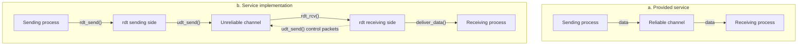

*Figure 1. Service model and service implementation of reliable data transfer*

The interfaces in Figure 1 are as follows. Here rdt stands for the reliable data transfer protocol, and udt stands for unreliable data transfer.

| Interface | Called by | Meaning |
|:-----|:-----|:-----|
| `rdt_send()` | Upper layer (sending application) | Passes data to be delivered to the upper layer at the receiving side down to the rdt sending side |
| `udt_send()` | rdt sending and receiving sides | Sends a packet into the unreliable channel |
| `rdt_rcv()` | Lower layer (channel) | Notifies rdt that a packet has arrived at the receiving side of the channel |
| `deliver_data()` | rdt receiving side | Passes data up to the upper layer |

*Table 1. Interfaces of a reliable data transfer protocol*

### 1.2 Assumptions of This Chapter and FSM Notation

This chapter adopts the following assumptions.

- **Unidirectional data transfer.** Data flows only from the sending side to the receiving side. Reliable bidirectional (full-duplex) transfer is conceptually no more difficult but tedious to explain (Section 8). Even though data is unidirectional, the sending and receiving sides exchange control packets in both directions, so both sides call `udt_send()`.
- **The channel does not reorder packets.** Packets are assumed to be delivered in the order in which they were sent, even if some are lost (the meaning of this assumption is revisited in Section 9).
- Because the theory of this chapter is not limited to the Internet transport layer, the generic term **packet** is used instead of segment.

The behavior of the sender and the receiver is expressed with finite state machines (FSMs, Chapter 6). The sender and the receiver have separate FSMs. The textbook by Kurose and Ross draws a horizontal line across each transition arrow, writing above the line the event that causes the transition and below it the actions taken when the event occurs. When no action is taken on an event, or an action is taken without an event, the symbol Λ is written in that place to denote explicitly the lack of an action or event, and the initial state is marked with a dashed arrow. The state diagrams in these notes write the same content in the form "event / action" and mark the initial state with an arrow coming from a black dot. When a state has several transitions back to itself, they are written on separate lines of a single arrow.

---

<br>

## 2. Basics of Flow Control and Error Control

Before building reliable transport protocols concretely, this section organizes the basic concepts and tools of two services the transport layer can provide: flow control and error control.

### 2.1 Flow Control: Pushing and Pulling

Whenever an entity produces items and another entity consumes them, the production rate and the consumption rate must be balanced. If items are produced faster than they are consumed, the consumer is overwhelmed and must discard some items; if they are produced more slowly, the consumer must wait and the system becomes less efficient. Flow control addresses the first problem, preventing the loss of data items at the consumer.

> **Definition:** **Flow control** is the technique of balancing the rate at which a producer creates data with the rate at which a consumer can use the data, so that the consumer never receives more data than it can handle.

There are two ways of delivering items from a producer to a consumer.

- **Pushing.** The producer sends items as they are produced, without a prior request from the consumer. Because the consumer can be overwhelmed, flow control is needed in the opposite direction: the consumer warns the producer to stop the delivery and informs it when it is ready again.
- **Pulling.** The producer sends items only when the consumer requests them. The consumer requests them when it is ready, so no flow control is needed.

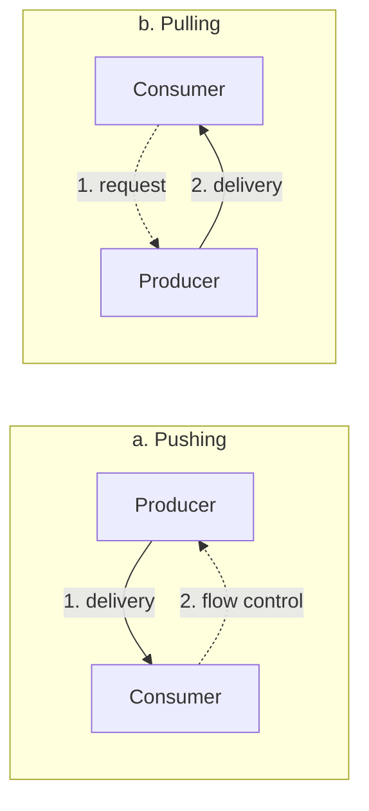

*Figure 2. Delivery by pushing and by pulling*

### 2.2 Flow Control at the Transport Layer and Buffers

Communication at the transport layer involves four entities: the sending process, the sending transport layer, the receiving transport layer, and the receiving process.

- The sending process at the application layer is only a producer. It produces message chunks and pushes them to the transport layer.
- The sending transport layer is both a consumer and a producer. It consumes the messages pushed by the sending process, encapsulates them in packets, and pushes them to the receiving transport layer.
- The receiving transport layer is also both a consumer and a producer. It is the consumer of the packets received from the sender and a producer that extracts the messages and delivers them to the application layer. This last delivery, however, is normally a pulling delivery: the transport layer waits until the application-layer process asks for messages.

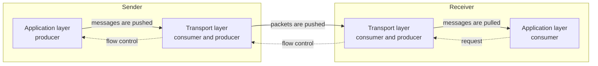

*Figure 3. The two places where flow control is needed at the transport layer*

As Figure 3 shows, flow control is needed in at least two places: from the sending transport layer to the sending application layer, and from the receiving transport layer to the sending transport layer. Flow control can be implemented in several ways, but normally two buffers are used, one at the sending transport layer and one at the receiving transport layer. A buffer is a set of memory locations that hold packets at the sender and the receiver, and flow-control communication takes place by the consumer sending signals to the producer.

- When the buffer of the sending transport layer is full, it tells the application layer to stop passing message chunks, and when there are vacancies, it tells the application layer that it can pass chunks again.
- When the buffer of the receiving transport layer is full, it tells the sending transport layer to stop sending packets, and when there are vacancies, it tells the sending transport layer that it can send again.

In this scheme the consumer must communicate with the producer twice: when the buffer is full and when there are vacancies. If both parties use a buffer of only one slot, the communication is simpler. When the single slot of the sending transport layer is empty, it tells the application layer to send its next chunk; when the single slot of the receiving transport layer is empty, it sends an acknowledgment telling the sending transport layer to send its next packet. As Section 4.5 shows, however, flow control with a one-slot buffer at the sender and the receiver is inefficient.

### 2.3 Error Control

In the Internet, the network layer (IP), which carries packets from the sending transport layer to the receiving transport layer, is unreliable, so if the application requires reliability, the transport layer must be made reliable. Reliability is obtained by adding an error-control service to the transport layer.

> **Definition:** **Error control** is the technique of detecting and correcting corrupted, lost, duplicated, or out-of-order packets so that data is delivered accurately.

Error control at the transport layer is responsible for the following.

1. Detecting and discarding corrupted packets.
2. Keeping track of lost and discarded packets and resending them.
3. Recognizing duplicate packets and discarding them.
4. Buffering out-of-order packets until the missing packets arrive.

Unlike flow control, error control involves only the sending and receiving transport layers. The message chunks exchanged between the application and transport layers are assumed to be error free. As with flow control, the receiving transport layer usually manages error control by informing the sending transport layer about the problems.

### 2.4 Sequence Numbers

Error control requires that the sending transport layer know which packet to resend and that the receiving transport layer know which packet is a duplicate or which packet has arrived out of order. This is possible if the packets are numbered.

> **Definition:** A **sequence number** is a serial number that the sender attaches to each packet by placing it in a field of the packet header. The receiver uses it to identify packets to be resent, duplicate packets, and packets that arrive out of order.

- When a packet is corrupted or lost, the receiving transport layer can use the sequence number to tell the sending transport layer to resend that packet.
- When two packets with the same sequence number arrive, a duplicate is detected.
- Gaps in the sequence numbers reveal out-of-order packets.

Because the sequence number must be carried in the header, a limit must be set. If the header allows $`m`$ bits for the sequence number, the sequence numbers range from $`0`$ to $`2^m - 1`$. For example, if $`m = 4`$, the only sequence numbers are 0 through 15. When all the numbers are used, however, the numbering can wrap around to the beginning, so the sequence numbers continue as follows.

```text
0, 1, 2, 3, 4, 5, 6, 7, 8, 9, 10, 11, 12, 13, 14, 15, 0, 1, 2, 3, 4, 5, ...
```

In other words, for error control the sequence numbers are modulo $`2^m`$, where $`m`$ is the size of the sequence-number field in bits. The sequence-number space can be thought of as a ring of size $`2^m`$ in which 0 immediately follows $`2^m - 1`$, and all arithmetic on sequence numbers is done modulo $`2^m`$.

> **[Discrete Mathematics]** In the congruence arithmetic of discrete mathematics, $`a \equiv b \pmod{n}`$ means that $`a - b`$ is a multiple of $`n`$. With modulo $`2^m`$ sequence numbers, the number after $`x`$ is $`(x + 1) \bmod 2^m`$, and the $`k`$-th packet (counting from 0) has sequence number $`k \bmod 2^m`$. The same sequence number recurs every $`2^m`$ packets, so, as Sections 6.6 and 7.6 show, a new packet cannot be distinguished from an old one unless the window size is limited.

### 2.5 Acknowledgments

Both positive and negative signals can be used for error control.

> **Definition:** An **acknowledgment (ACK)** is a control packet with which the receiver tells the sender that a packet or a set of packets has been received correctly. It typically carries the sequence number of the packet being acknowledged.

> **Definition:** A **negative acknowledgment (NAK)** is a control packet with which the receiver tells the sender that a packet has not been received correctly. It typically carries the sequence number of the packet that was not received correctly.

Acknowledgments may be individual, one for each packet, or a **cumulative acknowledgment** that acknowledges at once all packets up to some sequence number. The receiver can simply discard corrupted packets. The sender can detect lost packets with a timer: it starts a timer when it sends a packet and resends the packet if no ACK arrives before the timer expires. Duplicate packets can be silently discarded by the receiver. Out-of-order packets can be either discarded, to be treated as lost by the sender, or stored until the missing ones arrive.

> **Key Point:** Sequence numbers and acknowledgments are the foundation of reliable data transfer over an unreliable network. Sequence numbers let the receiver know what it has received, and acknowledgments let the sender know the state of the receiver.

### 2.6 Combining Flow and Error Control and the Sliding Window

Flow control requires two buffers, one at the sender and one at the receiver, and error control requires both sides to use sequence numbers and acknowledgment numbers. The two requirements can be met together by using two numbered buffers.

- At the sender, when a packet is ready to be sent, the number $`x`$ of the next free location in the buffer is used as the sequence number of the packet. When the packet is sent, a copy is stored at memory location $`x`$, awaiting the acknowledgment from the other end. When the acknowledgment for a sent packet arrives, the packet is purged and the location is freed.
- At the receiver, when a packet with sequence number $`y`$ arrives, it is stored at memory location $`y`$ until the application layer is ready to receive it, and an acknowledgment can be sent to announce the arrival of packet $`y`$.

Since the sequence numbers are modulo $`2^m`$, a circle can represent the sequence numbers from 0 to $`2^m - 1`$.

> **Definition:** A **sliding window** is the range of the sequence-number space that can currently be sent or received; it slides in the direction of increasing sequence numbers as acknowledgments arrive. It is an abstraction actually implemented with variables holding the sequence numbers of the next packet to send and of the first packet awaiting acknowledgment.

The buffer is represented as a set of slices of the circle, the sliding window. At the sender, when a packet is sent, the corresponding slice is marked. When all the slices are marked, the buffer is full and no further messages can be accepted from the application layer. When an acknowledgment arrives, the corresponding slice is unmarked. If consecutive slices from the beginning of the window are unmarked, the window slides along the sequence numbers by that amount, freeing more slices at the end of the window.

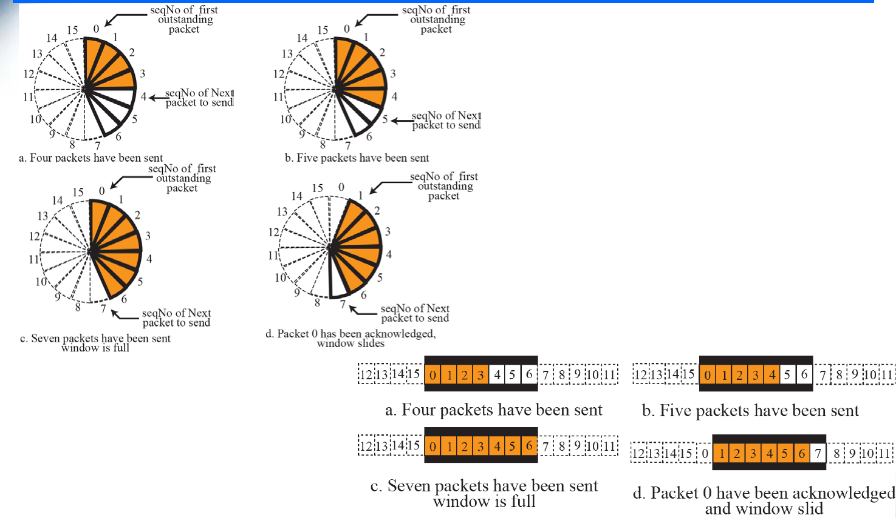

*Figure 4. Circular and linear representations of a send sliding window of size 7 with sequence numbers modulo 16*

Figure 4 shows a send-side sliding window with sequence numbers modulo 16 ($`m = 4`$) and window size 7 in four steps. The upper part is the circular representation, and the lower part is the linear representation of the same situations. Bending both sides of the circle up and flattening it gives the linear representation.

| Step | Situation | Sequence numbers covered by the window | Packets awaiting acknowledgment | Next sequence number to send |
|:-----|:-----|:-----|:-----|:-----|
| a | Four packets have been sent | 0-6 | 0, 1, 2, 3 | 4 |
| b | Five packets have been sent | 0-6 | 0, 1, 2, 3, 4 | 5 |
| c | Seven packets have been sent; the window is full | 0-6 | 0-6 | 7 (outside the window, so it cannot be sent) |
| d | Packet 0 has been acknowledged; the window slides one slot | 1-7 | 1-6 | 7 |

*Table 2. State of the send window in the four steps of Figure 4*

Most protocols use the linear representation, which takes less space on paper. The rest of this chapter uses the linear representation in text figures.

---

<br>

## 3. Building the rdt Protocols Step by Step

In the manner of Kurose and Ross, this section develops the sending and receiving sides of the protocol one step at a time, making the assumptions about the underlying channel increasingly realistic, until it arrives at a flawless reliable data transfer protocol.

### 3.1 rdt1.0: A Perfectly Reliable Channel

First consider the simplest case, in which the underlying channel is completely reliable. The protocol for this case, rdt1.0, is trivial.

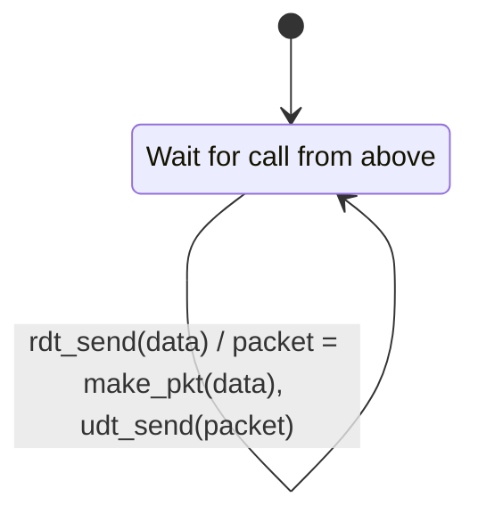

*Figure 5. FSM of the rdt1.0 sending side*

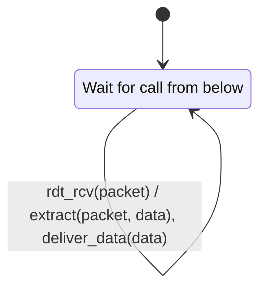

*Figure 6. FSM of the rdt1.0 receiving side*

The sending side accepts data from the upper layer through the `rdt_send(data)` event, creates a packet containing the data with `make_pkt(data)`, and sends it into the channel. The receiving side receives a packet from the channel through the `rdt_rcv(packet)` event, removes the data with `extract(packet, data)`, and passes it to the upper layer with `deliver_data(data)`. Each FSM has only one state, so each transition goes from that state back to itself.

In this protocol there is no difference between a unit of data and a packet, and all packets flow only from the sender to the receiver. With a perfectly reliable channel nothing can go wrong, so there is no need for the receiving side to give feedback to the sender. Also, since the receiver is assumed to be able to receive data as fast as the sender sends it, there is no need for the receiver to ask the sender to slow down.

### 3.2 rdt2.0: A Channel with Bit Errors

A more realistic model of the channel is one in which bits in a packet may be corrupted. Such bit errors typically occur in the physical components of a network as a packet is transmitted, propagates, or is buffered. For the moment it is still assumed that all transmitted packets are received in the order in which they were sent, although their bits may be corrupted.

Thinking about how a person dictates a long message over the phone suggests a solution. The message taker says "OK" after each sentence has been heard, understood, and recorded, and asks for a sentence to be repeated if it was garbled. This dictation protocol uses both positive acknowledgments ("OK") and negative acknowledgments ("Please repeat that"). Reliable data transfer protocols based on such retransmission are called ARQ protocols.

> **Definition:** **Automatic Repeat reQuest (ARQ)** is a class of protocols that obtain reliability by having the receiver detect errors and send feedback to the sender, and having the sender retransmit the packets received in error.

To handle bit errors, an ARQ protocol needs the following three capabilities.

1. **Error detection.** A mechanism is needed that allows the receiver to detect when bit errors have occurred. The Internet checksum used by UDP (Chapter 6) is an example. Such techniques require extra bits beyond the original data to be sent, and these bits go into the checksum field of the rdt2.0 data packet. Error detection and correction techniques are covered in detail in Chapter 18.
2. **Receiver feedback.** The sender and the receiver typically run on different end systems, possibly thousands of kilometers apart, so the only way for the sender to learn the receiver's view of the world (whether a packet was received correctly) is for the receiver to provide explicit feedback. rdt2.0 sends ACK and NAK packets from the receiver back to the sender. In principle these packets need only be one bit long (for example, 0 for a NAK and 1 for an ACK).
3. **Retransmission.** A packet received in error at the receiver is retransmitted by the sender.

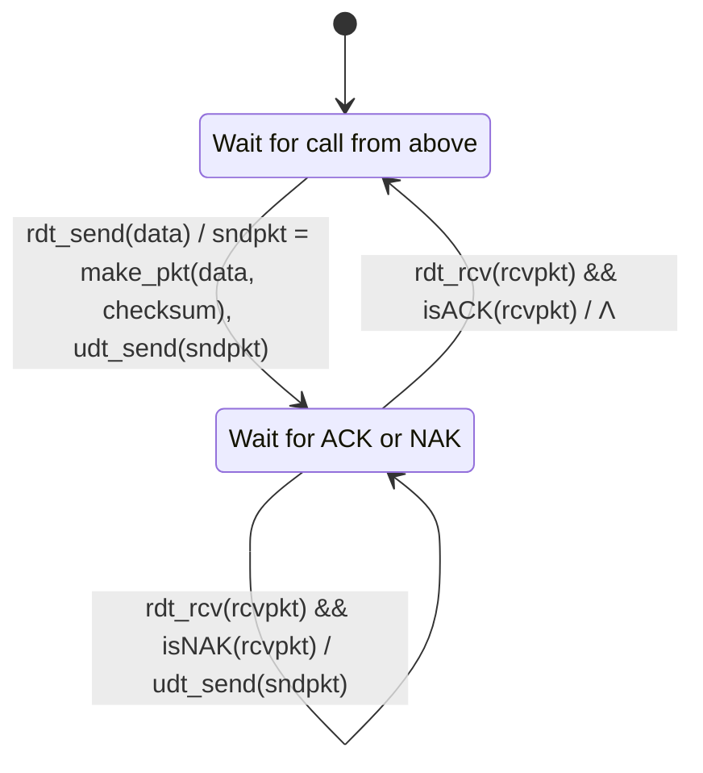

*Figure 7. FSM of the rdt2.0 sending side*

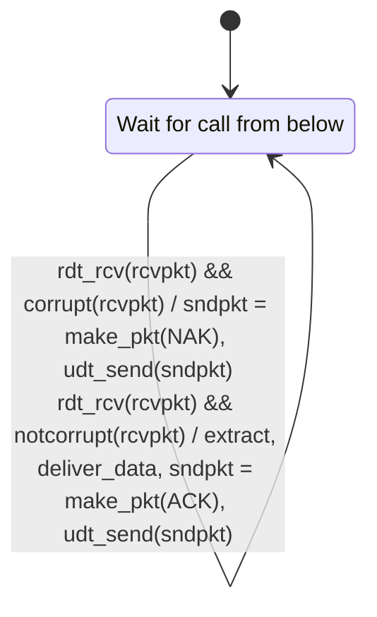

*Figure 8. FSM of the rdt2.0 receiving side*

The send side of rdt2.0 has two states. In the left state it waits for data to be passed down from the upper layer. When the `rdt_send(data)` event occurs, it creates a packet `sndpkt` containing the data and a checksum and sends it with `udt_send(sndpkt)`. In the right state it waits for an ACK or a NAK from the receiver. If an ACK arrives (`rdt_rcv(rcvpkt) && isACK(rcvpkt)`), the most recently transmitted packet has been received correctly, so the protocol returns to the state of waiting for data. If a NAK arrives, it retransmits the last packet and again waits for an ACK or NAK in response to the retransmitted packet.

While the sender is waiting for an ACK or NAK, it cannot get more data from the upper layer; that is, the `rdt_send()` event can occur only after the sender receives an ACK and leaves this state. The sender therefore does not send new data until it is sure that the receiver has correctly received the current packet. Protocols that behave this way are called stop-and-wait protocols.

> **Definition:** A **stop-and-wait protocol** is a protocol in which the sender, after sending one packet, waits without sending the next packet until it receives the acknowledgment for that packet.

The receive side of rdt2.0 still has a single state. When a packet arrives, it replies with an ACK or a NAK depending on whether the packet is corrupted.

rdt2.0 may look as if it works, but it has a fatal flaw: it does not account for **the possibility that the ACK or NAK packet itself is corrupted**. At a minimum, checksum bits must be added to ACK and NAK packets to detect such errors. The harder question is how to recover from a corrupted ACK or NAK. If an ACK or NAK is corrupted, the sender has no way of knowing whether the receiver has correctly received the last piece of data.

### 3.3 rdt2.1: Handling Corrupted ACKs and NAKs

Three possibilities can be considered for handling corrupted ACKs and NAKs.

1. In the dictation scenario, a speaker who did not understand the "OK" or "Please repeat that" would probably ask, "What did you say?" This introduces a new kind of sender-to-receiver packet. But if the "What did you say?" is garbled, the message taker, not knowing whether it was part of the dictation or a request to repeat the reply, would probably answer "What did you say?" in turn, and that reply might be garbled too. This path only gets harder.
2. Add enough checksum bits to allow the sender not only to detect but also to recover from bit errors. This solves the immediate problem for a channel that can corrupt packets but not lose them.
3. Have the sender simply resend the current data packet when it receives a garbled ACK or NAK. This introduces **duplicate packets** into the sender-to-receiver channel. The fundamental difficulty is that the receiver does not know whether the sender received its last ACK or NAK correctly, so it cannot know a priori whether an arriving packet contains new data or is a retransmission.

A simple solution, adopted in almost all existing data transfer protocols including TCP, is to add a new field to the data packet and have the sender number its data packets by putting a sequence number in this field. The receiver then need only check the sequence number to determine whether the received packet is a retransmission. For a stop-and-wait protocol, a 1-bit sequence number suffices. If the sequence number of the received packet is the same as that of the most recently received packet, the sender has resent the previous packet; if the sequence number has moved forward in modulo-2 arithmetic, it is a new packet. Since a channel that does not lose packets is still assumed, ACK and NAK packets do not themselves need to carry the sequence number of the packet they acknowledge. The sender knows that a received ACK or NAK packet, garbled or not, was generated in response to its most recently transmitted data packet.

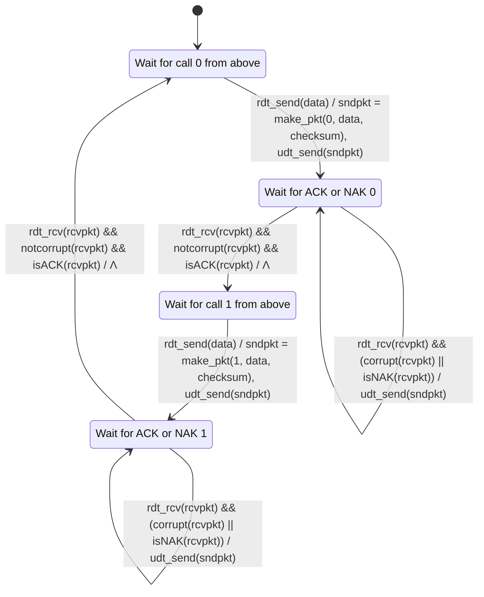

*Figure 9. FSM of the rdt2.1 sending side*

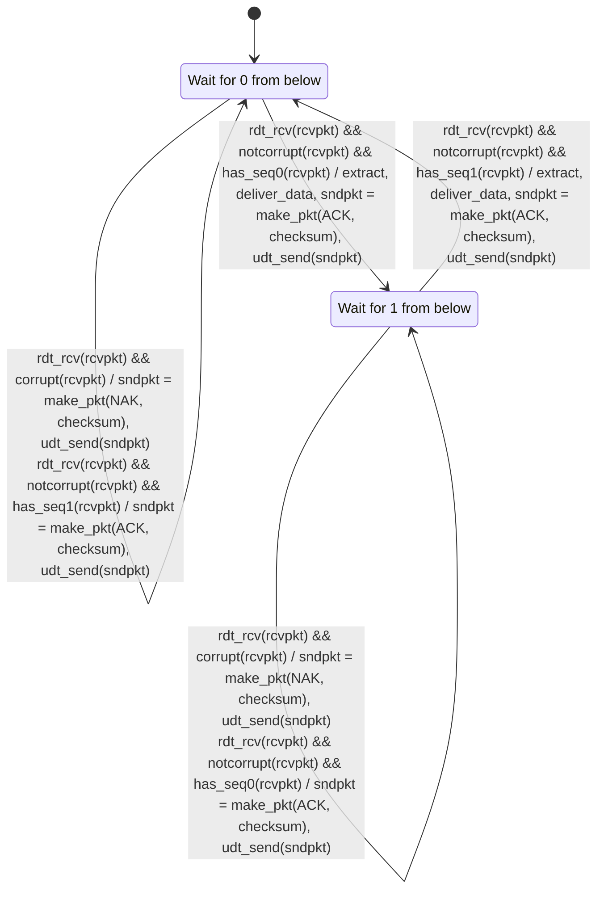

*Figure 10. FSM of the rdt2.1 receiving side*

The rdt2.1 sender and receiver FSMs each have twice as many states as before, because the state must now reflect whether the packet currently being sent (at the sender) or expected (at the receiver) should have sequence number 0 or 1. The actions in the states where a 0-numbered packet is being sent or expected are mirror images of those where a 1-numbered packet is being sent or expected; they differ only in the handling of the sequence number.

When the receiver receives a packet with a sequence number other than the one it expects, that is, a retransmission of a packet it has already received, it sends a positive acknowledgment (ACK) for that packet. The sender resent the packet because it received the previous ACK in garbled form, so it must receive an ACK again before it can move on to the next packet. When a corrupted packet is received, the receiver sends a negative acknowledgment (NAK).

### 3.4 rdt2.2: A NAK-Free Protocol

The same effect as a NAK can be obtained by sending, instead of a NAK, an ACK for the last correctly received packet.

> **Definition:** A **duplicate ACK** is an ACK that reacknowledges a packet for which the sender has already received an acknowledgment. A sender that receives two ACKs for the same packet knows that the receiver did not correctly receive the packet following the one that is acknowledged twice.

The subtle differences between the NAK-free rdt2.2 and rdt2.1 are the following two. The receiver must include in its ACK message the sequence number of the packet being acknowledged (with an extra argument, as in `make_pkt(ACK, 0, checksum)`), and the sender must check the sequence number of the packet being acknowledged by a received ACK (with an extra argument, as in `isACK(rcvpkt, 0)`).

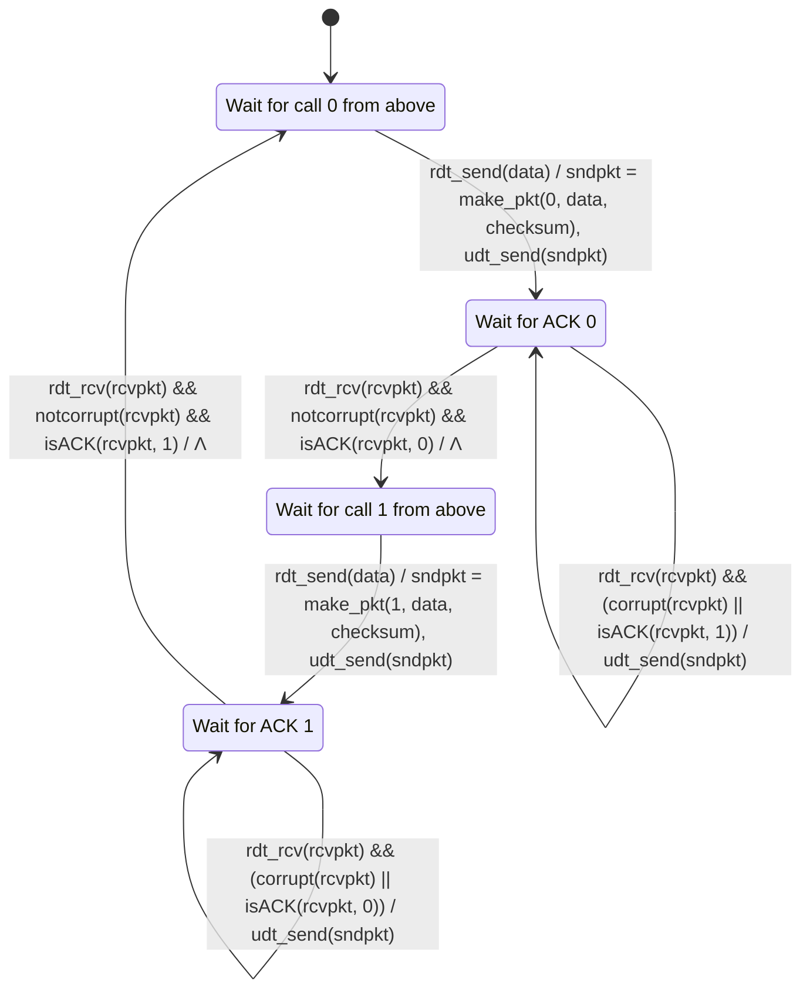

*Figure 11. FSM of the rdt2.2 sending side*

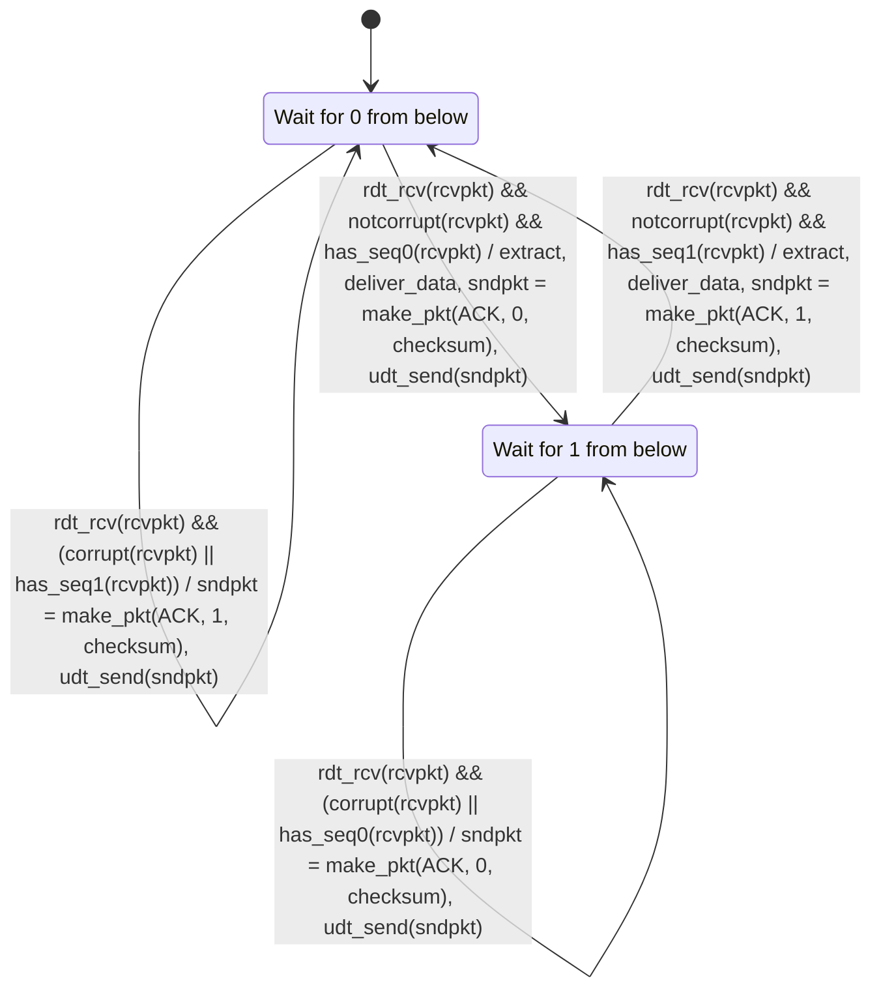

*Figure 12. FSM of the rdt2.2 receiving side*

For example, if the receiver is waiting for packet 0 and a corrupted packet or packet 1 (a retransmission) arrives, it resends ACK 1 for packet 1, the last packet it received correctly. A sender waiting for the ACK of packet 0 interprets ACK 1 as a duplicate ACK meaning that packet 0 did not arrive correctly and resends packet 0.

### 3.5 rdt3.0: A Lossy Channel with Bit Errors

Now suppose that the underlying channel can lose packets as well as corrupt bits, a not-uncommon event in today's computer networks, including the Internet. The protocol must now address two new concerns: how to detect packet loss and what to do when it occurs. The second concern is handled by the checksums, sequence numbers, ACK packets, and retransmissions already developed in rdt2.2. The first concern requires a new mechanism.

There are many ways to detect loss, but here the burden of detecting and recovering from loss is placed on the sender. Suppose the sender transmits a data packet and either that packet or the receiver's ACK of that packet is lost. In either case no reply comes from the receiver. If the sender is willing to wait long enough to be sure that a packet has been lost, it can simply retransmit the data packet.

But how long must the sender wait to be sure that something has been lost? It must wait at least as long as a round-trip delay between the sender and the receiver (including buffering at intermediate routers) plus the time needed to process a packet at the receiver. In many networks this worst-case delay is very difficult even to estimate, let alone know with certainty. Moreover, the protocol should recover from loss as soon as possible, so waiting for a worst-case delay is undesirable. The approach taken in practice is for the sender to choose judiciously a time value such that loss is likely, although not guaranteed, to have happened, and to retransmit the packet if no ACK arrives within that time. If a packet experiences a particularly large delay, a retransmission may occur even though neither the data packet nor its ACK was lost, so duplicate data packets may appear in the sender-to-receiver channel. Fortunately, rdt2.2 already has sequence numbers to handle duplicate packets.

From the sender's viewpoint, retransmission is a panacea. The sender does not know whether a data packet was lost, an ACK was lost, or both were simply overly delayed. In all cases the action is the same: retransmit. Implementing time-based retransmission requires a countdown timer that interrupts the sender after a given amount of time has expired.

> **Definition:** A **retransmission timer** is a countdown timer that the sender starts when it sends a packet and that interrupts the sender after a given amount of time. If no acknowledgment arrives within that time, the sender retransmits the packet.

The sender must be able to (1) start the timer each time a packet is sent, whether a first-time packet or a retransmission, (2) respond to a timer interrupt with appropriate actions, and (3) stop the timer.

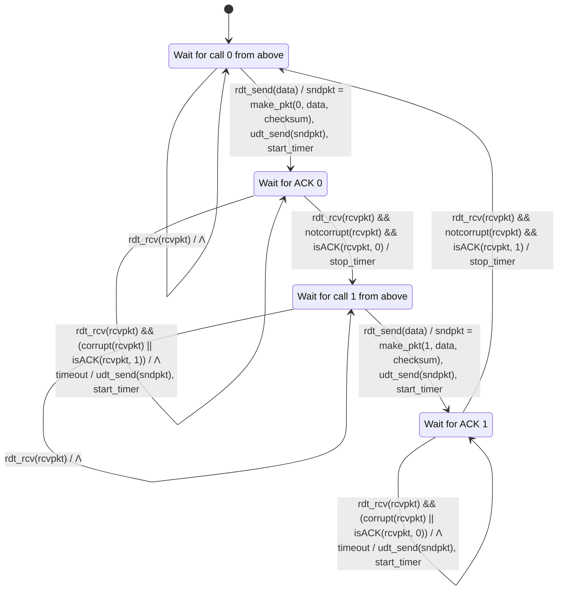

*Figure 13. FSM of the rdt3.0 sending side*

Compared with the rdt2.2 sender, there are three differences. First, the timer is started with `start_timer` whenever a packet is sent and stopped with `stop_timer` when the correct ACK arrives. Second, when the timer expires (`timeout`), the packet is resent and the timer restarted. Third, when a corrupted ACK or an ACK with the other sequence number arrives, the sender does not retransmit immediately but takes no action (Λ), because retransmission is left to the timer. In the states waiting for data, packets such as late duplicate ACKs are ignored. The rdt3.0 receiver is the same as the rdt2.2 receiver.

Figure 14 shows four cases of rdt3.0 operation. Time moves from top to bottom, and because of transmission and propagation delays, the time a packet is received is necessarily later than the time it is sent.

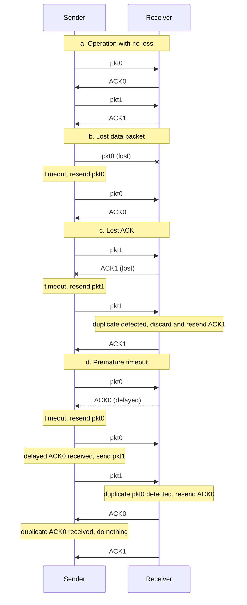

*Figure 14. Four cases of rdt3.0 operation: no loss, lost packet, lost ACK, and premature timeout*

In (d) the sender's timer expires too early and it resends pkt0, but it soon receives the delayed ACK0 and sends pkt1. The receiver detects the resent pkt0 as a duplicate, discards it, and resends ACK0, and the sender ignores this ACK0 as a duplicate ACK for a packet already acknowledged. Because the sequence numbers of the packets alternate between 0 and 1, rdt3.0 is sometimes called the **alternating-bit protocol**.

### 3.6 Summary of the rdt Protocols

| Protocol | Channel assumption | Mechanisms added | Remaining problem |
|:-----|:-----|:-----|:-----|
| rdt1.0 | Perfectly reliable | None (make and send packets, extract and deliver) | None |
| rdt2.0 | Bit errors possible, no loss | Checksum, ACK and NAK, retransmission | Cannot cope with corrupted ACKs and NAKs |
| rdt2.1 | Bit errors possible (including ACKs and NAKs), no loss | 1-bit sequence number, duplicate detection | None (uses NAKs) |
| rdt2.2 | Same as rdt2.1 | Sequence numbers in ACKs replace NAKs (duplicate ACKs) | None |
| rdt3.0 | Bit errors and packet loss possible | Countdown timer and retransmission on timeout | Poor performance because it is stop-and-wait (Section 4.5) |

*Table 3. Changes in channel assumptions and mechanisms from rdt1.0 to rdt3.0*

> **Key Point:** Checksums, sequence numbers, timers, and positive and negative acknowledgment packets each play a crucial and necessary role in a reliable data transfer protocol. rdt3.0 has all of these elements and is a functionally correct reliable data transfer protocol.

---

<br>

## 4. The Simple Protocol and the Stop-and-Wait Protocol

The textbook by Forouzan treats the same problem by starting from the simplest protocol and gradually adding more complex features. The transport-layer protocols of TCP/IP are modifications or combinations of these generic protocols. This section and Sections 6 and 7 explain Forouzan's four protocols (simple, stop-and-wait, Go-Back-N, and Selective Repeat) in connection with the rdt protocols of Section 3. All are treated as unidirectional protocols in which data packets flow in one direction.

### 4.1 The Simple Protocol

The first protocol is a simple connectionless protocol with neither flow control nor error control. The receiver is assumed to be able to handle any packet it receives immediately, so it is never overwhelmed.

> **Key Point:** The simple protocol is a connectionless protocol that provides neither flow control nor error control.

The sending transport layer gets a message from its application layer, makes a packet out of it, and sends the packet. The receiving transport layer receives a packet from its network layer, extracts the message, and delivers it to its application layer. The sending side does not send a packet until its application layer has a message to send, and the receiving side cannot deliver a message until a packet arrives. These requirements can be expressed with two FSMs, each with only one state, Ready.

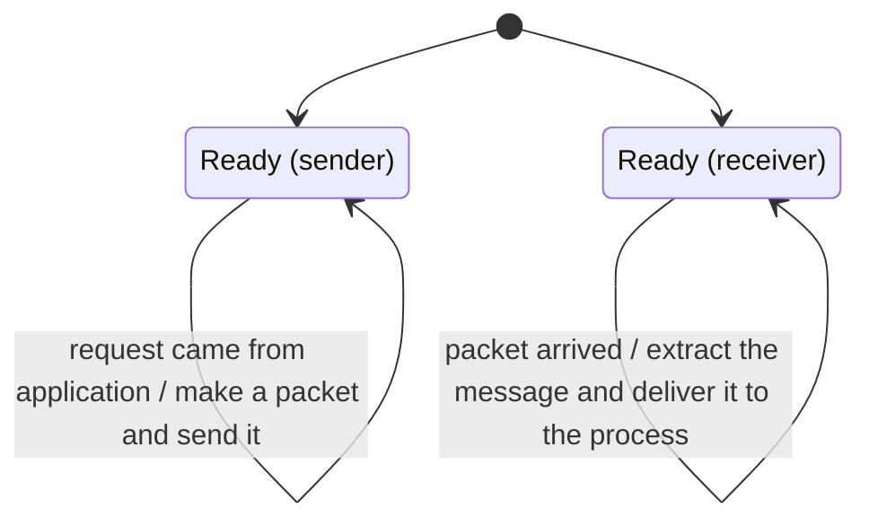

*Figure 15. FSMs of the sender and receiver of the simple protocol*

The simple protocol is the same as rdt1.0 of Section 3.1. As Chapter 6 showed, UDP is this protocol with an optional checksum added. Figure 16 shows an example of communication with the simple protocol; the sender sends packets one after another without even thinking about the receiver.

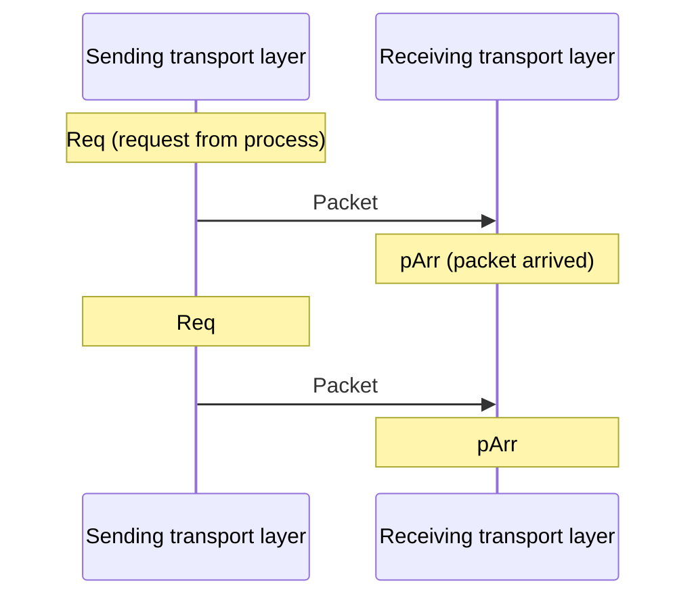

*Figure 16. An example of communication with the simple protocol*

### 4.2 Structure of the Stop-and-Wait Protocol

The second protocol is the stop-and-wait protocol (defined in Section 3.2), a connection-oriented protocol that uses both flow control and error control. Both the sender and the receiver use a sliding window of size 1.

- The sender sends one packet at a time and waits for an acknowledgment before sending the next one. Therefore only one packet and one acknowledgment can be in the channels at any time.
- To detect corrupted packets, a checksum is added to each data packet. When a packet arrives at the receiver, it is checked, and if its checksum is incorrect, the packet is considered corrupted and silently discarded. The silence of the receiver is a signal to the sender that a packet was either corrupted or lost.
- Every time the sender sends a packet, it starts a timer. If an acknowledgment arrives before the timer expires, the timer is stopped and the sender sends the next packet (if it has one). If the timer expires, the sender assumes the packet was lost or corrupted and resends the previous packet. The sender must therefore keep a copy of the packet until its acknowledgment arrives.

```text
            Sender                                    Receiver
  +------------------------+  data: [seqNo|data|checksum] -->  +------------------------+
  | Application            |                                   | Application            |
  | Transport              |  <-- ACK: [ackNo|checksum]        | Transport              |
  +------------------------+                                   +------------------------+
     S                                                            R  next packet
     |                                                            |  to receive
  ...[ ]...   timer                                            ...[ ]...
  send window (size 1)                                         receive window (size 1)
```

*Figure 17. Structure of the stop-and-wait protocol and its send and receive windows of size 1*

> **Key Point:** In the stop-and-wait protocol, flow control is achieved by forcing the sender to wait for an acknowledgment, and error control is achieved by discarding corrupted packets and letting the sender resend unacknowledged packets when the timer expires.

The same discipline also appears at the application layer. TFTP (Chapter 4), which runs over UDP, sends one block of data in a DATA message and sends the next block only after the ACK for that block arrives before the time-out.

### 4.3 Sequence Numbers and Acknowledgment Numbers

To prevent duplicate packets, the protocol uses sequence numbers and acknowledgment numbers. A field holding the sequence number of the packet is added to the packet header. To minimize the packet size, the smallest range of sequence numbers that provides unambiguous communication must be found.

If sequence number $`x`$ has been used, only $`x + 1`$ is needed after it, not $`x + 2`$. After the sender sends the packet with sequence number $`x`$, three things can happen.

1. The packet arrives safe and sound at the receiver, and the acknowledgment the receiver sends arrives at the sender. The sender sends the packet numbered $`x + 1`$.
2. The packet is corrupted or never arrives at the receiver. The sender resends the packet numbered $`x`$ after the time-out, and the receiver returns an acknowledgment.
3. The packet arrives safe and sound and the receiver sends an acknowledgment, but the acknowledgment is corrupted or lost. The sender resends the packet numbered $`x`$ after the time-out. This packet is a duplicate. The receiver can recognize this because it expects packet $`x + 1`$ but receives packet $`x`$.

Because the receiver must distinguish case 1 from case 3, sequence numbers $`x`$ and $`x + 1`$ are needed. But $`x + 2`$ is not needed. In case 1, packets $`x`$ and $`x + 1`$ are both acknowledged and there is no ambiguity at either side, so the next packet can be numbered $`x`$ again; in cases 2 and 3, the new packet is $`x + 1`$, not $`x + 2`$. Since only two values are needed, letting $`x = 0`$ and $`x + 1 = 1`$ gives the sequence 0, 1, 0, 1, 0, ..., which is modulo-2 arithmetic. The stop-and-wait protocol can therefore number its packets with a 1-bit field.

Since the sequence numbers must suit both data packets and acknowledgments, Forouzan adopts the convention that the acknowledgment number always announces the sequence number of the next packet the receiver expects. For example, if packet 0 has arrived safe and sound, the receiver sends an ACK with acknowledgment number 1 (meaning packet 1 is expected next), and if packet 1 has arrived safe and sound, it sends an ACK with acknowledgment number 0.

> **Key Point:** In the stop-and-wait protocol, sequence numbers are modulo 2, and the acknowledgment number always announces, in modulo-2 arithmetic, the sequence number of the next packet the receiver expects. All calculation is done modulo 2.

> **Note:** **ACK numbering in the two textbooks.** In rdt2.2 and rdt3.0 of Kurose and Ross, the number in an ACK is the sequence number of the packet the receiver has received (receiving packet 0 gives ACK 0). In Forouzan's stop-and-wait protocol, the ACK number is the sequence number of the next packet expected (receiving packet 0 gives ACK 1). The two conventions express the same information differently; the sender only has to interpret ACKs accordingly. TCP in Chapter 8 uses, like Forouzan, the number of the next byte expected as its acknowledgment number.

### 4.4 FSMs and an Example of the Stop-and-Wait Protocol

The sender has a control variable $`S`$ (sender) that points to the only slot in the send window, and the receiver has a control variable $`R`$ (receiver) that points to the only slot in the receive window. Because the protocol is connection-oriented, both ends must be in the established state before exchanging data packets, and the states below are actually nested in the established state.

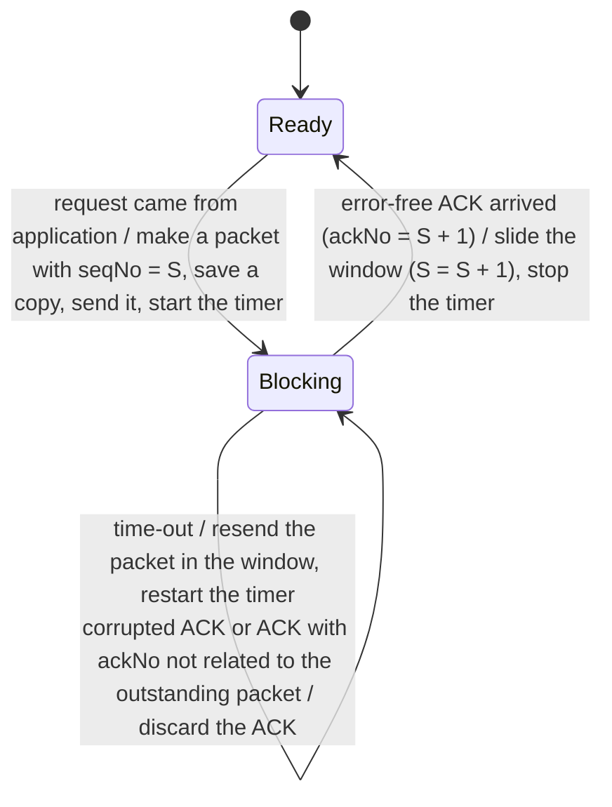

*Figure 18. Sender FSM of the stop-and-wait protocol (all arithmetic modulo 2)*

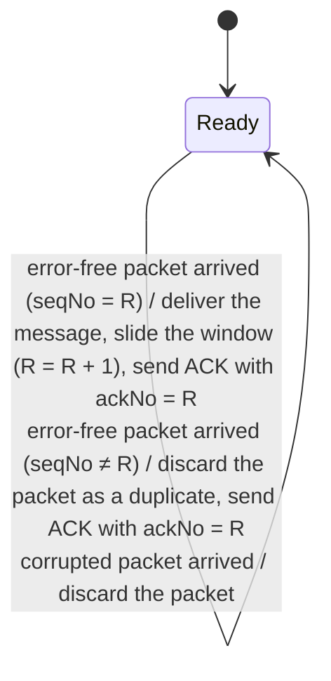

*Figure 19. Receiver FSM of the stop-and-wait protocol (all arithmetic modulo 2)*

**Sender.** The sender starts in the Ready state with $`S`$ initialized to 0. In the Ready state it waits only for a request from the application. When a request comes, it creates a packet with sequence number $`S`$, stores a copy, sends it, starts the only timer, and moves to the Blocking state. In the Blocking state three events can occur.

1. If an error-free ACK arrives with the acknowledgment number related to the next packet to be sent, that is, $`(S + 1) \bmod 2`$, the timer is stopped, the window slides to $`S = (S + 1) \bmod 2`$, and the sender moves to the Ready state.
2. If a corrupted ACK or an error-free ACK with an acknowledgment number other than $`(S + 1) \bmod 2`$ arrives, the ACK is discarded.
3. If a time-out occurs, the sender resends the only outstanding packet and restarts the timer.

**Receiver.** The receiver is always in the Ready state, with $`R`$ initialized to 0. Three events can occur.

1. If an error-free packet with sequence number $`R`$ arrives, the message is delivered to the application layer, the window slides to $`R = (R + 1) \bmod 2`$, and an ACK with acknowledgment number $`R`$ is sent.
2. If an error-free packet with a sequence number other than $`R`$ arrives, the packet is discarded, but an ACK with acknowledgment number $`R`$ is sent.
3. If a corrupted packet arrives, the packet is discarded.

Figure 20 shows an example of the stop-and-wait protocol. Packet 0 is sent and acknowledged. Packet 1 is lost and resent after the time-out, and the timer stops when the resent packet 1 is acknowledged. Packet 0 is sent again and received, but the acknowledgment is lost. The sender has no idea whether the packet or the acknowledgment was lost, so after the time-out it resends packet 0, which the receiver discards as a duplicate while sending the acknowledgment again.

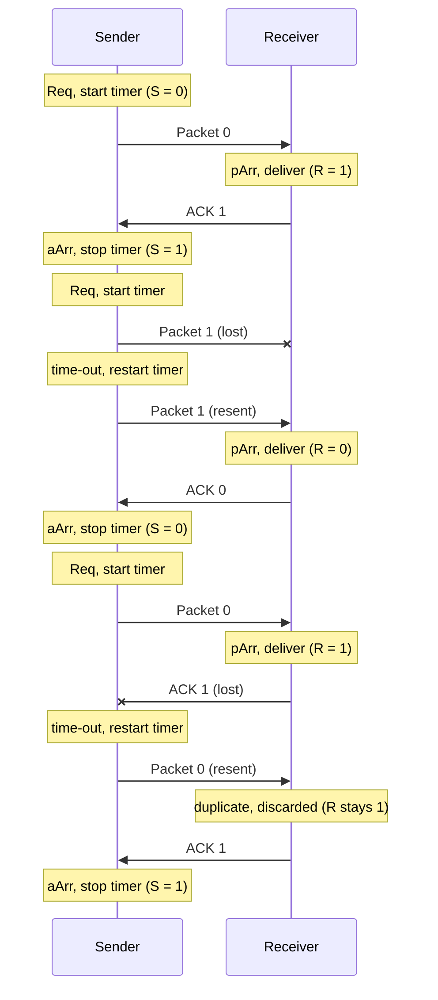

*Figure 20. Handling of a lost packet and a lost acknowledgment in the stop-and-wait protocol*

The stop-and-wait protocol is the same protocol as rdt3.0 (the alternating-bit protocol) of Section 3.5; only the rule for numbering ACKs differs (the note in Section 4.3).

### 4.5 Efficiency of the Stop-and-Wait Protocol

rdt3.0 is functionally correct, but no one would be happy with its performance, particularly in today's high-speed networks. At the heart of the performance problem is its stop-and-wait behavior.

Consider two hosts, one on the West Coast and one on the East Coast of the United States. The speed-of-light round-trip propagation delay between the two end systems, RTT, is about 30 ms, and they are connected by a channel with transmission rate $`R`$ of 1 Gbps ($`10^9`$ bps). With a packet size $`L`$ of 1,000 bytes (8,000 bits) including header and data, the time needed to actually transmit one packet into the 1 Gbps link is as follows.

```math
d_{\text{trans}} = \frac{L}{R} = \frac{8000 \text{ bits}}{10^9 \text{ bits/s}} = 8 \ \mu\text{s}
```

If the sender begins sending the packet at $`t = 0`$, the last bit enters the channel at $`t = L/R = 8 \ \mu\text{s}`$. The packet then makes its 15 ms journey across the continent, and its last bit emerges at the receiver at $`t = RTT/2 + L/R = 15.008`$ ms. Assuming that ACK packets are so small that their transmission time can be ignored and that the receiver sends an ACK as soon as the last bit of a data packet arrives, the ACK emerges back at the sender at $`t = RTT + L/R = 30.008`$ ms, and only then can the sender transmit the next message. Thus, out of 30.008 ms, the sender was actually sending bits for only 0.008 ms.

> **Definition:** **Sender utilization** is the fraction of time the sender (or the channel) is actually busy sending bits into the channel.

```math
U_{\text{sender}} = \frac{L/R}{RTT + L/R} = \frac{0.008}{30.008} \approx 0.00027
```

The sender is busy only 0.027% of the time. Viewed another way, the sender sent only 1,000 bytes in 30.008 ms, an effective throughput of 8,000 bits / 30.008 ms ≈ 267 kbps, even though a 1 Gbps link was available. Including lower-layer processing times at the sender and receiver and the processing and queuing delays at intermediate routers would only increase the delay and worsen the performance. This is an example of how much a network protocol can limit the capabilities of the hardware.

Forouzan explains the same problem with the bandwidth-delay product. The stop-and-wait protocol is very inefficient on a channel that is thick (large bandwidth) and long (long round-trip delay).

> **Definition:** The **bandwidth-delay product** is the product of the channel's bandwidth (data rate) and the round-trip delay; it is the number of bits a sender can put into the system while waiting for an acknowledgment from the receiver. If the channel is viewed as a pipe, it corresponds to the volume of the pipe.

For example, if in a stop-and-wait system the bandwidth of the line is 1 Mbps and 1 bit takes 20 ms to make a round trip, the bandwidth-delay product is as follows.

```math
(1 \times 10^6 \text{ bps}) \times (20 \times 10^{-3} \text{ s}) = 20{,}000 \text{ bits}
```

The system can send 20,000 bits while the data goes to the receiver and the acknowledgment comes back, but with 1,000-bit data packets it sends only 1,000 of them. The link utilization is therefore 1,000 / 20,000 = 5%. If a protocol on the same link can send up to 15 packets before worrying about acknowledgments, it can send 15,000 bits during a round trip, so the utilization becomes 15,000 / 20,000 = 75%. Of course, if some packets are damaged and must be resent, the utilization is much lower.

> **Note:** **The difference between the two calculations.** Forouzan's calculation divides the number of bits in a packet by the bandwidth-delay product, an approximation that ignores the $`L/R`$ term in the denominator of Kurose's formula. Applying Kurose's formula to the example above, $`L/R = 1`$ ms, so the utilization is $`1/(20 + 1) \approx 4.8\%`$, and with 15 packets it is $`15/(20 + 1) \approx 71.4\%`$. When $`L/R`$ is much smaller than the RTT, the difference is negligible.

---

<br>

## 5. Pipelining

### 5.1 Pipelining and Utilization

The solution to the performance problem of stop-and-wait is simple: allow the sender to send multiple packets without waiting for acknowledgments.

> **Definition:** **Pipelining** is the technique in which the sender sends multiple packets back to back without waiting for acknowledgments, so that the packets in transit fill the pipe between the sender and the receiver.

```text
Stop-and-wait                          Pipelined (3 packets)

sender            receiver             sender            receiver
t=0      |--pkt-->                     t=0      |--pkt1-->
t=L/R    |   \                                  |--pkt2-->
         |    \                                 |--pkt3-->
         |     \--> RTT/2+L/R          t=3L/R   |   \\\
         |     /    (send ACK)                  |    \\\--> first bit arrives
         |    /                                 |    ///    (send ACKs)
t=RTT+L/R|<-ACK, send next packet      t=RTT+L/R|<-ACK1, send next packet
```

*Figure 21. Sending times of stop-and-wait and of pipelining with three packets sent back to back*

If, as in Figure 21, the sender may send three packets before waiting for acknowledgments, the utilization is essentially tripled.

```math
U_{\text{sender}} = \frac{3L/R}{RTT + L/R} = \frac{0.024}{30.008} \approx 0.0008
```

In general, if the number of packets that may be sent without waiting for acknowledgments (the window size) is $`N`$, the utilization is $`\min(1, \; N \cdot (L/R)/(RTT + L/R))`$. In the example above, filling the pipe completely to reach a utilization of 1 requires $`N \geq (RTT + L/R)/(L/R) = 30.008/0.008 = 3751`$ packets in transit at the same time.

In Forouzan's words, beginning a task before the previous one has ended is known as pipelining in networking and in other areas. The stop-and-wait protocol has no pipelining, because the sender cannot send the next packet until a packet reaches the destination and is acknowledged. Pipelining improves the efficiency of transmission when the number of bits in transit is large with respect to the bandwidth-delay product.

### 5.2 What Pipelining Requires

Pipelining has the following consequences for reliable data transfer protocols.

- **The range of sequence numbers must be increased.** Each in-transit packet (not counting retransmissions) must have a unique sequence number, and there may be several in-transit, unacknowledged packets.
- **The sending and receiving sides may have to buffer more than one packet.** At a minimum, the sender must buffer packets that have been transmitted but not yet acknowledged. The receiver may also need to buffer correctly received packets.
- The range of sequence numbers needed and the buffering requirements depend on how the protocol responds to lost, corrupted, and overly delayed packets. There are two basic approaches to pipelined error recovery: Go-Back-N and Selective Repeat.

---

<br>

## 6. Go-Back-N

> **Definition:** **Go-Back-N (GBN)** is a pipelined protocol in which the sender may send up to $`N`$ unacknowledged packets without waiting for acknowledgments, the receiver accepts only packets that arrive in order, and on a timeout the sender resends all unacknowledged packets.

The key to GBN is that the sender can send several packets before receiving acknowledgments, but the receiver can buffer only one packet. The sender keeps copies of the sent packets until their acknowledgments arrive.

### 6.1 The Sender's Sequence-Number Space

Kurose and Ross divide the sequence-number space, from the sender's viewpoint, into four intervals using two variables. `base` is the sequence number of the oldest unacknowledged packet, and `nextseqnum` is the smallest unused sequence number, that is, the sequence number of the next packet to be sent.

```text
                 base                 nextseqnum
                   |                      |
                   v                      v
 [ acked ......... | sent, not yet acked  | usable, not yet sent | not usable ...
                   |<------------- window size N -------------->|
```

*Figure 22. The four intervals of sequence numbers seen by a Go-Back-N sender*

| Interval | Meaning |
|:-----|:-----|
| [0, base-1] | Packets already transmitted and acknowledged |
| [base, nextseqnum-1] | Packets sent but not yet acknowledged |
| [nextseqnum, base+N-1] | Sequence numbers that can be used immediately when data arrives from the upper layer |
| base+N and above | Sequence numbers that cannot be used until an unacknowledged packet in the pipeline (specifically packet base) is acknowledged |

*Table 4. Sequence-number intervals of a Go-Back-N sender*

The range of permissible sequence numbers for transmitted but unacknowledged packets can be viewed as a window of size $`N`$ over the sequence-number space. As the protocol operates, this window slides forward over the space, so $`N`$ is called the window size and the GBN protocol itself a sliding-window protocol. Reasons to limit the number of unacknowledged packets to $`N`$ include flow control (Chapter 8) and congestion control (Chapter 9).

In practice a packet's sequence number is carried in a fixed-length field in the header. If the sequence-number field has $`k`$ bits, the range of sequence numbers is $`[0, 2^k - 1]`$, and all arithmetic on sequence numbers is done modulo $`2^k`$ (the same meaning as $`m`$ in Section 2.4). rdt3.0 used a 1-bit sequence number with range [0, 1]. TCP uses a 32-bit sequence-number field, and TCP's sequence numbers count bytes in the byte stream rather than packets (Chapter 8).

### 6.2 The Notation of the Two Textbooks and the Send Window

Forouzan defines the same send window with three variables. $`S_f`$ (send window, first outstanding packet) is the sequence number of the oldest outstanding packet, $`S_n`$ (send window, next packet to be sent) is the sequence number to be assigned to the next packet sent, and $`S_{size}`$ is the size of the window.

| Meaning | Kurose and Ross | Forouzan |
|:-----|:-----|:-----|
| Sequence number of the oldest unacknowledged packet | `base` | $`S_f`$ |
| Sequence number of the next packet to send | `nextseqnum` | $`S_n`$ |
| Send window size | $`N`$ | $`S_{size}`$ |
| Sequence number of the next packet the receiver expects | `expectedseqnum` | $`R_n`$ |
| Meaning of the number $`n`$ in an ACK | All packets up to and including $`n`$ have been received | All packets up to $`n - 1`$ have been received and $`n`$ is expected next |

*Table 5. Correspondence between the Go-Back-N notation of the two textbooks*

> **Caution:** As the last row of Table 5 shows, the two textbooks number cumulative ACKs differently. Kurose's ACK $`n`$ means "packets up to $`n`$ have been received," while Forouzan's ackNo = $`n`$ means "packet $`n`$ is expected." In the same situation, Kurose's ACK 2 corresponds to Forouzan's ackNo = 3. When solving a problem, check first which convention is being used.

Forouzan's send window is an imaginary box of maximum size $`2^m - 1`$ (Section 6.6 explains why); the example below is a send window of size 7 with $`m = 3`$.

```text
               Sf: first outstanding
               |               Sn: next to send
               v               v
 ... | 6 | 7 [ 0 | 1 | 2 | 3 | 4 | 5 | 6 ] 7 | 0 | ...
     sent, acked,  outstanding     can be sent when    cannot be accepted
     and purged    (sent, not      accepted from       from process
                   acknowledged)   process
             |<-- Ssize = window size -->|
```

*Figure 23. Send window for Go-Back-N (m = 3, size 7)*

The send window at any time divides the possible sequence numbers into four regions. To the left of the window are packets already acknowledged; the sender no longer worries about them and keeps no copies. The left part inside the window (0-3 in Figure 23) holds outstanding packets that have been sent but whose status is unknown; the sender waits to find out whether they were received or lost. The right part inside the window (4-6) holds sequence numbers that can be sent but whose data have not yet been received from the application layer. To the right of the window are sequence numbers that cannot be used until the window slides.

> **Key Point:** The Go-Back-N send window is an abstract box of maximum size $`2^m - 1`$ defined by three variables: $`S_f`$, $`S_n`$, and $`S_{size}`$.

When an acknowledgment arrives, the send window can slide one or more slots. In Figure 24, an ACK with acknowledgment number ackNo = 6 has arrived. This means the receiver is expecting packet 6, that is, it has received everything up to packet 5.

```text
a. Window before sliding
                  Sf              Sn
                  v               v
  0   1   2   3 [ 4   5   6   7 | 0   1   2 ] 3   4   5   6

b. Window after sliding (an ACK with ackNo = 6 has arrived)
                          Sf      Sn
                          v       v
  0   1   2   3   4   5 [ 6   7 | 0   1   2   3   4 ] 5   6
```

*Figure 24. The send window sliding two slots when an ACK with ackNo = 6 arrives*

> **Key Point:** The send window can slide one or more slots when an error-free ACK arrives whose acknowledgment number lies between $`S_f`$ and $`S_n`$ (in modular arithmetic).

### 6.3 The Receive Window and the Receiver's Behavior

The receive window makes sure that the correct data packets are received and that the correct acknowledgments are sent. In GBN the size of the receive window is always 1. The receiver is always waiting for the arrival of one specific packet, and any packet arriving out of order is discarded and must be resent. This abstraction needs only one variable, $`R_n`$ (receive window, next packet expected).

```text
                         Rn  next expected
                         |
                         v
 ... 0 | 1 | 2 | 3 | 4 [ 5 ] 6 | 7 | 0 | 1 | 2 ...
     already received        cannot be received
     and acknowledged
                       Rsize = 1
```

*Figure 25. Receive window for Go-Back-N (size 1)*

Sequence numbers to the left of the window belong to packets already received and acknowledged, and those to the right belong to packets that cannot be received. A packet with a sequence number in either region is discarded. Only a packet whose sequence number equals $`R_n`$ is accepted and acknowledged. The receive window also slides, but only one slot at a time: when a correct packet is received, $`R_n = (R_n + 1) \bmod 2^m`$.

> **Key Point:** The receive window is an abstract box of size 1 defined by a single variable $`R_n`$. The window slides when a correct packet arrives, one slot at a time.

The receiver of Kurose and Ross is the same. If a packet with sequence number $`n`$ is received correctly and in order (that is, the data last delivered to the upper layer came from packet $`n - 1`$), the receiver sends an ACK for packet $`n`$ and delivers the data portion to the upper layer. In all other cases it discards the packet and resends an ACK for the most recently received in-order packet. Because packets are delivered one at a time and in order, if packet $`k`$ has been received and delivered, all packets with sequence numbers lower than $`k`$ have also been delivered. Cumulative acknowledgments are therefore a natural choice for GBN.

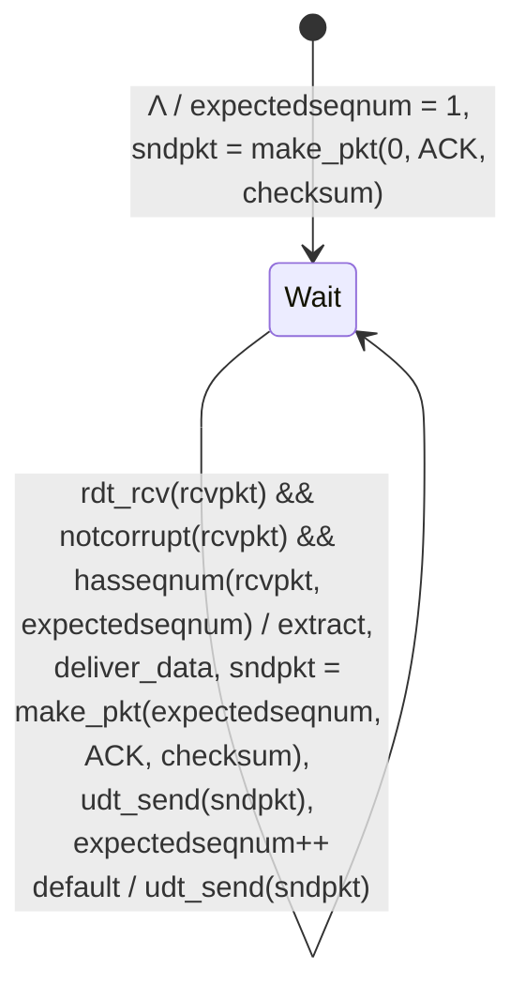

*Figure 26. Extended FSM of the Go-Back-N receiver of Kurose and Ross*

The GBN receiver discards out-of-order packets. Discarding a correctly received packet may seem silly and wasteful, but there is a reason. The receiver must deliver data to the upper layer in order. Suppose packet $`n`$ is expected but packet $`n + 1`$ arrives. The receiver could buffer packet $`n + 1`$ and deliver it after it later receives and delivers packet $`n`$. But if packet $`n`$ was lost, both $`n`$ and $`n + 1`$ will eventually be retransmitted under the GBN retransmission rule, so the receiver can discard packet $`n + 1`$. The advantage of this approach is the simplicity of receiver buffering. The receiver need not buffer any out-of-order packets, so while the sender must maintain the upper and lower bounds of its window and the position of `nextseqnum`, the receiver need only maintain `expectedseqnum`, the sequence number of the next in-order packet. The disadvantage is that the retransmission of a discarded packet might itself be lost or garbled, requiring even more retransmissions.

### 6.4 The Sender's Behavior and the Extended FSM

Kurose and Ross describe the GBN sender with an **extended FSM** that adds the variables `base` and `nextseqnum`, operations on them, and conditional actions. An extended FSM begins to look like a specification written in a programming language.

```text
initial:  base = 1, nextseqnum = 1                     (state: Wait)

event: rdt_send(data)
    if (nextseqnum < base + N) {
        sndpkt[nextseqnum] = make_pkt(nextseqnum, data, checksum)
        udt_send(sndpkt[nextseqnum])
        if (base == nextseqnum)
            start_timer
        nextseqnum++
    }
    else
        refuse_data(data)

event: timeout
    start_timer
    udt_send(sndpkt[base])
    udt_send(sndpkt[base+1])
    ...
    udt_send(sndpkt[nextseqnum-1])

event: rdt_rcv(rcvpkt) && notcorrupt(rcvpkt)
    base = getacknum(rcvpkt) + 1
    if (base == nextseqnum)
        stop_timer
    else
        start_timer

event: rdt_rcv(rcvpkt) && corrupt(rcvpkt)
    (no action)
```

*Figure 27. Extended FSM of the Go-Back-N sender of Kurose and Ross*

The GBN sender responds to three types of events.

1. **Invocation from above.** When `rdt_send()` is called, the sender first checks whether the window is full, that is, whether there are $`N`$ unacknowledged packets. If the window is not full, a packet is created and sent and the variables are updated. If it is full, the sender simply returns the data to the upper layer as an implicit indication that the window is full, and the upper layer must try again later. A real implementation would more likely buffer this data and send it later, or have a synchronization mechanism such as a semaphore or a flag that lets the upper layer call `rdt_send()` only when the window is not full.
2. **Receipt of an ACK.** An acknowledgment for the packet with sequence number $`n`$ is taken as a cumulative acknowledgment indicating that all packets up to and including $`n`$ have been correctly received.
3. **A timeout.** The protocol's name, Go-Back-N, comes from the sender's behavior when packets are lost or overly delayed. On a timeout, the sender resends all packets that have been sent but not yet acknowledged. The sender in Figure 27 uses only a single timer, which can be thought of as the timer of the oldest unacknowledged packet. If an ACK arrives while unacknowledged packets remain, the timer is restarted; if there are none, the timer is stopped.

Forouzan also uses only one timer for the same reason: the timer of the first outstanding packet always expires first. When the timer expires, the sender resends all outstanding packets. For example, if the sender has already sent packet 6 ($`S_n = 7`$) when the only timer expires and $`S_f = 3`$, packets 3, 4, 5, and 6 have not been acknowledged, so the sender goes back and resends packets 3, 4, 5, and 6.

> **Key Point:** On a time-out, the machine goes back N locations and resends all packets. This is where the name Go-Back-N comes from.

Forouzan's GBN FSM gives the sender two states, Ready and Blocking.

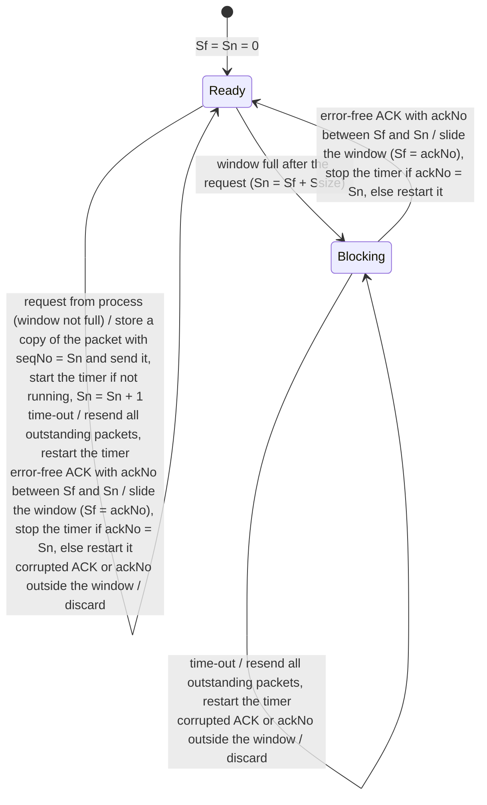

*Figure 28. Forouzan's Go-Back-N sender FSM (all arithmetic modulo 2 to the power m)*

The receiver is always in the Ready state, with $`R_n`$ initialized to 0. If an error-free packet with sequence number $`R_n`$ arrives, the message is delivered to the application layer, the window slides to $`R_n = (R_n + 1) \bmod 2^m`$, and an ACK with ackNo = $`R_n`$ is sent. If an error-free packet with a sequence number outside the window arrives, the packet is discarded, but an ACK with ackNo = $`R_n`$ is sent. A corrupted packet is discarded.

> **Note:** **Relation between GBN and stop-and-wait.** The stop-and-wait protocol is a Go-Back-N protocol with only two sequence numbers and a send window of size 1. That is, $`m = 1`$ and $`2^m - 1 = 1`$, and the modulo $`2^m`$ arithmetic of GBN is the same as the modulo-2 arithmetic of stop-and-wait when $`m = 1`$.

### 6.5 Examples of Operation

**Example of Kurose and Ross (window size 4, packet 2 lost).** Because of the window size, the sender sends packets 0-3 and must then wait for one or more of them to be acknowledged. As ACK0 and ACK1 arrive in turn, the window slides forward and the sender can send one new packet each (packets 4 and 5). At the receiver, packet 2 has been lost, so packets 3, 4, and 5 are found to be out of order and are discarded.

```mermaid
sequenceDiagram
    participant S as Sender
    participant R as Receiver
    S->>R: pkt0
    S->>R: pkt1
    S-xR: pkt2 (lost)
    S->>R: pkt3
    Note over S: window full, wait
    R->>S: ACK0 (pkt0 received)
    Note over S: ACK0 received, send pkt4
    S->>R: pkt4
    R->>S: ACK1 (pkt1 received)
    Note over S: ACK1 received, send pkt5
    S->>R: pkt5
    R->>S: ACK1 (pkt3 discarded)
    R->>S: ACK1 (pkt4 discarded)
    R->>S: ACK1 (pkt5 discarded)
    Note over S: pkt2 timeout
    S->>R: pkt2
    S->>R: pkt3
    S->>R: pkt4
    S->>R: pkt5
    R->>S: ACK2 (pkt2 delivered)
    R->>S: ACK3 (pkt3 delivered)
```

*Figure 29. Go-Back-N with window size 4 when packet 2 is lost (Kurose's ACK numbering)*

The GBN protocol incorporates almost all the techniques that appear in the reliable data transfer components of TCP in Chapter 8: sequence numbers, cumulative acknowledgments, checksums, and timeout and retransmission.

**Forouzan's example 1 (lost ACK and the effect of cumulative acknowledgment).** This is a case where the forward channel is reliable but the reverse channel is not. No data packets are lost, but some ACKs are delayed and one is lost. The example shows how cumulative acknowledgments help when acknowledgments are delayed or lost.

```mermaid
sequenceDiagram
    participant S as Sender (Sf, Sn)
    participant R as Receiver (Rn)
    Note over S: initially Sf = 0, Sn = 0, start timer
    Note over R: initially Rn = 0
    S->>R: Packet 0 (Sn = 1)
    Note over R: pArr, Rn = 1
    R->>S: ACK 1
    Note over S: aArr, Sf = 1
    S->>R: Packet 1 (Sn = 2)
    Note over R: pArr, Rn = 2
    R-xS: ACK 2 (lost)
    S->>R: Packet 2 (Sn = 3)
    Note over R: pArr, Rn = 3
    R->>S: ACK 3
    S->>R: Packet 3 (Sn = 4)
    Note over R: pArr, Rn = 4
    R->>S: ACK 4
    Note over S: ACK 3 arrives, Sf = 3, restart timer
    Note over S: ACK 4 arrives, Sf = 4 = Sn, stop timer
```

*Figure 30. Go-Back-N in which the cumulative ACK 3 takes the place of the lost ACK 2 (Forouzan's ackNo)*

After initialization, the events at the sender are request events triggered by message chunks from the application layer and arrival events triggered by ACKs received from the network layer. There is no time-out event, because all outstanding packets are acknowledged before the timer expires. Although ACK 2 is lost, ACK 3 is cumulative and serves as both ACK 2 and ACK 3. There are four packet-arrival events at the receiver.

**Forouzan's example 2 (lost packet).** Packets 0, 1, 2, and 3 are sent, but packet 1 is lost. The receiver receives packets 2 and 3 but discards them because they are out of order (packet 1 is expected). Each time the receiver receives packet 2 or 3 it sends ACK1 to show that it expects packet 1, but these ACKs are not useful to the sender because their ackNo equals $`S_f`$ rather than exceeding it, so they are discarded. When the time-out occurs, the sender resends packets 1, 2, and 3, which are acknowledged.

```mermaid
sequenceDiagram
    participant S as Sender (Sf, Sn)
    participant R as Receiver (Rn)
    Note over S: start timer
    S->>R: Packet 0
    Note over R: pArr, Rn = 1
    R->>S: ACK 1
    Note over S: aArr, Sf = 1, stop timer
    Note over S: start timer
    S-xR: Packet 1 (lost)
    S->>R: Packet 2
    Note over R: out of order, discarded
    R->>S: ACK 1
    S->>R: Packet 3
    Note over R: out of order, discarded
    R->>S: ACK 1
    Note over S: both ACK 1 discarded because ackNo = Sf
    Note over S: time-out
    S->>R: Packet 1 (resent)
    Note over R: pArr, Rn = 2
    R->>S: ACK 2
    S->>R: Packet 2 (resent)
    Note over R: pArr, Rn = 3
    R->>S: ACK 3
    S->>R: Packet 3 (resent)
    Note over R: pArr, Rn = 4
    R->>S: ACK 4
    Note over S: restart timer on ACK 2 and ACK 3, stop it on ACK 4
```

*Figure 31. Go-Back-N resending packets 1, 2, and 3 after packet 1 is lost (Forouzan's ackNo)*

### 6.6 Limit on the Send Window Size

Why the send window must be smaller than $`2^m`$ is shown with $`m = 2`$, for which the window size can be at most $`2^m - 1 = 3`$. Figure 32 compares a window of size 3 with a window of size 4.

```mermaid
sequenceDiagram
    participant S as Sender
    participant R as Receiver
    Note over S,R: a. Send window of size 3 (less than 2 to the m)
    S->>R: Packet 0
    R-xS: ACK1 (lost)
    S->>R: Packet 1
    R-xS: ACK2 (lost)
    S->>R: Packet 2
    R-xS: ACK3 (lost)
    Note over R: Rn = 3
    Note over S: time-out, restart
    S->>R: Packet 0 (resent)
    Note over R: correctly discarded as a duplicate because 3 is expected
    Note over S,R: b. Send window of size 4 (equal to 2 to the m)
    S->>R: Packet 0
    R-xS: ACK1 (lost)
    S->>R: Packet 1
    R-xS: ACK2 (lost)
    S->>R: Packet 2
    R-xS: ACK3 (lost)
    S->>R: Packet 3
    R-xS: ACK0 (lost)
    Note over R: Rn = 0 (next cycle)
    Note over S: time-out, restart
    S->>R: Packet 0 (resent)
    Note over R: erroneously accepted as packet 0 of the next cycle and delivered as new data
```

*Figure 32. Go-Back-N with send windows of size 3 and size 4 (m = 2)*

If the window size is 3 (less than $`2^m`$) and all three acknowledgments are lost, the only timer expires and all three packets are resent. The receiver is now expecting packet 3, not packet 0, so the duplicate packet is correctly discarded. On the other hand, if the window size is 4 (equal to $`2^2`$) and all acknowledgments are lost, the sender resends a copy of packet 0. This time the receiver's window expects packet 0 (of the next cycle), so it accepts this packet not as a duplicate but as the first packet of the next cycle. This is an error.

> **Key Point:** In the Go-Back-N protocol, the size of the send window must be less than $`2^m`$ (at most $`2^m - 1`$), and the size of the receive window is always 1.

---

<br>

## 7. Selective Repeat

### 7.1 The Idea of Individual Retransmission

GBN avoids the channel-utilization problem of stop-and-wait by letting the sender fill the pipeline with packets. GBN itself, however, has performance problems. When the window size and the bandwidth-delay product are both large, there can be many packets in the pipeline, and a single packet error makes GBN retransmit a large number of packets, many of them unnecessarily. As the probability of channel errors increases, the pipeline fills with these unnecessary retransmissions. If, in the dictation scenario, every garbled word required the surrounding 1,000 words (a window size of 1,000) to be repeated, the dictation would be slowed down considerably by all the repeated words.

Forouzan relates this problem to congestion. If the network layer is losing many packets because of congestion, resending all outstanding packets makes the congestion worse, and eventually more packets are lost. This avalanche effect can lead to the collapse of the whole network (Chapter 9).

> **Definition:** **Selective Repeat (SR)** is a pipelined protocol in which the sender retransmits only the packets it suspects were received in error (lost or corrupted), and the receiver individually acknowledges and buffers correctly received packets regardless of their order.

Such individual, as-needed retransmission requires the receiver to acknowledge each correctly received packet individually. The number of unacknowledged packets is again limited by a window size $`N`$, but unlike in GBN, the sender may already have received ACKs for some of the packets in the window.

### 7.2 Send Window and Receive Window

SR also uses a send window and a receive window, but they differ from the windows of GBN in two ways. First, the maximum size of the send window is much smaller, $`2^{m-1}`$ (Section 7.6 explains why). For example, if $`m = 4`$, the sequence numbers are 0-15 but the maximum window size is only 8 (it is 15 in GBN). Second, the receive window is the same size as the send window.

```text
              Sf: first outstanding
              |               Sn: next to send
              v               v
 13  14  15 [ 0*  1*  2+  3*  4   5   6   7 ] 8   9   10  11  12
  packets    outstanding packets,  packets that     packets that
  already    some acknowledged     can be sent      cannot be sent
  acked
            |<------ Ssize = 2^(m-1) ------>|

  * outstanding packet, not acknowledged
  + packet acknowledged out of order
```

*Figure 33. Send window for Selective Repeat (m = 4, size 8)*

In Figure 33, packets 0, 1, and 3 have been sent but not acknowledged, and packet 2 has been acknowledged out of order. The window starts at packet 0, the oldest unacknowledged packet, so it slides only after packets 0 and 1 are acknowledged.

The receive window in SR is totally different from that of GBN. Its size is the same as that of the send window (at most $`2^{m-1}`$), and as many packets as the size of the receive window can arrive out of order and be kept until there is a set of consecutive packets to deliver to the upper layer. Because the send and receive windows are the same size, all the packets in the send window can arrive out of order and be stored until they can be delivered. However, the receiver of a reliable protocol never delivers packets out of order to the application layer.

```text
             Rn  next packet expected
              |
              v
  0   1   2 [ 3   4+  5   6+  7   8   9+  10 ] 11  12  13  14  15
  packets      packets that can be received     packets that
  already      and stored for later delivery    cannot be received
  received     (+ already received out of order)
            |<------ Rsize = 2^(m-1) ------->|
```

*Figure 34. Receive window for Selective Repeat (m = 4, size 8)*

The receive window in Figure 34 covers 3-10, and packets 4, 6, and 9 have arrived out of order and are stored. Only when the earlier packet 3 arrives can packets 3 and 4 be delivered to the upper layer and the window slide.

Kurose and Ross call the start of the send window `send_base` and the start of the receive window `rcv_base`. They correspond to Forouzan's $`S_f`$ and $`R_n`$, respectively.

### 7.3 Events and Actions of the Sender and Receiver

**Events and actions of the SR sender**

1. **Data received from above.** The sender checks the next available sequence number for the packet. If the sequence number is within the send window, the data is packetized and sent. Otherwise, as in GBN, it is buffered or returned to the upper layer for later transmission.
2. **Timeout.** Timers are again used to protect against lost packets, but since only a single packet must be retransmitted on a timeout, each packet must now have its own logical timer. A single hardware timer can be used to mimic multiple logical timers.
3. **ACK received.** When an ACK is received, the sender marks that packet as received, provided it is in the window. If the packet's sequence number equals `send_base`, the window base is moved forward to the unacknowledged packet with the smallest sequence number. If the window moves and there are untransmitted packets with sequence numbers that now fall within the window, these packets are transmitted.

**Events and actions of the SR receiver**

1. **Packet with sequence number in [rcv_base, rcv_base+N-1] is correctly received.** The received packet falls within the receive window, so a selective ACK is returned to the sender. If the packet was not previously received, it is buffered. If its sequence number equals the base of the receive window (`rcv_base`), this packet and any previously buffered consecutive packets (beginning with `rcv_base`) are delivered to the upper layer, and the receive window moves forward by the number of packets delivered.
2. **Packet with sequence number in [rcv_base-N, rcv_base-1] is correctly received.** An ACK must be generated and sent, even though the receiver has previously acknowledged this packet.
3. **Otherwise.** The packet is ignored.

The receiver must reacknowledge already received packets in action 2 instead of ignoring them for the following reason. If the ACK for packet `send_base` does not propagate from the receiver to the sender, the sender will eventually retransmit that packet even though the receiver has already received it. If the receiver did not acknowledge this packet, the sender's window would never move forward. This example illustrates an important property of SR and many other protocols: the sender and the receiver do not always have the same view of what has been received correctly, and in SR the send and receive windows do not always coincide.

Forouzan's SR FSMs contain the same content. The sender moves between the Ready and Blocking states; when an error-free ACK acknowledging one of the outstanding packets arrives, it marks that packet, and if ackNo = $`S_f`$, it slides the window past all consecutive acknowledged packets. When an error-free packet with a sequence number inside the window arrives, the receiver stores it unless it is a duplicate and sends an ACK with ackNo = seqNo; if seqNo = $`R_n`$, it delivers that packet and all consecutive previously arrived and stored packets to the application and slides the window to the first empty slot. When an error-free packet with a sequence number outside the window arrives, the receiver discards it but returns an ACK with ackNo = $`R_n`$. This lets the sender slide its window if ACKs for packets with sequence numbers below $`R_n`$ were lost.

### 7.4 Acknowledgments and Timers

In GBN the ackNo is cumulative: it gives the sequence number of the next packet expected and confirms that all previous packets have been received safe and sound. The semantics of acknowledgment in SR are different. In SR the ackNo gives the sequence number of one single packet received safe and sound and says nothing about any other packet.

> **Key Point:** In the Selective Repeat protocol, an acknowledgment number defines the sequence number of the error-free packet received.

For example, suppose a sender sends six packets, 0, 1, 2, 3, 4, and 5, and receives an ACK with ackNo = 3. If the system uses GBN, it means that packets 0, 1, and 2 have been received uncorrupted and the receiver is expecting packet 3. If the system uses SR, it means that packet 3 has been received uncorrupted; the ACK says nothing about other packets.

As for timers, SR in theory uses one timer for each outstanding packet, and when a timer expires, only the corresponding packet is resent. In other words, GBN treats outstanding packets as a group, whereas SR treats them individually. Forouzan, however, describes SR with a single timer on the grounds that most transport-layer protocols implementing SR use only one, and in that case all unacknowledged packets in the window are resent on a time-out.

### 7.5 Examples of Operation

**Example of Kurose and Ross (window size 4, packet 2 lost).** The receiver initially buffers packets 3, 4, and 5 and delivers them together with packet 2 to the upper layer when packet 2 finally arrives. Below, the brackets give the sequence numbers covered by the window at each moment.

```mermaid
sequenceDiagram
    participant S as Sender
    participant R as Receiver
    S->>R: pkt0 [0 1 2 3]
    Note over R: pkt0 received, delivered, ACK0 sent [1 2 3 4]
    R->>S: ACK0
    S->>R: pkt1 [0 1 2 3]
    Note over R: pkt1 received, delivered, ACK1 sent [2 3 4 5]
    R->>S: ACK1
    S-xR: pkt2 (lost) [0 1 2 3]
    S->>R: pkt3, window full [0 1 2 3]
    Note over R: pkt3 received, buffered, ACK3 sent [2 3 4 5]
    R->>S: ACK3
    Note over S: ACK0 received, pkt4 sent [1 2 3 4]
    S->>R: pkt4
    Note over S: ACK1 received, pkt5 sent [2 3 4 5]
    S->>R: pkt5
    Note over R: pkt4 received, buffered, ACK4 sent [2 3 4 5]
    R->>S: ACK4
    Note over R: pkt5 received, buffered, ACK5 sent [2 3 4 5]
    R->>S: ACK5
    Note over S: pkt2 timeout, pkt2 resent [2 3 4 5]
    S->>R: pkt2
    Note over R: pkt2 received, pkt2 through pkt5 delivered, ACK2 sent [6 7 8 9]
    R->>S: ACK2
    Note over S: ACK3 received, nothing sent [2 3 4 5]
```

*Figure 35. Selective Repeat with window size 4 when packet 2 is lost*

**Forouzan's example (packet 1 lost, the same situation as GBN example 2 in Section 6.5).** At the sender, packet 0 is transmitted and acknowledged. Packet 1 is lost. Packets 2 and 3 arrive out of order and are acknowledged. When the timer times out, packet 1, the only unacknowledged packet, is resent and acknowledged, and the send window slides.

```mermaid
sequenceDiagram
    participant S as Sender (Sf, Sn)
    participant R as Receiver (Rn)
    Note over S: start timer
    S->>R: Packet 0
    Note over R: pArr, packet 0 delivered, Rn = 1
    R->>S: ACK 0
    Note over S: aArr, Sf = 1, stop timer
    Note over S: start timer
    S-xR: Packet 1 (lost)
    S->>R: Packet 2
    Note over R: pArr, packet 2 stored (cannot be delivered)
    R->>S: ACK 2
    Note over S: aArr, packet 2 marked, Sf stays 1
    S->>R: Packet 3
    Note over R: pArr, packet 3 stored (cannot be delivered)
    R->>S: ACK 3
    Note over S: aArr, packet 3 marked, Sf stays 1
    Note over S: time-out, restart
    S->>R: Packet 1 (resent)
    Note over R: pArr, packets 1, 2, 3 delivered, Rn = 4
    R->>S: ACK 1
    Note over S: aArr, Sf = 4, stop timer
```

*Figure 36. Selective Repeat when packet 1 is lost (Forouzan's example)*

At the receiver, the acceptance of a packet must be distinguished from its delivery to the application layer. At the second arrival, packet 2 is stored and marked but cannot be delivered because packet 1 is missing. At the next arrival, packet 3 is also marked and stored, but still none of the packets can be delivered. Only at the last arrival, when a copy of packet 1 finally arrives, can packets 1, 2, and 3 be delivered to the application layer. Delivering packets to the application layer requires two conditions. First, a set of consecutive packets must have arrived. Second, the set must start from the beginning of the window. A reliable transport layer must keep its promise to deliver packets in order.

### 7.6 Limit on the Window Size

The fact that the send and receive windows do not always coincide in SR has important consequences when combined with the reality of a finite range of sequence numbers. Consider the example of Kurose and Ross with four sequence numbers, 0, 1, 2, and 3, and a window size of three. Suppose packets 0-2 are transmitted, correctly received, and acknowledged at the receiver. At this point the receiver's window is over the fourth, fifth, and sixth packets, which have sequence numbers 3, 0, and 1.

```mermaid
sequenceDiagram
    participant S as Sender
    participant R as Receiver
    Note over S,R: a. The ACKs for the first three packets are all lost
    S->>R: pkt0
    R-xS: ACK0 (lost)
    S->>R: pkt1
    R-xS: ACK1 (lost)
    S->>R: pkt2
    R-xS: ACK2 (lost)
    Note over R: receive window [3 0 1]
    Note over S: timeout, retransmit pkt0
    S->>R: pkt0
    Note over R: receives a packet with sequence number 0 (actually a copy of the first packet)
    Note over S,R: b. All ACKs arrive and the sender sends the next packets
    S->>R: pkt0
    R->>S: ACK0
    S->>R: pkt1
    R->>S: ACK1
    S->>R: pkt2
    R->>S: ACK2
    Note over R: receive window [3 0 1]
    S-xR: pkt3 (lost)
    S->>R: pkt0
    Note over R: receives a packet with sequence number 0 (new data, the fifth packet)
```

*Figure 37. The dilemma of a Selective Repeat receiver with too-large windows: a new packet or a retransmission?*

In the first scenario (a), the ACKs for the first three packets are lost and the sender retransmits these packets. The receiver therefore next receives a packet with sequence number 0, a copy of the first packet. In the second scenario (b), the ACKs for the first three packets are all delivered correctly, so the sender moves its window forward and sends the fourth, fifth, and sixth packets with sequence numbers 3, 0, and 1. The packet with sequence number 3 is lost, but the packet with sequence number 0, containing new data, arrives.

The receiver cannot see the actions of the sender; it observes only the sequence of messages it receives from and sends into the channel. From the receiver's viewpoint, the two scenarios are identical: there is no way to distinguish the retransmission of the first packet from the original transmission of the fifth packet. A window size that is 1 less than the size of the sequence-number space clearly does not work. Kurose and Ross leave it as an exercise to show that the window size must be less than or equal to half the size of the sequence-number space for SR.

Forouzan shows the same conclusion with $`m = 2`$, for which the window size can be at most $`2^m / 2 = 2`$.

```mermaid
sequenceDiagram
    participant S as Sender
    participant R as Receiver
    Note over S,R: a. Send and receive windows of size 2 (2 to the m-1)
    S->>R: Packet 0
    R-xS: ACK 0 (lost)
    S->>R: Packet 1
    R-xS: ACK 1 (lost)
    Note over R: receive window [2 3]
    Note over S: time-out, restart
    S->>R: Packet 0 (resent)
    Note over R: correctly discarded because 0 is outside the window
    Note over S,R: b. Send and receive windows of size 3 (greater than 2 to the m-1)
    S->>R: Packet 0
    R-xS: ACK 0 (lost)
    S->>R: Packet 1
    R-xS: ACK 1 (lost)
    S->>R: Packet 2
    R-xS: ACK 2 (lost)
    Note over R: receive window [3 0 1]
    Note over S: time-out, restart
    S->>R: Packet 0 (resent)
    Note over R: erroneously accepted and stored as new data because 0 is inside the window
```

*Figure 38. Selective Repeat with window sizes 2 and 3 (m = 2)*

If the window size is 2 and all acknowledgments are lost, the timer for packet 0 expires and packet 0 is resent. But the receiver's window is now expecting packet 2, not packet 0 (sequence number 0 is outside the window), so this duplicate packet is correctly discarded. If the window size is 3 and all acknowledgments are lost, the sender sends a copy of packet 0, but this time the receiver's window can accept packet 0 (0 is inside the window), so it accepts the packet not as a duplicate but as a packet of the next cycle. This is clearly an error.

> **Key Point:** In Selective Repeat, the size of the send and receive windows can be at most one-half of $`2^m`$, that is, $`2^{m-1}`$.

Comparing the two limits: the GBN receiver accepts only $`R_n`$, so even if the sender sends up to $`2^m - 1`$ packets, they do not overlap with the first number of the next cycle; but the SR receiver accepts the sequence numbers of its entire window, so if the old sequence numbers the sender may resend are not to overlap with the new sequence numbers the receive window covers, the two windows together must not exceed the sequence-number space $`2^m`$.

### 7.7 Comparison of Go-Back-N and Selective Repeat

| Feature | Go-Back-N | Selective Repeat |
|:-----|:-----|:-----|
| Retransmission | The lost packet and all later unacknowledged packets | Only the lost (or corrupted) packets |
| Receive window size | 1 | Same as the send window |
| Out-of-order packets | Discarded | Stored if inside the window |
| Acknowledgment | Cumulative (the next number expected or the last number received in order) | Individual (the number of the packet received) |
| Timers | One timer for the oldest unacknowledged packet | In theory one per packet |
| Maximum send window size | $`2^m - 1`$ | $`2^{m-1}`$ |
| Receiver implementation | Simple, with one variable | Complex, requiring buffers and marks |
| Efficiency with frequent errors | Low because of many unnecessary retransmissions | High |

*Table 6. Comparison of Go-Back-N and Selective Repeat*

---

<br>

## 8. Bidirectional Transfer and Piggybacking

The four protocols discussed so far are all unidirectional: data packets flow in one direction and acknowledgments in the other. In real life, data packets normally flow in both directions, from client to server and from server to client, so acknowledgments must also flow in both directions.

> **Definition:** **Piggybacking** is the technique of carrying, in a packet that transports data in one direction, the acknowledgment for the data flowing in the opposite direction. Separate packets carrying only acknowledgments are no longer needed, which improves the efficiency of bidirectional protocols.

A packet carrying data from A to B can also carry acknowledgment feedback about packets arrived from B, and a packet carrying data from B to A can also carry acknowledgment feedback about packets arrived from A. Figure 39 shows the layout of GBN implemented bidirectionally with piggybacking. The client and the server each use two independent windows, a send window and a receive window.

```mermaid
graph LR
    subgraph C["Client"]
        CS["Send window<br/>Sf, Sn"]
        CR["Receive window<br/>Rn"]
    end
    subgraph SV["Server"]
        SR["Receive window<br/>Rn"]
        SS["Send window<br/>Sf, Sn"]
    end
    CS -->|"seqNo, data, ackNo (acknowledging server-to-client data)"| SR
    SS -->|"seqNo, data, ackNo (acknowledging client-to-server data)"| CR
```

*Figure 39. The four windows of the client and server in bidirectional Go-Back-N with piggybacking*

Communication from client to server uses the client's send window and the server's receive window, and communication from server to client uses the server's send window and the client's receive window. Each packet carries both the sequence number (seqNo) of the data it transports and the acknowledgment number (ackNo) for the data in the opposite direction. TCP in Chapter 8 uses this approach.

---

<br>

## 9. Packet Reordering and Reuse of Sequence Numbers

So far the channel has been assumed not to reorder packets. This is a reasonable assumption when the sender and the receiver are connected by a single physical wire, but when the "channel" connecting them is a network, packet reordering can occur. One manifestation of reordering is that old copies of a packet with sequence or acknowledgment number $`x`$ can appear even though neither the sender's nor the receiver's window contains $`x`$. With reordering, the channel can be thought of as essentially buffering packets and spontaneously emitting them at any point in the future.

Because sequence numbers are reused, care must be taken to guard against such duplicate packets. The approach taken in practice is to ensure that a sequence number $`x`$ is not reused until the sender is "sure" that any previously sent packets with sequence number $`x`$ are no longer in the network. This is done by assuming that a packet cannot "live" in the network longer than some fixed maximum amount of time. A maximum packet lifetime of about three minutes is assumed in the TCP extensions for high-speed networks. TCP's random initial sequence numbers and TIME-WAIT state, covered in Chapter 8, address the same problem.

---

<br>

## 10. Summary of Reliable Data Transfer Mechanisms

| Mechanism | Use and comments |
|:-----|:-----|
| Checksum | Detects bit errors in a transmitted packet. |
| Timer | Times out and retransmits a packet, possibly because the packet or its ACK was lost in the channel. Because timeouts can occur when a packet is delayed but not lost (premature timeout) or when the receiver has received a packet but the ACK was lost, the receiver may receive duplicate copies of a packet. |
| Sequence number | Numbers the data packets flowing from sender to receiver in order. Gaps in the sequence numbers of received packets let the receiver detect a lost packet, and packets with duplicate sequence numbers let it detect duplicate copies. |
| Acknowledgment | Tells the sender that a packet or set of packets has been received correctly. It typically carries the sequence number of the packet being acknowledged and may be individual or cumulative depending on the protocol. |
| Negative acknowledgment | Tells the sender that a packet has not been received correctly. It typically carries the sequence number of the packet not received correctly. |
| Window, pipelining | Restricts the sender to sending only packets with sequence numbers in a given range. Allowing multiple packets to be sent but not yet acknowledged increases sender utilization over stop-and-wait. The window size may be set on the basis of the receiver's ability to receive and buffer messages, the level of congestion in the network, or both (Chapters 8 and 9). |

*Table 7. Reliable data transfer mechanisms and their uses*

---

<br>

## Concept Applications

**True/False Check:**

| Statement | Judgment and Reason |
|:-----|:-----|
| rdt2.0 always works correctly over a channel with bit errors. | **F.** If an ACK or NAK itself is corrupted, the sender cannot know the receiver's state, so rdt2.1 with sequence numbers is needed. |
| In a stop-and-wait protocol over a channel without packet loss, a 1-bit sequence number suffices. | **T.** The receiver only needs to distinguish a new packet from a retransmission of the previous packet, so modulo-2 sequence numbers suffice. |
| An rdt3.0 sender immediately resends the packet when it receives a corrupted ACK. | **F.** On a corrupted ACK or an ACK with the other sequence number, rdt3.0 takes no action and retransmits only when a timeout occurs. |
| For stop-and-wait with 1 Gbps, an RTT of 30 ms, and 1,000-byte packets, the sender utilization is about 0.027%. | **T.** $`U = 0.008/30.008 \approx 0.00027`$. |
| The receive window size of GBN is 1. | **T.** The GBN receiver accepts only the one in-order packet ($`R_n`$) and discards the rest. |
| If the sequence-number field has m bits, the SR send window may be as large as $`2^m - 1`$. | **F.** The SR send and receive windows are at most $`2^{m-1}`$; $`2^m - 1`$ is the limit for GBN. |
| In SR, an ACK with ackNo = 3 means that packets 0, 1, and 2 have all arrived. | **F.** SR acknowledgments are individual, so it means only that packet 3 has arrived and says nothing about the other packets. |
| An SR receiver ignores a packet whose sequence number lies before its receive window. | **F.** Packets in the range [rcv_base-N, rcv_base-1] must be reacknowledged; otherwise the window of a sender that lost the ACK cannot move forward. |

---

<br>

## Summary

| Concept | Key Summary |
|:-----|:-----|
| Reliable data transfer | A service in which data is delivered without corruption or loss and in the order sent, implemented as a protocol on top of an unreliable channel. |
| Flow control | A technique that balances production and consumption rates; it is needed with pushing and is usually implemented with two buffers at the sending and receiving sides. |
| Error control | It handles four tasks: discarding corrupted packets, resending lost packets, discarding duplicates, and buffering out-of-order packets. |
| Sequence number | Sequence numbers in an m-bit field are modulo $`2^m`$ and are used to detect retransmissions, duplicates, and out-of-order arrivals. |
| Sliding window | An abstract box that represents the range of sequence numbers that can be sent or received and slides forward as acknowledgments arrive. |
| rdt1.0-rdt3.0 | As the channel assumption changes from perfectly reliable to bit errors to loss, checksums, ACKs and NAKs, sequence numbers, duplicate ACKs, and timers are added in turn. |
| Stop-and-wait | A protocol that sends one packet and waits for its acknowledgment; its utilization is $`(L/R)/(RTT + L/R)`$, which is very low when the bandwidth-delay product is large. |
| Pipelining | Sending several packets without acknowledgments raises utilization and requires a wider sequence-number range and buffers. |
| Go-Back-N | The sender sends up to $`2^m - 1`$ unacknowledged packets and resends all of them with a single timer, and the receiver accepts only in-order packets with a window of size 1. |
| Selective Repeat | Only lost packets are resent and the receiver buffers out-of-order packets, with send and receive windows of at most $`2^{m-1}`$. |
| Meaning of acknowledgments | GBN ACKs are cumulative and SR ACKs are individual; Kurose puts the number received in an ACK, while Forouzan's GBN puts the number expected next. |
| Piggybacking | A technique that carries acknowledgments in data packets of the opposite direction; each end of a bidirectional protocol has one send window and one receive window. |

---

<br>

## Self-Check Questions

1. **Utilization:** The packet size is $`L`$ = 1,500 bytes, the transmission rate is $`R`$ = 100 Mbps, and RTT = 20 ms. Find the sender utilization and throughput of a stop-and-wait protocol and of a pipelined protocol with window size 10, and state how large the window must be for the utilization to reach 1.

   <details>
   <summary>Answer</summary>

   $`L/R`$ = 12,000 bits / $`10^8`$ bps = 0.12 ms. The stop-and-wait utilization is 0.12 / (20 + 0.12) ≈ 0.00596, about 0.6%, and the throughput is 12,000 bits / 20.12 ms ≈ 596 kbps. With window size 10, the utilization is 10 × 0.12 / 20.12 ≈ 0.0596, about 6%, and the throughput is about 5.96 Mbps. For the utilization to reach 1, $`N \geq 20.12/0.12 \approx 167.7`$, so the window size must be at least 168.

   </details>

2. **GBN retransmissions:** A GBN sender with window size 4 must send packets 0-5. Only packet 2 is lost, all other packets and ACKs arrive on time, and before the timer of packet 2 expires the sender sends every packet the window allows. List the packets resent on the timeout and the packets the receiver discards.

   <details>
   <summary>Answer</summary>

   The sender sends 0-3, and when ACK0 and ACK1 arrive the window slides and it sends 4 and 5. The receiver expects packet 2, so it treats packets 3, 4, and 5 as out of order and discards them, each time resending the ACK for packet 1, the last packet received in order. When the timer of packet 2 expires, all four unacknowledged packets, 2, 3, 4, and 5, are resent.

   </details>

3. **SR retransmissions:** In the same situation as question 2 but with SR, which packets are resent, and when does the receiver deliver which packets to the upper layer?

   <details>
   <summary>Answer</summary>

   The SR receiver buffers packets 3, 4, and 5 and sends ACK3, ACK4, and ACK5. The sender marks these packets as acknowledged, so when the timer of packet 2 expires it resends only packet 2. When the resent packet 2 arrives, the receiver delivers packets 2, 3, 4, and 5 to the upper layer together and moves its receive window to start at packet 6.

   </details>

4. **Maximum window size:** With a 3-bit sequence-number field, find the range of sequence numbers and the maximum send window sizes of GBN and SR, and explain what goes wrong if the GBN window size is 8.

   <details>
   <summary>Answer</summary>

   Sequence numbers are modulo $`2^3 = 8`$, so they range from 0 to 7. The maximum GBN send window size is $`2^3 - 1 = 7`$, and the maximum SR send and receive window size is $`2^{3-1} = 4`$. If the GBN window is 8, the sender sends packets 0-7, and if all the ACKs are lost, it resends packet 0. The receiver has already received all eight and is waiting for packet 0 of the next cycle, so it wrongly accepts the old duplicate packet 0 as a new packet.

   </details>

5. **Interpreting ACK numbers:** After sending six packets, 0-5, a sender receives an ACK with ackNo = 3 under Forouzan's convention. State what this ACK means in GBN and in SR, and give the ACK number that represents the same situation in GBN under Kurose's convention.

   <details>
   <summary>Answer</summary>

   In GBN it means that packets 0, 1, and 2 arrived uncorrupted and the receiver is expecting packet 3. In SR it means only that packet 3 arrived uncorrupted and says nothing about other packets. GBN under Kurose's convention puts the number of the last packet received in order in the ACK, so the same situation is represented by ACK 2.

   </details>

6. **Duplicate handling in the rdt2.1 receiver:** An rdt2.1 receiver in the "Wait for 1 from below" state receives an uncorrupted packet 0. State what the receiver does and why.

   <details>
   <summary>Answer</summary>

   This packet is a retransmission of packet 0, which has already been received and delivered. The receiver does not deliver the data again but sends an ACK and stays in the "Wait for 1 from below" state. The sender resent packet 0 because it received the previous ACK for packet 0 in corrupted form, so an ACK must be sent again for the sender to move on to packet 1.

   </details>

7. **Tracing stop-and-wait:** In Forouzan's stop-and-wait protocol, a sender with $`S = 1`$ is in the Blocking state. (a) Which sequence number does it resend on a time-out? (b) What does it do if an error-free ACK with ackNo = 1 arrives? (c) What does a receiver with $`R = 1`$ do if an error-free packet with sequence number 0 arrives?

   <details>
   <summary>Answer</summary>

   (a) It resends the only outstanding packet in the window, the one with sequence number 1, and restarts the timer. (b) The expected ackNo is $`(S + 1) \bmod 2 = 0`$, so an ACK with ackNo = 1 is not related to the outstanding packet and is discarded. (c) The sequence number differs from $`R`$, so the packet is treated as a duplicate and discarded, but an ACK with ackNo = $`R`$ = 1 is sent.

   </details>

8. **Reacknowledgment in the SR receiver:** Explain, in terms of the sender's window, why an SR receiver must send an ACK when it receives again a packet it has already received (a sequence number in the range [rcv_base-N, rcv_base-1]).

   <details>
   <summary>Answer</summary>

   If the receiver's ACK for packet `send_base` is lost, the sender assumes that the packet did not arrive and resends it after a timeout. The receiver has already received that packet and moved its window, but the sender does not know this. If the receiver did not ACK this retransmission, the sender would never get packet `send_base` acknowledged and its send window could not move forward. The receiver must therefore send ACKs for packets in the range just before its window as well.

   </details>
