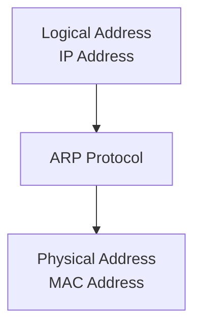
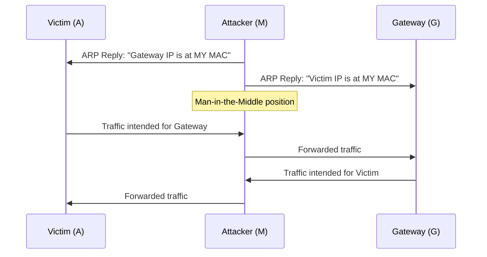

# 8장 — 주소 결정 프로토콜 (ARP)

[레포지토리 안내](../../README.ko.md) | [English](Concepts_Lecture.md) | [한국어](Concepts_Lecture.ko.md)

> **최종 수정일:** 2026-10-17
>
> TCP/IP Protocol Suite, Forouzan, Ch 8

> **학습 목표:**
> 1. 주소 결정 프로토콜(ARP) 과정을 설명할 수 있다
> 2. ARP 캐시 관리와 타임아웃을 설명할 수 있다
> 3. ARP와 RARP, 프록시 ARP를 구분할 수 있다

---

## 목차

- [1. 주소 매핑](#1-주소-매핑)
  - [1.1 정적 매핑](#11-정적-매핑)
  - [1.2 동적 매핑](#12-동적-매핑)
- [2. ARP 프로토콜](#2-arp-프로토콜)
  - [2.1 ARP 동작](#21-arp-동작)
  - [2.2 ARP 패킷 형식](#22-arp-패킷-형식)
  - [2.3 ARP 캡슐화](#23-arp-캡슐화)
  - [2.4 ARP 캐시](#24-arp-캐시)
- [3. ARP를 사용하는 네 가지 경우](#3-arp를-사용하는-네-가지-경우)
- [4. 프록시 ARP](#4-프록시-arp)
- [5. ARP 보안](#5-arp-보안)
  - [5.1 ARP 스푸핑](#51-arp-스푸핑)
  - [5.2 대응 방안](#52-대응-방안)
- [6. 부록](#6-부록)
  - [6.1 ARP vs. RARP](#61-arp-vs-rarp)
  - [6.2 무상 ARP (Gratuitous ARP)](#62-무상-arp-gratuitous-arp)
  - [6.3 ARP 명령 예제](#63-arp-명령-예제)
- [요약](#요약)
- [점검 문제](#점검-문제)

---

<br>

## 1. 주소 매핑

패킷을 호스트나 라우터에 전달하려면 **두 수준의 주소 지정**이 필요하다: **논리적(IP) 주소**와 **물리적(MAC) 주소**.

논리적 주소를 해당하는 물리적 주소로, 그리고 그 반대로 매핑할 수 있어야 한다. 이는 **정적** 또는 **동적** 매핑을 사용하여 수행할 수 있다.

### 1.1 정적 매핑

- 논리적 주소와 물리적 주소를 연결하는 테이블을 만든다.
- 이 테이블을 네트워크의 각 장비에 저장한다.
- 다른 장비의 IP 주소를 아는 장비는 테이블에서 해당 물리적 주소를 조회할 수 있다.

**한계:**
- 물리적 주소는 바뀔 수 있다(NIC 교체, 모바일 컴퓨터의 이동).
- 변경이 생길 때마다 테이블을 수동으로 갱신해야 한다.
- 네트워크 규모가 커질수록 유지보수 부담이 증가한다.

### 1.2 동적 매핑

- 장비가 두 주소 중 하나(논리적 또는 물리적)를 알고 있으면 프로토콜을 사용하여 다른 주소를 찾을 수 있다.
- **ARP (Address Resolution Protocol)** 는 논리적 주소를 물리적 주소로 매핑한다.
- 동적 매핑은 테이블을 수동으로 유지보수할 필요를 없앤다.



*그림 1. ARP를 통한 논리적 주소와 물리적 주소의 동적 매핑*

> **핵심:** ARP는 IP 주소를 MAC 주소로 동적으로 매핑하여 정적 주소 테이블의 필요성을 제거한다.

---

<br>

## 2. ARP 프로토콜

### 2.1 ARP 동작

ARP는 IP 주소를 물리적(MAC) 주소와 연결한다. 일반적인 물리적 네트워크(LAN 등)에서 링크의 각 장치는 보통 NIC에 새겨져 있는 물리적 또는 스테이션 주소로 식별된다.

ARP는 IP 프로토콜로부터 논리적 주소를 받아들이고, 해당하는 물리적 주소로 매핑한 후 데이터 링크 계층에 전달한다.

```text
            ICMP    IGMP
Network  +---+---+---------+
Layer    |       |   IP    |  Logical
         |       |         |  address
         |       +---------+    |
         |           |    +-----v-----+
         |           |    |    ARP    |
         +-----------+----+-----------+
                                |
                          Physical address
                                |
                          Data Link Layer
```

*그림 2. 네트워크 계층에서 ARP의 위치*

**ARP 동작 (호스트 A가 동일 LAN에 있는 호스트 B에게 전송하려는 경우):**

1. A가 **ARP 캐시**에서 B의 물리적 주소를 찾는다.
2. 찾으면 캐시된 주소를 사용한다.
3. 찾지 못하면 A가 **ARP 요청** 메시지를 만들어 LAN의 모든 호스트에 **브로드캐스트** 한다(목적지 MAC = `FF:FF:FF:FF:FF:FF`).
4. B는 ARP 요청을 받고 대상 IP 주소가 자신의 주소임을 인식하여, 자신의 물리적 주소를 담은 **ARP 응답**을 만든다.
5. B가 ARP 응답을 A에게 **유니캐스트**로 직접 보낸다.
6. A는 B의 물리적 주소를 ARP 캐시에 저장한다(보통 **20분** 동안 유지한다).
7. 대상 IP 주소가 자신의 주소와 일치하지 않는 나머지 호스트는 요청을 **무시**한다.

> **핵심:** ARP 요청은 **브로드캐스트**이고, ARP 응답은 **유니캐스트**이다.

### 2.2 ARP 패킷 형식

```text
 0                   1                   2                   3
 0 1 2 3 4 5 6 7 8 9 0 1 2 3 4 5 6 7 8 9 0 1 2 3 4 5 6 7 8 9 0 1
+-+-+-+-+-+-+-+-+-+-+-+-+-+-+-+-+-+-+-+-+-+-+-+-+-+-+-+-+-+-+-+-+
|         Hardware Type         |         Protocol Type         |
+-+-+-+-+-+-+-+-+-+-+-+-+-+-+-+-+-+-+-+-+-+-+-+-+-+-+-+-+-+-+-+-+
| Hw Addr Len   | Proto Addr Len|          Operation            |
+-+-+-+-+-+-+-+-+-+-+-+-+-+-+-+-+-+-+-+-+-+-+-+-+-+-+-+-+-+-+-+-+
|                  Sender Hardware Address                       |
|                       (6 bytes for Ethernet)                  |
+-+-+-+-+-+-+-+-+-+-+-+-+-+-+-+-+-+-+-+-+-+-+-+-+-+-+-+-+-+-+-+-+
|                  Sender Protocol Address                       |
|                       (4 bytes for IPv4)                      |
+-+-+-+-+-+-+-+-+-+-+-+-+-+-+-+-+-+-+-+-+-+-+-+-+-+-+-+-+-+-+-+-+
|                  Target Hardware Address                       |
|            (6 bytes for Ethernet, unknown in request)         |
+-+-+-+-+-+-+-+-+-+-+-+-+-+-+-+-+-+-+-+-+-+-+-+-+-+-+-+-+-+-+-+-+
|                  Target Protocol Address                       |
|                       (4 bytes for IPv4)                      |
+-+-+-+-+-+-+-+-+-+-+-+-+-+-+-+-+-+-+-+-+-+-+-+-+-+-+-+-+-+-+-+-+
```

*그림 3. ARP 패킷 형식*

| 필드 | 설명 |
|-------|-------------|
| Hardware Type | 네트워크 유형 (Ethernet = 1) |
| Protocol Type | 주소를 결정할 상위 프로토콜 (IPv4 = 0x0800) |
| Hardware Length | 물리적 주소의 바이트 단위 길이 (Ethernet = 6) |
| Protocol Length | 논리적 주소의 바이트 단위 길이 (IPv4 = 4) |
| Operation | 패킷 유형: ARP Request (1), ARP Reply (2) |
| Sender Hardware Address | 송신자의 물리적(MAC) 주소 |
| Sender Protocol Address | 송신자의 논리적(IP) 주소 |
| Target Hardware Address | 수신자의 물리적 주소 (요청 시 미지, 0으로 채움) |
| Target Protocol Address | 수신자의 논리적(IP) 주소 |

*표 1. ARP 패킷의 필드*

### 2.3 ARP 캡슐화

ARP 패킷은 Ethernet 프레임에 직접 캡슐화된다:

```text
+-----------+-------------+-------------+------+-------------------+-----+
| Preamble  | Destination | Source      | Type | ARP Request       | CRC |
| and SFD   | Address     | Address     |      | or Reply Packet   |     |
+-----------+-------------+-------------+------+-------------------+-----+
  8 bytes      6 bytes      6 bytes     2 bytes                    4 bytes
```

*그림 4. Ethernet 프레임에 캡슐화된 ARP 패킷*

- **Type 필드**의 값은 `0x0806`이며, ARP 페이로드를 나타낸다.
- ARP 요청의 목적지 MAC은 `FF:FF:FF:FF:FF:FF`(브로드캐스트)이다.
- ARP 응답의 목적지 MAC은 요청을 보낸 송신자의 MAC(유니캐스트)이다.

**ARP 캡슐화 단계:**
1. 송신자는 대상의 IP 주소를 알고 있다.
2. IP가 ARP에 ARP 요청을 만들도록 요청한다. 요청에는 송신자의 물리적 주소와 IP 주소, 대상의 IP 주소가 들어가며, 대상의 물리적 주소는 알 수 없으므로 0으로 채운다.
3. 데이터 링크 계층이 요청을 프레임으로 캡슐화한다. 출발지 주소는 송신자의 물리적 주소이고, 목적지 주소는 브로드캐스트 주소이다.
4. LAN의 모든 호스트와 라우터가 프레임을 받아 자신의 ARP에 전달한다.
5. 대상 시스템은 자신의 물리적 주소를 담은 ARP 응답을 유니캐스트로 보낸다.
6. 송신자는 응답을 받아 대상의 물리적 주소를 알게 된다.
7. 이제 IP 데이터그램을 프레임에 캡슐화하여 대상에게 유니캐스트로 보낸다.

### 2.4 ARP 캐시

ARP 캐시는 최근에 결정된 주소 매핑을 저장한다:
- 각 항목에는 **유효 시간(Time-to-Live)** 이 있으며, 보통 20분이다.
- 유효 시간이 지난 항목은 캐시에서 제거된다.
- 캐시는 반복적인 ARP 요청을 피하여 네트워크 트래픽을 줄인다.

```text
$ arp -a
? (192.168.1.1) at aa:bb:cc:dd:ee:ff on en0 [ethernet]
? (192.168.1.100) at 11:22:33:44:55:66 on en0 [ethernet]
```

---

<br>

## 3. ARP를 사용하는 네 가지 경우

ARP는 송신자와 수신자의 관계에 따라 네 가지 다른 시나리오에서 사용된다:

```mermaid
graph TD
    subgraph "Case 1: Host to Host (Same Network)"
        A1[Host] -->|Target IP = Dest IP in datagram| B1[Host]
    end
    subgraph "Case 2: Host to Host (Different Network)"
        A2[Host] -->|Target IP = Default Router IP| R2[Router]
        R2 -->|Other network| B2[Host]
    end
    subgraph "Case 3: Router to Router (Different Network)"
        R3a[Router] -->|Target IP = Next-hop Router IP| R3b[Router]
    end
    subgraph "Case 4: Router to Host (Same Network)"
        R4[Router] -->|Target IP = Dest IP in datagram| B4[Host]
    end
```



*그림 5. ARP를 사용하는 네 가지 경우*

| 경우 | 송신자 | 수신자 | ARP의 대상 IP |
|------|--------|----------|-------------------|
| 1 | 호스트 | 호스트 (동일 네트워크) | 데이터그램의 목적지 IP |
| 2 | 호스트 | 호스트 (다른 네트워크) | **기본 게이트웨이/라우터**의 IP 주소 |
| 3 | 라우터 | 라우터 (다른 네트워크) | **다음 홉 라우터**의 IP 주소 |
| 4 | 라우터 | 호스트 (동일 네트워크) | 데이터그램의 목적지 IP |

*표 2. 경우별 ARP의 대상 IP 주소*

> **핵심:** 목적지가 다른 네트워크에 있을 때 ARP는 최종 목적지 호스트가 아닌 다음 홉 라우터의 MAC 주소를 결정한다.

---

<br>

## 4. 프록시 ARP

**프록시 ARP**는 라우터가 다른 네트워크에 있는 호스트를 대신하여 ARP 요청에 응답할 수 있게 한다:
- 라우터는 자신의 MAC 주소를 담아 ARP 요청에 응답한다.
- 송신 호스트는 목적지가 로컬 네트워크에 있다고 여기게 된다.
- 호스트에 라우팅을 설정하지 않고도 서브넷을 연결할 수 있다.
- 잘못 사용하면 보안 문제를 일으킬 수 있다.

---

<br>

## 5. ARP 보안

### 5.1 ARP 스푸핑

**ARP 스푸핑**(ARP 포이즈닝이라고도 함)은 악의적인 호스트가 위조된 ARP 응답을 보내는 공격이다:



*그림 6. ARP 스푸핑을 이용한 중간자 공격*

**ARP 스푸핑으로 가능한 공격:**
- **중간자 공격(Man-in-the-Middle, MITM)**: 공격자가 트래픽을 가로채고 수정할 수도 있다.
- **세션 하이재킹(Session Hijacking)**: 공격자가 인증된 세션을 탈취한다.
- **서비스 거부(Denial of Service)**: 공격자가 트래픽을 존재하지 않는 MAC 주소로 보낸다.
- **트래픽 스니핑(Traffic Sniffing)**: 공격자가 비밀번호나 자격 증명 같은 민감한 데이터를 캡처한다.

### 5.2 대응 방안

| 대응 방안 | 설명 |
|---------------|-------------|
| 정적 ARP 항목 | 중요한 매핑을 수동으로 설정 (확장성 부족) |
| Dynamic ARP Inspection (DAI) | 스위치가 DHCP 스누핑 데이터베이스에 대해 ARP 패킷을 검증 |
| ARP Watch | 이상 징후에 대해 ARP 트래픽을 모니터링하는 소프트웨어 |
| 802.1X | 포트 기반 네트워크 접근 제어 |
| 암호화 (TLS/SSL) | 트래픽이 가로채져도 읽을 수 없음 |
| VPN | 암호화된 터널이 ARP 공격을 무력화 |

*표 3. ARP 스푸핑 대응 방안*

---

<br>

## 6. 부록

### 6.1 ARP vs. RARP

| 특징 | ARP | RARP |
|---------|-----|------|
| 방향 | IP --> MAC | MAC --> IP |
| 사용 사례 | 일반 통신 | 디스크 없는 워크스테이션 (구식) |
| 대체 | 여전히 사용 중 | BOOTP/DHCP로 대체됨 |

*표 4. ARP와 RARP의 비교*

### 6.2 무상 ARP (Gratuitous ARP)

**무상 ARP**는 송신자가 송신자와 대상 IP 모두를 자신의 주소로 설정하는 ARP 요청이다:
- 응답이 돌아오면 같은 IP 주소를 쓰는 다른 장치가 있다는 뜻이므로, IP 주소 충돌을 감지하는 데 쓰인다.
- 주소가 바뀌었을 때 다른 호스트의 ARP 캐시를 갱신한다.
- 호스트는 부팅하거나 IP 주소를 바꿀 때 무상 ARP를 보낸다.

### 6.3 ARP 명령 예제

```bash
# ARP 캐시 조회
arp -a

# 정적 ARP 항목 추가
arp -s 192.168.1.1 aa:bb:cc:dd:ee:ff

# ARP 항목 삭제
arp -d 192.168.1.1

# 전체 ARP 캐시 삭제 (Linux)
ip -s -s neigh flush all
```

---

<br>

## 요약

| 개념 | 핵심 요약 |
|---------|-----------|
| 주소 매핑 | 패킷을 전달하려면 논리적(IP) 주소와 물리적(MAC) 주소라는 두 수준의 주소가 필요하다. |
| 정적 매핑 | 주소 테이블을 수동으로 관리하므로 유연하지 않고 유지보수 부담이 크다. |
| 동적 매핑 (ARP) | ARP는 브로드캐스트 요청과 유니캐스트 응답으로 IP 주소에 대응하는 MAC 주소를 자동으로 결정한다. |
| ARP 요청 | ARP 요청은 LAN의 모든 호스트에 브로드캐스트된다. |
| ARP 응답 | ARP 응답은 요청자에게 유니캐스트로 돌아간다. |
| ARP 캐시 | ARP 캐시는 트래픽을 줄이기 위해 매핑을 보통 20분 동안 저장한다. |
| 네 가지 ARP 경우 | ARP의 대상 IP 주소는 목적지가 같은 네트워크에 있는지 다른 네트워크에 있는지에 따라 달라진다. |
| ARP 스푸핑 | 위조된 ARP 응답은 중간자 공격을 가능하게 한다. |

---

<br>

## 점검 문제

1. **ARP의 대상 IP 주소:** 호스트 A(192.168.1.10/24)가 기본 라우터 192.168.1.1을 거쳐 다른 네트워크의 호스트 B(10.0.0.5)에 IP 데이터그램을 보낸다. A가 보내는 ARP 요청의 대상 IP 주소는 무엇인가? 데이터그램을 담은 프레임의 목적지 MAC 주소와 데이터그램의 목적지 IP 주소는 각각 무엇인가?

   <details>
   <summary>정답</summary>

   목적지가 다른 네트워크에 있으므로 3절의 경우 2에 해당하며, ARP 요청의 대상 IP 주소는 기본 라우터의 192.168.1.1이다. 프레임의 목적지 MAC 주소는 ARP로 알아낸 라우터 인터페이스의 MAC 주소이고, 데이터그램의 목적지 IP 주소는 그대로 10.0.0.5이다. ARP는 다음 홉의 MAC 주소만 결정하며 IP 헤더의 목적지 주소를 바꾸지 않는다.

   </details>

2. **ARP 패킷과 프레임의 크기:** Ethernet과 IPv4에서 ARP 패킷의 크기를 구하라. 이 패킷을 담는 Ethernet 프레임의 크기를 프리앰블과 SFD를 빼고 구하라. Ethernet 프레임은 목적지 주소부터 CRC까지 최소 64바이트여야 한다.

   <details>
   <summary>정답</summary>

   ARP 패킷은 Hardware Type 2바이트, Protocol Type 2바이트, 두 길이 필드 각 1바이트, Operation 2바이트, 송신자와 대상의 물리적 주소 각 6바이트, 송신자와 대상의 IP 주소 각 4바이트로 이루어지므로 2 + 2 + 1 + 1 + 2 + 6 + 4 + 6 + 4 = 28바이트이다. 프레임 헤더(목적지 6, 출발지 6, Type 2)는 14바이트, CRC는 4바이트이므로 28바이트를 그대로 담으면 14 + 28 + 4 = 46바이트로 최소 크기보다 작다. 따라서 데이터 필드를 46바이트로 맞추도록 18바이트를 채우며, 프레임은 14 + 46 + 4 = 64바이트가 된다.

   </details>

3. **요청과 응답의 필드:** 호스트 A(IP 192.168.1.10, MAC AA:AA:AA:AA:AA:AA)가 같은 LAN의 호스트 B(IP 192.168.1.20, MAC BB:BB:BB:BB:BB:BB)의 물리적 주소를 결정한다. ARP 요청과 ARP 응답 각각에 대해 Operation 값, Target Hardware Address, 프레임의 목적지 MAC 주소를 쓰라.

   <details>
   <summary>정답</summary>

   ARP 요청은 Operation이 1이고, Target Hardware Address는 아직 알 수 없으므로 00:00:00:00:00:00이며, 프레임의 목적지 MAC 주소는 브로드캐스트 주소 FF:FF:FF:FF:FF:FF이다. ARP 응답은 Operation이 2이고, B가 송신자가 되므로 Sender 필드에 B의 주소를, Target 필드에 A의 주소를 넣는다. 따라서 Target Hardware Address는 AA:AA:AA:AA:AA:AA이고, 프레임의 목적지 MAC 주소도 유니캐스트 주소 AA:AA:AA:AA:AA:AA이다. A는 응답의 Sender Hardware Address에서 BB:BB:BB:BB:BB:BB를 알아낸다.

   </details>

4. **ARP 스푸핑의 원리와 대응:** ARP 스푸핑이 가능한 이유는 무엇인가? 피해 호스트에 게이트웨이의 정적 ARP 항목을 설정하면 왜 공격을 막을 수 있으며, 이 방법의 한계는 무엇인가?

   <details>
   <summary>정답</summary>

   ARP에는 인증 기능이 없어서, 호스트는 받은 ARP 응답이 실제 주소 소유자가 보낸 것인지 확인하지 않고 캐시를 갱신한다. 따라서 공격자가 게이트웨이의 IP 주소에 자신의 MAC 주소를 대응시킨 위조 응답을 보내면 피해 호스트의 트래픽이 공격자에게 간다. 정적 ARP 항목은 동적으로 바뀌지 않으므로 위조 응답이 와도 게이트웨이의 매핑이 유지된다. 그러나 모든 호스트에 중요한 매핑을 수동으로 설정하고 주소가 바뀔 때마다 고쳐야 하므로 확장성이 떨어진다.

   </details>
