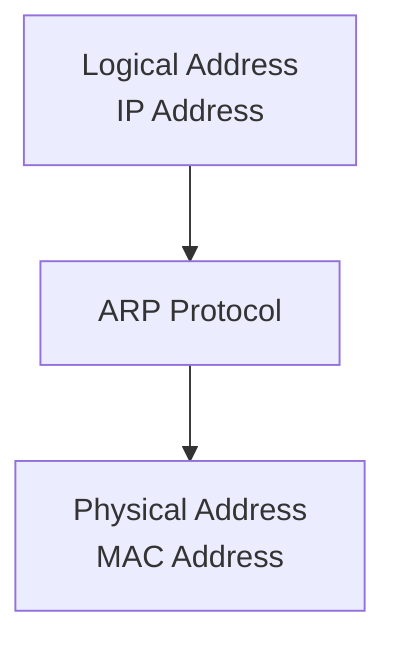
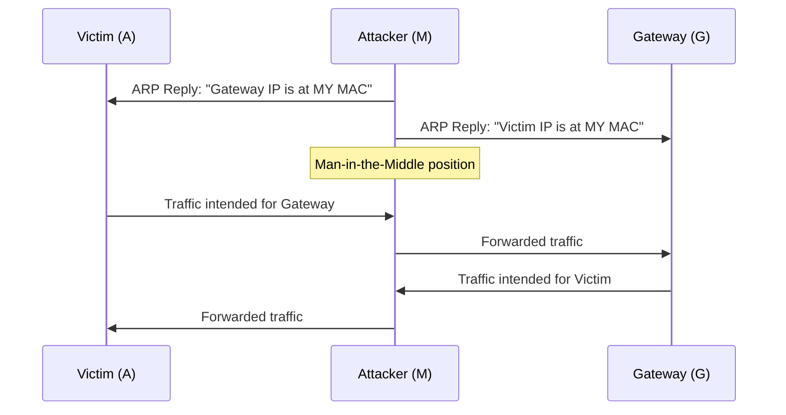

# Chapter 8 — Address Resolution Protocol (ARP)

[Repository Guide](../../README.md) | [English](Concepts_Lecture.md) | [한국어](Concepts_Lecture.ko.md)

> **Last Updated:** 2026-10-26
>
> TCP/IP Protocol Suite, Forouzan, Ch 8

> **Learning Objectives:**
> 1. Explain the Address Resolution Protocol (ARP) process
> 2. Describe ARP cache management and timeouts
> 3. Distinguish ARP from RARP and proxy ARP

---

## Table of Contents

- [1. Address Mapping](#1-address-mapping)
  - [1.1 Static Mapping](#11-static-mapping)
  - [1.2 Dynamic Mapping](#12-dynamic-mapping)
- [2. The ARP Protocol](#2-the-arp-protocol)
  - [2.1 ARP Operation](#21-arp-operation)
  - [2.2 ARP Packet Format](#22-arp-packet-format)
  - [2.3 ARP Encapsulation](#23-arp-encapsulation)
  - [2.4 ARP Cache](#24-arp-cache)
- [3. Four Cases Using ARP](#3-four-cases-using-arp)
- [4. Proxy ARP](#4-proxy-arp)
- [5. ARP Security](#5-arp-security)
  - [5.1 ARP Spoofing](#51-arp-spoofing)
  - [5.2 Countermeasures](#52-countermeasures)
- [6. Appendix](#6-appendix)
  - [6.1 ARP vs. RARP](#61-arp-vs-rarp)
  - [6.2 Gratuitous ARP](#62-gratuitous-arp)
  - [6.3 ARP Command Examples](#63-arp-command-examples)
- [Summary](#summary)
- [Self-Check Questions](#self-check-questions)

---

<br>

## 1. Address Mapping

The delivery of packets to a host or a router requires **two levels of addressing**: **logical (IP) address** and **physical (MAC) address**.

We need to be able to map a logical address to its corresponding physical address and vice versa. This can be done using either **static** or **dynamic** mapping.

### 1.1 Static Mapping

- A table that associates each logical address with a physical address is created.
- This table is stored in each machine on the network.
- A machine that knows the IP address of another machine can look up its physical address in the table.

**Limitations:**
- Physical addresses may change (changing a NIC, moving a mobile computer).
- The table must be manually updated whenever a change occurs.
- Maintenance overhead increases as the network grows.

### 1.2 Dynamic Mapping

- Whenever a machine knows one of the two addresses (logical or physical), it can use a protocol to find the other.
- **ARP (Address Resolution Protocol)** maps a logical address to a physical address.
- Dynamic mapping eliminates the need for manual table maintenance.



*Figure 1. Dynamic mapping from a logical address to a physical address through ARP*

> **Key Point:** ARP dynamically maps IP addresses to MAC addresses, eliminating the need for static address tables.

---

<br>

## 2. The ARP Protocol

### 2.1 ARP Operation

ARP associates an IP address with its physical (MAC) address. On a typical physical network (such as a LAN), each device on a link is identified by a physical or station address that is usually imprinted on the NIC.

ARP accepts a logical address from the IP protocol, maps it to the corresponding physical address, and passes it to the data link layer.

```text
            ICMP    IGMP
Network  +---+---+---------+
Layer    |       |   IP    |  Logical
         |       |         |  address
         |       +---------+    |
         |           |    +-----v-----+
         |           |    |    ARP    |
         +-----------+----+-----------+
                                |
                          Physical address
                                |
                          Data Link Layer
```

*Figure 2. Position of ARP in the network layer*

**ARP operation (Host A wants to send to Host B on the same LAN):**

1. A checks its **ARP cache** for B's physical address.
2. If the address is found, A uses the cached address.
3. If it is not found, A creates an **ARP Request** message and **broadcasts** it to all hosts on the LAN (destination MAC = `FF:FF:FF:FF:FF:FF`).
4. B receives the ARP Request, recognizes that the target IP address is its own, and creates an **ARP Reply** containing its physical address.
5. B sends the ARP Reply as a **unicast** directly back to A.
6. A stores B's physical address in its ARP cache (typically for **20 minutes**).
7. All other hosts whose addresses do not match the target IP address **ignore** the request.

> **Key Point:** An ARP request is **broadcast**; an ARP reply is **unicast**.

### 2.2 ARP Packet Format

```text
 0                   1                   2                   3
 0 1 2 3 4 5 6 7 8 9 0 1 2 3 4 5 6 7 8 9 0 1 2 3 4 5 6 7 8 9 0 1
+-+-+-+-+-+-+-+-+-+-+-+-+-+-+-+-+-+-+-+-+-+-+-+-+-+-+-+-+-+-+-+-+
|         Hardware Type         |         Protocol Type         |
+-+-+-+-+-+-+-+-+-+-+-+-+-+-+-+-+-+-+-+-+-+-+-+-+-+-+-+-+-+-+-+-+
| Hw Addr Len   | Proto Addr Len|          Operation            |
+-+-+-+-+-+-+-+-+-+-+-+-+-+-+-+-+-+-+-+-+-+-+-+-+-+-+-+-+-+-+-+-+
|                  Sender Hardware Address                       |
|                       (6 bytes for Ethernet)                  |
+-+-+-+-+-+-+-+-+-+-+-+-+-+-+-+-+-+-+-+-+-+-+-+-+-+-+-+-+-+-+-+-+
|                  Sender Protocol Address                       |
|                       (4 bytes for IPv4)                      |
+-+-+-+-+-+-+-+-+-+-+-+-+-+-+-+-+-+-+-+-+-+-+-+-+-+-+-+-+-+-+-+-+
|                  Target Hardware Address                       |
|            (6 bytes for Ethernet, unknown in request)         |
+-+-+-+-+-+-+-+-+-+-+-+-+-+-+-+-+-+-+-+-+-+-+-+-+-+-+-+-+-+-+-+-+
|                  Target Protocol Address                       |
|                       (4 bytes for IPv4)                      |
+-+-+-+-+-+-+-+-+-+-+-+-+-+-+-+-+-+-+-+-+-+-+-+-+-+-+-+-+-+-+-+-+
```

*Figure 3. ARP packet format*

| Field | Description |
|-------|-------------|
| Hardware Type | Type of network (Ethernet = 1) |
| Protocol Type | Upper-layer protocol whose address is resolved (IPv4 = 0x0800) |
| Hardware Length | Length of physical address in bytes (Ethernet = 6) |
| Protocol Length | Length of logical address in bytes (IPv4 = 4) |
| Operation | Type of packet: ARP Request (1), ARP Reply (2) |
| Sender Hardware Address | Sender's physical (MAC) address |
| Sender Protocol Address | Sender's logical (IP) address |
| Target Hardware Address | Receiver's physical address (unknown in request, filled to 0) |
| Target Protocol Address | Receiver's logical (IP) address |

*Table 1. Fields of the ARP packet*

### 2.3 ARP Encapsulation

An ARP packet is encapsulated directly in an Ethernet frame:

```text
+-----------+-------------+-------------+------+-------------------+-----+
| Preamble  | Destination | Source      | Type | ARP Request       | CRC |
| and SFD   | Address     | Address     |      | or Reply Packet   |     |
+-----------+-------------+-------------+------+-------------------+-----+
  8 bytes      6 bytes      6 bytes     2 bytes                    4 bytes
```

*Figure 4. ARP packet encapsulated in an Ethernet frame*

- The **Type field** is `0x0806`, which indicates an ARP payload.
- For an ARP Request, the destination MAC is `FF:FF:FF:FF:FF:FF` (broadcast).
- For an ARP Reply, the destination MAC is the MAC of the sender of the request (unicast).

**ARP Encapsulation steps:**
1. The sender knows the target's IP address.
2. IP asks ARP to create an ARP Request. The request carries the sender's physical and IP addresses and the target's IP address; the target's physical address is unknown and is filled with 0s.
3. The data link layer encapsulates the request in a frame. The source address is the sender's physical address, and the destination address is the broadcast address.
4. Every host and router on the LAN receives the frame and passes it to its ARP.
5. The target system sends an ARP Reply containing its physical address as a unicast.
6. The sender receives the reply and learns the target's physical address.
7. The IP datagram is then encapsulated in a frame and sent to the target as a unicast.

### 2.4 ARP Cache

The ARP cache stores recently resolved address mappings:
- Each entry has a **time-to-live**, typically 20 minutes.
- Expired entries are removed from the cache.
- The cache reduces network traffic by avoiding repeated ARP requests.

```text
$ arp -a
? (192.168.1.1) at aa:bb:cc:dd:ee:ff on en0 [ethernet]
? (192.168.1.100) at 11:22:33:44:55:66 on en0 [ethernet]
```

---

<br>

## 3. Four Cases Using ARP

ARP is used in four different scenarios depending on the relationship between sender and receiver:

```mermaid
graph TD
    subgraph "Case 1: Host to Host (Same Network)"
        A1[Host] -->|Target IP = Dest IP in datagram| B1[Host]
    end
    subgraph "Case 2: Host to Host (Different Network)"
        A2[Host] -->|Target IP = Default Router IP| R2[Router]
        R2 -->|Other network| B2[Host]
    end
    subgraph "Case 3: Router to Router (Different Network)"
        R3a[Router] -->|Target IP = Next-hop Router IP| R3b[Router]
    end
    subgraph "Case 4: Router to Host (Same Network)"
        R4[Router] -->|Target IP = Dest IP in datagram| B4[Host]
    end
```



*Figure 5. Four cases of using ARP*

| Case | Sender | Receiver | Target IP for ARP |
|------|--------|----------|-------------------|
| 1 | Host | Host (same network) | Destination IP in the datagram |
| 2 | Host | Host (different network) | IP address of the **default gateway/router** |
| 3 | Router | Router (different network) | IP address of the **next-hop router** |
| 4 | Router | Host (same network) | Destination IP in the datagram |

*Table 2. Target IP address of ARP in each case*

> **Key Point:** When the destination is on a different network, ARP resolves the MAC address of the next-hop router, not the final destination host.

---

<br>

## 4. Proxy ARP

**Proxy ARP** allows a router to respond to ARP requests on behalf of hosts on another network:
- The router answers ARP requests with its own MAC address.
- The sending host believes the destination is on the local network.
- Subnets can be connected without configuring routing on the hosts.
- It can create security concerns if misused.

---

<br>

## 5. ARP Security

### 5.1 ARP Spoofing

**ARP Spoofing** (also called ARP poisoning) is an attack where a malicious host sends forged ARP replies:



*Figure 6. Man-in-the-middle attack using ARP spoofing*

**Attacks enabled by ARP spoofing:**
- **Man-in-the-Middle (MITM)**: The attacker intercepts and may modify traffic.
- **Session Hijacking**: The attacker takes over an authenticated session.
- **Denial of Service**: The attacker redirects traffic to a non-existent MAC address.
- **Traffic Sniffing**: The attacker captures sensitive data such as passwords and credentials.

> **[Information Security]** In terms of the security goals studied in Information Security, traffic sniffing violates confidentiality, the modification of traffic in a man-in-the-middle attack violates integrity, and denial of service by sending traffic to a nonexistent MAC address violates availability. All of these attacks are possible because ARP does not authenticate the sender of a reply.

### 5.2 Countermeasures

| Countermeasure | Description |
|---------------|-------------|
| Static ARP Entries | Manually configure critical mappings (not scalable) |
| Dynamic ARP Inspection (DAI) | Switch validates ARP packets against DHCP snooping database |
| ARP Watch | Software that monitors ARP traffic for anomalies |
| 802.1X | Port-based network access control |
| Encryption (TLS/SSL) | Even if traffic is intercepted, it cannot be read |
| VPN | Encrypted tunnel prevents ARP attacks from being useful |

*Table 3. Countermeasures against ARP spoofing*

---

<br>

## 6. Appendix

### 6.1 ARP vs. RARP

| Feature | ARP | RARP |
|---------|-----|------|
| Direction | IP --> MAC | MAC --> IP |
| Use case | Normal communication | Diskless workstations (obsolete) |
| Replacement | Still in use | Replaced by BOOTP/DHCP |

*Table 4. Comparison of ARP and RARP*

### 6.2 Gratuitous ARP

A **gratuitous ARP** is an ARP request where the sender sets both the sender and target IP to its own address:
- If a reply comes back, another device is using the same IP address, so it is used to detect IP address conflicts.
- It updates the ARP caches of other hosts when an address changes.
- A host sends a gratuitous ARP when it boots or changes its IP address.

### 6.3 ARP Command Examples

```bash
# View ARP cache
arp -a

# Add static ARP entry
arp -s 192.168.1.1 aa:bb:cc:dd:ee:ff

# Delete ARP entry
arp -d 192.168.1.1

# Clear entire ARP cache (Linux)
ip -s -s neigh flush all
```

---

<br>

## Summary

| Concept | Key Summary |
|---------|-----------|
| Address Mapping | Delivering a packet requires two levels of addresses: a logical (IP) address and a physical (MAC) address. |
| Static Mapping | A manually maintained address table is inflexible and has a high maintenance cost. |
| Dynamic Mapping (ARP) | ARP automatically resolves the MAC address for an IP address with a broadcast request and a unicast reply. |
| ARP Request | An ARP request is broadcast to all hosts on the LAN. |
| ARP Reply | An ARP reply is unicast back to the requester. |
| ARP Cache | The ARP cache stores mappings for typically 20 minutes to reduce traffic. |
| Four ARP Cases | The target IP address of ARP depends on whether the destination is on the same network or a different one. |
| ARP Spoofing | Forged ARP replies enable man-in-the-middle attacks. |

---

<br>

## Self-Check Questions

1. **Target IP address of ARP:** Host A (192.168.1.10/24) sends an IP datagram to host B (10.0.0.5) on another network through the default router 192.168.1.1. What is the target IP address of the ARP request that A sends? What are the destination MAC address of the frame carrying the datagram and the destination IP address of the datagram?

   <details>
   <summary>Answer</summary>

   The destination is on another network, so this is case 2 in Section 3, and the target IP address of the ARP request is the default router's address, 192.168.1.1. The destination MAC address of the frame is the MAC address of the router interface learned through ARP, and the destination IP address of the datagram stays 10.0.0.5. ARP resolves only the MAC address of the next hop and does not change the destination address in the IP header.

   </details>

2. **Size of the ARP packet and frame:** Find the size of an ARP packet for Ethernet and IPv4. Then find the size of the Ethernet frame carrying it, excluding the preamble and SFD. An Ethernet frame must be at least 64 bytes from the destination address through the CRC.

   <details>
   <summary>Answer</summary>

   The ARP packet consists of a 2-byte Hardware Type, a 2-byte Protocol Type, two 1-byte length fields, a 2-byte Operation, 6-byte sender and target physical addresses, and 4-byte sender and target IP addresses, so it is 2 + 2 + 1 + 1 + 2 + 6 + 4 + 6 + 4 = 28 bytes. The frame header (destination 6, source 6, Type 2) is 14 bytes and the CRC is 4 bytes, so carrying the 28 bytes as they are gives 14 + 28 + 4 = 46 bytes, which is below the minimum. Therefore 18 bytes of padding bring the data field to 46 bytes, and the frame becomes 14 + 46 + 4 = 64 bytes.

   </details>

3. **Fields of the request and reply:** Host A (IP 192.168.1.10, MAC AA:AA:AA:AA:AA:AA) resolves the physical address of host B (IP 192.168.1.20, MAC BB:BB:BB:BB:BB:BB) on the same LAN. For both the ARP request and the ARP reply, give the Operation value, the Target Hardware Address, and the destination MAC address of the frame.

   <details>
   <summary>Answer</summary>

   In the ARP request, Operation is 1, the Target Hardware Address is still unknown and is therefore 00:00:00:00:00:00, and the destination MAC address of the frame is the broadcast address FF:FF:FF:FF:FF:FF. In the ARP reply, Operation is 2, and B becomes the sender, so the Sender fields carry B's addresses and the Target fields carry A's addresses. The Target Hardware Address is therefore AA:AA:AA:AA:AA:AA, and the destination MAC address of the frame is also the unicast address AA:AA:AA:AA:AA:AA. A learns BB:BB:BB:BB:BB:BB from the Sender Hardware Address of the reply.

   </details>

4. **Principle of and defense against ARP spoofing:** Why is ARP spoofing possible? Why does a static ARP entry for the gateway on the victim host stop the attack, and what is the limitation of this method?

   <details>
   <summary>Answer</summary>

   ARP has no authentication, so a host updates its cache without checking whether a received ARP reply came from the real owner of the address. If an attacker sends a forged reply that maps the gateway's IP address to the attacker's MAC address, the victim's traffic goes to the attacker. A static ARP entry does not change dynamically, so the gateway mapping stays intact even when a forged reply arrives. However, critical mappings must be configured manually on every host and corrected whenever an address changes, so the method does not scale.

   </details>
