# 8장 — 전송 제어 프로토콜 (TCP)

[레포지토리 안내](../../README.ko.md) | [English](Concepts_Lecture.md) | [한국어](Concepts_Lecture.ko.md)

> **최종 수정일:** 2026-11-18
>
> Computer Networking: A Top-Down Approach, Kurose and Ross, Ch 3; TCP/IP Protocol Suite, Forouzan, Ch 15

> **학습 목표:**
> 1. TCP가 제공하는 서비스(바이트 스트림, 전이중, 연결형, 신뢰성)와 세그먼트 헤더의 각 필드를 설명할 수 있다
> 2. 바이트 번호, 순서 번호, 확인 응답 번호를 계산하고 제어 세그먼트가 순서 번호를 소비하는 규칙을 적용할 수 있다
> 3. 3방향 핸드셰이크와 연결 해제 과정을 상태 전이도와 함께 설명할 수 있다
> 4. 수신 윈도우를 이용한 흐름 제어를 추적하고 어리석은 윈도우 증후군의 해결책을 설명할 수 있다
> 5. ACK 생성 규칙과 재전송 규칙을 적용하여 오류 제어 시나리오를 추적할 수 있다
> 6. RTT 추정값, RTT 편차, 재전송 타임아웃을 계산하고 Karn 알고리즘과 지수 백오프를 적용할 수 있다

---

## 목차

- [1. TCP 연결](#1-tcp-연결)
  - [1.1 연결형, 전이중, 점대점 서비스](#11-연결형-전이중-점대점-서비스)
  - [1.2 송신 버퍼, 수신 버퍼와 최대 세그먼트 크기](#12-송신-버퍼-수신-버퍼와-최대-세그먼트-크기)
- [2. TCP 서비스](#2-tcp-서비스)
  - [2.1 TCP의 위치와 프로세스 간 통신](#21-tcp의-위치와-프로세스-간-통신)
  - [2.2 스트림 전달 서비스](#22-스트림-전달-서비스)
  - [2.3 송신 버퍼와 수신 버퍼, 세그먼트](#23-송신-버퍼와-수신-버퍼-세그먼트)
  - [2.4 전이중 통신, 연결형 서비스, 신뢰적 서비스](#24-전이중-통신-연결형-서비스-신뢰적-서비스)
  - [2.5 UDP 통신과 TCP 통신](#25-udp-통신과-tcp-통신)
- [3. 번호 체계](#3-번호-체계)
  - [3.1 바이트 번호](#31-바이트-번호)
  - [3.2 순서 번호](#32-순서-번호)
  - [3.3 확인 응답 번호](#33-확인-응답-번호)
  - [3.4 Telnet으로 본 순서 번호와 확인 응답 번호](#34-telnet으로-본-순서-번호와-확인-응답-번호)
- [4. 세그먼트 형식](#4-세그먼트-형식)
  - [4.1 헤더의 구조와 필드](#41-헤더의-구조와-필드)
  - [4.2 제어 플래그](#42-제어-플래그)
  - [4.3 체크섬과 의사 헤더](#43-체크섬과-의사-헤더)
  - [4.4 캡슐화](#44-캡슐화)
- [5. 연결 관리](#5-연결-관리)
  - [5.1 3방향 핸드셰이크](#51-3방향-핸드셰이크)
  - [5.2 동시 열기](#52-동시-열기)
  - [5.3 SYN 플러딩 공격과 SYN 쿠키](#53-syn-플러딩-공격과-syn-쿠키)
  - [5.4 데이터 전송](#54-데이터-전송)
  - [5.5 밀어 넣기와 긴급 데이터](#55-밀어-넣기와-긴급-데이터)
  - [5.6 연결 해제](#56-연결-해제)
  - [5.7 반닫기](#57-반닫기)
  - [5.8 연결 재설정](#58-연결-재설정)
- [6. 상태 전이도](#6-상태-전이도)
  - [6.1 TCP의 상태](#61-tcp의-상태)
  - [6.2 전체 상태 전이도](#62-전체-상태-전이도)
  - [6.3 클라이언트와 서버의 전형적인 상태 순서](#63-클라이언트와-서버의-전형적인-상태-순서)
  - [6.4 시나리오: 연결 설정과 반닫기 종료](#64-시나리오-연결-설정과-반닫기-종료)
  - [6.5 TIME-WAIT 상태](#65-time-wait-상태)
  - [6.6 그 밖의 시나리오](#66-그-밖의-시나리오)
- [7. TCP의 윈도우](#7-tcp의-윈도우)
  - [7.1 네 개의 윈도우](#71-네-개의-윈도우)
  - [7.2 송신 윈도우](#72-송신-윈도우)
  - [7.3 수신 윈도우](#73-수신-윈도우)
- [8. 흐름 제어](#8-흐름-제어)
  - [8.1 데이터의 흐름과 흐름 제어 피드백](#81-데이터의-흐름과-흐름-제어-피드백)
  - [8.2 수신 윈도우의 계산](#82-수신-윈도우의-계산)
  - [8.3 윈도우 열기, 닫기, 줄이기](#83-윈도우-열기-닫기-줄이기)
  - [8.4 흐름 제어의 예](#84-흐름-제어의-예)
  - [8.5 송신 윈도우 줄이기의 금지](#85-송신-윈도우-줄이기의-금지)
  - [8.6 윈도우 닫기와 탐색 세그먼트](#86-윈도우-닫기와-탐색-세그먼트)
  - [8.7 어리석은 윈도우 증후군](#87-어리석은-윈도우-증후군)
- [9. 오류 제어](#9-오류-제어)
  - [9.1 오류의 종류와 세 가지 도구](#91-오류의-종류와-세-가지-도구)
  - [9.2 확인 응답의 종류](#92-확인-응답의-종류)
  - [9.3 ACK 생성 규칙](#93-ack-생성-규칙)
  - [9.4 재전송과 순서가 어긋난 세그먼트](#94-재전송과-순서가-어긋난-세그먼트)
  - [9.5 단순화된 TCP 송신자](#95-단순화된-tcp-송신자)
  - [9.6 타임아웃에 의한 재전송 시나리오](#96-타임아웃에-의한-재전송-시나리오)
  - [9.7 타임아웃 간격 두 배로 늘리기](#97-타임아웃-간격-두-배로-늘리기)
  - [9.8 빠른 재전송](#98-빠른-재전송)
  - [9.9 ACK 규칙으로 본 오류 제어 시나리오](#99-ack-규칙으로-본-오류-제어-시나리오)
  - [9.10 송신자와 수신자의 단순화된 FSM](#910-송신자와-수신자의-단순화된-fsm)
  - [9.11 TCP는 GBN인가 SR인가](#911-tcp는-gbn인가-sr인가)
- [10. RTT 추정과 타이머](#10-rtt-추정과-타이머)
  - [10.1 RTT 표본](#101-rtt-표본)
  - [10.2 RTT 추정값](#102-rtt-추정값)
  - [10.3 RTT 편차와 재전송 타임아웃](#103-rtt-편차와-재전송-타임아웃)
  - [10.4 계산 예](#104-계산-예)
  - [10.5 Karn 알고리즘과 지수 백오프](#105-karn-알고리즘과-지수-백오프)
  - [10.6 지속 타이머, 킵얼라이브 타이머, TIME-WAIT 타이머](#106-지속-타이머-킵얼라이브-타이머-time-wait-타이머)
- [11. 옵션](#11-옵션)
  - [11.1 옵션의 분류](#111-옵션의-분류)
  - [11.2 옵션 목록 끝과 무동작](#112-옵션-목록-끝과-무동작)
  - [11.3 최대 세그먼트 크기 옵션](#113-최대-세그먼트-크기-옵션)
  - [11.4 윈도우 확대 비율 옵션](#114-윈도우-확대-비율-옵션)
  - [11.5 타임스탬프 옵션](#115-타임스탬프-옵션)
  - [11.6 SACK 허용 옵션과 SACK 옵션](#116-sack-허용-옵션과-sack-옵션)
- [12. TCP 패키지](#12-tcp-패키지)
- [13. TCP와 UDP의 비교](#13-tcp와-udp의-비교)
- [개념 적용](#개념-적용)
- [요약](#요약)
- [점검 문제](#점검-문제)
- [참고 문헌](#참고-문헌)

---

<br>

## 1. TCP 연결

**TCP(Transmission Control Protocol)** 는 인터넷의 연결형이고 신뢰적인 전송 계층 프로토콜이다. TCP는 신뢰적 데이터 전송을 위해 7장에서 다룬 원리, 즉 오류 검출, 재전송, 누적 확인 응답, 타이머, 순서 번호와 확인 응답 번호를 담은 헤더 필드를 사용한다.

### 1.1 연결형, 전이중, 점대점 서비스

TCP를 연결형이라고 하는 이유는 한 응용 프로세스가 다른 응용 프로세스에 데이터를 보내기 전에 두 프로세스가 먼저 서로 "핸드셰이크"를 해야 하기 때문이다. 즉 이후의 데이터 전송에 쓸 매개변수를 정하기 위해 예비 세그먼트를 주고받으며, 이 과정에서 양쪽은 연결에 관련된 여러 TCP 상태 변수를 초기화한다.

TCP 연결은 회선 교환 네트워크의 종단 간 TDM이나 FDM 회선이 아니다. 공통 상태가 통신하는 두 종단 시스템의 TCP에만 있는 논리적 연결이다. TCP 프로토콜은 종단 시스템에서만 실행되고 중간 네트워크 요소(라우터와 링크 계층 스위치)에서는 실행되지 않으므로, 중간 요소는 TCP 연결 상태를 유지하지 않는다. 실제로 중간 라우터는 TCP 연결을 전혀 알지 못하며 연결이 아니라 데이터그램을 볼 뿐이다.

- **전이중(full-duplex) 서비스.** 한 호스트의 프로세스 A와 다른 호스트의 프로세스 B 사이에 TCP 연결이 있으면, A에서 B로 응용 계층 데이터가 흐르는 동시에 B에서 A로도 흐를 수 있다.
- **점대점(point-to-point) 서비스.** TCP 연결은 언제나 송신자 하나와 수신자 하나 사이에 있다. 한 번의 송신으로 데이터를 여러 수신자에게 보내는 멀티캐스트는 TCP로 할 수 없다.

연결을 시작하는 프로세스를 클라이언트 프로세스, 다른 쪽을 서버 프로세스라고 한다. 클라이언트 TCP는 특별한 TCP 세그먼트를 먼저 보내고, 서버는 두 번째 특별한 세그먼트로 응답하며, 클라이언트는 세 번째 세그먼트로 다시 응답한다. 처음 두 세그먼트는 응용 계층 데이터(페이로드)를 싣지 않고, 세 번째 세그먼트는 페이로드를 실을 수 있다. 두 호스트 사이에 세그먼트 세 개가 오가므로 이 연결 설정 절차를 3방향 핸드셰이크라고 한다(5.1절).

### 1.2 송신 버퍼, 수신 버퍼와 최대 세그먼트 크기

연결이 설정되면 클라이언트 프로세스는 소켓을 통해 데이터 스트림을 넘긴다. TCP는 이 데이터를 3방향 핸드셰이크 때 마련한 연결의 **송신 버퍼**에 넣고, 때때로 송신 버퍼에서 데이터 덩어리를 꺼내 네트워크 계층에 넘긴다. TCP 명세는 TCP가 버퍼의 데이터를 언제 보내야 하는지에 대해 매우 느슨하여 "편리할 때 세그먼트로 보내라"고만 한다. 다른 쪽 끝에서 세그먼트를 받으면 데이터는 연결의 **수신 버퍼**에 들어가고, 응용은 이 버퍼에서 데이터 스트림을 읽는다. 연결의 양쪽은 각자 송신 버퍼와 수신 버퍼를 가진다. 즉 TCP 연결은 한 호스트의 버퍼, 변수, 프로세스와의 소켓 연결, 그리고 다른 호스트의 버퍼, 변수, 소켓 연결로 이루어지며, 두 호스트 사이의 네트워크 요소에는 연결을 위한 버퍼나 변수가 할당되지 않는다.

세그먼트에 담을 수 있는 데이터의 최대량은 최대 세그먼트 크기로 제한된다.

> **용어 정의:** **최대 세그먼트 크기(maximum segment size, MSS)** 는 TCP 세그먼트 하나에 담을 수 있는 응용 계층 데이터의 최대 바이트 수이다. 헤더를 포함한 세그먼트 전체의 최대 크기가 아니라 데이터 부분의 최대 크기이다.

MSS는 보통 송신 호스트가 보낼 수 있는 가장 큰 링크 계층 프레임의 길이, 즉 **최대 전송 단위(maximum transmission unit, MTU)** 를 먼저 정하고, TCP 세그먼트를 IP 데이터그램에 캡슐화했을 때 TCP/IP 헤더 길이(보통 40바이트)를 더해도 링크 계층 프레임 하나에 들어가도록 정한다. 이더넷과 PPP의 MTU는 1,500바이트이므로 MSS의 전형적인 값은 다음과 같다.

```math
\text{MSS} = 1500 - 20 \ (\text{IP header}) - 20 \ (\text{TCP header}) = 1460 \text{ bytes}
```

출발지에서 목적지까지 모든 링크에서 보낼 수 있는 가장 큰 프레임인 경로 MTU를 찾아 그 값으로 MSS를 정하는 방법도 제안되어 있다(11장). Forouzan에 따르면 상대가 MSS를 정하지 않으면 기본값은 536바이트이다(11.3절).

> **주의:** MSS라는 이름은 "최대 세그먼트 크기"이지만 실제로는 세그먼트 안의 응용 데이터의 최대량이다. 헤더를 포함한 세그먼트의 크기와 혼동하지 않도록 유의해야 한다.

---

<br>

## 2. TCP 서비스

### 2.1 TCP의 위치와 프로세스 간 통신

TCP는 UDP처럼 응용 계층과 네트워크 계층 사이에 위치하며 응용 프로그램과 네트워크 동작 사이의 중개자 역할을 한다(6장의 그림 2). TCP도 UDP와 마찬가지로 포트 번호를 이용해 프로세스 간 통신을 제공한다. TCP가 쓰는 잘 알려진 포트는 6장의 표 3에 정리되어 있다(FTP 20과 21, TELNET 23, SMTP 25, DNS 53, HTTP 80 등).

### 2.2 스트림 전달 서비스

TCP는 UDP와 달리 스트림 지향 프로토콜이다. UDP에서 프로세스는 경계가 정해진 메시지를 UDP에 넘기고, UDP는 각 메시지에 자신의 헤더를 붙여 IP에 넘긴다. 프로세스의 메시지 하나가 사용자 데이터그램 하나가 되고 결국 IP 데이터그램 하나가 되며, IP도 UDP도 데이터그램 사이의 관계를 알지 못한다.

> **용어 정의:** **바이트 스트림 서비스(byte-stream service)** 는 송신 프로세스가 데이터를 바이트의 흐름으로 넘기고 수신 프로세스도 데이터를 바이트의 흐름으로 받으며, 그 사이에 메시지 경계가 보존되지 않는 전달 서비스이다.

TCP는 두 프로세스가 인터넷을 가로질러 바이트를 나르는 가상의 "관"으로 연결된 것처럼 보이는 환경을 만든다. 송신 프로세스는 바이트 스트림을 만들어(써 넣어) 관에 넣고, 수신 프로세스는 바이트 스트림을 소비한다(읽어 낸다).

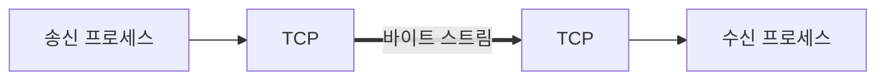

*그림 1. 두 TCP 사이의 가상의 관을 흐르는 바이트 스트림*

### 2.3 송신 버퍼와 수신 버퍼, 세그먼트

송신 프로세스와 수신 프로세스가 같은 속도로 데이터를 쓰거나 읽는다는 보장이 없으므로 TCP는 저장을 위한 버퍼가 필요하다. 방향마다 송신 버퍼와 수신 버퍼가 하나씩 있으며, 이 버퍼들은 TCP의 흐름 제어와 오류 제어에도 필요하다(8절, 9절). 버퍼를 구현하는 한 가지 방법은 1바이트 칸으로 된 원형 배열이다.

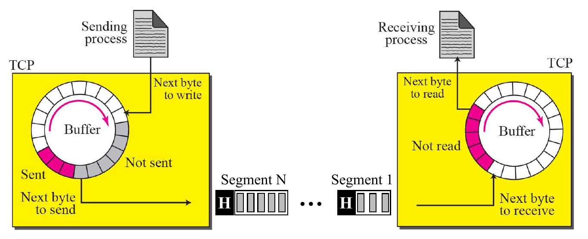

*그림 2. TCP의 원형 송신 버퍼와 수신 버퍼, 그리고 버퍼의 바이트로 만든 세그먼트*

그림 2는 한 방향의 데이터 흐름을 보여 준다.

- **송신 버퍼**에는 세 종류의 칸이 있다. 흰 칸은 송신 프로세스(생산자)가 채울 수 있는 빈 칸이다. 색칠된 칸(Sent)은 보냈지만 아직 확인되지 않은 바이트로, TCP 송신자는 확인 응답을 받을 때까지 이 바이트를 버퍼에 보관한다. 회색 칸(Not sent)은 TCP가 보낼 바이트이다. 다만 수신 프로세스가 느리거나 네트워크가 혼잡하면 TCP는 이 가운데 일부만 보낼 수 있다(8절, 9장). 색칠된 칸의 바이트가 확인되면 그 칸은 재활용되어 송신 프로세스가 다시 쓸 수 있으므로 버퍼를 원형으로 그린다.
- **수신 버퍼**의 동작은 더 단순하다. 흰 칸은 네트워크에서 받은 바이트로 채워질 빈 칸이고, 색칠된 칸(Not read)은 받았지만 수신 프로세스가 아직 읽지 않은 바이트이다. 수신 프로세스가 바이트를 읽으면 그 칸은 재활용되어 빈 칸이 된다.

버퍼링으로 생산 속도와 소비 속도의 차이를 처리하더라도 데이터를 보내기 전에 한 단계가 더 필요하다. TCP에 서비스를 제공하는 IP 계층은 데이터를 바이트 스트림이 아니라 패킷 단위로 보내야 한다. 전송 계층에서 TCP는 여러 바이트를 묶어 **세그먼트**라는 패킷을 만든다. TCP는 세그먼트마다 제어용 헤더를 붙여 IP 계층에 넘기고, 세그먼트는 IP 데이터그램에 캡슐화되어 전송된다. 이 모든 과정은 수신 프로세스에 보이지 않는다. 세그먼트가 순서가 바뀌어 도착하거나 손실되거나 손상되어 다시 보내지더라도 TCP 수신자가 처리하므로 수신 응용 프로세스는 이를 알지 못한다. 세그먼트의 크기가 모두 같을 필요는 없으며, 실제로 세그먼트는 수백에서 수천 바이트를 나른다.

### 2.4 전이중 통신, 연결형 서비스, 신뢰적 서비스

- **전이중 통신.** 데이터가 양방향으로 동시에 흐를 수 있다. 각 TCP 종단은 자신의 송신 버퍼와 수신 버퍼를 가지며 세그먼트는 양방향으로 움직인다. 한 방향의 데이터 세그먼트에 반대 방향 데이터의 확인 응답을 함께 싣는 피기백(7장)을 쓴다.
- **다중화와 역다중화.** UDP처럼 TCP도 송신 측에서 다중화를, 수신 측에서 역다중화를 한다. 다만 TCP는 연결형이므로 프로세스 쌍마다 연결을 설정해야 하며, 연결 소켓은 4-튜플로 식별된다(6장).
- **연결형 서비스.** 사이트 A의 프로세스가 사이트 B의 프로세스와 데이터를 주고받으려면 (1) 두 TCP가 가상 연결을 설정하고, (2) 양방향으로 데이터를 교환하고, (3) 연결을 해제한다. 이 연결은 물리적 연결이 아니라 가상 연결이다. TCP 세그먼트는 IP 데이터그램에 캡슐화되어 순서가 바뀌거나 손실되거나 손상된 뒤 다시 보내질 수 있고, 각 데이터그램은 서로 다른 경로로 목적지에 갈 수 있다. TCP는 바이트를 순서대로 상대에게 전달할 책임을 지는 스트림 지향 환경을 만든다.
- **신뢰적 서비스.** TCP는 확인 응답 메커니즘으로 데이터가 무사히 도착했는지 확인하는 신뢰적 전송 프로토콜이다(9절).

비연결형 프로토콜인 IP의 서비스를 쓰는 TCP가 어떻게 연결형일 수 있는가. 핵심은 TCP 연결이 물리적이 아니라 가상이라는 데 있다. TCP는 더 높은 수준에서 동작한다. TCP는 IP의 서비스로 개별 세그먼트를 수신자에게 전달하지만 연결 자체는 직접 관리한다. 세그먼트가 손실되거나 손상되면 TCP가 다시 보내며 IP는 이 재전송을 알지 못한다. 세그먼트가 순서가 바뀌어 도착하면 TCP가 빠진 세그먼트가 올 때까지 보관하며 IP는 이 재정렬을 알지 못한다.

### 2.5 UDP 통신과 TCP 통신

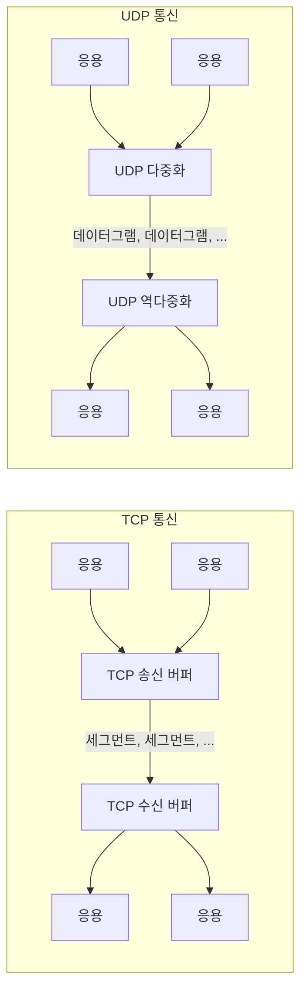

*그림 3. 버퍼를 거쳐 세그먼트로 전달하는 TCP 통신과 다중화기를 거쳐 데이터그램으로 전달하는 UDP 통신*

그림 3에서 TCP는 응용이 넘긴 데이터를 송신 버퍼에 모았다가 세그먼트로 잘라 보내고, 수신 측은 세그먼트를 수신 버퍼에 모았다가 응용에 바이트 스트림으로 넘긴다. UDP는 응용이 넘긴 메시지 하나를 데이터그램 하나로 만들어 다중화기를 거쳐 보내고, 수신 측 역다중화기가 데이터그램을 해당 응용에 그대로 넘긴다.

---

<br>

## 3. 번호 체계

TCP 소프트웨어는 보내거나 받는 세그먼트를 추적하지만 세그먼트 헤더에는 세그먼트 번호 필드가 없다. 대신 순서 번호와 확인 응답 번호라는 두 필드가 있으며, 이 두 번호는 데이터 링크 계층의 프레임 번호와 달리 세그먼트가 아니라 **바이트**를 가리킨다. 이 번호들은 흐름 제어와 오류 제어에 쓰인다.

### 3.1 바이트 번호

TCP는 한 연결에서 전송되는 모든 데이터 바이트(옥텟)에 번호를 매기며, 번호는 방향마다 독립적이다. TCP는 프로세스에서 데이터 바이트를 받으면 송신 버퍼에 저장하고 번호를 매긴다. 번호는 0부터 시작할 필요가 없다.

> **용어 정의:** **초기 순서 번호(initial sequence number, ISN)** 는 연결을 설정할 때 각 쪽이 무작위로 골라, 자신이 보낼 바이트 스트림의 번호를 시작하는 데 쓰는 32비트 수이다. 값의 범위는 0부터 $`2^{32} - 1`$까지이다.

예를 들어 번호가 1,057에서 시작하고 보낼 데이터가 6,000바이트이면 바이트 번호는 1,057부터 7,056까지이다. 연결의 양쪽이 ISN을 무작위로 고르는 이유는, 이미 끝난 이전 연결의 세그먼트가 네트워크에 남아 있다가 같은 두 호스트(같은 포트 번호를 쓰는) 사이의 새 연결에서 유효한 세그먼트로 오인될 가능성을 줄이기 위해서이다. ISN을 제대로 무작위화하는 것은 순서 번호를 예측하는 보안 공격을 막는 데도 중요하다.

> **핵심:** 각 연결에서 전송되는 데이터 바이트에는 TCP가 번호를 매기며, 번호는 무작위로 만든 수에서 시작한다.

### 3.2 순서 번호

바이트에 번호를 매긴 뒤 TCP는 보내는 각 세그먼트에 순서 번호를 붙인다.

> **핵심:** 세그먼트의 순서 번호 필드의 값은 그 세그먼트에 담긴 첫 번째 데이터 바이트에 매겨진 번호이다.

예를 들어 TCP 연결로 5,000바이트 파일을 보내고 첫 바이트의 번호가 10,001이며, 데이터를 1,000바이트씩 다섯 세그먼트로 보낸다고 하자. 각 세그먼트의 순서 번호는 다음과 같다.

| 세그먼트 | 순서 번호 | 바이트 범위 |
|:-----|:-----|:-----|
| 세그먼트 1 | 10,001 | 10,001\~11,000 |
| 세그먼트 2 | 11,001 | 11,001\~12,000 |
| 세그먼트 3 | 12,001 | 12,001\~13,000 |
| 세그먼트 4 | 13,001 | 13,001\~14,000 |
| 세그먼트 5 | 14,001 | 14,001\~15,000 |

*표 1. 5,000바이트 파일을 1,000바이트씩 보낼 때 각 세그먼트의 순서 번호*

Kurose와 Ross의 예에서는 500,000바이트 파일을 MSS 1,000바이트로 보내고 첫 바이트의 번호를 0으로 두면, TCP는 세그먼트 500개를 만들고 각 세그먼트의 순서 번호는 0, 1,000, 2,000, ...이 된다.

세그먼트가 데이터와 제어 정보를 함께 나르면(피기백) 순서 번호를 쓴다. 사용자 데이터를 싣지 않는 세그먼트는 논리적으로 순서 번호를 정의하지 않는다. 필드는 있지만 그 값은 유효하지 않다. 그러나 제어 정보만 나르는 일부 세그먼트, 즉 연결 설정, 해제, 중단에 쓰는 세그먼트는 수신자의 확인 응답을 받기 위해 순서 번호가 필요하다. 이 세그먼트들은 실제 데이터는 없지만 1바이트를 나르는 것처럼 순서 번호 하나를 소비한다(5절).

### 3.3 확인 응답 번호

TCP는 전이중이므로 연결이 설정되면 양쪽이 동시에 데이터를 보내고 받을 수 있다. 각 쪽은 보통 서로 다른 번호에서 바이트 번호를 시작한다. 각 방향의 순서 번호는 세그먼트가 나르는 첫 바이트의 번호이고, 각 쪽은 자신이 받은 바이트를 확인하기 위해 확인 응답 번호를 쓴다.

> **핵심:** 세그먼트의 확인 응답 필드의 값은 그 세그먼트를 보내는 쪽이 다음에 받기를 기대하는 바이트의 번호이다. 확인 응답 번호는 누적적이다.

누적적이라는 말은, 받는 쪽이 무사히 받은 마지막 바이트의 번호에 1을 더해 확인 응답 번호로 알린다는 뜻이다. 예를 들어 어느 쪽이 확인 응답 번호로 5,643을 쓰면 처음부터 5,642번까지의 바이트를 모두 받았다는 뜻이다. 첫 바이트 번호가 0에서 시작할 필요가 없으므로, 5,642바이트를 받았다는 뜻은 아니다.

Kurose와 Ross의 예로 보면, 호스트 A가 B로부터 0\~535번 바이트를 모두 받았다면 A는 536번 바이트와 그 이후를 기다리므로 B에게 보내는 세그먼트의 확인 응답 번호 필드에 536을 넣는다. A가 B로부터 0\~535번 바이트를 담은 세그먼트와 900\~1,000번 바이트를 담은 세그먼트를 받고 536\~899번은 아직 받지 못했다면, A는 여전히 536번을 기다리므로 다음 세그먼트의 확인 응답 번호는 536이다. TCP는 스트림에서 처음으로 빠진 바이트까지만 확인하므로 TCP를 **누적 확인 응답**을 제공한다고 한다.

이 예에서 세 번째 세그먼트(900\~1,000번)는 두 번째 세그먼트(536\~899번)보다 먼저, 즉 순서가 어긋나 도착했다. 순서가 어긋난 세그먼트를 받았을 때 어떻게 할지는 TCP RFC가 정하지 않고 구현자에게 맡긴다. 수신자가 (1) 순서가 어긋난 세그먼트를 즉시 버리거나(수신자 설계가 단순해짐), (2) 순서가 어긋난 바이트를 보관하고 빈틈이 채워지기를 기다리는 두 가지 선택이 있다. 네트워크 대역폭 면에서 뒤의 방식이 더 효율적이며 실제로 쓰이는 방식이다.

### 3.4 Telnet으로 본 순서 번호와 확인 응답 번호

Telnet은 원격 로그인에 쓰는 응용 계층 프로토콜로(4장), TCP 위에서 동작하는 대화형 응용이다. 사용자가 클라이언트에서 입력한 각 문자는 원격 호스트로 보내지고, 원격 호스트는 각 문자의 사본을 돌려보내 사용자 화면에 표시한다. 이 되울림(echo back)은 사용자가 보는 문자가 원격 사이트에서 이미 받아 처리한 것임을 보장한다.

호스트 A가 호스트 B와 Telnet 세션을 시작하고, 클라이언트와 서버의 시작 순서 번호가 각각 42와 79라고 하자. 연결이 설정된 뒤 데이터를 보내기 전에 클라이언트는 79번 바이트를, 서버는 42번 바이트를 기다린다. 사용자가 문자 'C' 하나를 입력하면 세그먼트 세 개가 오간다.

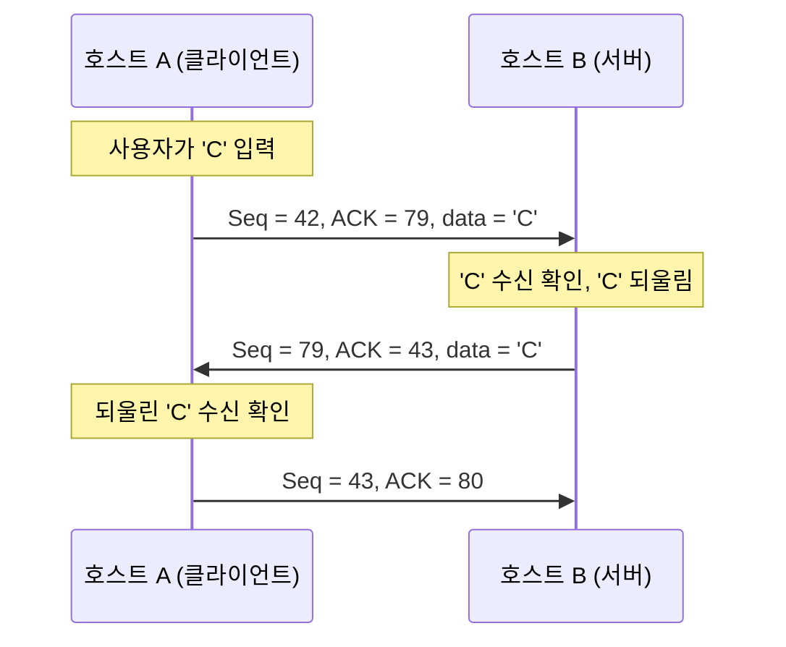

*그림 4. Telnet에서 문자 하나를 보내고 되울릴 때의 순서 번호와 확인 응답 번호*

1. 첫 세그먼트는 클라이언트에서 서버로 가며 데이터 필드에 문자 'C'의 1바이트 ASCII 표현을 담는다. 순서 번호는 42이고, 클라이언트는 아직 서버에서 데이터를 받지 않았으므로 확인 응답 번호는 79이다.
2. 두 번째 세그먼트는 서버에서 클라이언트로 가며 두 가지 목적을 가진다. 첫째, 확인 응답 필드에 43을 넣어 42번 바이트까지 받았고 43번부터 기다린다고 알린다. 둘째, 문자 'C'를 되울린다. 서버가 보내는 첫 데이터이므로 순서 번호는 서버의 시작 순서 번호인 79이다. 클라이언트에서 서버로 가는 데이터의 확인 응답이 서버에서 클라이언트로 가는 데이터 세그먼트에 실려 있으므로, 이 확인 응답은 피기백되었다고 한다.
3. 세 번째 세그먼트는 클라이언트에서 서버로 가며 서버에서 받은 데이터를 확인하는 것이 유일한 목적이다. 데이터 필드는 비어 있고, 79번 바이트까지 받았으므로 확인 응답 번호는 80이다. 데이터가 없는데도 순서 번호(43)가 있는 이유는 TCP 헤더에 순서 번호 필드가 있으므로 무엇인가 값을 넣어야 하기 때문이다.

---

<br>

## 4. 세그먼트 형식

### 4.1 헤더의 구조와 필드

TCP를 쓰는 두 장치 사이의 데이터 전송 단위는 세그먼트이다. 세그먼트는 20\~60바이트의 헤더와 응용 프로그램의 데이터로 이루어진다. 옵션이 없으면 헤더는 20바이트이고, 옵션이 있으면 최대 60바이트이다. MSS가 데이터 필드의 최대 크기를 제한한다. 큰 파일을 보낼 때 TCP는 보통 파일을 MSS 크기의 덩어리로 나누지만(마지막 덩어리는 대개 MSS보다 작음), Telnet 같은 대화형 응용은 MSS보다 작은 덩어리를 보내는 경우가 많다. 예를 들어 Telnet 세그먼트의 데이터 필드는 1바이트인 경우가 많고, TCP 헤더가 보통 20바이트(UDP 헤더보다 12바이트 많음)이므로 Telnet 세그먼트는 21바이트일 수 있다.

```text
 0                   1                   2                   3
 0 1 2 3 4 5 6 7 8 9 0 1 2 3 4 5 6 7 8 9 0 1 2 3 4 5 6 7 8 9 0 1
+-+-+-+-+-+-+-+-+-+-+-+-+-+-+-+-+-+-+-+-+-+-+-+-+-+-+-+-+-+-+-+-+
|      Source port address      |    Destination port address   |
+-+-+-+-+-+-+-+-+-+-+-+-+-+-+-+-+-+-+-+-+-+-+-+-+-+-+-+-+-+-+-+-+
|                        Sequence number                        |
+-+-+-+-+-+-+-+-+-+-+-+-+-+-+-+-+-+-+-+-+-+-+-+-+-+-+-+-+-+-+-+-+
|                     Acknowledgment number                     |
+-+-+-+-+-+-+-+-+-+-+-+-+-+-+-+-+-+-+-+-+-+-+-+-+-+-+-+-+-+-+-+-+
|  HLEN | Unused|C|E|U|A|P|R|S|F|          Window size          |
|       |       |W|C|R|C|S|S|Y|I|                               |
|       |       |R|E|G|K|H|T|N|N|                               |
+-+-+-+-+-+-+-+-+-+-+-+-+-+-+-+-+-+-+-+-+-+-+-+-+-+-+-+-+-+-+-+-+
|           Checksum            |         Urgent pointer        |
+-+-+-+-+-+-+-+-+-+-+-+-+-+-+-+-+-+-+-+-+-+-+-+-+-+-+-+-+-+-+-+-+
|                 Options and padding (0-40 bytes)              |
+-+-+-+-+-+-+-+-+-+-+-+-+-+-+-+-+-+-+-+-+-+-+-+-+-+-+-+-+-+-+-+-+
|                             Data                              |
+-+-+-+-+-+-+-+-+-+-+-+-+-+-+-+-+-+-+-+-+-+-+-+-+-+-+-+-+-+-+-+-+
```

*그림 5. TCP 세그먼트의 헤더 형식*

| 필드 | 크기 | 설명 |
|:-----|:-----|:-----|
| 출발지 포트 주소 (Source port address) | 16비트 | 세그먼트를 보내는 호스트의 응용 프로그램 포트 번호. UDP 헤더의 출발지 포트와 같은 역할 |
| 목적지 포트 주소 (Destination port address) | 16비트 | 세그먼트를 받는 호스트의 응용 프로그램 포트 번호 |
| 순서 번호 (Sequence number) | 32비트 | 이 세그먼트에 담긴 데이터의 첫 바이트에 매겨진 번호. 연결 설정 때 각 쪽이 난수 생성기로 ISN을 만듦 |
| 확인 응답 번호 (Acknowledgment number) | 32비트 | 세그먼트를 받는 쪽(이 세그먼트를 보내는 쪽)이 상대에게서 다음에 받기를 기대하는 바이트 번호. 상대의 바이트 x까지 받았으면 x + 1 |
| 헤더 길이 (HLEN) | 4비트 | 4바이트 워드 단위의 TCP 헤더 길이. 값은 5(20바이트)\~15(60바이트) |
| 예약 (Reserved) | 6비트 | 나중을 위해 예약된 필드. 현재는 그 가운데 2비트가 CWR, ECE 플래그로 쓰임 |
| 제어 (Control) | 6비트 (CWR, ECE 포함 8비트) | 흐름 제어, 연결 설정과 해제, 연결 중단, 데이터 전송 방식을 위한 플래그 (4.2절) |
| 윈도우 크기 (Window size) | 16비트 | 수신자가 받을 수 있는 바이트 수, 즉 수신 윈도우 rwnd. 최대 65,535바이트이며 윈도우 확대 옵션으로 늘릴 수 있음 (11.4절) |
| 체크섬 (Checksum) | 16비트 | UDP와 같은 방식으로 계산하지만 사용이 필수이며, 의사 헤더의 프로토콜 값은 6 (4.3절) |
| 긴급 포인터 (Urgent pointer) | 16비트 | URG 플래그가 켜졌을 때만 유효. 순서 번호에 더하면 데이터 부분의 마지막 긴급 바이트 번호가 되는 값 (5.5절) |
| 옵션 (Options) | 0\~40바이트 | MSS, 윈도우 확대 비율, 타임스탬프, SACK 등 (11절) |

*표 2. TCP 헤더의 필드*

헤더 길이 필드 덕분에 옵션이 있어 길이가 바뀌는 헤더도 해석할 수 있다. 예를 들어 HLEN 필드가 `0101`이면 헤더는 5 × 4 = 20바이트로 옵션이 없고, `1000`이면 헤더는 8 × 4 = 32바이트이므로 옵션과 채움이 12바이트이다. 보통은 옵션 필드가 비어 있어 TCP 헤더의 길이는 20바이트이다.

### 4.2 제어 플래그

제어 필드는 한 번에 하나 이상 켤 수 있는 플래그들이다. Forouzan의 교재는 6비트(URG, ACK, PSH, RST, SYN, FIN)를 설명하며, Kurose와 Ross의 교재는 명시적 혼잡 통지에 쓰는 CWR과 ECE를 더한 8비트를 보여 준다.

| 플래그 | 이름 | 의미 |
|:-----|:-----|:-----|
| CWR | Congestion Window Reduced | 송신자가 혼잡 윈도우를 줄였음을 알림 (9장의 ECN) |
| ECE | ECN-Echo | 수신자가 네트워크의 혼잡 표시를 송신자에게 되돌려 알림 (9장의 ECN) |
| URG | Urgent | 긴급 포인터 필드가 유효함 |
| ACK | Acknowledgment | 확인 응답 번호 필드가 유효함 |
| PSH | Push | 수신자가 데이터를 즉시 상위 계층에 넘겨야 함 |
| RST | Reset | 연결을 재설정(중단)함 |
| SYN | Synchronize | 연결 설정 때 순서 번호를 동기화함 |
| FIN | Finish | 연결을 해제함, 즉 송신자가 더 보낼 데이터가 없음 |

*표 3. TCP 헤더의 제어 플래그*

Kurose와 Ross는 실제로는 PSH, URG, 긴급 데이터 포인터가 쓰이지 않는다고 덧붙인다(5.5절).

### 4.3 체크섬과 의사 헤더

TCP 체크섬은 6장의 UDP 체크섬과 같은 절차로 계산하며, 같은 목적의 의사 헤더를 세그먼트 앞에 붙인다. TCP 의사 헤더의 프로토콜 필드 값은 6이다. UDP에서는 체크섬이 선택이지만 TCP에서는 필수이다.

```text
+-----------------------------------------------------------+
|                  32-bit source IP address                 |  Pseudoheader
+-----------------------------------------------------------+
|               32-bit destination IP address               |
+--------------+----------------+---------------------------+
|   All 0s     | 8-bit protocol |   16-bit TCP total length |
|              |      (6)       |                           |
+--------------+----------------+---------------------------+
|     Source port number        |  Destination port number  |  Header
+-------------------------------+---------------------------+
|                     Sequence number                       |
+-----------------------------------------------------------+
|                  Acknowledgment number                    |
+-------+---------+-------------+---------------------------+
| HLEN  | Reserved|   Control   |        Window size        |
+-------+---------+-------------+---------------------------+
|           Checksum            |      Urgent pointer       |
+-------------------------------+---------------------------+
|                     Data and option                       |
|   (Padding must be added to make the data a multiple of   |
|                        16 bits)                           |
+-----------------------------------------------------------+
```

*그림 6. TCP 세그먼트에 붙이는 의사 헤더*

> **핵심:** TCP에서 체크섬의 사용은 필수이다.

### 4.4 캡슐화

TCP 세그먼트는 응용 계층에서 받은 데이터를 캡슐화하고, TCP 세그먼트는 IP 데이터그램에, IP 데이터그램은 데이터 링크 계층의 프레임에 차례로 캡슐화된다.

```text
                          +------------+-------------------------+
                          | TCP header |  Application-layer data |
                          +------------+-------------------------+
                          |<-------------- TCP payload --------->|
             +-----------+---------------------------------------+
             | IP header |              IP payload               |
             +-----------+---------------------------------------+
+------------+---------------------------------------------------+
|Frame header|                 Data-link layer payload           |
+------------+---------------------------------------------------+
```

*그림 7. TCP 세그먼트의 캡슐화*

---

<br>

## 5. 연결 관리

TCP는 연결형 프로토콜이므로 출발지와 목적지 사이에 가상 경로를 설정하고, 한 메시지에 속한 세그먼트를 모두 이 가상 경로로 보낸다. 메시지 전체에 가상 경로 하나를 쓰면 확인 응답과 손상되거나 손실된 세그먼트의 재전송이 쉬워진다. TCP의 연결형 전송은 연결 설정, 데이터 전송, 연결 해제의 세 단계로 이루어진다. TCP 연결 설정은 웹 검색 같은 작업에서 사람이 느끼는 지연을 크게 늘릴 수 있고, SYN 플러딩 같은 흔한 네트워크 공격 상당수가 TCP 연결 관리의 취약점을 노리므로 중요하다.

### 5.1 3방향 핸드셰이크

TCP는 데이터를 전이중으로 전송하므로, 두 TCP가 연결되면 동시에 세그먼트를 주고받을 수 있다. 이는 각 쪽이 데이터를 보내기 전에 통신을 초기화하고 상대의 승인을 받아야 함을 뜻한다.

> **용어 정의:** **3방향 핸드셰이크(three-way handshake)** 는 TCP 연결을 설정할 때 클라이언트의 SYN, 서버의 SYN+ACK, 클라이언트의 ACK의 세 세그먼트를 주고받아 양쪽의 초기 순서 번호를 동기화하고 서로의 연결 승인을 확인하는 절차이다.

과정은 서버에서 시작한다. 서버 프로그램은 자신의 TCP에 연결을 받아들일 준비가 되었다고 알리며, 이 요청을 **수동 열기(passive open)** 라고 한다. 서버 TCP는 전 세계 어느 장치의 연결도 받아들일 준비가 되었지만 스스로 연결을 만들지는 못한다. 클라이언트 프로그램은 **능동 열기(active open)** 를 요청하여, 열려 있는 특정 서버에 연결하라고 자신의 TCP에 알린다. 이제 TCP가 3방향 핸드셰이크를 시작한다.

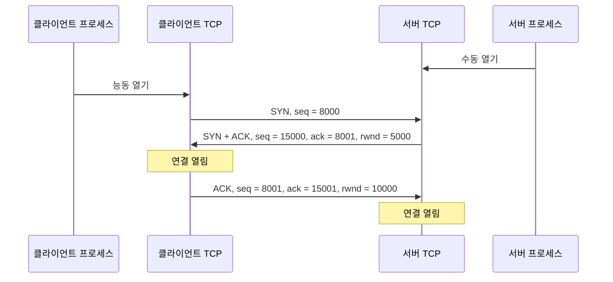

*그림 8. 3방향 핸드셰이크를 이용한 연결 설정*

그림 8의 시간선은 각 세그먼트의 헤더 필드 가운데 이해에 필요한 순서 번호, 확인 응답 번호, 켜진 제어 플래그, 관련이 있는 경우 윈도우 크기(rwnd, 수신 윈도우)만 보여 준다.

1. **SYN.** 클라이언트는 SYN 플래그만 켠 첫 세그먼트를 보낸다. 이 세그먼트는 순서 번호의 동기화를 위한 것이다. 클라이언트는 난수를 첫 순서 번호(ISN, 이 예에서는 8000)로 골라 서버에 보낸다. 이 세그먼트에는 확인 응답 번호가 없고 윈도우 크기도 정의하지 않는다. 윈도우 크기는 세그먼트가 확인 응답을 담을 때만 의미가 있기 때문이다. 일부 옵션(11절)을 담을 수 있다. SYN 세그먼트는 데이터를 싣지 않는 제어 세그먼트이지만 순서 번호 하나를 소비한다. 데이터 전송이 시작되면 ISN에 1을 더한 번호부터 쓰므로, SYN 세그먼트는 실제 데이터는 없지만 가상의 바이트 하나를 담은 것으로 볼 수 있다. Kurose와 Ross는 이 세그먼트의 순서 번호를 `client_isn`이라고 부른다.
2. **SYN + ACK.** 서버는 SYN과 ACK의 두 플래그를 켠 두 번째 세그먼트를 보낸다. 이 세그먼트는 두 가지 목적을 가진다. 첫째, 반대 방향 통신을 위한 SYN 세그먼트로서 서버에서 클라이언트로 가는 바이트에 매길 순서 번호를 초기화한다(이 예에서는 15000, Kurose와 Ross의 `server_isn`). 둘째, ACK 플래그를 켜고 다음에 클라이언트에게서 받기를 기대하는 순서 번호(8001, 즉 `client_isn + 1`)를 표시하여 클라이언트의 SYN 세그먼트를 받았음을 확인한다. 확인 응답을 담으므로 클라이언트가 쓸 수신 윈도우 크기(rwnd = 5000)도 정의한다. Kurose와 Ross에 따르면 서버는 SYN을 받은 시점에 이 연결을 위한 TCP 버퍼와 변수를 할당한다.
3. **ACK.** 클라이언트는 세 번째 세그먼트로 ACK 플래그와 확인 응답 번호 필드(15001, 즉 `server_isn + 1`)를 써서 두 번째 세그먼트를 받았음을 확인한다. 이 세그먼트의 순서 번호(8001)는 SYN 세그먼트의 번호 다음 값이다. 클라이언트도 이때 연결의 버퍼와 변수를 할당하고 서버가 쓸 윈도우 크기(rwnd = 10000)를 정한다. 일부 구현에서는 이 세 번째 세그먼트가 클라이언트의 첫 데이터 덩어리를 실을 수 있으며, 이 경우 세그먼트의 순서 번호는 데이터의 첫 바이트 번호가 된다. 대개 세 번째 세그먼트는 데이터를 싣지 않으며 순서 번호를 소비하지 않는다. 이 세그먼트부터는 SYN 비트가 0이다.

> **핵심:** SYN 세그먼트는 데이터를 실을 수 없지만 순서 번호 하나를 소비한다. SYN + ACK 세그먼트도 데이터를 실을 수 없지만 순서 번호 하나를 소비한다. ACK 세그먼트는 데이터를 싣지 않으면 순서 번호를 소비하지 않는다.

연결 설정에 세그먼트가 세 개 필요한 이유는, 양방향 통신의 양쪽이 각자 자신의 ISN을 알리고(SYN) 상대가 그 ISN을 받았음을 확인받아야(ACK) 하기 때문이다. 서버의 ACK와 서버의 SYN을 한 세그먼트로 합치므로 6장 그림 9의 네 패킷이 세 세그먼트가 된다.

> **참고:** **데이터를 싣지 않는 세그먼트의 순서 번호.** Forouzan의 그림은 데이터를 싣지 않아 순서 번호를 소비하지 않는 세그먼트에 송신자가 이미 쓴 마지막 순서 번호를 적는다. 핸드셰이크의 세 번째 세그먼트는 SYN과 같은 seq: 8000, 데이터 전송의 마지막 ACK는 seq: 10000이며, 연결 해제와 반닫기 그림에서 클라이언트의 마지막 ACK는 seq: x, 반닫기 그림에서 서버의 ACK는 seq: y - 1이다. Kurose와 Ross는 이런 세그먼트에 송신자가 다음에 쓸 순서 번호를 적는다. 핸드셰이크의 세 번째 세그먼트(seq = client_isn + 1)와 그림 4의 Telnet 예에서 세 번째 세그먼트(seq = 43)가 그 예이다. 이 정리본은 모든 그림에서 Kurose와 Ross를 따르므로, 예를 들어 그림 8의 세 번째 세그먼트는 8001을 싣는다. 어느 방식이든 데이터가 없는 세그먼트는 순서 번호를 소비하지 않으므로 데이터 바이트의 번호는 같고, 첫 데이터 세그먼트는 두 방식 모두 8001을 싣는다.

### 5.2 동시 열기

드물게 두 프로세스가 모두 능동 열기를 할 수 있다. 이 경우 두 TCP는 서로에게 SYN을 보내고, 상대의 SYN을 받으면 SYN + ACK 세그먼트를 보내며, 둘 사이에 연결 하나가 설정된다. 양쪽의 SYN 세그먼트가 동시에 전송 중이어야 하므로 두 응용이 거의 같은 시각에 능동 열기를 해야 해서 실제로 일어날 가능성은 낮다. 이때는 클라이언트와 서버의 구분 없이, 자신의 로컬 포트 번호를 아는 두 피어 사이의 통신이 된다. 두 TCP는 SYN-SENT 상태와 SYN-RCVD 상태를 거쳐 ESTABLISHED 상태가 되며(6절), 연결 설정에 세그먼트 네 개가 오간다.

### 5.3 SYN 플러딩 공격과 SYN 쿠키

TCP의 연결 설정 절차는 SYN 플러딩 공격이라는 심각한 보안 문제에 취약하다.

> **용어 정의:** **SYN 플러딩 공격(SYN flooding attack)** 은 공격자가 3방향 핸드셰이크의 세 번째 단계를 완료하지 않은 채 많은 SYN 세그먼트를 서버에 보내, 반쯤 열린 연결에 서버의 연결 자원이 모두 할당되게 하여 정상 클라이언트의 연결을 막는 서비스 거부(DoS) 공격이다.

하나 이상의 공격자가 데이터그램의 출발지 IP 주소를 위조하여 각각 서로 다른 클라이언트에서 온 것처럼 꾸민 SYN 세그먼트를 서버에 대량으로 보낸다. 서버는 클라이언트가 능동 열기를 한 것으로 보고 전송 제어 블록(TCB, 12절) 테이블을 만들고 타이머를 설정하는 등 필요한 자원을 할당한 뒤, 가짜 클라이언트들에게 SYN + ACK 세그먼트를 보내지만 이 세그먼트는 사라진다. 서버가 핸드셰이크의 세 번째 단계를 기다리는 동안 자원은 쓰이지 않은 채 할당되어 있다. 짧은 시간 동안 SYN 세그먼트의 수가 많으면 서버는 결국 자원이 바닥나 정상 클라이언트의 연결 요청을 받아들이지 못한다. 클라이언트가 세 번째 단계의 ACK를 보내지 않으면 서버는 결국(흔히 1분 이상 뒤) 반쯤 열린 연결을 끝내고 자원을 회수한다. 서비스 거부 공격은 공격자가 너무 많은 서비스 요청으로 시스템을 독점하여 시스템이 과부하로 정상 요청을 거부하게 만드는 공격의 부류이며, SYN 플러딩은 가장 먼저 기록된 서비스 거부 공격 가운데 하나이다.

일부 TCP 구현은 SYN 공격의 영향을 줄이는 전략을 쓴다. 일정 시간 동안의 연결 요청 수를 제한하거나, 원하지 않는 출발지 주소에서 온 데이터그램을 걸러 낸다. 효과적인 방어책으로 오늘날 주요 운영체제 대부분이 쓰는 것이 **SYN 쿠키**로, 연결 요청이 유효한 IP 주소에서 왔음을 확인할 때까지 자원 할당을 미룬다.

1. 서버는 SYN 세그먼트를 받아도 그것이 정상 사용자에게서 왔는지 SYN 플러딩 공격의 일부인지 모른다. 그래서 반쯤 열린 TCP 연결을 만드는 대신, SYN 세그먼트의 출발지와 목적지 IP 주소, 포트 번호, 그리고 서버만 아는 비밀 값을 입력으로 하는 복잡한 함수(해시 함수)로 초기 순서 번호를 만든다. 이렇게 만든 초기 순서 번호가 "쿠키"이다. 서버는 이 특별한 초기 순서 번호를 담은 SYN + ACK를 클라이언트에게 보내고, 쿠키를 포함하여 그 SYN에 관한 어떤 상태 정보도 기억하지 않는다.
2. 정상 클라이언트는 ACK 세그먼트를 돌려보낸다. 서버는 이 ACK가 앞서 받은 SYN에 대응하는지 확인해야 하는데, SYN에 관한 기억이 없으므로 쿠키를 이용한다. 정상 ACK의 확인 응답 필드 값은 SYN + ACK의 초기 순서 번호(쿠키)에 1을 더한 값이다. 서버는 ACK에 담긴 출발지와 목적지 IP 주소와 포트 번호(원래 SYN과 같음)와 비밀 값으로 같은 해시 함수를 다시 계산하여, 결과에 1을 더한 값이 확인 응답 번호와 같으면 앞선 SYN에 대응하는 유효한 ACK로 보고 완전히 열린 연결과 소켓을 만든다.
3. 클라이언트가 ACK를 돌려보내지 않으면, 서버는 가짜 SYN에 아무 자원도 할당하지 않았으므로 원래 SYN은 서버에 아무 피해도 주지 않는다.

> **[정보보호]** 정보보호에서 배우는 암호학적 해시 함수는 출력에서 입력을 되찾거나 같은 출력을 내는 다른 입력을 찾기가 계산상 어려운 함수이다. SYN 쿠키는 이 성질 덕분에 비밀 값을 모르는 공격자가 유효한 쿠키를 만들어 내지 못하므로, 서버가 상태를 저장하지 않고도 ACK의 정당성을 검증할 수 있다.

### 5.4 데이터 전송

연결이 설정되면 양방향 데이터 전송이 일어난다. 클라이언트와 서버는 데이터와 확인 응답을 양방향으로 보낼 수 있으며, 같은 방향으로 가는 데이터와 확인 응답은 같은 세그먼트에 실린다. 즉 확인 응답은 데이터에 피기백된다.

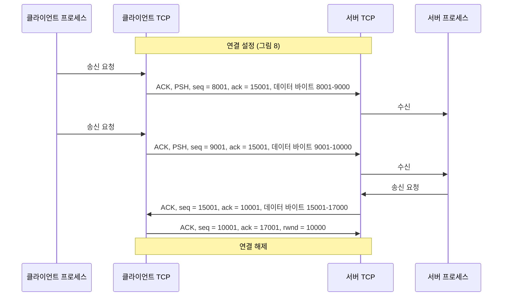

*그림 9. 연결 설정 뒤의 데이터 전송*

그림 9에서 연결이 설정된 뒤 클라이언트는 2,000바이트를 두 세그먼트로 보내고, 서버는 2,000바이트를 한 세그먼트로 보낸다. 클라이언트는 세그먼트 하나를 더 보낸다. 처음 세 세그먼트는 데이터와 확인 응답을 함께 나르고, 마지막 세그먼트는 더 보낼 데이터가 없으므로 확인 응답만 나른다. 클라이언트가 보낸 데이터 세그먼트에는 PSH(밀어 넣기) 플래그가 켜져 있어 서버 TCP가 데이터를 받는 즉시 서버 프로세스에 넘기려 한다. 서버의 세그먼트에는 밀어 넣기 플래그가 켜져 있지 않으며, 대부분의 TCP 구현은 이 플래그를 켤지 말지를 선택할 수 있다.

순서 번호와 확인 응답 번호를 확인하면 다음과 같다. 클라이언트의 첫 데이터 세그먼트는 ISN 8000 다음인 8001부터 1,000바이트(8001\~9000)를 나르므로 두 번째 세그먼트의 순서 번호는 9001이다. 서버는 10000번까지 받았으므로 확인 응답 번호 10001을 보낸다. 서버의 데이터는 서버 ISN 15000 다음인 15001부터 2,000바이트(15001\~17000)이므로 클라이언트의 마지막 확인 응답 번호는 17001이다. 마지막 세그먼트는 데이터가 없으므로 순서 번호를 소비하지 않으며, 순서 번호 10001은 클라이언트가 다음에 보낼 바이트 번호이다.

### 5.5 밀어 넣기와 긴급 데이터

**밀어 넣기(pushing data).** 송신 TCP는 송신 응용에서 오는 데이터 스트림을 버퍼에 저장하며 세그먼트의 크기를 고를 수 있다. 수신 TCP도 데이터가 도착하면 버퍼에 넣어 두었다가 응용 프로그램이 준비되었을 때나 수신 TCP에 편리할 때 넘긴다. 이 유연성은 TCP의 효율을 높인다. 그러나 응용 프로그램에 이 유연성이 필요 없는 경우가 있다. 예를 들어 상대 응용과 대화형으로 통신하는 응용은 키 입력 하나를 보내고 즉시 응답을 받기를 원하며, 전송과 전달의 지연을 받아들일 수 없다. 이때 송신 측 응용은 밀어 넣기 연산을 요청할 수 있다. 그러면 송신 TCP는 윈도우가 채워지기를 기다리지 않고 세그먼트를 만들어 즉시 보내야 하며, PSH 비트를 켜서 수신 TCP에게 이 세그먼트의 데이터를 더 기다리지 말고 되도록 빨리 수신 응용에 넘기라고 알린다. 응용 프로그램이 밀어 넣기를 요청할 수 있더라도 오늘날 대부분의 TCP 구현은 이 요청을 무시하며, TCP는 이 기능을 쓸지 말지 선택할 수 있다.

**긴급 데이터(urgent data).** TCP는 스트림 지향 프로토콜이므로 응용 프로그램은 데이터를 바이트 스트림으로 TCP에 넘기고, 각 바이트는 스트림에서 위치를 가진다. 그러나 응용 프로그램이 상대 쪽 응용에서 특별하게 다루어야 할 긴급 바이트를 보내야 할 때가 있다. 이때 송신 응용은 그 데이터가 긴급하다고 송신 TCP에 알리고, 송신 TCP는 URG 비트를 켠 세그먼트를 만들어 긴급 데이터를 세그먼트의 맨 앞에 넣는다. 세그먼트의 나머지에는 버퍼의 일반 데이터를 담을 수 있다. 헤더의 긴급 포인터 필드는 긴급 데이터의 끝(마지막 긴급 바이트)을 정의하며, 그 값을 순서 번호에 더하면 마지막 긴급 바이트의 번호가 된다. 예를 들어 순서 번호가 3001이고 긴급 포인터가 99이면 마지막 긴급 바이트는 3001 + 99 = 3100번이므로 3001\~3100번의 100바이트가 긴급 데이터이다. 수신 TCP는 URG 비트가 켜진 세그먼트를 받으면 운영체제에 따른 방식으로 수신 응용에 상황을 알리고, 어떤 조치를 할지는 수신 프로그램이 정한다.

TCP의 긴급 데이터는 우선순위 서비스나 신속 데이터 서비스가 아니다. 긴급 모드는 송신 측 응용이 바이트 스트림의 일부를 수신 측 응용이 특별히 처리하도록 표시하는 서비스일 뿐이다. 긴급 데이터의 존재를 알리고 스트림에서 그 위치를 표시한다는 점 말고는 긴급 데이터도 나머지 TCP 바이트 스트림과 똑같이 다루어진다. 수신 측 응용은 긴급 모드를 쓰든 안 쓰든 모든 바이트를 보낸 순서 그대로 읽어야 하며, 표준 TCP는 데이터를 결코 순서가 어긋난 채로 전달하지 않는다.

> **참고:** Kurose와 Ross는 실제로는 PSH, URG, 긴급 데이터 포인터가 쓰이지 않으며 완전성을 위해 소개한다고 설명한다.

### 5.6 연결 해제

연결에 참여한 두 쪽(클라이언트나 서버) 가운데 어느 쪽이든 연결을 닫을 수 있지만 보통 클라이언트가 시작한다. 연결이 끝나면 호스트의 "자원", 즉 버퍼와 변수가 해제된다. 오늘날 대부분의 구현은 연결 해제에 3방향 핸드셰이크와 반닫기를 이용한 4방향 핸드셰이크의 두 가지 방식을 허용한다.

**3방향 핸드셰이크에 의한 해제.**

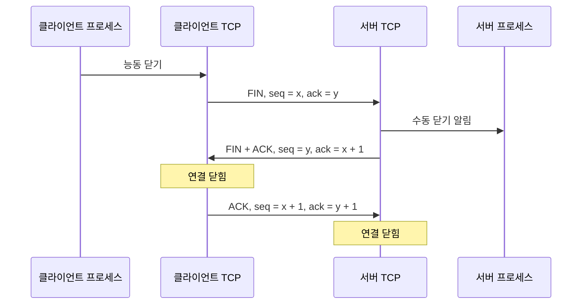

*그림 10. 3방향 핸드셰이크를 이용한 연결 해제*

1. 일반적인 경우 클라이언트 TCP는 클라이언트 프로세스로부터 닫기 명령을 받으면 FIN 플래그를 켠 첫 세그먼트인 FIN 세그먼트를 보낸다. FIN 세그먼트는 클라이언트가 보내는 마지막 데이터 덩어리를 담을 수도 있고, 그림 10처럼 제어 세그먼트일 수도 있다. 제어 세그먼트이면 순서 번호 하나만 소비한다.
2. 서버 TCP는 FIN 세그먼트를 받으면 자신의 프로세스에 상황을 알리고, 두 번째 세그먼트인 FIN + ACK 세그먼트를 보내 클라이언트의 FIN을 받았음을 확인하는 동시에 반대 방향의 연결을 닫는다고 알린다. 이 세그먼트는 서버의 마지막 데이터 덩어리를 담을 수도 있으며, 데이터를 싣지 않으면 순서 번호 하나만 소비한다.
3. 클라이언트 TCP는 마지막 세그먼트인 ACK 세그먼트를 보내 서버의 FIN 세그먼트를 받았음을 확인한다. 이 세그먼트의 확인 응답 번호는 서버의 FIN 세그먼트의 순서 번호에 1을 더한 값이다. 이 세그먼트는 데이터를 실을 수 없으며 순서 번호를 소비하지 않는다.

> **핵심:** FIN 세그먼트는 데이터를 싣지 않으면 순서 번호 하나를 소비한다. FIN + ACK 세그먼트도 데이터를 싣지 않으면 순서 번호 하나를 소비한다.

**4방향 핸드셰이크에 의한 해제.** Kurose와 Ross는 클라이언트가 FIN을 보내면 서버가 ACK로 확인하고, 그 뒤 서버가 자신의 FIN을 보내면 클라이언트가 ACK로 확인하는 네 세그먼트 방식을 기본으로 설명한다. 서버가 FIN을 받았을 때 보낼 데이터가 남아 있으면 ACK와 FIN을 따로 보내야 하므로 이 방식이 되며, 그 사이에 서버가 데이터를 계속 보내는 경우가 5.7절의 반닫기이다.

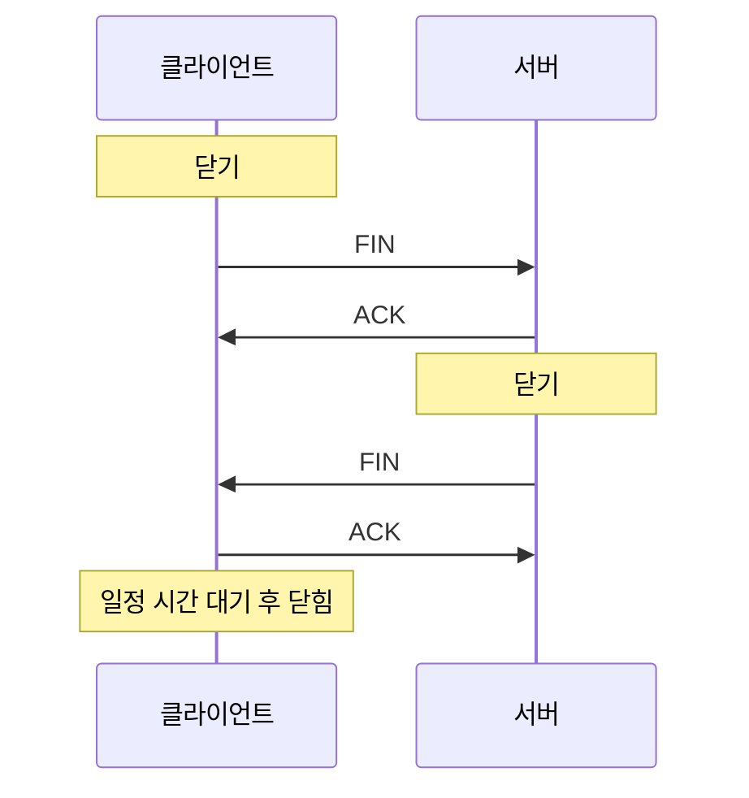

*그림 11. 네 세그먼트로 TCP 연결을 닫는 과정*

### 5.7 반닫기

> **용어 정의:** **반닫기(half-close)** 는 TCP 연결의 한쪽이 데이터 송신을 멈추면서도 여전히 데이터를 받을 수 있는 상태로 연결의 한 방향만 닫는 것이다.

서버와 클라이언트 어느 쪽이든 반닫기를 요청할 수 있다. 반닫기는 서버가 처리를 시작하기 전에 데이터를 모두 받아야 할 때 쓴다. 정렬이 좋은 예이다. 클라이언트가 정렬할 데이터를 서버에 보내면 서버는 데이터를 모두 받아야 정렬을 시작할 수 있다. 따라서 클라이언트는 데이터를 모두 보낸 뒤 클라이언트에서 서버로 가는 방향의 연결을 닫을 수 있다. 그러나 정렬된 데이터를 돌려받아야 하므로 서버에서 클라이언트로 가는 방향은 열려 있어야 하며, 서버는 데이터를 받은 뒤에도 정렬할 시간이 필요하므로 서버의 송신 방향이 열려 있어야 한다.

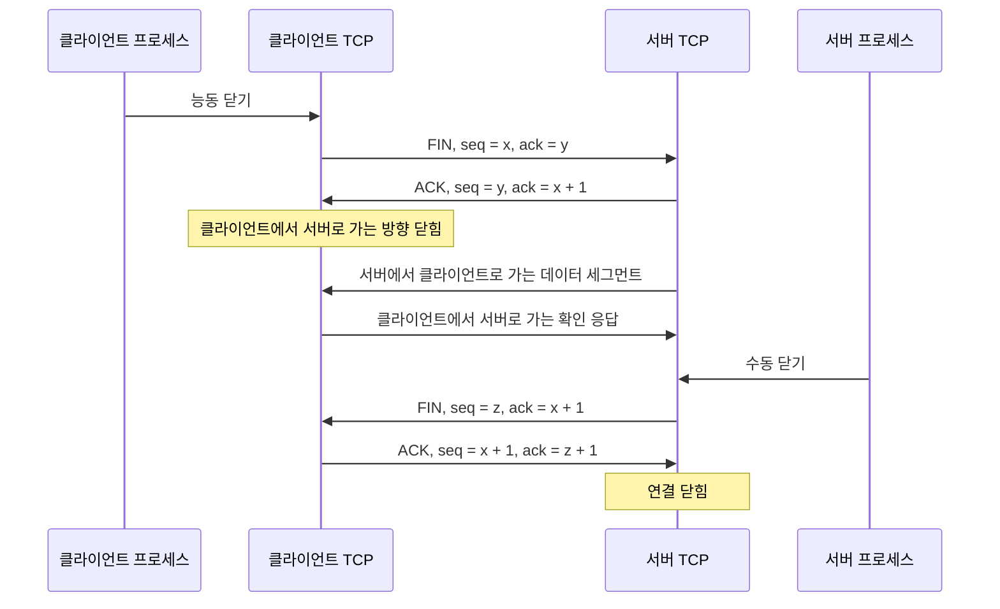

*그림 12. 반닫기*

그림 12에서 클라이언트에서 서버로 가는 데이터 전송이 멈춘다. 클라이언트는 FIN 세그먼트를 보내 연결을 반닫기하고, 서버는 ACK 세그먼트를 보내 반닫기를 받아들인다. 그러나 서버는 여전히 데이터를 보낼 수 있다. 서버가 처리된 데이터를 모두 보내면 FIN 세그먼트를 보내고, 클라이언트가 ACK로 이를 확인한다.

반닫기 뒤에는 데이터가 서버에서 클라이언트로 흐르고 확인 응답이 클라이언트에서 서버로 흐를 수 있지만, 클라이언트는 서버에 더 이상 데이터를 보낼 수 없다. 순서 번호를 보면, 서버의 두 번째 세그먼트(ACK)는 데이터가 없으므로 순서 번호를 소비하지 않는다. 서버의 데이터 세그먼트는 y번부터 바이트를 나르며, 서버가 데이터를 모두 보낸 뒤 보내는 FIN의 순서 번호 z는 서버가 보낸 마지막 데이터 바이트 다음 번호이다. 클라이언트의 마지막 ACK의 순서 번호는 x + 1이다. 클라이언트의 FIN이 x를 소비했고 그 방향으로는 데이터 전송 중에 순서 번호가 소비되지 않기 때문이다.

### 5.8 연결 재설정

한쪽의 TCP는 연결 요청을 거부하거나, 기존 연결을 중단하거나, 유휴 연결을 끝낼 수 있다. 이 모든 일은 RST(재설정) 플래그로 한다.

- **연결 거부.** 한쪽의 TCP가 존재하지 않는 포트로 연결을 요청하면, 다른 쪽 TCP는 RST 비트를 켠 세그먼트를 보내 요청을 거부할 수 있다(6.6절). Kurose와 Ross의 예로, 어떤 호스트가 목적지 포트 80인 TCP SYN 패킷을 받았는데 포트 80에서 연결을 받아들이지 않는다면(웹 서버를 실행하지 않는다면) 출발지에 RST 세그먼트를 보낸다. 이는 "그 세그먼트에 해당하는 소켓이 없으니 다시 보내지 말라"는 뜻이다. 반면 목적지 포트가 진행 중인 UDP 소켓과 맞지 않는 UDP 패킷을 받으면 특별한 ICMP 데이터그램을 보낸다(16장).
- **연결 중단.** 한 TCP가 비정상적인 상황 때문에 기존 연결을 중단하고 싶으면 RST 세그먼트를 보내 연결을 닫을 수 있다.
- **유휴 연결 종료.** 한쪽의 TCP가 상대 TCP가 오랫동안 아무것도 하지 않았음을 알아채면 RST 세그먼트를 보내 연결을 끝낼 수 있다. 과정은 연결 중단과 같다.

> **참고:** **포트 스캐닝의 세 가지 결과.** nmap 같은 포트 스캐너는 대상 호스트의 특정 TCP 포트(예: 6789)를 조사하기 위해 그 포트로 TCP SYN 세그먼트를 보낸다. 결과는 세 가지이다. (1) SYN + ACK 세그먼트를 받으면 대상 호스트에서 그 포트로 응용이 실행 중이므로 "열림"이다. (2) RST 세그먼트를 받으면 SYN이 대상 호스트에 도착했지만 그 포트로 실행 중인 응용이 없다는 뜻이며, 적어도 그 포트로 가는 세그먼트가 경로상의 방화벽(26장)에 막히지 않았음을 알 수 있다. (3) 아무것도 받지 못하면 SYN이 중간의 방화벽에 막혀 대상 호스트에 도달하지 못했을 가능성이 크다.

---

<br>

## 6. 상태 전이도

연결 설정, 연결 해제, 데이터 전송 중에 일어나는 여러 사건을 추적하기 위해 TCP는 유한 상태 기계(6장)로 정의된다.

### 6.1 TCP의 상태

| 상태 | 설명 |
|:-----|:-----|
| CLOSED | 연결이 없음 |
| LISTEN | 수동 열기를 받고 SYN을 기다림 |
| SYN-SENT | SYN을 보내고 ACK를 기다림 |
| SYN-RCVD | SYN + ACK를 보내고 ACK를 기다림 |
| ESTABLISHED | 연결이 설정되어 데이터 전송이 진행 중 |
| FIN-WAIT-1 | 첫 FIN을 보내고 ACK를 기다림 |
| FIN-WAIT-2 | 첫 FIN에 대한 ACK를 받고 두 번째 FIN을 기다림 |
| CLOSE-WAIT | 첫 FIN을 받고 ACK를 보낸 뒤 응용이 닫기를 기다림 |
| TIME-WAIT | 두 번째 FIN을 받고 ACK를 보낸 뒤 2MSL 타임아웃을 기다림 |
| LAST-ACK | 두 번째 FIN을 보내고 ACK를 기다림 |
| CLOSING | 양쪽이 동시에 닫기로 함 |

*표 4. TCP의 상태*

### 6.2 전체 상태 전이도

그림 13은 TCP 클라이언트와 서버가 쓰는 두 FSM을 하나로 합친 상태 전이도이다. 각 전이에는 "입력 / 출력"의 두 문자열이 붙어 있다. 앞의 것은 TCP가 받는 것이고 뒤의 것은 TCP가 보내는 것이며, 보내는 것이 없으면 Λ로 적었다. Forouzan의 교재는 서버가 보통 거치는 전이와 클라이언트가 보통 거치는 전이, 특수한 상황의 전이를 선의 종류로 구분하지만, 상황에 따라 서버가 클라이언트의 전이를 거치거나 그 반대일 수도 있다.

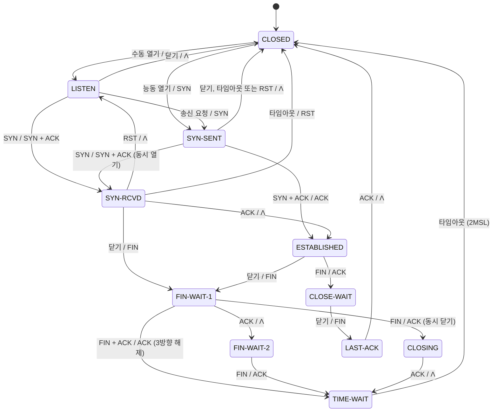

*그림 13. TCP의 상태 전이도*

ESTABLISHED라고 표시한 상태는 실제로 클라이언트와 서버가 데이터를 전송하는 데 거치는, 흐름 제어와 오류 제어를 위한 서로 다른 두 상태 집합이다(9.10절).

> **참고:** Forouzan의 그림은 LISTEN에서 CLOSED로 돌아가는 전이에 "RST / -"라는 이름을 붙인다. 그러나 TCP 명세에서 LISTEN 상태의 TCP는 들어오는 RST를 무시하며, 응용의 close 명령을 받으면 TCB를 지우고 CLOSED로 돌아간다[1]. 그래서 그림 13은 이 전이를 "close / Λ"로 적는다.

### 6.3 클라이언트와 서버의 전형적인 상태 순서

Kurose와 Ross는 연결이 정상적으로 설정되고 해제될 때 클라이언트 TCP와 서버 TCP가 거치는 전형적인 상태 순서를 보여 준다.

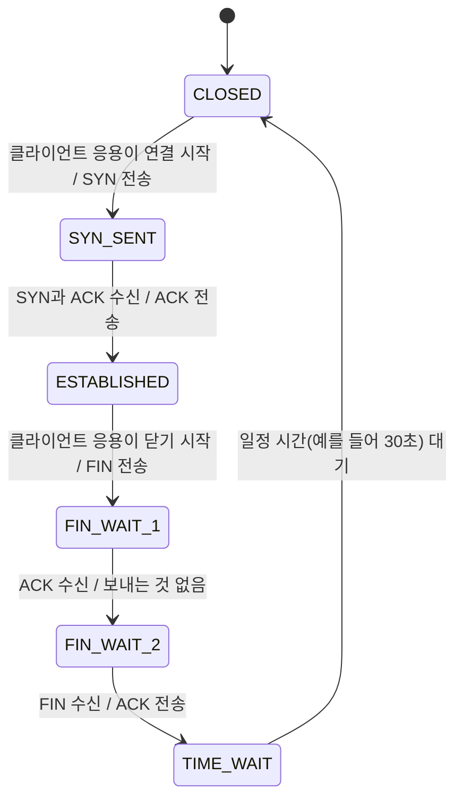

*그림 14. 클라이언트 TCP가 거치는 전형적인 상태 순서*

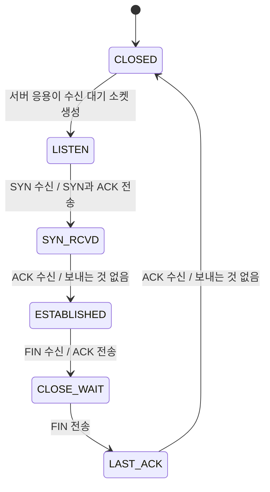

*그림 15. 서버 TCP가 거치는 전형적인 상태 순서*

클라이언트 TCP는 CLOSED 상태에서 시작한다. 클라이언트 응용이 새 TCP 연결을 시작하면 클라이언트 TCP는 SYN 세그먼트를 보내고 SYN_SENT 상태가 된다. 이 상태에서 클라이언트 TCP는 자신의 이전 세그먼트에 대한 확인 응답을 담고 SYN 비트가 1인 세그먼트를 기다리며, 이를 받으면 ESTABLISHED 상태가 된다. ESTABLISHED 상태에서 TCP 클라이언트는 페이로드 데이터를 담은 세그먼트를 보내고 받을 수 있다. 클라이언트 응용이 연결을 닫기로 하면 FIN 비트를 1로 한 세그먼트를 보내고 FIN_WAIT_1 상태가 되어 확인 응답을 기다린다. 확인 응답을 받으면 FIN_WAIT_2 상태가 되어 서버의 FIN 세그먼트를 기다리고, 이를 받으면 확인 응답을 보내고 TIME_WAIT 상태가 된다. TIME_WAIT 상태에서 기다린 뒤 연결은 공식적으로 닫히며, 포트 번호를 포함한 클라이언트 쪽의 모든 자원이 해제된다. 그림 15의 서버 쪽 전이는 클라이언트가 연결 해제를 시작한다고 가정한 것이다. 두 그림은 연결이 정상적으로 설정되고 해제되는 경우만 보여 주며, 양쪽이 동시에 연결을 시작하거나 닫는 경우는 6.6절과 그림 13에 있다.

### 6.4 시나리오: 연결 설정과 반닫기 종료

서버 프로세스가 수동 열기와 수동 닫기를, 클라이언트 프로세스가 능동 열기와 능동 닫기를 하는 시나리오를 시간선으로 보면 다음과 같다. 반닫기 해제를 쓰면 더 많은 상태를 볼 수 있다.

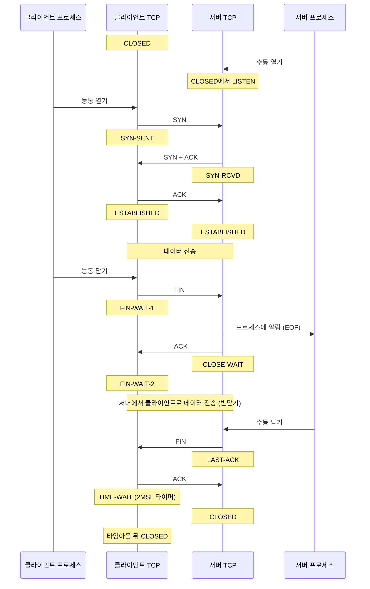

*그림 16. 연결 설정과 반닫기 종료에서 클라이언트와 서버의 상태 변화*

**클라이언트의 상태.** 클라이언트 프로세스는 특정 소켓 주소로의 연결을 TCP에 요청하는 능동 열기를 한다. TCP는 SYN 세그먼트를 보내고 SYN-SENT 상태가 되며, SYN + ACK를 받으면 ACK를 보내고 ESTABLISHED 상태가 된다. 데이터가 (양방향으로) 전송되고 확인된다. 클라이언트 프로세스가 더 보낼 데이터가 없으면 능동 닫기 명령을 내리고, 클라이언트 TCP는 FIN 세그먼트를 보내고 FIN-WAIT-1 상태가 된다. 보낸 FIN에 대한 ACK를 받으면 FIN-WAIT-2 상태가 되어 서버의 FIN을 받을 때까지 머문다. FIN을 받으면 ACK를 보내고 TIME-WAIT 상태가 되어, 최대 세그먼트 수명(MSL)의 두 배를 타임아웃 값으로 하는 타이머를 설정한다.

**서버의 상태.** 서버 프로세스는 열기 명령을 내리며, 이는 클라이언트가 열기 명령을 내리기 전에 일어나야 한다. 서버 TCP는 LISTEN 상태가 되어 SYN 세그먼트를 받을 때까지 수동적으로 머문다. SYN을 받으면 SYN + ACK를 보내고 SYN-RCVD 상태가 되어 클라이언트의 ACK를 기다리며, ACK를 받으면 데이터 전송이 가능한 ESTABLISHED 상태가 된다. 클라이언트 TCP로부터 더 보낼 데이터가 없고 연결을 닫아도 된다는 FIN을 받으면, 서버는 클라이언트에 ACK를 보내고 큐에 남은 데이터를 응용에 넘긴 뒤 CLOSE-WAIT 상태가 된다. 반닫기를 가정했으므로 서버 TCP는 여전히 클라이언트에 데이터를 보내고 확인 응답을 받을 수 있지만, 반대 방향으로는 데이터가 흐를 수 없다. 서버 TCP는 응용이 실제로 닫기 명령을 내릴 때까지 이 상태에 머물다가, 자신도 연결을 닫는다는 FIN을 클라이언트에 보내고 LAST-ACK 상태가 된다. 마지막 ACK를 받으면 CLOSED 상태가 된다. 첫 FIN으로 시작하는 이 해제 단계를 4방향 핸드셰이크라고 한다.

### 6.5 TIME-WAIT 상태

> **용어 정의:** **최대 세그먼트 수명(maximum segment lifetime, MSL)** 은 TCP 세그먼트가 폐기되기 전에 인터넷에 존재할 수 있는 최대 시간이다. TCP 세그먼트는 수명(TTL)이 제한된 IP 데이터그램에 캡슐화되므로, IP 데이터그램이 폐기되면 그 안의 세그먼트도 함께 폐기된다.

Forouzan에 따르면 MSL의 흔한 값은 30초에서 1분 사이이다. Kurose와 Ross는 TIME_WAIT 상태에 머무는 시간이 구현에 따라 다르며 흔한 값은 30초, 1분, 2분이라고 설명한다. TIME-WAIT 상태가 있는 이유는 두 가지이다.

1. **마지막 ACK의 손실에 대비하기 위해서이다.** 마지막 ACK 세그먼트가 손실되면, 마지막 FIN에 타이머를 설정해 둔 서버 TCP는 자신의 FIN이 손실되었다고 보고 다시 보낸다. 클라이언트가 2MSL 타이머가 끝나기 전에 CLOSED 상태로 가서 연결을 닫으면 다시 온 FIN을 받지 못하고, 결국 서버는 마지막 ACK를 받지 못해 연결을 닫을 수 없다. 2MSL 타이머는 클라이언트가 ACK가 손실되는 시간(MSL 하나)과 FIN이 도착하는 시간(MSL 하나)만큼 기다리게 한다. TIME-WAIT 상태에서 새 FIN이 도착하면 클라이언트는 새 ACK를 보내고 2MSL 타이머를 다시 시작한다.
2. **이전 연결의 중복 세그먼트가 다음 연결에 섞이는 것을 막기 위해서이다.** 클라이언트와 서버가 연결을 닫은 직후 같은 소켓 주소(같은 출발지와 목적지 IP 주소, 같은 출발지와 목적지 포트 번호)로 연결을 다시 연다고 하자. 이 새 연결을 이전 연결의 화신(incarnation)이라고 한다. 두 연결 사이의 시간이 충분하지 않으면 이전 연결의 중복 세그먼트가 새 연결에 도착하여 새 연결의 것으로 해석될 수 있다. 이를 막기 위해 TCP는 2MSL 시간이 지나기 전에는 화신을 만들지 못하게 한다. 다만 일부 구현은 화신의 초기 순서 번호가 이전 연결에서 쓴 마지막 순서 번호보다 크면 이 규칙을 무시한다.

### 6.6 그 밖의 시나리오

**3방향 핸드셰이크에 의한 해제.** 연결 설정과 해제 모두에서 3방향 핸드셰이크가 흔하다. 클라이언트가 데이터 전송 뒤 닫기를 하면 클라이언트 TCP는 FIN을 보내고 FIN-WAIT-1 상태가 된다. 서버 TCP는 FIN을 받으면 큐에 있는 데이터를 연결을 닫아야 한다는 가상의 EOF 표시와 함께 서버에 넘기고 CLOSE-WAIT 상태가 되지만, 받은 FIN에 대한 확인 응답은 자신의 프로세스로부터 수동 닫기를 받을 때까지 미룬다. 수동 닫기를 받으면 FIN + ACK 세그먼트를 클라이언트에 보내고 LAST-ACK 상태가 되어 마지막 ACK를 기다린다. 클라이언트는 FIN-WAIT-2 상태를 거치지 않고 곧바로 TIME-WAIT 상태가 된다(그림 13의 FIN-WAIT-1에서 TIME-WAIT으로 가는 전이). 나머지는 4방향 핸드셰이크와 같다.

**동시 닫기.** 양쪽이 모두 능동 닫기를 하는 드물지만 가능한 상황이다. 두 TCP는 FIN-WAIT-1 상태가 되어 동시에 전송 중인 FIN을 보낸다. 각 쪽은 FIN을 받으면 CLOSING 상태가 되어 ACK를 보낸다. CLOSING 상태는 일반적인 시나리오의 FIN-WAIT-2나 CLOSE-WAIT 상태를 대신한다. ACK를 받으면 각 쪽은 TIME-WAIT 상태가 된다. 양쪽이 모두 손실될 수 있는 ACK를 보냈으므로 TIME-WAIT 시간은 양쪽 모두에 필요하다.

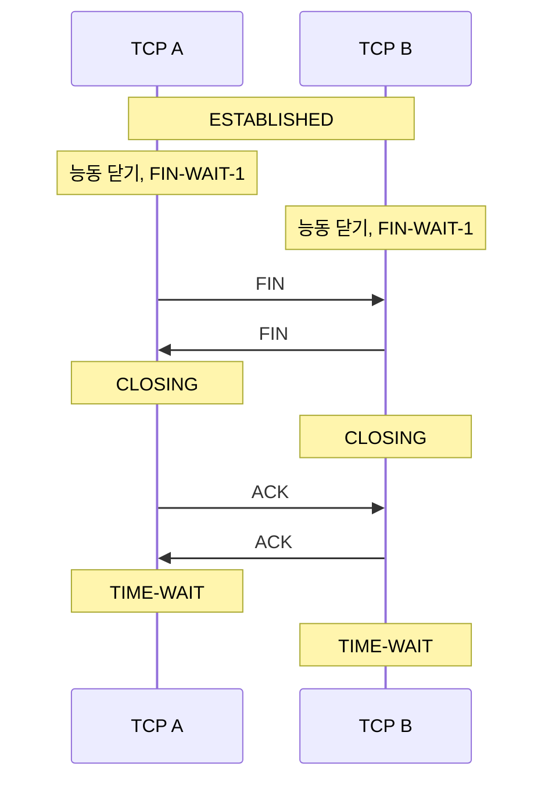

*그림 17. 동시 닫기*

**연결 거부.** 흔한 상황은 서버 TCP가 연결을 거부하는 경우로, SYN 세그먼트의 목적지 포트 번호가 지금 LISTEN 상태가 아닌 서버를 가리킬 때 일어날 수 있다. 서버 TCP는 SYN 세그먼트를 받은 뒤 그 SYN을 확인하는 동시에 연결을 재설정(거부)하는 RST + ACK 세그먼트를 보내고, 다른 연결을 기다리기 위해 LISTEN 상태로 간다. 클라이언트는 RST + ACK를 받으면 CLOSED 상태가 된다.

**연결 중단.** 프로세스가 연결을 닫는 대신 중단할 수 있다. 프로세스가 실패했거나(예: 무한 루프에 갇힘) 큐에 있는 데이터를 보내고 싶지 않을 때(예: 데이터에 불일치가 있음) 일어날 수 있다. TCP 자신이 연결을 중단하고 싶을 때도 있다. 이전 연결(화신)에 속한 세그먼트를 받았을 때가 그 예이다. 이런 경우 TCP는 RST + ACK 세그먼트를 보내고 큐의 데이터를 모두 버린다. 상대 TCP도 큐의 데이터를 모두 버리고 오류 메시지로 자신의 프로세스에 알린다. 두 TCP는 곧바로 CLOSED 상태가 되며, RST 세그먼트에 대해서는 ACK 세그먼트를 만들지 않는다. 이 기능은 구현자가 선택적으로 구현할 수 있으므로 그림 13의 일반 전이도에는 없다.

---

<br>

## 7. TCP의 윈도우

### 7.1 네 개의 윈도우

TCP는 데이터 전송의 방향마다 송신 윈도우와 수신 윈도우의 두 윈도우를 쓰므로, 양방향 통신에는 윈도우 네 개가 쓰인다. 논의를 단순하게 하기 위해 통신이 한 방향(예: 클라이언트에서 서버로)으로만 일어난다고 가정한다. 양방향 통신은 피기백을 쓰는 단방향 통신 두 개로 볼 수 있다.

슬라이딩 윈도우는 전송을 더 효율적으로 만들고 목적지가 데이터에 압도되지 않도록 데이터의 흐름을 제어하는 데 쓰인다. TCP의 슬라이딩 윈도우는 바이트 지향이다.

> **용어 정의:** **수신 윈도우(receive window, rwnd)** 는 수신자가 버퍼가 넘쳐 데이터를 버리기 전에 받아들일 수 있는 바이트 수로, 수신자가 ACK를 담은 세그먼트의 윈도우 크기 필드에 넣어 상대에게 알리는 값이다.

> **용어 정의:** **혼잡 윈도우(congestion window, cwnd)** 는 네트워크의 혼잡을 피하기 위해 송신자가 네트워크 상태에 따라 정하는 값으로, 확인되지 않은 데이터의 양을 제한한다(9장).

한쪽 끝의 윈도우 크기는 두 값 가운데 작은 쪽으로 정해진다.

```math
\text{window size} = \min(\text{rwnd}, \text{cwnd})
```

이 장에서는 흐름 제어에 집중하기 위해 cwnd가 충분히 커서 윈도우 크기가 rwnd로 정해진다고 가정한다. 혼잡 제어는 9장에서 다룬다.

### 7.2 송신 윈도우

```text
           Sf: first outstanding byte                             Timer
           |               Sn: next byte to send
           |               |
           v               v
 ... 200 [ 201  ...  260 | 261   ...                 300 ] 301 ...
 bytes that are   outstanding bytes      bytes that can be     bytes that cannot be
 acknowledged     (sent but not          sent (usable          sent until the right
 (can be purged   acknowledged)          window)               edge moves to the right
 from buffer)
         |<- send window size (advertised by receiver) ->|
```

*그림 18. TCP의 송신 윈도우 (윈도우 크기 100바이트)*

그림 18의 송신 윈도우는 크기가 100바이트(실제로는 보통 수천 바이트)이다. 201\~260번 바이트는 보냈지만 확인되지 않았고, 261\~300번은 지금 보낼 수 있으며, 301번 이후는 윈도우의 오른쪽 경계가 오른쪽으로 움직일 때까지 보낼 수 없다. 송신 윈도우의 크기는 수신자(흐름 제어)와 네트워크의 혼잡(혼잡 제어)이 정한다.

TCP의 송신 윈도우는 7장의 Selective Repeat 송신 윈도우와 비슷하지만 다음이 다르다.

1. SR의 윈도우는 패킷에 번호를 매기지만 TCP의 윈도우는 바이트에 번호를 매긴다. 실제 전송은 세그먼트 단위로 일어나지만 윈도우를 제어하는 변수는 바이트 단위이다.
2. 일부 구현에서는 TCP가 프로세스에서 받은 데이터를 저장했다가 나중에 보낼 수 있다. 여기서는 송신 TCP가 프로세스에서 데이터를 받는 즉시 세그먼트로 보낼 수 있다고 가정한다.
3. 이론적인 SR 프로토콜은 보낸 패킷마다 타이머를 쓸 수 있지만, TCP 프로토콜은 타이머를 하나만 쓴다(9절).

### 7.3 수신 윈도우

```text
           next byte to be pulled by the process
           |               Rn: next byte expected to receive
           |               |
           v               v
 ... 200 | 201  ...  260 [ 261   ...                 300 ] 301 ...
 bytes that have  bytes received      bytes that can be      bytes that cannot be
 already been     and acknowledged,   received from sender   received from sender
 pulled by the    waiting to be       (receive window size,
 process          consumed by process  rwnd)
         |<------------- allocated buffer -------------->|
```

*그림 19. TCP의 수신 윈도우와 할당된 버퍼 (버퍼 크기 100바이트)*

그림 19에서 할당된 버퍼는 201\~300번의 100바이트이다. 201\~260번의 60바이트는 받아서 확인했지만 프로세스가 아직 끌어가지 않은 바이트이므로, 수신 윈도우는 261\~300번의 40바이트이다.

TCP의 수신 윈도우는 SR의 수신 윈도우와 두 가지가 다르다.

1. TCP는 수신 프로세스가 자신의 속도로 데이터를 끌어가게 한다. 따라서 할당된 버퍼의 일부는 받아서 확인했지만 수신 프로세스가 끌어가기를 기다리는 바이트가 차지할 수 있다. 수신 윈도우의 크기는 항상 버퍼 크기 이하이며, 수신자가 압도되기 전에 송신자에게서 받아들일 수 있는 바이트 수(흐름 제어)를 정한다.

```math
\text{rwnd} = \text{buffer size} - \text{number of waiting bytes to be pulled}
```

2. TCP의 확인 응답 방식이 다르다. SR의 확인 응답은 손상 없이 받은 패킷을 정의하는 선택적 확인 응답이다. TCP의 주된 확인 응답 메커니즘은 다음에 받기를 기대하는 바이트를 알리는 누적 확인 응답이다(이 점에서 TCP는 GBN과 비슷하다). 그러나 새로운 TCP는 누적 확인 응답과 선택적 확인 응답을 모두 쓴다(11.6절).

수신 윈도우는 송신자에게서 바이트가 더 도착하면 닫히고(왼쪽 벽이 오른쪽으로 이동), 프로세스가 바이트를 더 끌어가면 열린다(오른쪽 벽이 오른쪽으로 이동). 실제로 수신 윈도우는 결코 줄어들면 안 된다(오른쪽 벽이 왼쪽으로 움직이지 않는다).

---

<br>

## 8. 흐름 제어

> **용어 정의:** **흐름 제어(flow control)** 는 송신자가 수신자의 수신 버퍼를 넘치게 하지 않도록, 송신자가 보내는 속도를 수신 응용이 읽는 속도에 맞추는 속도 맞춤 서비스이다.

TCP 송신자는 IP 네트워크 안의 혼잡 때문에도 억제될 수 있으며, 이런 송신자 제어는 혼잡 제어라고 한다(9장). 흐름 제어와 혼잡 제어가 하는 일(송신자를 억제함)은 비슷하지만 이유는 전혀 다르므로 두 말을 구분해야 한다. TCP는 흐름 제어를 오류 제어와도 분리하며, 이 절에서는 송신 TCP와 수신 TCP 사이의 논리적 채널에 오류가 없다고 가정한다.

### 8.1 데이터의 흐름과 흐름 제어 피드백

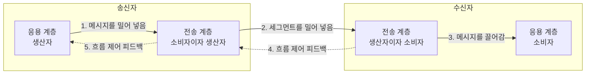

*그림 20. TCP의 데이터 흐름과 흐름 제어 피드백*

그림 20에서 데이터는 송신 프로세스에서 송신 TCP로, 송신 TCP에서 수신 TCP로, 수신 TCP에서 수신 프로세스로 흐른다(경로 1, 2, 3). 흐름 제어 피드백은 수신 TCP에서 송신 TCP로, 송신 TCP에서 송신 프로세스로 간다(경로 4, 5). 대부분의 TCP 구현은 수신 프로세스에서 수신 TCP로 가는 흐름 제어 피드백을 두지 않고, 수신 프로세스가 준비될 때마다 수신 TCP에서 데이터를 끌어가게 한다. 즉 수신 TCP가 송신 TCP를 제어하고, 송신 TCP가 송신 프로세스를 제어한다. 송신 TCP에서 송신 프로세스로 가는 피드백(경로 5)은 윈도우가 가득 차면 송신 TCP가 데이터를 단순히 거부하는 방식으로 이루어진다. 따라서 흐름 제어의 논의는 수신 TCP에서 송신 TCP로 가는 피드백(경로 4)에 집중한다.

### 8.2 수신 윈도우의 계산

Kurose와 Ross는 수신자가 순서가 어긋난 세그먼트를 버린다고 가정하고 수신 윈도우를 다음 변수로 정의한다. 호스트 A가 TCP 연결로 호스트 B에 큰 파일을 보내고, B가 이 연결에 크기가 `RcvBuffer`인 수신 버퍼를 할당했다고 하자.

- `LastByteRead`: B의 응용 프로세스가 버퍼에서 읽은 데이터 스트림의 마지막 바이트 번호
- `LastByteRcvd`: 네트워크에서 도착하여 B의 수신 버퍼에 들어간 데이터 스트림의 마지막 바이트 번호

TCP는 할당된 버퍼를 넘치게 해서는 안 되므로 다음이 성립해야 한다.

```math
\text{LastByteRcvd} - \text{LastByteRead} \leq \text{RcvBuffer}
```

수신 윈도우는 버퍼의 남은 공간이다.

```math
\text{rwnd} = \text{RcvBuffer} - (\text{LastByteRcvd} - \text{LastByteRead})
```

남은 공간은 시간에 따라 바뀌므로 rwnd는 동적이다. B는 A에게 보내는 모든 세그먼트의 수신 윈도우 필드에 현재 rwnd 값을 넣어 버퍼에 남은 공간을 알린다. 처음에 B는 rwnd = `RcvBuffer`로 둔다. 호스트 A는 이름 그대로의 뜻을 가진 두 변수 `LastByteSent`와 `LastByteAcked`를 추적한다. 두 변수의 차는 A가 연결에 보냈지만 확인되지 않은 데이터의 양이며, A는 연결이 유지되는 동안 이 양을 rwnd 이하로 유지하여 B의 수신 버퍼가 넘치지 않게 한다.

```math
\text{LastByteSent} - \text{LastByteAcked} \leq \text{rwnd}
```

예를 들어 `RcvBuffer` = 10,000바이트, `LastByteRcvd` = 25,000, `LastByteRead` = 21,000이면 버퍼에 읽히기를 기다리는 데이터가 4,000바이트이므로 rwnd = 10,000 - 4,000 = 6,000바이트이다. 이 rwnd를 받은 A의 `LastByteAcked`가 23,000이면 A는 `LastByteSent`가 29,000이 될 때까지 보낼 수 있다.

### 8.3 윈도우 열기, 닫기, 줄이기

흐름 제어를 위해 TCP는 송신자와 수신자가 윈도우 크기를 조정하게 한다. 양쪽의 버퍼 크기는 연결을 설정할 때 정해져 고정되지만 윈도우는 바뀐다. 송신 윈도우의 열기, 닫기, 줄이기는 송신자가 아니라 수신자가 제어한다.

```text
                                Shrinking
                                <---------
          +-------------------------------------------+
 ... n-1  |  n  | n+1 |       ...        | m-1 |  m   | m+1 ...
          +-------------------------------------------+
          ----------->        Sliding Window            ----------->
          Closing                                       Opening

                    Window size = min(rwnd, cwnd)
```

*그림 21. 송신 윈도우의 열기, 닫기, 줄이기*

- **닫기(closing).** 윈도우의 왼쪽 벽이 오른쪽으로 움직인다. 새 확인 응답이 일부 바이트를 확인하여 송신자가 더 이상 그 바이트를 신경 쓰지 않아도 될 때 일어난다.
- **열기(opening).** 윈도우의 오른쪽 벽이 오른쪽으로 움직인다. 수신자가 알린 rwnd가 허용하여 버퍼의 새 바이트를 보낼 수 있게 될 때 일어난다.
- **줄이기(shrinking).** 윈도우의 오른쪽 벽이 왼쪽으로 움직인다. 일부 바이트를 보낼 자격을 취소하는 것으로, 송신자가 그 바이트를 이미 보냈다면 문제가 된다(8.5절).

### 8.4 흐름 제어의 예

그림 22는 클라이언트에서 서버로 가는 단방향 데이터 전송에서 연결 설정 단계에 송신 윈도우와 수신 윈도우가 어떻게 정해지고 데이터 전송 중에 어떻게 바뀌는지 보여 준다. 오류 제어는 무시하고 세그먼트가 손상되거나 손실되거나 중복되거나 순서가 어긋나지 않는다고 가정한다. 단방향이므로 각 쪽의 윈도우 하나만 본다.

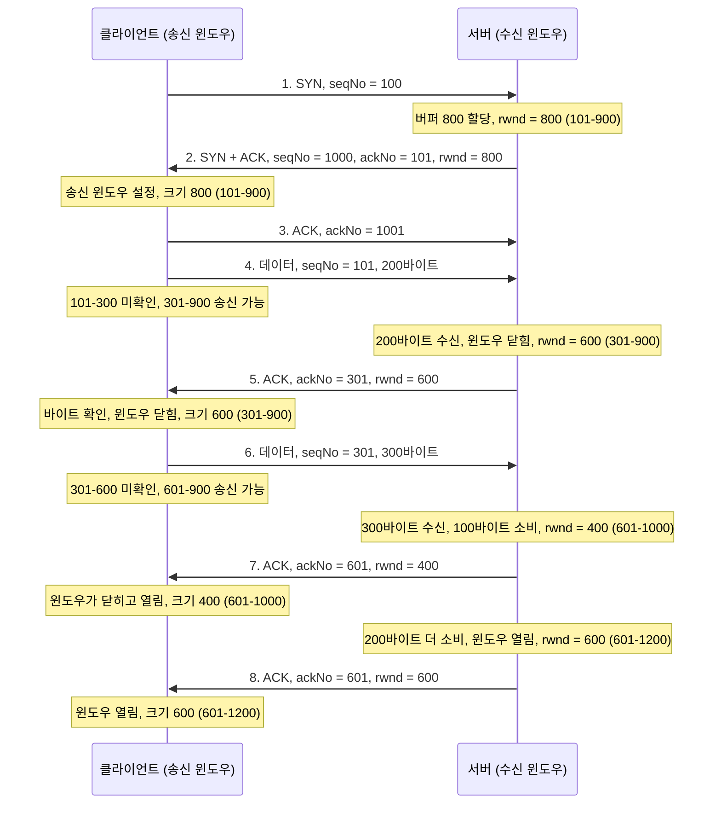

*그림 22. 단방향 데이터 전송에서의 흐름 제어 예*

| 단계 | 세그먼트 | 서버 버퍼에서 끌어가기를 기다리는 바이트 | rwnd | 클라이언트 송신 윈도우 |
|:-----|:-----|:-----|:-----|:-----|
| 1 | SYN (seqNo 100) | 없음 | 800 | 아직 없음 |
| 2 | SYN + ACK (ackNo 101, rwnd 800) | 없음 | 800 | 101\~900 (800바이트) |
| 4 | 데이터 101\~300 | 101\~300 (200바이트) | 600 | 101\~900, 그중 101\~300 미확인 |
| 5 | ACK (ackNo 301, rwnd 600) | 101\~300 (200바이트) | 600 | 301\~900 (600바이트) |
| 6, 7 | 데이터 301\~600, ACK (ackNo 601, rwnd 400) | 201\~600 (400바이트, 101\~200은 소비됨) | 400 | 601\~1,000 (400바이트) |
| 8 | ACK (ackNo 601, rwnd 600) | 401\~600 (200바이트) | 600 | 601\~1,200 (600바이트) |

*표 5. 흐름 제어 예에서 rwnd와 송신 윈도우의 변화*

1. 첫 세그먼트는 클라이언트가 서버에 연결을 요청하는 SYN 세그먼트로, 초기 seqNo = 100을 알린다. 서버는 이 세그먼트를 받으면 800바이트 크기의 버퍼를 할당하고(가정) 윈도우가 버퍼 전체를 덮도록 rwnd = 800으로 둔다. 다음에 도착할 바이트의 번호는 101이다.
2. 두 번째 세그먼트는 서버에서 클라이언트로 가는 SYN + ACK 세그먼트이다. ackNo = 101로 101번부터 받기를 기대한다고 알리고, 클라이언트가 800바이트 크기의 윈도우를 둘 수 있다고 알린다.
3. 세 번째 세그먼트는 클라이언트에서 서버로 가는 ACK 세그먼트이다.
4. 클라이언트가 서버가 정한 크기(800)로 윈도우를 설정한 뒤 프로세스가 200바이트를 밀어 넣는다. 클라이언트 TCP는 이 바이트에 101\~300번을 매기고 세그먼트를 만들어 보낸다. 클라이언트의 윈도우는 200바이트를 보냈지만 확인을 기다리고 있음을 표시하도록 조정된다. 서버는 이 바이트를 저장하고 다음에 기대하는 바이트가 301번이 되도록 수신 윈도우를 닫는다. 저장된 바이트가 버퍼의 200바이트를 차지하므로 rwnd는 600이다.
5. 다섯 번째 세그먼트는 서버에서 클라이언트로 가는 피드백이다. 서버는 300번까지(포함) 확인하며(301번을 기대함), 줄어든 수신 윈도우의 크기(600)를 함께 알린다. 클라이언트는 이 세그먼트를 받으면 확인된 바이트를 윈도우에서 지우고, 다음에 보낼 바이트가 301번이 되도록 윈도우를 닫는다. 윈도우 크기는 600바이트로 줄어든다. 할당된 버퍼는 800바이트를 담을 수 있지만, 수신자가 허락하지 않으므로 윈도우를 열 수(오른쪽 벽을 오른쪽으로 옮길 수) 없다.
6. 클라이언트의 프로세스가 300바이트를 더 밀어 넣으면 클라이언트는 seqNo = 301이고 300바이트를 담은 여섯 번째 세그먼트를 보낸다. 서버는 이를 저장하지만 윈도우 크기를 줄여야 한다. 서버의 프로세스가 100바이트를 끌어간 뒤, 윈도우는 왼쪽에서 300바이트만큼 닫히고 오른쪽에서 100바이트만큼 열린다. 결과적으로 크기는 200바이트만 줄어 수신 윈도우는 400바이트가 된다.
7. 일곱 번째 세그먼트에서 서버는 데이터를 받았음을 확인하고 윈도우 크기가 400이라고 알린다. 클라이언트는 윈도우를 다시 줄여 서버가 알린 rwnd = 400으로 둘 수밖에 없다. 송신 윈도우는 왼쪽에서 300바이트만큼 닫히고 오른쪽에서 100바이트만큼 열린다.
8. 여덟 번째 세그먼트도 서버가 보내며, 서버의 프로세스가 200바이트를 더 끌어간 뒤이다. 윈도우 크기가 커져 rwnd는 600이 된다. 이 세그먼트는 서버가 여전히 601번을 기대하지만 서버의 윈도우가 600으로 커졌음을 알린다. 이 세그먼트를 보낼지는 구현의 정책에 달려 있으며, 일부 구현은 이 시점에 rwnd를 알리지 않고 데이터를 받은 뒤에 알린다. 클라이언트는 이 세그먼트를 받으면 윈도우를 닫지 않고 200바이트만큼 열어, 윈도우 크기가 600바이트가 된다.

### 8.5 송신 윈도우 줄이기의 금지

앞에서 말했듯이 수신 윈도우는 줄어들 수 없다. 그러나 수신자가 정한 rwnd 값 때문에 송신 윈도우가 줄어들 수는 있다. 일부 구현은 송신 윈도우가 줄어드는 것, 즉 송신 윈도우의 오른쪽 벽이 왼쪽으로 움직이는 것을 허용하지 않는다. 이를 막으려면 수신자는 마지막 확인 응답 번호와 rwnd, 새 확인 응답 번호와 rwnd 사이에 다음 관계를 지켜야 한다.

```math
\text{new ackNo} + \text{new rwnd} \geq \text{last ackNo} + \text{last rwnd}
```

왼쪽은 순서 번호 공간에서 오른쪽 벽의 새 위치이고, 오른쪽은 이전 위치이다. 이 관계는 오른쪽 벽이 왼쪽으로 움직이지 않아야 함을 나타내며, 수신자가 자신의 알림을 점검해야 한다는 규정이다. 이 부등식은 $`S_f < S_n`$일 때만 유효하며, 모든 계산은 modulo $`2^{32}`$로 한다는 점에 유의해야 한다.

예를 들어 마지막 알림이 ackNo = 206, rwnd = 12였다면 오른쪽 벽은 206 + 12 = 218에 있다. 송신자가 206\~214번 바이트를 보냈고, 206\~209번이 확인되어 지워졌다고 하자. 새 알림이 ackNo = 210, rwnd = 4이면 210 + 4 = 214 < 218이므로 송신 윈도우가 줄어든다. 이 경우 이미 보낸 214번 바이트가 윈도우 밖에 놓이는 문제가 생긴다. 수신자는 210\~217번 가운데 어느 바이트가 이미 보내졌는지 모르므로, 위 관계를 지켜 오른쪽 벽을 이전 위치에 두어야 한다. 이런 상황을 막는 한 방법은 수신자가 프로세스가 바이트를 더 소비하여 위 관계를 만족할 만큼 윈도우에 자리가 생길 때까지 피드백을 미루는 것이다.

### 8.6 윈도우 닫기와 탐색 세그먼트

오른쪽 벽을 왼쪽으로 옮겨 송신 윈도우를 줄이는 것은 강하게 금지되지만 예외가 하나 있다. 수신자는 rwnd = 0을 보내 윈도우를 일시적으로 닫을 수 있다. 수신자가 어떤 이유로 잠시 송신자의 데이터를 받고 싶지 않을 때 일어난다. 이때 송신자는 실제로 윈도우 크기를 줄이지 않고, 새 알림이 올 때까지 데이터 송신을 멈춘다.

Kurose와 Ross는 이 방식의 기술적 문제를 지적한다. 호스트 B의 수신 버퍼가 가득 차서 rwnd = 0을 알린 뒤 B가 A에게 보낼 것이 없다고 하자. B의 응용 프로세스가 버퍼를 비워도, TCP는 보낼 데이터나 보낼 확인 응답이 있을 때만 A에게 세그먼트를 보내므로 새 rwnd 값을 담은 세그먼트를 보내지 않는다. 그러면 A는 B의 수신 버퍼에 공간이 생긴 것을 영원히 알 수 없어 더 이상 데이터를 보내지 못하고 막힌다. 이 문제를 해결하기 위해 TCP 명세는 B의 수신 윈도우가 0일 때 A가 1바이트 데이터를 담은 세그먼트를 계속 보내도록 요구한다. 이 세그먼트들은 수신자가 확인하므로, 결국 버퍼가 비기 시작하면 확인 응답이 0이 아닌 rwnd 값을 담게 된다. Forouzan은 이렇게 수신자의 지시로 윈도우가 닫혀도 송신자가 항상 보낼 수 있는 1바이트 데이터 세그먼트를 **탐색(probe)** 이라고 부르며, 이를 지속 타이머(10.6절)로 관리한다.

> **참고:** UDP는 흐름 제어를 제공하지 않으므로 수신자에서 버퍼 넘침 때문에 세그먼트가 손실될 수 있다. 일반적인 UDP 구현은 해당 소켓 앞의 유한한 크기의 버퍼에 세그먼트를 붙이고, 프로세스는 버퍼에서 세그먼트를 한 번에 하나씩 읽는다. 프로세스가 버퍼에서 충분히 빨리 읽지 않으면 버퍼가 넘쳐 세그먼트가 버려진다(6장의 큐잉).

### 8.7 어리석은 윈도우 증후군

슬라이딩 윈도우 동작에서 송신 응용 프로그램이 데이터를 천천히 만들거나 수신 응용 프로그램이 데이터를 천천히 소비하거나, 또는 둘 다이면 심각한 문제가 생길 수 있다. 어느 경우든 데이터가 매우 작은 세그먼트로 보내져 동작의 효율이 떨어진다.

> **용어 정의:** **어리석은 윈도우 증후군(silly window syndrome)** 은 송신 응용이 데이터를 느리게 만들거나 수신 응용이 데이터를 느리게 소비하여, TCP가 헤더에 비해 데이터가 매우 적은 세그먼트를 계속 보내게 되는 비효율 문제이다.

예를 들어 TCP가 데이터 1바이트만 담은 세그먼트를 보내면, 41바이트 데이터그램(TCP 헤더 20바이트와 IP 헤더 20바이트 포함)이 사용자 데이터 1바이트만 나른다. 이때 부담은 41/1로, 네트워크 용량을 매우 비효율적으로 쓰는 것이다. 데이터 링크 계층과 물리 계층의 부담까지 고려하면 비효율은 더 심해진다.

**송신자가 만드는 증후군.** 송신 TCP가 데이터를 느리게, 예를 들어 1바이트씩 만드는 응용 프로그램을 서비스하면 증후군이 생길 수 있다. 응용 프로그램이 송신 TCP의 버퍼에 1바이트씩 쓰고 송신 TCP가 별다른 지시 없이 1바이트짜리 세그먼트를 만들면, 41바이트 세그먼트가 인터넷을 대량으로 오가게 된다. 해결책은 송신 TCP가 데이터를 바이트 단위로 보내지 못하게 하고, 기다렸다가 더 큰 블록으로 모아 보내게 하는 것이다. 문제는 얼마나 기다리느냐이다. 너무 오래 기다리면 프로세스가 지연되고, 충분히 기다리지 않으면 작은 세그먼트를 보내게 된다. Nagle이 이에 대한 깔끔한 해결책을 찾았다.

> **용어 정의:** **Nagle 알고리즘(Nagle's algorithm)** 은 송신 TCP가 첫 데이터는 즉시 보내되, 그 뒤에는 확인 응답이 오거나 최대 크기 세그먼트를 채울 만큼 데이터가 모일 때까지 출력 버퍼에 데이터를 모았다가 보내게 하는 알고리즘이다.

1. 송신 TCP는 송신 응용 프로그램에서 받은 첫 데이터를 1바이트라도 그대로 보낸다.
2. 첫 세그먼트를 보낸 뒤 송신 TCP는 출력 버퍼에 데이터를 모으면서, 수신 TCP가 확인 응답을 보내거나 최대 크기 세그먼트를 채울 만큼 데이터가 모일 때까지 기다린다. 그때 세그먼트를 보낸다.
3. 나머지 전송에서 2단계를 되풀이한다. 즉 세그먼트 3은 세그먼트 2에 대한 확인 응답이 오거나 최대 크기 세그먼트를 채울 만큼 데이터가 모이면 즉시 보낸다.

Nagle 알고리즘의 장점은 단순하면서도 데이터를 만드는 응용 프로그램의 속도와 데이터를 나르는 네트워크의 속도를 모두 고려한다는 데 있다. 응용 프로그램이 네트워크보다 빠르면 세그먼트가 커지고(최대 크기 세그먼트), 응용 프로그램이 네트워크보다 느리면 세그먼트가 작아진다(최대 세그먼트 크기보다 작음).

**수신자가 만드는 증후군.** 수신 TCP가 데이터를 느리게, 예를 들어 1바이트씩 소비하는 응용 프로그램을 서비스해도 증후군이 생길 수 있다. 송신 응용 프로그램은 1킬로바이트 블록으로 데이터를 만들지만 수신 응용 프로그램은 1바이트씩 소비하고, 수신 TCP의 입력 버퍼가 4킬로바이트라고 하자. 송신자가 처음 4킬로바이트를 보내면 수신자는 이를 버퍼에 저장하고, 버퍼가 가득 차므로 윈도우 크기 0을 알려 송신자를 멈춘다. 수신 응용이 입력 버퍼에서 첫 바이트를 읽으면 버퍼에 1바이트 공간이 생기고, 수신 TCP는 윈도우 크기 1바이트를 알린다. 보낼 데이터를 기다리던 송신 TCP는 이를 반가운 소식으로 받아 1바이트 데이터만 담은 세그먼트를 보낸다. 이 과정이 되풀이되어 1바이트가 소비되면 1바이트 세그먼트가 보내지므로, 다시 효율 문제와 어리석은 윈도우 증후군이 생긴다. 데이터가 도착하는 속도보다 느리게 소비하는 응용 프로그램이 만드는 증후군을 막기 위해 두 가지 해결책이 제안되었다.

- **Clark의 해결책.** 데이터가 도착하는 즉시 확인 응답을 보내되, 최대 크기 세그먼트를 담을 만큼 공간이 생기거나 수신 버퍼의 절반 이상이 빌 때까지 윈도우 크기를 0으로 알린다.
- **지연 확인 응답.** 세그먼트가 도착해도 즉시 확인하지 않는다.

> **용어 정의:** **지연 확인 응답(delayed acknowledgment)** 은 수신자가 세그먼트를 받아도 즉시 확인하지 않고, 입력 버퍼에 적당한 공간이 생기거나 일정 시간이 지날 때까지 확인 응답을 미루는 기법이다.

지연 확인 응답은 송신 TCP가 윈도우를 미끄러뜨리지 못하게 한다. 송신 TCP는 윈도우의 데이터를 다 보내면 멈추므로 증후군이 사라진다. 지연 확인 응답은 트래픽을 줄이는 장점도 있다. 수신자가 세그먼트마다 확인할 필요가 없기 때문이다. 그러나 확인 응답이 늦어져 송신자가 세그먼트를 불필요하게 다시 보낼 수 있다는 단점도 있다. TCP는 장점과 단점의 균형을 맞추어 확인 응답을 500 ms보다 오래 미루지 않도록 정한다.

---

<br>

## 9. 오류 제어

TCP는 신뢰적 전송 계층 프로토콜이다. 즉 데이터 스트림을 TCP에 넘기는 응용 프로그램은 스트림 전체가 상대쪽 응용 프로그램에 순서대로, 오류 없이, 일부의 손실이나 중복 없이 전달된다고 믿는다. TCP가 제공하는 신뢰적 데이터 전송 서비스는 프로세스가 TCP 수신 버퍼에서 읽는 데이터 스트림이 손상되지 않고, 빈틈이 없고, 중복이 없고, 순서대로인 것, 즉 연결의 반대쪽 종단 시스템이 보낸 바이트 스트림과 정확히 같은 것을 보장한다.

### 9.1 오류의 종류와 세 가지 도구

IP 서비스는 데이터그램의 전달도, 순서대로의 전달도, 데이터의 무결성도 보장하지 않는다. 데이터그램은 라우터 버퍼를 넘쳐 목적지에 도달하지 못하거나, 순서가 바뀌어 도착하거나, 비트가 손상될 수 있으며, 세그먼트도 같은 문제를 겪는다. TCP의 오류 제어가 다루는 오류는 손상된 세그먼트, 손실된 세그먼트, 순서가 어긋난 세그먼트, 중복된 세그먼트이다.

TCP의 오류 제어는 체크섬, 확인 응답, 타임아웃의 세 도구로 이루어진다.

- **체크섬.** 각 세그먼트에는 손상을 검사하는 체크섬 필드가 있다. 체크섬이 맞지 않아 손상된 세그먼트는 목적지 TCP가 버리며 손실된 것으로 간주한다. TCP는 모든 세그먼트에 필수인 16비트 체크섬을 쓴다(4.3절).
- **확인 응답.** 손상되지 않은 데이터 세그먼트를 받았음을 확인하는 데 쓴다. 데이터를 싣지 않지만 순서 번호를 소비하는 제어 세그먼트(SYN, FIN)도 확인한다. 반면 ACK 세그먼트는 결코 확인하지 않는다.
- **타임아웃.** 세그먼트가 타임아웃 전에 확인되지 않으면 손상되었거나 손실된 것으로 본다. 오류 정정 메커니즘은 타임아웃 타이머에 의한 재전송이다.

> **핵심:** ACK 세그먼트는 순서 번호를 소비하지 않으며 확인 응답을 받지 않는다.

### 9.2 확인 응답의 종류

과거의 TCP는 누적 확인 응답 한 가지만 썼지만, 오늘날 일부 TCP 구현은 선택적 확인 응답도 쓴다.

- **누적 확인 응답(ACK).** TCP는 원래 세그먼트의 수신을 누적적으로 확인하도록 설계되었다. 수신자는 순서가 어긋나 받아 보관한 세그먼트는 무시하고, 다음에 받기를 기대하는 바이트를 알린다. 이를 긍정 누적 확인 응답이라고도 하며, "긍정"은 버려지거나 손실되거나 중복된 세그먼트에 대해서는 아무 피드백도 주지 않는다는 뜻이다. TCP 헤더의 32비트 확인 응답 필드가 누적 확인 응답에 쓰이며, ACK 플래그 비트가 1일 때만 유효하다.
- **선택적 확인 응답(SACK).** 점점 더 많은 구현이 선택적 확인 응답을 더하고 있다. SACK는 ACK를 대신하지 않고 송신자에게 추가 정보를 알린다. SACK는 순서가 어긋나 도착한 데이터 블록과 중복으로 받은 세그먼트 블록을 알린다. TCP 헤더에는 이런 정보를 넣을 자리가 없으므로 SACK는 TCP 헤더 끝의 옵션으로 구현된다(11.6절).

### 9.3 ACK 생성 규칙

수신자는 언제 확인 응답을 만드는가. TCP가 발전하면서 여러 구현이 여러 규칙을 정의하고 써 왔다. Forouzan은 가장 흔한 규칙을 다음 여섯 가지로 정리하며, 규칙의 순서가 중요도를 뜻하지는 않는다.

1. **규칙 1 (피기백).** 끝점 A가 끝점 B에게 데이터 세그먼트를 보낼 때는 자신이 다음에 기대하는 순서 번호를 알리는 확인 응답을 반드시 함께 실어야 한다. 이 규칙은 필요한 세그먼트 수를 줄여 트래픽을 줄인다.
2. **규칙 2 (지연 ACK).** 수신자가 보낼 데이터가 없는데 순서에 맞는(기대한 순서 번호의) 세그먼트를 받았고 그 앞 세그먼트는 이미 확인했다면, 다른 세그먼트가 도착하거나 일정 시간(보통 500 ms)이 지날 때까지 ACK 세그먼트를 보내는 것을 미룬다. 즉 확인되지 않은 순서에 맞는 세그먼트가 하나뿐이면 ACK를 미루어야 한다. 이 규칙은 ACK 세그먼트 트래픽을 줄인다.
3. **규칙 3 (누적 ACK 즉시 전송).** 수신자가 기대한 순서 번호의 세그먼트를 받았는데 그 앞의 순서에 맞는 세그먼트를 아직 확인하지 않았다면 즉시 ACK 세그먼트를 보낸다. 즉 어느 순간에도 확인되지 않은 순서에 맞는 세그먼트가 둘보다 많아서는 안 된다. 이 규칙은 혼잡을 일으킬 수 있는 불필요한 재전송을 막는다.
4. **규칙 4 (빈틈 발견 시 즉시 ACK).** 기대보다 큰 순서 번호, 즉 순서가 어긋난 세그먼트가 도착하면 수신자는 다음에 기대하는 세그먼트의 순서 번호를 알리는 ACK 세그먼트를 즉시 보낸다. 이 규칙은 빠진 세그먼트의 빠른 재전송으로 이어진다(9.8절).
5. **규칙 5 (빈틈을 채운 세그먼트).** 빠졌던 세그먼트가 도착하면 수신자는 다음에 기대하는 순서 번호를 알리는 ACK 세그먼트를 보낸다. 이는 빠졌다고 보고된 세그먼트를 받았음을 송신자에게 알린다.
6. **규칙 6 (중복 세그먼트).** 중복 세그먼트가 도착하면 수신자는 그 세그먼트를 버리고, 다음에 기대하는 순서에 맞는 세그먼트를 알리는 확인 응답을 즉시 보낸다. 이 규칙은 ACK 세그먼트 자체가 손실되었을 때의 일부 문제를 해결한다(9.9절).

Kurose와 Ross는 같은 내용을 TCP 수신자의 ACK 생성 권고로 정리한다. 표 6은 두 교재의 규칙을 대응시킨 것이다.

| 수신자에서 일어나는 사건 | TCP 수신자의 동작 (Kurose와 Ross) | Forouzan의 규칙 |
|:-----|:-----|:-----|
| 기대한 순서 번호의 순서에 맞는 세그먼트가 도착함. 기대한 순서 번호까지의 데이터는 모두 이미 확인됨 | 지연 ACK. 다음 순서에 맞는 세그먼트가 도착하기를 최대 500 ms 기다리고, 그동안 오지 않으면 ACK를 보냄 | 규칙 2 |
| 기대한 순서 번호의 순서에 맞는 세그먼트가 도착함. 다른 순서에 맞는 세그먼트 하나가 ACK 전송을 기다리고 있음 | 두 순서에 맞는 세그먼트를 모두 확인하는 누적 ACK 하나를 즉시 보냄 | 규칙 3 |
| 기대보다 큰 순서 번호의 순서가 어긋난 세그먼트가 도착함. 빈틈이 발견됨 | 다음에 기대하는 바이트(빈틈의 아래쪽 끝)의 순서 번호를 알리는 중복 ACK를 즉시 보냄 | 규칙 4 |
| 받은 데이터의 빈틈을 일부 또는 전부 채우는 세그먼트가 도착함 | 그 세그먼트가 빈틈의 아래쪽 끝에서 시작하면 즉시 ACK를 보냄 | 규칙 5 |
| (Forouzan만 따로 정함) 수신자가 보낼 데이터가 있음 | 데이터 세그먼트에 ACK를 실어 보냄 | 규칙 1 |
| (Forouzan만 따로 정함) 중복 세그먼트가 도착함 | 버리고 다음에 기대하는 바이트를 알리는 ACK를 즉시 보냄 | 규칙 6 |

*표 6. TCP 수신자의 ACK 생성 규칙과 두 교재의 대응*

### 9.4 재전송과 순서가 어긋난 세그먼트

오류 제어 메커니즘의 핵심은 세그먼트의 재전송이다. 세그먼트를 보내면 확인될 때까지 큐에 저장한다. 재전송 타이머가 끝나거나 송신자가 큐의 첫 세그먼트에 대해 중복 ACK 세 개를 받으면 그 세그먼트를 다시 보낸다. 확인 응답만 담은 ACK 세그먼트에는 재전송 타이머를 설정하지 않는다.

- **RTO 뒤의 재전송.** 송신 TCP는 연결마다 하나의 **재전송 타임아웃(RTO)** 을 유지한다. 타이머가 끝나면 TCP는 큐의 맨 앞에 있는 세그먼트(순서 번호가 가장 작은 세그먼트)를 보내고 타이머를 다시 시작한다. RTO 값은 동적이며 세그먼트의 왕복 시간(RTT)에 따라 갱신된다(10절). Forouzan은 이 방식만 쓰는 TCP를 Tahoe라고 부른다.
- **중복 ACK 세 개 뒤의 재전송.** RTO 값이 크지 않으면 앞의 규칙으로 충분하다. 그러나 오늘날 대부분의 구현은 처리량을 높이기 위해 타임아웃을 기다리지 않고 중복 ACK 세 개 규칙을 따라 빠진 세그먼트를 즉시 다시 보낸다(9.8절의 빠른 재전송). Forouzan은 이 기능을 쓰는 TCP를 Reno라고 부른다. 같은 확인 응답 세 개가 중복으로(원래 ACK 하나와 똑같은 사본 세 개) 도착하면, 타임아웃을 기다리지 않고 다음 세그먼트를 다시 보낸다. Tahoe와 Reno라는 이름은 9장에서 혼잡 제어 동작의 차이로 다시 다룬다.

**순서가 어긋난 세그먼트.** 오늘날의 TCP 구현은 순서가 어긋난 세그먼트를 버리지 않는다. 빠진 세그먼트가 도착할 때까지 임시로 저장하고 순서가 어긋났다고 표시해 둔다. 그러나 순서가 어긋난 세그먼트를 프로세스에 넘기지는 않는다.

> **핵심:** 데이터는 순서가 어긋나 도착하여 수신 TCP에 임시로 저장될 수 있지만, TCP는 순서가 어긋난 데이터를 결코 프로세스에 넘기지 않는다.

### 9.5 단순화된 TCP 송신자

7장에서는 보냈지만 확인되지 않은 패킷마다 개별 타이머가 있다고 가정했다. 이론적으로는 좋지만 타이머 관리에 상당한 부담이 든다. 그래서 TCP 타이머 관리 권고는 보냈지만 확인되지 않은 세그먼트가 여러 개라도 재전송 타이머를 **하나만** 쓴다. Kurose와 Ross는 데이터가 Host A에서 Host B로 한 방향으로만 흐르고 A가 큰 파일을 보낸다고 가정하고, 타임아웃만으로 손실을 복구하는 매우 단순화된 TCP 송신자를 먼저 제시한다.

```text
/* Assume sender is not constrained by TCP flow or congestion control,
   that data from above is less than MSS in size, and that data
   transfer is in one direction only. */

NextSeqNum = InitialSeqNumber
SendBase = InitialSeqNumber

loop (forever) {
    switch(event)

        event: data received from application above
            create TCP segment with sequence number NextSeqNum
            if (timer currently not running)
                start timer
            pass segment to IP
            NextSeqNum = NextSeqNum + length(data)
            break;

        event: timer timeout
            retransmit not-yet-acknowledged segment with
                smallest sequence number
            start timer
            break;

        event: ACK received, with ACK field value of y
            if (y > SendBase) {
                SendBase = y
                if (there are currently any not-yet-acknowledged segments)
                    start timer
            }
            break;

} /* end of loop forever */
```

*그림 23. 단순화된 TCP 송신자*

TCP 송신자에서 데이터 전송과 재전송에 관련된 주요 사건은 세 가지이다.

1. **응용에서 데이터를 받음.** TCP는 데이터를 세그먼트에 캡슐화하여 IP에 넘긴다. 각 세그먼트의 순서 번호는 세그먼트의 첫 데이터 바이트의 바이트 스트림 번호이다. 다른 세그먼트를 위해 타이머가 이미 돌고 있지 않으면 세그먼트를 IP에 넘길 때 타이머를 시작한다(타이머를 가장 오래된 미확인 세그먼트의 타이머로 생각하면 편하다). 타이머의 만료 간격은 10절의 `TimeoutInterval`이다.
2. **타임아웃.** TCP는 타임아웃을 일으킨 세그먼트를 다시 보내고 타이머를 다시 시작한다.
3. **ACK 수신.** 유효한 ACK 필드 값 $`y`$를 담은 세그먼트가 도착하면, TCP는 $`y`$를 변수 `SendBase`와 비교한다. `SendBase`는 가장 오래된 미확인 바이트의 순서 번호이다(따라서 `SendBase - 1`은 수신자가 올바르게 순서대로 받았다고 알려진 마지막 바이트의 번호이다). TCP는 누적 확인 응답을 쓰므로 $`y`$는 $`y`$번 이전의 모든 바이트를 받았음을 확인한다. $`y`$ > `SendBase`이면 이 ACK는 아직 확인되지 않았던 세그먼트 하나 이상을 확인하므로, 송신자는 `SendBase`를 갱신하고 아직 확인되지 않은 세그먼트가 남아 있으면 타이머를 다시 시작한다.

### 9.6 타임아웃에 의한 재전송 시나리오

이 단순화된 송신자에도 미묘한 점이 많다. 세 가지 시나리오로 동작을 살펴본다.

**ACK 손실에 의한 재전송.** 호스트 A가 순서 번호 92이고 데이터가 8바이트인 세그먼트 하나를 B에게 보내고, 확인 응답 번호 100인 세그먼트를 기다린다. A의 세그먼트는 B에 도착하지만 B에서 A로 가는 확인 응답이 손실된다. 타임아웃이 일어나 A는 같은 세그먼트를 다시 보낸다. B는 재전송된 세그먼트를 받으면 순서 번호로 이미 받은 데이터임을 알고 그 바이트를 버린다.

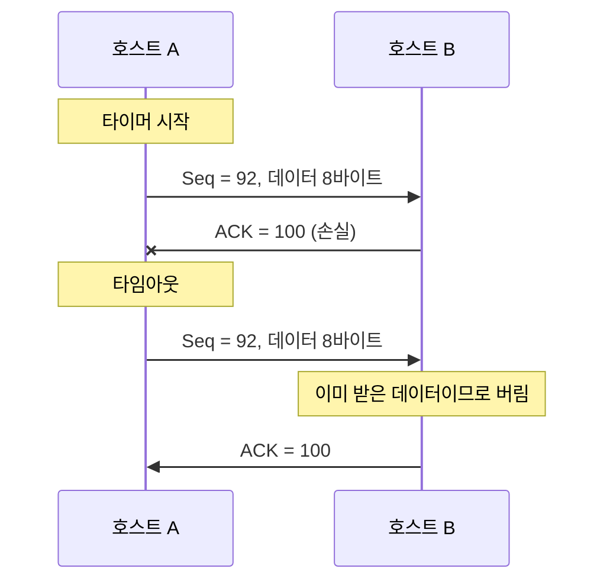

*그림 24. 확인 응답이 손실되어 재전송하는 경우*

**세그먼트 100은 재전송하지 않는 경우.** A가 세그먼트 두 개를 연달아 보낸다. 첫 세그먼트는 순서 번호 92와 데이터 8바이트, 두 번째는 순서 번호 100과 데이터 20바이트이다. 두 세그먼트 모두 B에 무사히 도착하고 B는 각각에 대해 확인 응답 번호 100과 120인 확인 응답 두 개를 보낸다. 두 확인 응답이 모두 타임아웃 전에 A에 도착하지 못하면, 타임아웃이 일어날 때 A는 순서 번호 92인 첫 세그먼트를 다시 보내고 타이머를 다시 시작한다. 두 번째 세그먼트의 ACK가 새 타임아웃 전에 도착하면 두 번째 세그먼트는 다시 보내지 않는다.

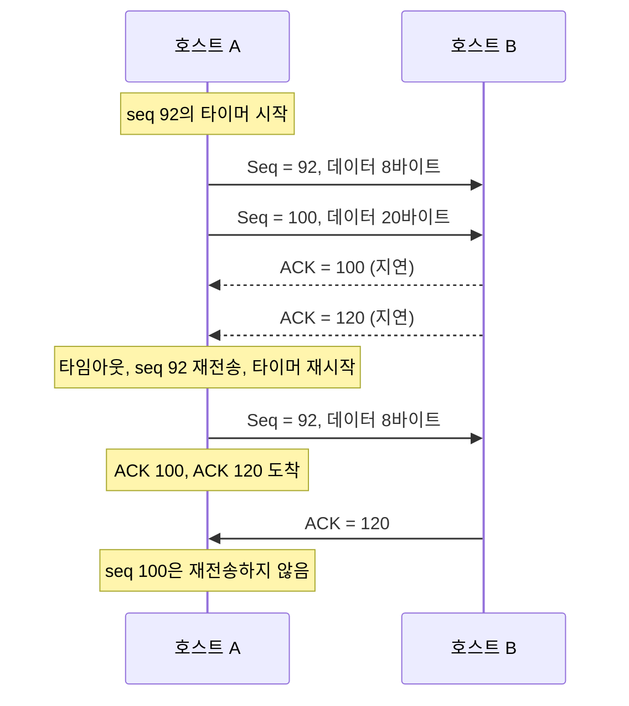

*그림 25. 지연된 확인 응답 때문에 첫 세그먼트만 재전송하고 두 번째는 재전송하지 않는 경우*

**누적 확인 응답이 재전송을 막는 경우.** A가 앞의 예와 똑같이 세그먼트 두 개를 보낸다. 첫 세그먼트의 확인 응답은 네트워크에서 손실되지만, 타임아웃 직전에 A가 확인 응답 번호 120인 확인 응답을 받는다. 따라서 A는 B가 119번 바이트까지 모두 받았다는 것을 알고 두 세그먼트 모두 다시 보내지 않는다.

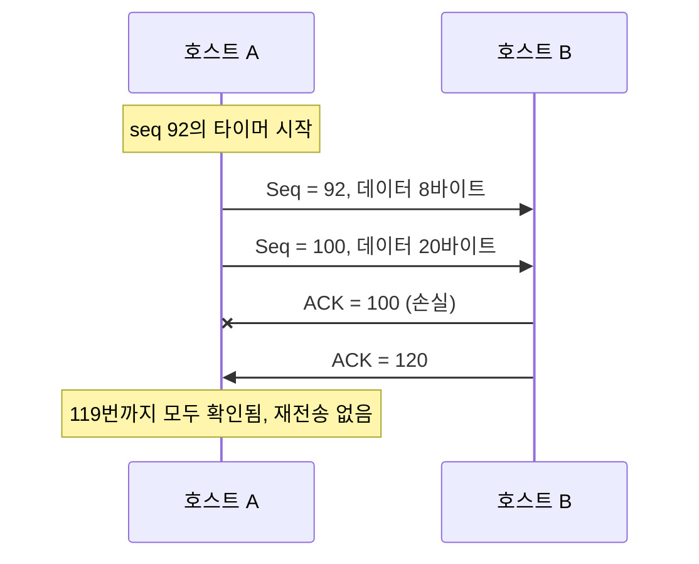

*그림 26. 누적 확인 응답 덕분에 첫 세그먼트를 재전송하지 않는 경우*

### 9.7 타임아웃 간격 두 배로 늘리기

대부분의 TCP 구현이 쓰는 첫 번째 변경은 타이머가 끝난 뒤의 타임아웃 간격 길이에 관한 것이다. 타임아웃 사건이 일어나면 TCP는 앞에서처럼 순서 번호가 가장 작은 미확인 세그먼트를 다시 보낸다. 그러나 다시 보낼 때마다 다음 타임아웃 간격을 마지막 `EstimatedRTT`와 `DevRTT`(10절)로 계산하지 않고 이전 값의 두 배로 정한다. 예를 들어 가장 오래된 미확인 세그먼트의 `TimeoutInterval`이 처음 타이머가 끝날 때 0.75초였다면, TCP는 이 세그먼트를 다시 보내고 새 만료 시간을 1.5초로 정한다. 1.5초 뒤 타이머가 다시 끝나면 다시 보내고 만료 시간을 3.0초로 정한다. 즉 재전송할 때마다 간격이 지수적으로 커진다. 그러나 나머지 두 사건(응용에서 데이터를 받음, ACK를 받음) 뒤에 타이머를 시작할 때는 `TimeoutInterval`을 가장 최근의 `EstimatedRTT`와 `DevRTT`로 계산한다.

이 변경은 제한된 형태의 혼잡 제어 역할을 한다(9장). 타이머 만료는 대개 네트워크의 혼잡, 즉 출발지와 목적지 사이 경로의 라우터 큐에 너무 많은 패킷이 도착하여 패킷이 버려지거나 큐잉 지연이 길어지는 것 때문에 일어난다. 혼잡할 때 출발지들이 패킷을 끈질기게 계속 다시 보내면 혼잡이 더 심해질 수 있다. 대신 TCP는 송신자가 점점 더 긴 간격을 두고 다시 보내게 하여 더 정중하게 행동한다. 18장의 이더넷 CSMA/CD도 비슷한 생각을 쓴다.

### 9.8 빠른 재전송

타임아웃에 의한 재전송의 문제 하나는 타임아웃 기간이 비교적 길 수 있다는 것이다. 세그먼트가 손실되면 긴 타임아웃 때문에 송신자는 손실된 패킷을 늦게 다시 보내게 되어 종단 간 지연이 커진다. 다행히 송신자는 이른바 중복 ACK(7장)를 보고 타임아웃 전에 패킷 손실을 알아챌 수 있는 경우가 많다.

TCP 수신자가 기대한 다음 순서 번호보다 큰 순서 번호의 세그먼트를 받으면 데이터 스트림의 빈틈, 즉 빠진 세그먼트를 발견한 것이다. 이 빈틈은 네트워크 안에서 세그먼트가 손실되었거나 순서가 바뀐 결과일 수 있다. TCP는 부정 확인 응답을 쓰지 않으므로 수신자는 명시적인 NAK를 보낼 수 없고, 대신 자신이 받은 마지막 순서에 맞는 데이터 바이트를 다시 확인한다(중복 ACK를 만든다, 규칙 4). 송신자는 보통 많은 세그먼트를 연달아 보내므로, 세그먼트 하나가 손실되면 연달아 많은 중복 ACK가 생길 가능성이 크다.

> **용어 정의:** **빠른 재전송(fast retransmit)** 은 TCP 송신자가 같은 데이터에 대한 중복 ACK 세 개를 받으면, 세 번 확인된 세그먼트 다음 세그먼트가 손실되었다고 보고 그 세그먼트의 타이머가 끝나기 전에 즉시 다시 보내는 기법이다.

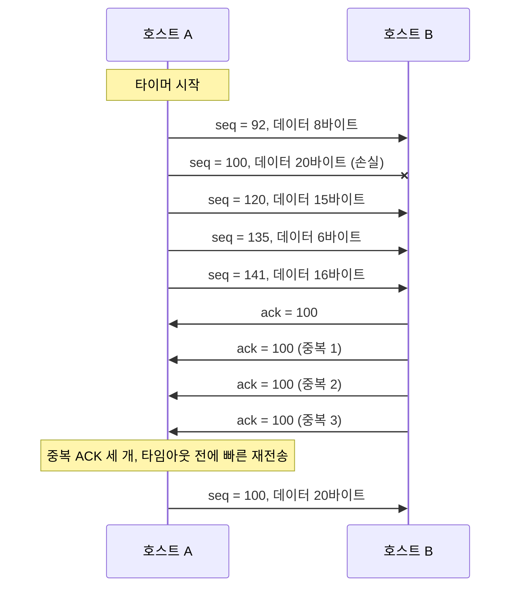

*그림 27. 세그먼트의 타이머가 끝나기 전에 빠진 세그먼트를 다시 보내는 빠른 재전송*

그림 27에서 두 번째 세그먼트가 손실되고, 그 세그먼트는 타이머가 끝나기 전에 재전송된다. 첫 ack = 100은 seq 92 세그먼트에 대한 원래 확인 응답이고, 뒤의 세 개는 seq 120, 135, 141 세그먼트가 순서가 어긋나 도착할 때마다 생긴 중복 ACK이다. 빠른 재전송을 쓰는 TCP에서는 그림 23의 ACK 수신 사건을 다음 코드로 바꾼다.

```text
event: ACK received, with ACK field value of y
    if (y > SendBase) {
        SendBase = y
        if (there are currently any not yet acknowledged segments)
            start timer
    }
    else { /* a duplicate ACK for already ACKed segment */
        increment number of duplicate ACKs received for y
        if (number of duplicate ACKs received for y == 3)
            /* TCP fast retransmit */
            resend segment with sequence number y
    }
    break;
```

중복 ACK 하나가 아니라 세 개를 기다리는 이유는 중복 ACK가 세그먼트 손실뿐 아니라 네트워크 안에서 세그먼트의 순서가 바뀐 경우에도 생기기 때문이다. 세그먼트 몇 개가 조금 늦게 도착하는 재정렬이면 중복 ACK가 한두 개 생긴 뒤 빠진 세그먼트가 도착하여 빈틈이 채워진다. 중복 ACK 세 개를 기다리면 단순한 재정렬을 손실로 잘못 판단하여 불필요하게 재전송할 가능성을 줄이면서도 타임아웃보다 훨씬 빨리 손실에 대응할 수 있다.

> **참고:** Kurose와 Ross는 TCP가 긍정 확인 응답과 타이머를 7장에서 다룬 방식과 거의 같게 쓴다고 정리한다. 일부 TCP는 빠른 재전송으로 암묵적인 NAK 메커니즘도 가진다. 어떤 세그먼트에 대한 중복 ACK 세 개는 다음 세그먼트에 대한 암묵적인 NAK 역할을 하여 타임아웃 전에 그 세그먼트의 재전송을 일으킨다.

### 9.9 ACK 규칙으로 본 오류 제어 시나리오

Forouzan은 9.3절의 ACK 생성 규칙이 실제로 어떻게 적용되는지 여러 시나리오로 보여 준다. 아래 그림에서 데이터를 담은 세그먼트는 바이트 번호 범위와 확인 응답 필드 값으로, 확인 응답만 담은 세그먼트는 확인 응답 번호로 나타낸다.

**정상 동작.** 첫 시나리오는 두 시스템 사이의 양방향 데이터 전송이다. 클라이언트 TCP는 세그먼트 하나를, 서버 TCP는 세 개를 보낸다.

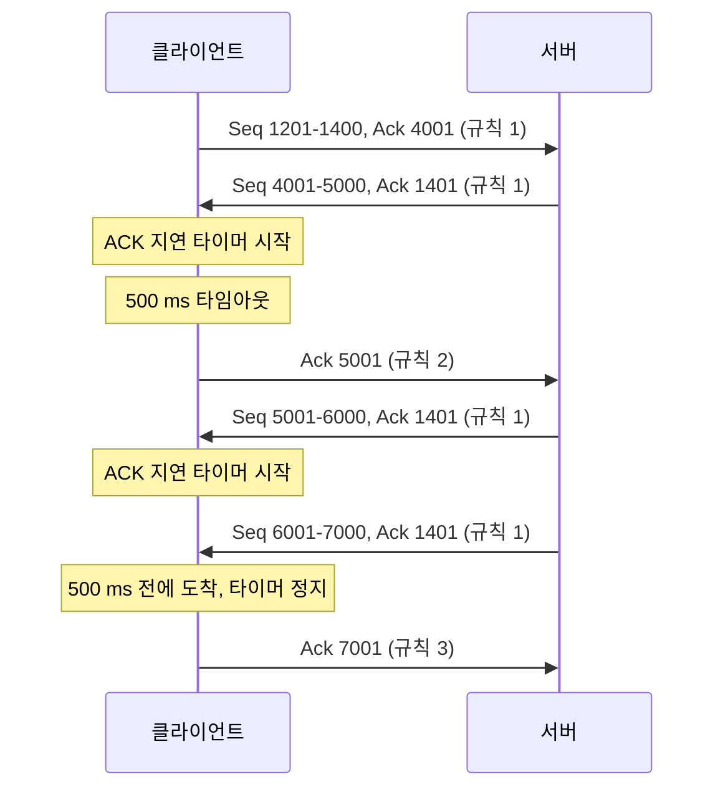

*그림 28. 양방향 데이터 전송의 정상 동작과 ACK 규칙*

클라이언트의 첫 세그먼트와 서버의 세 세그먼트에는 규칙 1이 적용된다. 보낼 데이터가 있으므로 세그먼트가 다음에 기대하는 바이트를 함께 알린다. 클라이언트는 서버의 첫 세그먼트를 받았을 때 더 보낼 데이터가 없어 ACK 세그먼트만 보내면 되지만, 규칙 2에 따라 다른 세그먼트가 오는지 보기 위해 500 ms 동안 확인 응답을 미룬다. ACK 지연 타이머가 끝나면 확인 응답을 보낸다. 클라이언트는 다른 세그먼트가 올지 모르므로 확인 응답을 무한정 미룰 수는 없다. 다음 세그먼트가 도착하면 ACK 지연 타이머를 다시 설정하지만, 타이머가 끝나기 전에 세 번째 세그먼트가 도착하므로 규칙 3에 따라 확인 응답을 즉시 보낸다. 손실되거나 지연된 세그먼트가 없으므로 RTO 타이머는 그림에 나타내지 않았다.

**손실된 세그먼트.** 손실된 세그먼트와 손상된 세그먼트는 수신자에게 똑같이 다루어진다. 손실된 세그먼트는 네트워크 어딘가에서 버려지고 손상된 세그먼트는 수신자가 버리며, 둘 다 손실로 간주된다. 데이터 전송이 단방향이어서 한쪽은 보내기만 하고 다른 쪽은 받기만 한다고 가정한다.

```mermaid
sequenceDiagram
    participant C as 클라이언트 (RTO)
    participant S as 서버 (수신 버퍼)
    Note over C: RTO 시작
    C->>S: Seq 501-600
    C->>S: Seq 601-700
    S->>C: Ack 701 (규칙 3)
    Note over C: RTO 정지, 다시 시작
    C-xS: Seq 701-800 (손실)
    C->>S: Seq 801-900
    Note over S: 순서가 어긋남, 빈틈을 남기고 보관
    S->>C: Ack 701 (규칙 4)
    Note over C: 타임아웃, 재시작
    C->>S: Seq 701-800 (재전송)
    Note over S: 빈틈이 채워짐
    S->>C: Ack 901 (규칙 5)
    Note over C: RTO 정지
```

*그림 29. 세그먼트가 손실된 경우의 재전송과 ACK 규칙*

송신자는 세그먼트 1과 2를 보내고, 수신자는 이를 ACK로 즉시 확인한다(규칙 3). 그러나 세그먼트 3이 손실된다. 수신자는 순서가 어긋난 세그먼트 4를 받아 그 데이터를 버퍼에 저장하되 데이터가 이어지지 않음을 나타내는 빈틈을 남기고, 다음에 기대하는 바이트를 알리는 확인 응답을 즉시 보낸다(규칙 4). 수신자는 801\~900번 바이트를 저장하지만 빈틈이 채워지기 전에는 이 바이트를 응용에 넘기지 않는다.

> **핵심:** 수신 TCP는 순서에 맞는 데이터만 프로세스에 넘긴다.

송신 TCP는 연결 기간 전체에 RTO 타이머 하나를 유지한다. 세 번째 세그먼트의 타이머가 끝나면 송신 TCP는 세그먼트 3을 다시 보내며, 이번에는 세그먼트가 도착하여 올바르게 확인된다(규칙 5).

**빠른 재전송.** 이 시나리오는 RTO 값이 더 크다는 점만 빼면 앞의 시나리오와 같다.

```mermaid
sequenceDiagram
    participant C as 클라이언트 (RTO)
    participant S as 서버 (수신 버퍼)
    Note over C: RTO 시작
    C->>S: Seq 101-200
    C->>S: Seq 201-300
    S->>C: Ack 301 (원래 ACK)
    Note over C: RTO 정지, 다시 시작
    C-xS: Seq 301-400 (손실)
    C->>S: Seq 401-500
    S->>C: Ack 301 (첫 번째 중복)
    C->>S: Seq 501-600
    S->>C: Ack 301 (두 번째 중복)
    C->>S: Seq 601-700
    S->>C: Ack 301 (세 번째 중복)
    Note over C: 빠른 재전송, RTO 재시작
    C->>S: Seq 301-400 (재전송)
    Note over S: 모두 순서대로 정렬됨
    S->>C: Ack 701
    Note over C: RTO 정지
```

*그림 30. 중복 ACK 세 개에 의한 빠른 재전송과 ACK 규칙*

수신자는 네 번째, 다섯 번째, 여섯 번째 세그먼트를 받을 때마다 확인 응답을 보낸다(규칙 4). 송신자는 값이 같은 확인 응답 네 개(중복 세 개)를 받는다. 타이머가 끝나지 않았더라도 빠른 재전송 규칙에 따라 이 중복 확인 응답들이 모두 기다리는 세그먼트 3을 즉시 다시 보낸다. 세그먼트를 다시 보낸 뒤 타이머를 다시 시작한다.

**지연된 세그먼트와 중복 세그먼트.** TCP는 비연결형 프로토콜인 IP의 서비스를 쓴다. TCP 세그먼트를 캡슐화한 각 IP 데이터그램은 서로 다른 경로로 서로 다른 지연을 겪으며 목적지에 갈 수 있으므로 TCP 세그먼트가 지연될 수 있다. 지연된 TCP 세그먼트는 수신자에게 손실되거나 손상된 세그먼트와 똑같이 다루어지며, 타임아웃이 일어나 이미 다시 보내진 뒤에 도착하면 중복 세그먼트가 된다. 중복 세그먼트는 예를 들어 송신 TCP가 지연된 세그먼트를 손실로 보고 다시 보낼 때 생긴다. 목적지 TCP는 연속된 바이트 스트림을 기대하므로, 이미 받아 저장한 세그먼트와 순서 번호가 같은 세그먼트, 또는 이미 확인한 바이트보다 작은 순서 번호를 담은 세그먼트가 도착하면 버리고, 다음에 기대하는 바이트를 정의하는 ackNo를 담은 ACK를 보낸다(규칙 6).

**자동으로 바로잡히는 확인 응답 손실.** 손실된 확인 응답의 정보가 다음 확인 응답에 담기는 경우로, 누적 확인 응답을 쓰는 핵심적인 이점이다. TCP의 확인 응답 메커니즘에서는 확인 응답이 손실되어도 출발지 TCP가 알아채지 못할 수도 있다. 다음 확인 응답이 확인 응답의 손실을 자동으로 바로잡는다고 할 수 있다.

```mermaid
sequenceDiagram
    participant C as 클라이언트 (RTO)
    participant S as 서버
    Note over C: RTO 시작
    C->>S: Seq 501-600
    C->>S: Seq 601-700
    S-xC: Ack 701 (손실)
    C->>S: Seq 701-800
    C->>S: Seq 801-900
    S->>C: Ack 901
    Note over C: 누적 ACK가 701까지도 확인, RTO 정지
```

*그림 31. 다음 누적 확인 응답이 손실된 확인 응답을 자동으로 바로잡는 경우*

**세그먼트 재전송으로 바로잡히는 확인 응답 손실.** 다음 확인 응답이 오랫동안 지연되거나 다음 확인 응답이 없으면(손실된 확인 응답이 마지막으로 보낸 것이면) RTO 타이머가 바로잡는다. 그 결과 중복 세그먼트가 생긴다. 수신자는 중복 세그먼트를 받으면 버리고 마지막 ACK를 즉시 다시 보내(규칙 6) 송신자에게 세그먼트들을 받았음을 알린다.

```mermaid
sequenceDiagram
    participant C as 클라이언트 (RTO)
    participant S as 서버
    Note over C: RTO 시작
    C->>S: Seq 501-600
    C->>S: Seq 601-700
    S-xC: Ack 701 (손실)
    Note over C: 타임아웃, 재시작
    C->>S: Seq 501-600 (재전송)
    Note over S: 중복 세그먼트, 버림
    S->>C: Ack 701 (규칙 6)
    Note over C: RTO 정지
```

*그림 32. 세그먼트를 다시 보내 확인 응답 손실을 바로잡는 경우*

확인되지 않은 세그먼트가 두 개인데도 하나만 다시 보낸다는 점에 주목할 필요가 있다. 송신자가 다시 보낸 ACK를 받으면, 확인 응답이 누적적이므로 두 세그먼트가 모두 무사히 도착했음을 안다.

**확인 응답 손실에 의한 교착 상태.** 확인 응답의 손실이 시스템의 교착 상태를 일으킬 수 있는 상황이 하나 있다. 수신자가 rwnd를 0으로 한 확인 응답을 보내 송신자에게 윈도우를 일시적으로 닫으라고 요청한 경우이다. 잠시 뒤 수신자가 제한을 풀고 싶지만 보낼 데이터가 없으면, 0이 아닌 rwnd 값을 담은 ACK 세그먼트를 보내 제한을 푼다. 이 확인 응답이 손실되면 문제가 생긴다. 송신자는 0이 아닌 rwnd를 알리는 확인 응답을 기다리고, 수신자는 송신자가 이를 받았다고 생각하여 데이터를 기다린다. 양쪽이 서로의 응답을 기다리며 아무 일도 일어나지 않는 이 상황을 교착 상태(deadlock)라고 한다. 확인 응답에는 재전송 타이머가 설정되지 않는다. 교착 상태를 막기 위해 지속 타이머가 고안되었다(10.6절).

> **핵심:** 손실된 확인 응답은 제대로 처리하지 않으면 교착 상태를 일으킬 수 있다.

### 9.10 송신자와 수신자의 단순화된 FSM

Forouzan은 7장의 SR 프로토콜과 비슷하지만 TCP에 맞게 바꾼 단순화된 FSM을 제시한다. 통신은 단방향이고 세그먼트는 ACK 세그먼트로 확인되며, 선택적 확인 응답과 혼잡 제어, 어리석은 윈도우 증후군(Nagle 알고리즘, Clark의 해결책), 윈도우 닫기는 무시한다. 모든 계산은 modulo $`2^{32}`$로 한다.

| 쪽 | 사건 | 동작 |
|:-----|:-----|:-----|
| 송신자 | 응용에서 데이터 덩어리를 받음 (Ready 상태) | seqNo = $`S_n`$인 세그먼트를 만들어 사본을 큐에 저장하고 보냄. 큐의 첫 세그먼트이면 타이머 시작. $`S_n`$ = $`S_n`$ + 데이터 길이. 윈도우가 가득 차면 Blocking 상태로 감 |
| 송신자 | 타임아웃 | 큐의 첫 세그먼트를 다시 보내고 타이머 재설정 |
| 송신자 | 큐의 첫 세그먼트를 확인하는 오류 없는 ACK | 윈도우를 미끄러뜨리고($`S_f`$ = ackNo) rwnd에 따라 윈도우 크기 조정. 확인된 세그먼트를 큐에서 지우고, 큐에 세그먼트가 남아 있으면 타이머 재시작, 없으면 정지. Blocking 상태였으면 Ready 상태로 감 |
| 송신자 | 중복 ACK | dupNo = dupNo + 1. dupNo = 3이면 큐 맨 앞의 세그먼트를 다시 보내고 타이머를 다시 시작하며 dupNo = 0 |
| 송신자 | 손상된 ACK | 버림 |
| 수신자 | 기대한 오류 없는 세그먼트 | ACK 지연 타이머가 돌고 있으면 멈추고 누적 ACK를 보냄. 아니면 ACK 지연 타이머 시작 (규칙 2, 3) |
| 수신자 | ACK 지연 타이머 만료 | 미룬 ACK를 보냄 |
| 수신자 | 오류 없지만 순서가 어긋난 세그먼트 | 중복이 아니면 저장하고, 기대하는 세그먼트의 순서 번호로 ACK를 보냄 (중복 ACK, 규칙 4) |
| 수신자 | 오류 없는 중복 세그먼트 또는 윈도우 밖의 순서 번호를 가진 세그먼트 | 버리고, 기대하는 세그먼트의 순서 번호로 ACK를 보냄 (규칙 6) |
| 수신자 | 손상된 세그먼트 | 버림 |
| 수신자 | 프로세스의 전달 요청 | 순서에 맞게 쌓인 데이터를 프로세스에 넘김 |

*표 7. TCP 송신자와 수신자의 단순화된 FSM이 처리하는 사건과 동작*

이 FSM이 7장의 SR FSM과 다른 점은 송신자의 빠른 재전송(중복 ACK 세 개), rwnd에 따른 윈도우 크기 조정, 수신자의 ACK 지연, 그리고 송신자가 빠른 재전송을 할 수 있도록 수신자가 중복 ACK를 보내는 것이다. 양방향 통신의 수신자 FSM은 보낼 데이터가 있으면 즉시 ACK를 보내는 등의 정책을 더 고려해야 하므로 SR만큼 단순하지 않다.

### 9.11 TCP는 GBN인가 SR인가

TCP의 확인 응답은 누적적이고 순서가 어긋났지만 올바르게 받은 세그먼트는 수신자가 개별적으로 확인하지 않는다. 따라서 TCP 송신자는 보냈지만 확인되지 않은 바이트의 가장 작은 순서 번호(`SendBase`)와 다음에 보낼 바이트의 순서 번호(`NextSeqNum`)만 유지하면 된다. 이 점에서 TCP는 GBN 방식과 매우 비슷해 보인다. 그러나 TCP와 GBN 사이에는 두드러진 차이가 있다.

- 많은 TCP 구현은 순서가 어긋났지만 올바르게 받은 세그먼트를 버퍼에 보관한다.
- 송신자가 세그먼트 1, 2, ..., N을 보내 모두 순서대로 오류 없이 수신자에 도착했는데, 패킷 n < N에 대한 확인 응답만 손실되고 나머지 N - 1개의 확인 응답은 각자의 타임아웃 전에 송신자에 도착했다고 하자. GBN은 패킷 n뿐 아니라 그 뒤의 n + 1, n + 2, ..., N까지 모두 다시 보낸다. TCP는 많아야 세그먼트 n 하나만 다시 보내며, 세그먼트 n의 타임아웃 전에 세그먼트 n + 1의 확인 응답이 도착하면 세그먼트 n도 다시 보내지 않는다.

TCP의 변경으로 제안된 선택적 확인 응답(11.6절)은 TCP 수신자가 마지막으로 올바르게 받은 순서에 맞는 세그먼트를 누적적으로 확인하는 대신 순서가 어긋난 세그먼트를 선택적으로 확인하게 한다. 이를 수신자가 이미 선택적으로 확인한 세그먼트의 재전송을 건너뛰는 선택적 재전송과 결합하면 TCP는 일반적인 SR 프로토콜과 매우 비슷해진다. 따라서 Kurose와 Ross는 TCP의 오류 복구 메커니즘을 GBN과 SR 프로토콜의 혼합으로 분류하는 것이 가장 적절하다고 본다. Forouzan도 TCP가 순서가 어긋난 세그먼트를 받아들이므로 SR처럼 동작하고, 원래의 확인 응답이 누적적이라는 점에서 GBN과 조금 닮았으며, SACK를 쓰면 SR에 가장 가깝다고 정리한다.

> **핵심:** TCP는 Selective Repeat 프로토콜로 모델링하는 것이 가장 적절하다.

---

<br>

## 10. RTT 추정과 타이머

TCP는 7장의 rdt 프로토콜처럼 타임아웃과 재전송 메커니즘으로 손실된 세그먼트를 복구한다. 개념은 단순하지만 실제 프로토콜에 구현하면 미묘한 문제가 많다. 가장 분명한 문제는 타임아웃 간격의 길이이다. 타임아웃은 연결의 왕복 시간(RTT), 즉 세그먼트를 보낸 때부터 그 세그먼트가 확인될 때까지의 시간보다 커야 한다. 그렇지 않으면 불필요한 재전송이 일어난다. 그러면 얼마나 커야 하는가. RTT는 어떻게 추정하는가. 미확인 세그먼트마다 타이머를 두어야 하는가.

> **용어 정의:** **재전송 타임아웃(retransmission timeout, RTO)** 은 송신자가 세그먼트를 보낸 뒤 확인 응답을 기다리는 시간으로, 이 시간이 지나면 세그먼트를 다시 보낸다. TCP는 RTT의 측정값으로부터 이 값을 동적으로 계산한다.

### 10.1 RTT 표본

세그먼트의 표본 RTT(`SampleRTT`)는 세그먼트를 보낸 때(IP에 넘긴 때)부터 그 세그먼트의 확인 응답을 받을 때까지의 시간이다. Forouzan은 이를 측정 RTT($`RTT_M`$)라고 부른다. 세그먼트와 확인 응답은 일대일로 대응하지 않으며 여러 세그먼트가 함께 확인될 수 있다. 세그먼트의 측정 RTT는 그 세그먼트가 목적지에 도달하여 확인되는 데 걸리는 시간이며, 확인 응답이 다른 세그먼트도 함께 확인하더라도 마찬가지이다.

- 대부분의 TCP 구현은 보내는 세그먼트마다 `SampleRTT`를 재지 않고 한 번에 하나만 잰다. 즉 어느 순간에도 보냈지만 확인되지 않은 세그먼트 가운데 하나에 대해서만 `SampleRTT`를 추정하므로, 대략 RTT마다 한 번 새 `SampleRTT`를 얻는다.
- TCP는 재전송한 세그먼트의 `SampleRTT`는 계산하지 않고 한 번만 보낸 세그먼트에 대해서만 잰다(10.5절의 Karn 알고리즘).

> **핵심:** TCP에서는 어느 순간에도 진행 중인 RTT 측정이 하나뿐이다.

### 10.2 RTT 추정값

`SampleRTT` 값은 라우터의 혼잡과 종단 시스템의 부하 변화 때문에 세그먼트마다 요동치므로, 어떤 한 값은 전형적이지 않을 수 있다. 전형적인 RTT를 추정하려면 `SampleRTT` 값들의 평균을 내는 것이 자연스럽다. TCP는 새 `SampleRTT`를 얻을 때마다 그 평균인 `EstimatedRTT`(Forouzan의 평활 RTT, $`RTT_S`$)를 다음 식으로 갱신한다.

```math
\text{EstimatedRTT} = (1 - \alpha) \cdot \text{EstimatedRTT} + \alpha \cdot \text{SampleRTT}
```

이 식은 프로그래밍 언어의 대입문 형식으로, 새 `EstimatedRTT`는 이전 `EstimatedRTT`와 새 `SampleRTT`의 가중 결합이다. 권장되는 $`\alpha`$ 값은 0.125(1/8)이며, 이때 식은 다음과 같다.

```math
\text{EstimatedRTT} = 0.875 \cdot \text{EstimatedRTT} + 0.125 \cdot \text{SampleRTT}
```

`EstimatedRTT`는 `SampleRTT` 값들의 가중 평균이며, 이 가중 평균은 오래된 표본보다 최근 표본에 더 큰 가중치를 준다. 최근 표본이 네트워크의 현재 혼잡을 더 잘 반영하므로 자연스럽다. 통계학에서는 이런 평균을 **지수 가중 이동 평균(exponential weighted moving average, EWMA)** 이라고 한다. 식을 되풀이해 펼치면 $`k`$번 전의 표본에는 $`0.125 \times 0.875^k`$의 가중치가 붙으므로 가장 최근 표본부터 0.125, 0.109, 0.096, 0.084, ...로 가중치가 지수적으로 빠르게 줄어든다. 첫 측정 뒤에는 `EstimatedRTT` = `SampleRTT`로 둔다(Forouzan).

### 10.3 RTT 편차와 재전송 타임아웃

RTT의 추정값뿐 아니라 RTT의 변동성을 나타내는 값도 있으면 좋다. RTT 편차 `DevRTT`(Forouzan의 $`RTT_D`$)는 `SampleRTT`가 `EstimatedRTT`에서 보통 얼마나 벗어나는지 추정한 값이다.

```math
\text{DevRTT} = (1 - \beta) \cdot \text{DevRTT} + \beta \cdot \lvert \text{SampleRTT} - \text{EstimatedRTT} \rvert
```

`DevRTT`는 `SampleRTT`와 `EstimatedRTT`의 차의 EWMA이다. `SampleRTT` 값의 요동이 작으면 `DevRTT`도 작고, 요동이 크면 `DevRTT`도 크다. 권장되는 $`\beta`$ 값은 0.25이다. Forouzan에 따르면 첫 측정 뒤에는 `DevRTT` = `SampleRTT` / 2로 둔다.

타임아웃 간격은 `EstimatedRTT`보다 크거나 같아야 하며, 그렇지 않으면 불필요한 재전송이 일어난다. 그러나 `EstimatedRTT`보다 지나치게 크면 세그먼트가 손실되었을 때 TCP가 빨리 다시 보내지 못해 데이터 전송 지연이 커진다. 따라서 타임아웃을 `EstimatedRTT`에 어떤 여유를 더한 값으로 정하되, `SampleRTT` 값의 요동이 크면 여유를 크게, 작으면 작게 두는 것이 바람직하다. TCP는 이 모든 점을 고려하여 재전송 타임아웃 간격을 다음과 같이 정한다.

```math
\text{TimeoutInterval} = \text{EstimatedRTT} + 4 \cdot \text{DevRTT}
```

초기 `TimeoutInterval` 값은 1초가 권장된다(Kurose와 Ross). 타임아웃이 일어나면 곧 확인될 다음 세그먼트에 너무 이른 타임아웃이 일어나지 않도록 `TimeoutInterval`을 두 배로 늘린다(9.7절). 그러나 세그먼트를 받아 `EstimatedRTT`가 갱신되면 `TimeoutInterval`을 다시 위 식으로 계산한다.

| 의미 | Kurose와 Ross | Forouzan |
|:-----|:-----|:-----|
| 측정한 RTT | `SampleRTT` | $`RTT_M`$ |
| 평활한 RTT | `EstimatedRTT` | $`RTT_S`$ |
| RTT 편차 | `DevRTT` | $`RTT_D`$ |
| 재전송 타임아웃 | `TimeoutInterval` | RTO |

*표 8. RTT 추정 변수의 두 교재 표기 대응*

> **참고:** `EstimatedRTT`와 `DevRTT`를 갱신하는 순서에 따라 `DevRTT` 값이 조금 달라진다. 이 노트의 계산은 Forouzan의 예제처럼 `EstimatedRTT`를 먼저 갱신하고 그 새 값을 `DevRTT` 식에 넣는다.

### 10.4 계산 예

Forouzan의 예로 연결 설정과 데이터 전송 일부에서 변수가 어떻게 바뀌는지 본다.

```mermaid
sequenceDiagram
    participant S as 송신자
    participant R as 수신자
    Note over S: RTT 값 없음, RTO = 6.00
    S->>R: SYN, Seq 1400
    R->>S: SYN + ACK, Seq 4000, Ack 1401
    Note over S: RTTM = 1.5, RTTS = 1.50, RTTD = 0.75, RTO = 4.50
    S->>R: ACK, Seq 1401, Ack 4001
    Note over S: 새 RTT 측정 시작
    S->>R: 데이터 1401-1500, Ack 4001
    S->>R: 데이터 1501-1600, Ack 4001
    R->>S: ACK, Seq 4001, Ack 1601
    Note over S: RTTM = 2.50, RTTS = 1.625, RTTD = 0.78, RTO = 4.75
```

*그림 33. 연결 설정과 데이터 전송 중의 RTT 추정 (단위: 초)*

1. SYN 세그먼트를 보낼 때는 $`RTT_M`$, $`RTT_S`$, $`RTT_D`$에 값이 없으며 RTO는 6.00초로 둔다.
2. SYN + ACK 세그먼트가 도착하면 $`RTT_M`$을 측정하며 1.5초이다. 첫 측정이므로 다음과 같다.

```math
RTT_S = 1.5, \quad RTT_D = \frac{1.5}{2} = 0.75, \quad RTO = 1.5 + 4 \times 0.75 = 4.5
```

3. 첫 데이터 세그먼트를 보낼 때 새 RTT 측정을 시작한다. ACK 세그먼트를 보낼 때는 RTT 측정을 시작하지 않는다. ACK 세그먼트는 순서 번호를 소비하지 않고 타임아웃도 없기 때문이다. 이미 측정이 진행 중이므로 두 번째 데이터 세그먼트에 대해서도 측정을 시작하지 않는다. 마지막 ACK 세그먼트는 두 데이터 세그먼트를 모두(누적적으로) 확인하지만, 그 도착이 첫 세그먼트의 $`RTT_M`$ 값을 확정한다. $`RTT_M`$ = 2.5초이므로 다음과 같다.

```math
\begin{aligned}
RTT_S &= \tfrac{7}{8} \times 1.5 + \tfrac{1}{8} \times 2.5 = 1.625 \\
RTT_D &= \tfrac{3}{4} \times 0.75 + \tfrac{1}{4} \times \lvert 1.625 - 2.5 \rvert = 0.5625 + 0.21875 = 0.78125 \\
RTO &= 1.625 + 4 \times 0.78125 = 4.75
\end{aligned}
```

> **참고:** Forouzan의 교재는 $`RTT_D`$를 0.78로 반올림하므로 RTO가 1.625 + 4 × 0.78 = 4.745가 되고, 이를 4.74초로 적는다. 반올림하지 않은 $`RTT_D`$ = 0.78125를 쓰면 RTO는 정확히 4.75초이며, 차이는 반올림에서만 생긴다. 10.5절의 그림 34는 교재의 값 4.74초와 2 × 4.74 = 9.48초를 그대로 쓰며, 반올림하지 않으면 각각 4.75초와 2 × 4.75 = 9.50초이다.

### 10.5 Karn 알고리즘과 지수 백오프

세그먼트가 재전송 타임아웃 기간 안에 확인되지 않아 재전송되었다고 하자. 송신 TCP가 이 세그먼트의 확인 응답을 받으면, 그것이 원래 세그먼트에 대한 것인지 재전송한 세그먼트에 대한 것인지 알 수 없다. 원래 세그먼트가 손실되었고 확인 응답이 재전송에 대한 것이라면 RTT를 재전송한 때부터 계산해야 하므로 모호함이 생긴다. Karn이 이 모호함을 해결했다.

> **용어 정의:** **Karn 알고리즘(Karn's algorithm)** 은 재전송한 세그먼트의 왕복 시간을 RTT 추정 계산에 쓰지 않고, 재전송 없이 보내고 확인받은 세그먼트를 얻을 때까지 $`RTT_S`$를 갱신하지 않는 규칙이다.

재전송이 일어나면 RTO는 어떻게 되는가. 대부분의 TCP 구현은 **지수 백오프(exponential backoff)** 전략을 써서 재전송할 때마다 RTO를 두 배로 늘린다. 한 번 재전송하면 RTO의 두 배, 두 번 재전송하면 네 배가 되는 식이다. 9.7절의 타임아웃 간격 두 배 늘리기가 이것이다.

10.4절의 예를 이어 보면 다음과 같다.

```mermaid
sequenceDiagram
    participant S as 송신자
    participant R as 수신자
    Note over S: 이전 값 RTTM = 2.50, RTTS = 1.625, RTTD = 0.78, RTO = 4.74
    Note over S: 타이머 시작
    S-xR: 데이터 1601-1700, Seq 1601, Ack 4001 (손실)
    Note over S: 타임아웃, RTO = 2 × 4.74 = 9.48 (지수 백오프)
    S->>R: 데이터 1601-1700 (재전송)
    R->>S: ACK, Seq 4001, Ack 1701
    Note over S: 타이머 정지, RTO = 9.48 유지 (Karn 알고리즘)
    Note over S: 타이머 시작
    S->>R: 데이터 1701-1800, Seq 1701, Ack 4001
    R->>S: ACK, Seq 4001, Ack 1801
    Note over S: RTTM = 4.00, RTTS = 1.92, RTTD = 1.105, RTO = 6.34
```

*그림 34. 지수 백오프와 Karn 알고리즘 (단위: 초, 교재의 반올림 값)*

첫 세그먼트는 보냈지만 손실된다. RTO 타이머가 4.74초 뒤에 끝나면 세그먼트를 다시 보내고 타이머를 이전 RTO의 두 배인 9.48초로 설정한다. 이번에는 타임아웃 전에 ACK를 받는다. 그러나 이 ACK는 재전송한 세그먼트에 대한 것일 수 있으므로 RTT 계산에 쓰지 않고(Karn 알고리즘), 새 세그먼트를 보내 재전송 없이 ACK를 받을 때까지 RTO를 다시 계산하지 않는다. 다음 세그먼트의 $`RTT_M`$이 4.00초이면 새 값은 다음과 같다(교재처럼 이전 값 $`RTT_S`$ = 1.625, $`RTT_D`$ = 0.78을 씀).

```math
\begin{aligned}
RTT_S &= \tfrac{7}{8} \times 1.625 + \tfrac{1}{8} \times 4.00 \approx 1.92 \\
RTT_D &= \tfrac{3}{4} \times 0.78 + \tfrac{1}{4} \times \lvert 1.92 - 4.00 \rvert = 0.585 + 0.52 = 1.105 \\
RTO &= 1.92 + 4 \times 1.105 = 6.34
\end{aligned}
```

반올림하지 않은 값(10.4절의 $`RTT_D`$ = 0.78125)으로 계산해도 RTO는 약 6.34초로 같다.

### 10.6 지속 타이머, 킵얼라이브 타이머, TIME-WAIT 타이머

대부분의 TCP 구현은 동작을 원활하게 하기 위해 적어도 네 개의 타이머, 즉 재전송 타이머, 지속 타이머, 킵얼라이브 타이머, TIME-WAIT 타이머를 쓴다. 재전송 타이머는 연결 기간 전체에 하나를 쓰며 다음 규칙을 따른다.

1. TCP는 송신 큐의 맨 앞에 있는 세그먼트를 보낼 때 타이머를 시작한다.
2. 타이머가 끝나면 큐 맨 앞의 첫 세그먼트를 다시 보내고 타이머를 다시 시작한다.
3. 세그먼트(들)가 누적적으로 확인되면 그 세그먼트(들)를 큐에서 지운다.
4. 큐가 비면 타이머를 멈추고, 그렇지 않으면 다시 시작한다.

**지속 타이머(persistence timer).** 윈도우 크기 0 알림을 처리하려면 타이머가 하나 더 필요하다. 수신 TCP가 윈도우 크기 0을 알리면 송신 TCP는 수신 TCP가 0이 아닌 윈도우 크기를 알리는 ACK 세그먼트를 보낼 때까지 세그먼트 전송을 멈춘다. 이 ACK 세그먼트가 손실될 수 있는데, TCP에서 ACK 세그먼트는 확인되지도 재전송되지도 않으므로 9.9절의 교착 상태가 생길 수 있다. 이를 바로잡기 위해 TCP는 연결마다 지속 타이머를 쓴다. 송신 TCP가 윈도우 크기 0인 확인 응답을 받으면 지속 타이머를 시작하고, 지속 타이머가 끝나면 탐색(probe)이라는 특별한 세그먼트를 보낸다. 이 세그먼트는 새 데이터 1바이트만 담는다. 순서 번호를 가지지만 그 순서 번호는 결코 확인되지 않으며, 나머지 데이터의 순서 번호를 계산할 때도 무시된다. 탐색은 수신 TCP가 확인 응답을 다시 보내게 한다. 지속 타이머의 값은 재전송 시간으로 둔다. 수신자에게서 응답이 오지 않으면 다른 탐색 세그먼트를 보내고 지속 타이머의 값을 두 배로 늘려 다시 설정한다. 송신자는 이 값이 임곗값(보통 60초)에 이를 때까지 탐색 세그먼트를 보내며 지속 타이머를 두 배로 늘리고, 그 뒤에는 윈도우가 다시 열릴 때까지 60초마다 탐색 세그먼트를 하나씩 보낸다.

**킵얼라이브 타이머(keepalive timer).** 일부 구현은 두 TCP 사이의 연결이 오랫동안 유휴 상태로 남는 것을 막기 위해 킵얼라이브 타이머를 쓴다. 클라이언트가 서버에 TCP 연결을 열고 데이터를 주고받다가 조용해졌다고 하자. 클라이언트가 고장 났을 수도 있으며, 이 경우 연결은 영원히 열린 채 남는다. 이를 해결하기 위해 대부분의 구현은 서버에 킵얼라이브 타이머를 둔다. 서버는 클라이언트에게서 무엇인가 받을 때마다 이 타이머를 다시 설정한다. 타임아웃은 보통 2시간이다. 서버가 2시간 동안 클라이언트에게서 아무것도 받지 못하면 탐색 세그먼트를 보내고, 75초 간격으로 탐색 10개를 보내도 응답이 없으면 클라이언트가 다운되었다고 보고 연결을 끝낸다.

**TIME-WAIT 타이머.** 연결 해제 중에 쓰는 2MSL 타이머이다. 이 타이머가 필요한 이유는 6.5절에서 다루었다.

---

<br>

## 11. 옵션

TCP 헤더에는 최대 40바이트의 선택적 정보를 담을 수 있다. 옵션은 목적지에 추가 정보를 전달하거나 다른 옵션을 정렬한다.

### 11.1 옵션의 분류

옵션은 1바이트 옵션과 여러 바이트 옵션의 두 부류로 나뉜다. 1바이트 옵션에는 옵션 목록 끝과 무동작이 있고, 여러 바이트 옵션에는 대부분의 구현에서 최대 세그먼트 크기, 윈도우 확대 비율, 타임스탬프, SACK 허용, SACK의 다섯 가지가 있다. 각 옵션은 종류(kind) 필드로 구분되며, 여러 바이트 옵션은 길이(length) 필드를 가진다.

| 부류 | 옵션 | 종류 (kind) | 길이 (바이트) | 용도 |
|:-----|:-----|:-----|:-----|:-----|
| 1바이트 | 옵션 목록 끝 (End of option list, EOP) | 0 | 1 | 옵션 부분 끝의 채움 |
| 1바이트 | 무동작 (No operation, NOP) | 1 | 1 | 다른 옵션의 정렬을 위한 채움 |
| 여러 바이트 | 최대 세그먼트 크기 (MSS) | 2 | 4 | 받을 수 있는 데이터의 최대 크기 |
| 여러 바이트 | 윈도우 확대 비율 (Window scale factor) | 3 | 3 | 윈도우 크기를 2의 거듭제곱 배로 늘림 |
| 여러 바이트 | SACK 허용 (SACK-permitted) | 4 | 2 | 연결 설정 때 SACK 지원을 알림 |
| 여러 바이트 | SACK | 5 | 가변 | 순서가 어긋나거나 중복된 블록을 알림 |
| 여러 바이트 | 타임스탬프 (Timestamp) | 8 | 10 | RTT 측정과 PAWS |

*표 9. TCP 옵션의 종류와 길이*

### 11.2 옵션 목록 끝과 무동작

**옵션 목록 끝(EOP).** 옵션 부분의 끝에서 채움에 쓰는 1바이트 옵션이며 마지막 옵션으로만 쓸 수 있고 한 번만 나올 수 있다. 수신자는 이 옵션 뒤에서 페이로드 데이터를 찾는다. 예를 들어 헤더 뒤에 3바이트 옵션이 오고 이어서 데이터가 오면, EOP 옵션 하나를 넣어 데이터를 다음 워드 경계에 맞춘다. EOP는 목적지에 두 가지를 알린다. 헤더에 더 이상 옵션이 없다는 것과, 응용 프로그램의 데이터가 다음 32비트 워드의 시작부터 시작한다는 것이다.

**무동작(NOP).** 역시 채움에 쓰는 1바이트 옵션이지만, 보통 다른 옵션 앞에 와서 그 옵션을 4바이트 단위 칸에 맞추는 데 쓴다. 예를 들어 윈도우 확대 비율 같은 3바이트 옵션 하나와 타임스탬프 같은 10바이트 옵션 하나를 정렬하는 데 쓰며, 여러 번 쓸 수 있다.

### 11.3 최대 세그먼트 크기 옵션

최대 세그먼트 크기 옵션은 TCP 세그먼트의 목적지가 받을 수 있는 가장 큰 데이터 단위의 크기를 정한다. 이름과 달리 세그먼트의 최대 크기가 아니라 데이터의 최대 크기를 정한다. 필드가 16비트이므로 값은 0\~65,535바이트이다.

```text
+-----------+-----------+------------------------------+
|  Kind: 2  | Length: 4 |     Maximum segment size     |
| 00000010  | 00000100  |                              |
+-----------+-----------+------------------------------+
   1 byte      1 byte               2 bytes
```

*그림 35. 최대 세그먼트 크기 옵션의 형식*

MSS는 연결 설정 중에 정해진다. 각 쪽은 연결 동안 자신이 받을 세그먼트의 MSS를 정의하며, 한쪽이 이를 정의하지 않으면 기본값은 536바이트이다.

> **핵심:** MSS 값은 연결 설정 중에 정해지며 연결 동안 바뀌지 않는다.

### 11.4 윈도우 확대 비율 옵션

헤더의 윈도우 크기 필드는 슬라이딩 윈도우의 크기를 정의한다. 이 필드는 16비트이므로 윈도우는 0\~65,535바이트일 수 있다. 큰 값처럼 보이지만, 데이터가 대역폭이 넓고 긴 채널(long fat pipe)을 지날 때는 충분하지 않을 수 있다. 윈도우 크기를 늘리기 위해 윈도우 확대 비율을 쓴다. 새 윈도우 크기는 2를 윈도우 확대 비율만큼 거듭제곱한 값에 헤더의 윈도우 크기를 곱한 것이다.

```math
\text{new window size} = \text{window size defined in the header} \times 2^{\text{window scale factor}}
```

확대 비율은 시프트 횟수라고도 한다. 2의 거듭제곱을 곱하는 것은 비트 연산에서 왼쪽 시프트와 같기 때문이다. 예를 들어 윈도우 확대 비율이 3이고 한 끝점이 윈도우 크기 32,768을 알리는 확인 응답을 받으면, 이 끝점이 쓸 수 있는 윈도우 크기는 32,768 × $`2^3`$ = 262,144바이트이다. 32,768을 왼쪽으로 3비트 시프트해도 같은 값을 얻는다.

확대 비율은 최대 255일 수 있지만 TCP/IP가 허용하는 가장 큰 값은 14이므로, 최대 윈도우 크기는 $`2^{16} \times 2^{14} = 2^{30}`$으로 순서 번호의 최댓값보다 작다. 윈도우의 크기는 순서 번호의 최댓값보다 클 수 없다는 점에 유의해야 한다. 윈도우 확대 비율도 연결 설정 단계에서만 정할 수 있다. 데이터 전송 중에 헤더의 윈도우 크기는 바뀔 수 있지만 항상 같은 확대 비율을 곱해야 한다. 한 끝점이 윈도우 확대 비율을 0으로 두면, 이 옵션을 지원하지만 이 연결에서는 쓰지 않겠다는 뜻이다.

### 11.5 타임스탬프 옵션

타임스탬프 옵션은 10바이트 옵션으로, 타임스탬프 값 필드와 타임스탬프 응답 필드를 가진다. 능동 열기를 하는 쪽이 연결 요청 세그먼트(SYN)에 타임스탬프를 알리고, 다음 세그먼트(SYN + ACK)에서 상대의 타임스탬프를 받으면 타임스탬프를 쓸 수 있으며, 받지 못하면 더 이상 쓰지 않는다. 타임스탬프 옵션에는 RTT 측정과 순서 번호 순환 방지(PAWS)의 두 용도가 있다.

**RTT 측정.** TCP는 세그먼트를 보낼 준비가 되면 시스템 시계를 읽어 32비트 수인 그 값을 타임스탬프 값 필드에 넣는다. 수신자는 이 세그먼트, 또는 이 세그먼트의 바이트를 포함하는 누적 확인 응답을 보낼 때 받은 타임스탬프를 타임스탬프 응답 필드에 복사한다. 송신자는 확인 응답을 받으면 시계가 가리키는 현재 시각에서 타임스탬프 응답 값을 빼서 RTT를 구한다. 모든 계산이 송신자의 시계로 이루어지므로 송신자와 수신자의 시계를 동기화할 필요가 없고, 세그먼트가 떠난 시각이 세그먼트에 실려 있으므로 송신자가 이를 기억하거나 저장할 필요도 없다.

수신자는 두 변수를 추적해야 한다. `lastack`은 마지막으로 보낸 확인 응답의 값이고, `tsrecent`는 아직 되돌려 보내지 않은 최근 타임스탬프의 값이다. 수신자는 `lastack` 값과 일치하는 바이트를 담은 세그먼트를 받으면 그 타임스탬프 값을 `tsrecent`에 넣고, 확인 응답을 보낼 때 `tsrecent` 값을 응답 필드에 넣는다.

예를 들어 송신자가 첫 세그먼트와 두 번째 세그먼트의 타임스탬프 필드에 시계 값(예: 자정 이후의 초 수)을 넣는다. 수신자는 마지막으로 보낸 확인 응답(12000)을 기억하고 있다. 12000\~12099번 바이트를 담은 첫 세그먼트가 도착하면 첫 바이트가 `lastack` 값과 같으므로 타임스탬프 값(4720)을 `tsrecent`에 복사한다. 아직 새 확인 응답을 보내지 않았으므로 `lastack`은 여전히 12000이다. 두 번째 세그먼트가 도착하면 그 세그먼트의 어떤 바이트 번호도 `lastack` 값을 포함하지 않으므로 타임스탬프 필드 값을 무시한다. 수신자가 확인 응답 번호 12200인 누적 확인 응답을 보내기로 하면 `lastack`을 12200으로 바꾸고 `tsrecent` 값(4720)을 응답 필드에 넣는다. 송신자가 시각 4732에 이 확인 응답(세 번째 세그먼트)을 받으면 RTT는 4732 - 4720 = 12초이다.

```mermaid
sequenceDiagram
    participant S as 송신자
    participant R as 수신자
    Note over R: lastack = 12000
    Note over S: 시각 4720
    S->>R: 바이트 12000-12099, 타임스탬프 4720
    Note over R: 첫 바이트 = lastack, tsrecent = 4720
    S->>R: 바이트 12100-12199, 타임스탬프 4725
    Note over R: lastack을 포함하지 않으므로 타임스탬프 무시
    R->>S: ACK 12200, 타임스탬프 응답 4720
    Note over R: lastack = 12200
    Note over S: 시각 4732, RTT = 4732 - 4720 = 12
```

*그림 36. 타임스탬프 옵션으로 RTT를 구하는 예*

이 예에서 계산한 RTT는 첫 세그먼트를 보낸 때와 세 번째 세그먼트를 받은 때의 차이이며, 이것이 RTT의 뜻, 즉 패킷을 보낸 때와 확인 응답을 받은 때의 시간 차이이다. 세 번째 세그먼트가 첫 세그먼트와 두 번째 세그먼트를 함께 확인한다. 그림 36에서 두 번째 세그먼트의 타임스탬프 4725는 설명을 위해 정한 값이며, 이 값은 무시되므로 결과에 영향을 주지 않는다. 다른 쪽 끝의 RTT를 구하려면 모든 것을 뒤집어야 한다.

**PAWS (protection against wrapped sequence numbers).** TCP의 순서 번호는 32비트뿐이다. 큰 수이지만 고속 연결에서는 순환할 수 있다. 즉 어느 순간 순서 번호가 n이면 같은 연결의 수명 동안 다시 n이 될 수 있다. 첫 세그먼트가 중복되어 순서 번호의 두 번째 순환 중에 도착하면, 과거의 세그먼트가 새 순환의 세그먼트로 잘못 받아들여진다. 한 가지 해결책은 순서 번호의 크기를 늘리는 것이지만, 그러려면 윈도우 크기와 세그먼트 형식까지 바꾸어야 한다. 가장 쉬운 해결책은 세그먼트의 식별에 타임스탬프를 포함하는 것, 즉 세그먼트의 정체를 타임스탬프와 순서 번호의 조합으로 정하는 것이다. 예를 들어 두 세그먼트 400:12,001과 700:12,001은 분명히 서로 다른 순환에 속한다. 앞의 것은 시각 400에, 뒤의 것은 시각 700에 보냈기 때문이다.

### 11.6 SACK 허용 옵션과 SACK 옵션

TCP 세그먼트의 확인 응답 필드는 누적 확인 응답으로 설계되어 마지막으로 이어진 바이트까지의 수신만 알리며, 순서가 어긋나 도착한 바이트와 중복된 세그먼트에 대해서는 침묵한다. 이는 TCP의 성능에 나쁜 영향을 줄 수 있다. 패킷 일부가 손실되거나 버려지면 송신자는 타임아웃까지 기다렸다가 확인되지 않은 패킷을 모두 보내야 하고, 수신자는 중복 패킷을 받을 수 있다. 성능을 높이기 위해 선택적 확인 응답(SACK)이 제안되었다. SACK는 송신자가 어느 세그먼트가 실제로 손실되었고 어느 세그먼트가 순서가 어긋나 도착했는지 더 잘 알게 하며, 중복 패킷 목록까지 포함하여 송신자가 짧은 타임아웃으로 재전송한 세그먼트를 찾는 데 도움을 준다.

- **SACK 허용 옵션.** 2바이트 옵션으로 연결 설정 중에만 쓴다. SYN 세그먼트를 보내는 호스트가 이 옵션을 넣어 SACK 옵션을 지원할 수 있다고 알리고, 상대도 SYN + ACK 세그먼트에 이 옵션을 넣으면 양쪽은 데이터 전송 중에 SACK 옵션을 쓸 수 있다. 데이터 전송 단계에서는 이 옵션을 쓸 수 없다.
- **SACK 옵션.** 가변 길이 옵션으로, 양쪽이 연결 설정 중에 SACK 허용 옵션을 주고받은 경우에만 데이터 전송 중에 쓴다. 이 옵션은 순서가 어긋나 도착한 블록의 목록을 담으며, 각 블록은 블록의 시작과 끝을 정하는 32비트 수 두 개를 차지한다. TCP에서 옵션에 허용되는 크기가 40바이트뿐이므로 SACK 옵션은 블록을 4개보다 많이 정의할 수 없다. 블록 5개의 정보는 (5 × 2) × 4 + 2 = 42바이트를 차지하여 옵션 부분의 크기를 넘기 때문이다(블록 4개이면 34바이트). SACK 옵션을 다른 옵션과 함께 쓰면 블록 수는 더 줄어들 수 있다. 구현이 허용하면 SACK 옵션의 첫 블록을 중복 보고에 쓸 수 있다.

**순서가 어긋난 블록 목록의 예.** 한 끝점이 다섯 세그먼트 0001:1000, 1001:2000, 4001:5000, 5001:6000, 8001:9000을 받았다고 하자. 첫 번째와 두 번째 세그먼트는 연속이므로 누적 확인 응답으로 수신을 알릴 수 있다. 그러나 세그먼트 3, 4, 5는 순서가 어긋나 있으며, 두 번째와 세 번째 사이, 네 번째와 다섯 번째 사이에 빈틈이 있다. ACK와 SACK를 함께 쓰면 송신자에게 상황을 분명히 알릴 수 있다. ACK 값은 2001이므로 송신자는 1\~2000번 바이트를 신경 쓰지 않아도 된다. SACK에는 블록이 두 개 있다. 첫 블록은 4001\~6000번 바이트가, 두 번째 블록은 8001\~9000번 바이트가 순서가 어긋나 도착했음을 알린다. 따라서 2001\~4000번과 6001\~8000번 바이트가 손실되었거나 버려진 것이며, 송신자는 이 바이트만 다시 보내면 된다.

| 받은 세그먼트 | ACK | SACK 블록 | 송신자가 다시 보낼 바이트 |
|:-----|:-----|:-----|:-----|
| 0001:1000, 1001:2000, 4001:5000, 5001:6000, 8001:9000 | 2001 | 4001\~6000, 8001\~9000 | 2001\~4000, 6001\~8000 |

*표 10. 순서가 어긋난 세그먼트를 ACK와 SACK로 알리는 예*

**중복 세그먼트의 보고.** 순서가 어긋난 세그먼트(한 블록)와 중복 세그먼트 하나가 함께 있으면, SACK는 첫 블록으로 중복 데이터를, 나머지 블록으로 순서가 어긋난 데이터를 알린다. 중복 데이터에는 첫 블록만 쓸 수 있다. 송신자가 첫 블록이 중복을 알린다는 것을 아는 방법은, 첫 블록의 바이트가 ACK 필드로 이미 확인된 범위에 있다는 데서 알 수 있다. 예를 들어 0001:1000, 4001:5000, 5001:6000, 0001:1000을 받았다면 ACK는 1001이고, SACK의 첫 블록 1\~1000은 이미 확인된 범위이므로 중복이며, 둘째 블록 4001\~6000은 순서가 어긋난 데이터이다. 순서가 어긋난 부분의 세그먼트가 중복된 경우, 예를 들어 0001:1000, 4001:5000, 5001:6000, 4001:5000을 받았다면, SACK는 중복 데이터 4001\~5000을 먼저 알리고 이어서 순서가 어긋난 블록 4001\~6000을 알린다. 이때 중복 블록은 ACK로 아직 확인되지 않았지만 순서가 어긋난 블록의 일부(4001:5000은 4001:6000의 일부)이므로, 송신자는 이것이 중복 데이터임을 이해한다.

---

<br>

## 12. TCP 패키지

TCP는 바이트 스트림 서비스와 연결형 프로토콜, 복잡한 상태 전이도, 흐름 제어와 오류 제어를 갖춘 복잡한 프로토콜이어서 실제 코드는 수만 줄에 이른다. Forouzan은 상태 전이도로 표현한 TCP의 핵심을 흉내 내는 단순화된 TCP 패키지를 제시한다. 이 패키지는 전송 제어 블록 테이블, 타이머들, 그리고 주 모듈, 입력 처리 모듈, 출력 처리 모듈의 세 소프트웨어 모듈로 이루어진다.

> **용어 정의:** **전송 제어 블록(transmission control block, TCB)** 은 TCP가 연결 하나에 관한 정보를 담기 위해 쓰는 구조체이다. 한 번에 여러 연결이 있을 수 있으므로 TCP는 TCB의 배열을 테이블 형태로 유지한다.

| 필드 | 내용 |
|:-----|:-----|
| 상태 (State) | 상태 전이도에 따른 연결의 상태 |
| 프로세스 (Process) | 이 기계에서 이 연결을 쓰는 프로세스 (클라이언트 또는 서버) |
| 로컬 IP 주소, 로컬 포트 번호 | 이 연결이 쓰는 로컬 기계의 IP 주소와 포트 번호 |
| 원격 IP 주소, 원격 포트 번호 | 이 연결이 쓰는 원격 기계의 IP 주소와 포트 번호 |
| 인터페이스 (Interface) | 로컬 인터페이스 |
| 로컬 윈도우, 원격 윈도우 | 로컬 TCP와 원격 TCP의 윈도우 정보 (여러 하위 필드) |
| 송신 순서 번호, 수신 순서 번호, 송신 ACK 번호 | 보내는 순서 번호, 받는 순서 번호, 보낸 ACK 번호 |
| 왕복 시간 (Round-trip time) | RTT에 관한 정보 (여러 필드) |
| 타임아웃 값 (Time-out values) | 재전송, 지속, 킵얼라이브 타임아웃 등 |
| 버퍼 크기, 버퍼 포인터 | 로컬 TCP의 버퍼 크기와, 응용이 읽을 때까지 받은 데이터를 보관하는 버퍼를 가리키는 포인터 |

*표 11. TCB의 주요 필드*

- **주 모듈.** 도착한 TCP 세그먼트, 타임아웃 사건, 응용 프로그램의 메시지가 이 모듈을 호출한다. 수행할 동작이 TCP의 현재 상태에 따라 달라지므로 매우 복잡한 모듈이다. 상태 전이도를 구현하는 방법으로는 상태마다 프로세스를 두는 방법, 테이블(2차원 배열)을 쓰는 방법 등이 있으며, 단순화된 패키지는 11개의 상태에 대해 11개의 경우(case)로 상태를 처리한다. 주 모듈은 해당 연결의 TCB를 찾고(없으면 CLOSED 상태로 새로 만들고), TCB의 상태에 따라 상태 전이도에 정의된 대로 동작한다. ESTABLISHED 상태에서 데이터나 확인 응답 세그먼트가 도착하면 입력 처리 모듈을, 응용 프로그램이 "데이터 송신" 메시지를 내리면 출력 처리 모듈을 호출한다.
- **입력 처리 모듈.** ESTABLISHED 상태에서 받은 데이터나 확인 응답을 처리하는 데 필요한 세부 사항을 모두 다룬다. 필요하면 ACK를 보내고, 윈도우 크기 알림을 처리하고, 오류를 검사한다.
- **출력 처리 모듈.** ESTABLISHED 상태에서 응용 프로그램이 넘긴 데이터를 내보내는 데 필요한 세부 사항을 모두 다룬다. 재전송 타임아웃, 지속 타임아웃 등을 처리하며, 다양한 출력 조건을 처리하는 작은 상태 전이도로 구현할 수 있다.

---

<br>

## 13. TCP와 UDP의 비교

| 특징 | TCP | UDP |
|:-----|:-----|:-----|
| 데이터 단위 | 세그먼트 | 사용자 데이터그램 |
| 전달 방식 | 메시지 경계가 없는 바이트 스트림, 송신 버퍼와 수신 버퍼를 거침 | 메시지 경계가 있는 데이터그램, 다중화기를 거침 |
| 연결 | 연결형 (3방향 핸드셰이크, 3방향 또는 4방향 해제) | 비연결형 |
| 신뢰성 | 체크섬, 누적 ACK와 SACK, 타임아웃과 빠른 재전송 | 체크섬으로 검출만 함 |
| 순서 | 순서대로 전달 | 보장하지 않음 |
| 흐름 제어 | 수신 윈도우 rwnd | 없음 |
| 혼잡 제어 | 혼잡 윈도우 cwnd (9장) | 없음 |
| 헤더 | 20\~60바이트 | 8바이트 |
| 체크섬 | 필수 (프로토콜 6) | 선택 (프로토콜 17) |
| 연결 상태 | TCB, 버퍼, 타이머 | 없음 |

*표 12. TCP와 UDP의 비교*

---

<br>

## 개념 적용

**T/F 점검:**

| 문장 | 판단과 근거 |
|:-----|:-----|
| TCP 헤더에는 세그먼트 번호 필드가 있다. | **F.** TCP 헤더에는 세그먼트 번호가 없고, 바이트를 가리키는 순서 번호와 확인 응답 번호가 있다. |
| 데이터를 싣지 않은 ACK 세그먼트도 순서 번호 하나를 소비한다. | **F.** 데이터를 싣지 않은 ACK 세그먼트는 순서 번호를 소비하지 않는다. 순서 번호를 소비하는 제어 세그먼트는 SYN, SYN + ACK, FIN, FIN + ACK이다. |
| MSS는 TCP 헤더와 데이터를 합한 세그먼트의 최대 크기이다. | **F.** MSS는 세그먼트에 담을 수 있는 응용 데이터의 최대 크기이며 헤더를 포함하지 않는다. |
| 수신 윈도우는 받았지만 응용이 아직 읽지 않은 바이트만큼 줄어든다. | **T.** rwnd = RcvBuffer - (LastByteRcvd - LastByteRead)이다. |
| TCP 송신자는 같은 ACK를 두 번 받으면 곧바로 빠른 재전송을 한다. | **F.** 원래 ACK 하나와 중복 ACK 세 개, 즉 같은 ACK 네 개를 받아야 빠른 재전송을 한다. 중복 ACK 한두 개는 단순한 재정렬 때문일 수 있다. |
| 재전송한 세그먼트의 왕복 시간도 RTT 추정에 쓴다. | **F.** Karn 알고리즘에 따라 재전송한 세그먼트의 RTT는 계산에 쓰지 않는다. |
| TIME-WAIT 상태는 마지막 ACK가 손실되어 상대가 FIN을 다시 보낼 때 응답하기 위해 필요하다. | **T.** 또한 이전 연결의 중복 세그먼트가 같은 소켓 주소의 새 연결에 섞이지 않게 한다. |
| Nagle 알고리즘은 수신자가 만드는 어리석은 윈도우 증후군의 해결책이다. | **F.** Nagle 알고리즘은 송신자 쪽의 해결책이며, 수신자 쪽의 해결책은 Clark의 해결책과 지연 확인 응답이다. |

---

<br>

## 요약

| 개념 | 핵심 요약 |
|:-----|:-----|
| TCP 연결 | TCP 연결은 두 종단 시스템에만 상태가 있는 논리적 연결이며 전이중이고 점대점이다. |
| MSS | MSS는 세그먼트에 담는 응용 데이터의 최대 크기로, MTU 1,500바이트이면 보통 1,460바이트이고 기본값은 536바이트이다. |
| 바이트 스트림 | TCP는 데이터를 메시지 경계 없는 바이트 스트림으로 다루며, 송신 버퍼와 수신 버퍼를 거쳐 세그먼트로 나누어 보낸다. |
| 번호 체계 | 바이트마다 번호를 매기고, 순서 번호는 세그먼트 첫 바이트의 번호, 확인 응답 번호는 다음에 기대하는 바이트 번호이며 누적적이다. |
| 세그먼트 헤더 | 헤더는 20\~60바이트이며 포트, 순서 번호, 확인 응답 번호, 헤더 길이, 플래그, 윈도우, 필수 체크섬, 긴급 포인터, 옵션으로 이루어진다. |
| 3방향 핸드셰이크 | SYN, SYN + ACK, ACK로 양쪽의 ISN을 동기화하며, SYN과 SYN + ACK는 순서 번호 하나를 소비하고 데이터 없는 ACK는 소비하지 않는다. |
| SYN 플러딩 | 반쯤 열린 연결로 서버 자원을 고갈시키는 서비스 거부 공격이며, SYN 쿠키는 상태를 저장하지 않고 해시로 ACK를 검증하여 막는다. |
| 연결 해제 | FIN, FIN + ACK, ACK의 3방향 해제와 반닫기를 포함하는 4방향 해제가 있고, 먼저 닫은 쪽은 TIME-WAIT에서 2MSL 동안 기다린다. |
| 상태 전이도 | TCP는 CLOSED, LISTEN, SYN-SENT, SYN-RCVD, ESTABLISHED, FIN-WAIT-1, FIN-WAIT-2, CLOSING, TIME-WAIT, CLOSE-WAIT, LAST-ACK의 11개 상태를 가진다. |
| 흐름 제어 | 수신자가 알리는 rwnd = RcvBuffer - (LastByteRcvd - LastByteRead)로 송신자의 미확인 데이터를 제한하며, 윈도우는 열리고 닫히지만 줄어들면 안 된다. |
| 어리석은 윈도우 증후군 | 매우 작은 세그먼트가 오가는 비효율이며, 송신자는 Nagle 알고리즘, 수신자는 Clark의 해결책이나 지연 확인 응답으로 막는다. |
| ACK 생성 규칙 | 피기백, 지연 ACK(최대 500 ms), 두 세그먼트마다 즉시 ACK, 빈틈 발견 시 즉시 중복 ACK, 빈틈을 채우면 즉시 ACK, 중복 세그먼트에 즉시 ACK의 여섯 규칙이 있다. |
| 재전송 | 타이머 하나로 가장 오래된 미확인 세그먼트를 관리하며, RTO가 끝나거나 중복 ACK 세 개를 받으면 그 세그먼트를 다시 보낸다. |
| RTT 추정 | EstimatedRTT와 DevRTT는 각각 α = 0.125, β = 0.25의 EWMA이고, TimeoutInterval = EstimatedRTT + 4 × DevRTT이며, Karn 알고리즘과 지수 백오프를 쓴다. |
| 타이머 | 재전송, 지속(0 윈도우 교착 방지), 킵얼라이브(유휴 연결 정리), TIME-WAIT(2MSL)의 네 타이머를 쓴다. |
| 옵션 | EOP, NOP, MSS, 윈도우 확대 비율, 타임스탬프(RTT 측정과 PAWS), SACK 허용, SACK이 있으며 옵션은 최대 40바이트이다. |

---

<br>

## 점검 문제

1. **순서 번호 계산:** 초기 순서 번호가 20,000인 TCP 연결에서 핸드셰이크가 끝난 뒤 6,000바이트 파일을 1,000바이트씩 여섯 세그먼트로 보낸다. 각 세그먼트의 순서 번호와 바이트 범위, 그리고 수신자가 파일 전체를 받은 뒤 보내는 확인 응답 번호를 구하라.

   <details>
   <summary>정답</summary>

   SYN 세그먼트가 순서 번호 20,000을 소비하므로 첫 데이터 바이트의 번호는 20,001이다. 세그먼트의 순서 번호는 20,001, 21,001, 22,001, 23,001, 24,001, 25,001이고, 바이트 범위는 각각 20,001\~21,000, 21,001\~22,000, 22,001\~23,000, 23,001\~24,000, 24,001\~25,000, 25,001\~26,000이다. 마지막 바이트가 26,000번이므로 수신자의 확인 응답 번호는 26,001이다.

   </details>

2. **핸드셰이크와 확인 응답 번호:** 클라이언트의 ISN은 5,000이고 서버의 ISN은 9,000이다. 3방향 핸드셰이크를 마친 뒤 클라이언트가 200바이트 데이터를 담은 세그먼트 하나를 보내고 서버가 이를 확인한다. (a) SYN + ACK 세그먼트의 ack 값, (b) 핸드셰이크의 세 번째 세그먼트(ACK)의 seq와 ack 값, (c) 클라이언트 데이터 세그먼트의 seq 값, (d) 서버가 보내는 확인 응답의 ack 값을 구하라.

   <details>
   <summary>정답</summary>

   (a) SYN은 순서 번호 하나를 소비하므로 ack = 5,001이다. (b) seq = 5,001, ack = 9,001이다. (c) 데이터를 싣지 않는 ACK 세그먼트는 순서 번호를 소비하지 않으므로 첫 데이터 세그먼트도 seq = 5,001이다. (d) 서버는 5,001\~5,200번 바이트를 받았으므로 ack = 5,201이다.

   </details>

3. **RTT 추정과 타임아웃:** 현재 EstimatedRTT = 100 ms, DevRTT = 5 ms이고, α = 0.125, β = 0.25이다. 표본 RTT가 차례로 106 ms, 120 ms, 140 ms로 측정될 때 각 표본 뒤의 EstimatedRTT, DevRTT, TimeoutInterval을 구하라. EstimatedRTT를 먼저 갱신하고 그 값을 DevRTT 식에 쓴다.

   <details>
   <summary>정답</summary>

   106 ms 뒤: EstimatedRTT = 0.875 × 100 + 0.125 × 106 = 100.75 ms, DevRTT = 0.75 × 5 + 0.25 × |106 - 100.75| = 3.75 + 1.3125 = 5.0625 ms, TimeoutInterval = 100.75 + 4 × 5.0625 = 121.0 ms이다. 120 ms 뒤: EstimatedRTT = 0.875 × 100.75 + 0.125 × 120 ≈ 103.16 ms, DevRTT = 0.75 × 5.0625 + 0.25 × |120 - 103.16| ≈ 8.01 ms, TimeoutInterval ≈ 103.16 + 32.03 ≈ 135.19 ms이다. 140 ms 뒤: EstimatedRTT ≈ 0.875 × 103.16 + 0.125 × 140 ≈ 107.76 ms, DevRTT ≈ 0.75 × 8.01 + 0.25 × |140 - 107.76| ≈ 14.07 ms, TimeoutInterval ≈ 107.76 + 56.26 ≈ 164.02 ms이다. 표본이 커질수록 편차가 커져 타임아웃이 추정값보다 빠르게 커진다.

   </details>

4. **수신 윈도우:** 수신 버퍼 RcvBuffer = 10,000바이트, LastByteRcvd = 25,000, LastByteRead = 21,000이다. 수신자가 알리는 rwnd를 구하고, 송신자의 LastByteAcked가 23,000일 때 송신자가 보낼 수 있는 마지막 바이트 번호를 구하라. 또한 송신자의 cwnd가 4,000바이트이면 결과가 어떻게 달라지는가?

   <details>
   <summary>정답</summary>

   버퍼에서 읽히기를 기다리는 데이터가 25,000 - 21,000 = 4,000바이트이므로 rwnd = 10,000 - 4,000 = 6,000바이트이다. LastByteSent - LastByteAcked ≤ rwnd이므로 송신자는 LastByteSent가 23,000 + 6,000 = 29,000이 될 때까지 보낼 수 있다. cwnd가 4,000바이트이면 미확인 데이터는 min(cwnd, rwnd) = 4,000바이트로 제한되므로 27,000번 바이트까지만 보낼 수 있다.

   </details>

5. **ACK 생성 규칙:** 수신자가 보낼 데이터가 없는 단방향 전송에서 다음 네 사건 각각에 적용되는 규칙과 수신자의 동작을 쓰라. (a) 앞의 데이터가 모두 확인된 상태에서 기대한 세그먼트가 도착함 (b) (a)의 ACK를 미루는 중에 다음 순서의 세그먼트가 도착함 (c) 기대보다 큰 순서 번호의 세그먼트가 도착함 (d) 이미 받은 세그먼트가 다시 도착함

   <details>
   <summary>정답</summary>

   (a) 규칙 2: ACK를 최대 500 ms 동안 미룬다. (b) 규칙 3: 두 세그먼트를 모두 확인하는 누적 ACK를 즉시 보낸다. (c) 규칙 4: 세그먼트를 보관하고 다음에 기대하는 바이트 번호를 알리는 (중복) ACK를 즉시 보낸다. (d) 규칙 6: 세그먼트를 버리고 다음에 기대하는 바이트 번호를 알리는 ACK를 즉시 보낸다.

   </details>

6. **중복 ACK의 개수:** TCP 송신자가 중복 ACK 하나나 둘이 아니라 셋을 받아야 빠른 재전송을 하는 이유를 설명하라.

   <details>
   <summary>정답</summary>

   중복 ACK는 세그먼트가 손실되었을 때뿐 아니라 네트워크 안에서 세그먼트의 순서가 바뀌었을 때도 생긴다. 순서가 조금 바뀐 정도라면 중복 ACK가 한두 개 생긴 뒤 빠진 세그먼트가 도착하여 빈틈이 채워진다. 중복 ACK 하나에 재전송하면 이런 단순한 재정렬마다 불필요한 재전송이 일어난다. 세 개를 기다리면 재정렬을 손실로 잘못 볼 가능성을 줄이면서도 타임아웃보다 훨씬 빨리 실제 손실에 대응할 수 있다.

   </details>

7. **반닫기의 순서 번호:** 그림 12의 반닫기에서 클라이언트의 FIN이 seq = x, ack = y이다. 서버가 반닫기를 받아들인 뒤 y번부터 500바이트를 한 세그먼트로 보내고 FIN을 보낸다. 서버의 데이터 세그먼트와 FIN의 seq, 클라이언트의 마지막 ACK의 seq와 ack를 쓰라.

   <details>
   <summary>정답</summary>

   서버의 ACK 세그먼트는 데이터가 없으므로 순서 번호를 소비하지 않아, 데이터 세그먼트는 seq = y이고 y\~y + 499번 바이트를 나른다. 따라서 서버의 FIN은 seq = z = y + 500이다. 클라이언트의 FIN이 x를 소비했고 그 방향으로는 더 이상 데이터가 없으므로 클라이언트의 마지막 ACK는 seq = x + 1, ack = z + 1 = y + 501이다.

   </details>

8. **송신 윈도우 줄이기:** 수신자의 마지막 알림이 ackNo = 1,000, rwnd = 500이었다. 다음 알림으로 ackNo = 1,200을 보내려 한다. 송신 윈도우가 줄어들지 않으려면 rwnd를 최소 얼마로 알려야 하는가? 수신 버퍼에 그만한 공간이 없으면 수신자는 어떻게 해야 하는가?

   <details>
   <summary>정답</summary>

   new ackNo + new rwnd ≥ last ackNo + last rwnd이어야 하므로 1,200 + rwnd ≥ 1,000 + 500, 즉 rwnd ≥ 300이어야 한다. 버퍼에 300바이트 공간이 없으면 수신자는 프로세스가 데이터를 더 소비하여 이 관계를 만족할 만큼 공간이 생길 때까지 피드백을 미루어야 한다. 데이터를 잠시 받지 않으려면 윈도우를 줄이는 대신 rwnd = 0을 보내 윈도우를 일시적으로 닫을 수 있다.

   </details>

---

<br>

## 참고 문헌

1. W. Eddy, Ed., "Transmission Control Protocol (TCP)," RFC 9293, Aug. 2022. [Online]. Available: https://www.rfc-editor.org/rfc/rfc9293
