# Chapter 8 — Transmission Control Protocol (TCP)

[Repository Guide](../../README.md) | [English](Concepts_Lecture.md) | [한국어](Concepts_Lecture.ko.md)

> **Last Updated:** 2026-11-18
>
> Computer Networking: A Top-Down Approach, Kurose and Ross, Ch 3; TCP/IP Protocol Suite, Forouzan, Ch 15

> **Learning Objectives:**
> 1. Explain the services TCP provides (byte stream, full duplex, connection orientation, reliability) and each field of the segment header
> 2. Compute byte numbers, sequence numbers, and acknowledgment numbers, and apply the rules by which control segments consume sequence numbers
> 3. Explain the three-way handshake and connection termination together with the state transition diagram
> 4. Trace flow control with the receive window and explain the solutions to the silly window syndrome
> 5. Trace error-control scenarios by applying the ACK generation rules and the retransmission rules
> 6. Compute the estimated RTT, the RTT deviation, and the retransmission timeout, and apply Karn's algorithm and exponential backoff

---

## Table of Contents

- [1. The TCP Connection](#1-the-tcp-connection)
  - [1.1 Connection-Oriented, Full-Duplex, Point-to-Point Service](#11-connection-oriented-full-duplex-point-to-point-service)
  - [1.2 Send and Receive Buffers and the Maximum Segment Size](#12-send-and-receive-buffers-and-the-maximum-segment-size)
- [2. TCP Services](#2-tcp-services)
  - [2.1 Position of TCP and Process-to-Process Communication](#21-position-of-tcp-and-process-to-process-communication)
  - [2.2 Stream Delivery Service](#22-stream-delivery-service)
  - [2.3 Sending and Receiving Buffers and Segments](#23-sending-and-receiving-buffers-and-segments)
  - [2.4 Full-Duplex Communication, Connection-Oriented Service, and Reliable Service](#24-full-duplex-communication-connection-oriented-service-and-reliable-service)
  - [2.5 UDP Communication and TCP Communication](#25-udp-communication-and-tcp-communication)
- [3. The Numbering System](#3-the-numbering-system)
  - [3.1 Byte Numbers](#31-byte-numbers)
  - [3.2 Sequence Numbers](#32-sequence-numbers)
  - [3.3 Acknowledgment Numbers](#33-acknowledgment-numbers)
  - [3.4 Sequence and Acknowledgment Numbers in Telnet](#34-sequence-and-acknowledgment-numbers-in-telnet)
- [4. Segment Format](#4-segment-format)
  - [4.1 Structure and Fields of the Header](#41-structure-and-fields-of-the-header)
  - [4.2 Control Flags](#42-control-flags)
  - [4.3 Checksum and Pseudoheader](#43-checksum-and-pseudoheader)
  - [4.4 Encapsulation](#44-encapsulation)
- [5. Connection Management](#5-connection-management)
  - [5.1 The Three-Way Handshake](#51-the-three-way-handshake)
  - [5.2 Simultaneous Open](#52-simultaneous-open)
  - [5.3 The SYN Flooding Attack and SYN Cookies](#53-the-syn-flooding-attack-and-syn-cookies)
  - [5.4 Data Transfer](#54-data-transfer)
  - [5.5 Pushing Data and Urgent Data](#55-pushing-data-and-urgent-data)
  - [5.6 Connection Termination](#56-connection-termination)
  - [5.7 Half-Close](#57-half-close)
  - [5.8 Connection Reset](#58-connection-reset)
- [6. State Transition Diagram](#6-state-transition-diagram)
  - [6.1 TCP States](#61-tcp-states)
  - [6.2 The Complete State Transition Diagram](#62-the-complete-state-transition-diagram)
  - [6.3 Typical State Sequences of a Client and a Server](#63-typical-state-sequences-of-a-client-and-a-server)
  - [6.4 Scenario: Connection Establishment and Half-Close Termination](#64-scenario-connection-establishment-and-half-close-termination)
  - [6.5 The TIME-WAIT State](#65-the-time-wait-state)
  - [6.6 Other Scenarios](#66-other-scenarios)
- [7. Windows in TCP](#7-windows-in-tcp)
  - [7.1 Four Windows](#71-four-windows)
  - [7.2 The Send Window](#72-the-send-window)
  - [7.3 The Receive Window](#73-the-receive-window)
- [8. Flow Control](#8-flow-control)
  - [8.1 Data Flow and Flow-Control Feedback](#81-data-flow-and-flow-control-feedback)
  - [8.2 Computing the Receive Window](#82-computing-the-receive-window)
  - [8.3 Opening, Closing, and Shrinking Windows](#83-opening-closing-and-shrinking-windows)
  - [8.4 An Example of Flow Control](#84-an-example-of-flow-control)
  - [8.5 Prohibiting the Shrinking of the Send Window](#85-prohibiting-the-shrinking-of-the-send-window)
  - [8.6 Window Shutdown and Probe Segments](#86-window-shutdown-and-probe-segments)
  - [8.7 Silly Window Syndrome](#87-silly-window-syndrome)
- [9. Error Control](#9-error-control)
  - [9.1 Types of Errors and Three Tools](#91-types-of-errors-and-three-tools)
  - [9.2 Types of Acknowledgment](#92-types-of-acknowledgment)
  - [9.3 ACK Generation Rules](#93-ack-generation-rules)
  - [9.4 Retransmission and Out-of-Order Segments](#94-retransmission-and-out-of-order-segments)
  - [9.5 A Simplified TCP Sender](#95-a-simplified-tcp-sender)
  - [9.6 Retransmission Scenarios Driven by Timeouts](#96-retransmission-scenarios-driven-by-timeouts)
  - [9.7 Doubling the Timeout Interval](#97-doubling-the-timeout-interval)
  - [9.8 Fast Retransmit](#98-fast-retransmit)
  - [9.9 Error-Control Scenarios Viewed Through the ACK Rules](#99-error-control-scenarios-viewed-through-the-ack-rules)
  - [9.10 Simplified FSMs of the Sender and Receiver](#910-simplified-fsms-of-the-sender-and-receiver)
  - [9.11 Is TCP GBN or SR](#911-is-tcp-gbn-or-sr)
- [10. RTT Estimation and Timers](#10-rtt-estimation-and-timers)
  - [10.1 RTT Samples](#101-rtt-samples)
  - [10.2 Estimated RTT](#102-estimated-rtt)
  - [10.3 RTT Deviation and the Retransmission Timeout](#103-rtt-deviation-and-the-retransmission-timeout)
  - [10.4 A Computation Example](#104-a-computation-example)
  - [10.5 Karn's Algorithm and Exponential Backoff](#105-karns-algorithm-and-exponential-backoff)
  - [10.6 Persistence, Keepalive, and TIME-WAIT Timers](#106-persistence-keepalive-and-time-wait-timers)
- [11. Options](#11-options)
  - [11.1 Classification of Options](#111-classification-of-options)
  - [11.2 End of Option List and No Operation](#112-end-of-option-list-and-no-operation)
  - [11.3 The Maximum-Segment-Size Option](#113-the-maximum-segment-size-option)
  - [11.4 The Window-Scale-Factor Option](#114-the-window-scale-factor-option)
  - [11.5 The Timestamp Option](#115-the-timestamp-option)
  - [11.6 The SACK-Permitted and SACK Options](#116-the-sack-permitted-and-sack-options)
- [12. The TCP Package](#12-the-tcp-package)
- [13. Comparison of TCP and UDP](#13-comparison-of-tcp-and-udp)
- [Concept Applications](#concept-applications)
- [Summary](#summary)
- [Self-Check Questions](#self-check-questions)
- [References](#references)

---

<br>

## 1. The TCP Connection

**TCP (Transmission Control Protocol)** is the Internet's connection-oriented, reliable transport-layer protocol. To provide reliable data transfer, TCP uses the principles covered in Chapter 7: error detection, retransmissions, cumulative acknowledgments, timers, and header fields for sequence and acknowledgment numbers.

### 1.1 Connection-Oriented, Full-Duplex, Point-to-Point Service

TCP is said to be connection-oriented because, before one application process can begin to send data to another, the two processes must first "handshake" with each other. That is, they exchange preliminary segments to establish the parameters of the ensuing data transfer, and in the process both sides initialize many TCP state variables associated with the connection.

A TCP connection is not an end-to-end TDM or FDM circuit as in a circuit-switched network. It is a logical connection whose common state resides only in the TCPs of the two communicating end systems. Because the TCP protocol runs only in the end systems and not in the intermediate network elements (routers and link-layer switches), the intermediate elements do not maintain TCP connection state. In fact, the intermediate routers are completely oblivious to TCP connections; they see datagrams, not connections.

- **Full-duplex service.** If there is a TCP connection between process A on one host and process B on another host, application-layer data can flow from A to B at the same time as it flows from B to A.
- **Point-to-point service.** A TCP connection is always between a single sender and a single receiver. Multicasting, the transfer of data from one sender to many receivers in a single send operation, is not possible with TCP.

The process that initiates the connection is called the client process, and the other the server process. The client TCP first sends a special TCP segment, the server responds with a second special segment, and the client responds again with a third. The first two segments carry no application-layer data (payload), and the third may carry a payload. Because three segments are sent between the two hosts, this connection-establishment procedure is called a three-way handshake (Section 5.1).

### 1.2 Send and Receive Buffers and the Maximum Segment Size

Once the connection is established, the client process passes a stream of data through the socket. TCP directs this data to the connection's **send buffer**, set aside during the three-way handshake, and from time to time grabs chunks of data from the send buffer and passes them to the network layer. The TCP specification is very laid back about when TCP should actually send buffered data, saying only that it should send it "in segments at its own convenience." When a segment is received at the other end, its data is placed in the connection's **receive buffer**, and the application reads the stream of data from this buffer. Each side of the connection has its own send buffer and receive buffer. A TCP connection thus consists of buffers, variables, and a socket connection to a process in one host, and another set of buffers, variables, and a socket connection in another host; no buffers or variables are allocated to the connection in the network elements between the hosts.

The maximum amount of data that can be placed in a segment is limited by the maximum segment size.

> **Definition:** The **maximum segment size (MSS)** is the maximum number of bytes of application-layer data that one TCP segment can carry. It is the maximum size of the data part, not of the whole segment including headers.

The MSS is typically set by first determining the length of the largest link-layer frame the local sending host can send, the **maximum transmission unit (MTU)**, and then setting the MSS so that a TCP segment encapsulated in an IP datagram, plus the TCP/IP header length (typically 40 bytes), fits into a single link-layer frame. Ethernet and PPP have an MTU of 1,500 bytes, so a typical value of MSS is as follows.

```math
\text{MSS} = 1500 - 20 \ (\text{IP header}) - 20 \ (\text{TCP header}) = 1460 \text{ bytes}
```

Approaches have also been proposed for discovering the path MTU, the largest frame that can be sent on every link from source to destination, and setting the MSS from it (Chapter 11). According to Forouzan, if the other party does not define the MSS, the default value is 536 bytes (Section 11.3).

> **Caution:** Despite the name "maximum segment size," the MSS is actually the maximum amount of application data in a segment. Take care not to confuse it with the size of the segment including headers.

---

<br>

## 2. TCP Services

### 2.1 Position of TCP and Process-to-Process Communication

Like UDP, TCP lies between the application layer and the network layer and serves as the intermediary between application programs and network operations (Figure 2 of Chapter 6). Like UDP, TCP also provides process-to-process communication using port numbers. The well-known ports used by TCP are listed in Table 3 of Chapter 6 (FTP 20 and 21, TELNET 23, SMTP 25, DNS 53, HTTP 80, and so on).

### 2.2 Stream Delivery Service

TCP, unlike UDP, is a stream-oriented protocol. In UDP, a process sends messages with predefined boundaries to UDP, and UDP adds its own header to each message and delivers it to IP. Each message from the process becomes one user datagram and eventually one IP datagram, and neither IP nor UDP recognizes any relationship between the datagrams.

> **Definition:** A **byte-stream service** is a delivery service in which the sending process delivers data as a flow of bytes and the receiving process obtains data as a flow of bytes, with no message boundaries preserved in between.

TCP creates an environment in which the two processes seem to be connected by an imaginary "tube" that carries their bytes across the Internet. The sending process produces (writes) the stream of bytes into the tube, and the receiving process consumes (reads) it.

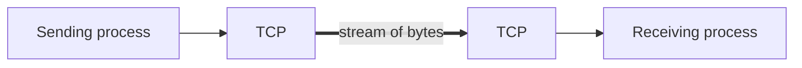

*Figure 1. A stream of bytes flowing through the imaginary tube between two TCPs*

### 2.3 Sending and Receiving Buffers and Segments

Because the sending and receiving processes may not write or read data at the same rate, TCP needs buffers for storage. There is one sending buffer and one receiving buffer for each direction, and these buffers are also needed for TCP's flow- and error-control mechanisms (Sections 8 and 9). One way to implement a buffer is a circular array of 1-byte locations.

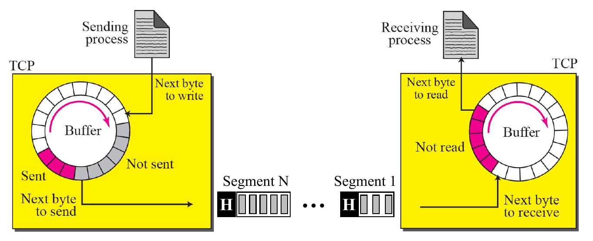

*Figure 2. TCP's circular sending and receiving buffers and the segments made from the bytes in the buffers*

Figure 2 shows the movement of data in one direction.

- The **sending buffer** has three types of chambers. The white chambers are empty and can be filled by the sending process (producer). The colored chambers (Sent) hold bytes that have been sent but not yet acknowledged; the TCP sender keeps these bytes in the buffer until it receives an acknowledgment. The gray chambers (Not sent) hold bytes to be sent by the TCP. TCP may, however, be able to send only part of them because of the slowness of the receiving process or congestion in the network (Section 8 and Chapter 9). After the bytes in the colored chambers are acknowledged, the chambers are recycled and available to the sending process again, which is why the buffer is drawn as a circle.
- The operation of the **receiving buffer** is simpler. The white chambers are empty and will be filled by bytes received from the network, and the colored chambers (Not read) hold received bytes that the receiving process has not yet read. When the receiving process reads a byte, the chamber is recycled and becomes empty.

Although buffering handles the disparity between the speeds of production and consumption, one more step is needed before data can be sent. The IP layer, the service provider for TCP, must send data in packets, not as a stream of bytes. At the transport layer, TCP groups a number of bytes together into a packet called a **segment**. TCP adds a header to each segment for control purposes and delivers the segment to the IP layer, where it is encapsulated in an IP datagram and transmitted. This entire operation is invisible to the receiving process. Segments may arrive out of order, be lost, or be corrupted and resent, but all of this is handled by the TCP receiver, and the receiving application process is unaware of it. Segments are not necessarily all the same size; in reality they carry hundreds or thousands of bytes.

### 2.4 Full-Duplex Communication, Connection-Oriented Service, and Reliable Service

- **Full-duplex communication.** Data can flow in both directions at the same time. Each TCP endpoint has its own sending and receiving buffers, and segments move in both directions. Piggybacking (Chapter 7), carrying the acknowledgment for data in the opposite direction in a data segment, is used.
- **Multiplexing and demultiplexing.** Like UDP, TCP performs multiplexing at the sender and demultiplexing at the receiver. Because TCP is connection-oriented, however, a connection must be established for each pair of processes, and connection sockets are identified by four-tuples (Chapter 6).
- **Connection-oriented service.** When a process at site A wants to exchange data with a process at site B, (1) the two TCPs establish a virtual connection, (2) data are exchanged in both directions, and (3) the connection is terminated. This is a virtual connection, not a physical one. TCP segments are encapsulated in IP datagrams and may be sent out of order, lost, or corrupted and resent, and each datagram may take a different path to the destination. TCP creates a stream-oriented environment in which it takes responsibility for delivering the bytes in order to the other site.
- **Reliable service.** TCP is a reliable transport protocol that uses an acknowledgment mechanism to check the safe and sound arrival of data (Section 9).

How can TCP, which uses the services of IP, a connectionless protocol, be connection-oriented? The point is that a TCP connection is virtual, not physical. TCP operates at a higher level. TCP uses the services of IP to deliver individual segments to the receiver, but it controls the connection itself. If a segment is lost or corrupted, TCP retransmits it, and IP is unaware of this retransmission. If a segment arrives out of order, TCP holds it until the missing segments arrive, and IP is unaware of this reordering.

### 2.5 UDP Communication and TCP Communication

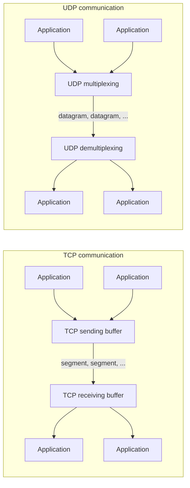

*Figure 3. TCP communication delivering segments through buffers and UDP communication delivering datagrams through a multiplexer*

In Figure 3, TCP gathers the data passed by applications in the sending buffer, cuts it into segments, and sends them, and the receiving side collects the segments in the receiving buffer and delivers them to the applications as a stream of bytes. UDP turns each message passed by an application into one datagram and sends it through the multiplexer, and the demultiplexer at the receiving side passes each datagram unchanged to the corresponding application.

---

<br>

## 3. The Numbering System

Although the TCP software keeps track of the segments being transmitted or received, there is no field for a segment number in the segment header. Instead, there are two fields called the sequence number and the acknowledgment number, and unlike frame numbers at the data link layer, these numbers refer to **bytes**, not segments. They are used for flow control and error control.

### 3.1 Byte Numbers

TCP numbers all data bytes (octets) transmitted in a connection, and the numbering is independent in each direction. When TCP receives bytes of data from a process, it stores them in the sending buffer and numbers them. The numbering does not necessarily start from 0.

> **Definition:** The **initial sequence number (ISN)** is a 32-bit number that each side chooses at random when a connection is established and uses to start numbering the byte stream it will send. Its value ranges from 0 to $`2^{32} - 1`$.

For example, if the numbering starts at 1,057 and the data to be sent is 6,000 bytes, the bytes are numbered from 1,057 to 7,056. Both sides of a connection choose the ISN at random to minimize the possibility that a segment still present in the network from an earlier, already-terminated connection between the same two hosts (using the same port numbers) is mistaken for a valid segment of a later connection. Properly randomizing the ISN is also important for avoiding security attacks that predict sequence numbers.

> **Key Point:** The bytes of data transferred in each connection are numbered by TCP, and the numbering starts with a randomly generated number.

### 3.2 Sequence Numbers

After numbering the bytes, TCP assigns a sequence number to each segment it sends.

> **Key Point:** The value in the sequence number field of a segment is the number assigned to the first data byte contained in that segment.

For example, suppose a TCP connection is transferring a file of 5,000 bytes, the first byte is numbered 10,001, and the data are sent in five segments of 1,000 bytes each. The sequence number of each segment is as follows.

| Segment | Sequence number | Byte range |
|:-----|:-----|:-----|
| Segment 1 | 10,001 | 10,001-11,000 |
| Segment 2 | 11,001 | 11,001-12,000 |
| Segment 3 | 12,001 | 12,001-13,000 |
| Segment 4 | 13,001 | 13,001-14,000 |
| Segment 5 | 14,001 | 14,001-15,000 |

*Table 1. Sequence numbers of the segments when a 5,000-byte file is sent 1,000 bytes at a time*

In the example of Kurose and Ross, if a file of 500,000 bytes is sent with an MSS of 1,000 bytes and the first byte is numbered 0, TCP constructs 500 segments, and the segments are assigned sequence numbers 0, 1,000, 2,000, and so on.

When a segment carries a combination of data and control information (piggybacking), it uses a sequence number. A segment that carries no user data does not logically define a sequence number; the field is there, but its value is not valid. However, some segments that carry only control information, those used for connection establishment, termination, or abortion, need a sequence number to allow an acknowledgment from the receiver. Each of these segments consumes one sequence number as though it carried one byte, even though it carries no actual data (Section 5).

### 3.3 Acknowledgment Numbers

TCP is full duplex, so once a connection is established both parties can send and receive data at the same time. Each party usually starts numbering its bytes from a different number. The sequence number in each direction is the number of the first byte carried by the segment, and each party uses an acknowledgment number to confirm the bytes it has received.

> **Key Point:** The value of the acknowledgment field in a segment is the number of the next byte the party sending that segment expects to receive. The acknowledgment number is cumulative.

Cumulative means that the party takes the number of the last byte it has received safe and sound, adds 1 to it, and announces the sum as the acknowledgment number. For example, if a party uses 5,643 as an acknowledgment number, it has received all bytes from the beginning up to 5,642. Because the first byte number does not have to start from 0, this does not mean that it has received 5,642 bytes.

In the example of Kurose and Ross, if Host A has received all bytes numbered 0 through 535 from B, A is waiting for byte 536 and beyond, so it puts 536 in the acknowledgment number field of the segment it sends to B. If A has received one segment from B containing bytes 0 through 535 and another containing bytes 900 through 1,000 but has not yet received bytes 536 through 899, A is still waiting for byte 536, so the acknowledgment number of its next segment is 536. Because TCP acknowledges bytes only up to the first missing byte in the stream, TCP is said to provide **cumulative acknowledgments**.

In this example the third segment (bytes 900-1,000) arrived before the second segment (bytes 536-899), that is, out of order. The TCP RFCs do not specify what to do with out-of-order segments and leave the decision to implementers. The receiver can either (1) immediately discard out-of-order segments, which simplifies receiver design, or (2) keep the out-of-order bytes and wait for the missing bytes to fill the gap. The latter is more efficient in terms of network bandwidth and is the approach taken in practice.

### 3.4 Sequence and Acknowledgment Numbers in Telnet

Telnet is an application-layer protocol for remote login (Chapter 4) and an interactive application that runs over TCP. Each character typed by the user at the client is sent to the remote host, and the remote host sends back a copy of each character, which is displayed on the user's screen. This echo back ensures that the characters the user sees have already been received and processed at the remote site.

Suppose Host A initiates a Telnet session with Host B, and the starting sequence numbers of the client and the server are 42 and 79, respectively. After the connection is established but before any data is sent, the client is waiting for byte 79 and the server for byte 42. When the user types a single letter 'C', three segments are sent.

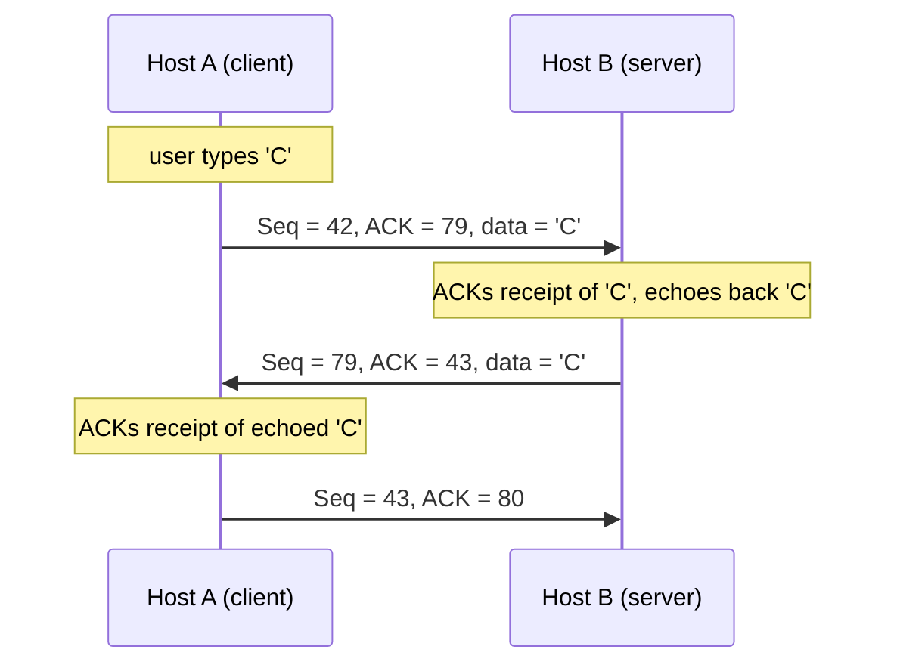

*Figure 4. Sequence and acknowledgment numbers when one character is sent and echoed in Telnet*

1. The first segment is sent from the client to the server and contains the 1-byte ASCII representation of the letter 'C' in its data field. Its sequence number is 42, and because the client has not yet received any data from the server, its acknowledgment number is 79.
2. The second segment is sent from the server to the client and serves a dual purpose. First, by putting 43 in the acknowledgment field, it tells the client that it has received everything up through byte 42 and is waiting for byte 43 onward. Second, it echoes back the letter 'C'. Since this is the first data the server sends, its sequence number is 79, the server's starting sequence number. The acknowledgment for client-to-server data is carried in a segment carrying server-to-client data, so this acknowledgment is said to be piggybacked.
3. The third segment is sent from the client to the server, and its sole purpose is to acknowledge the data received from the server. Its data field is empty, and since it has received bytes through 79, its acknowledgment number is 80. This segment has a sequence number (43) even though it contains no data because the TCP header has a sequence number field, so some value must be placed in it.

---

<br>

## 4. Segment Format

### 4.1 Structure and Fields of the Header

The unit of data transfer between two devices using TCP is a segment. A segment consists of a 20- to 60-byte header followed by data from the application program. The header is 20 bytes without options and up to 60 bytes with options. The MSS limits the maximum size of the data field. When TCP sends a large file, it typically breaks the file into chunks of size MSS (except for the last chunk, which is often smaller), but interactive applications such as Telnet often send chunks smaller than the MSS. For example, the data field of a Telnet segment is often only one byte, and because the TCP header is typically 20 bytes (12 bytes more than the UDP header), a Telnet segment may be only 21 bytes long.

```text
 0                   1                   2                   3
 0 1 2 3 4 5 6 7 8 9 0 1 2 3 4 5 6 7 8 9 0 1 2 3 4 5 6 7 8 9 0 1
+-+-+-+-+-+-+-+-+-+-+-+-+-+-+-+-+-+-+-+-+-+-+-+-+-+-+-+-+-+-+-+-+
|      Source port address      |    Destination port address   |
+-+-+-+-+-+-+-+-+-+-+-+-+-+-+-+-+-+-+-+-+-+-+-+-+-+-+-+-+-+-+-+-+
|                        Sequence number                        |
+-+-+-+-+-+-+-+-+-+-+-+-+-+-+-+-+-+-+-+-+-+-+-+-+-+-+-+-+-+-+-+-+
|                     Acknowledgment number                     |
+-+-+-+-+-+-+-+-+-+-+-+-+-+-+-+-+-+-+-+-+-+-+-+-+-+-+-+-+-+-+-+-+
|  HLEN | Unused|C|E|U|A|P|R|S|F|          Window size          |
|       |       |W|C|R|C|S|S|Y|I|                               |
|       |       |R|E|G|K|H|T|N|N|                               |
+-+-+-+-+-+-+-+-+-+-+-+-+-+-+-+-+-+-+-+-+-+-+-+-+-+-+-+-+-+-+-+-+
|           Checksum            |         Urgent pointer        |
+-+-+-+-+-+-+-+-+-+-+-+-+-+-+-+-+-+-+-+-+-+-+-+-+-+-+-+-+-+-+-+-+
|                 Options and padding (0-40 bytes)              |
+-+-+-+-+-+-+-+-+-+-+-+-+-+-+-+-+-+-+-+-+-+-+-+-+-+-+-+-+-+-+-+-+
|                             Data                              |
+-+-+-+-+-+-+-+-+-+-+-+-+-+-+-+-+-+-+-+-+-+-+-+-+-+-+-+-+-+-+-+-+
```

*Figure 5. Header format of a TCP segment*

| Field | Size | Description |
|:-----|:-----|:-----|
| Source port address | 16 bits | Port number of the application program in the host sending the segment; the same role as the source port in the UDP header |
| Destination port address | 16 bits | Port number of the application program in the host receiving the segment |
| Sequence number | 32 bits | Number assigned to the first byte of data in this segment; during connection establishment each side creates an ISN with a random number generator |
| Acknowledgment number | 32 bits | Byte number that the sender of this segment expects to receive next from the other party; x + 1 if bytes up to x of the other party have been received |
| Header length (HLEN) | 4 bits | Length of the TCP header in 4-byte words; the value is 5 (20 bytes) to 15 (60 bytes) |
| Reserved | 6 bits | Reserved for future use; two of these bits are now used as the CWR and ECE flags |
| Control | 6 bits (8 bits with CWR and ECE) | Flags for flow control, connection establishment and termination, connection abortion, and the mode of data transfer (Section 4.2) |
| Window size | 16 bits | Number of bytes the receiver can accept, that is, the receive window rwnd; at most 65,535 bytes, which the window scale option can extend (Section 11.4) |
| Checksum | 16 bits | Computed in the same way as for UDP, but its use is mandatory, and the protocol value in the pseudoheader is 6 (Section 4.3) |
| Urgent pointer | 16 bits | Valid only when the URG flag is set; a value that, added to the sequence number, gives the number of the last urgent byte in the data section (Section 5.5) |
| Options | 0-40 bytes | MSS, window scale factor, timestamp, SACK, and so on (Section 11) |

*Table 2. Fields of the TCP header*

The header length field makes it possible to interpret headers whose length varies because of options. For example, if the HLEN field is `0101`, the header is 5 × 4 = 20 bytes with no options; if it is `1000`, the header is 8 × 4 = 32 bytes, so there are 12 bytes of options and padding. Typically the options field is empty, so the typical TCP header is 20 bytes long.

### 4.2 Control Flags

The control field consists of flags, one or more of which can be set at a time. The textbook by Forouzan describes 6 bits (URG, ACK, PSH, RST, SYN, FIN), and the textbook by Kurose and Ross shows 8 bits, adding CWR and ECE, which are used for explicit congestion notification.

| Flag | Name | Meaning |
|:-----|:-----|:-----|
| CWR | Congestion Window Reduced | The sender announces that it has reduced its congestion window (ECN in Chapter 9) |
| ECE | ECN-Echo | The receiver echoes the network's congestion indication back to the sender (ECN in Chapter 9) |
| URG | Urgent | The urgent pointer field is valid |
| ACK | Acknowledgment | The acknowledgment number field is valid |
| PSH | Push | The receiver should pass the data to the upper layer immediately |
| RST | Reset | Reset (abort) the connection |
| SYN | Synchronize | Synchronize sequence numbers during connection establishment |
| FIN | Finish | Terminate the connection; the sender has no more data to send |

*Table 3. Control flags of the TCP header*

Kurose and Ross add that in practice the PSH, URG, and urgent data pointer are not used (Section 5.5).

### 4.3 Checksum and Pseudoheader

The TCP checksum is computed by the same procedure as the UDP checksum of Chapter 6, with a pseudoheader serving the same purpose prepended to the segment. The value of the protocol field in the TCP pseudoheader is 6. The checksum is optional in UDP but mandatory in TCP.

```text
+-----------------------------------------------------------+
|                  32-bit source IP address                 |  Pseudoheader
+-----------------------------------------------------------+
|               32-bit destination IP address               |
+--------------+----------------+---------------------------+
|   All 0s     | 8-bit protocol |   16-bit TCP total length |
|              |      (6)       |                           |
+--------------+----------------+---------------------------+
|     Source port number        |  Destination port number  |  Header
+-------------------------------+---------------------------+
|                     Sequence number                       |
+-----------------------------------------------------------+
|                  Acknowledgment number                    |
+-------+---------+-------------+---------------------------+
| HLEN  | Reserved|   Control   |        Window size        |
+-------+---------+-------------+---------------------------+
|           Checksum            |      Urgent pointer       |
+-------------------------------+---------------------------+
|                     Data and option                       |
|   (Padding must be added to make the data a multiple of   |
|                        16 bits)                           |
+-----------------------------------------------------------+
```

*Figure 6. The pseudoheader added to a TCP segment*

> **Key Point:** The use of the checksum in TCP is mandatory.

### 4.4 Encapsulation

A TCP segment encapsulates the data received from the application layer, the TCP segment is encapsulated in an IP datagram, and the IP datagram is in turn encapsulated in a frame at the data-link layer.

```text
                          +------------+-------------------------+
                          | TCP header |  Application-layer data |
                          +------------+-------------------------+
                          |<-------------- TCP payload --------->|
             +-----------+---------------------------------------+
             | IP header |              IP payload               |
             +-----------+---------------------------------------+
+------------+---------------------------------------------------+
|Frame header|                 Data-link layer payload           |
+------------+---------------------------------------------------+
```

*Figure 7. Encapsulation of a TCP segment*

---

<br>

## 5. Connection Management

Because TCP is connection-oriented, it establishes a virtual path between the source and the destination, and all the segments belonging to a message are sent over this virtual path. Using a single virtual pathway for the entire message facilitates acknowledgment and the retransmission of damaged or lost segments. Connection-oriented transmission in TCP has three phases: connection establishment, data transfer, and connection termination. TCP connection establishment can add significantly to perceived delays, for example when searching the Web, and many common network attacks, including SYN flooding, exploit vulnerabilities in TCP connection management, so the topic is important.

### 5.1 The Three-Way Handshake

TCP transmits data in full-duplex mode, so when two TCPs are connected, they can send segments to each other simultaneously. This implies that each party must initialize communication and get approval from the other party before any data are transferred.

> **Definition:** The **three-way handshake** is the procedure for establishing a TCP connection in which three segments, the client's SYN, the server's SYN+ACK, and the client's ACK, are exchanged to synchronize the initial sequence numbers of both sides and confirm each other's approval of the connection.

The process starts with the server. The server program tells its TCP that it is ready to accept a connection; this request is called a **passive open**. Although the server TCP is ready to accept a connection from any machine in the world, it cannot make the connection itself. The client program issues an **active open**, telling its TCP to connect to a particular open server. TCP can now start the three-way handshake.

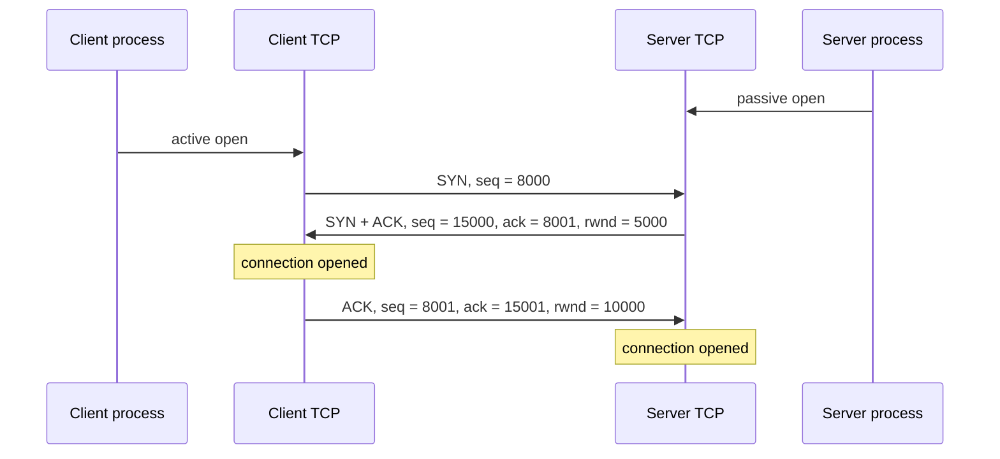

*Figure 8. Connection establishment with the three-way handshake*

The time line in Figure 8 shows, of each segment's header fields, only those needed to understand the phase: the sequence number, the acknowledgment number, the control flags that are set, and the window size (rwnd, the receive window) where relevant.

1. **SYN.** The client sends the first segment, with only the SYN flag set. This segment is for synchronization of sequence numbers. The client chooses a random number as its first sequence number (the ISN, 8000 in this example) and sends it to the server. This segment does not contain an acknowledgment number and does not define the window size either, because a window size makes sense only when a segment includes an acknowledgment. It can include some options (Section 11). The SYN segment is a control segment and carries no data, but it consumes one sequence number. When data transfer starts, numbering begins at the ISN plus 1, so the SYN segment can be thought of as carrying one imaginary byte even though it has no real data. Kurose and Ross call the sequence number of this segment `client_isn`.
2. **SYN + ACK.** The server sends the second segment, with two flag bits set: SYN and ACK. This segment has a dual purpose. First, it is a SYN segment for communication in the other direction, initializing the sequence number for the bytes sent from the server to the client (15000 in this example, `server_isn` in Kurose and Ross). Second, it acknowledges the receipt of the client's SYN segment by setting the ACK flag and showing the next sequence number it expects from the client (8001, that is, `client_isn + 1`). Because it contains an acknowledgment, it also defines the receive window size to be used by the client (rwnd = 5000). According to Kurose and Ross, the server allocates the TCP buffers and variables for the connection when it receives the SYN.
3. **ACK.** The client sends the third segment, acknowledging the receipt of the second segment with the ACK flag and the acknowledgment number field (15001, that is, `server_isn + 1`). The sequence number of this segment (8001) follows that of the SYN segment. The client also allocates the buffers and variables of the connection at this point and defines the window size to be used by the server (rwnd = 10000). Some implementations allow this third segment to carry the first chunk of data from the client, in which case its sequence number is the number of the first byte of the data. In general, the third segment carries no data and consumes no sequence number. From this segment on, the SYN bit is 0.

> **Key Point:** A SYN segment cannot carry data, but it consumes one sequence number. A SYN + ACK segment cannot carry data, but it also consumes one sequence number. An ACK segment, if it carries no data, consumes no sequence number.

Three segments are needed to establish a connection because each side of a two-way communication must announce its own ISN (SYN) and get confirmation that the other side received that ISN (ACK). Combining the server's ACK and the server's SYN into one segment turns the four packets of Figure 9 in Chapter 6 into three segments.

> **Note:** **Sequence numbers of segments that carry no data.** Forouzan's figures give a segment that carries no data, and so consumes no sequence number, the last sequence number its sender has already used: the third segment of the handshake carries seq: 8000, the same number as the SYN, and the last ACK of the data transfer carries seq: 10000; in the termination and half-close figures the client's last ACK carries seq: x, and in the half-close figure the server's ACK carries seq: y - 1. Kurose and Ross instead give such a segment the next sequence number its sender will use, as in the third segment of their handshake (seq = client_isn + 1) and the third segment of the Telnet example in Figure 4 (seq = 43). These notes follow Kurose and Ross in every figure, so, for example, the third segment of Figure 8 carries 8001. Under either convention a segment without data consumes no sequence number, so the data bytes are numbered the same way, and the first data segment carries 8001 in both.

### 5.2 Simultaneous Open

In a rare situation, both processes may issue an active open. In this case both TCPs send SYN segments to each other, each sends a SYN + ACK segment when it receives the other's SYN, and one single connection is established between them. Because both SYN segments must be in transit at the same time, the two applications must issue active opens at almost the same moment, so this is unlikely to happen in practice. There is then no client or server; the communication is between two peers that know their local port numbers. Both TCPs go through the SYN-SENT and SYN-RCVD states before reaching the ESTABLISHED state (Section 6), and four segments are exchanged to establish the connection.

### 5.3 The SYN Flooding Attack and SYN Cookies

The connection-establishment procedure of TCP is susceptible to a serious security problem called the SYN flooding attack.

> **Definition:** A **SYN flooding attack** is a denial-of-service (DoS) attack in which the attacker sends many SYN segments to a server without completing the third step of the three-way handshake, so that the server's connection resources are all allocated to half-open connections and legitimate clients cannot connect.

One or more malicious attackers send a large number of SYN segments to a server, faking the source IP addresses in the datagrams so that each appears to come from a different client. The server, assuming that the clients are issuing active opens, allocates the necessary resources, such as creating transmission control block (TCB, Section 12) tables and setting timers, and then sends SYN + ACK segments to the fake clients, which are lost. While the server waits for the third leg of the handshake, the resources remain allocated without being used. If the number of SYN segments is large during a short period, the server eventually runs out of resources and cannot accept connection requests from valid clients. If the client does not send the ACK of the third step, the server eventually (often after a minute or more) terminates the half-open connection and reclaims the resources. Denial-of-service attacks are a class of attacks in which the attacker monopolizes a system with so many service requests that the system overloads and denies legitimate requests, and SYN flooding was among the first documented denial-of-service attacks.

Some TCP implementations have strategies to alleviate the effect of a SYN attack. Some impose a limit on connection requests during a specified period, and others filter out datagrams coming from unwanted source addresses. An effective defense, now deployed in most major operating systems, is **SYN cookies**, which postpone resource allocation until the server can verify that the connection request comes from a valid IP address.

1. When the server receives a SYN segment, it does not know whether the segment comes from a legitimate user or is part of a SYN flooding attack. So instead of creating a half-open TCP connection, it creates an initial sequence number that is a complicated function (a hash function) of the source and destination IP addresses and port numbers of the SYN segment and a secret number known only to the server. This carefully crafted initial sequence number is the "cookie." The server sends the client a SYN + ACK with this special initial sequence number and does not remember the cookie or any other state information about the SYN.
2. A legitimate client returns an ACK segment. The server must verify that this ACK corresponds to some earlier SYN, and because it keeps no memory of SYN segments, it uses the cookie. For a legitimate ACK, the value in the acknowledgment field equals the initial sequence number in the SYN + ACK (the cookie) plus one. The server runs the same hash function on the source and destination IP addresses and port numbers in the ACK (the same as in the original SYN) and the secret number, and if the result plus one equals the acknowledgment number, it concludes that the ACK corresponds to an earlier SYN and is valid, and it creates a fully open connection along with a socket.
3. If the client does not return an ACK, the original SYN has done no harm at the server, since the server has allocated no resources for the bogus SYN.

> **[Information Security]** A cryptographic hash function, studied in information security, is a function for which recovering an input from its output or finding another input with the same output is computationally hard. Because of this property, an attacker who does not know the secret cannot forge a valid cookie, so SYN cookies let the server verify the legitimacy of an ACK without storing any state.

### 5.4 Data Transfer

After the connection is established, bidirectional data transfer can take place. The client and the server can send data and acknowledgments in both directions, and data traveling in the same direction as an acknowledgment are carried in the same segment; that is, the acknowledgment is piggybacked on the data.

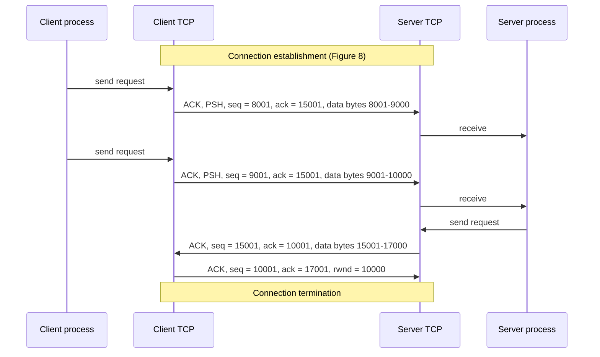

*Figure 9. Data transfer after connection establishment*

In Figure 9, after the connection is established, the client sends 2,000 bytes of data in two segments, and the server sends 2,000 bytes in one segment. The client sends one more segment. The first three segments carry both data and acknowledgments, but the last segment carries only an acknowledgment because there is no more data to send. The data segments sent by the client have the PSH (push) flag set so that the server TCP tries to deliver the data to the server process as soon as they are received. The segment from the server does not set the push flag, and most TCP implementations have the option to set it or not.

Checking the sequence and acknowledgment numbers: the client's first data segment carries 1,000 bytes starting at 8001, right after the ISN 8000 (8001-9000), so the sequence number of the second segment is 9001. The server has received up to byte 10000, so it sends acknowledgment number 10001. The server's data are 2,000 bytes starting at 15001, right after the server ISN 15000 (15001-17000), so the client's last acknowledgment number is 17001. The last segment has no data and consumes no sequence number; its sequence number 10001 is the number of the next byte the client will send.

### 5.5 Pushing Data and Urgent Data

**Pushing data.** The sending TCP uses a buffer to store the stream of data coming from the sending application and can choose the segment size. The receiving TCP also buffers the data when they arrive and delivers them to the application program when the program is ready or when it is convenient for the receiving TCP. This flexibility increases the efficiency of TCP. There are occasions, however, when an application program has no need for this flexibility. For example, an application that communicates interactively with another application wants to send a keystroke and receive an immediate response, and cannot accept delayed transmission and delayed delivery. In such a case the sending application can request a push operation. The sending TCP must then not wait for the window to be filled; it must create a segment and send it immediately, and it sets the push bit (PSH) to tell the receiving TCP that the segment includes data that must be delivered to the receiving application as soon as possible and not wait for more data. Although the push operation can be requested by the application program, most current TCP implementations ignore such requests, and TCP can choose whether or not to use this feature.

**Urgent data.** TCP is a stream-oriented protocol, so an application program presents data to TCP as a stream of bytes, and each byte has a position in the stream. There are occasions, however, when an application program needs to send urgent bytes that must be treated in a special way by the application at the other end. The sending application tells the sending TCP that the piece of data is urgent, and the sending TCP creates a segment with the URG bit set and inserts the urgent data at the beginning of the segment. The rest of the segment can contain normal data from the buffer. The urgent pointer field in the header defines the end of the urgent data (the last urgent byte); adding its value to the sequence number gives the number of the last urgent byte. For example, if the sequence number is 3001 and the urgent pointer is 99, the last urgent byte is 3001 + 99 = 3100, so the 100 bytes 3001-3100 are urgent data. When the receiving TCP receives a segment with the URG bit set, it informs the receiving application of the situation in a way that depends on the operating system, and it is up to the receiving program to decide what action to take.

TCP's urgent data is neither a priority service nor an expedited data service. Urgent mode is only a service by which the sending application marks some portion of the byte stream as needing special treatment by the receiving application. Apart from signaling the presence of urgent data and marking its position in the stream, urgent data is treated identically to the rest of the TCP byte stream. The receiving application must read every byte in exactly the order it was submitted, whether or not urgent mode is used, and standard TCP never delivers data out of order.

> **Note:** Kurose and Ross explain that in practice the PSH, URG, and urgent data pointer are not used and are mentioned for completeness.

### 5.6 Connection Termination

Either of the two parties involved in exchanging data (client or server) can close the connection, although it is usually initiated by the client. When a connection ends, the "resources" in the hosts, the buffers and variables, are deallocated. Most implementations today allow two options for connection termination: a three-way handshake and a four-way handshake with a half-close option.

**Termination with a three-way handshake.**

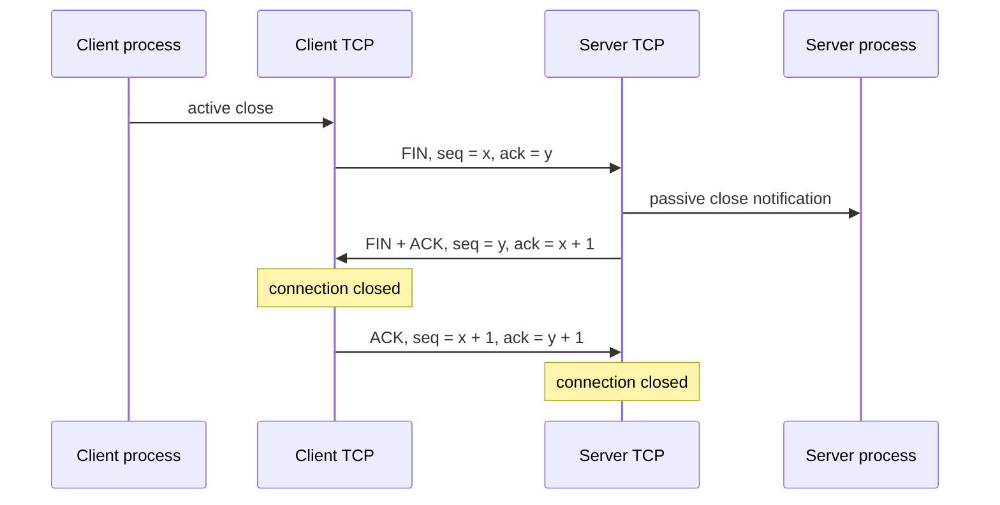

*Figure 10. Connection termination with a three-way handshake*

1. In a common situation, the client TCP, after receiving a close command from the client process, sends the first segment, a FIN segment with the FIN flag set. The FIN segment can include the last chunk of data sent by the client, or it can be just a control segment, as in Figure 10. If it is only a control segment, it consumes only one sequence number.
2. The server TCP, after receiving the FIN segment, informs its process of the situation and sends the second segment, a FIN + ACK segment, to confirm the receipt of the client's FIN and at the same time to announce the closing of the connection in the other direction. This segment can also contain the last chunk of data from the server; if it does not carry data, it consumes only one sequence number.
3. The client TCP sends the last segment, an ACK segment, to confirm the receipt of the server's FIN segment. Its acknowledgment number is the sequence number of the server's FIN segment plus one. This segment cannot carry data and consumes no sequence number.

> **Key Point:** A FIN segment consumes one sequence number if it does not carry data. A FIN + ACK segment also consumes one sequence number if it does not carry data.

**Termination with a four-way handshake.** Kurose and Ross describe as the basic case a four-segment exchange in which the client sends a FIN, the server acknowledges it with an ACK, the server then sends its own FIN, and the client acknowledges it with an ACK. This happens when the server still has data to send when it receives the FIN, so that the ACK and the FIN must be sent separately; the case in which the server keeps sending data in between is the half-close of Section 5.7.

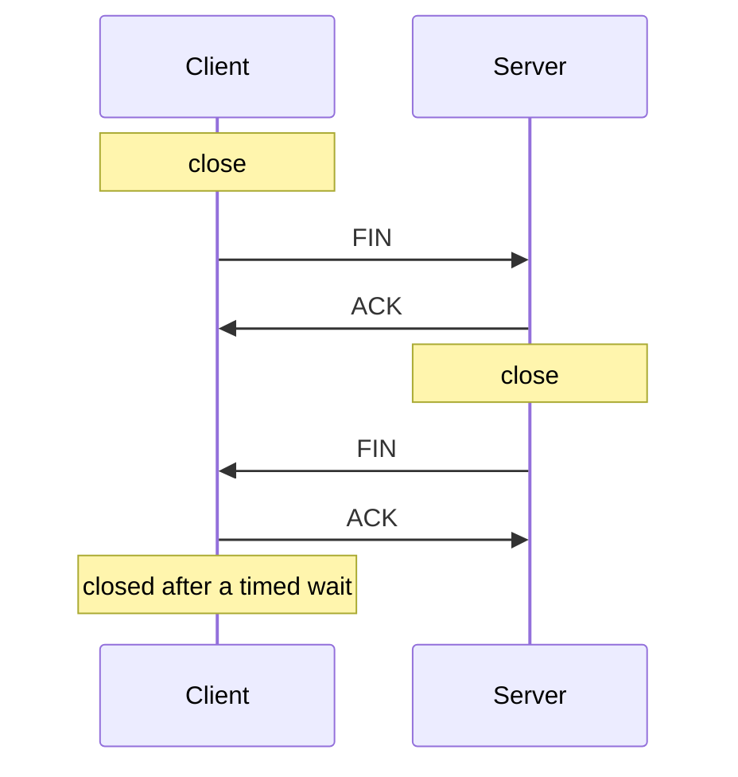

*Figure 11. Closing a TCP connection with four segments*

### 5.7 Half-Close

> **Definition:** A **half-close** closes only one direction of a TCP connection, so that one end stops sending data while it can still receive data.

Either the server or the client can issue a half-close request. It is used when the server needs all the data before processing can begin. Sorting is a good example. When the client sends data to the server to be sorted, the server needs to receive all the data before sorting can start. The client, after sending all the data, can therefore close the connection in the client-to-server direction. The server-to-client direction, however, must remain open to return the sorted data, and since the server still needs time to sort after receiving the data, its outbound direction must remain open.

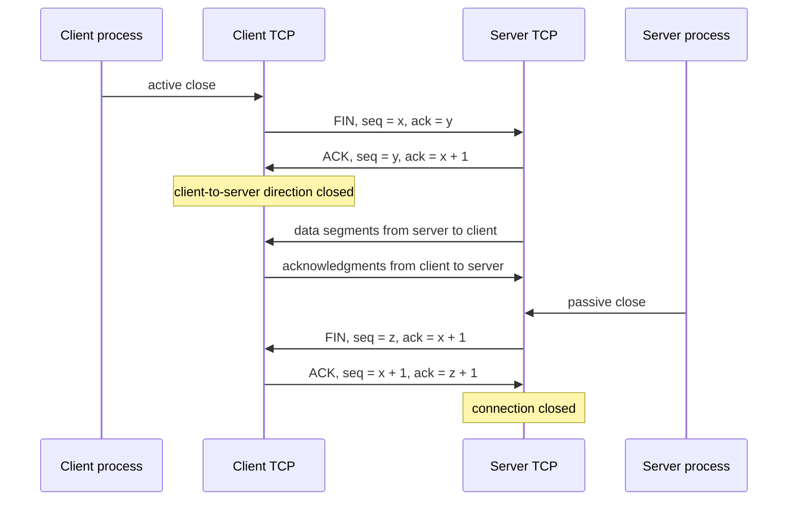

*Figure 12. Half-close*

In Figure 12, data transfer from the client to the server stops. The client half-closes the connection by sending a FIN segment, and the server accepts the half-close by sending an ACK segment. The server, however, can still send data. When it has sent all the processed data, it sends a FIN segment, which the client acknowledges with an ACK.

After the half-close, data can travel from the server to the client and acknowledgments from the client to the server, but the client cannot send any more data to the server. Looking at the sequence numbers, the server's second segment (the ACK) carries no data and consumes no sequence number. The server's data segments carry bytes starting at y, and the sequence number z of the FIN the server sends after all its data is the number following the last data byte it sent. The sequence number of the client's last ACK is x + 1, because the client's FIN consumed x and no sequence numbers are consumed in that direction during data transfer.

### 5.8 Connection Reset

TCP at one end may deny a connection request, abort an existing connection, or terminate an idle connection. All of these are done with the RST (reset) flag.

- **Denying a connection.** If the TCP on one side requests a connection to a nonexistent port, the TCP on the other side may send a segment with its RST bit set to deny the request (Section 6.6). In the example of Kurose and Ross, if a host receives a TCP SYN packet with destination port 80 but is not accepting connections on port 80 (not running a Web server), it sends an RST segment to the source, saying in effect, "I do not have a socket for that segment; please do not resend it." When a host receives a UDP packet whose destination port does not match an ongoing UDP socket, it instead sends a special ICMP datagram (Chapter 16).
- **Aborting a connection.** One TCP may want to abort an existing connection because of an abnormal situation; it can send an RST segment to close the connection.
- **Terminating an idle connection.** The TCP on one side may discover that the TCP on the other side has been idle for a long time and send an RST segment to end the connection. The process is the same as aborting a connection.

> **Note:** **Three outcomes of port scanning.** To explore a specific TCP port (for example, 6789) on a target host, a port scanner such as nmap sends a TCP SYN segment to that port. There are three possible outcomes. (1) If a SYN + ACK segment comes back, an application is running on that port of the target host, so the port is "open." (2) If an RST segment comes back, the SYN reached the target host but no application is running on that port; at least the scanner learns that segments to that port are not blocked by a firewall (Chapter 26) on the path. (3) If nothing comes back, the SYN was likely blocked by an intervening firewall and never reached the target host.

---

<br>

## 6. State Transition Diagram

To keep track of all the different events happening during connection establishment, connection termination, and data transfer, TCP is specified as a finite state machine (Chapter 6).

### 6.1 TCP States

| State | Description |
|:-----|:-----|
| CLOSED | No connection exists |
| LISTEN | Passive open received; waiting for SYN |
| SYN-SENT | SYN sent; waiting for ACK |
| SYN-RCVD | SYN + ACK sent; waiting for ACK |
| ESTABLISHED | Connection established; data transfer in progress |
| FIN-WAIT-1 | First FIN sent; waiting for ACK |
| FIN-WAIT-2 | ACK to first FIN received; waiting for second FIN |
| CLOSE-WAIT | First FIN received, ACK sent; waiting for the application to close |
| TIME-WAIT | Second FIN received, ACK sent; waiting for the 2MSL time-out |
| LAST-ACK | Second FIN sent; waiting for ACK |
| CLOSING | Both sides decided to close simultaneously |

*Table 4. TCP states*

### 6.2 The Complete State Transition Diagram

Figure 13 is the state transition diagram that combines the two FSMs used by the TCP client and server into one. Each transition carries two strings, "input / output": the first is what TCP receives and the second is what TCP sends, with Λ written when nothing is sent. The textbook by Forouzan distinguishes, by line style, the transitions a server normally goes through, the transitions a client normally goes through, and transitions for special situations, but in some situations a server goes through a client's transition or vice versa.

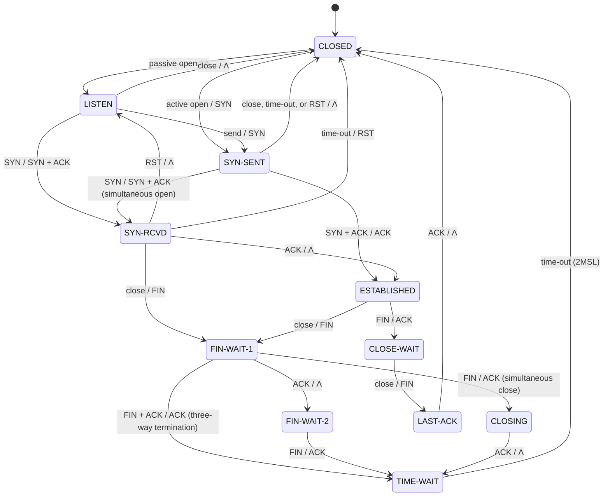

*Figure 13. TCP state transition diagram*

The state marked ESTABLISHED is in fact two different sets of states, for flow and error control, that the client and the server go through to transfer data (Section 9.10).

> **Note:** In the figure of Forouzan, the transition from LISTEN back to CLOSED is labeled "RST / -". In the TCP specification, however, a TCP in the LISTEN state ignores an incoming RST, and a close command from the application deletes the TCB and returns the TCP to CLOSED [1]. Figure 13 therefore labels this transition "close / Λ".

### 6.3 Typical State Sequences of a Client and a Server

Kurose and Ross show the typical sequences of states visited by a client TCP and a server TCP when a connection is established and terminated normally.

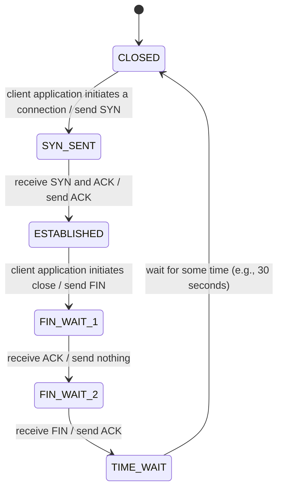

*Figure 14. A typical sequence of TCP states visited by a client TCP*

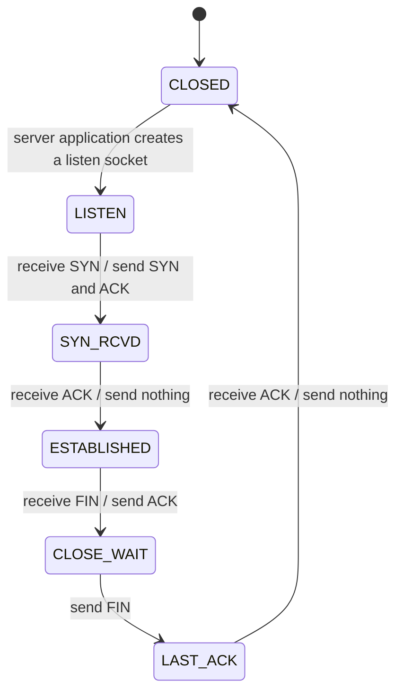

*Figure 15. A typical sequence of TCP states visited by a server TCP*

The client TCP begins in the CLOSED state. When the client application initiates a new TCP connection, the client TCP sends a SYN segment and enters the SYN_SENT state. In this state it waits for a segment from the server that includes an acknowledgment for its previous segment and has the SYN bit set to 1; on receiving it, the client enters the ESTABLISHED state. In the ESTABLISHED state the TCP client can send and receive segments containing payload data. When the client application decides to close the connection, the client sends a segment with the FIN bit set to 1 and enters the FIN_WAIT_1 state to wait for an acknowledgment. On receiving the acknowledgment, it enters the FIN_WAIT_2 state to wait for the server's FIN segment, and on receiving that, it sends an acknowledgment and enters the TIME_WAIT state. After waiting in the TIME_WAIT state, the connection formally closes and all resources on the client side, including port numbers, are released. The server-side transitions in Figure 15 assume that the client begins the teardown. The two figures show only how a connection is normally established and shut down; cases in which both sides initiate or shut down a connection at the same time appear in Section 6.6 and Figure 13.

### 6.4 Scenario: Connection Establishment and Half-Close Termination

The following time line shows a scenario in which the server process issues a passive open and a passive close and the client process issues an active open and an active close. Using the half-close termination shows more states.

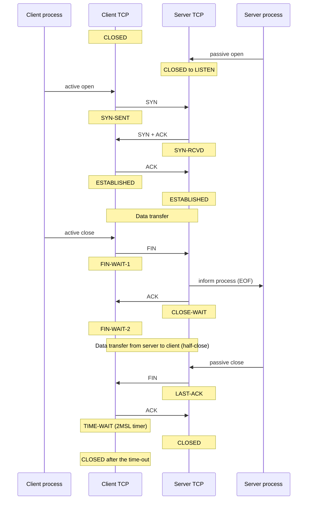

*Figure 16. State changes of the client and server in connection establishment and half-close termination*

**Client states.** The client process issues an active open, asking its TCP for a connection to a specific socket address. TCP sends a SYN segment and moves to the SYN-SENT state, and after receiving the SYN + ACK, it sends an ACK and goes to the ESTABLISHED state. Data are transferred, possibly in both directions, and acknowledged. When the client process has no more data to send, it issues an active close command; the client TCP sends a FIN segment and goes to the FIN-WAIT-1 state. When it receives the ACK for the sent FIN, it goes to the FIN-WAIT-2 state and remains there until it receives a FIN from the server. When the FIN is received, it sends an ACK, goes to the TIME-WAIT state, and sets a timer with a time-out value of twice the maximum segment lifetime (MSL).

**Server states.** The server process issues an open command, which must happen before the client issues its open command. The server TCP goes to the LISTEN state and remains there passively until it receives a SYN segment. When it receives the SYN, it sends a SYN + ACK and goes to the SYN-RCVD state to wait for the client's ACK, and after receiving the ACK, it goes to the ESTABLISHED state, where data transfer can take place. When it receives a FIN from the client TCP signifying that there are no more data to be sent and that the connection can be closed, the server sends an ACK to the client, delivers the outstanding data in its queue to the application, and goes to the CLOSE-WAIT state. Since a half-close is assumed, the server TCP can still send data to the client and receive acknowledgments, but no data can flow in the other direction. The server TCP remains in this state until the application actually issues a close command; it then sends a FIN to the client to show that it is closing the connection too and goes to the LAST-ACK state. When it receives the final ACK, it goes to the CLOSED state. The termination phase beginning with the first FIN is called a four-way handshake.

### 6.5 The TIME-WAIT State

> **Definition:** The **maximum segment lifetime (MSL)** is the maximum time a TCP segment can exist in the Internet before it is dropped. A TCP segment is encapsulated in an IP datagram with a limited lifetime (TTL), so when the IP datagram is dropped, the segment inside is dropped as well.

According to Forouzan, the common value for the MSL is between 30 seconds and 1 minute. Kurose and Ross explain that the time spent in the TIME_WAIT state is implementation-dependent, with typical values of 30 seconds, 1 minute, and 2 minutes. There are two reasons for the existence of the TIME-WAIT state.

1. **To guard against the loss of the last ACK.** If the last ACK segment is lost, the server TCP, which has set a timer for its last FIN, assumes that its FIN was lost and resends it. If the client goes to the CLOSED state and closes the connection before the 2MSL timer expires, it never receives this resent FIN, and consequently the server never receives the final ACK and cannot close the connection. The 2MSL timer makes the client wait long enough for an ACK to be lost (one MSL) and a FIN to arrive (another MSL). If a new FIN arrives during the TIME-WAIT state, the client sends a new ACK and restarts the 2MSL timer.
2. **To keep duplicate segments of one connection from appearing in the next.** Suppose a client and a server close a connection and shortly afterward open a connection with the same socket addresses (the same source and destination IP addresses and the same source and destination port numbers). This new connection is called an incarnation of the old one. If not enough time passes between the two connections, a duplicate segment from the previous connection may arrive in the new connection and be interpreted as belonging to it. To prevent this, TCP requires that an incarnation cannot occur until 2MSL has elapsed. Some implementations, however, ignore this rule if the initial sequence number of the incarnation is greater than the last sequence number used in the previous connection.

### 6.6 Other Scenarios

**Termination with a three-way handshake.** Three-way handshakes are common in both connection establishment and termination. When the client issues a close after data transfer, the client TCP sends a FIN and goes to the FIN-WAIT-1 state. The server TCP, on receiving the FIN, sends all queued data to the server with a virtual EOF marker meaning that the connection must be closed, and goes to the CLOSE-WAIT state, but it postpones acknowledging the received FIN until it receives a passive close from its process. After receiving the passive close, it sends a FIN + ACK segment to the client and goes to the LAST-ACK state to wait for the final ACK. The client skips the FIN-WAIT-2 state and goes directly to the TIME-WAIT state (the transition from FIN-WAIT-1 to TIME-WAIT in Figure 13). The rest is the same as the four-way handshake.

**Simultaneous close.** In this uncommon but possible situation, both ends issue an active close. Both TCPs go to the FIN-WAIT-1 state and send FIN segments that are in transit simultaneously. On receiving the FIN, each end goes to the CLOSING state and sends an ACK. The CLOSING state takes the place of FIN-WAIT-2 or CLOSE-WAIT in a common scenario. After receiving the ACK, each end moves to the TIME-WAIT state. Since each end has sent an ACK that may get lost, the TIME-WAIT duration is required for both ends.

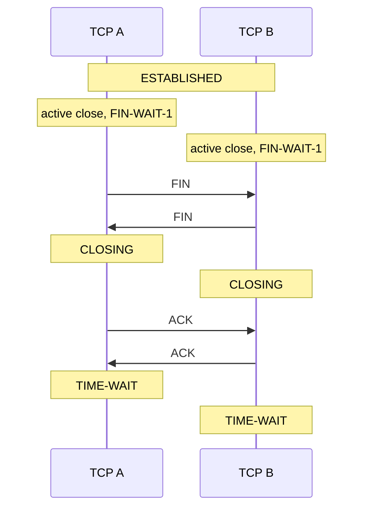

*Figure 17. Simultaneous close*

**Denying a connection.** A common situation is a server TCP denying a connection, which can happen when the destination port number in the SYN segment defines a server that is not in the LISTEN state at the moment. The server TCP, after receiving the SYN segment, sends an RST + ACK segment that acknowledges the SYN and at the same time resets (denies) the connection, and it goes to the LISTEN state to wait for another connection. The client, after receiving the RST + ACK, goes to the CLOSED state.

**Aborting a connection.** A process can abort a connection instead of closing it. This can happen if the process has failed (perhaps locked in an infinite loop) or does not want the data in the queue to be sent (perhaps because of some discrepancy in the data). TCP itself may also want to abort the connection, for example if it receives a segment belonging to a previous connection (incarnation). In all of these cases, TCP sends an RST + ACK segment and throws away all data in the queue. The other TCP also throws away all queued data and informs its process with an error message. Both TCPs go to the CLOSED state immediately, and no ACK segment is generated in response to the RST segment. This feature can be implemented optionally by the vendor, so it does not appear in the general transition diagram of Figure 13.

---

<br>

## 7. Windows in TCP

### 7.1 Four Windows

TCP uses two windows, a send window and a receive window, for each direction of data transfer, so a bidirectional communication uses four windows. To keep the discussion simple, communication is assumed to be unidirectional (say, from client to server). Bidirectional communication can be viewed as two unidirectional communications with piggybacking.

A sliding window is used to make transmission more efficient and to control the flow of data so that the destination is not overwhelmed with data. TCP's sliding windows are byte oriented.

> **Definition:** The **receive window (rwnd)** is the number of bytes the receiver can accept before its buffer overflows and data is discarded; the receiver places it in the window size field of segments carrying an ACK to announce it to the other end.

> **Definition:** The **congestion window (cwnd)** is a value that the sender sets according to the state of the network to avoid congestion, limiting the amount of unacknowledged data (Chapter 9).

The window size at one end is determined by the lesser of the two values.

```math
\text{window size} = \min(\text{rwnd}, \text{cwnd})
```

To focus on flow control, this chapter assumes that cwnd is large enough that the window size is determined by rwnd. Congestion control is covered in Chapter 9.

### 7.2 The Send Window

```text
           Sf: first outstanding byte                             Timer
           |               Sn: next byte to send
           |               |
           v               v
 ... 200 [ 201  ...  260 | 261   ...                 300 ] 301 ...
 bytes that are   outstanding bytes      bytes that can be     bytes that cannot be
 acknowledged     (sent but not          sent (usable          sent until the right
 (can be purged   acknowledged)          window)               edge moves to the right
 from buffer)
         |<- send window size (advertised by receiver) ->|
```

*Figure 18. The TCP send window (window size 100 bytes)*

The send window in Figure 18 is 100 bytes in size (normally thousands of bytes). Bytes 201-260 have been sent but not acknowledged, bytes 261-300 can be sent now, and bytes from 301 on cannot be sent until the right edge of the window moves to the right. The size of the send window is dictated by the receiver (flow control) and by congestion in the network (congestion control).

The TCP send window is similar to the Selective Repeat send window of Chapter 7, with the following differences.

1. The window in SR numbers packets, but the window in TCP numbers bytes. Actual transmission takes place segment by segment, but the variables that control the window are expressed in bytes.
2. In some implementations TCP can store data received from the process and send them later. Here the sending TCP is assumed to be able to send data in segments as soon as it receives them from its process.
3. The theoretical SR protocol may use a timer for each packet sent, but the TCP protocol uses only one timer (Section 9).

### 7.3 The Receive Window

```text
           next byte to be pulled by the process
           |               Rn: next byte expected to receive
           |               |
           v               v
 ... 200 | 201  ...  260 [ 261   ...                 300 ] 301 ...
 bytes that have  bytes received      bytes that can be      bytes that cannot be
 already been     and acknowledged,   received from sender   received from sender
 pulled by the    waiting to be       (receive window size,
 process          consumed by process  rwnd)
         |<------------- allocated buffer -------------->|
```

*Figure 19. The TCP receive window and the allocated buffer (buffer size 100 bytes)*

In Figure 19 the allocated buffer is the 100 bytes 201-300. The 60 bytes 201-260 have been received and acknowledged but not yet pulled by the process, so the receive window is the 40 bytes 261-300.

The TCP receive window differs from the SR receive window in two ways.

1. TCP allows the receiving process to pull data at its own pace. Part of the allocated buffer may therefore be occupied by bytes that have been received and acknowledged but are waiting to be pulled by the receiving process. The receive window size is always smaller than or equal to the buffer size, and it determines the number of bytes the receiver can accept from the sender before being overwhelmed (flow control).

```math
\text{rwnd} = \text{buffer size} - \text{number of waiting bytes to be pulled}
```

2. TCP uses acknowledgments differently. An acknowledgment in SR is selective, defining the uncorrupted packets that have been received. The main acknowledgment mechanism in TCP is a cumulative acknowledgment announcing the next byte expected (in this respect TCP looks like GBN). Newer versions of TCP, however, use both cumulative and selective acknowledgments (Section 11.6).

The receive window closes (its left wall moves to the right) when more bytes arrive from the sender, and it opens (its right wall moves to the right) when more bytes are pulled by the process. In practice the receive window should never shrink (its right wall should never move to the left).

---

<br>

## 8. Flow Control

> **Definition:** **Flow control** is a speed-matching service that matches the rate at which the sender sends against the rate at which the receiving application reads, so that the sender does not overflow the receiver's receive buffer.

A TCP sender can also be throttled because of congestion within the IP network; this form of sender control is called congestion control (Chapter 9). Although flow control and congestion control take similar actions (throttling the sender), they do so for very different reasons, so the two terms must be distinguished. TCP also separates flow control from error control, and this section assumes that the logical channel between the sending and receiving TCPs is error free.

### 8.1 Data Flow and Flow-Control Feedback

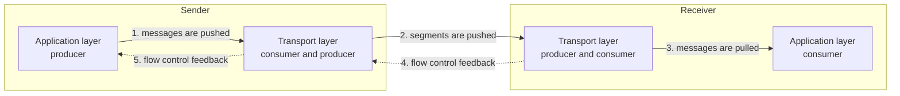

*Figure 20. Data flow and flow-control feedback in TCP*

In Figure 20, data travel from the sending process down to the sending TCP, from the sending TCP to the receiving TCP, and from the receiving TCP up to the receiving process (paths 1, 2, and 3). Flow-control feedback travels from the receiving TCP to the sending TCP and from the sending TCP up to the sending process (paths 4 and 5). Most TCP implementations do not provide flow-control feedback from the receiving process to the receiving TCP; they let the receiving process pull data from the receiving TCP whenever it is ready. In other words, the receiving TCP controls the sending TCP, and the sending TCP controls the sending process. The feedback from the sending TCP to the sending process (path 5) is achieved by the sending TCP simply rejecting data when its window is full. The discussion of flow control therefore concentrates on the feedback from the receiving TCP to the sending TCP (path 4).

### 8.2 Computing the Receive Window

Kurose and Ross assume that the receiver discards out-of-order segments and define the receive window with the following variables. Suppose Host A is sending a large file to Host B over a TCP connection, and B has allocated a receive buffer of size `RcvBuffer` to this connection.

- `LastByteRead`: the number of the last byte in the data stream read from the buffer by the application process in B
- `LastByteRcvd`: the number of the last byte in the data stream that has arrived from the network and been placed in the receive buffer at B

Because TCP is not permitted to overflow the allocated buffer, the following must hold.

```math
\text{LastByteRcvd} - \text{LastByteRead} \leq \text{RcvBuffer}
```

The receive window is the amount of spare room in the buffer.

```math
\text{rwnd} = \text{RcvBuffer} - (\text{LastByteRcvd} - \text{LastByteRead})
```

Because the spare room changes with time, rwnd is dynamic. B tells A how much spare room it has by placing the current value of rwnd in the receive window field of every segment it sends to A. Initially B sets rwnd = `RcvBuffer`. Host A keeps track of two variables with obvious meanings, `LastByteSent` and `LastByteAcked`. Their difference is the amount of unacknowledged data A has sent into the connection, and A keeps this amount at or below rwnd throughout the life of the connection so that it does not overflow B's receive buffer.

```math
\text{LastByteSent} - \text{LastByteAcked} \leq \text{rwnd}
```

For example, if `RcvBuffer` = 10,000 bytes, `LastByteRcvd` = 25,000, and `LastByteRead` = 21,000, there are 4,000 bytes waiting to be read in the buffer, so rwnd = 10,000 - 4,000 = 6,000 bytes. If A receives this rwnd when its `LastByteAcked` is 23,000, A can send until its `LastByteSent` reaches 29,000.

### 8.3 Opening, Closing, and Shrinking Windows

To achieve flow control, TCP makes the sender and the receiver adjust their window sizes. The size of the buffer at both parties is fixed when the connection is established, but the windows change. The opening, closing, and shrinking of the send window are controlled by the receiver, not the sender.

```text
                                Shrinking
                                <---------
          +-------------------------------------------+
 ... n-1  |  n  | n+1 |       ...        | m-1 |  m   | m+1 ...
          +-------------------------------------------+
          ----------->        Sliding Window            ----------->
          Closing                                       Opening

                    Window size = min(rwnd, cwnd)
```

*Figure 21. Opening, closing, and shrinking of the send window*

- **Closing.** The left wall of the window moves to the right. This happens when a new acknowledgment acknowledges some bytes so that the sender need not worry about them anymore.
- **Opening.** The right wall of the window moves to the right. This happens when the rwnd advertised by the receiver allows new bytes in the buffer to become eligible for sending.
- **Shrinking.** The right wall of the window moves to the left. This revokes the eligibility of some bytes for sending, which is a problem if the sender has already sent them (Section 8.5).

### 8.4 An Example of Flow Control

Figure 22 shows how the send and receive windows are set during the connection-establishment phase and how they change during data transfer, for unidirectional data transfer from the client to the server. Error control is ignored, and no segment is assumed to be corrupted, lost, duplicated, or to arrive out of order. Because the transfer is unidirectional, only one window at each side is shown.

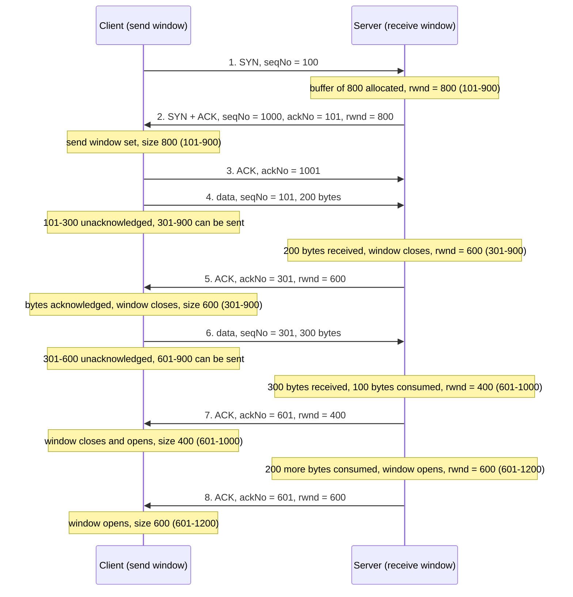

*Figure 22. An example of flow control in unidirectional data transfer*

| Step | Segment | Bytes waiting to be pulled in the server buffer | rwnd | Client send window |
|:-----|:-----|:-----|:-----|:-----|
| 1 | SYN (seqNo 100) | None | 800 | Not yet set |
| 2 | SYN + ACK (ackNo 101, rwnd 800) | None | 800 | 101-900 (800 bytes) |
| 4 | Data 101-300 | 101-300 (200 bytes) | 600 | 101-900, of which 101-300 unacknowledged |
| 5 | ACK (ackNo 301, rwnd 600) | 101-300 (200 bytes) | 600 | 301-900 (600 bytes) |
| 6, 7 | Data 301-600, ACK (ackNo 601, rwnd 400) | 201-600 (400 bytes; 101-200 consumed) | 400 | 601-1,000 (400 bytes) |
| 8 | ACK (ackNo 601, rwnd 600) | 401-600 (200 bytes) | 600 | 601-1,200 (600 bytes) |

*Table 5. Changes of rwnd and the send window in the flow-control example*

1. The first segment is a SYN segment from the client to the server requesting a connection, announcing the initial seqNo = 100. When this segment arrives, the server allocates a buffer of 800 bytes (an assumption) and sets its window to cover the whole buffer (rwnd = 800). The number of the next byte to arrive is 101.
2. The second segment is a SYN + ACK segment from the server to the client. It uses ackNo = 101 to show that it expects to receive bytes starting from 101, and it announces that the client can set a window of 800 bytes.
3. The third segment is an ACK segment from the client to the server.
4. After the client has set its window to the size (800) dictated by the server, its process pushes 200 bytes of data. The client TCP numbers these bytes 101 to 300, creates a segment, and sends it. The client's window is adjusted to show that 200 bytes have been sent but are waiting for acknowledgment. The server stores the bytes and closes its receive window to show that the next byte expected is 301. The stored bytes occupy 200 bytes of the buffer, so rwnd is 600.
5. The fifth segment is the feedback from the server to the client. The server acknowledges bytes up to and including 300 (expecting 301) and also carries the size of the decreased receive window (600). On receiving this segment, the client purges the acknowledged bytes from its window and closes the window to show that the next byte to send is 301. The window size decreases to 600 bytes. Although the allocated buffer can hold 800 bytes, the window cannot open (move its right wall to the right) because the receiver does not allow it.
6. When the client's process pushes 300 more bytes, the client sends the sixth segment with seqNo = 301 carrying 300 bytes. The server stores them but has to reduce its window size. After its process has pulled 100 bytes, the window closes from the left by 300 bytes and opens from the right by 100 bytes. As a result the size is reduced by only 200 bytes, and the receive window is now 400 bytes.
7. In the seventh segment the server acknowledges the receipt of the data and announces that its window size is 400. The client has no choice but to reduce its window again to the rwnd = 400 advertised by the server. The send window closes from the left by 300 bytes and opens from the right by 100 bytes.
8. The eighth segment is also from the server, after its process has pulled another 200 bytes. The window size increases, and the new rwnd is 600. The segment tells the client that the server still expects byte 601 but that its window has expanded to 600. Whether this segment is sent depends on the policy of the implementation; some implementations do not advertise the rwnd at this point and wait until they receive some data. On receiving this segment, the client opens its window by 200 bytes without closing it, so its window size becomes 600 bytes.

### 8.5 Prohibiting the Shrinking of the Send Window

As stated above, the receive window cannot shrink. The send window, however, can shrink if the receiver defines an rwnd value that results in shrinking. Some implementations do not allow the send window to shrink, that is, they do not allow its right wall to move to the left. To prevent it, the receiver must keep the following relationship between the last and new acknowledgment numbers and the last and new rwnd values.

```math
\text{new ackNo} + \text{new rwnd} \geq \text{last ackNo} + \text{last rwnd}
```

The left side is the new position of the right wall in the sequence-number space, and the right side is the old position. The relationship states that the right wall must not move to the left, and it is a mandate for the receiver to check its advertisements. Note that the inequality is valid only if $`S_f < S_n`$ and that all calculations are modulo $`2^{32}`$.

For example, if the last advertisement was ackNo = 206 and rwnd = 12, the right wall is at 206 + 12 = 218. Suppose the sender has sent bytes 206 to 214, and bytes 206 to 209 have been acknowledged and purged. If the new advertisement is ackNo = 210 and rwnd = 4, then 210 + 4 = 214 < 218, so the send window shrinks. This creates a problem: byte 214, which has already been sent, falls outside the window. The receiver does not know which of bytes 210 to 217 have already been sent, so it must keep the relationship and leave the right wall where it was. One way to prevent this situation is for the receiver to postpone its feedback until its process has consumed enough bytes for the window to satisfy the relationship.

### 8.6 Window Shutdown and Probe Segments

Shrinking the send window by moving its right wall to the left is strongly discouraged, but there is one exception: the receiver can temporarily shut down the window by sending an rwnd of 0. This can happen if, for some reason, the receiver does not want to receive data from the sender for a while. In this case the sender does not actually shrink the window but stops sending data until a new advertisement arrives.

Kurose and Ross point out a technical problem with this scheme. Suppose Host B's receive buffer becomes full, it advertises rwnd = 0, and B has nothing to send to A. As B's application process empties the buffer, TCP does not send new segments with new rwnd values to A, because TCP sends a segment to A only when it has data or an acknowledgment to send. A is then never informed that space has opened up in B's receive buffer and is blocked, unable to transmit more data. To solve this problem, the TCP specification requires A to continue to send segments with one data byte when B's receive window is zero. These segments are acknowledged by the receiver, and eventually, as the buffer begins to empty, the acknowledgments contain a nonzero rwnd value. Forouzan calls such a one-byte data segment, which the sender can always send even when the window is shut down by an order from the receiver, a **probe**, managed with the persistence timer (Section 10.6).

> **Note:** UDP provides no flow control, so segments may be lost at the receiver because of buffer overflow. A typical UDP implementation appends segments to a finite-sized buffer in front of the corresponding socket, and the process reads one segment at a time from the buffer. If the process does not read segments fast enough, the buffer overflows and segments are dropped (queuing in Chapter 6).

### 8.7 Silly Window Syndrome

A serious problem can arise in sliding-window operation when the sending application creates data slowly, the receiving application consumes data slowly, or both. Either situation results in data being sent in very small segments, which reduces the efficiency of the operation.

> **Definition:** The **silly window syndrome** is the inefficiency in which, because the sending application creates data slowly or the receiving application consumes it slowly, TCP keeps sending segments that carry very little data relative to their headers.

For example, if TCP sends segments containing only 1 byte of data, a 41-byte datagram (including 20 bytes of TCP header and 20 bytes of IP header) transfers only 1 byte of user data. The overhead is 41/1, which means the capacity of the network is used very inefficiently. The inefficiency is even worse once the overhead of the data link and physical layers is considered.

**Syndrome created by the sender.** The sending TCP may create the syndrome if it is serving an application that creates data slowly, for example 1 byte at a time. If the application writes 1 byte at a time into the buffer of the sending TCP and the sending TCP, without specific instructions, creates 1-byte segments, a great many 41-byte segments travel through the Internet. The solution is to prevent the sending TCP from sending data byte by byte and to force it to wait and collect data into a larger block. The question is how long to wait: if it waits too long, it may delay the process, and if it does not wait long enough, it may end up sending small segments. Nagle found an elegant solution.

> **Definition:** **Nagle's algorithm** makes the sending TCP send the first piece of data immediately and thereafter accumulate data in the output buffer until either an acknowledgment arrives or enough data has accumulated to fill a maximum-size segment.

1. The sending TCP sends the first piece of data it receives from the sending application, even if it is only 1 byte.
2. After sending the first segment, the sending TCP accumulates data in the output buffer and waits until either the receiving TCP sends an acknowledgment or enough data has accumulated to fill a maximum-size segment. At that point it sends the segment.
3. Step 2 is repeated for the rest of the transmission. That is, segment 3 is sent immediately if an acknowledgment is received for segment 2 or if enough data have accumulated to fill a maximum-size segment.

The elegance of Nagle's algorithm lies in its simplicity and in the fact that it takes into account both the speed of the application that creates the data and the speed of the network that transports it. If the application is faster than the network, the segments are larger (maximum-size segments); if the application is slower than the network, the segments are smaller (less than the maximum segment size).

**Syndrome created by the receiver.** The receiving TCP may also create the syndrome if it is serving an application that consumes data slowly, for example 1 byte at a time. Suppose the sending application creates data in blocks of 1 kilobyte, the receiving application consumes data 1 byte at a time, and the input buffer of the receiving TCP is 4 kilobytes. The sender sends the first 4 kilobytes, the receiver stores them, and since its buffer is now full, it advertises a window size of zero, stopping the sender. When the receiving application reads the first byte from the input buffer, there is 1 byte of space, and the receiving TCP announces a window size of 1 byte. The sending TCP, which is eagerly waiting to send data, takes this as good news and sends a segment carrying only 1 byte of data. The procedure continues: 1 byte is consumed and a 1-byte segment is sent, so again there is an efficiency problem and the silly window syndrome. Two solutions have been proposed to prevent the syndrome created by an application that consumes data more slowly than it arrives.

- **Clark's solution.** Send an acknowledgment as soon as the data arrive, but announce a window size of zero until either there is enough space to accommodate a segment of maximum size or at least half of the receive buffer is empty.
- **Delayed acknowledgment.** When a segment arrives, do not acknowledge it immediately.

> **Definition:** A **delayed acknowledgment** is the technique in which the receiver, on receiving a segment, does not acknowledge it immediately but postpones the acknowledgment until there is a decent amount of space in its input buffer or a period of time has passed.

A delayed acknowledgment prevents the sending TCP from sliding its window. After the sending TCP has sent the data in the window, it stops, and this kills the syndrome. Delayed acknowledgment also has another advantage: it reduces traffic, because the receiver does not have to acknowledge each segment. Its disadvantage is that the late acknowledgment may make the sender unnecessarily retransmit segments. TCP balances the advantages and disadvantages by specifying that an acknowledgment should not be delayed by more than 500 ms.

---

<br>

## 9. Error Control

TCP is a reliable transport-layer protocol. An application program that delivers a stream of data to TCP relies on TCP to deliver the entire stream to the application program at the other end in order, without error, and without any part lost or duplicated. TCP's reliable data transfer service ensures that the data stream a process reads out of its TCP receive buffer is uncorrupted, without gaps, without duplication, and in sequence, that is, exactly the same byte stream that was sent by the end system on the other side of the connection.

### 9.1 Types of Errors and Three Tools

IP service guarantees neither datagram delivery, nor in-order delivery, nor the integrity of the data. Datagrams can overflow router buffers and never reach their destination, arrive out of order, or have their bits corrupted, and segments suffer the same problems. The errors handled by TCP's error control are corrupted segments, lost segments, out-of-order segments, and duplicated segments.

Error control in TCP is achieved with three tools: checksum, acknowledgment, and time-out.

- **Checksum.** Each segment includes a checksum field used to check for a corrupted segment. A segment found corrupted by an invalid checksum is discarded by the destination TCP and considered lost. TCP uses a 16-bit checksum that is mandatory in every segment (Section 4.3).
- **Acknowledgment.** It confirms the receipt of uncorrupted data segments. Control segments that carry no data but consume a sequence number (SYN, FIN) are also acknowledged. ACK segments, however, are never acknowledged.
- **Time-out.** If a segment is not acknowledged before the time-out, it is considered corrupted or lost. The error-correction mechanism is retransmission driven by the time-out timer.

> **Key Point:** ACK segments do not consume sequence numbers and are not acknowledged.

### 9.2 Types of Acknowledgment

In the past TCP used only one type of acknowledgment, cumulative acknowledgment, but today some TCP implementations also use selective acknowledgment.

- **Cumulative acknowledgment (ACK).** TCP was originally designed to acknowledge the receipt of segments cumulatively. The receiver announces the next byte it expects to receive, ignoring all segments received and stored out of order. This is sometimes called positive cumulative acknowledgment, where "positive" indicates that no feedback is provided for discarded, lost, or duplicate segments. The 32-bit acknowledgment field in the TCP header is used for cumulative acknowledgments, and its value is valid only when the ACK flag bit is set to 1.
- **Selective acknowledgment (SACK).** More and more implementations are adding selective acknowledgment. A SACK does not replace the ACK but reports additional information to the sender: blocks of data that arrived out of order and blocks of segments that were duplicated. Since the TCP header has no room for this information, SACK is implemented as an option at the end of the TCP header (Section 11.6).

### 9.3 ACK Generation Rules

When does a receiver generate acknowledgments? Over the evolution of TCP, several rules have been defined and used by various implementations. Forouzan lists the six most common rules as follows; the order of a rule does not indicate its importance.

1. **Rule 1 (piggybacking).** When end A sends a data segment to end B, it must include (piggyback) an acknowledgment giving the next sequence number it expects to receive. This rule decreases the number of segments needed and therefore reduces traffic.
2. **Rule 2 (delayed ACK).** When the receiver has no data to send and receives an in-order segment (with the expected sequence number) whose preceding segment has already been acknowledged, it delays sending an ACK segment until another segment arrives or a period of time (normally 500 ms) has passed. In other words, the receiver must delay the ACK if there is only one outstanding in-order segment. This rule reduces ACK segment traffic.
3. **Rule 3 (immediate cumulative ACK).** When a segment with the expected sequence number arrives and the previous in-order segment has not been acknowledged, the receiver immediately sends an ACK segment. In other words, there should never be more than two in-order unacknowledged segments at any time. This prevents unnecessary retransmissions that may create congestion in the network.
4. **Rule 4 (immediate ACK on a gap).** When a segment arrives with an out-of-order sequence number higher than expected, the receiver immediately sends an ACK segment announcing the sequence number of the next expected segment. This leads to the fast retransmission of missing segments (Section 9.8).
5. **Rule 5 (segment filling the gap).** When a missing segment arrives, the receiver sends an ACK segment announcing the next sequence number expected. This informs the sender that the segments reported missing have been received.
6. **Rule 6 (duplicate segment).** If a duplicate segment arrives, the receiver discards it but immediately sends an acknowledgment indicating the next in-order segment expected. This solves some problems that arise when an ACK segment itself is lost (Section 9.9).

Kurose and Ross summarize the same content as the TCP receiver's ACK generation recommendation. Table 6 maps the rules of the two textbooks to each other.

| Event at the receiver | TCP receiver action (Kurose and Ross) | Forouzan's rule |
|:-----|:-----|:-----|
| Arrival of an in-order segment with the expected sequence number; all data up to the expected sequence number already acknowledged | Delayed ACK: wait up to 500 ms for the arrival of another in-order segment, and if it does not arrive, send an ACK | Rule 2 |
| Arrival of an in-order segment with the expected sequence number; one other in-order segment waiting for ACK transmission | Immediately send a single cumulative ACK acknowledging both in-order segments | Rule 3 |
| Arrival of an out-of-order segment with a higher-than-expected sequence number; gap detected | Immediately send a duplicate ACK indicating the sequence number of the next expected byte (the lower end of the gap) | Rule 4 |
| Arrival of a segment that partially or completely fills a gap in the received data | Immediately send an ACK, provided that the segment starts at the lower end of the gap | Rule 5 |
| (Defined separately only by Forouzan) The receiver has data to send | Carry the ACK in a data segment | Rule 1 |
| (Defined separately only by Forouzan) Arrival of a duplicate segment | Discard it and immediately send an ACK announcing the next expected byte | Rule 6 |

*Table 6. ACK generation rules of the TCP receiver and their correspondence in the two textbooks*

### 9.4 Retransmission and Out-of-Order Segments

The heart of the error-control mechanism is the retransmission of segments. When a segment is sent, it is stored in a queue until it is acknowledged. When the retransmission timer expires or the sender receives three duplicate ACKs for the first segment in the queue, that segment is retransmitted. No retransmission timer is set for an ACK segment that carries only an acknowledgment.

- **Retransmission after RTO.** The sending TCP maintains one **retransmission timeout (RTO)** for each connection. When the timer expires, TCP sends the segment at the front of the queue (the segment with the smallest sequence number) and restarts the timer. The value of the RTO is dynamic and is updated based on the round-trip time (RTT) of segments (Section 10). Forouzan calls a TCP that uses only this mechanism Tahoe.
- **Retransmission after three duplicate ACKs.** The previous rule suffices if the RTO value is not large. To improve throughput, however, most implementations today follow the three-duplicate-ACKs rule and retransmit the missing segment immediately instead of waiting for a time-out (fast retransmit, Section 9.8). Forouzan calls a TCP that uses this feature Reno. If three duplicate acknowledgments (that is, an original ACK plus three exactly identical copies) arrive, the next segment is retransmitted without waiting for the time-out. The names Tahoe and Reno reappear in Chapter 9 to describe differences in congestion-control behavior.

**Out-of-order segments.** TCP implementations today do not discard out-of-order segments. They store them temporarily and flag them as out of order until the missing segments arrive. Out-of-order segments, however, are never delivered to the process.

> **Key Point:** Data may arrive out of order and be temporarily stored by the receiving TCP, but TCP guarantees that no out-of-order data are delivered to the process.

### 9.5 A Simplified TCP Sender

Chapter 7 assumed that each transmitted but unacknowledged packet has its own timer. This is fine in theory, but timer management can require considerable overhead. The recommended TCP timer-management procedures therefore use only a **single** retransmission timer, even if there are several transmitted but unacknowledged segments. Kurose and Ross first present a highly simplified TCP sender that uses only timeouts to recover from lost segments, assuming that data is sent in only one direction, from Host A to Host B, and that A is sending a large file.

```text
/* Assume sender is not constrained by TCP flow or congestion control,
   that data from above is less than MSS in size, and that data
   transfer is in one direction only. */

NextSeqNum = InitialSeqNumber
SendBase = InitialSeqNumber

loop (forever) {
    switch(event)

        event: data received from application above
            create TCP segment with sequence number NextSeqNum
            if (timer currently not running)
                start timer
            pass segment to IP
            NextSeqNum = NextSeqNum + length(data)
            break;

        event: timer timeout
            retransmit not-yet-acknowledged segment with
                smallest sequence number
            start timer
            break;

        event: ACK received, with ACK field value of y
            if (y > SendBase) {
                SendBase = y
                if (there are currently any not-yet-acknowledged segments)
                    start timer
            }
            break;

} /* end of loop forever */
```

*Figure 23. A simplified TCP sender*

There are three major events related to data transmission and retransmission in the TCP sender.

1. **Data received from the application.** TCP encapsulates the data in a segment and passes it to IP. The sequence number of each segment is the byte-stream number of its first data byte. If the timer is not already running for some other segment, TCP starts the timer when it passes the segment to IP (it is helpful to think of the timer as the timer of the oldest unacknowledged segment). The expiration interval of the timer is the `TimeoutInterval` of Section 10.
2. **Timeout.** TCP retransmits the segment that caused the timeout and restarts the timer.
3. **ACK received.** When a segment containing a valid ACK field value $`y`$ arrives, TCP compares $`y`$ with its variable `SendBase`, the sequence number of the oldest unacknowledged byte (so `SendBase - 1` is the number of the last byte known to have been received correctly and in order at the receiver). TCP uses cumulative acknowledgments, so $`y`$ acknowledges the receipt of all bytes before byte $`y`$. If $`y`$ > `SendBase`, the ACK acknowledges one or more previously unacknowledged segments, so the sender updates `SendBase` and restarts the timer if there are still unacknowledged segments.

### 9.6 Retransmission Scenarios Driven by Timeouts

Even this simplified sender has many subtleties. Three scenarios illustrate its operation.

**Retransmission due to a lost acknowledgment.** Host A sends one segment with sequence number 92 and 8 bytes of data to B and waits for a segment from B with acknowledgment number 100. A's segment is received at B, but the acknowledgment from B to A is lost. A timeout occurs, and A retransmits the same segment. When B receives the retransmission, it observes from the sequence number that the segment contains data already received and discards those bytes.

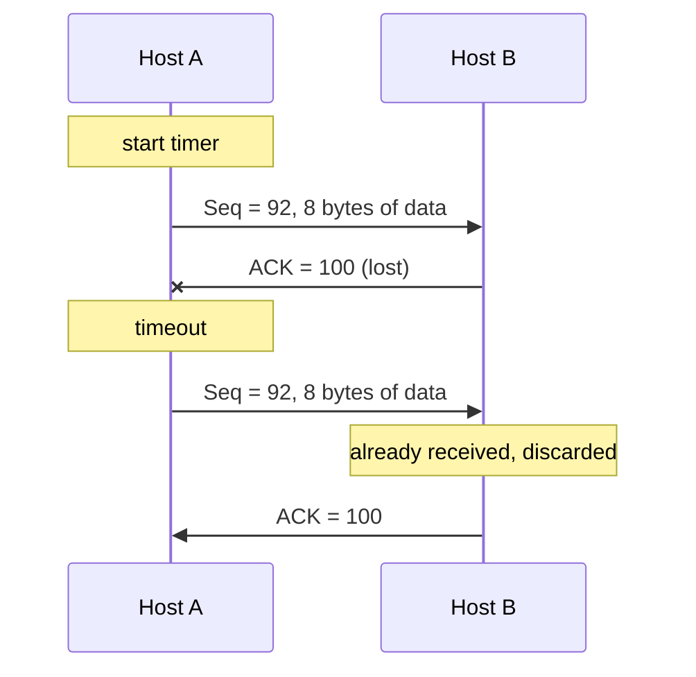

*Figure 24. Retransmission due to a lost acknowledgment*

**Segment 100 not retransmitted.** A sends two segments back to back. The first has sequence number 92 and 8 bytes of data, and the second has sequence number 100 and 20 bytes of data. Both segments arrive intact at B, and B sends two separate acknowledgments with acknowledgment numbers 100 and 120. If neither acknowledgment arrives at A before the timeout, A resends the first segment, with sequence number 92, when the timeout occurs and restarts the timer. As long as the ACK for the second segment arrives before the new timeout, the second segment is not retransmitted.

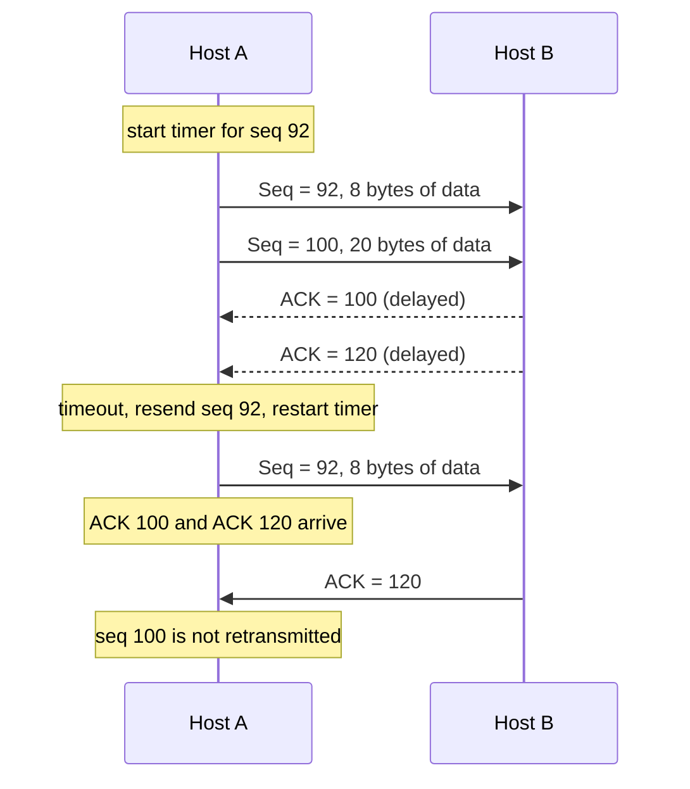

*Figure 25. Delayed acknowledgments cause only the first segment, not the second, to be retransmitted*

**A cumulative acknowledgment avoids retransmission.** A sends the two segments exactly as in the previous example. The acknowledgment of the first segment is lost in the network, but just before the timeout A receives an acknowledgment with acknowledgment number 120. A therefore knows that B has received everything up through byte 119 and resends neither segment.

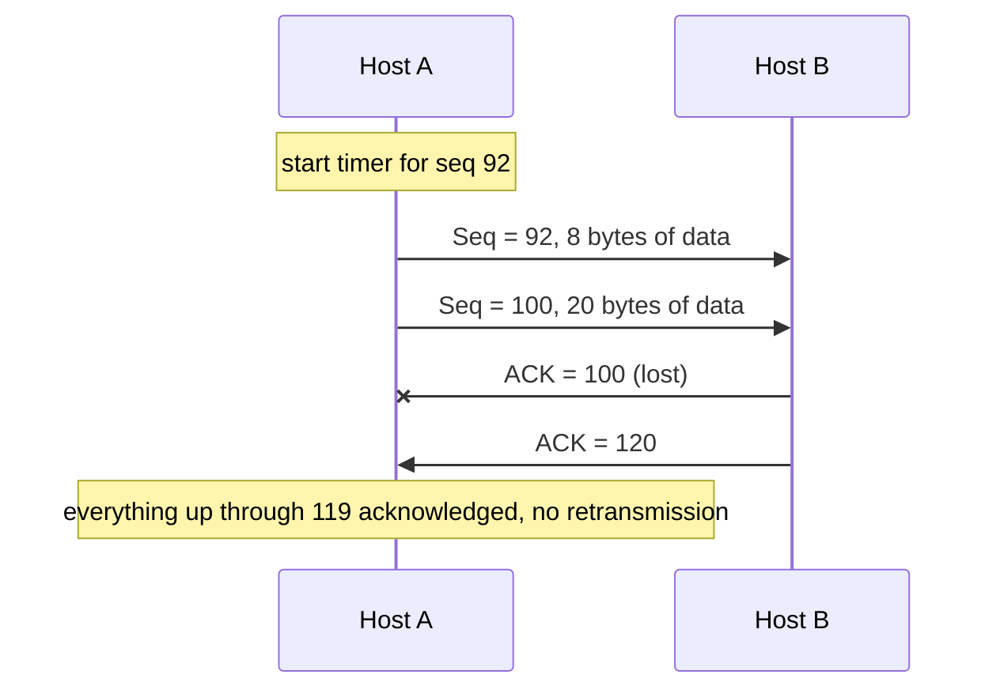

*Figure 26. A cumulative acknowledgment avoids retransmission of the first segment*

### 9.7 Doubling the Timeout Interval

The first modification that most TCP implementations employ concerns the length of the timeout interval after a timer expiration. When a timeout event occurs, TCP retransmits the unacknowledged segment with the smallest sequence number, as described above. But each time it retransmits, it sets the next timeout interval to twice the previous value rather than deriving it from the last `EstimatedRTT` and `DevRTT` (Section 10). For example, if the `TimeoutInterval` associated with the oldest unacknowledged segment is 0.75 seconds when the timer first expires, TCP retransmits this segment and sets the new expiration time to 1.5 seconds. If the timer expires again 1.5 seconds later, TCP retransmits again, now setting the expiration time to 3.0 seconds. The intervals thus grow exponentially after each retransmission. However, whenever the timer is started after either of the two other events (data received from the application, ACK received), the `TimeoutInterval` is derived from the most recent values of `EstimatedRTT` and `DevRTT`.

This modification provides a limited form of congestion control (Chapter 9). A timer expiration is most likely caused by congestion in the network, that is, too many packets arriving at router queues on the path between the source and the destination, causing packets to be dropped or long queuing delays. In times of congestion, if sources continue to retransmit packets persistently, the congestion may get worse. Instead, TCP acts more politely, with each sender retransmitting after longer and longer intervals. Ethernet's CSMA/CD in Chapter 18 uses a similar idea.

### 9.8 Fast Retransmit

One problem with timeout-triggered retransmissions is that the timeout period can be relatively long. When a segment is lost, the long timeout forces the sender to delay resending the lost packet, increasing the end-to-end delay. Fortunately, the sender can often detect packet loss well before the timeout by noticing so-called duplicate ACKs (Chapter 7).

When a TCP receiver receives a segment with a sequence number larger than the next expected in-order sequence number, it detects a gap in the data stream, that is, a missing segment. This gap could be the result of lost or reordered segments within the network. Since TCP does not use negative acknowledgments, the receiver cannot send an explicit NAK; instead, it reacknowledges the last in-order byte of data it has received (generates a duplicate ACK, Rule 4). Because a sender often sends many segments back to back, if one segment is lost there will likely be many back-to-back duplicate ACKs.

> **Definition:** **Fast retransmit** is the technique in which a TCP sender, on receiving three duplicate ACKs for the same data, takes this as an indication that the segment following the segment acknowledged three times has been lost and resends it immediately, before that segment's timer expires.

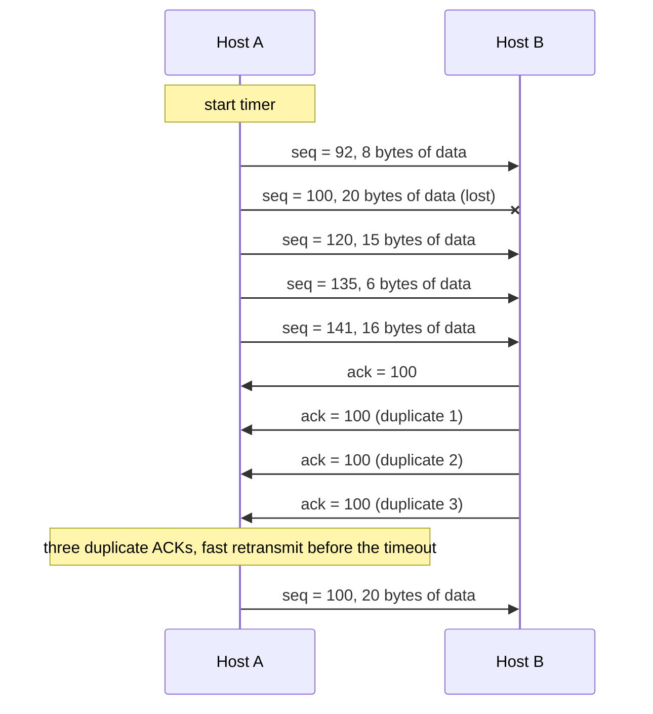

*Figure 27. Fast retransmit: retransmitting the missing segment before the segment's timer expires*

In Figure 27 the second segment is lost and is retransmitted before its timer expires. The first ack = 100 is the original acknowledgment for the seq 92 segment, and the next three are duplicate ACKs generated each time the seq 120, 135, and 141 segments arrive out of order. For TCP with fast retransmit, the ACK-received event of Figure 23 is replaced by the following code.

```text
event: ACK received, with ACK field value of y
    if (y > SendBase) {
        SendBase = y
        if (there are currently any not yet acknowledged segments)
            start timer
    }
    else { /* a duplicate ACK for already ACKed segment */
        increment number of duplicate ACKs received for y
        if (number of duplicate ACKs received for y == 3)
            /* TCP fast retransmit */
            resend segment with sequence number y
    }
    break;
```

The sender waits for three duplicate ACKs rather than one because duplicate ACKs arise not only from segment loss but also from segments being reordered within the network. With reordering, in which a few segments arrive slightly late, one or two duplicate ACKs appear and then the missing segment arrives and fills the gap. Waiting for three duplicate ACKs reduces the chance of mistaking simple reordering for loss and retransmitting unnecessarily, while still responding to loss much sooner than a timeout.

> **Note:** Kurose and Ross sum up that TCP uses positive acknowledgments and timers in much the same way as Chapter 7 described. Certain versions of TCP also have an implicit NAK mechanism through fast retransmit: three duplicate ACKs for a given segment serve as an implicit NAK for the following segment, triggering its retransmission before a timeout.

### 9.9 Error-Control Scenarios Viewed Through the ACK Rules

Forouzan shows with several scenarios how the ACK generation rules of Section 9.3 are applied in practice. In the figures below, a segment carrying data is shown with its range of byte numbers and the value of its acknowledgment field, and a segment carrying only an acknowledgment is shown with its acknowledgment number.

**Normal operation.** The first scenario is bidirectional data transfer between two systems. The client TCP sends one segment, and the server TCP sends three.

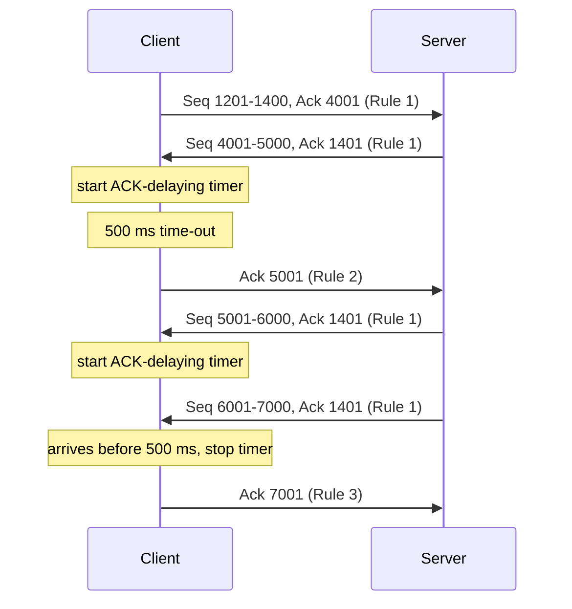

*Figure 28. Normal operation of bidirectional data transfer and the ACK rules*

Rule 1 applies to the client's first segment and to all three server segments: there are data to send, so the segment also announces the next byte expected. When the client receives the server's first segment, it has no more data to send and needs to send only an ACK segment, but according to Rule 2 it delays the acknowledgment for 500 ms to see whether more segments arrive. When the ACK-delaying timer matures, it sends the acknowledgment. The client cannot delay the acknowledgment forever, because it does not know whether other segments are coming. When the next segment arrives, another ACK-delaying timer is set, but the third segment arrives before it matures, so according to Rule 3 an acknowledgment is sent immediately. The RTO timer is not shown because no segment is lost or delayed.

**Lost segment.** A lost segment and a corrupted segment are treated the same way by the receiver: a lost segment is discarded somewhere in the network, and a corrupted segment is discarded by the receiver itself, and both are considered lost. Data transfer is assumed to be unidirectional: one side only sends and the other only receives.

```mermaid
sequenceDiagram
    participant C as Client (RTO)
    participant S as Server (receiver buffer)
    Note over C: start RTO
    C->>S: Seq 501-600
    C->>S: Seq 601-700
    S->>C: Ack 701 (Rule 3)
    Note over C: stop RTO, start again
    C-xS: Seq 701-800 (lost)
    C->>S: Seq 801-900
    Note over S: out of order, stored with a gap
    S->>C: Ack 701 (Rule 4)
    Note over C: time-out, restart
    C->>S: Seq 701-800 (resent)
    Note over S: gap filled
    S->>C: Ack 901 (Rule 5)
    Note over C: stop RTO
```

*Figure 29. Retransmission of a lost segment and the ACK rules*

The sender sends segments 1 and 2, which are acknowledged immediately by an ACK (Rule 3). Segment 3, however, is lost. The receiver receives segment 4, which is out of order, stores its data in its buffer while leaving a gap to indicate that there is no continuity in the data, and immediately sends an acknowledgment showing the next byte it expects (Rule 4). The receiver stores bytes 801 to 900 but never delivers them to the application until the gap is filled.

> **Key Point:** The receiving TCP delivers only ordered data to the process.

The sending TCP keeps one RTO timer for the whole period of the connection. When the timer for the third segment expires, the sending TCP resends segment 3, which arrives this time and is acknowledged properly (Rule 5).

**Fast retransmission.** This scenario is the same as the previous one except that the RTO has a larger value.

```mermaid
sequenceDiagram
    participant C as Client (RTO)
    participant S as Server (receiver buffer)
    Note over C: start RTO
    C->>S: Seq 101-200
    C->>S: Seq 201-300
    S->>C: Ack 301 (original ACK)
    Note over C: stop RTO, start again
    C-xS: Seq 301-400 (lost)
    C->>S: Seq 401-500
    S->>C: Ack 301 (first duplicate)
    C->>S: Seq 501-600
    S->>C: Ack 301 (second duplicate)
    C->>S: Seq 601-700
    S->>C: Ack 301 (third duplicate)
    Note over C: fast retransmit, restart RTO
    C->>S: Seq 301-400 (resent)
    Note over S: all in order
    S->>C: Ack 701
    Note over C: stop RTO
```

*Figure 30. Fast retransmission by three duplicate ACKs and the ACK rules*

Each time the receiver receives the fourth, fifth, and sixth segments, it triggers an acknowledgment (Rule 4). The sender receives four acknowledgments with the same value (three duplicates). Although the timer has not matured, the fast retransmission rule requires that segment 3, the segment expected by all these duplicate acknowledgments, be resent immediately. After resending the segment, the timer is restarted.

**Delayed segment and duplicate segment.** TCP uses the services of IP, a connectionless protocol. Each IP datagram encapsulating a TCP segment may reach the destination through a different route with a different delay, so TCP segments may be delayed. A delayed TCP segment is treated by the receiver the same way as a lost or corrupted segment, and if it arrives after it has been resent because of a timeout, it becomes a duplicate segment. A duplicate segment can be created, for example, when the sending TCP treats a delayed segment as lost and resends it. The destination TCP expects a continuous stream of bytes, so when a segment arrives with a sequence number equal to an already received and stored segment, or with sequence numbers less than the bytes already acknowledged, it discards the segment and sends an ACK whose ackNo defines the next byte expected (Rule 6).

**Lost acknowledgment corrected automatically.** Here the information in a lost acknowledgment is contained in the next one, a key advantage of cumulative acknowledgments. In TCP's acknowledgment mechanism, a lost acknowledgment may not even be noticed by the source TCP. The next acknowledgment can be said to correct the loss automatically.

```mermaid
sequenceDiagram
    participant C as Client (RTO)
    participant S as Server
    Note over C: start RTO
    C->>S: Seq 501-600
    C->>S: Seq 601-700
    S-xC: Ack 701 (lost)
    C->>S: Seq 701-800
    C->>S: Seq 801-900
    S->>C: Ack 901
    Note over C: the cumulative ACK also covers 701, stop RTO
```

*Figure 31. The next cumulative acknowledgment automatically corrects a lost acknowledgment*

**Lost acknowledgment corrected by resending a segment.** If the next acknowledgment is delayed for a long time or there is no next acknowledgment (the lost acknowledgment was the last one sent), the RTO timer triggers the correction. A duplicate segment results. When the receiver receives the duplicate segment, it discards it and immediately resends the last ACK (Rule 6) to tell the sender that the segments have been received.

```mermaid
sequenceDiagram
    participant C as Client (RTO)
    participant S as Server
    Note over C: start RTO
    C->>S: Seq 501-600
    C->>S: Seq 601-700
    S-xC: Ack 701 (lost)
    Note over C: time-out, restart
    C->>S: Seq 501-600 (resent)
    Note over S: duplicate segment, discarded
    S->>C: Ack 701 (Rule 6)
    Note over C: stop RTO
```

*Figure 32. A lost acknowledgment corrected by resending a segment*

Note that only one segment is retransmitted although two segments are unacknowledged. When the sender receives the resent ACK, it knows that both segments arrived safe and sound, because the acknowledgment is cumulative.

**Deadlock created by a lost acknowledgment.** There is one situation in which the loss of an acknowledgment can result in system deadlock. It is the case in which a receiver sends an acknowledgment with rwnd set to 0, asking the sender to shut down its window temporarily. After a while the receiver wants to remove the restriction, but if it has no data to send, it sends an ACK segment with a nonzero rwnd value to remove it. A problem arises if this acknowledgment is lost. The sender is waiting for an acknowledgment announcing a nonzero rwnd, and the receiver thinks the sender has received it and waits for data. This situation, in which each end waits for a response from the other and nothing happens, is called a deadlock. No retransmission timer is set for acknowledgments. The persistence timer was designed to prevent this deadlock (Section 10.6).

> **Key Point:** Lost acknowledgments may create deadlock if they are not properly handled.

### 9.10 Simplified FSMs of the Sender and Receiver

Forouzan presents simplified FSMs similar to the SR protocol of Chapter 7 but modified for TCP. The communication is unidirectional, segments are acknowledged with ACK segments, and selective acknowledgment, congestion control, the silly window syndrome (Nagle's algorithm, Clark's solution), and window shutdown are ignored. All calculations are modulo $`2^{32}`$.

| Side | Event | Action |
|:-----|:-----|:-----|
| Sender | A chunk of data accepted from the application (Ready state) | Make a segment with seqNo = $`S_n`$, store a copy in the queue, and send it; start the timer if it is the first segment in the queue; $`S_n`$ = $`S_n`$ + data length; go to the Blocking state if the window is full |
| Sender | Time-out | Resend the first segment in the queue and reset the timer |
| Sender | Error-free ACK acknowledging the first segment in the queue | Slide the window ($`S_f`$ = ackNo) and adjust the window size according to rwnd; remove the acknowledged segments from the queue, restart the timer if segments remain, else stop it; return to the Ready state if in the Blocking state |
| Sender | Duplicate ACK | dupNo = dupNo + 1; if dupNo = 3, resend the segment at the front of the queue, restart the timer, and set dupNo = 0 |
| Sender | Corrupted ACK | Discard it |
| Receiver | Expected error-free segment | If the ACK-delaying timer is running, stop it and send a cumulative ACK; otherwise start the ACK-delaying timer (Rules 2 and 3) |
| Receiver | ACK-delaying timer expired | Send the delayed ACK |
| Receiver | Error-free but out-of-order segment | Store it if not a duplicate and send an ACK with the sequence number of the expected segment (duplicate ACK, Rule 4) |
| Receiver | Error-free duplicate segment or segment with a sequence number outside the window | Discard it and send an ACK with the sequence number of the expected segment (Rule 6) |
| Receiver | Corrupted segment | Discard it |
| Receiver | Delivery request from the process | Deliver the data accumulated in order to the process |

*Table 7. Events and actions handled by the simplified FSMs of the TCP sender and receiver*

This FSM differs from the SR FSM of Chapter 7 in the sender's fast retransmission (three duplicate ACKs), the adjustment of the window size according to rwnd, the receiver's ACK delaying, and the receiver's sending of duplicate ACKs so that the sender can use the fast-retransmission policy. A receiver FSM for bidirectional communication is not as simple as the one for SR, since it must consider policies such as sending an immediate ACK when the receiver has data to return.

### 9.11 Is TCP GBN or SR

TCP acknowledgments are cumulative, and correctly received but out-of-order segments are not individually acknowledged by the receiver. The TCP sender therefore need only maintain the smallest sequence number of a transmitted but unacknowledged byte (`SendBase`) and the sequence number of the next byte to be sent (`NextSeqNum`). In this sense TCP looks a lot like a GBN-style protocol. But there are striking differences between TCP and GBN.

- Many TCP implementations buffer correctly received but out-of-order segments.
- Suppose the sender sends segments 1, 2, ..., N, and all arrive in order without error at the receiver, but the acknowledgment for packet n < N is lost while the remaining N - 1 acknowledgments arrive at the sender before their respective timeouts. GBN would retransmit not only packet n but also all the subsequent packets n + 1, n + 2, ..., N. TCP would retransmit at most one segment, segment n, and would not even retransmit segment n if the acknowledgment for segment n + 1 arrived before the timeout for segment n.

Selective acknowledgment (Section 11.6), proposed as a modification to TCP, allows a TCP receiver to acknowledge out-of-order segments selectively instead of cumulatively acknowledging the last correctly received in-order segment. Combined with selective retransmission, skipping the retransmission of segments already selectively acknowledged by the receiver, TCP looks a lot like a generic SR protocol. Kurose and Ross therefore consider TCP's error-recovery mechanism best categorized as a hybrid of the GBN and SR protocols. Forouzan likewise sums up that TCP behaves like SR because it accepts out-of-order segments, looks slightly like GBN because its original acknowledgments are cumulative, and is closest to SR when it uses SACKs.

> **Key Point:** TCP can be best modeled as a Selective Repeat protocol.

---

<br>

## 10. RTT Estimation and Timers

Like the rdt protocols of Chapter 7, TCP uses a timeout and retransmission mechanism to recover from lost segments. The concept is simple, but many subtle issues arise when it is implemented in an actual protocol. The most obvious is the length of the timeout interval. The timeout should be larger than the connection's round-trip time (RTT), the time from when a segment is sent until it is acknowledged; otherwise unnecessary retransmissions would be sent. But how much larger? How should the RTT be estimated? Should there be a timer for every unacknowledged segment?

> **Definition:** The **retransmission timeout (RTO)** is the time a sender waits for an acknowledgment after sending a segment; when it expires, the segment is retransmitted. TCP computes this value dynamically from measurements of the RTT.

### 10.1 RTT Samples

The sample RTT of a segment (`SampleRTT`) is the time between when the segment is sent (passed to IP) and when an acknowledgment for it is received. Forouzan calls it the measured RTT ($`RTT_M`$). Segments and acknowledgments do not correspond one to one, and several segments may be acknowledged together. The measured RTT of a segment is the time for the segment to reach the destination and be acknowledged, even if the acknowledgment covers other segments as well.

- Most TCP implementations do not measure a `SampleRTT` for every transmitted segment but take only one measurement at a time. That is, at any point in time the `SampleRTT` is being estimated for only one of the transmitted but unacknowledged segments, so a new `SampleRTT` is obtained approximately once every RTT.
- TCP never computes a `SampleRTT` for a segment that has been retransmitted; it measures only segments transmitted once (Karn's algorithm, Section 10.5).

> **Key Point:** In TCP, there can be only one RTT measurement in progress at any time.

### 10.2 Estimated RTT

`SampleRTT` values fluctuate from segment to segment because of congestion in routers and varying load on end systems, so any single value may be atypical. To estimate a typical RTT, it is natural to average the `SampleRTT` values. Each time TCP obtains a new `SampleRTT`, it updates the average, `EstimatedRTT` (Forouzan's smoothed RTT, $`RTT_S`$), with the following formula.

```math
\text{EstimatedRTT} = (1 - \alpha) \cdot \text{EstimatedRTT} + \alpha \cdot \text{SampleRTT}
```

The formula is written in the form of a programming-language assignment: the new `EstimatedRTT` is a weighted combination of the previous `EstimatedRTT` and the new `SampleRTT`. The recommended value of $`\alpha`$ is 0.125 (1/8), in which case the formula becomes the following.

```math
\text{EstimatedRTT} = 0.875 \cdot \text{EstimatedRTT} + 0.125 \cdot \text{SampleRTT}
```

`EstimatedRTT` is a weighted average of the `SampleRTT` values that puts more weight on recent samples than on old ones. This is natural, since recent samples better reflect the current congestion in the network. In statistics such an average is called an **exponential weighted moving average (EWMA)**. Unrolling the formula, the sample from $`k`$ steps ago carries weight $`0.125 \times 0.875^k`$, so the weights decay exponentially fast from the most recent sample: 0.125, 0.109, 0.096, 0.084, and so on. After the first measurement, `EstimatedRTT` = `SampleRTT` (Forouzan).

### 10.3 RTT Deviation and the Retransmission Timeout

In addition to an estimate of the RTT, it is valuable to have a measure of its variability. The RTT deviation `DevRTT` (Forouzan's $`RTT_D`$) estimates how much `SampleRTT` typically deviates from `EstimatedRTT`.

```math
\text{DevRTT} = (1 - \beta) \cdot \text{DevRTT} + \beta \cdot \lvert \text{SampleRTT} - \text{EstimatedRTT} \rvert
```

`DevRTT` is an EWMA of the difference between `SampleRTT` and `EstimatedRTT`. If the `SampleRTT` values fluctuate little, `DevRTT` is small; if they fluctuate a lot, `DevRTT` is large. The recommended value of $`\beta`$ is 0.25. According to Forouzan, after the first measurement `DevRTT` = `SampleRTT` / 2.

The timeout interval should be greater than or equal to `EstimatedRTT`, or unnecessary retransmissions would be sent. But it should not be much larger than `EstimatedRTT`, or TCP would not quickly retransmit a lost segment, leading to large data-transfer delays. It is therefore desirable to set the timeout to `EstimatedRTT` plus some margin that is large when the `SampleRTT` values fluctuate a lot and small when they fluctuate little. Taking all of this into account, TCP sets the retransmission timeout interval as follows.

```math
\text{TimeoutInterval} = \text{EstimatedRTT} + 4 \cdot \text{DevRTT}
```

An initial `TimeoutInterval` value of 1 second is recommended (Kurose and Ross). When a timeout occurs, the `TimeoutInterval` is doubled to avoid a premature timeout for a subsequent segment that will soon be acknowledged (Section 9.7). As soon as a segment is received and `EstimatedRTT` is updated, however, the `TimeoutInterval` is again computed with the formula above.

| Meaning | Kurose and Ross | Forouzan |
|:-----|:-----|:-----|
| Measured RTT | `SampleRTT` | $`RTT_M`$ |
| Smoothed RTT | `EstimatedRTT` | $`RTT_S`$ |
| RTT deviation | `DevRTT` | $`RTT_D`$ |
| Retransmission timeout | `TimeoutInterval` | RTO |

*Table 8. Correspondence between the RTT estimation variables of the two textbooks*

> **Note:** The value of `DevRTT` differs slightly depending on the order in which `EstimatedRTT` and `DevRTT` are updated. The calculations in these notes, like Forouzan's examples, update `EstimatedRTT` first and use the new value in the `DevRTT` formula.

### 10.4 A Computation Example

Forouzan's example shows how the variables change during connection establishment and part of the data transfer.

```mermaid
sequenceDiagram
    participant S as Sender
    participant R as Receiver
    Note over S: no RTT values, RTO = 6.00
    S->>R: SYN, Seq 1400
    R->>S: SYN + ACK, Seq 4000, Ack 1401
    Note over S: RTTM = 1.5, RTTS = 1.50, RTTD = 0.75, RTO = 4.50
    S->>R: ACK, Seq 1401, Ack 4001
    Note over S: a new RTT measurement starts
    S->>R: data 1401-1500, Ack 4001
    S->>R: data 1501-1600, Ack 4001
    R->>S: ACK, Seq 4001, Ack 1601
    Note over S: RTTM = 2.50, RTTS = 1.625, RTTD = 0.78, RTO = 4.75
```

*Figure 33. RTT estimation during connection establishment and data transfer (in seconds)*

1. When the SYN segment is sent, $`RTT_M`$, $`RTT_S`$, and $`RTT_D`$ have no values, and the RTO is set to 6.00 seconds.
2. When the SYN + ACK segment arrives, $`RTT_M`$ is measured as 1.5 seconds. Since this is the first measurement, the values are as follows.

```math
RTT_S = 1.5, \quad RTT_D = \frac{1.5}{2} = 0.75, \quad RTO = 1.5 + 4 \times 0.75 = 4.5
```

3. A new RTT measurement starts when the first data segment is sent. No measurement starts when the ACK segment is sent, because it does not consume a sequence number and there is no time-out. No measurement starts for the second data segment either, because a measurement is already in progress. The last ACK segment acknowledges both data segments (cumulatively), but its arrival finalizes $`RTT_M`$ for the first segment. With $`RTT_M`$ = 2.5 seconds, the values are as follows.

```math
\begin{aligned}
RTT_S &= \tfrac{7}{8} \times 1.5 + \tfrac{1}{8} \times 2.5 = 1.625 \\
RTT_D &= \tfrac{3}{4} \times 0.75 + \tfrac{1}{4} \times \lvert 1.625 - 2.5 \rvert = 0.5625 + 0.21875 = 0.78125 \\
RTO &= 1.625 + 4 \times 0.78125 = 4.75
\end{aligned}
```

> **Note:** The textbook by Forouzan rounds $`RTT_D`$ to 0.78, so its RTO is 1.625 + 4 × 0.78 = 4.745, which it prints as 4.74 seconds. With the unrounded $`RTT_D`$ = 0.78125 the RTO is exactly 4.75 seconds; the difference comes only from rounding. Figure 34 in Section 10.5 keeps the textbook's values 4.74 and 2 × 4.74 = 9.48 seconds, which are 4.75 and 2 × 4.75 = 9.50 seconds without rounding.

### 10.5 Karn's Algorithm and Exponential Backoff

Suppose a segment is not acknowledged within the retransmission timeout and is retransmitted. When the sending TCP receives an acknowledgment for this segment, it cannot tell whether the acknowledgment is for the original segment or for the retransmitted one. If the original segment was lost and the acknowledgment is for the retransmission, the RTT should be computed from the time of the retransmission, so there is an ambiguity. Karn solved this ambiguity.

> **Definition:** **Karn's algorithm** is the rule that the round-trip time of a retransmitted segment is not used in RTT estimation, and that $`RTT_S`$ is not updated until a segment is sent and acknowledged without retransmission.

What happens to the RTO when a retransmission occurs? Most TCP implementations use an **exponential backoff** strategy, doubling the RTO for each retransmission: twice the RTO after one retransmission, four times after two, and so on. This is the doubling of the timeout interval in Section 9.7.

Continuing the example of Section 10.4 gives the following.

```mermaid
sequenceDiagram
    participant S as Sender
    participant R as Receiver
    Note over S: previous values RTTM = 2.50, RTTS = 1.625, RTTD = 0.78, RTO = 4.74
    Note over S: start timer
    S-xR: data 1601-1700, Seq 1601, Ack 4001 (lost)
    Note over S: time-out, RTO = 2 × 4.74 = 9.48 (exponential backoff)
    S->>R: data 1601-1700 (resent)
    R->>S: ACK, Seq 4001, Ack 1701
    Note over S: stop timer, RTO stays 9.48 (Karn's algorithm)
    Note over S: start timer
    S->>R: data 1701-1800, Seq 1701, Ack 4001
    R->>S: ACK, Seq 4001, Ack 1801
    Note over S: RTTM = 4.00, RTTS = 1.92, RTTD = 1.105, RTO = 6.34
```

*Figure 34. Exponential backoff and Karn's algorithm (in seconds, with the textbook's rounded values)*

The first segment is sent but lost. When the RTO timer expires after 4.74 seconds, the segment is retransmitted and the timer is set to 9.48 seconds, twice the previous RTO. This time the ACK arrives before the time-out. But this ACK may be for the retransmitted segment, so it is not used in the RTT calculation (Karn's algorithm), and the RTO is not recalculated until a new segment is sent and its ACK received without retransmission. If the $`RTT_M`$ of the next segment is 4.00 seconds, the new values are as follows (using, as the textbook does, the previous values $`RTT_S`$ = 1.625 and $`RTT_D`$ = 0.78).

```math
\begin{aligned}
RTT_S &= \tfrac{7}{8} \times 1.625 + \tfrac{1}{8} \times 4.00 \approx 1.92 \\
RTT_D &= \tfrac{3}{4} \times 0.78 + \tfrac{1}{4} \times \lvert 1.92 - 4.00 \rvert = 0.585 + 0.52 = 1.105 \\
RTO &= 1.92 + 4 \times 1.105 = 6.34
\end{aligned}
```

Computing with the unrounded value ($`RTT_D`$ = 0.78125 from Section 10.4) gives the same RTO of about 6.34 seconds.

### 10.6 Persistence, Keepalive, and TIME-WAIT Timers

To perform its operation smoothly, most TCP implementations use at least four timers: the retransmission, persistence, keepalive, and TIME-WAIT timers. One retransmission timer is used for the whole connection period, with the following rules.

1. When TCP sends the segment at the front of the sending queue, it starts the timer.
2. When the timer expires, TCP resends the first segment at the front of the queue and restarts the timer.
3. When a segment (or segments) is cumulatively acknowledged, the segment (or segments) is purged from the queue.
4. If the queue is empty, TCP stops the timer; otherwise, TCP restarts it.

**Persistence timer.** Another timer is needed to deal with a zero-window-size advertisement. If the receiving TCP announces a window size of zero, the sending TCP stops transmitting segments until the receiving TCP sends an ACK segment announcing a nonzero window size. This ACK segment can be lost, and since ACK segments are neither acknowledged nor retransmitted in TCP, the deadlock of Section 9.9 can arise. To correct this, TCP uses a persistence timer for each connection. When the sending TCP receives an acknowledgment with a window size of zero, it starts a persistence timer, and when the timer goes off, it sends a special segment called a probe. This segment contains only 1 byte of new data. It has a sequence number, but its sequence number is never acknowledged and is even ignored in calculating the sequence numbers for the rest of the data. The probe causes the receiving TCP to resend the acknowledgment. The value of the persistence timer is set to the value of the retransmission time. If no response is received from the receiver, another probe segment is sent and the value of the persistence timer is doubled and reset. The sender continues sending probe segments, doubling and resetting the persistence timer, until the value reaches a threshold (usually 60 seconds), after which it sends one probe segment every 60 seconds until the window is reopened.

**Keepalive timer.** Some implementations use a keepalive timer to prevent a long idle connection between two TCPs. Suppose a client opens a TCP connection to a server, transfers some data, and becomes silent. Perhaps the client has crashed, in which case the connection remains open forever. To remedy this, most implementations equip the server with a keepalive timer. Each time the server hears from the client, it resets this timer. The time-out is usually 2 hours. If the server does not hear from the client for 2 hours, it sends a probe segment, and if there is no response after 10 probes sent 75 seconds apart, it assumes that the client is down and terminates the connection.

**TIME-WAIT timer.** This is the 2MSL timer used during connection termination; the reasons for it were covered in Section 6.5.

---

<br>

## 11. Options

The TCP header can have up to 40 bytes of optional information. Options convey additional information to the destination or align other options.

### 11.1 Classification of Options

Options fall into two categories: 1-byte options and multiple-byte options. The first category contains end of option list and no operation, and the second contains, in most implementations, five options: maximum segment size, window scale factor, timestamp, SACK-permitted, and SACK. Each option is identified by a kind field, and multiple-byte options have a length field.

| Category | Option | Kind | Length (bytes) | Purpose |
|:-----|:-----|:-----|:-----|:-----|
| 1-byte | End of option list (EOP) | 0 | 1 | Padding at the end of the option section |
| 1-byte | No operation (NOP) | 1 | 1 | Filler for aligning other options |
| Multiple-byte | Maximum segment size (MSS) | 2 | 4 | Maximum size of data that can be received |
| Multiple-byte | Window scale factor | 3 | 3 | Increases the window size by a power of 2 |
| Multiple-byte | SACK-permitted | 4 | 2 | Announces SACK support during connection establishment |
| Multiple-byte | SACK | 5 | Variable | Reports out-of-order or duplicated blocks |
| Multiple-byte | Timestamp | 8 | 10 | RTT measurement and PAWS |

*Table 9. Kinds and lengths of TCP options*

### 11.2 End of Option List and No Operation

**End of option list (EOP).** A 1-byte option used for padding at the end of the option section. It can only be used as the last option, and only one occurrence is allowed. After this option, the receiver looks for the payload data. For example, if a 3-byte option follows the header and the data comes next, one EOP option is inserted to align the data with the boundary of the next word. EOP tells the destination two things: there are no more options in the header, and data from the application program starts at the beginning of the next 32-bit word.

**No operation (NOP).** Also a 1-byte filler option, but it normally comes before another option to align it in a 4-byte slot. For example, it is used to align a 3-byte option such as the window scale factor and a 10-byte option such as the timestamp, and it can be used more than once.

### 11.3 The Maximum-Segment-Size Option

The maximum-segment-size option defines the size of the largest unit of data that can be received by the destination of the TCP segment. Despite its name, it defines the maximum size of the data, not of the segment. Since the field is 16 bits long, the value can be 0-65,535 bytes.

```text
+-----------+-----------+------------------------------+
|  Kind: 2  | Length: 4 |     Maximum segment size     |
| 00000010  | 00000100  |                              |
+-----------+-----------+------------------------------+
   1 byte      1 byte               2 bytes
```

*Figure 35. Format of the maximum-segment-size option*

The MSS is determined during connection establishment. Each party defines the MSS for the segments it will receive during the connection, and if a party does not define it, the default value is 536 bytes.

> **Key Point:** The value of the MSS is determined during connection establishment and does not change during the connection.

### 11.4 The Window-Scale-Factor Option

The window size field in the header defines the size of the sliding window. The field is 16 bits long, so the window can range from 0 to 65,535 bytes. Although this seems large, it may not be sufficient, especially when data travel through a long fat pipe, a long channel with a wide bandwidth. To increase the window size, a window scale factor is used. The new window size is found by raising 2 to the window scale factor and multiplying the result by the window size in the header.

```math
\text{new window size} = \text{window size defined in the header} \times 2^{\text{window scale factor}}
```

The scale factor is sometimes called the shift count, because multiplying by a power of 2 is the same as a left shift in a bitwise operation. For example, if the window scale factor is 3 and an end point receives an acknowledgment advertising a window size of 32,768, the window size this end can use is 32,768 × $`2^3`$ = 262,144 bytes. The same value is obtained by shifting 32,768 three bits to the left.

Although the scale factor could be as large as 255, the largest value allowed by TCP/IP is 14, so the maximum window size is $`2^{16} \times 2^{14} = 2^{30}`$, which is less than the maximum value of the sequence number. Note that the window size cannot be greater than the maximum value of the sequence number. The window scale factor can also be determined only during the connection-establishment phase. During data transfer the window size in the header may change, but it must always be multiplied by the same scale factor. If one end point sets the window scale factor to 0, it supports the option but does not want to use it for this connection.

### 11.5 The Timestamp Option

The timestamp option is a 10-byte option with a timestamp value field and a timestamp echo reply field. The end with the active open announces a timestamp in the connection request segment (SYN), and if it receives a timestamp in the next segment (SYN + ACK) from the other end, it may use timestamps; otherwise it does not use them any more. The timestamp option has two applications: measuring the RTT and protection against wrapped sequence numbers (PAWS).

**Measuring RTT.** When TCP is ready to send a segment, it reads the system clock and inserts the value, a 32-bit number, in the timestamp value field. The receiver, when sending an acknowledgment for this segment or a cumulative acknowledgment covering its bytes, copies the received timestamp into the timestamp echo reply field. The sender, on receiving the acknowledgment, subtracts the echo reply value from the current time shown by its clock to find the RTT. Since all calculations are based on the sender's clock, the sender's and receiver's clocks need not be synchronized, and since the time the segment left is carried in the segment, the sender need not remember or store it.

The receiver needs to keep track of two variables. `lastack` is the value of the last acknowledgment sent, and `tsrecent` is the value of the recent timestamp that has not yet been echoed. When the receiver receives a segment containing the byte that matches the value of `lastack`, it puts the value of the timestamp field into `tsrecent`, and when it sends an acknowledgment, it puts the value of `tsrecent` into the echo reply field.

For example, the sender inserts its clock value (for example, the number of seconds past midnight) in the timestamp field of the first and second segments. The receiver remembers the last acknowledgment it sent (12000). When the first segment, containing bytes 12000 to 12099, arrives, its first byte equals the value of `lastack`, so the receiver copies the timestamp value (4720) into `tsrecent`. No new acknowledgment has been sent yet, so `lastack` is still 12000. When the second segment arrives, none of its byte numbers include the value of `lastack`, so the value of its timestamp field is ignored. When the receiver decides to send a cumulative acknowledgment with acknowledgment number 12200, it changes `lastack` to 12200 and puts the value of `tsrecent` (4720) into the echo reply field. If the sender receives this acknowledgment (the third segment) at time 4732, the RTT is 4732 - 4720 = 12 seconds.

```mermaid
sequenceDiagram
    participant S as Sender
    participant R as Receiver
    Note over R: lastack = 12000
    Note over S: time 4720
    S->>R: bytes 12000-12099, timestamp 4720
    Note over R: first byte = lastack, tsrecent = 4720
    S->>R: bytes 12100-12199, timestamp 4725
    Note over R: does not include lastack, timestamp ignored
    R->>S: ACK 12200, timestamp echo reply 4720
    Note over R: lastack = 12200
    Note over S: time 4732, RTT = 4732 - 4720 = 12
```

*Figure 36. An example of finding the RTT with the timestamp option*

The RTT computed in this example is the time difference between sending the first segment and receiving the third segment, which is exactly the meaning of the RTT: the time difference between sending a packet and receiving its acknowledgment. The third segment acknowledges both the first and second segments. In Figure 36 the timestamp 4725 of the second segment is a value chosen for illustration; it is ignored and does not affect the result. To calculate the RTT for the other end, everything must be flipped.

**PAWS (protection against wrapped sequence numbers).** The sequence number defined in TCP is only 32 bits long. Although this is a large number, it could wrap around in a high-speed connection. That is, if a sequence number is n at one time, it could be n again during the lifetime of the same connection. If the first segment is duplicated and arrives during the second round of the sequence numbers, the segment from the past is wrongly taken as belonging to the new round. One solution is to increase the size of the sequence number, but that requires changing the window size and the segment format as well. The easiest solution is to include the timestamp in the identification of a segment, that is, to define the identity of a segment as the combination of its timestamp and sequence number. For example, the two segments 400:12,001 and 700:12,001 definitely belong to different rounds, since the first was sent at time 400 and the second at time 700.

### 11.6 The SACK-Permitted and SACK Options

The acknowledgment field of the TCP segment is designed as a cumulative acknowledgment, reporting only the receipt of the last consecutive byte; it is silent about bytes that arrived out of order and about duplicate segments. This may have a negative effect on TCP's performance. If some packets are lost or dropped, the sender must wait until a time-out and then send all unacknowledged packets, and the receiver may receive duplicate packets. To improve performance, selective acknowledgment (SACK) was proposed. SACK gives the sender a better idea of which segments were actually lost and which arrived out of order, and it even includes a list of duplicate packets, which helps the sender find segments retransmitted because of a short time-out.

- **SACK-permitted option.** A 2-byte option used only during connection establishment. The host that sends the SYN segment adds this option to show that it supports the SACK option, and if the other end also includes this option in its SYN + ACK segment, the two ends can use the SACK option during data transfer. This option is not allowed during the data-transfer phase.
- **SACK option.** A variable-length option used during data transfer only if both ends exchanged SACK-permitted options during connection establishment. The option includes a list of blocks that arrived out of order, each occupying two 32-bit numbers that define the beginning and the end of the block. Because the space allowed for options in TCP is only 40 bytes, a SACK option cannot define more than 4 blocks: the information for 5 blocks occupies (5 × 2) × 4 + 2 = 42 bytes, beyond the size of the option section (4 blocks occupy 34 bytes). If the SACK option is used with other options, the number of blocks may be reduced further. If the implementation allows it, the first block of the SACK option can be used to report duplicates.

**Example of a list of out-of-order blocks.** Suppose an end has received five segments: 0001:1000, 1001:2000, 4001:5000, 5001:6000, and 8001:9000. The first and second segments are consecutive, so a cumulative acknowledgment can report their reception. Segments 3, 4, and 5, however, are out of order, with a gap between the second and third and a gap between the fourth and fifth. An ACK together with a SACK makes the situation clear to the sender. The ACK value is 2001, so the sender need not worry about bytes 1 to 2000. The SACK has two blocks: the first announces that bytes 4001 to 6000 arrived out of order, and the second that bytes 8001 to 9000 did. This means that bytes 2001 to 4000 and 6001 to 8000 were lost or discarded, and the sender can resend only these bytes.

| Segments received | ACK | SACK blocks | Bytes the sender resends |
|:-----|:-----|:-----|:-----|
| 0001:1000, 1001:2000, 4001:5000, 5001:6000, 8001:9000 | 2001 | 4001-6000, 8001-9000 | 2001-4000, 6001-8000 |

*Table 10. An example of reporting out-of-order segments with an ACK and a SACK*

**Reporting duplicate segments.** When there are out-of-order segments (one block) and also one duplicate segment, SACK uses the first block to report the duplicate data and the other blocks to report the out-of-order data. Only the first block can be used for duplicate data. The sender knows that the first block reports a duplicate because the bytes in it are already acknowledged by the ACK field. For example, if 0001:1000, 4001:5000, 5001:6000, and 0001:1000 have been received, the ACK is 1001, the first SACK block, 1-1000, lies in the range already acknowledged and is therefore a duplicate, and the second block, 4001-6000, is out-of-order data. When a segment in the out-of-order part is duplicated, for example when 0001:1000, 4001:5000, 5001:6000, and 4001:5000 have been received, the SACK announces the duplicate data 4001-5000 first and then the out-of-order block 4001-6000. The duplicate block is not yet acknowledged by the ACK, but because it is part of the out-of-order block (4001:5000 is part of 4001:6000), the sender understands that it defines duplicate data.

---

<br>

## 12. The TCP Package

TCP is a complex protocol, with a byte-stream service, connection orientation, an involved state transition diagram, and flow and error control; actual code runs to tens of thousands of lines. Forouzan presents a simplified, bare-bones TCP package that simulates the heart of TCP as represented by the state transition diagram. The package involves a table of transmission control blocks, a set of timers, and three software modules: a main module, an input processing module, and an output processing module.

> **Definition:** A **transmission control block (TCB)** is a structure that TCP uses to hold information about one connection. Because there can be several connections at any time, TCP keeps an array of TCBs in the form of a table.

| Field | Content |
|:-----|:-----|
| State | State of the connection according to the state transition diagram |
| Process | Process using this connection on this machine (client or server) |
| Local IP address, local port number | IP address and port number of the local machine used by this connection |
| Remote IP address, remote port number | IP address and port number of the remote machine used by this connection |
| Interface | Local interface |
| Local window, remote window | Window information of the local and remote TCPs (several subfields) |
| Sending sequence number, receiving sequence number, sending ACK number | Sequence number being sent, sequence number being received, and ACK number sent |
| Round-trip time | Information about the RTT (several fields) |
| Time-out values | Retransmission, persistence, keepalive time-outs, and so on |
| Buffer size, buffer pointer | Size of the local TCP's buffer and a pointer to the buffer holding received data until the application reads it |

*Table 11. Main fields of a TCB*

- **Main module.** It is invoked by an arriving TCP segment, a time-out event, or a message from an application program. It is very complicated, because the action to be taken depends on the current state of TCP. Approaches to implementing the state transition diagram include using a process for each state and using a table (two-dimensional array); the simplified package handles the states with 11 cases for the 11 states. The main module finds the TCB of the connection (creating one in the CLOSED state if none exists) and acts as the state transition diagram defines for the state in the TCB. When data or an acknowledgment segment arrives in the ESTABLISHED state, it calls the input processing module, and when an application issues a "send data" message, it calls the output processing module.
- **Input processing module.** It handles all the details needed to process data or an acknowledgment received in the ESTABLISHED state: sending an ACK if needed, handling the window size announcement, and error checking.
- **Output processing module.** It handles all the details needed to send out data received from the application in the ESTABLISHED state, including retransmission and persistence time-outs, and can be implemented with a small transition diagram that handles the different output conditions.

---

<br>

## 13. Comparison of TCP and UDP

| Feature | TCP | UDP |
|:-----|:-----|:-----|
| Data unit | Segment | User datagram |
| Delivery | A byte stream without message boundaries, through sending and receiving buffers | Datagrams with message boundaries, through a multiplexer |
| Connection | Connection-oriented (three-way handshake, three-way or four-way termination) | Connectionless |
| Reliability | Checksum, cumulative ACKs and SACKs, timeouts and fast retransmit | Detection only, with the checksum |
| Order | Delivered in order | Not guaranteed |
| Flow control | Receive window rwnd | None |
| Congestion control | Congestion window cwnd (Chapter 9) | None |
| Header | 20-60 bytes | 8 bytes |
| Checksum | Mandatory (protocol 6) | Optional (protocol 17) |
| Connection state | TCB, buffers, timers | None |

*Table 12. Comparison of TCP and UDP*

---

<br>

## Concept Applications

**True/False Check:**

| Statement | Judgment and Reason |
|:-----|:-----|
| The TCP header has a segment number field. | **F.** The TCP header has no segment number; it has a sequence number and an acknowledgment number that refer to bytes. |
| An ACK segment carrying no data also consumes one sequence number. | **F.** An ACK segment carrying no data consumes no sequence number. The control segments that consume a sequence number are SYN, SYN + ACK, FIN, and FIN + ACK. |
| The MSS is the maximum size of a segment including the TCP header and data. | **F.** The MSS is the maximum size of the application data a segment can carry and does not include headers. |
| The receive window shrinks by the number of bytes received but not yet read by the application. | **T.** rwnd = RcvBuffer - (LastByteRcvd - LastByteRead). |
| A TCP sender performs fast retransmit as soon as it receives the same ACK twice. | **F.** It performs fast retransmit after receiving an original ACK and three duplicate ACKs, four identical ACKs in all. One or two duplicate ACKs may be caused by simple reordering. |
| The round-trip time of a retransmitted segment is also used in RTT estimation. | **F.** Under Karn's algorithm the RTT of a retransmitted segment is not used. |
| The TIME-WAIT state is needed to respond when the last ACK is lost and the other side resends its FIN. | **T.** It also keeps duplicate segments of a previous connection from mixing into a new connection with the same socket addresses. |
| Nagle's algorithm is a solution to the silly window syndrome created by the receiver. | **F.** Nagle's algorithm is the sender-side solution; the receiver-side solutions are Clark's solution and delayed acknowledgment. |

---

<br>

## Summary

| Concept | Key Summary |
|:-----|:-----|
| TCP connection | A TCP connection is a logical connection whose state resides only in the two end systems; it is full duplex and point to point. |
| MSS | The MSS is the maximum application data in a segment, typically 1,460 bytes with a 1,500-byte MTU, with a default of 536 bytes. |
| Byte stream | TCP treats data as a byte stream without message boundaries and sends it in segments through sending and receiving buffers. |
| Numbering system | Every byte is numbered; the sequence number is the number of the segment's first byte, and the acknowledgment number is the number of the next byte expected and is cumulative. |
| Segment header | The header is 20-60 bytes and consists of ports, sequence number, acknowledgment number, header length, flags, window, mandatory checksum, urgent pointer, and options. |
| Three-way handshake | SYN, SYN + ACK, and ACK synchronize both ISNs; SYN and SYN + ACK each consume one sequence number, and an ACK without data consumes none. |
| SYN flooding | A denial-of-service attack that exhausts server resources with half-open connections; SYN cookies prevent it by verifying the ACK with a hash without storing state. |
| Connection termination | There are three-way termination with FIN, FIN + ACK, and ACK and four-way termination including the half-close, and the side that closes first waits 2MSL in TIME-WAIT. |
| State transition diagram | TCP has 11 states: CLOSED, LISTEN, SYN-SENT, SYN-RCVD, ESTABLISHED, FIN-WAIT-1, FIN-WAIT-2, CLOSING, TIME-WAIT, CLOSE-WAIT, and LAST-ACK. |
| Flow control | The rwnd = RcvBuffer - (LastByteRcvd - LastByteRead) advertised by the receiver limits the sender's unacknowledged data, and the window opens and closes but must not shrink. |
| Silly window syndrome | The inefficiency of exchanging very small segments; the sender prevents it with Nagle's algorithm, and the receiver with Clark's solution or delayed acknowledgment. |
| ACK generation rules | Six rules: piggybacking, delayed ACK (up to 500 ms), an immediate ACK for every two segments, an immediate duplicate ACK on a gap, an immediate ACK when a gap is filled, and an immediate ACK for a duplicate segment. |
| Retransmission | One timer manages the oldest unacknowledged segment, which is resent when the RTO expires or three duplicate ACKs arrive. |
| RTT estimation | EstimatedRTT and DevRTT are EWMAs with α = 0.125 and β = 0.25, TimeoutInterval = EstimatedRTT + 4 × DevRTT, and Karn's algorithm and exponential backoff are used. |
| Timers | Four timers are used: retransmission, persistence (preventing zero-window deadlock), keepalive (cleaning up idle connections), and TIME-WAIT (2MSL). |
| Options | EOP, NOP, MSS, window scale factor, timestamp (RTT measurement and PAWS), SACK-permitted, and SACK, with at most 40 bytes of options. |

---

<br>

## Self-Check Questions

1. **Sequence numbers:** On a TCP connection whose initial sequence number is 20,000, a 6,000-byte file is sent after the handshake in six segments of 1,000 bytes. Find the sequence number and byte range of each segment, and the acknowledgment number the receiver sends after receiving the whole file.

   <details>
   <summary>Answer</summary>

   The SYN segment consumes sequence number 20,000, so the first data byte is numbered 20,001. The sequence numbers of the segments are 20,001, 21,001, 22,001, 23,001, 24,001, and 25,001, and their byte ranges are 20,001-21,000, 21,001-22,000, 22,001-23,000, 23,001-24,000, 24,001-25,000, and 25,001-26,000. The last byte is 26,000, so the receiver's acknowledgment number is 26,001.

   </details>

2. **Handshake and acknowledgment numbers:** The client's ISN is 5,000 and the server's ISN is 9,000. After the three-way handshake, the client sends one segment with 200 bytes of data and the server acknowledges it. Find (a) the ack value of the SYN + ACK segment, (b) the seq and ack values of the third handshake segment (ACK), (c) the seq value of the client's data segment, and (d) the ack value of the server's acknowledgment.

   <details>
   <summary>Answer</summary>

   (a) The SYN consumes one sequence number, so ack = 5,001. (b) seq = 5,001 and ack = 9,001. (c) An ACK segment carrying no data consumes no sequence number, so the first data segment also has seq = 5,001. (d) The server has received bytes 5,001-5,200, so ack = 5,201.

   </details>

3. **RTT estimation and timeout:** Currently EstimatedRTT = 100 ms and DevRTT = 5 ms, with α = 0.125 and β = 0.25. Sample RTTs of 106 ms, 120 ms, and 140 ms are measured in turn. Find EstimatedRTT, DevRTT, and TimeoutInterval after each sample, updating EstimatedRTT first and using that value in the DevRTT formula.

   <details>
   <summary>Answer</summary>

   After 106 ms: EstimatedRTT = 0.875 × 100 + 0.125 × 106 = 100.75 ms, DevRTT = 0.75 × 5 + 0.25 × |106 - 100.75| = 3.75 + 1.3125 = 5.0625 ms, and TimeoutInterval = 100.75 + 4 × 5.0625 = 121.0 ms. After 120 ms: EstimatedRTT = 0.875 × 100.75 + 0.125 × 120 ≈ 103.16 ms, DevRTT = 0.75 × 5.0625 + 0.25 × |120 - 103.16| ≈ 8.01 ms, and TimeoutInterval ≈ 103.16 + 32.03 ≈ 135.19 ms. After 140 ms: EstimatedRTT ≈ 0.875 × 103.16 + 0.125 × 140 ≈ 107.76 ms, DevRTT ≈ 0.75 × 8.01 + 0.25 × |140 - 107.76| ≈ 14.07 ms, and TimeoutInterval ≈ 107.76 + 56.26 ≈ 164.02 ms. As the samples grow, the deviation grows, so the timeout increases faster than the estimate.

   </details>

4. **Receive window:** The receive buffer is RcvBuffer = 10,000 bytes, LastByteRcvd = 25,000, and LastByteRead = 21,000. Find the rwnd the receiver advertises and, if the sender's LastByteAcked is 23,000, the last byte number the sender can send. How does the result change if the sender's cwnd is 4,000 bytes?

   <details>
   <summary>Answer</summary>

   There are 25,000 - 21,000 = 4,000 bytes waiting to be read in the buffer, so rwnd = 10,000 - 4,000 = 6,000 bytes. Since LastByteSent - LastByteAcked ≤ rwnd, the sender can send until LastByteSent reaches 23,000 + 6,000 = 29,000. If cwnd is 4,000 bytes, unacknowledged data is limited to min(cwnd, rwnd) = 4,000 bytes, so it can send only up to byte 27,000.

   </details>

5. **ACK generation rules:** In a unidirectional transfer where the receiver has no data to send, state the rule that applies to each of the following four events and the receiver's action. (a) An expected segment arrives while all previous data has been acknowledged. (b) The next in-order segment arrives while the ACK of (a) is being delayed. (c) A segment with a higher-than-expected sequence number arrives. (d) A segment already received arrives again.

   <details>
   <summary>Answer</summary>

   (a) Rule 2: delay the ACK for up to 500 ms. (b) Rule 3: immediately send a cumulative ACK acknowledging both segments. (c) Rule 4: store the segment and immediately send a (duplicate) ACK announcing the next byte expected. (d) Rule 6: discard the segment and immediately send an ACK announcing the next byte expected.

   </details>

6. **Number of duplicate ACKs:** Explain why a TCP sender performs fast retransmit only after receiving three duplicate ACKs, not one or two.

   <details>
   <summary>Answer</summary>

   Duplicate ACKs arise not only when a segment is lost but also when segments are reordered within the network. If segments are only slightly out of order, one or two duplicate ACKs appear and then the missing segment arrives and fills the gap. Retransmitting on a single duplicate ACK would cause an unnecessary retransmission for every such simple reordering. Waiting for three reduces the chance of mistaking reordering for loss while still responding to actual loss much sooner than a timeout.

   </details>

7. **Sequence numbers in a half-close:** In the half-close of Figure 12, the client's FIN has seq = x and ack = y. After accepting the half-close, the server sends 500 bytes starting at byte y in one segment and then sends its FIN. Give the seq of the server's data segment and FIN, and the seq and ack of the client's last ACK.

   <details>
   <summary>Answer</summary>

   The server's ACK segment carries no data and consumes no sequence number, so the data segment has seq = y and carries bytes y to y + 499. The server's FIN therefore has seq = z = y + 500. The client's FIN consumed x, and no more data flows in that direction, so the client's last ACK has seq = x + 1 and ack = z + 1 = y + 501.

   </details>

8. **Shrinking the send window:** The receiver's last advertisement was ackNo = 1,000 and rwnd = 500. The next advertisement is to carry ackNo = 1,200. What is the minimum rwnd it must advertise so that the send window does not shrink? What should the receiver do if its receive buffer does not have that much space?

   <details>
   <summary>Answer</summary>

   It must satisfy new ackNo + new rwnd ≥ last ackNo + last rwnd, so 1,200 + rwnd ≥ 1,000 + 500, that is, rwnd ≥ 300. If the buffer does not have 300 bytes of space, the receiver must postpone its feedback until its process consumes enough data to satisfy the relationship. If it wants to stop receiving data for a while, it can send rwnd = 0 to shut down the window temporarily instead of shrinking it.

   </details>

---

<br>

## References

1. W. Eddy, Ed., "Transmission Control Protocol (TCP)," RFC 9293, Aug. 2022. [Online]. Available: https://www.rfc-editor.org/rfc/rfc9293
