# 9장 — 혼잡 제어

[레포지토리 안내](../../README.ko.md) | [English](Concepts_Lecture.md) | [한국어](Concepts_Lecture.ko.md)

> **최종 수정일:** 2026-11-18
>
> Computer Networking: A Top-Down Approach, Kurose and Ross, Ch 3; TCP/IP Protocol Suite, Forouzan, Ch 4, 13, 15

> **학습 목표:**
> 1. 혼잡의 정의와 원인을 설명하고, 세 가지 시나리오로 혼잡의 비용을 분석할 수 있다
> 2. 종단 간 혼잡 제어와 네트워크 지원 혼잡 제어, 개루프 혼잡 제어와 폐루프 혼잡 제어를 구분할 수 있다
> 3. 혼잡 윈도우로 TCP의 송신 속도를 조절하는 원리와 손실 사건, 자기 클로킹을 설명할 수 있다
> 4. 느린 시작, 혼잡 회피, 빠른 회복의 동작을 FSM으로 설명하고 TCP Tahoe와 TCP Reno의 혼잡 윈도우 변화를 추적할 수 있다
> 5. AIMD로부터 TCP의 평균 처리량을 유도하고 고속 경로에서 허용되는 손실률을 계산할 수 있다
> 6. AIMD가 공정한 대역폭 분배로 수렴하는 이유와 명시적 혼잡 통지(ECN)의 동작을 설명할 수 있다

---

## 목차

- [1. 혼잡이란 무엇인가](#1-혼잡이란-무엇인가)
  - [1.1 부하와 용량](#11-부하와-용량)
  - [1.2 혼잡 제어와 흐름 제어](#12-혼잡-제어와-흐름-제어)
  - [1.3 네트워크 계층에서 본 혼잡](#13-네트워크-계층에서-본-혼잡)
- [2. 혼잡의 원인과 비용](#2-혼잡의-원인과-비용)
  - [2.1 시나리오 1: 두 송신자와 무한 버퍼 라우터](#21-시나리오-1-두-송신자와-무한-버퍼-라우터)
  - [2.2 시나리오 2: 두 송신자와 유한 버퍼 라우터](#22-시나리오-2-두-송신자와-유한-버퍼-라우터)
  - [2.3 시나리오 3: 네 송신자와 다중 홉 경로](#23-시나리오-3-네-송신자와-다중-홉-경로)
  - [2.4 혼잡 비용의 정리](#24-혼잡-비용의-정리)
- [3. 혼잡 제어의 접근 방식](#3-혼잡-제어의-접근-방식)
  - [3.1 종단 간 혼잡 제어와 네트워크 지원 혼잡 제어](#31-종단-간-혼잡-제어와-네트워크-지원-혼잡-제어)
  - [3.2 개루프 혼잡 제어](#32-개루프-혼잡-제어)
  - [3.3 폐루프 혼잡 제어](#33-폐루프-혼잡-제어)
  - [3.4 연결형 네트워크의 혼잡 제어](#34-연결형-네트워크의-혼잡-제어)
- [4. TCP 혼잡 제어의 기본](#4-tcp-혼잡-제어의-기본)
  - [4.1 혼잡 윈도우](#41-혼잡-윈도우)
  - [4.2 손실 사건과 자기 클로킹](#42-손실-사건과-자기-클로킹)
  - [4.3 TCP 혼잡 제어의 세 원칙](#43-tcp-혼잡-제어의-세-원칙)
  - [4.4 알고리즘의 구성](#44-알고리즘의-구성)
- [5. 느린 시작](#5-느린-시작)
  - [5.1 지수적 증가](#51-지수적-증가)
  - [5.2 지연 확인 응답과 느린 시작](#52-지연-확인-응답과-느린-시작)
  - [5.3 느린 시작이 끝나는 세 경우](#53-느린-시작이-끝나는-세-경우)
- [6. 혼잡 회피](#6-혼잡-회피)
  - [6.1 가법적 증가](#61-가법적-증가)
  - [6.2 혼잡 회피 중의 손실](#62-혼잡-회피-중의-손실)
- [7. 빠른 회복과 전체 알고리즘](#7-빠른-회복과-전체-알고리즘)
  - [7.1 빠른 회복](#71-빠른-회복)
  - [7.2 TCP 혼잡 제어의 FSM](#72-tcp-혼잡-제어의-fsm)
  - [7.3 TCP Tahoe와 TCP Reno](#73-tcp-tahoe와-tcp-reno)
  - [7.4 Forouzan의 혼잡 정책](#74-forouzan의-혼잡-정책)
  - [7.5 혼잡 제어와 오류 제어의 관계](#75-혼잡-제어와-오류-제어의-관계)
- [8. AIMD와 TCP 처리량](#8-aimd와-tcp-처리량)
  - [8.1 AIMD와 톱니 모양](#81-aimd와-톱니-모양)
  - [8.2 장기 평균 처리량](#82-장기-평균-처리량)
  - [8.3 고속 경로의 TCP](#83-고속-경로의-tcp)
- [9. 공정성](#9-공정성)
  - [9.1 병목 링크와 공정성](#91-병목-링크와-공정성)
  - [9.2 AIMD가 공정한 몫으로 수렴하는 이유](#92-aimd가-공정한-몫으로-수렴하는-이유)
  - [9.3 공정성이 깨지는 경우](#93-공정성이-깨지는-경우)
- [10. 명시적 혼잡 통지 (ECN)](#10-명시적-혼잡-통지-ecn)
  - [10.1 ECN의 동작](#101-ecn의-동작)
  - [10.2 ECN을 쓰는 다른 프로토콜](#102-ecn을-쓰는-다른-프로토콜)
- [개념 적용](#개념-적용)
- [요약](#요약)
- [점검 문제](#점검-문제)

---

<br>

## 1. 혼잡이란 무엇인가

7장과 8장에서는 패킷 손실이 있어도 신뢰적 데이터 전송을 제공하는 일반 원리와 TCP의 구체적인 메커니즘을 다루었다. 실제 네트워크에서 그런 손실은 대부분 네트워크가 혼잡해져 라우터 버퍼가 넘칠 때 일어난다. 패킷 재전송은 혼잡의 증상인 세그먼트 손실을 치료할 뿐, 혼잡의 원인인 "너무 많은 출발지가 너무 빠른 속도로 데이터를 보내려 하는 상황"은 치료하지 못한다. 원인을 다루려면 네트워크가 혼잡할 때 송신자의 속도를 억제하는 메커니즘이 필요하며, 이것이 이 장에서 다루는 혼잡 제어이다. 혼잡 제어는 신뢰적 데이터 전송과 함께 네트워킹에서 가장 근본적인 문제 가운데 하나이다.

### 1.1 부하와 용량

> **용어 정의:** **혼잡(congestion)** 은 네트워크에 주어진 부하, 즉 네트워크로 보내진 패킷의 수가 네트워크의 용량, 즉 네트워크가 처리할 수 있는 패킷의 수보다 커서 패킷이 쌓이고 지연과 손실이 커지는 상태이다.

혼잡은 기다림이 있는 모든 시스템에서 일어난다. 고속도로를 예로 들면, 출퇴근 시간에 사고 같은 이상이 하나만 생겨도 흐름이 막혀 정체가 생긴다. 네트워크나 인터네트워크에서 혼잡이 생기는 이유는 라우터와 스위치에 큐가 있기 때문이다. 큐는 처리 전후의 패킷을 담아 두는 버퍼이다. 도착한 패킷은 알맞은 출력 큐에 들어가 전송될 차례를 기다리는데, 큐의 크기는 유한하므로 라우터가 버퍼에 담을 수 있는 것보다 많은 패킷이 도착할 수 있다. 이때 생기는 큐잉 지연과 패킷 손실은 1장에서 다룬 것과 같다.

> **용어 정의:** **혼잡 제어(congestion control)** 는 혼잡을 제어하여 네트워크의 부하를 용량 아래로 유지하는 메커니즘과 기법이다. 혼잡이 일어나기 전에 막는 기법과 일어난 뒤에 없애는 기법이 모두 포함된다.

### 1.2 혼잡 제어와 흐름 제어

8장의 흐름 제어와 혼잡 제어는 둘 다 송신자의 속도를 억제한다는 점에서 비슷해 보이지만, 그렇게 하는 이유가 전혀 다르다. 흐름 제어는 수신자의 수신 버퍼가 넘치지 않도록 송신 속도를 수신 응용이 읽는 속도에 맞추는 것이고, 혼잡 제어는 송신자와 수신자 사이의 네트워크, 즉 라우터의 버퍼와 링크가 감당할 수 있도록 송신 속도를 네트워크의 상태에 맞추는 것이다.

Forouzan은 이 관계를 송신 윈도우의 크기를 정하는 주체로 설명한다. 흐름 제어를 다룰 때는 수신자만이 송신 윈도우의 크기를 정한다고 가정했다. 그러나 네트워크가 송신자가 만드는 속도만큼 데이터를 전달하지 못한다면, 네트워크도 송신자에게 속도를 줄이라고 알려야 한다. 즉 수신자와 함께 네트워크가 송신 윈도우의 크기를 정하는 두 번째 주체이다.

| 구분 | 흐름 제어 | 혼잡 제어 |
|:-----|:-----|:-----|
| 보호 대상 | 수신자의 수신 버퍼 | 네트워크(라우터의 버퍼와 링크) |
| 문제의 원인 | 수신 응용이 데이터를 송신 속도보다 늦게 읽음 | 너무 많은 출발지가 너무 빠른 속도로 보냄 |
| TCP의 변수 | 수신 윈도우 rwnd | 혼잡 윈도우 cwnd |
| 정보를 얻는 방법 | 수신자가 세그먼트 헤더의 윈도우 크기 필드로 명시적으로 알림 | 송신자가 손실과 지연으로 추론하거나, 네트워크가 명시적으로 표시함 |

*표 1. 흐름 제어와 혼잡 제어의 비교*

### 1.3 네트워크 계층에서 본 혼잡

Forouzan은 혼잡을 네트워크 계층의 문제로도 설명한다. 네트워크 계층에서 혼잡이란 인터넷의 어느 영역에 데이터그램이 너무 많이 있는 상황이다. 출발지 컴퓨터들이 보내는 데이터그램의 수가 네트워크나 라우터의 용량을 넘으면 혼잡이 생기고, 일부 라우터는 데이터그램을 버린다. 그런데 데이터그램이 많이 버려질수록 상황은 더 나빠질 수 있다. 상위 계층의 오류 제어 때문에 송신자가 잃어버린 패킷의 사본을 다시 보내기 때문이다. 혼잡이 계속되면 시스템이 붕괴하여 어떤 데이터그램도 전달되지 않는 지점에 이를 수도 있다. 2절에서는 이 악순환을 세 가지 시나리오로 살펴본다.

인터넷의 네트워크 계층인 IP는 종단 시스템에 혼잡에 대한 명시적인 피드백을 주지 않는다. 그래서 인터넷에서 혼잡 제어의 대부분은 전송 계층의 TCP가 맡으며, 이 장의 4절부터 10절까지가 TCP의 혼잡 제어를 다룬다.

---

<br>

## 2. 혼잡의 원인과 비용

혼잡에 어떻게 대응할지를 다루기 전에, 호스트가 송신 속도를 높여 네트워크가 혼잡해질 때 무슨 일이 일어나는지부터 이해해야 한다. Kurose는 점점 복잡해지는 세 가지 시나리오로 혼잡이 왜 생기는지, 그리고 혼잡의 비용이 무엇인지를 보인다. 여기서 비용이란 충분히 활용되지 못하는 자원과 종단 시스템이 겪는 나쁜 성능을 말한다.

### 2.1 시나리오 1: 두 송신자와 무한 버퍼 라우터

가장 단순한 혼잡 시나리오에서는 두 호스트 A와 B가 연결을 하나씩 가지며, 두 연결은 출발지와 목적지 사이의 홉 하나를 공유한다. 호스트 A의 응용은 평균 $`\lambda_{in}`$ 바이트/초의 속도로 소켓에 데이터를 넣는다. 이 데이터는 원래 데이터이다. 즉 각 데이터 단위는 소켓에 한 번만 들어간다. 전송 계층 프로토콜은 단순하여 데이터를 캡슐화해 보내기만 하고, 오류 복구(재전송), 흐름 제어, 혼잡 제어를 하지 않는다. 헤더 오버헤드를 무시하면 호스트 A가 라우터에 주는 트래픽은 $`\lambda_{in}`$ 바이트/초이다. 호스트 B도 같은 방식으로 같은 속도 $`\lambda_{in}`$로 보낸다고 가정한다. 두 호스트의 패킷은 라우터를 지나 용량 R인 공유 출력 링크로 나간다. 라우터에는 패킷 도착 속도가 출력 링크 용량을 넘을 때 패킷을 담아 두는 버퍼가 있으며, 이 시나리오에서는 버퍼가 무한하다고 가정한다.

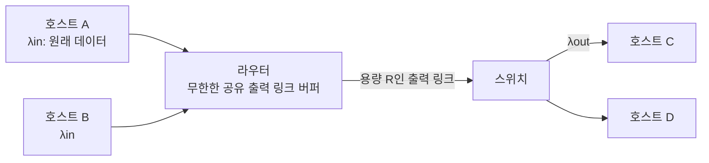

*그림 1. 시나리오 1: 무한 버퍼 라우터의 홉 하나를 공유하는 두 연결(A에서 C로, B에서 D로)*

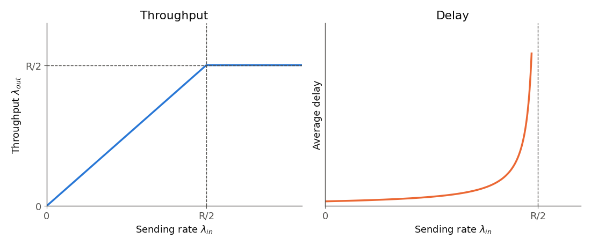

*그림 2. 시나리오 1에서 송신 속도에 따른 연결당 처리량과 평균 지연*

그림 2의 왼쪽 그래프는 연결당 처리량, 즉 수신자가 초당 받는 바이트 수를 송신 속도의 함수로 나타낸다. 송신 속도가 0과 R/2 사이이면 수신자의 처리량은 송신 속도와 같다. 송신자가 보낸 모든 것이 유한한 지연을 거쳐 수신자에 도착한다. 송신 속도가 R/2를 넘으면 처리량은 R/2에 머문다. 두 연결이 링크 용량을 나누어 쓰므로, 링크는 정상 상태에서 R/2보다 빠른 속도로 한 수신자에게 패킷을 전달할 수 없다. 호스트 A와 B가 송신 속도를 아무리 높여도 각자 R/2보다 큰 처리량을 얻지 못한다.

연결당 R/2의 처리량은 링크가 패킷 전달에 완전히 활용되고 있다는 뜻이므로 좋아 보인다. 그러나 오른쪽 그래프는 링크 용량 가까이에서 동작하는 대가를 보여 준다. 송신 속도가 R/2에 가까워질수록 평균 지연이 점점 커진다. 송신 속도가 R/2를 넘으면 라우터에 쌓인 패킷의 평균 개수에 상한이 없어지고, 출발지와 목적지 사이의 평균 지연은 무한대가 된다. 연결이 이 속도로 무한히 오래 동작하고 버퍼가 무한하다고 가정할 때의 이야기이다. 1장에서 트래픽 강도 La/R이 1에 가까워질 때 평균 큐잉 지연이 급격히 커진 것과 같은 현상이다. 처리량만 보면 총 처리량이 R에 가까운 상태가 이상적이지만, 지연의 관점에서는 결코 이상적이지 않다.

> **핵심:** 혼잡의 첫 번째 비용은 패킷 도착 속도가 링크 용량에 가까워질 때 생기는 큰 큐잉 지연이다. 버퍼가 무한한 이상적인 상황에서도 이 비용은 사라지지 않는다.

### 2.2 시나리오 2: 두 송신자와 유한 버퍼 라우터

시나리오 1을 두 가지 점에서 바꾼다. 첫째, 라우터의 버퍼가 유한하다. 이 현실적인 가정 때문에 이미 가득 찬 버퍼에 도착한 패킷은 버려진다. 둘째, 각 연결은 신뢰적이다. 전송 계층 세그먼트를 담은 패킷이 라우터에서 버려지면 송신자는 결국 그 세그먼트를 재전송한다. 패킷이 재전송될 수 있으므로 송신 속도라는 말을 더 조심해서 써야 한다. 응용이 소켓에 원래 데이터를 넣는 속도는 앞에서처럼 $`\lambda_{in}`$ 바이트/초로 나타내고, 전송 계층이 네트워크로 보내는 속도는 따로 정의한다.

> **용어 정의:** **제공 부하(offered load)** 는 전송 계층이 원래 데이터와 재전송 데이터를 모두 포함하여 네트워크로 세그먼트를 보내는 속도이다. 응용이 원래 데이터를 넣는 속도 $`\lambda_{in}`$과 구별하여 $`\lambda'_{in}`$ 바이트/초로 나타낸다.

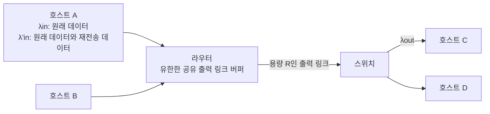

*그림 3. 시나리오 2: 재전송을 하는 두 호스트와 유한 버퍼 라우터*

시나리오 2의 성능은 재전송을 어떻게 하느냐에 크게 좌우된다. 그림 4는 세 가지 경우를 보여 준다.

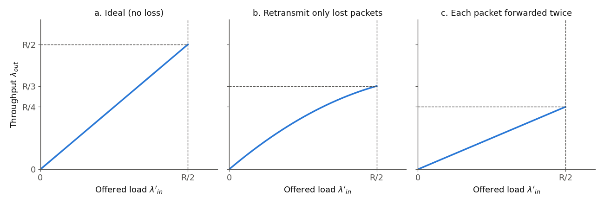

*그림 4. 시나리오 2에서 제공 부하에 따른 처리량: 손실이 없는 이상적인 경우, 손실된 패킷만 재전송하는 경우, 모든 패킷을 두 번씩 전달하는 경우*

**(a) 손실이 없는 이상적인 경우.** 비현실적이지만, 호스트 A가 라우터 버퍼에 빈자리가 있는지를 어떻게든 알아내어 빈자리가 있을 때만 패킷을 보낸다고 가정한다. 그러면 손실이 일어나지 않으므로 $`\lambda_{in}`$과 $`\lambda'_{in}`$이 같고, 연결의 처리량도 $`\lambda_{in}`$과 같다. 보낸 것이 모두 도착하므로 처리량의 관점에서는 이상적이다. 손실이 일어나지 않는다고 가정했으므로 호스트의 평균 송신 속도는 R/2를 넘을 수 없다.

**(b) 손실이 확실할 때만 재전송하는 경우.** 조금 더 현실적으로, 송신자는 패킷이 손실된 것이 확실할 때만 재전송한다고 가정한다. 이 가정도 다소 무리가 있지만, 송신 호스트가 타임아웃을 충분히 길게 잡으면 확인 응답이 오지 않은 패킷은 거의 확실히 손실된 것으로 볼 수 있다. 제공 부하 $`\lambda'_{in}`$이 R/2일 때 수신 응용에 전달되는 데이터의 속도가 R/3이라면, 송신자가 보내는 0.5R 가운데 평균 R/3 ≈ 0.333R 바이트/초는 원래 데이터이고 나머지 R/6 ≈ 0.167R 바이트/초는 재전송 데이터이다. 송신자는 버퍼 넘침으로 버려진 패킷을 보상하기 위해 재전송을 해야 하며, 그만큼 링크 용량이 새 데이터 전달에 쓰이지 못한다.

**(c) 너무 이른 타임아웃으로 불필요하게 재전송하는 경우.** 마지막으로, 송신자의 타임아웃이 너무 일러서 손실되지 않고 큐에서 지연되고 있을 뿐인 패킷을 재전송할 수 있다고 가정한다. 이 경우 원래 패킷과 재전송 패킷이 모두 수신자에 도착할 수 있다. 수신자는 사본 하나만 필요하므로 재전송본을 버린다. 라우터가 재전송본을 전달한 일은 낭비이며, 그 링크 전송 용량으로 다른 패킷을 보냈다면 더 좋았을 것이다. 라우터가 모든 패킷을 평균 두 번씩 전달한다고 가정하면, 연결당 R/2의 전달 능력 가운데 유용한 전달은 절반뿐이므로 제공 부하가 R/2에 다가갈 때 처리량은 R/4에 다가간다.

> **핵심:** 혼잡의 두 번째 비용은 버퍼 넘침으로 손실된 패킷을 보상하기 위한 재전송이다. 세 번째 비용은 큰 지연 때문에 송신자가 불필요하게 재전송하여 라우터가 쓸모없는 패킷 사본을 전달하는 데 링크 대역폭을 쓰는 것이다.

### 2.3 시나리오 3: 네 송신자와 다중 홉 경로

마지막 시나리오에서는 네 호스트가 서로 겹치는 두 홉 경로로 패킷을 보낸다. 모든 호스트는 타임아웃과 재전송으로 신뢰적 데이터 전송을 구현하고, 모든 호스트의 $`\lambda_{in}`$ 값이 같으며, 모든 라우터 링크의 용량은 R 바이트/초라고 가정한다. 네 라우터 R1, R2, R3, R4는 고리 모양으로 연결되어 있고, 각 호스트는 이웃한 두 라우터 사이의 링크에 붙어 있다.

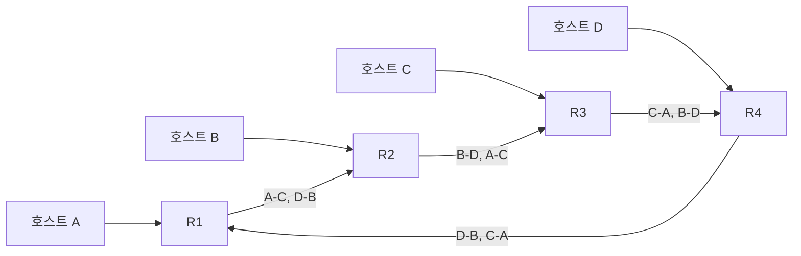

*그림 5. 시나리오 3: 고리 모양의 네 라우터와 서로 겹치는 두 홉 경로*

그림 5에서 화살표에 적은 것은 그 링크를 지나는 연결이다. 예를 들어 호스트 A에서 호스트 C로 가는 A-C 연결은 R1과 R2를 거친 뒤, R2와 R3 사이의 링크에 붙은 호스트 C에 도착한다. 따라서 A-C 연결은 R1에서 D-B 연결과 라우터를 함께 쓰고, R2에서 B-D 연결과 라우터를 함께 쓴다. 각 연결은 첫 번째 홉에서 한 연결과, 두 번째 홉에서 다른 한 연결과 경쟁한다.

**트래픽이 매우 적을 때.** $`\lambda_{in}`$이 매우 작으면 시나리오 1, 2처럼 버퍼 넘침이 드물고, 처리량은 제공 부하와 거의 같다. $`\lambda_{in}`$이 조금 커지면 더 많은 원래 데이터가 네트워크로 들어가 목적지에 전달되고 넘침은 여전히 드물므로, 처리량도 커진다. 즉 $`\lambda_{in}`$이 작은 범위에서는 $`\lambda_{in}`$이 커질수록 $`\lambda_{out}`$도 커진다.

**트래픽이 매우 많을 때.** 이제 $`\lambda_{in}`$, 따라서 $`\lambda'_{in}`$이 매우 크다고 가정한다. 라우터 R2를 생각한다. R1에서 전달되어 R2에 도착하는 A-C 트래픽의 도착 속도는 $`\lambda_{in}`$이 얼마이든 R1에서 R2로 가는 링크의 용량인 R을 넘을 수 없다. 반면 모든 연결의 $`\lambda'_{in}`$이 매우 크면, R2를 첫 번째 홉으로 쓰는 B-D 트래픽의 도착 속도는 A-C 트래픽보다 훨씬 클 수 있다. A-C 트래픽과 B-D 트래픽은 R2의 제한된 버퍼 공간을 두고 경쟁하므로, B-D의 제공 부하가 커질수록 R2를 무사히 통과하는 A-C 트래픽은 점점 줄어든다. 극한에서 제공 부하가 무한대에 다가가면, R2의 버퍼에 빈자리가 생기는 즉시 B-D 패킷이 그 자리를 채우고 R2에서 A-C 연결의 처리량은 0이 된다. 따라서 트래픽이 많은 극한에서 A-C 연결의 종단 간 처리량은 0으로 떨어진다.

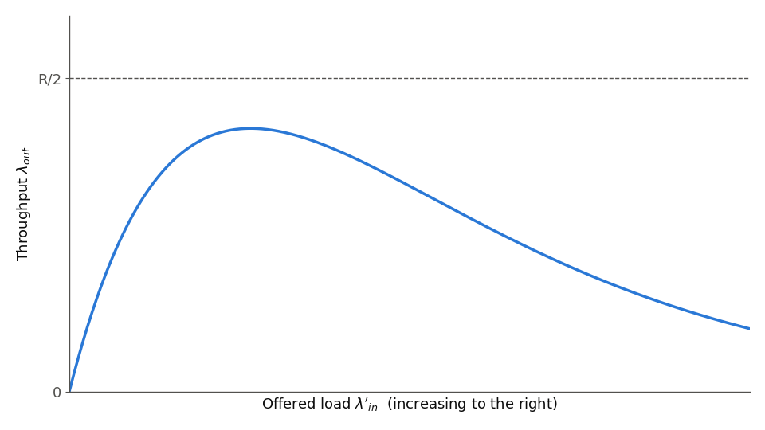

*그림 6. 시나리오 3에서 제공 부하에 따른 처리량의 개념도*

제공 부하가 커질수록 처리량이 결국 줄어드는 이유는 네트워크가 하는 낭비된 일을 보면 분명해진다. 트래픽이 많을 때 두 번째 홉 라우터에서 패킷이 버려지면, 첫 번째 홉 라우터가 그 패킷을 두 번째 홉 라우터로 전달한 일은 결국 낭비가 된다. 첫 번째 라우터가 그 패킷을 그 자리에서 버리고 쉬었더라도 네트워크의 사정은 똑같았을 것이다. 더 정확히 말하면 똑같이 나빴을 것이다. 첫 번째 라우터가 그 패킷을 전달하는 데 쓴 전송 용량은 다른 패킷을 보내는 데 훨씬 유익하게 쓰일 수 있었다. 예를 들어 라우터가 전송할 패킷을 고를 때 이미 상류 라우터를 여러 개 거쳐 온 패킷에 우선순위를 주는 편이 나을 수 있다. 제공 부하가 커질수록 처리량이 오히려 줄어 0에 다가가는 이 현상을 **혼잡 붕괴(congestion collapse)** 라고 하며, 1.3절에서 말한 시스템의 붕괴가 이것이다.

> **핵심:** 혼잡의 네 번째 비용은 경로 중간에서 패킷이 버려질 때, 그 패킷을 버려진 지점까지 전달하는 데 쓰인 모든 상류 링크의 전송 용량이 낭비되는 것이다.

### 2.4 혼잡 비용의 정리

| 비용 | 드러나는 시나리오 | 내용 |
|:-----|:-----|:-----|
| 큰 큐잉 지연 | 시나리오 1 | 도착 속도가 링크 용량에 가까워지면 평균 지연이 급격히 커지며, R/2를 넘으면 무한대가 된다 |
| 손실 보상을 위한 재전송 | 시나리오 2 (b) | 버려진 패킷을 재전송하는 데 링크 용량이 쓰여, 제공 부하 R/2에서 처리량이 R/3에 그친다 |
| 불필요한 재전송 | 시나리오 2 (c) | 너무 이른 타임아웃으로 지연되었을 뿐인 패킷의 사본까지 전달하여, 처리량이 R/4에 다가간다 |
| 상류 전송 용량의 낭비 | 시나리오 3 | 중간에서 버려진 패킷이 그때까지 쓴 상류 링크의 용량이 낭비되어, 처리량이 0에 다가갈 수 있다 |

*표 2. 세 시나리오에서 드러난 혼잡의 비용*

---

<br>

## 3. 혼잡 제어의 접근 방식

혼잡 제어 방식은 여러 기준으로 나눌 수 있다. Kurose는 네트워크 계층이 혼잡 제어를 명시적으로 돕는지에 따라 나누고, Forouzan은 혼잡이 일어나기 전에 막는지 일어난 뒤에 없애는지에 따라 나눈다. 두 분류는 서로 다른 관점이므로 함께 알아 두어야 한다.

### 3.1 종단 간 혼잡 제어와 네트워크 지원 혼잡 제어

- **종단 간 혼잡 제어(end-to-end congestion control).** 네트워크 계층이 전송 계층에 혼잡 제어를 위한 명시적 지원을 하지 않는다. 혼잡이 있다는 사실조차 종단 시스템이 관찰한 네트워크의 동작, 예를 들어 패킷 손실과 지연만으로 추론해야 한다. IP 계층은 혼잡에 대한 피드백을 호스트에 주지 않아도 되므로, TCP는 이 방식을 쓴다(4절). TCP는 타임아웃이나 중복 ACK 세 개로 드러나는 세그먼트 손실을 네트워크 혼잡의 표시로 받아들이고 윈도우 크기를 줄인다. 왕복 지연이 커지는 것을 혼잡이 심해지는 표시로 쓰는 방식도 제안되었다(8.1절의 TCP Vegas).
- **네트워크 지원 혼잡 제어(network-assisted congestion control).** 라우터가 네트워크의 혼잡 상태에 대한 명시적인 피드백을 송신자나 수신자, 또는 둘 모두에게 준다. 피드백은 링크의 혼잡을 나타내는 비트 하나처럼 단순할 수 있으며, 초기의 IBM SNA, DEC DECnet, ATM 네트워크 구조가 이런 방식을 썼다. 더 정교한 피드백도 가능하다. 예를 들어 ATM의 ABR(Available Bit Rate) 혼잡 제어에서는 라우터가 출력 링크에서 자신이 지원할 수 있는 최대 송신 속도를 송신자에게 알린다. 인터넷의 기본 IP와 TCP는 종단 간 방식을 쓰지만, 최근에는 IP와 TCP가 선택적으로 네트워크 지원 방식을 구현할 수도 있다(10절의 ECN).

네트워크 지원 혼잡 제어에서 혼잡 정보가 송신자에게 돌아가는 경로는 두 가지이다. 첫째는 라우터가 송신자에게 직접 피드백을 보내는 것이다. 이 알림은 흔히 "혼잡하다!"고 말하는 초크 패킷의 형태를 띤다(3.3절). 둘째는 더 흔한 방식으로, 라우터가 송신자에서 수신자로 가는 패킷의 한 필드에 혼잡을 표시하는 것이다. 표시된 패킷을 받은 수신자는 송신자에게 혼잡을 알린다. 이 두 번째 방식은 알림이 송신자에게 닿기까지 왕복 시간 하나가 꼬박 걸린다.

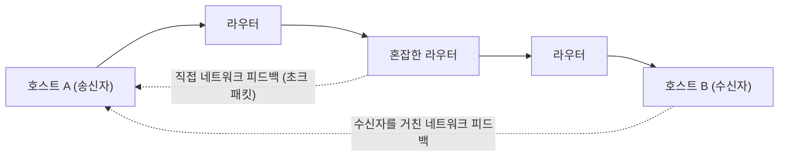

*그림 7. 네트워크가 알려 주는 혼잡 정보가 송신자에게 돌아가는 두 경로*

| 구분 | 종단 간 혼잡 제어 | 네트워크 지원 혼잡 제어 |
|:-----|:-----|:-----|
| 네트워크 계층의 지원 | 없음 | 라우터가 혼잡 상태를 명시적으로 알림 |
| 혼잡을 아는 방법 | 종단 시스템이 손실과 지연을 관찰하여 추론 | 혼잡 비트, 최대 송신 속도, 초크 패킷, 패킷 표시 |
| 예 | 인터넷의 기본 TCP | IBM SNA, DECnet, ATM ABR, TCP/IP의 ECN |

*표 3. 종단 간 혼잡 제어와 네트워크 지원 혼잡 제어*

### 3.2 개루프 혼잡 제어

> **용어 정의:** **개루프 혼잡 제어(open-loop congestion control)** 는 혼잡이 일어나기 전에 막기 위해 미리 정해 둔 정책을 적용하는 혼잡 제어이다. 출발지나 목적지가 이 정책을 적용한다.

Forouzan은 전송 계층에서 혼잡에 영향을 주는 세 가지 정책을 든다.

- **재전송 정책.** 송신자가 보낸 패킷이 손실되었거나 손상되었다고 느끼면 그 패킷을 재전송해야 하므로, 재전송은 때때로 피할 수 없다. 재전송은 일반적으로 네트워크의 혼잡을 키울 수 있지만, 좋은 재전송 정책은 혼잡을 막을 수 있다. 재전송 정책과 재전송 타이머는 효율을 높이면서도 혼잡을 막도록 설계해야 한다. 2.2절 (c)의 너무 이른 타임아웃이 나쁜 정책의 예이며, 8장에서 RTT를 추정하여 재전송 타임아웃을 정하는 것이 그 해결책이다.
- **윈도우 정책.** 송신자 윈도우의 종류도 혼잡에 영향을 준다. 혼잡 제어에는 Selective Repeat 윈도우가 Go-Back-N 윈도우보다 낫다. Go-Back-N은 패킷 하나가 손실되면 그 뒤에 보낸 패킷이 수신자에 무사히 도착했더라도 모두 다시 보내므로(7장), 불필요한 재전송이 네트워크의 부하를 키운다.
- **확인 응답 정책.** 수신자가 정한 확인 응답 정책도 혼잡에 영향을 준다. 수신자가 받는 패킷마다 확인 응답을 보내지 않으면 송신자의 속도를 늦추어 혼잡을 막는 데 도움이 된다. 수신자는 보낼 패킷이 있을 때나 특별한 타이머가 만료될 때만 확인 응답을 보낼 수 있고, 패킷 N개마다 한 번만 확인 응답을 보낼 수도 있다. 확인 응답도 네트워크 부하의 일부이므로, 확인 응답을 적게 보내면 네트워크에 주는 부하가 줄어든다. 8장의 지연 확인 응답과 누적 확인 응답이 이 정책의 예이다.

### 3.3 폐루프 혼잡 제어

> **용어 정의:** **폐루프 혼잡 제어(closed-loop congestion control)** 는 혼잡이 일어난 뒤 이를 감지하고 피드백에 따라 송신 속도를 조절하여 혼잡을 완화하는 혼잡 제어이다.

여러 프로토콜이 여러 가지 폐루프 메커니즘을 써 왔다. 전송 계층의 메커니즘은 송신자의 윈도우 크기를 유연하게 바꾸는 것이다. 송신 윈도우의 크기를 정하는 요인 가운데 하나가 인터넷의 혼잡이다. 송신 측 전송 계층은 손실된 패킷을 지켜봄으로써 인터넷의 혼잡을 감시하고, 혼잡이 심해지면 윈도우 크기를 줄이고 혼잡이 줄어들면 윈도우 크기를 늘리는 전략을 쓸 수 있다. TCP가 이 전략으로 윈도우 크기를 제어하는 방법은 4절부터 7절까지에서 다룬다.

Forouzan은 비연결형 네트워크의 네트워크 계층에서 혼잡을 제어하는 방법도 소개한다.

- **역방향 신호(backward signaling).** 혼잡한 방향과 반대 방향으로 움직이는 데이터그램에 비트 하나를 설정하여, 혼잡이 일어났으니 패킷 송신 속도를 줄이라고 송신자에게 알린다. 이 비트는 패킷에 대한 응답이나 패킷을 확인하는 패킷에 설정할 수 있다.
- **순방향 신호(forward signaling).** 네트워크 계층에는 피드백(확인 응답)이 없지만 상위 계층이 피드백을 쓸 때는, 혼잡한 방향으로 움직이는 패킷에 비트 하나를 설정하여 그 패킷의 수신자에게 혼잡을 경고한다. 수신자는 이를 상위 계층 프로토콜에 알리고, 그 프로토콜이 다시 출발지에 알린다. Forouzan이 설명하는 인터넷의 네트워크 계층은 순방향 신호도 역방향 신호도 쓰지 않았지만, 10절의 ECN은 순방향 신호와 같은 구조로 동작한다.
- **초크 패킷.** 라우터가 혼잡을 겪을 때 송신자에게 보내는 특별한 패킷이다.
- **중요도에 따른 폐기.** 패킷 헤더의 한 필드로 데이터그램이 메시지 전체에서 얼마나 중요한지를 나타낸다. 혼잡한 라우터가 패킷을 버려야 할 때 덜 중요하다고 표시된 패킷부터 버린다. 예를 들어 이미지를 여러 패킷으로 나누어 보낼 때, 가장자리 부분의 패킷은 가운데 부분의 패킷보다 덜 중요할 수 있다. 라우터가 혼잡할 때 덜 중요한 패킷을 버려도 이미지의 품질은 크게 달라지지 않는다.

> **용어 정의:** **초크 패킷(choke packet)** 은 혼잡을 겪는 라우터가 송신자에게 직접 보내어 혼잡을 알리고 송신 속도를 줄이게 하는 특별한 패킷이다.

Forouzan은 인터넷의 네트워크 계층이 보조 프로토콜 ICMP로 초크 패킷 방식을 구현하여, 혼잡한 라우터가 출발지에 속도를 줄이라는 ICMP 패킷을 보낼 수 있다고 설명한다. 이 ICMP 메시지와 그 현재 지위는 16장에서 다룬다.

| 기법 | 혼잡을 알리는 방향 | 설명 |
|:-----|:-----|:-----|
| 송신 윈도우 조절 | 손실을 관찰한 송신자 자신 | 손실이 늘면 윈도우를 줄이고 줄면 늘린다(TCP) |
| 역방향 신호 | 혼잡 지점에서 송신자 쪽으로 | 반대 방향 데이터그램의 비트로 송신자에게 알린다 |
| 순방향 신호 | 혼잡 지점에서 수신자 쪽으로, 수신자가 다시 송신자에게 | 혼잡 방향 패킷의 비트로 수신자에게 경고하고, 상위 계층이 출발지에 알린다 |
| 초크 패킷 | 혼잡한 라우터에서 송신자에게 직접 | 라우터가 특별한 패킷을 만들어 보낸다 |
| 중요도에 따른 폐기 | 알리지 않음 | 혼잡한 라우터가 덜 중요한 패킷부터 버린다 |

*표 4. 폐루프 혼잡 제어 기법*

> **참고:** Kurose의 두 피드백 경로와 Forouzan의 분류는 다음과 같이 대응한다. 그림 7의 직접 네트워크 피드백은 초크 패킷에 해당하고, 수신자를 거친 네트워크 피드백은 순방향 신호에 해당한다. 역방향 신호는 라우터가 따로 패킷을 만들지 않고 반대 방향으로 가는 기존 패킷에 표시한다는 점에서 초크 패킷과 다르다.

### 3.4 연결형 네트워크의 혼잡 제어

연결형 네트워크에서는 비연결형 네트워크보다 혼잡을 제어하기가 쉬울 때가 있다. 한 가지 방법은 어느 영역에 혼잡이 생기면 가상 회선을 하나 더 만드는 것이지만, 이는 일부 라우터에 더 많은 문제를 만들 수 있다. 더 나은 방법은 연결 설정 단계에서 미리 협상하는 것이다. 송신자와 수신자는 가상 회선을 설정할 때 트래픽의 수준에 합의할 수 있고, 그 수준은 가상 회선의 설정을 허락하는 라우터들이 정할 수 있다. 즉 라우터는 현재 트래픽을 자신의 최대 용량과 비교하여 새 가상 회선의 생성을 허락할지 정한다. 가상 회선의 설정 과정은 10장에서 다룬다.

---

<br>

## 4. TCP 혼잡 제어의 기본

8장에서 보았듯이 TCP는 서로 다른 호스트에서 실행되는 두 프로세스 사이에 신뢰적 전송 서비스를 제공한다. TCP의 또 다른 핵심 요소는 혼잡 제어 메커니즘이다. IP 계층은 네트워크 혼잡에 대한 명시적 피드백을 종단 시스템에 주지 않으므로, TCP는 네트워크 지원 혼잡 제어가 아닌 종단 간 혼잡 제어를 써야 한다. Forouzan의 표현으로는 TCP의 혼잡 제어는 개루프 메커니즘과 폐루프 메커니즘을 모두 바탕으로 하며, 혼잡 윈도우와 혼잡 정책을 써서 혼잡을 피하고, 혼잡이 일어나면 이를 감지하여 완화한다.

TCP의 접근 방식은 각 송신자가 자신이 인지한 네트워크 혼잡에 따라 연결로 트래픽을 보내는 속도를 제한하는 것이다. 송신자와 목적지 사이의 경로에 혼잡이 거의 없다고 인지하면 송신 속도를 높이고, 경로에 혼잡이 있다고 인지하면 송신 속도를 낮춘다. 이 방식에는 세 가지 질문이 따른다. 첫째, TCP 송신자는 연결로 트래픽을 보내는 속도를 어떻게 제한하는가? 둘째, TCP 송신자는 자신과 목적지 사이의 경로에 혼잡이 있음을 어떻게 인지하는가? 셋째, 송신자는 인지한 종단 간 혼잡에 따라 송신 속도를 바꾸는 데 어떤 알고리즘을 써야 하는가? 4.1절, 4.2절, 4.3절이 차례로 이 질문에 답한다.

### 4.1 혼잡 윈도우

8장에서 보았듯이 TCP 연결의 각 쪽은 수신 버퍼, 송신 버퍼와 여러 변수(LastByteRead, rwnd 등)로 이루어진다. 송신자에서 동작하는 TCP 혼잡 제어 메커니즘은 변수 하나를 더 관리한다.

> **용어 정의:** **혼잡 윈도우(congestion window, cwnd)** 는 TCP 송신자가 네트워크의 혼잡 상태에 따라 조절하는 변수로, 송신자가 네트워크로 트래픽을 보내는 속도를 제한한다. 확인 응답을 받지 않은 데이터의 양은 cwnd와 rwnd 가운데 작은 값을 넘을 수 없다.

```math
\text{LastByteSent} - \text{LastByteAcked} \leq \min\{\text{cwnd}, \text{rwnd}\}
```

Forouzan은 같은 내용을 실제 윈도우 크기가 수신자가 알린 윈도우 크기와 혼잡 윈도우 크기 가운데 작은 값이라고 표현한다(8장).

```math
\text{actual window size} = \min(\text{rwnd}, \text{cwnd})
```

이 장에서는 흐름 제어가 아닌 혼잡 제어에 집중하기 위해, TCP 수신 버퍼가 충분히 커서 수신 윈도우의 제약을 무시할 수 있다고 가정한다. 그러면 송신자의 미확인 데이터의 양은 cwnd로만 제한된다. 또 송신자에게는 항상 보낼 데이터가 있어서 혼잡 윈도우 안의 세그먼트를 모두 보낸다고 가정한다.

위의 제약은 송신자의 미확인 데이터의 양을 제한함으로써 간접적으로 송신 속도를 제한한다. 손실과 패킷 전송 지연을 무시할 수 있는 연결을 생각하면, 대략 매 RTT가 시작될 때 송신자는 cwnd 바이트의 데이터를 연결로 보낼 수 있고, 그 RTT가 끝날 때 그 데이터에 대한 확인 응답을 받는다. 따라서 송신자의 송신 속도는 대략 다음과 같다.

```math
\text{sending rate} \approx \frac{\text{cwnd}}{RTT} \ \text{bytes/sec}
```

예를 들어 MSS가 1,460바이트이고 cwnd가 10 MSS, 즉 14,600바이트이며 RTT가 100 ms이면, 송신 속도는 약 14,600 × 8 / 0.1 = 1,168,000 bps, 즉 약 1.17 Mbps이다. 송신자는 cwnd의 값을 조절함으로써 연결로 데이터를 보내는 속도를 조절할 수 있다.

### 4.2 손실 사건과 자기 클로킹

다음으로 TCP 송신자가 경로의 혼잡을 어떻게 인지하는지 살펴본다. TCP 송신자에서 **손실 사건(loss event)** 은 타임아웃이 일어나거나 수신자로부터 중복 ACK 세 개를 받는 것을 말한다(8장). 혼잡이 지나치면 경로상의 라우터 버퍼 하나 이상이 넘쳐 TCP 세그먼트를 담은 데이터그램이 버려진다. 버려진 데이터그램은 송신자에서 손실 사건을 일으키고, 송신자는 이를 송신자와 수신자 사이의 경로에 혼잡이 있다는 표시로 받아들인다. Forouzan은 송신자가 혼잡이 일어났다고 짐작하는 유일한 방법이 세그먼트를 재전송해야 하는 상황이라는 점이 TCP의 중요한 가정이라고 강조한다. 재전송이 필요하다는 것은 너무 많은 패킷이 들어와 과부하가 걸린 라우터가 그 세그먼트를 버렸다고 가정하는 것이다.

반대로 네트워크에 혼잡이 없어 손실 사건이 일어나지 않으면, 아직 확인되지 않았던 세그먼트에 대한 확인 응답이 송신자에 도착한다. TCP는 확인 응답의 도착을 보낸 세그먼트가 목적지에 무사히 전달되고 있다는 표시로 받아들이고, 확인 응답에 따라 혼잡 윈도우를 키워 송신 속도를 높인다. 이때 확인 응답이 비교적 느리게 도착하면, 예를 들어 종단 간 경로의 지연이 크거나 경로에 대역폭이 작은 링크가 있으면 혼잡 윈도우도 비교적 느리게 커진다. 확인 응답이 빠르게 도착하면 혼잡 윈도우도 빠르게 커진다.

> **용어 정의:** **자기 클로킹(self-clocking)** 은 TCP가 확인 응답의 도착을 시계처럼 써서 혼잡 윈도우의 증가 시점을 정하는 성질이다. 확인 응답이 빨리 오는 경로에서는 윈도우가 빨리 커지고, 늦게 오는 경로에서는 천천히 커진다.

### 4.3 TCP 혼잡 제어의 세 원칙

cwnd로 송신 속도를 조절하는 메커니즘이 있다고 해도, TCP 송신자가 어떤 속도로 보내야 하는지라는 핵심 질문이 남는다. TCP 송신자들이 모두 너무 빨리 보내면 네트워크를 혼잡하게 만들어 2.3절과 같은 혼잡 붕괴를 일으킬 수 있다. 실제로 이 장에서 다루는 TCP 버전은 이전 버전의 TCP에서 인터넷의 혼잡 붕괴가 관찰된 데 대응하여 개발되었다. 그러나 TCP 송신자가 너무 조심스러워 너무 느리게 보내면 네트워크의 대역폭을 충분히 쓰지 못한다. 즉 네트워크를 혼잡하게 만들지 않고도 더 빠르게 보낼 수 있었는데 그러지 못한 것이다. 그렇다면 TCP 송신자들은 네트워크를 혼잡하게 만들지 않으면서 가용 대역폭을 모두 쓰도록 송신 속도를 어떻게 정할까? TCP 송신자들이 명시적으로 조율하는가, 아니면 각 송신자가 지역 정보만으로 송신 속도를 정하는 분산 방식인가? TCP는 다음 원칙으로 이 질문에 답한다.

1. **손실된 세그먼트는 혼잡을 뜻하므로, 세그먼트를 잃으면 송신 속도를 줄여야 한다.** 타임아웃이 일어나거나, 한 세그먼트에 대한 확인 응답 네 개(원래 ACK 하나와 중복 ACK 세 개)를 받으면 네 번 확인된 세그먼트의 다음 세그먼트에 대한 암묵적인 손실 사건으로 해석하여 그 세그먼트를 재전송한다. 혼잡 제어의 관점에서 남는 질문은 이 손실 사건에 대응하여 혼잡 윈도우, 즉 송신 속도를 얼마나 줄이느냐이다.
2. **확인 응답된 세그먼트는 네트워크가 송신자의 세그먼트를 수신자에게 전달하고 있음을 뜻하므로, 아직 확인되지 않았던 세그먼트에 대한 ACK가 오면 송신 속도를 높일 수 있다.** 확인 응답의 도착은 세그먼트가 송신자에서 수신자로 무사히 전달되어 네트워크가 혼잡하지 않다는 암묵적인 표시이다.
3. **대역폭 탐색(bandwidth probing).** ACK는 혼잡이 없는 경로를, 손실 사건은 혼잡한 경로를 나타내므로, TCP는 손실 사건이 일어날 때까지 ACK가 올 때마다 송신 속도를 높이고, 손실 사건이 일어나면 송신 속도를 낮춘다. 즉 TCP 송신자는 혼잡이 시작되는 속도를 찾기 위해 송신 속도를 높여 가다가, 그 속도에서 물러난 뒤, 혼잡이 시작되는 속도가 바뀌었는지 보려고 다시 탐색을 시작한다. 간식을 점점 더 많이 달라고 하다가 "안 돼!"라는 말을 듣고 조금 물러섰다가, 얼마 뒤 다시 조르기 시작하는 아이와 비슷하다.

네트워크가 혼잡 상태를 명시적으로 알려 주는 신호는 없다. ACK와 손실 사건이 암묵적인 신호 역할을 하며, 각 TCP 송신자는 다른 TCP 송신자와 비동기적으로 자신의 지역 정보에 따라 행동한다.

### 4.4 알고리즘의 구성

TCP 혼잡 제어 알고리즘은 세 가지 주요 구성 요소로 이루어진다.

| 구성 요소 | 필수 여부 | cwnd의 증가 방식 | 다루는 절 |
|:-----|:-----|:-----|:-----|
| 느린 시작 | 필수 | 새 ACK마다 1 MSS, 즉 RTT마다 두 배(지수적 증가) | 5절 |
| 혼잡 회피 | 필수 | RTT마다 1 MSS(가법적 증가) | 6절 |
| 빠른 회복 | 권장(필수 아님) | 손실 세그먼트에 대한 중복 ACK마다 1 MSS | 7절 |

*표 5. TCP 혼잡 제어 알고리즘의 세 구성 요소*

느린 시작과 혼잡 회피는 TCP의 필수 구성 요소이며, 받은 ACK에 대응하여 cwnd를 키우는 방식이 다르다. 느린 시작은 이름과 달리 혼잡 회피보다 cwnd를 더 빠르게 키운다. 빠른 회복은 권장되지만 TCP 송신자에게 필수는 아니다.

Forouzan은 TCP의 혼잡 정책을 느린 시작, 혼잡 회피, 혼잡 감지의 세 단계로 설명한다. 느린 시작 단계에서 송신자는 느린 전송 속도로 시작하지만 임계값에 이를 때까지 속도를 빠르게 높인다. 임계값에 이르면 증가 속도를 줄인다. 혼잡이 감지되면 혼잡을 감지한 방법에 따라 느린 시작 단계나 혼잡 회피 단계로 돌아간다. Forouzan의 혼잡 감지 단계는 Kurose의 손실 사건에 대한 대응에 해당하며, 7.4절에서 두 설명을 비교한다.

---

<br>

## 5. 느린 시작

### 5.1 지수적 증가

> **용어 정의:** **느린 시작(slow start)** 은 TCP 연결이 시작되거나 타임아웃이 일어난 뒤 cwnd를 1 MSS에서 시작하여, 처음 확인 응답되는 세그먼트마다 1 MSS씩 키움으로써 RTT마다 두 배로 늘리는 TCP 혼잡 제어의 단계이다.

TCP 연결이 시작될 때 cwnd는 보통 1 MSS라는 작은 값으로 초기화되므로, 처음 송신 속도는 대략 MSS/RTT이다. 예를 들어 MSS가 500바이트이고 RTT가 200 ms이면 처음 송신 속도는 500 × 8 / 0.2 = 20,000 bps, 즉 약 20 kbps에 불과하다. TCP 송신자가 쓸 수 있는 대역폭은 MSS/RTT보다 훨씬 클 수 있으므로, 송신자는 가용 대역폭을 빨리 찾아내고 싶어 한다. 그래서 느린 시작 상태에서 cwnd는 1 MSS에서 시작하여, 보낸 세그먼트가 처음 확인 응답될 때마다 1 MSS씩 커진다. 느린 시작이라는 이름은 작은 윈도우로 느리게 시작한다는 뜻이다. 일단 시작한 뒤의 증가는 빠르다.

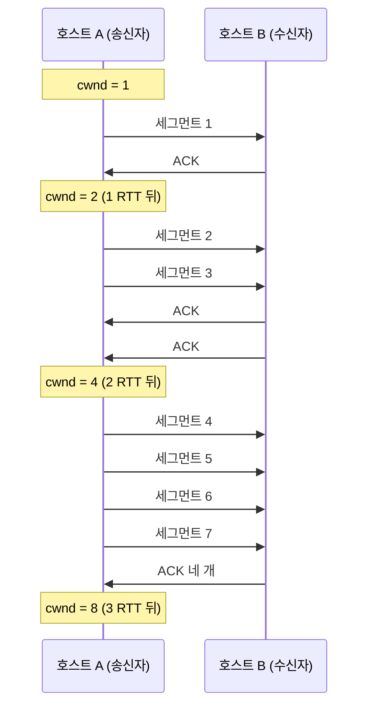

*그림 8. 느린 시작: RTT마다 혼잡 윈도우가 두 배가 되는 과정*

그림 8에서 TCP는 첫 세그먼트를 네트워크로 보내고 확인 응답을 기다린다. 확인 응답이 도착하면 혼잡 윈도우를 1 MSS 키우고 최대 크기의 세그먼트 두 개를 보낸다. 이 두 세그먼트가 확인 응답되면 확인된 세그먼트마다 혼잡 윈도우를 1 MSS씩 키워 혼잡 윈도우는 4 MSS가 되고, 같은 방식으로 계속된다. 이 과정에서 송신 속도는 RTT마다 두 배가 된다. 즉 느린 시작 단계에서 TCP의 송신 속도는 느리게 시작하지만 지수적으로 커진다. Forouzan은 rwnd가 cwnd보다 훨씬 커서 송신 윈도우가 항상 cwnd와 같고, 지연 확인 응답 정책을 무시하여 세그먼트마다 따로 확인 응답한다고 가정하고 이 과정을 RTT 단위로 정리한다.

| 시점 | cwnd (MSS) | 2의 거듭제곱 |
|:-----|:-----|:-----|
| 시작 | 1 | $`2^0`$ |
| 1 RTT 뒤 | 1 × 2 = 2 | $`2^1`$ |
| 2 RTT 뒤 | 2 × 2 = 4 | $`2^2`$ |
| 3 RTT 뒤 | 4 × 2 = 8 | $`2^3`$ |

*표 6. 느린 시작에서 RTT에 따른 혼잡 윈도우*

일반적으로 느린 시작이 n RTT 동안 계속되면 cwnd는 $`2^n`$ MSS가 된다. 예를 들어 cwnd가 1 MSS에서 32 MSS가 되는 데는 $`2^5 = 32`$이므로 5 RTT밖에 걸리지 않는다.

### 5.2 지연 확인 응답과 느린 시작

Forouzan은 지연 확인 응답(8장)을 쓰면 느린 시작이 더 느려진다고 지적한다. cwnd는 ACK 하나에 1 MSS만 커지므로, 세그먼트 세 개가 누적 확인 응답 하나로 확인되면 cwnd는 3 MSS가 아니라 1 MSS만 커진다. 증가는 여전히 지수적이지만 RTT마다 두 배가 되지는 않는다. 세그먼트 두 개마다 ACK 하나를 보내면, cwnd가 w MSS일 때 한 RTT 동안 ACK가 w/2개 도착하므로 cwnd는 w + w/2 = 1.5w가 된다. 즉 증가율은 RTT마다 1.5배에 가깝다. 예를 들어 cwnd가 8 MSS이면 다음 RTT에 12 MSS, 그다음 RTT에 18 MSS가 된다.

### 5.3 느린 시작이 끝나는 세 경우

지수적 증가는 언제 끝나야 할까? 느린 시작은 이 질문에 세 가지 답을 준다. 그 가운데 두 경우에는 변수 하나가 더 필요하다.

> **용어 정의:** **느린 시작 임계값(slow-start threshold, ssthresh)** 은 TCP 송신자가 관리하는 상태 변수로, cwnd가 이 값에 이르면 느린 시작을 끝내고 혼잡 회피로 넘어간다. 손실 사건이 일어나면 그때의 cwnd의 절반으로 설정된다.

1. **타임아웃.** 타임아웃으로 손실 사건, 즉 혼잡이 드러나면 TCP 송신자는 ssthresh를 cwnd/2, 즉 혼잡이 감지되었을 때의 혼잡 윈도우 값의 절반으로 설정하고, cwnd를 1 MSS로 설정한 뒤 느린 시작을 새로 시작한다.
2. **cwnd가 ssthresh에 이름.** ssthresh는 마지막으로 혼잡이 감지되었을 때의 cwnd의 절반이므로, cwnd가 ssthresh에 이르거나 넘은 뒤에도 계속 두 배로 키우는 것은 무모하다. 그래서 cwnd가 ssthresh와 같아지면 느린 시작이 끝나고 TCP는 혼잡 회피 모드로 넘어간다(6절).
3. **중복 ACK 세 개.** 중복 ACK 세 개가 감지되면 TCP는 빠른 재전송(8장)을 하고 빠른 회복 상태로 들어간다(7.1절).

Kurose의 FSM(7.2절)은 처음 ssthresh를 64 KB로 둔다. Forouzan의 예(7.4절)는 처음 임계값을 최대 윈도우 크기의 절반으로 둔다. 연결이 시작될 때는 아직 혼잡을 겪지 않았으므로 처음 ssthresh는 큰 값이며, 첫 손실 사건이 일어난 뒤에야 네트워크의 상태를 반영한 값이 된다.

> **핵심:** 느린 시작에서 혼잡 윈도우는 임계값에 이를 때까지 지수적으로 커진다.

---

<br>

## 6. 혼잡 회피

### 6.1 가법적 증가

> **용어 정의:** **혼잡 회피(congestion avoidance)** 는 cwnd가 ssthresh에 이른 뒤 cwnd를 RTT마다 1 MSS씩만 키우는 TCP 혼잡 제어의 단계이다.

혼잡 회피 상태에 들어설 때 cwnd의 값은 마지막으로 혼잡을 겪었을 때의 값의 대략 절반이다. 혼잡이 바로 가까이에 있을 수 있다. 그래서 TCP는 RTT마다 cwnd를 두 배로 키우는 대신, RTT마다 1 MSS씩만 키우는 보수적인 방식을 쓴다. 이를 구현하는 방법은 여러 가지이며, 흔한 방법은 새 확인 응답이 도착할 때마다 cwnd를 다음 양만큼 키우는 것이다.

```math
\text{cwnd} = \text{cwnd} + \text{MSS} \cdot \frac{\text{MSS}}{\text{cwnd}}
```

예를 들어 MSS가 1,460바이트이고 cwnd가 14,600바이트이면 RTT 동안 세그먼트 10개를 보낸다. 세그먼트마다 ACK가 하나씩 온다고 하면, 도착하는 ACK 하나는 혼잡 윈도우를 1/10 MSS, 즉 1,460 × 1,460 / 14,600 = 146바이트씩 키운다. 따라서 세그먼트 10개에 대한 ACK를 모두 받으면 혼잡 윈도우는 1 MSS 커진다.

Forouzan은 같은 동작을 윈도우 단위로 설명한다. 윈도우는 RTT 동안 보내는 세그먼트의 수이며, 보낸 윈도우 전체의 세그먼트가 확인 응답될 때마다 혼잡 윈도우를 1 늘린다. 즉 증가는 도착한 ACK의 수가 아니라 RTT를 기준으로 한다. 느린 시작이 cwnd = i에서 끝났다면 RTT에 따른 cwnd는 다음과 같이 가법적으로 커진다.

```math
\text{start: } i, \quad \text{after 1 RTT: } i + 1, \quad \text{after 2 RTT: } i + 2, \quad \text{after 3 RTT: } i + 3
```

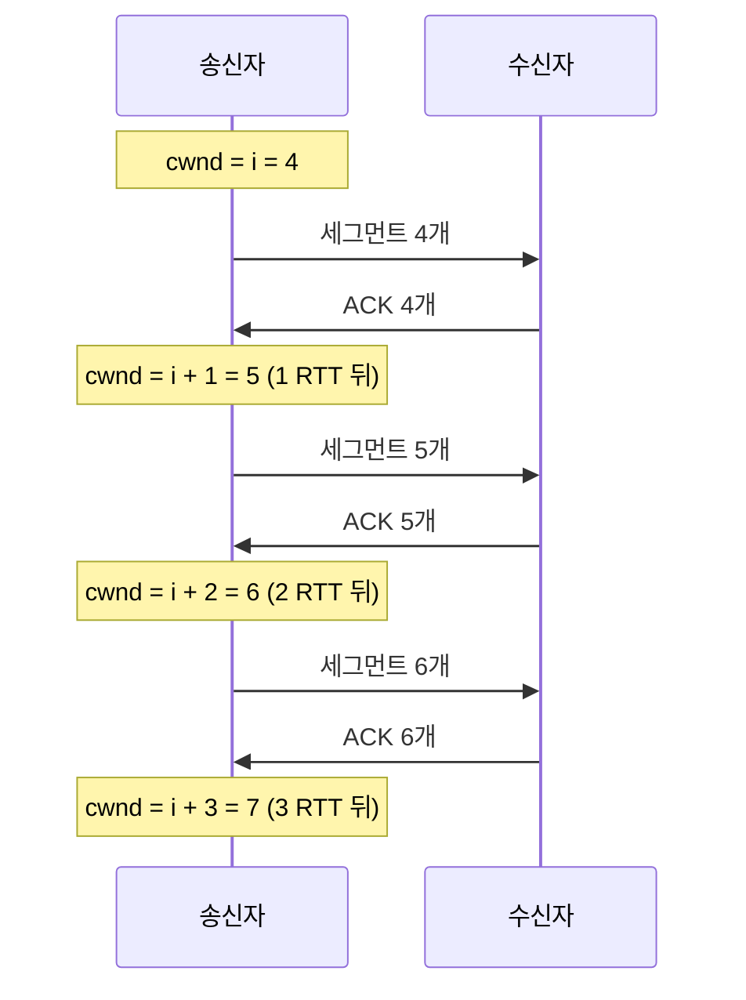

*그림 9. 혼잡 회피: RTT마다 혼잡 윈도우가 1씩 커지는 과정*

> **핵심:** 혼잡 회피에서 혼잡 윈도우는 혼잡이 감지될 때까지 가법적으로 커진다.

### 6.2 혼잡 회피 중의 손실

혼잡 회피의 선형 증가는 손실 사건이 일어나면 끝나며, 대응은 손실 사건의 종류에 따라 다르다.

- **타임아웃.** 느린 시작에서와 똑같이 대응한다. cwnd를 1 MSS로 설정하고, ssthresh를 손실 사건이 일어났을 때의 cwnd의 절반으로 갱신한 뒤 느린 시작 상태로 간다.
- **중복 ACK 세 개.** 이 경우 네트워크는 중복 ACK를 받는다는 사실이 보여 주듯이 여전히 송신자의 세그먼트를 수신자에게 전달하고 있다. 그래서 타임아웃으로 드러난 손실보다 덜 과격하게 대응한다. ssthresh를 중복 ACK 세 개를 받았을 때의 cwnd의 절반으로 기록하고, cwnd를 그 절반에 3 MSS를 더한 값으로 설정한 뒤 빠른 회복 상태로 들어간다. 3 MSS를 더하는 것은 받은 중복 ACK 세 개를 반영하기 위해서이다. 중복 ACK 하나는 세그먼트 하나가 수신자에 도착하여 네트워크를 떠났음을 뜻한다.

```math
\text{ssthresh} = \frac{\text{cwnd}}{2}, \qquad \text{cwnd} = \text{ssthresh} + 3 \cdot \text{MSS}
```

Forouzan은 두 경우의 차이를 혼잡의 가능성으로 설명한다. 타임아웃이 일어나면 세그먼트 하나가 네트워크에서 버려졌을 가능성이 크고 그 뒤에 보낸 세그먼트에 대한 소식도 없으므로, 혼잡의 가능성이 더 강하다. 그래서 TCP는 강하게 대응한다. 중복 ACK 세 개를 받으면 세그먼트 하나가 버려졌을 수 있지만 그 뒤의 세그먼트 몇 개는 무사히 도착했으므로, 혼잡의 가능성이 더 약하다. 그래서 TCP는 약하게 대응한다.

---

<br>

## 7. 빠른 회복과 전체 알고리즘

### 7.1 빠른 회복

> **용어 정의:** **빠른 회복(fast recovery)** 은 중복 ACK 세 개로 손실을 감지한 TCP 송신자가 느린 시작으로 돌아가지 않고, 손실 세그먼트에 대한 중복 ACK마다 cwnd를 1 MSS씩 키우다가 손실 세그먼트에 대한 ACK가 오면 cwnd를 ssthresh로 줄이고 혼잡 회피로 넘어가는 TCP 혼잡 제어의 단계이다.

빠른 회복에서는 빠른 회복 상태에 들어오게 만든 손실 세그먼트에 대한 중복 ACK를 받을 때마다 cwnd를 1 MSS씩 키운다. 중복 ACK 하나는 세그먼트 하나가 더 네트워크를 떠났다는 뜻이므로, 송신자는 늘어난 윈도우만큼 새 세그먼트를 보낼 수 있다. 결국 손실 세그먼트에 대한 ACK가 도착하면 TCP는 cwnd를 ssthresh로 줄인 뒤 혼잡 회피 상태로 들어간다. 빠른 회복 중에 타임아웃이 일어나면, 느린 시작과 혼잡 회피에서와 같은 동작을 한 뒤 느린 시작 상태로 간다. cwnd를 1 MSS로 설정하고, ssthresh를 손실 사건이 일어났을 때의 cwnd의 절반으로 설정한다.

예를 들어 cwnd가 12 MSS일 때 중복 ACK 세 개를 받으면 ssthresh = 12/2 = 6 MSS, cwnd = 6 + 3 = 9 MSS가 되고 빠른 회복 상태로 들어간다. 중복 ACK가 두 개 더 오면 cwnd는 11 MSS가 된다. 그 뒤 손실 세그먼트를 확인하는 새 ACK가 오면 cwnd는 ssthresh인 6 MSS로 줄고, 혼잡 회피에서 다음 RTT에 7 MSS가 된다.

### 7.2 TCP 혼잡 제어의 FSM

그림 10은 느린 시작, 혼잡 회피, 빠른 회복을 모두 담은 TCP 혼잡 제어의 FSM이다. 각 전이는 "사건 / 동작" 형태로 적었다. 한 상태에서 같은 상태로 돌아오는 전이가 여러 개이면 렌더러가 하나만 그리므로, 그런 전이는 한 화살표에 줄을 나누어 함께 적었다.

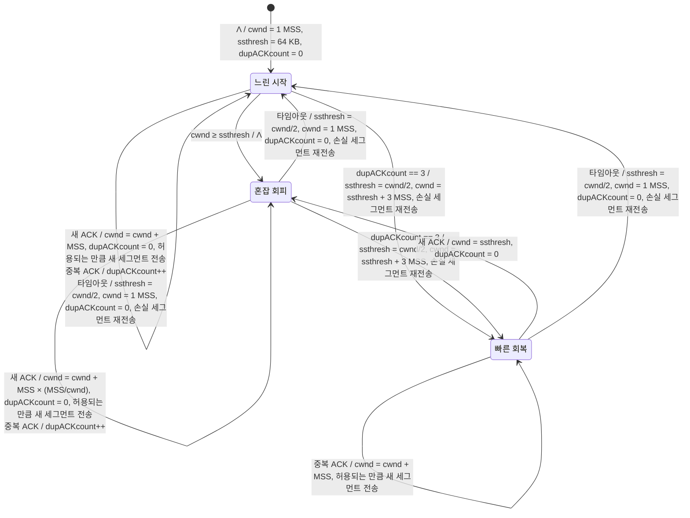

*그림 10. TCP 혼잡 제어의 FSM*

| 현재 상태 | 사건 | 동작 | 다음 상태 |
|:-----|:-----|:-----|:-----|
| (시작) | 연결 시작 | cwnd = 1 MSS, ssthresh = 64 KB, dupACKcount = 0 | 느린 시작 |
| 느린 시작 | 새 ACK | cwnd = cwnd + MSS, dupACKcount = 0, 허용되는 만큼 새 세그먼트 전송 | 느린 시작 |
| 느린 시작 | cwnd ≥ ssthresh | 없음 | 혼잡 회피 |
| 혼잡 회피 | 새 ACK | cwnd = cwnd + MSS × (MSS/cwnd), dupACKcount = 0, 허용되는 만큼 새 세그먼트 전송 | 혼잡 회피 |
| 느린 시작, 혼잡 회피 | 중복 ACK | dupACKcount++ | 그대로 |
| 느린 시작, 혼잡 회피 | dupACKcount == 3 | ssthresh = cwnd/2, cwnd = ssthresh + 3 MSS, 손실 세그먼트 재전송 | 빠른 회복 |
| 빠른 회복 | 중복 ACK | cwnd = cwnd + MSS, 허용되는 만큼 새 세그먼트 전송 | 빠른 회복 |
| 빠른 회복 | 새 ACK | cwnd = ssthresh, dupACKcount = 0 | 혼잡 회피 |
| 모든 상태 | 타임아웃 | ssthresh = cwnd/2, cwnd = 1 MSS, dupACKcount = 0, 손실 세그먼트 재전송 | 느린 시작 |

*표 7. TCP 혼잡 제어 FSM의 전이*

FSM은 새 세그먼트나 재전송 세그먼트를 보내는 시점도 함께 보여 준다. 새 ACK와 빠른 회복 중의 중복 ACK는 윈도우가 허용하는 만큼 새 세그먼트를 보내게 하고, 타임아웃과 세 번째 중복 ACK는 손실 세그먼트를 재전송하게 한다.

### 7.3 TCP Tahoe와 TCP Reno

빠른 회복은 TCP의 권장 구성 요소이지만 필수는 아니다. 초기 버전인 **TCP Tahoe** 는 타임아웃으로 드러난 손실이든 중복 ACK 세 개로 드러난 손실이든 무조건 혼잡 윈도우를 1 MSS로 줄이고 느린 시작 단계로 들어갔다. 더 새로운 버전인 **TCP Reno** 는 빠른 회복을 도입했다. 많은 TCP 구현이 Reno 알고리즘을 쓰며, Reno를 변형한 알고리즘도 많이 제안되었다.

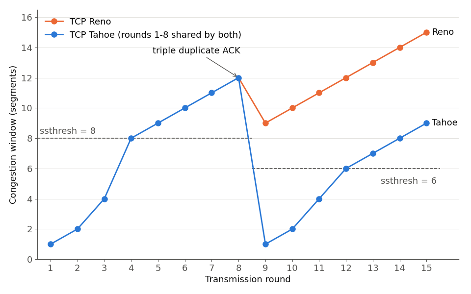

*그림 11. TCP Tahoe와 TCP Reno에서 전송 라운드에 따른 혼잡 윈도우의 변화*

그림 11에서 임계값은 처음에 8 MSS이다. 처음 여덟 전송 라운드 동안 Tahoe와 Reno는 똑같이 동작한다. 혼잡 윈도우는 느린 시작에서 지수적으로 빠르게 커져 네 번째 라운드에 임계값에 이르고, 그 뒤 선형으로 커지다가 라운드 8 직후에 중복 ACK 세 개 사건이 일어난다. 이 손실 사건이 일어날 때 혼잡 윈도우는 12 MSS이므로 ssthresh는 0.5 × cwnd = 6 MSS가 된다. TCP Reno에서는 혼잡 윈도우가 cwnd = 9 MSS로 설정된 뒤 선형으로 커진다. TCP Tahoe에서는 혼잡 윈도우가 1 MSS로 설정되어 ssthresh에 이를 때까지 지수적으로 커지고, 그 뒤 선형으로 커진다.

| 라운드 | 1 | 2 | 3 | 4 | 5 | 6 | 7 | 8 | 9 | 10 | 11 | 12 | 13 | 14 | 15 |
|:-----|:-----|:-----|:-----|:-----|:-----|:-----|:-----|:-----|:-----|:-----|:-----|:-----|:-----|:-----|:-----|
| Tahoe | 1 | 2 | 4 | 8 | 9 | 10 | 11 | 12 | 1 | 2 | 4 | 6 | 7 | 8 | 9 |
| Reno | 1 | 2 | 4 | 8 | 9 | 10 | 11 | 12 | 9 | 10 | 11 | 12 | 13 | 14 | 15 |

*표 8. 전송 라운드에 따른 혼잡 윈도우 (단위 MSS, 처음 ssthresh = 8, 라운드 8 직후 중복 ACK 세 개)*

라운드 12에서 Tahoe의 cwnd는 4의 두 배인 8이 아니라 6이다. 느린 시작에서 cwnd가 ssthresh = 6에 이르면 그 자리에서 느린 시작을 끝내고 혼잡 회피로 넘어가기 때문이다. 같은 이유로 처음의 느린 시작도 라운드 4에서 정확히 ssthresh = 8에 이른 뒤 혼잡 회피로 넘어간다.

> **참고:** **Reno의 cwnd를 그리는 두 방식.** 그림 11과 표 8은 Kurose의 그림을 따른 것이다. 이 그림은 위 문장과 마찬가지로 빠른 회복에 들어갈 때의 값인 ssthresh + 3 MSS = 9 MSS에서 바로 선형 증가를 이어 가므로, 빠른 회복이 cwnd를 줄이는 단계가 빠져 있다. 그림 10의 FSM을 그대로 따르면 cwnd는 9 MSS로 빠른 회복에 들어가 중복 ACK가 더 올 때마다 1 MSS씩 커지다가, 손실 세그먼트를 확인하는 새 ACK가 오면 ssthresh = 6 MSS로 줄어든다. 따라서 혼잡 회피는 9 MSS가 아니라 6 MSS에서 다시 시작한다. Forouzan은 중복 ACK 세 개를 받는 즉시 cwnd를 임계값으로 설정하고 혼잡 회피로 들어간다(7.4절). 이 값은 FSM에서 cwnd를 줄인 뒤의 값과 같고, 일부 구현이 임계값에 세그먼트 세 개를 더한다는 설명은 빠른 회복에 들어갈 때의 값에 해당한다. 정확한 설명은 FSM이며, FSM과 Forouzan의 정책 모두에서 중복 ACK 세 개로 손실을 감지한 뒤의 혼잡 회피는 손실 직전 cwnd의 절반에서 다시 시작한다.

### 7.4 Forouzan의 혼잡 정책

Forouzan은 TCP의 혼잡 정책을 세 단계로 나누어 설명하며, 손실 사건에 대한 대응을 혼잡 감지 단계로 따로 다룬다. 혼잡이 일어나면 혼잡 윈도우의 크기를 줄여야 한다. 재전송은 RTO 타이머가 만료될 때와 중복 ACK 세 개를 받을 때의 두 경우에 일어나며, 두 경우 모두 임계값을 절반으로 줄인다. 이를 **곱셈적 감소(multiplicative decrease)** 라 한다. 대부분의 TCP 구현은 두 가지로 대응한다.

1. **타임아웃이 일어나면** 혼잡의 가능성이 더 강하므로 강하게 대응한다. (a) 임계값을 현재 윈도우 크기의 절반으로 설정한다. (b) cwnd를 세그먼트 하나로 줄인다. (c) 느린 시작 단계를 다시 시작한다.
2. **중복 ACK 세 개를 받으면** 혼잡의 가능성이 더 약하므로 약하게 대응한다. Forouzan은 이를 빠른 재전송과 빠른 회복이라 부른다. (a) 임계값을 현재 윈도우 크기의 절반으로 설정한다. (b) cwnd를 임계값으로 설정한다. 일부 구현은 임계값에 세그먼트 세 개를 더한다. (c) 혼잡 회피 단계를 시작한다.

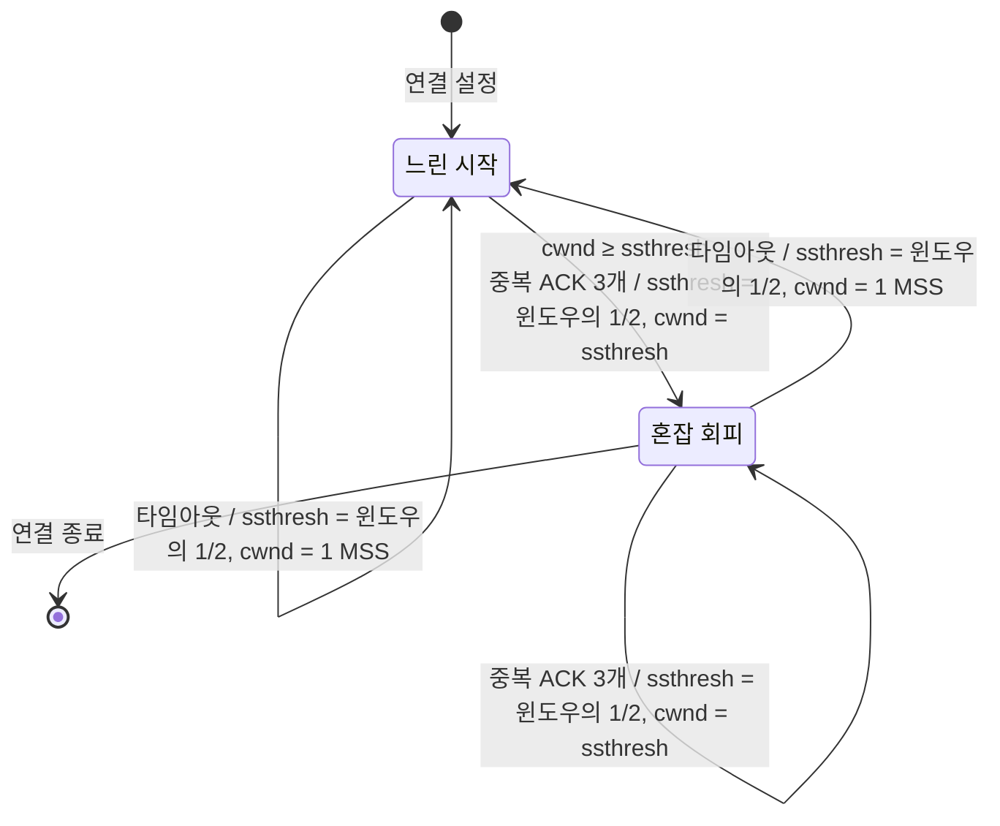

*그림 12. Forouzan의 TCP 혼잡 정책 요약*

Forouzan의 예에서 최대 윈도우 크기는 처음에 세그먼트 32개이고, 임계값은 처음에 최대 윈도우 크기의 절반인 16으로 설정된다. 느린 시작 단계에서 윈도우 크기는 1부터 지수적으로 커져 임계값에 이른다. 그 뒤 혼잡 회피(가법적 증가)가 윈도우 크기를 선형으로 키우다가, 윈도우 크기가 20일 때 타임아웃이 일어난다. 곱셈적 감소가 임계값을 그때 윈도우 크기의 절반인 10으로 줄이고, TCP는 윈도우 크기 1에서 다시 느린 시작을 한 뒤 새 임계값에 이르면 가법적 증가로 넘어간다. 윈도우 크기가 12일 때 중복 ACK 세 개 사건이 일어나면, 곱셈적 감소가 다시 임계값과 윈도우 크기를 모두 6으로 설정하고 TCP는 이번에는 가법적 증가 단계로 들어간다. TCP는 다음 타임아웃이나 다음 중복 ACK 세 개 사건이 일어날 때까지 이 단계에 머문다.

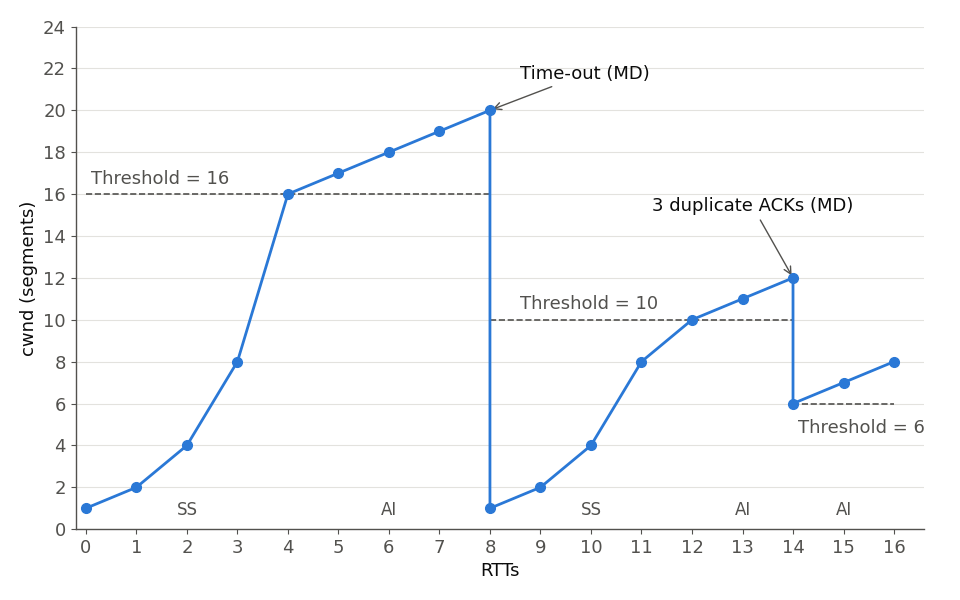

*그림 13. Forouzan의 혼잡 제어 예에서 RTT에 따른 혼잡 윈도우의 변화*

| RTT | 0 | 1 | 2 | 3 | 4 | 5 | 6 | 7 | 8 | 9 | 10 | 11 | 12 | 13 | 14 | 15 | 16 |
|:-----|:-----|:-----|:-----|:-----|:-----|:-----|:-----|:-----|:-----|:-----|:-----|:-----|:-----|:-----|:-----|:-----|:-----|
| cwnd | 1 | 2 | 4 | 8 | 16 | 17 | 18 | 19 | 20 → 1 | 2 | 4 | 8 | 10 | 11 | 12 → 6 | 7 | 8 |
| 임계값 | 16 | 16 | 16 | 16 | 16 | 16 | 16 | 16 | 16 → 10 | 10 | 10 | 10 | 10 | 10 | 10 → 6 | 6 | 6 |
| 단계 | SS | SS | SS | SS | AI | AI | AI | AI | MD, SS | SS | SS | SS | AI | AI | MD, AI | AI | AI |

*표 9. Forouzan의 혼잡 제어 예 (SS: 느린 시작, AI: 가법적 증가, MD: 곱셈적 감소)*

RTT 12에서 cwnd가 8의 두 배인 16이 아니라 10인 이유는 표 8의 라운드 12와 같다. 느린 시작은 새 임계값 10에서 멈춘다.

| 손실 사건 | TCP Tahoe | TCP Reno (Kurose의 FSM) | Forouzan의 정책 |
|:-----|:-----|:-----|:-----|
| 타임아웃 | ssthresh = cwnd/2, cwnd = 1 MSS, 느린 시작 | ssthresh = cwnd/2, cwnd = 1 MSS, 느린 시작 | 임계값 = 윈도우의 1/2, cwnd = 1, 느린 시작 |
| 중복 ACK 세 개 | ssthresh = cwnd/2, cwnd = 1 MSS, 느린 시작 | ssthresh = cwnd/2, cwnd = ssthresh + 3 MSS, 빠른 회복을 거쳐 혼잡 회피 | 임계값 = 윈도우의 1/2, cwnd = 임계값(일부 구현은 + 3), 혼잡 회피 |

*표 10. 손실 사건에 대한 TCP Tahoe, TCP Reno, Forouzan의 정책의 대응*

### 7.5 혼잡 제어와 오류 제어의 관계

TCP의 오류 제어(재전송)와 혼잡 제어는 구별해야 하지만, 둘이 떼려야 뗄 수 없이 엮여 있다는 점도 알아야 한다. 8장의 오류 제어가 손실을 감지하는 두 수단인 타임아웃과 중복 ACK 세 개는 그대로 혼잡 제어의 손실 사건이 되며, 그림 10의 FSM에서 보듯이 혼잡 제어의 상태 전이가 일어날 때 손실 세그먼트의 재전송도 함께 일어난다. 8장에서 본 타임아웃 간격의 두 배 증가도 혼잡이 있을 때 재전송을 점점 더 늦추는 제한된 형태의 혼잡 제어이다.

> **참고:** **TCP 분할(TCP splitting).** 검색, 전자 메일, 소셜 네트워크 같은 클라우드 서비스는 응답이 빨라야 한다. 그러나 사용자가 서비스의 동적 콘텐츠를 만드는 데이터 센터에서 멀리 떨어져 있으면 RTT가 크고, 느린 시작 때문에 응답 시간이 나빠질 수 있다. 예를 들어 검색 질의에 대한 응답을 보내는 데 서버가 느린 시작 동안 TCP 윈도우 세 개가 필요하다면, 종단 시스템이 TCP 연결을 시작한 때부터 응답의 마지막 패킷을 받을 때까지 대략 4 × RTT(연결 설정에 RTT 하나와 데이터 윈도우 세 개에 RTT 세 개)에 데이터 센터의 처리 시간을 더한 시간이 걸린다. 이를 줄이는 방법은 사용자 가까이에 프런트엔드 서버를 두고, 그 서버에서 TCP 연결을 나누는 것이다. 클라이언트는 가까운 프런트엔드와 TCP 연결을 맺고, 프런트엔드는 데이터 센터와 혼잡 윈도우가 매우 큰 지속 TCP 연결을 유지한다. 그러면 응답 시간은 대략 4 × RTT_FE + RTT_BE + 처리 시간이 된다. 여기서 RTT_FE는 클라이언트와 프런트엔드 사이의 왕복 시간이고, RTT_BE는 프런트엔드와 데이터 센터 사이의 왕복 시간이다. 프런트엔드가 클라이언트에 가까우면 RTT_FE는 무시할 만큼 작고 RTT_BE는 원래 RTT와 비슷하므로, 응답 시간은 대략 RTT에 처리 시간을 더한 값이 된다. 예를 들어 RTT가 100 ms이고 RTT_FE가 5 ms이면 네트워크 지연은 4 × 100 = 400 ms에서 약 4 × 5 + 100 = 120 ms로 줄어든다. TCP 분할은 접속 네트워크의 손실로 생기는 재전송 지연도 줄여 준다. 이런 프런트엔드로는 23장에서 다루는 CDN의 서버가 쓰인다.

---

<br>

## 8. AIMD와 TCP 처리량

### 8.1 AIMD와 톱니 모양

느린 시작, 혼잡 회피, 빠른 회복의 세부 동작에서 한 걸음 물러나 전체를 볼 필요가 있다. 연결이 시작될 때의 처음 느린 시작 구간을 무시하고 손실이 타임아웃이 아닌 중복 ACK 세 개로 드러난다고 가정하면, TCP의 혼잡 제어는 RTT마다 cwnd를 1 MSS씩 선형으로(가법적으로) 늘리다가 중복 ACK 세 개 사건이 일어나면 cwnd를 절반으로(곱셈적으로) 줄이는 것으로 이루어진다.

> **용어 정의:** **AIMD(가법적 증가, 곱셈적 감소)** 는 손실이 없는 동안 혼잡 윈도우를 RTT마다 일정한 양씩 더하여 늘리고, 손실 사건이 일어나면 혼잡 윈도우에 일정한 비율을 곱하여 줄이는 혼잡 제어 방식이다. TCP는 RTT마다 1 MSS를 더하고 손실이 일어나면 절반으로 줄인다.

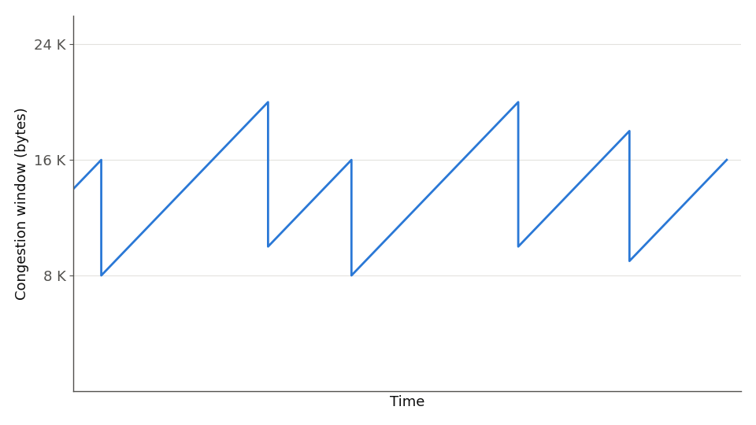

*그림 14. AIMD 혼잡 제어가 만드는 혼잡 윈도우의 톱니 모양*

AIMD 혼잡 제어는 그림 14와 같은 톱니 모양의 동작을 만든다. 이 그림은 앞에서 말한 대역폭 탐색의 직관도 잘 보여 준다. TCP는 중복 ACK 세 개 사건이 일어날 때까지 혼잡 윈도우의 크기, 즉 송신 속도를 선형으로 키운다. 그 뒤 혼잡 윈도우를 절반으로 줄이지만, 다시 선형으로 키우면서 가용 대역폭이 더 있는지 탐색한다. 손실이 일어나는 높이가 매번 다른 것은 다른 연결의 트래픽에 따라 가용 대역폭이 계속 바뀌기 때문이다.

TCP의 AIMD 알고리즘은 실제 운영 네트워크에서 혼잡 제어를 실험하며 얻은 많은 공학적 통찰을 바탕으로 개발되었다. TCP가 개발되고 10년 뒤의 이론적 분석은 TCP의 혼잡 제어 알고리즘이 사용자와 네트워크 성능의 여러 측면을 동시에 최적화하는 분산 비동기 최적화 알고리즘으로 동작함을 보였고, 그 뒤 풍부한 혼잡 제어 이론이 발전했다.

> **참고:** **TCP Vegas.** Reno가 손실을 겪은 뒤에 대응하는 것과 달리, TCP Vegas 알고리즘은 좋은 처리량을 유지하면서 혼잡을 피하려 한다. 기본 아이디어는 (1) 패킷 손실이 일어나기 전에 출발지와 목적지 사이의 라우터에서 혼잡을 감지하고, (2) 패킷 손실이 임박했다고 감지되면 송신 속도를 선형으로 낮추는 것이다. 임박한 손실은 RTT를 관찰하여 예측한다. 패킷의 RTT가 길수록 라우터의 혼잡이 심하다. 3.1절에서 말한 지연 기반의 종단 간 혼잡 제어가 이것이다.

### 8.2 장기 평균 처리량

톱니 모양의 동작을 보면, 오래 지속되는 TCP 연결의 평균 처리량, 즉 평균 속도가 얼마인지 묻는 것이 자연스럽다. 이 분석에서는 타임아웃 뒤의 느린 시작 구간을 무시한다. 송신자가 그 구간을 지수적으로 빠르게 벗어나므로 보통 매우 짧기 때문이다. 어느 왕복 구간 동안 TCP가 데이터를 보내는 속도는 혼잡 윈도우와 현재 RTT의 함수이다. 윈도우 크기가 w바이트이고 현재 왕복 시간이 RTT초이면 TCP의 전송 속도는 대략 w/RTT이다. TCP는 손실 사건이 일어날 때까지 RTT마다 w를 1 MSS씩 키우며 대역폭을 더 탐색한다. 손실 사건이 일어날 때의 w의 값을 W라 한다. 연결이 지속되는 동안 RTT와 W가 거의 일정하다고 가정하면, TCP의 전송 속도는 W/(2 × RTT)와 W/RTT 사이에서 변한다.

이 가정에서 TCP의 정상 상태 동작에 대한 매우 단순한 거시적 모형을 얻는다. 속도가 W/RTT로 커지면 네트워크가 그 연결의 패킷 하나를 버린다. 그러면 속도는 절반으로 줄고, 다시 W/RTT에 이를 때까지 RTT마다 MSS/RTT씩 커진다. 이 과정이 계속 되풀이된다. 처리량이 두 극단 값 사이에서 선형으로 커지므로, 평균 처리량은 두 값의 평균이다.

```math
\text{average throughput of a connection} = \frac{1}{2}\left(\frac{W}{2 \cdot RTT} + \frac{W}{RTT}\right) = \frac{0.75 \cdot W}{RTT}
```

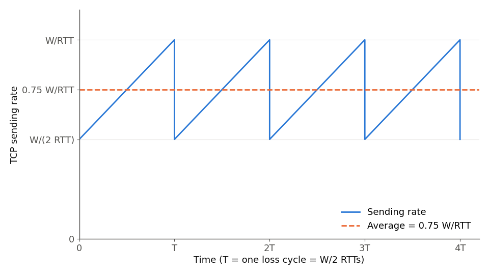

*그림 15. 단순화한 정상 상태 모형에서 TCP 송신 속도와 평균 처리량*

예를 들어 MSS가 1,500바이트이고, 손실이 일어날 때의 윈도우 W가 세그먼트 100개이며, RTT가 100 ms라고 가정한다. 최대 속도 W/RTT는 100 × 1,500 × 8 / 0.1 = 12 Mbps이고, 손실 직후의 속도는 그 절반인 6 Mbps이므로 평균 처리량은 0.75 × 12 = 9 Mbps이다. 윈도우가 50개에서 100개까지 RTT마다 하나씩 커지므로 톱니 하나의 주기는 50 RTT, 즉 5초이다.

### 8.3 고속 경로의 TCP

TCP 혼잡 제어는 여러 해에 걸쳐 발전해 왔고 지금도 발전하고 있다. 대부분의 TCP 연결이 SMTP, FTP, Telnet 트래픽을 나르던 시절의 인터넷에 좋았던 것이 오늘날 HTTP가 지배하는 인터넷이나 아직 상상하지 못한 서비스가 있을 미래의 인터넷에도 반드시 좋은 것은 아니다.

TCP가 계속 발전해야 하는 이유는 그리드 컴퓨팅이나 클라우드 컴퓨팅 응용에 필요한 고속 TCP 연결을 생각하면 알 수 있다. 1,500바이트 세그먼트와 100 ms의 RTT를 쓰는 TCP 연결로 10 Gbps의 속도로 데이터를 보내려 한다. 처리량이 평균 윈도우를 RTT로 나눈 값이라는 관계를 쓰면, 10 Gbps의 처리량을 얻기 위해 필요한 평균 혼잡 윈도우의 크기는 다음과 같다.

```math
\bar{w} = \frac{10 \times 10^{9} \times 0.1}{1500 \times 8} \approx 83{,}333 \ \text{segments}
```

전송 중인 세그먼트가 83,333개나 되므로, 그 가운데 하나라도 손실되면 어떻게 될지 걱정할 만하다. 달리 말하면, 그림 10의 TCP 혼잡 제어 알고리즘이 여전히 10 Gbps를 내려면 보낸 세그먼트 가운데 어느 정도까지 손실되어도 되는가? 손실률 L, 왕복 시간 RTT, 최대 세그먼트 크기 MSS로 TCP 연결의 처리량을 나타내는 식은 다음과 같다.

```math
\text{average throughput of a connection} = \frac{1.22 \cdot MSS}{RTT \sqrt{L}}
```

이 식을 L에 대해 풀어 10 Gbps를 대입하면 허용되는 손실률은 다음과 같다.

```math
L = \left(\frac{1.22 \cdot MSS}{RTT \cdot \text{throughput}}\right)^{2} = \left(\frac{1.22 \times 12000}{0.1 \times 10^{10}}\right)^{2} \approx 2.1 \times 10^{-10}
```

즉 세그먼트 약 47억 개마다 손실 사건이 하나 이하여야 한다. Kurose는 이를 $`2 \cdot 10^{-10}`$, 즉 세그먼트 50억 개마다 손실 사건 하나로 어림한다. 매우 낮은 손실률이므로, 오늘날의 TCP 혼잡 제어 알고리즘으로는 이런 고속 환경을 감당하기 어렵다. 이 관찰을 계기로 여러 연구자가 고속 환경을 위해 특별히 설계된 새로운 TCP 버전을 연구하고 있다.

> **참고:** **1.22 × MSS/(RTT √L) 식의 유도.** 8.2절의 모형에서 윈도우를 세그먼트 수 W로 나타낸다. 톱니 하나의 주기 동안 윈도우는 W/2에서 W까지 RTT마다 1씩 커지므로, 주기 동안 보내는 세그먼트는 대략 다음과 같다.
>
> ```math
> \frac{W}{2} + \left(\frac{W}{2} + 1\right) + \cdots + W \approx \frac{1}{2}\left(\frac{W}{2} + W\right) \cdot \frac{W}{2} = \frac{3}{8} W^{2}
> ```
>
> 주기마다 손실이 하나 일어나므로 손실률은 $`L = 8/(3W^{2})`$이고, $`W = \sqrt{8/(3L)}`$이다. 이를 평균 처리량 0.75 × W × MSS/RTT에 넣으면 $`0.75 \sqrt{8/3} \approx 1.22`$이므로 위의 식을 얻는다.

---

<br>

## 9. 공정성

### 9.1 병목 링크와 공정성

K개의 TCP 연결이 각자 다른 종단 간 경로를 가지지만 모두 전송 속도 R bps인 병목 링크를 지난다고 가정한다.

> **용어 정의:** **병목 링크(bottleneck link)** 는 어떤 연결의 경로에서 혼잡해지는 링크로, 그 연결의 경로에 있는 다른 모든 링크는 혼잡하지 않고 이 링크보다 전송 용량이 넉넉하다.

각 연결은 큰 파일을 전송하고 있고 병목 링크를 지나는 UDP 트래픽은 없다고 가정한다. 각 연결의 평균 전송 속도가 대략 R/K이면, 즉 각 연결이 링크 대역폭을 똑같이 나누어 가지면 그 혼잡 제어 메커니즘은 **공정하다(fair)** 고 한다.

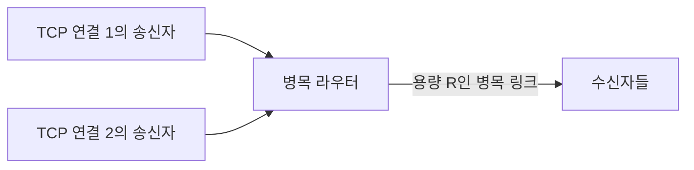

*그림 16. 하나의 병목 링크를 공유하는 두 TCP 연결*

TCP의 AIMD 알고리즘은 공정할까? 서로 다른 TCP 연결은 서로 다른 시점에 시작하여 어느 순간 서로 다른 윈도우 크기를 가질 수 있으므로 의문이 생긴다. 다음 절은 TCP 혼잡 제어가 경쟁하는 TCP 연결 사이에 병목 링크의 대역폭을 똑같이 나누도록 수렴하는 이유를 직관적으로 설명한다.

### 9.2 AIMD가 공정한 몫으로 수렴하는 이유

그림 16처럼 두 TCP 연결이 전송 속도 R인 링크 하나를 공유하는 단순한 경우를 생각한다. 두 연결의 MSS와 RTT가 같아서 혼잡 윈도우 크기가 같으면 처리량도 같고, 두 연결 모두 보낼 데이터가 많으며, 이 링크를 지나는 다른 TCP 연결이나 UDP 데이터그램은 없다고 가정한다. 또 TCP의 느린 시작 단계를 무시하고 두 연결이 항상 혼잡 회피 모드(AIMD)로 동작한다고 가정한다.

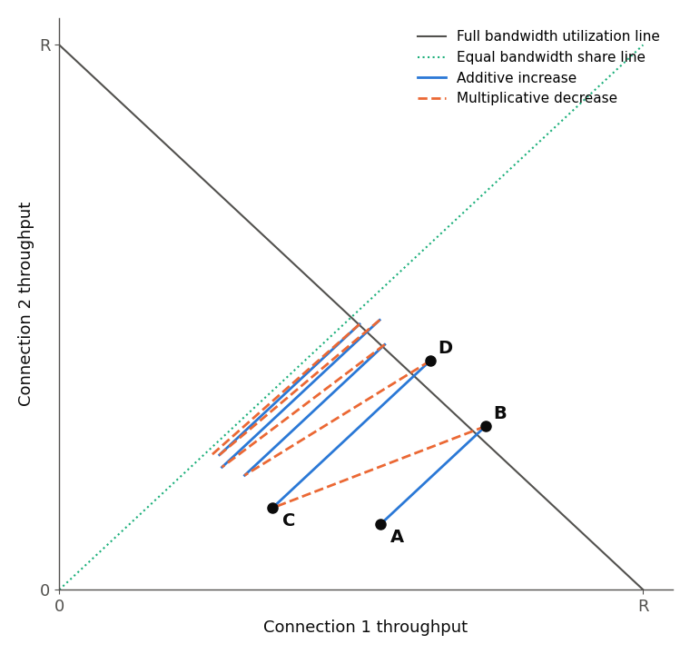

*그림 17. AIMD를 쓰는 두 TCP 연결의 처리량이 공정한 몫으로 수렴하는 과정*

그림 17은 두 TCP 연결이 얻는 처리량을 나타낸다. TCP가 링크 대역폭을 두 연결에 똑같이 나누어 준다면 실현된 처리량은 원점에서 시작하는 45도 직선인 균등 대역폭 분배선 위에 있어야 한다. 또 두 처리량의 합은 R과 같은 것이 이상적이다. 두 연결이 링크 용량을 똑같이 나누어 갖더라도 둘 다 0을 받는다면 바람직하지 않기 때문이다. 따라서 목표는 실현된 처리량이 균등 대역폭 분배선과 완전 대역폭 활용선의 교차점 가까이에 있는 것이다.

1. 어느 순간 두 연결의 처리량이 점 A에 있다고 가정한다. 두 연결이 함께 쓰는 링크 대역폭이 R보다 작으므로 손실이 일어나지 않고, 두 연결 모두 혼잡 회피 알고리즘에 따라 RTT마다 윈도우를 1 MSS씩 키운다. 따라서 두 연결의 처리량은 점 A에서 시작하는 45도 직선을 따라 움직인다. 두 연결이 똑같이 늘어나기 때문이다.
2. 결국 두 연결이 함께 쓰는 대역폭이 R보다 커지고 패킷 손실이 일어난다. 두 연결이 점 B에서 패킷 손실을 겪는다고 가정한다. 두 연결은 윈도우를 절반으로 줄이므로 처리량은 점 B에서 원점으로 가는 벡터의 중간인 점 C로 간다.
3. 점 C에서 함께 쓰는 대역폭은 R보다 작으므로 두 연결은 다시 점 C에서 시작하는 45도 직선을 따라 처리량을 키운다. 결국 점 D 같은 곳에서 다시 손실이 일어나고, 두 연결은 다시 윈도우를 절반으로 줄인다. 이 과정이 되풀이된다.

이렇게 두 연결이 실현하는 대역폭은 결국 균등 대역폭 분배선을 따라 오르내리게 되며, 두 연결이 2차원 공간의 어디에서 시작하든 이 동작으로 수렴한다. 그 이유는 두 처리량의 차이 $`x_1 - x_2`$를 보면 분명하다. 가법적 증가는 두 처리량에 같은 양을 더하므로 차이를 바꾸지 않고, 곱셈적 감소는 두 처리량을 모두 절반으로 줄이므로 차이도 절반으로 줄인다. 손실이 k번 일어나면 차이는 처음의 $`1/2^{k}`$이 되어 0으로 다가간다. 그림 17은 점 A = (0.55R, 0.12R)에서 시작하므로 처음 차이는 0.43R이고, 손실을 다섯 번 겪은 뒤의 차이는 0.43R/32 ≈ 0.013R에 불과하다. 감소도 가법적이어서 두 연결에서 같은 양을 뺀다면 차이는 결코 줄지 않으므로, 공정성을 만드는 것은 곱셈적 감소이다.

이 시나리오 뒤에는 여러 이상적인 가정이 있지만, TCP가 연결 사이에 대역폭을 똑같이 나누는 이유를 직관적으로 이해하게 해 준다.

### 9.3 공정성이 깨지는 경우

9.2절의 이상적인 시나리오는 병목 링크를 지나는 것이 TCP 연결뿐이고, 연결의 RTT가 같으며, 호스트와 목적지의 쌍마다 TCP 연결이 하나뿐이라고 가정했다. 실제로는 이 조건이 보통 성립하지 않으므로, 클라이언트-서버 응용은 링크 대역폭을 매우 불균등하게 나누어 가질 수 있다.

- **RTT의 차이.** 여러 연결이 공통의 병목을 공유할 때, RTT가 작은 연결은 대역폭이 비는 대로 더 빨리 차지한다. 즉 혼잡 윈도우를 더 빨리 열기 때문에 RTT가 큰 연결보다 높은 처리량을 얻는다. 4.2절의 자기 클로킹에서 보았듯이 윈도우는 ACK가 도착하는 속도에 맞추어 커지기 때문이다.
- **UDP.** TCP 혼잡 제어는 혼잡 윈도우로 응용의 전송 속도를 조절한다. 인터넷 전화나 화상 회의 같은 많은 멀티미디어 응용은 바로 이 때문에 TCP 위에서 실행되지 않는 경우가 많다. 네트워크가 매우 혼잡하더라도 전송 속도가 억제되기를 원하지 않기 때문이다. 이런 응용은 혼잡 제어가 없는 UDP 위에서 실행되기를 선호한다(6장). UDP 위에서는 혼잡할 때 속도를 "공정한" 수준으로 줄여 패킷을 잃지 않는 대신, 일정한 속도로 오디오와 비디오를 네트워크에 밀어 넣고 가끔 패킷을 잃는 편을 택할 수 있다. TCP의 관점에서 보면 UDP 위의 멀티미디어 응용은 다른 연결과 협력하지도 않고 전송 속도를 알맞게 조절하지도 않으므로 공정하지 않다. TCP는 혼잡이 커지면 전송 속도를 줄이지만 UDP 출발지는 그럴 필요가 없으므로, UDP 출발지가 TCP 트래픽을 밀어낼 수 있다. 그래서 UDP 트래픽이 인터넷의 처리량을 멈추게 하지 않도록 막는 혼잡 제어 메커니즘이 연구되고 있다(10.2절의 DCCP).
- **병렬 TCP 연결.** UDP 트래픽이 공정하게 행동하도록 강제할 수 있더라도 공정성 문제가 완전히 풀리지는 않는다. TCP 기반 응용이 여러 개의 병렬 연결을 쓰는 것을 막을 방법이 없기 때문이다. 예를 들어 웹 브라우저는 웹 페이지 안의 여러 객체를 전송하기 위해 여러 개의 병렬 TCP 연결을 쓰는 경우가 많다. 응용이 여러 개의 병렬 연결을 쓰면 혼잡한 링크의 대역폭에서 더 큰 몫을 가져간다.

병렬 연결의 예를 계산해 보면, 속도 R인 링크가 진행 중인 클라이언트-서버 응용 아홉 개를 지원하고 있고 각 응용이 TCP 연결 하나씩을 쓴다고 가정한다. 새 응용이 와서 TCP 연결 하나를 쓰면 연결은 모두 10개이므로 각 응용은 대략 같은 전송 속도 R/10을 얻는다. 그러나 새 응용이 병렬 TCP 연결 11개를 쓰면 연결은 모두 9 + 11 = 20개가 되고, 연결마다 R/20을 얻는다면 새 응용은 11 × R/20 = 0.55R, 즉 R/2보다 큰 불공정한 몫을 가져간다. 웹 트래픽은 인터넷에 매우 널리 퍼져 있으므로 이런 병렬 연결은 드물지 않다.

---

<br>

## 10. 명시적 혼잡 통지 (ECN)

### 10.1 ECN의 동작

1980년대 후반에 느린 시작과 혼잡 회피가 처음 표준화된 이래, TCP는 4절에서 다룬 종단 간 혼잡 제어를 구현해 왔다. TCP 송신자는 네트워크 계층에서 혼잡에 대한 명시적인 표시를 받지 않고, 관찰한 패킷 손실로 혼잡을 추론한다. 최근에는 네트워크가 TCP 송신자와 수신자에게 혼잡을 명시적으로 알릴 수 있도록 하는 IP와 TCP의 확장이 제안되고 구현되어 배치되었다. 이런 형태의 네트워크 지원 혼잡 제어를 명시적 혼잡 통지라 한다.

> **용어 정의:** **명시적 혼잡 통지(explicit congestion notification, ECN)** 는 혼잡을 겪는 라우터가 IP 데이터그램 헤더의 ECN 비트에 혼잡을 표시하고, 이를 받은 수신자가 TCP 확인 응답으로 송신자에게 알려 송신자가 혼잡 윈도우를 줄이게 하는 네트워크 지원 혼잡 제어 방식이다.

ECN에는 TCP와 IP 프로토콜이 모두 관여한다.

1. **네트워크 계층.** IP 데이터그램 헤더의 서비스 유형(Type of Service) 필드에 있는 비트 두 개를 ECN에 쓴다(IP 헤더는 11장에서 다룬다). 두 비트로 모두 네 가지 값을 나타낼 수 있다. 그 가운데 한 값은 라우터가 혼잡을 겪고 있음을 나타내는 데 쓴다. 이 혼잡 표시는 표시된 IP 데이터그램에 실려 목적지 호스트까지 전달되고, 목적지 호스트는 송신 호스트에게 이를 알린다. 라우터가 언제 혼잡하다고 볼지는 정해져 있지 않다. 그 결정은 라우터 제조사가 설정할 수 있도록 하고 네트워크 운영자가 정하는 설정 사항이다. 다만 ECN 혼잡 표시는 혼잡이 지속될 때만 설정하도록 권고된다. 또 다른 값은 송신 호스트가 라우터에게 송신자와 수신자가 ECN을 지원하여 ECN으로 알린 네트워크 혼잡에 대응할 수 있음을 알리는 데 쓴다.
2. **수신자.** 수신 호스트의 TCP는 받은 데이터그램으로 ECN 혼잡 표시를 받으면, 수신자에서 송신자로 가는 TCP ACK 세그먼트의 ECE(ECN Echo) 비트를 설정하여 송신 호스트의 TCP에게 혼잡을 알린다(TCP 헤더의 플래그는 8장).
3. **송신자.** TCP 송신자는 ECE 혼잡 표시가 있는 ACK를 받으면, 빠른 재전송으로 손실 세그먼트에 대응할 때처럼 혼잡 윈도우를 절반으로 줄이고, 송신자에서 수신자로 보내는 다음 TCP 세그먼트의 헤더에 CWR(Congestion Window Reduced) 비트를 설정한다.

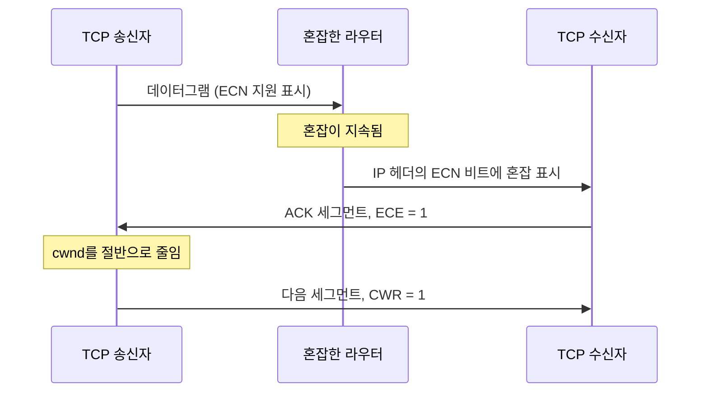

*그림 18. 명시적 혼잡 통지: 네트워크 지원 혼잡 제어*

| 표시 | 위치 | 설정하는 쪽 | 의미 |
|:-----|:-----|:-----|:-----|
| ECN 비트의 혼잡 표시 값 | IP 헤더의 서비스 유형 필드 | 혼잡한 라우터 | 이 데이터그램이 지나온 라우터가 혼잡을 겪고 있다 |
| ECN 비트의 ECN 지원 값 | IP 헤더의 서비스 유형 필드 | 송신 호스트 | 송신자와 수신자가 ECN을 지원한다 |
| ECE | TCP 헤더 | 수신자 | 네트워크의 혼잡 표시를 송신자에게 되돌려 알린다 |
| CWR | TCP 헤더 | 송신자 | 혼잡 윈도우를 줄였음을 수신자에게 알린다 |

*표 11. ECN에 쓰이는 비트와 플래그*

ECN은 그림 7의 두 경로 가운데 수신자를 거친 네트워크 피드백에 해당하며, 3.3절의 순방향 신호와 같은 구조이다. 송신자는 세그먼트 손실이 아니라 표시된 데이터그램을 통해 혼잡을 알게 되며, 혼잡을 알리는 신호가 송신자에게 돌아오기까지 왕복 시간 하나가 걸린다.

### 10.2 ECN을 쓰는 다른 프로토콜

TCP 말고도 다른 전송 계층 프로토콜이 네트워크 계층이 알린 ECN을 쓸 수 있다.

- **DCCP(Datagram Congestion Control Protocol).** 오버헤드가 작고 혼잡 제어가 되는, UDP와 비슷한 비신뢰적 서비스를 제공하며 ECN을 활용한다. 9.3절에서 말한 UDP의 공정성 문제에 대한 한 가지 대응이다.
- **DCTCP(Data Center TCP).** 데이터 센터 네트워크를 위해 특별히 설계된 TCP 버전으로, 역시 ECN을 활용한다.

---

<br>

## 개념 적용

**T/F 점검:**

| 문장 | 판단과 근거 |
|:-----|:-----|
| 흐름 제어와 혼잡 제어는 모두 수신자의 수신 버퍼가 넘치지 않도록 송신 속도를 억제한다. | **F.** 흐름 제어는 수신 버퍼를 보호하지만, 혼잡 제어는 송신자와 수신자 사이의 네트워크, 즉 라우터의 버퍼와 링크를 보호한다. |
| 라우터의 버퍼가 무한하면 혼잡의 비용은 생기지 않는다. | **F.** 시나리오 1에서 보았듯이 버퍼가 무한해도 도착 속도가 링크 용량에 가까워지면 큰 큐잉 지연이 생긴다. |
| 느린 시작에서 cwnd는 RTT마다 1 MSS씩 커진다. | **F.** 느린 시작에서는 새 ACK마다 1 MSS씩 커지므로 cwnd는 RTT마다 두 배가 된다. RTT마다 1 MSS씩 커지는 것은 혼잡 회피이다. |
| TCP Reno는 중복 ACK 세 개를 받으면 cwnd를 1 MSS로 줄이고 느린 시작으로 돌아간다. | **F.** 그렇게 하는 것은 TCP Tahoe이다. Reno는 ssthresh = cwnd/2, cwnd = ssthresh + 3 MSS로 설정하고 빠른 회복으로 들어간다. |
| 타임아웃이 일어나면 TCP Tahoe와 TCP Reno 모두 cwnd를 1 MSS로 줄이고 느린 시작으로 돌아간다. | **T.** 타임아웃은 혼잡의 가능성이 더 강한 신호이므로 두 버전 모두 강하게 대응한다. |
| AIMD를 쓰는 두 연결의 처리량 차이는 곱셈적 감소가 일어날 때마다 절반이 된다. | **T.** 가법적 증가는 차이를 바꾸지 않고 곱셈적 감소는 차이를 절반으로 줄이므로, 처리량은 공정한 몫으로 수렴한다. |
| 혼잡 제어에는 Go-Back-N 윈도우가 Selective Repeat 윈도우보다 낫다. | **F.** Go-Back-N은 무사히 도착한 패킷까지 재전송하여 부하를 키우므로, Selective Repeat 윈도우가 더 낫다. |
| ECN에서 라우터는 TCP 헤더의 ECE 비트를 설정하여 혼잡을 표시한다. | **F.** 라우터는 IP 헤더의 ECN 비트에 혼잡을 표시하고, 그 표시를 받은 수신자가 TCP ACK의 ECE 비트를 설정한다. |

---

<br>

## 요약

| 개념 | 핵심 정리 |
|:-----|:-----|
| 혼잡 | 네트워크에 주어진 부하가 용량보다 커서 라우터 큐에 패킷이 쌓이고 지연과 손실이 커지는 상태이다. |
| 혼잡과 흐름 제어 | 흐름 제어는 수신 버퍼를, 혼잡 제어는 네트워크를 보호하며, 송신 윈도우는 min(rwnd, cwnd)이다. |
| 혼잡의 비용 | 큰 큐잉 지연, 손실 보상을 위한 재전송, 불필요한 재전송, 중간에서 버려진 패킷이 쓴 상류 용량의 낭비가 있으며, 처리량이 0으로 떨어지는 혼잡 붕괴에 이를 수 있다. |
| 종단 간과 네트워크 지원 | 종단 간 방식은 손실과 지연으로 혼잡을 추론하고, 네트워크 지원 방식은 라우터가 초크 패킷이나 패킷 표시로 혼잡을 알린다. |
| 개루프와 폐루프 | 개루프는 재전송, 윈도우, 확인 응답 정책으로 혼잡을 미리 막고, 폐루프는 윈도우 조절, 역방향과 순방향 신호, 초크 패킷으로 혼잡을 완화한다. |
| 혼잡 윈도우 | LastByteSent - LastByteAcked ≤ min{cwnd, rwnd}이며, 송신 속도는 대략 cwnd/RTT이다. |
| 손실 사건과 자기 클로킹 | 타임아웃이나 중복 ACK 세 개가 혼잡의 신호이고, ACK의 도착이 윈도우 증가의 시계 역할을 한다. |
| 느린 시작 | cwnd를 1 MSS에서 시작하여 새 ACK마다 1 MSS씩, 즉 RTT마다 두 배로 키우고 ssthresh에 이르면 혼잡 회피로 넘어간다. |
| 혼잡 회피 | RTT마다 cwnd를 1 MSS씩 키우며, 새 ACK마다 MSS × (MSS/cwnd)씩 키워 구현한다. |
| 손실에 대한 대응 | 타임아웃이면 ssthresh = cwnd/2, cwnd = 1 MSS로 느린 시작을 하고, 중복 ACK 세 개이면 ssthresh = cwnd/2, cwnd = ssthresh + 3 MSS로 빠른 회복에 들어간다. |
| 빠른 회복 | 중복 ACK마다 cwnd를 1 MSS씩 키우다가 새 ACK가 오면 cwnd = ssthresh로 줄이고 혼잡 회피로 간다. |
| Tahoe와 Reno | Tahoe는 모든 손실에 cwnd = 1 MSS로 느린 시작을 하고, Reno는 중복 ACK 세 개에 빠른 회복을 쓴다. |
| AIMD | RTT마다 1 MSS를 더하고 손실이 일어나면 절반으로 줄여 톱니 모양으로 대역폭을 탐색한다. |
| TCP 처리량 | 평균 처리량은 0.75 × W/RTT이고, 손실률 L에서는 1.22 × MSS/(RTT √L)이어서 10 Gbps에는 약 $`2 \times 10^{-10}`$의 손실률이 필요하다. |
| 공정성 | AIMD는 처리량 차이를 감소 때마다 절반으로 줄여 공정한 몫 R/K로 수렴하지만, RTT 차이, UDP, 병렬 연결은 공정성을 깨뜨린다. |
| ECN | 라우터가 IP 헤더의 ECN 비트에 혼잡을 표시하고, 수신자가 ECE로 알리면, 송신자가 cwnd를 절반으로 줄이고 CWR로 응답한다. |

---

<br>

## 점검 문제

1. **혼잡 윈도우 추적:** TCP Reno 연결이 cwnd = 1 MSS, ssthresh = 16 MSS로 시작한다. cwnd가 18 MSS인 라운드에서 타임아웃이 일어나고, 그 뒤 cwnd가 14 MSS인 라운드에서 중복 ACK 세 개를 받는다. 느린 시작에서 cwnd가 ssthresh를 넘게 되면 ssthresh에서 멈춘다고 할 때, (a) 타임아웃까지 라운드마다의 cwnd, (b) 타임아웃 직후의 ssthresh와 cwnd, 그리고 중복 ACK 세 개 사건까지 라운드마다의 cwnd, (c) 중복 ACK 세 개 직후의 ssthresh와 cwnd, 그리고 손실 세그먼트에 대한 새 ACK가 왔을 때의 cwnd를 구하라. (d) TCP Tahoe였다면 (c)는 어떻게 달라지는가?

   <details>
   <summary>정답</summary>

   (a) 라운드 1부터 1, 2, 4, 8, 16 MSS로 느린 시작을 하고, 라운드 5에서 ssthresh = 16에 이르러 혼잡 회피로 넘어가 17, 18 MSS가 된다. 라운드 7(cwnd = 18 MSS)에서 타임아웃이 일어난다. (b) ssthresh = 18/2 = 9 MSS, cwnd = 1 MSS이다. 라운드 8부터 1, 2, 4, 8 MSS가 되고, 다음 라운드에 16이 아니라 ssthresh인 9 MSS에서 느린 시작이 끝난다. 그 뒤 10, 11, 12, 13, 14 MSS가 되며 라운드 17(cwnd = 14 MSS)에서 중복 ACK 세 개를 받는다. (c) ssthresh = 14/2 = 7 MSS, cwnd = 7 + 3 = 10 MSS로 빠른 회복에 들어간다. 새 ACK가 오면 cwnd = ssthresh = 7 MSS로 줄고 혼잡 회피를 이어 가 다음 라운드에 8 MSS가 된다. (d) Tahoe는 ssthresh = 7 MSS로 같지만 cwnd = 1 MSS로 줄이고 느린 시작부터 다시 시작한다.

   </details>

2. **평균 처리량:** 손실이 일어날 때의 혼잡 윈도우 W가 세그먼트 40개이고, MSS가 1,500바이트, RTT가 100 ms인 오래 지속되는 TCP 연결이 있다. 8.2절의 모형으로 송신 속도의 범위와 평균 처리량을 구하라.

   <details>
   <summary>정답</summary>

   W/RTT = 40 × 1,500 × 8 / 0.1 = 4.8 Mbps이고, 손실 직후의 속도 W/(2 × RTT)는 2.4 Mbps이다. 송신 속도는 2.4 Mbps와 4.8 Mbps 사이에서 선형으로 변하므로 평균 처리량은 0.75 × 4.8 = 3.6 Mbps이다.

   </details>

3. **고속 경로의 손실률:** MSS가 1,500바이트이고 RTT가 100 ms인 TCP 연결로 1 Gbps의 평균 처리량을 얻으려 한다. 필요한 평균 혼잡 윈도우의 크기와, 1.22 × MSS/(RTT √L) 식으로 허용되는 손실률 L을 구하라.

   <details>
   <summary>정답</summary>

   평균 윈도우는 $`10^{9} \times 0.1 / (1500 \times 8) \approx 8{,}333`$개 세그먼트이다. 손실률은 $`L = (1.22 \times 12000 / (0.1 \times 10^{9}))^{2} = (1.464 \times 10^{-4})^{2} \approx 2.1 \times 10^{-8}`$이므로, 세그먼트 약 4,700만 개마다 손실 사건이 하나 이하여야 한다. 처리량이 10배 커지면 허용되는 손실률은 100배 작아진다.

   </details>

4. **공정성의 수렴:** 용량 R = 10 Mbps인 병목 링크를 두 TCP 연결이 공유한다. 두 연결의 처리량은 처음에 1 Mbps와 5 Mbps이고, 손실이 없으면 RTT마다 둘 다 1 Mbps씩 커지며, 두 처리량의 합이 10 Mbps를 넘는 순간 손실이 일어나 둘 다 절반으로 줄어든다고 가정한다. 두 번째 감소 직후의 두 처리량과 처리량 차이를 구하고, 차이가 어떻게 변하는지 설명하라.

   <details>
   <summary>정답</summary>

   (1, 5)에서 (2, 6), (3, 7), (4, 8)로 커지고, 합이 12 Mbps가 되어 손실이 일어나 (2, 4)로 줄어든다. 다시 (3, 5), (4, 6), (5, 7)로 커지고, 합이 12 Mbps가 되어 (2.5, 3.5)로 줄어든다. 처리량 차이는 4 Mbps에서 2 Mbps, 1 Mbps로 감소 때마다 절반이 된다. 가법적 증가는 차이를 바꾸지 않고 곱셈적 감소만 차이를 줄이므로, 두 처리량은 같은 값으로 수렴한다.

   </details>

5. **개루프 정책:** 다음 각 설계가 Forouzan의 개루프 혼잡 제어 정책 가운데 무엇에 해당하는지 말하라. (a) 수신자가 세그먼트를 받을 때마다 확인 응답하지 않고 두 세그먼트마다 한 번, 또는 보낼 데이터가 있을 때 함께 확인 응답한다. (b) 송신자가 손실된 패킷만 다시 보내도록 Go-Back-N 대신 Selective Repeat을 쓴다. (c) 송신자가 측정한 RTT로 재전송 타임아웃을 정하여 지연되었을 뿐인 패킷을 너무 일찍 재전송하지 않게 한다.

   <details>
   <summary>정답</summary>

   (a) 확인 응답 정책이다. 확인 응답도 네트워크 부하의 일부이므로 확인 응답을 줄이면 부하가 줄어든다. (b) 윈도우 정책이다. 이미 도착한 패킷을 재전송하지 않으므로 불필요한 부하가 생기지 않는다. (c) 재전송 정책이다. 2.2절 (c)의 불필요한 재전송이라는 비용을 막는다.

   </details>

6. **재전송 비용:** 시나리오 2에서 제공 부하 $`\lambda'_{in}`$이 0.5R일 때 수신 응용이 받는 처리량이 0.4R이라고 가정한다. 송신자가 보내는 데이터 가운데 재전송 데이터의 속도와 비율을 구하라.

   <details>
   <summary>정답</summary>

   수신 응용에 전달되는 0.4R은 원래 데이터이므로, 나머지 0.5R - 0.4R = 0.1R이 재전송 데이터의 속도이다. 보내는 데이터 가운데 비율은 0.1R / 0.5R = 20%이다. Kurose의 예(처리량 R/3)에서는 재전송 데이터가 R/6이므로 비율이 약 33%이다.

   </details>

7. **빠른 회복의 cwnd:** TCP Reno 송신자의 cwnd가 16 MSS일 때 중복 ACK 세 개를 받았다. 그 뒤 같은 세그먼트에 대한 중복 ACK가 네 개 더 오고, 이어서 손실 세그먼트를 확인하는 새 ACK가 온다. 각 시점의 ssthresh와 cwnd를 구하고, 새 ACK 뒤 한 RTT가 지났을 때의 cwnd를 구하라.

   <details>
   <summary>정답</summary>

   중복 ACK 세 개를 받으면 ssthresh = 16/2 = 8 MSS, cwnd = 8 + 3 = 11 MSS로 빠른 회복에 들어간다. 중복 ACK 네 개가 더 오면 cwnd는 하나마다 1 MSS씩 커져 15 MSS가 된다. 새 ACK가 오면 cwnd = ssthresh = 8 MSS로 줄고 혼잡 회피로 넘어가므로, 한 RTT 뒤에는 9 MSS가 된다. 이 동안 ssthresh는 8 MSS로 유지된다.

   </details>

8. **ECN의 동작:** ECN을 지원하는 TCP 연결에서 경로의 라우터가 지속적인 혼잡을 겪는다. 라우터, 수신자, 송신자가 차례로 하는 일을 각자 설정하는 비트와 함께 설명하고, 이 방식이 그림 7의 두 피드백 경로 가운데 어느 것에 해당하는지 말하라.

   <details>
   <summary>정답</summary>

   라우터는 지나가는 IP 데이터그램 헤더의 서비스 유형 필드에 있는 ECN 비트에 혼잡을 표시한다. 수신자의 TCP는 표시된 데이터그램을 받으면 송신자에게 보내는 ACK 세그먼트의 ECE 비트를 설정한다. 송신자의 TCP는 ECE가 설정된 ACK를 받으면 빠른 재전송 때처럼 cwnd를 절반으로 줄이고, 다음에 보내는 세그먼트의 CWR 비트를 설정하여 윈도우를 줄였음을 알린다. 혼잡 표시가 수신자를 거쳐 송신자에게 돌아가므로, 수신자를 거친 네트워크 피드백에 해당한다.

   </details>
