# Chapter 9 — Congestion Control

[Repository Guide](../../README.md) | [English](Concepts_Lecture.md) | [한국어](Concepts_Lecture.ko.md)

> **Last Updated:** 2026-11-18
>
> Computer Networking: A Top-Down Approach, Kurose and Ross, Ch 3; TCP/IP Protocol Suite, Forouzan, Ch 4, 13, 15

> **Learning Objectives:**
> 1. Explain the definition and causes of congestion, and analyze the costs of congestion with three scenarios
> 2. Distinguish end-to-end from network-assisted congestion control, and open-loop from closed-loop congestion control
> 3. Explain how TCP regulates its sending rate with the congestion window, together with loss events and self-clocking
> 4. Explain slow start, congestion avoidance, and fast recovery with an FSM, and trace the congestion window of TCP Tahoe and TCP Reno
> 5. Derive the average throughput of TCP from AIMD and compute the loss rate a high-speed path can tolerate
> 6. Explain why AIMD converges to a fair share of bandwidth and how explicit congestion notification (ECN) works

---

## Table of Contents

- [1. The Concept of Congestion](#1-the-concept-of-congestion)
  - [1.1 Load and Capacity](#11-load-and-capacity)
  - [1.2 Congestion Control and Flow Control](#12-congestion-control-and-flow-control)
  - [1.3 Congestion Seen from the Network Layer](#13-congestion-seen-from-the-network-layer)
- [2. The Causes and the Costs of Congestion](#2-the-causes-and-the-costs-of-congestion)
  - [2.1 Scenario 1: Two Senders and a Router with Infinite Buffers](#21-scenario-1-two-senders-and-a-router-with-infinite-buffers)
  - [2.2 Scenario 2: Two Senders and a Router with Finite Buffers](#22-scenario-2-two-senders-and-a-router-with-finite-buffers)
  - [2.3 Scenario 3: Four Senders and Multihop Paths](#23-scenario-3-four-senders-and-multihop-paths)
  - [2.4 Summary of the Costs of Congestion](#24-summary-of-the-costs-of-congestion)
- [3. Approaches to Congestion Control](#3-approaches-to-congestion-control)
  - [3.1 End-to-End and Network-Assisted Congestion Control](#31-end-to-end-and-network-assisted-congestion-control)
  - [3.2 Open-Loop Congestion Control](#32-open-loop-congestion-control)
  - [3.3 Closed-Loop Congestion Control](#33-closed-loop-congestion-control)
  - [3.4 Congestion Control in a Connection-Oriented Network](#34-congestion-control-in-a-connection-oriented-network)
- [4. Basics of TCP Congestion Control](#4-basics-of-tcp-congestion-control)
  - [4.1 The Congestion Window](#41-the-congestion-window)
  - [4.2 Loss Events and Self-Clocking](#42-loss-events-and-self-clocking)
  - [4.3 Three Guiding Principles of TCP Congestion Control](#43-three-guiding-principles-of-tcp-congestion-control)
  - [4.4 Components of the Algorithm](#44-components-of-the-algorithm)
- [5. Slow Start](#5-slow-start)
  - [5.1 Exponential Increase](#51-exponential-increase)
  - [5.2 Delayed Acknowledgments and Slow Start](#52-delayed-acknowledgments-and-slow-start)
  - [5.3 Three Ways Slow Start Ends](#53-three-ways-slow-start-ends)
- [6. Congestion Avoidance](#6-congestion-avoidance)
  - [6.1 Additive Increase](#61-additive-increase)
  - [6.2 Loss During Congestion Avoidance](#62-loss-during-congestion-avoidance)
- [7. Fast Recovery and the Complete Algorithm](#7-fast-recovery-and-the-complete-algorithm)
  - [7.1 Fast Recovery](#71-fast-recovery)
  - [7.2 The FSM of TCP Congestion Control](#72-the-fsm-of-tcp-congestion-control)
  - [7.3 TCP Tahoe and TCP Reno](#73-tcp-tahoe-and-tcp-reno)
  - [7.4 Forouzan's Congestion Policy](#74-forouzans-congestion-policy)
  - [7.5 Congestion Control and Error Control](#75-congestion-control-and-error-control)
- [8. AIMD and TCP Throughput](#8-aimd-and-tcp-throughput)
  - [8.1 AIMD and the Sawtooth](#81-aimd-and-the-sawtooth)
  - [8.2 Long-Term Average Throughput](#82-long-term-average-throughput)
  - [8.3 TCP over High-Bandwidth Paths](#83-tcp-over-high-bandwidth-paths)
- [9. Fairness](#9-fairness)
  - [9.1 Bottleneck Links and Fairness](#91-bottleneck-links-and-fairness)
  - [9.2 Why AIMD Converges to a Fair Share](#92-why-aimd-converges-to-a-fair-share)
  - [9.3 When Fairness Breaks Down](#93-when-fairness-breaks-down)
- [10. Explicit Congestion Notification (ECN)](#10-explicit-congestion-notification-ecn)
  - [10.1 How ECN Works](#101-how-ecn-works)
  - [10.2 Other Protocols That Use ECN](#102-other-protocols-that-use-ecn)
- [Concept Applications](#concept-applications)
- [Summary](#summary)
- [Self-Check Questions](#self-check-questions)

---

<br>

## 1. The Concept of Congestion

Chapters 7 and 8 covered the general principles of providing reliable data transfer in the face of packet loss and the specific mechanisms of TCP. In practice, such loss typically results from router buffers overflowing as the network becomes congested. Packet retransmission treats a symptom of congestion, the loss of a segment, but not its cause: too many sources attempting to send data at too high a rate. To treat the cause, mechanisms are needed to throttle senders when the network is congested, and these mechanisms are the subject of this chapter, congestion control. Together with reliable data transfer, congestion control is one of the most fundamental problems in networking.

### 1.1 Load and Capacity

> **Definition:** **Congestion** is the state in which the load on a network, the number of packets sent to the network, is greater than the capacity of the network, the number of packets the network can handle, so that packets pile up and delay and loss grow.

Congestion happens in any system that involves waiting. On a freeway, for example, a single abnormality in the flow, such as an accident during rush hour, creates a blockage. Congestion occurs in a network or an internetwork because routers and switches have queues, buffers that hold packets before and after processing. An arriving packet is put in the appropriate output queue and waits its turn to be sent. These queues are finite, so more packets can arrive at a router than the router can buffer. The resulting queuing delay and packet loss are the same as those covered in Chapter 1.

> **Definition:** **Congestion control** is the set of mechanisms and techniques that control congestion and keep the load of the network below its capacity. It includes techniques that prevent congestion before it happens and techniques that remove congestion after it has happened.

### 1.2 Congestion Control and Flow Control

Flow control (Chapter 8) and congestion control look similar because both throttle the sender, but they do so for very different reasons. Flow control matches the sending rate to the rate at which the receiving application reads so that the receiver's receive buffer does not overflow, whereas congestion control matches the sending rate to the state of the network between the sender and the receiver so that the routers' buffers and links can cope.

Forouzan explains the relationship in terms of who determines the size of the send window. In the discussion of flow control, it was assumed that only the receiver dictates the size of the sender's window. If the network cannot deliver data as fast as the sender creates it, however, the network must also tell the sender to slow down. In other words, in addition to the receiver, the network is a second entity that determines the size of the sender's window.

| Aspect | Flow control | Congestion control |
|:-----|:-----|:-----|
| What it protects | The receiver's receive buffer | The network (router buffers and links) |
| Cause of the problem | The receiving application reads data more slowly than it is sent | Too many sources send at too high a rate |
| TCP variable | Receive window rwnd | Congestion window cwnd |
| How the information is obtained | The receiver states it explicitly in the window size field of the segment header | The sender infers it from loss and delay, or the network marks it explicitly |

*Table 1. Comparison of flow control and congestion control*

### 1.3 Congestion Seen from the Network Layer

Forouzan also describes congestion as a network-layer issue. Congestion at the network layer is a situation in which too many datagrams are present in an area of the Internet. Congestion occurs when the number of datagrams sent by source computers exceeds the capacity of the network or the routers, and some routers then drop datagrams. As more datagrams are dropped, however, the situation may become worse, because the error-control mechanisms of the upper layers make senders send duplicates of the lost packets. If the congestion continues, the system may reach a point at which it collapses and no datagram is delivered. Section 2 examines this vicious circle with three scenarios.

IP, the network layer of the Internet, gives end systems no explicit feedback about congestion. Most congestion control in the Internet is therefore done by TCP at the transport layer, and Sections 4 through 10 of this chapter cover TCP congestion control.

---

<br>

## 2. The Causes and the Costs of Congestion

Before deciding how to react to congestion, it is necessary to understand what happens as hosts increase their sending rates and the network becomes congested. Kurose and Ross use three increasingly complex scenarios to show why congestion occurs and what its costs are. Here the costs mean resources that are not fully utilized and poor performance received by the end systems.

### 2.1 Scenario 1: Two Senders and a Router with Infinite Buffers

In the simplest congestion scenario, two hosts A and B each have a connection, and the two connections share a single hop between source and destination. The application in Host A sends data into its socket at an average rate of $`\lambda_{in}`$ bytes/sec. These data are original, in the sense that each unit of data is sent into the socket only once. The transport protocol is simple: data are encapsulated and sent, and no error recovery (retransmission), flow control, or congestion control is performed. Ignoring header overhead, the rate at which Host A offers traffic to the router is $`\lambda_{in}`$ bytes/sec. Assume that Host B operates in the same way and also sends at a rate of $`\lambda_{in}`$. Packets from the two hosts pass through a router and over a shared outgoing link of capacity R. The router has buffers that store incoming packets when the packet-arrival rate exceeds the outgoing link's capacity, and in this scenario the buffers are assumed to be infinite.

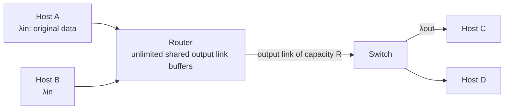

*Figure 1. Scenario 1: two connections (A to C and B to D) sharing a single hop through a router with infinite buffers*

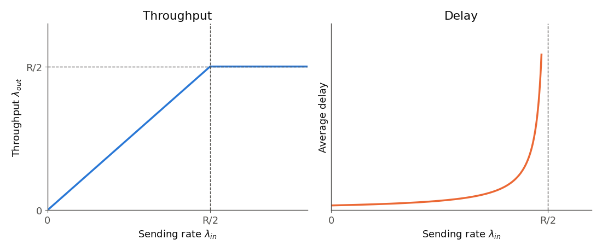

*Figure 2. Per-connection throughput and average delay as a function of the sending rate in Scenario 1*

The left graph of Figure 2 plots the per-connection throughput, the number of bytes per second at the receiver, as a function of the sending rate. For a sending rate between 0 and R/2, the throughput at the receiver equals the sending rate: everything the sender sends is received with a finite delay. When the sending rate is above R/2, the throughput stays at R/2. Because the two connections share the link capacity, the link cannot deliver packets to one receiver at a steady-state rate that exceeds R/2. No matter how high Hosts A and B set their sending rates, neither will see a throughput higher than R/2.

A per-connection throughput of R/2 may seem good, because the link is fully utilized in delivering packets. The right graph, however, shows the price of operating near link capacity. As the sending rate approaches R/2, the average delay becomes larger and larger. When the sending rate exceeds R/2, the average number of packets queued in the router is unbounded, and the average delay between source and destination becomes infinite. This assumes that the connections operate at these rates for an infinite period and that the buffers are infinite. It is the same phenomenon as in Chapter 1, where the average queuing delay grew rapidly as the traffic intensity La/R approached 1. An aggregate throughput near R may be ideal from the throughput standpoint, but it is far from ideal from the delay standpoint.

> **Key Point:** The first cost of congestion is the large queuing delay that arises as the packet-arrival rate nears the link capacity. This cost does not disappear even in the idealized case of infinite buffers.

### 2.2 Scenario 2: Two Senders and a Router with Finite Buffers

Scenario 1 is modified in two ways. First, the router's buffers are finite. As a consequence of this realistic assumption, packets that arrive at an already-full buffer are dropped. Second, each connection is reliable. If a packet containing a transport-layer segment is dropped at the router, the sender eventually retransmits it. Because packets can be retransmitted, the term sending rate must be used more carefully. The rate at which the application sends original data into the socket is again denoted $`\lambda_{in}`$ bytes/sec, and the rate at which the transport layer sends into the network is defined separately.

> **Definition:** **Offered load** is the rate at which the transport layer sends segments into the network, including both original data and retransmitted data. It is written $`\lambda'_{in}`$ bytes/sec to distinguish it from the rate $`\lambda_{in}`$ at which the application sends original data.

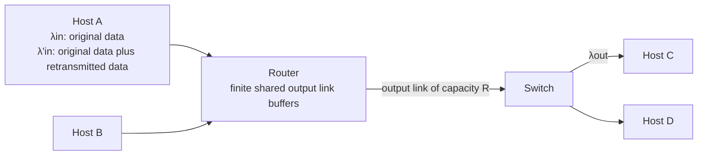

*Figure 3. Scenario 2: two hosts with retransmissions and a router with finite buffers*

The performance in Scenario 2 depends strongly on how retransmission is performed. Figure 4 shows three cases.

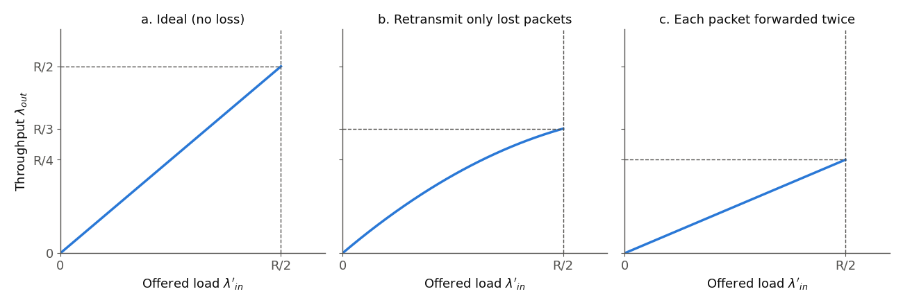

*Figure 4. Throughput as a function of offered load in Scenario 2: the ideal case without loss, retransmission of lost packets only, and every packet forwarded twice*

**(a) The ideal case without loss.** Suppose, unrealistically, that Host A can somehow determine whether a buffer in the router is free and sends a packet only when one is free. Then no loss occurs, $`\lambda_{in}`$ equals $`\lambda'_{in}`$, and the throughput of the connection equals $`\lambda_{in}`$. Since everything sent is received, the performance is ideal from the throughput standpoint. Because packet loss is assumed never to occur, the average host sending rate cannot exceed R/2.

**(b) Retransmission only when loss is certain.** Slightly more realistically, suppose that the sender retransmits only when a packet is known for certain to be lost. This assumption is also a bit of a stretch, but if the sending host sets its timeout large enough, a packet that has not been acknowledged can be considered almost certainly lost. If the rate at which data are delivered to the receiving application is R/3 when the offered load $`\lambda'_{in}`$ is R/2, then of the 0.5R that the sender transmits, on average R/3 ≈ 0.333R bytes/sec are original data and the remaining R/6 ≈ 0.167R bytes/sec are retransmitted data. The sender must perform retransmissions to compensate for packets dropped because of buffer overflow, and that much link capacity is not used for delivering new data.

**(c) Unneeded retransmission caused by premature timeouts.** Finally, suppose that the sender may time out prematurely and retransmit a packet that has been delayed in the queue but not lost. In this case both the original packet and the retransmission may reach the receiver. The receiver needs only one copy and discards the retransmission. The work the router did in forwarding the retransmitted copy was wasted; it would have been better to use that link transmission capacity to send a different packet. If the router is assumed to forward every packet twice on average, only half of the per-connection forwarding capacity of R/2 is useful, so the throughput approaches R/4 as the offered load approaches R/2.

> **Key Point:** The second cost of congestion is the retransmission needed to compensate for packets lost to buffer overflow. The third cost is that unneeded retransmissions by the sender in the face of large delays make routers use link bandwidth to forward useless copies of packets.

### 2.3 Scenario 3: Four Senders and Multihop Paths

In the final scenario, four hosts transmit packets, each over overlapping two-hop paths. Assume that every host implements reliable data transfer with timeouts and retransmissions, that all hosts have the same value of $`\lambda_{in}`$, and that all router links have capacity R bytes/sec. The four routers R1, R2, R3, and R4 are connected in a ring, and each host is attached to the link between two neighboring routers.

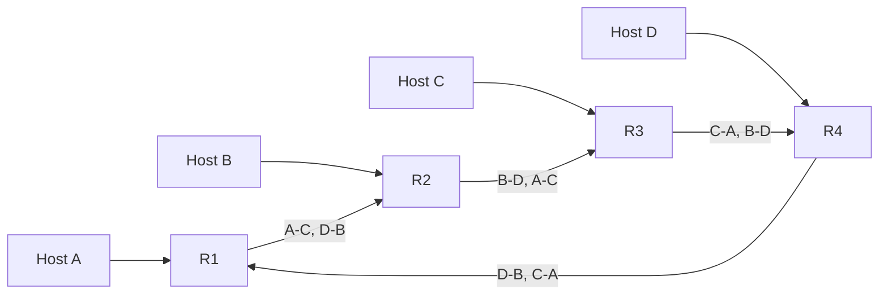

*Figure 5. Scenario 3: four routers in a ring and overlapping two-hop paths*

The labels on the arrows in Figure 5 are the connections that traverse each link. For example, the A-C connection from Host A to Host C passes through R1 and R2 and then reaches Host C, which is attached to the link between R2 and R3. The A-C connection therefore shares router R1 with the D-B connection and shares router R2 with the B-D connection. Each connection competes with one connection at its first hop and with another at its second hop.

**When traffic is very light.** For extremely small values of $`\lambda_{in}`$, buffer overflows are rare, as in Scenarios 1 and 2, and the throughput approximately equals the offered load. For slightly larger values of $`\lambda_{in}`$, more original data are transmitted into the network and delivered to the destination while overflows are still rare, so the throughput is also larger. That is, for small values of $`\lambda_{in}`$, an increase in $`\lambda_{in}`$ results in an increase in $`\lambda_{out}`$.

**When traffic is very heavy.** Now suppose that $`\lambda_{in}`$, and hence $`\lambda'_{in}`$, is extremely large. Consider router R2. The A-C traffic arriving at R2 after being forwarded from R1 can have an arrival rate at R2 of at most R, the capacity of the link from R1 to R2, regardless of the value of $`\lambda_{in}`$. If $`\lambda'_{in}`$ is extremely large for all connections, on the other hand, the arrival rate at R2 of the B-D traffic, which uses R2 as its first hop, can be much larger than that of the A-C traffic. Because the A-C and B-D traffic compete at R2 for the limited buffer space, the amount of A-C traffic that successfully passes through R2 becomes smaller and smaller as the offered load from B-D grows. In the limit, as the offered load approaches infinity, an empty buffer slot at R2 is immediately filled by a B-D packet, and the throughput of the A-C connection at R2 goes to zero. The end-to-end throughput of the A-C connection therefore goes to zero in the limit of heavy traffic.

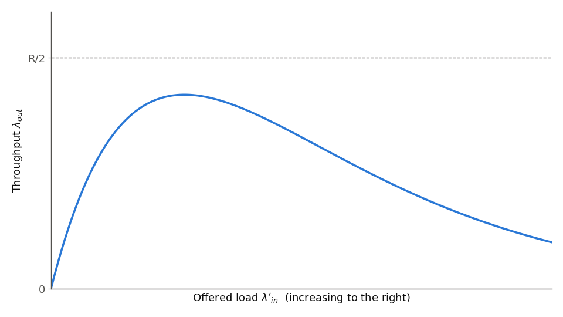

*Figure 6. Schematic of throughput as a function of offered load in Scenario 3*

The reason for the eventual decrease in throughput with increasing offered load becomes clear when one considers the wasted work done by the network. In heavy traffic, whenever a packet is dropped at a second-hop router, the work done by the first-hop router in forwarding that packet to the second-hop router ends up wasted. The network would have been equally well off if the first router had simply discarded the packet and remained idle; more accurately, it would have been equally badly off. The transmission capacity the first router used to forward the packet could have been used much more profitably to transmit a different packet. For example, when selecting a packet for transmission, it might be better for a router to give priority to packets that have already traversed some number of upstream routers. This phenomenon, in which the throughput falls toward zero as the offered load increases, is called **congestion collapse**, and it is the collapse of the system mentioned in Section 1.3.

> **Key Point:** The fourth cost of congestion is that when a packet is dropped along a path, the transmission capacity used at each upstream link to forward that packet to the point at which it is dropped is wasted.

### 2.4 Summary of the Costs of Congestion

| Cost | Scenario in which it appears | Description |
|:-----|:-----|:-----|
| Large queuing delay | Scenario 1 | The average delay grows rapidly as the arrival rate nears the link capacity and becomes infinite above R/2 |
| Retransmission to compensate for loss | Scenario 2 (b) | Link capacity is spent retransmitting dropped packets, so the throughput is only R/3 at an offered load of R/2 |
| Unneeded retransmission | Scenario 2 (c) | Premature timeouts cause copies of merely delayed packets to be forwarded, so the throughput approaches R/4 |
| Wasted upstream transmission capacity | Scenario 3 | The upstream link capacity used by a packet dropped along the path is wasted, so the throughput can approach zero |

*Table 2. The costs of congestion revealed by the three scenarios*

---

<br>

## 3. Approaches to Congestion Control

Congestion-control approaches can be classified by several criteria. Kurose and Ross classify them by whether the network layer provides explicit assistance for congestion control, and Forouzan classifies them by whether they prevent congestion before it happens or remove it after it has happened. The two classifications take different viewpoints, so both should be known.

### 3.1 End-to-End and Network-Assisted Congestion Control

- **End-to-end congestion control.** The network layer provides no explicit support to the transport layer for congestion control. Even the presence of congestion must be inferred by the end systems based only on observed network behavior, for example packet loss and delay. TCP takes this approach (Section 4), since the IP layer is not required to provide feedback to hosts about congestion. TCP takes segment loss, indicated by a timeout or three duplicate ACKs, as an indication of network congestion and decreases its window size accordingly. Approaches that use increasing round-trip delay as an indicator of increasing congestion have also been proposed (TCP Vegas in Section 8.1).
- **Network-assisted congestion control.** Routers provide explicit feedback to the sender, the receiver, or both about the congestion state of the network. The feedback may be as simple as a single bit indicating congestion at a link, an approach taken in the early IBM SNA, DEC DECnet, and ATM network architectures. More sophisticated feedback is also possible. In ATM ABR (Available Bit Rate) congestion control, for example, a router informs the sender of the maximum sending rate it can support on an outgoing link. The Internet-default versions of IP and TCP take the end-to-end approach, but more recently IP and TCP may also optionally implement network-assisted congestion control (ECN in Section 10).

In network-assisted congestion control, congestion information is fed back to the sender in one of two ways. The first is direct feedback sent from a router to the sender. This notification typically takes the form of a choke packet, essentially saying "I am congested!" (Section 3.3). The second, more common, way is for a router to mark a field in a packet flowing from the sender to the receiver to indicate congestion. On receiving a marked packet, the receiver notifies the sender of the congestion. This second form of notification takes a full round-trip time to reach the sender.

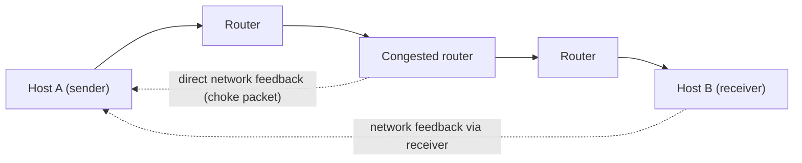

*Figure 7. Two pathways along which network-indicated congestion information returns to the sender*

| Aspect | End-to-end congestion control | Network-assisted congestion control |
|:-----|:-----|:-----|
| Support from the network layer | None | Routers explicitly report the congestion state |
| How congestion is learned | End systems infer it by observing loss and delay | Congestion bit, maximum sending rate, choke packet, packet marking |
| Examples | Internet-default TCP | IBM SNA, DECnet, ATM ABR, ECN in TCP/IP |

*Table 3. End-to-end and network-assisted congestion control*

### 3.2 Open-Loop Congestion Control

> **Definition:** **Open-loop congestion control** is congestion control that applies policies decided in advance to prevent congestion before it happens. The policies are applied by either the source or the destination.

Forouzan lists three policies at the transport layer that affect congestion.

- **Retransmission policy.** If the sender feels that a sent packet is lost or corrupted, the packet must be retransmitted, so retransmission is sometimes unavoidable. Retransmission in general may increase congestion in the network, but a good retransmission policy can prevent congestion. The retransmission policy and the retransmission timers must be designed to optimize efficiency and at the same time prevent congestion. The premature timeouts of Section 2.2 (c) are an example of a bad policy, and estimating the RTT to set the retransmission timeout (Chapter 8) is the remedy.
- **Window policy.** The type of window at the sender also affects congestion. For congestion control, the Selective Repeat window is better than the Go-Back-N window. When one packet is lost, Go-Back-N resends all the packets sent after it even if they arrived safely at the receiver (Chapter 7), and these unneeded retransmissions add to the load on the network.
- **Acknowledgment policy.** The acknowledgment policy imposed by the receiver also affects congestion. If the receiver does not acknowledge every packet it receives, it may slow down the sender and help prevent congestion. A receiver may send an acknowledgment only when it has a packet to send or when a special timer expires, or it may acknowledge only once every N packets. Acknowledgments are also part of the load on a network, so sending fewer acknowledgments imposes less load. The delayed and cumulative acknowledgments of Chapter 8 are examples of this policy.

### 3.3 Closed-Loop Congestion Control

> **Definition:** **Closed-loop congestion control** is congestion control that alleviates congestion after it happens by detecting it and adjusting the sending rate according to feedback.

Various protocols have used various closed-loop mechanisms. The mechanism at the transport layer is to make the size of the sender's window flexible. One factor that can determine the size of the send window is congestion in the Internet. The sending transport layer can monitor congestion in the Internet by watching for lost packets and use a strategy of decreasing the window size when congestion increases and increasing it when congestion decreases. How TCP uses this strategy to control its window size is covered in Sections 4 through 7.

Forouzan also introduces ways to control congestion at the network layer of a connectionless network.

- **Backward signaling.** A bit is set in a datagram moving in the direction opposite to the congested direction to inform the sender that congestion has occurred and that it should slow down the sending of packets. The bit can be set in the response to a packet or in a packet that acknowledges a packet.
- **Forward signaling.** When the network layer uses no feedback (acknowledgment) but the upper layer does, a bit is set in a packet traveling in the direction of the congestion to warn the receiver of the packet. The receiver informs the upper-layer protocol, which in turn informs the source. The Internet network layer as Forouzan describes it used neither forward nor backward signaling, but ECN in Section 10 works with the same structure as forward signaling.
- **Choke packet.** A special packet sent to the sender by a router that encounters congestion.
- **Dropping by importance.** A field in the packet header indicates how important a datagram is within the whole message. When a congested router must drop packets, it drops the packets marked as less important first. For example, when an image is sent in many packets, the packets for the corners may be less important than those for the middle. If a congested router drops the less important packets, the quality of the image does not change much.

> **Definition:** A **choke packet** is a special packet that a congested router sends directly to the sender to announce the congestion and make the sender reduce its sending rate.

Forouzan explains that the Internet network layer implements the choke-packet approach with the auxiliary protocol ICMP, so that a congested router can send the source an ICMP packet telling it to slow down. This ICMP message and its current status are covered in Chapter 16.

| Technique | Direction of the congestion signal | Description |
|:-----|:-----|:-----|
| Adjusting the send window | The sender itself, which observes loss | Shrinks the window when loss increases and grows it when loss decreases (TCP) |
| Backward signaling | From the point of congestion toward the sender | A bit in a datagram going the opposite way informs the sender |
| Forward signaling | From the point of congestion toward the receiver, then from the receiver to the sender | A bit in a packet going toward the congestion warns the receiver, and the upper layer informs the source |
| Choke packet | Directly from the congested router to the sender | The router creates and sends a special packet |
| Dropping by importance | No signal | The congested router drops less important packets first |

*Table 4. Closed-loop congestion-control techniques*

> **Note:** The two feedback pathways of Kurose and Ross correspond to Forouzan's classification as follows. The direct network feedback of Figure 7 corresponds to a choke packet, and network feedback via the receiver corresponds to forward signaling. Backward signaling differs from a choke packet in that the router does not create a separate packet but marks an existing packet traveling in the opposite direction.

### 3.4 Congestion Control in a Connection-Oriented Network

It is sometimes easier to control congestion in a connection-oriented network than in a connectionless one. One method is to create an extra virtual circuit when an area becomes congested, but this may create more problems for some routers. A better solution is advance negotiation during the setup phase. The sender and the receiver can agree on a level of traffic when they set up the virtual circuit, and that level can be dictated by the routers that allow the establishment of the virtual circuit. That is, a router compares the existing traffic with its maximum capacity to decide whether to allow a new virtual circuit to be created. Virtual-circuit setup is covered in Chapter 10.

---

<br>

## 4. Basics of TCP Congestion Control

As seen in Chapter 8, TCP provides a reliable transport service between two processes running on different hosts. Another key component of TCP is its congestion-control mechanism. Because the IP layer provides no explicit feedback to end systems about network congestion, TCP must use end-to-end congestion control rather than network-assisted congestion control. In Forouzan's terms, TCP congestion control is based on both open-loop and closed-loop mechanisms: it uses a congestion window and a congestion policy to avoid congestion, and to detect and alleviate congestion after it has occurred.

The approach taken by TCP is to have each sender limit the rate at which it sends traffic into its connection as a function of perceived network congestion. If a sender perceives little congestion on the path to the destination, it increases its sending rate; if it perceives congestion on the path, it reduces its sending rate. This approach raises three questions. First, how does a TCP sender limit the rate at which it sends traffic into its connection? Second, how does a TCP sender perceive that there is congestion on the path between itself and the destination? Third, what algorithm should the sender use to change its sending rate as a function of perceived end-to-end congestion? Sections 4.1, 4.2, and 4.3 answer these questions in turn.

### 4.1 The Congestion Window

As seen in Chapter 8, each side of a TCP connection consists of a receive buffer, a send buffer, and several variables (LastByteRead, rwnd, and so on). The TCP congestion-control mechanism operating at the sender keeps track of one more variable.

> **Definition:** The **congestion window (cwnd)** is a variable that a TCP sender adjusts according to the congestion state of the network, imposing a constraint on the rate at which the sender sends traffic into the network. The amount of unacknowledged data may not exceed the minimum of cwnd and rwnd.

```math
\text{LastByteSent} - \text{LastByteAcked} \leq \min\{\text{cwnd}, \text{rwnd}\}
```

Forouzan expresses the same idea by saying that the actual window size is the minimum of the window size advertised by the receiver and the congestion window size (Chapter 8).

```math
\text{actual window size} = \min(\text{rwnd}, \text{cwnd})
```

To focus on congestion control rather than flow control, this chapter assumes that the TCP receive buffer is so large that the receive-window constraint can be ignored. The amount of unacknowledged data at the sender is then limited solely by cwnd. It is also assumed that the sender always has data to send, so all segments in the congestion window are sent.

The constraint above limits the amount of unacknowledged data at the sender and therefore indirectly limits the sender's sending rate. For a connection whose loss and packet transmission delays are negligible, roughly at the beginning of every RTT the sender may send cwnd bytes of data into the connection, and at the end of the RTT it receives acknowledgments for the data. The sender's sending rate is therefore roughly as follows.

```math
\text{sending rate} \approx \frac{\text{cwnd}}{RTT} \ \text{bytes/sec}
```

For example, if the MSS is 1,460 bytes, cwnd is 10 MSS (14,600 bytes), and the RTT is 100 ms, the sending rate is about 14,600 × 8 / 0.1 = 1,168,000 bps, or about 1.17 Mbps. By adjusting the value of cwnd, the sender can adjust the rate at which it sends data into its connection.

### 4.2 Loss Events and Self-Clocking

Next consider how a TCP sender perceives congestion on the path. At a TCP sender, a **loss event** is the occurrence of either a timeout or the receipt of three duplicate ACKs from the receiver (Chapter 8). When there is excessive congestion, one or more router buffers along the path overflow, causing a datagram containing a TCP segment to be dropped. The dropped datagram in turn results in a loss event at the sender, which the sender takes as an indication of congestion on the sender-to-receiver path. Forouzan stresses that a major assumption of TCP is that the only way a sender can guess that congestion has occurred is the need to retransmit a segment. A needed retransmission is assumed to mean that a router overloaded with too many incoming packets dropped the segment.

Conversely, when the network is free of congestion and no loss event occurs, acknowledgments for previously unacknowledged segments arrive at the sender. TCP takes the arrival of acknowledgments as an indication that the segments being transmitted are being successfully delivered to the destination, and uses the acknowledgments to increase its congestion window and hence its sending rate. If acknowledgments arrive at a relatively slow rate, for example because the end-to-end path has high delay or contains a low-bandwidth link, the congestion window increases at a relatively slow rate. If acknowledgments arrive at a high rate, the congestion window increases more quickly.

> **Definition:** **Self-clocking** is the property that TCP uses the arrival of acknowledgments as a clock that triggers increases of its congestion window. On a path whose acknowledgments arrive quickly the window grows quickly, and on a path whose acknowledgments arrive slowly it grows slowly.

### 4.3 Three Guiding Principles of TCP Congestion Control

Even with a mechanism that adjusts the sending rate through cwnd, the critical question remains: at what rate should a TCP sender send? If TCP senders collectively send too fast, they can congest the network and cause congestion collapse like that of Section 2.3. Indeed, the version of TCP covered in this chapter was developed in response to Internet congestion collapse observed under earlier versions of TCP. If TCP senders are too cautious and send too slowly, however, they underutilize the bandwidth of the network; that is, they could have sent at a higher rate without congesting the network but failed to do so. How then do TCP senders determine their sending rates so that they do not congest the network but use all the available bandwidth? Are TCP senders explicitly coordinated, or is there a distributed approach in which each sender sets its rate based only on local information? TCP answers these questions with the following guiding principles.

1. **A lost segment implies congestion, so the sender's rate should be decreased when a segment is lost.** A timeout event, or the receipt of four acknowledgments for a given segment (one original ACK and three duplicate ACKs), is interpreted as an implicit loss event for the segment following the quadruply acknowledged segment, triggering its retransmission. From the congestion-control standpoint, the question is how much the sender should decrease its congestion window, and hence its sending rate, in response to this loss event.
2. **An acknowledged segment indicates that the network is delivering the sender's segments to the receiver, so the sender's rate can be increased when an ACK arrives for a previously unacknowledged segment.** The arrival of acknowledgments is an implicit indication that segments are being successfully delivered from sender to receiver and that the network is not congested.
3. **Bandwidth probing.** Since ACKs indicate a congestion-free path and loss events indicate a congested path, TCP increases its sending rate in response to arriving ACKs until a loss event occurs, at which point it decreases the rate. The TCP sender thus increases its rate to probe for the rate at which congestion onset begins, backs off from that rate, and then begins probing again to see whether the congestion onset rate has changed. The behavior resembles that of a child who asks for more and more treats until finally told "No!", backs off a bit, and soon begins asking again.

The network gives no explicit signal of its congestion state. ACKs and loss events serve as implicit signals, and each TCP sender acts on local information asynchronously from other TCP senders.

### 4.4 Components of the Algorithm

The TCP congestion-control algorithm has three major components.

| Component | Required or not | How cwnd increases | Section |
|:-----|:-----|:-----|:-----|
| Slow start | Mandatory | 1 MSS per new ACK, doubling every RTT (exponential increase) | Section 5 |
| Congestion avoidance | Mandatory | 1 MSS every RTT (additive increase) | Section 6 |
| Fast recovery | Recommended (not required) | 1 MSS per duplicate ACK for the missing segment | Section 7 |

*Table 5. The three components of the TCP congestion-control algorithm*

Slow start and congestion avoidance are mandatory components of TCP and differ in how they increase cwnd in response to received ACKs. Despite its name, slow start increases cwnd more rapidly than congestion avoidance. Fast recovery is recommended, but not required, for TCP senders.

Forouzan describes TCP's congestion policy in three phases: slow start, congestion avoidance, and congestion detection. In the slow-start phase the sender starts with a slow rate of transmission but increases the rate rapidly until it reaches a threshold. When the threshold is reached, the rate of increase is reduced. If congestion is detected, the sender goes back to the slow-start or the congestion-avoidance phase depending on how the congestion was detected. Forouzan's congestion-detection phase corresponds to the reaction to loss events in Kurose and Ross, and Section 7.4 compares the two descriptions.

---

<br>

## 5. Slow Start

### 5.1 Exponential Increase

> **Definition:** **Slow start** is the phase of TCP congestion control that, when a connection begins or after a timeout, starts cwnd at 1 MSS and increases it by 1 MSS for every segment that is first acknowledged, thereby doubling it every RTT.

When a TCP connection begins, cwnd is typically initialized to a small value of 1 MSS, so the initial sending rate is roughly MSS/RTT. For example, if the MSS is 500 bytes and the RTT is 200 ms, the initial sending rate is only 500 × 8 / 0.2 = 20,000 bps, or about 20 kbps. The bandwidth available to the TCP sender may be much larger than MSS/RTT, so the sender would like to find the available bandwidth quickly. In the slow-start state, therefore, cwnd begins at 1 MSS and increases by 1 MSS every time a transmitted segment is first acknowledged. The name slow start refers to starting slowly with a small window; once started, the growth is fast.

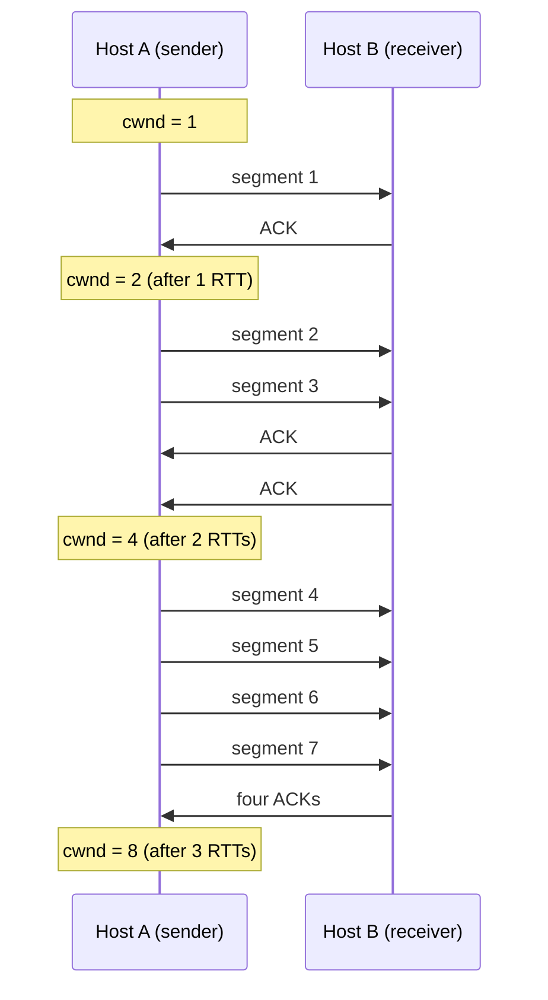

*Figure 8. Slow start: the congestion window doubles every RTT*

In Figure 8, TCP sends the first segment into the network and waits for an acknowledgment. When this acknowledgment arrives, it increases the congestion window by 1 MSS and sends two maximum-sized segments. When these two segments are acknowledged, it increases the congestion window by 1 MSS for each acknowledged segment, giving a congestion window of 4 MSS, and so on. This process doubles the sending rate every RTT. The TCP sending rate thus starts slow but grows exponentially during the slow-start phase. Forouzan summarizes the process per RTT, assuming that rwnd is much larger than cwnd so that the send window always equals cwnd, and ignoring the delayed-ACK policy so that each segment is acknowledged individually.

| Time | cwnd (MSS) | Power of 2 |
|:-----|:-----|:-----|
| Start | 1 | $`2^0`$ |
| After 1 RTT | 1 × 2 = 2 | $`2^1`$ |
| After 2 RTTs | 2 × 2 = 4 | $`2^2`$ |
| After 3 RTTs | 4 × 2 = 8 | $`2^3`$ |

*Table 6. The congestion window per RTT during slow start*

In general, if slow start continues for n RTTs, cwnd becomes $`2^n`$ MSS. For example, since $`2^5 = 32`$, it takes only 5 RTTs for cwnd to grow from 1 MSS to 32 MSS.

### 5.2 Delayed Acknowledgments and Slow Start

Forouzan points out that slow start is slower when delayed acknowledgments (Chapter 8) are used. Since cwnd increases by only 1 MSS per ACK, if three segments are acknowledged by one cumulative acknowledgment, cwnd increases by 1 MSS, not 3 MSS. The growth is still exponential, but it is not a doubling every RTT. If one ACK is sent for every two segments, then when cwnd is w MSS, w/2 ACKs arrive during one RTT, so cwnd becomes w + w/2 = 1.5w. That is, the growth factor is close to 1.5 per RTT. For example, if cwnd is 8 MSS, it becomes 12 MSS after the next RTT and 18 MSS after the one after that.

### 5.3 Three Ways Slow Start Ends

When should this exponential growth end? Slow start provides three answers. Two of them need one more variable.

> **Definition:** The **slow-start threshold (ssthresh)** is a state variable kept by a TCP sender; when cwnd reaches this value, slow start ends and congestion avoidance begins. When a loss event occurs, it is set to half of the cwnd at that time.

1. **Timeout.** If a loss event, that is, congestion, is indicated by a timeout, the TCP sender sets ssthresh to cwnd/2, half of the value of the congestion window when congestion was detected, sets cwnd to 1 MSS, and begins the slow-start process anew.
2. **cwnd reaches ssthresh.** Since ssthresh is half of cwnd when congestion was last detected, it would be reckless to keep doubling cwnd once it reaches or surpasses ssthresh. So when cwnd equals ssthresh, slow start ends and TCP transitions into congestion-avoidance mode (Section 6).
3. **Three duplicate ACKs.** If three duplicate ACKs are detected, TCP performs a fast retransmit (Chapter 8) and enters the fast-recovery state (Section 7.1).

The FSM of Kurose and Ross (Section 7.2) sets the initial ssthresh to 64 KB. Forouzan's example (Section 7.4) sets the initial threshold to half of the maximum window size. When a connection starts, it has not yet experienced congestion, so the initial ssthresh is a large value; only after the first loss event does it reflect the state of the network.

> **Key Point:** In slow start, the congestion window increases exponentially until it reaches the threshold.

---

<br>

## 6. Congestion Avoidance

### 6.1 Additive Increase

> **Definition:** **Congestion avoidance** is the phase of TCP congestion control that, once cwnd has reached ssthresh, increases cwnd by only 1 MSS every RTT.

On entry to the congestion-avoidance state, the value of cwnd is approximately half its value when congestion was last encountered. Congestion could be just around the corner. So rather than doubling cwnd every RTT, TCP adopts a more conservative approach and increases cwnd by just one MSS every RTT. This can be accomplished in several ways, and a common approach is to increase cwnd by the following amount whenever a new acknowledgment arrives.

```math
\text{cwnd} = \text{cwnd} + \text{MSS} \cdot \frac{\text{MSS}}{\text{cwnd}}
```

For example, if the MSS is 1,460 bytes and cwnd is 14,600 bytes, 10 segments are sent within an RTT. Assuming one ACK per segment, each arriving ACK increases the congestion window by 1/10 MSS, that is, 1,460 × 1,460 / 14,600 = 146 bytes. The congestion window has therefore increased by one MSS after the ACKs for all 10 segments have been received.

Forouzan describes the same behavior in units of windows. A window is the number of segments transmitted during one RTT, and each time the whole window of segments is acknowledged, the congestion window is increased by one. The increase is thus based on the RTT, not on the number of arriving ACKs. If slow start ended at cwnd = i, cwnd grows additively per RTT as follows.

```math
\text{start: } i, \quad \text{after 1 RTT: } i + 1, \quad \text{after 2 RTT: } i + 2, \quad \text{after 3 RTT: } i + 3
```

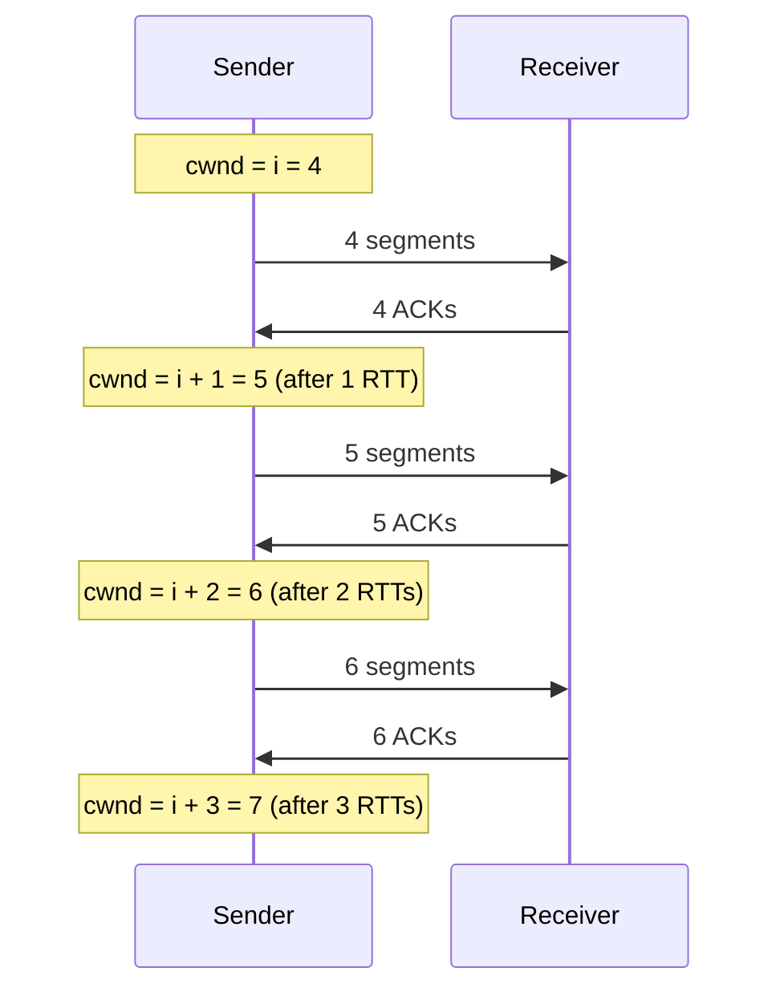

*Figure 9. Congestion avoidance: the congestion window grows by one every RTT*

> **Key Point:** In congestion avoidance, the congestion window increases additively until congestion is detected.

### 6.2 Loss During Congestion Avoidance

The linear increase of congestion avoidance ends when a loss event occurs, and the reaction depends on the kind of loss event.

- **Timeout.** TCP reacts exactly as in slow start. It sets cwnd to 1 MSS, updates ssthresh to half of cwnd when the loss event occurred, and goes to the slow-start state.
- **Three duplicate ACKs.** In this case the network is continuing to deliver the sender's segments to the receiver, as the receipt of duplicate ACKs shows. TCP's reaction is therefore less drastic than with a timeout-indicated loss. TCP records ssthresh as half of cwnd when the three duplicate ACKs were received, sets cwnd to that half plus 3 MSS, and enters the fast-recovery state. The 3 MSS are added to account for the three duplicate ACKs received; each duplicate ACK means that one segment has arrived at the receiver and left the network.

```math
\text{ssthresh} = \frac{\text{cwnd}}{2}, \qquad \text{cwnd} = \text{ssthresh} + 3 \cdot \text{MSS}
```

Forouzan explains the difference between the two cases in terms of the likelihood of congestion. When a timeout occurs, a segment has probably been dropped in the network and there is no news about the segments sent after it, so there is a stronger possibility of congestion, and TCP reacts strongly. When three duplicate ACKs are received, a segment may have been dropped but some segments after it have arrived safely, so there is a weaker possibility of congestion, and TCP reacts weakly.

---

<br>

## 7. Fast Recovery and the Complete Algorithm

### 7.1 Fast Recovery

> **Definition:** **Fast recovery** is the phase of TCP congestion control in which a sender that has detected loss through three duplicate ACKs does not return to slow start but increases cwnd by 1 MSS for every duplicate ACK for the missing segment, and when the ACK for the missing segment arrives, reduces cwnd to ssthresh and moves to congestion avoidance.

In fast recovery, cwnd is increased by 1 MSS for every duplicate ACK received for the missing segment that caused TCP to enter the fast-recovery state. Each duplicate ACK means that one more segment has left the network, so the sender can send new segments as the enlarged window allows. Eventually, when an ACK arrives for the missing segment, TCP deflates cwnd to ssthresh and enters the congestion-avoidance state. If a timeout occurs during fast recovery, TCP performs the same actions as in slow start and congestion avoidance and goes to the slow-start state: cwnd is set to 1 MSS, and ssthresh is set to half of cwnd when the loss event occurred.

For example, if three duplicate ACKs arrive when cwnd is 12 MSS, ssthresh = 12/2 = 6 MSS and cwnd = 6 + 3 = 9 MSS, and TCP enters the fast-recovery state. If two more duplicate ACKs arrive, cwnd becomes 11 MSS. When a new ACK acknowledging the missing segment then arrives, cwnd is reduced to ssthresh, 6 MSS, and in congestion avoidance it becomes 7 MSS after the next RTT.

### 7.2 The FSM of TCP Congestion Control

Figure 10 is the FSM of TCP congestion control, including slow start, congestion avoidance, and fast recovery. Each transition is written as "event / actions." When a state has several transitions back to itself, the renderer draws only one of them, so such transitions are written together on one arrow, separated by line breaks.

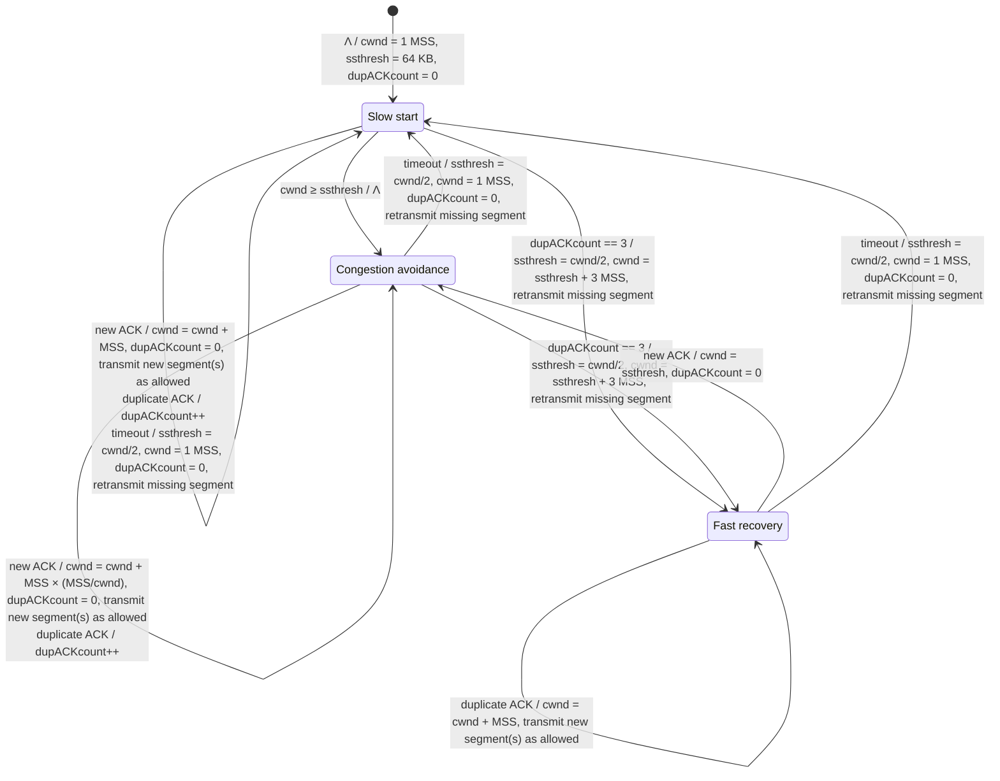

*Figure 10. FSM of TCP congestion control*

| Current state | Event | Actions | Next state |
|:-----|:-----|:-----|:-----|
| (Start) | Connection begins | cwnd = 1 MSS, ssthresh = 64 KB, dupACKcount = 0 | Slow start |
| Slow start | New ACK | cwnd = cwnd + MSS, dupACKcount = 0, transmit new segment(s) as allowed | Slow start |
| Slow start | cwnd ≥ ssthresh | None | Congestion avoidance |
| Congestion avoidance | New ACK | cwnd = cwnd + MSS × (MSS/cwnd), dupACKcount = 0, transmit new segment(s) as allowed | Congestion avoidance |
| Slow start, congestion avoidance | Duplicate ACK | dupACKcount++ | Unchanged |
| Slow start, congestion avoidance | dupACKcount == 3 | ssthresh = cwnd/2, cwnd = ssthresh + 3 MSS, retransmit missing segment | Fast recovery |
| Fast recovery | Duplicate ACK | cwnd = cwnd + MSS, transmit new segment(s) as allowed | Fast recovery |
| Fast recovery | New ACK | cwnd = ssthresh, dupACKcount = 0 | Congestion avoidance |
| Any state | Timeout | ssthresh = cwnd/2, cwnd = 1 MSS, dupACKcount = 0, retransmit missing segment | Slow start |

*Table 7. Transitions of the FSM of TCP congestion control*

The FSM also shows where new or retransmitted segments are sent. A new ACK, and a duplicate ACK during fast recovery, let the sender transmit new segments as the window allows, and a timeout or the third duplicate ACK makes it retransmit the missing segment.

### 7.3 TCP Tahoe and TCP Reno

Fast recovery is a recommended, but not required, component of TCP. An early version, **TCP Tahoe**, unconditionally cut its congestion window to 1 MSS and entered the slow-start phase after either a timeout-indicated or a triple-duplicate-ACK-indicated loss event. The newer version, **TCP Reno**, incorporated fast recovery. Many TCP implementations use the Reno algorithm, and many variations of Reno have been proposed.

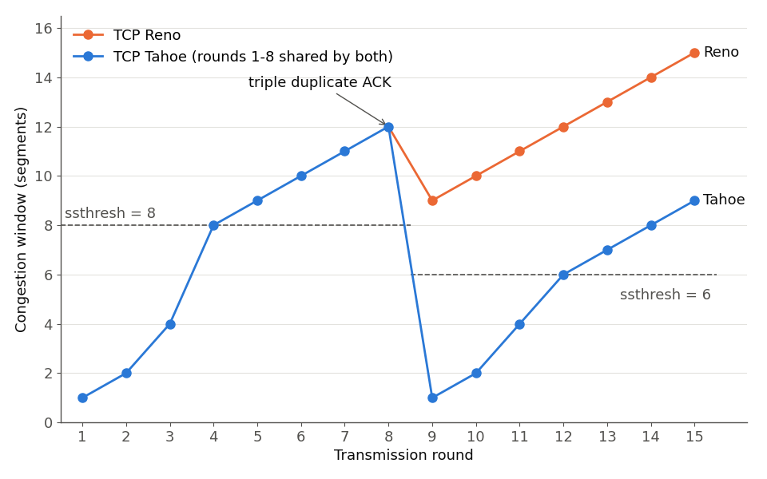

*Figure 11. Evolution of the congestion window per transmission round in TCP Tahoe and TCP Reno*

In Figure 11 the threshold is initially 8 MSS. For the first eight transmission rounds, Tahoe and Reno take identical actions. The congestion window climbs exponentially fast during slow start and hits the threshold at the fourth round, then climbs linearly until a triple-duplicate-ACK event occurs just after round 8. The congestion window is 12 MSS when this loss event occurs, so ssthresh is set to 0.5 × cwnd = 6 MSS. Under TCP Reno, the congestion window is set to cwnd = 9 MSS and then grows linearly. Under TCP Tahoe, the congestion window is set to 1 MSS and grows exponentially until it reaches ssthresh, after which it grows linearly.

| Round | 1 | 2 | 3 | 4 | 5 | 6 | 7 | 8 | 9 | 10 | 11 | 12 | 13 | 14 | 15 |
|:-----|:-----|:-----|:-----|:-----|:-----|:-----|:-----|:-----|:-----|:-----|:-----|:-----|:-----|:-----|:-----|
| Tahoe | 1 | 2 | 4 | 8 | 9 | 10 | 11 | 12 | 1 | 2 | 4 | 6 | 7 | 8 | 9 |
| Reno | 1 | 2 | 4 | 8 | 9 | 10 | 11 | 12 | 9 | 10 | 11 | 12 | 13 | 14 | 15 |

*Table 8. Congestion window per transmission round (in MSS; initial ssthresh = 8; three duplicate ACKs just after round 8)*

At round 12, Tahoe's cwnd is 6, not 8, twice 4. When cwnd reaches ssthresh = 6 during slow start, slow start ends right there and congestion avoidance begins. For the same reason, the initial slow start reaches exactly ssthresh = 8 at round 4 and then moves to congestion avoidance.

> **Note:** **Two ways of drawing Reno's cwnd.** Figure 11 and Table 8 follow the figure of Kurose and Ross, which, like the sentence above, continues the linear growth directly from ssthresh + 3 MSS = 9 MSS, the value on entry to fast recovery, and so leaves out the step in which fast recovery reduces cwnd. Following the FSM of Figure 10 exactly, cwnd enters fast recovery at 9 MSS, grows by 1 MSS for each further duplicate ACK, and is reduced to ssthresh = 6 MSS when a new ACK acknowledging the missing segment arrives, so congestion avoidance resumes from 6 MSS, not from 9 MSS. Forouzan sets cwnd to the threshold as soon as three duplicate ACKs arrive and enters congestion avoidance (Section 7.4); this equals the value of the FSM after the reduction, and the remark that some implementations add three segments to the threshold corresponds to the value on entry to fast recovery. The FSM is the precise description, and in both the FSM and Forouzan's policy, congestion avoidance after a loss detected by three duplicate ACKs resumes from half of the cwnd just before the loss.

### 7.4 Forouzan's Congestion Policy

Forouzan describes TCP's congestion policy in three phases and treats the reaction to loss events separately as the congestion-detection phase. If congestion occurs, the congestion window size must be decreased. Retransmission occurs in two cases, when the RTO timer times out and when three duplicate ACKs are received, and in both cases the threshold is dropped to half. This is called **multiplicative decrease**. Most TCP implementations have two reactions.

1. **If a time-out occurs**, there is a stronger possibility of congestion, so TCP reacts strongly. (a) It sets the threshold to half of the current window size. (b) It reduces cwnd back to one segment. (c) It starts the slow-start phase again.
2. **If three duplicate ACKs are received**, there is a weaker possibility of congestion, so TCP reacts weakly. Forouzan calls this fast retransmission and fast recovery. (a) It sets the threshold to half of the current window size. (b) It sets cwnd to the threshold; some implementations add three segment sizes to the threshold. (c) It starts the congestion-avoidance phase.

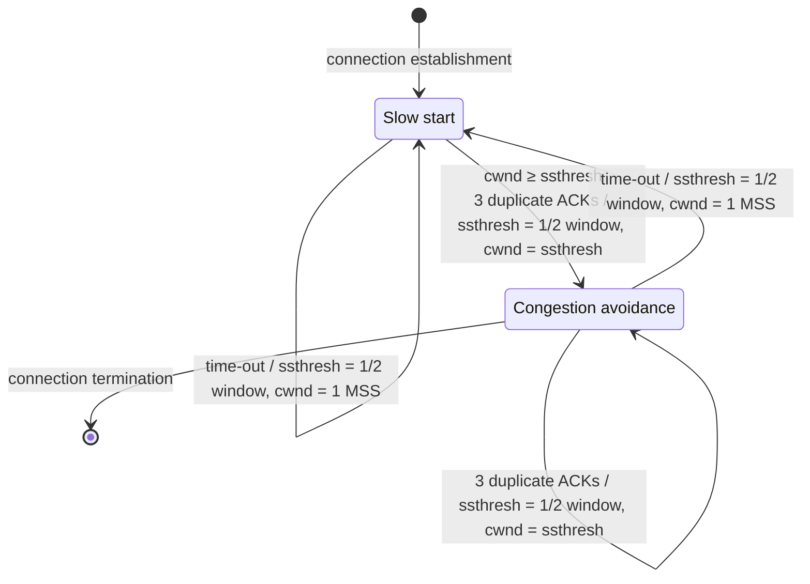

*Figure 12. Summary of Forouzan's TCP congestion policy*

In Forouzan's example, the maximum window size is initially 32 segments, and the threshold is initially set to 16, half of the maximum window size. In the slow-start phase the window size starts from 1 and grows exponentially until it reaches the threshold. Congestion avoidance (additive increase) then lets the window size grow linearly until a time-out occurs when the window size is 20. Multiplicative decrease reduces the threshold to 10, half of the window size at that moment, and TCP starts slow start again from a window size of 1, moving to additive increase when the new threshold is reached. When a three-duplicate-ACK event occurs at a window size of 12, multiplicative decrease again sets both the threshold and the window size to 6, and this time TCP enters the additive-increase phase. TCP remains in this phase until another time-out or another three-duplicate-ACK event occurs.

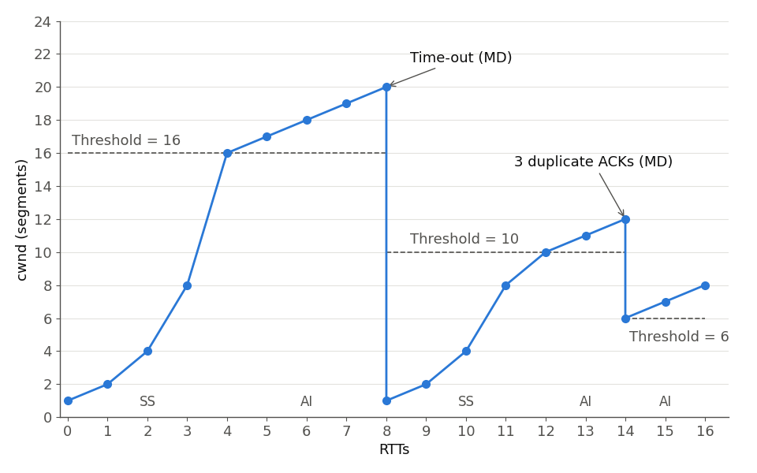

*Figure 13. Evolution of the congestion window per RTT in Forouzan's congestion-control example*

| RTT | 0 | 1 | 2 | 3 | 4 | 5 | 6 | 7 | 8 | 9 | 10 | 11 | 12 | 13 | 14 | 15 | 16 |
|:-----|:-----|:-----|:-----|:-----|:-----|:-----|:-----|:-----|:-----|:-----|:-----|:-----|:-----|:-----|:-----|:-----|:-----|
| cwnd | 1 | 2 | 4 | 8 | 16 | 17 | 18 | 19 | 20 → 1 | 2 | 4 | 8 | 10 | 11 | 12 → 6 | 7 | 8 |
| Threshold | 16 | 16 | 16 | 16 | 16 | 16 | 16 | 16 | 16 → 10 | 10 | 10 | 10 | 10 | 10 | 10 → 6 | 6 | 6 |
| Phase | SS | SS | SS | SS | AI | AI | AI | AI | MD, SS | SS | SS | SS | AI | AI | MD, AI | AI | AI |

*Table 9. Forouzan's congestion-control example (SS: slow start, AI: additive increase, MD: multiplicative decrease)*

At RTT 12, cwnd is 10 rather than 16, twice 8, for the same reason as at round 12 of Table 8: slow start stops at the new threshold of 10.

| Loss event | TCP Tahoe | TCP Reno (FSM of Kurose and Ross) | Forouzan's policy |
|:-----|:-----|:-----|:-----|
| Timeout | ssthresh = cwnd/2, cwnd = 1 MSS, slow start | ssthresh = cwnd/2, cwnd = 1 MSS, slow start | threshold = 1/2 window, cwnd = 1, slow start |
| Three duplicate ACKs | ssthresh = cwnd/2, cwnd = 1 MSS, slow start | ssthresh = cwnd/2, cwnd = ssthresh + 3 MSS, congestion avoidance after fast recovery | threshold = 1/2 window, cwnd = threshold (+ 3 in some implementations), congestion avoidance |

*Table 10. Reactions of TCP Tahoe, TCP Reno, and Forouzan's policy to loss events*

### 7.5 Congestion Control and Error Control

Although it is important to distinguish TCP error control (retransmission) from TCP congestion control, it is also important to appreciate how inextricably the two are linked. The two means by which the error control of Chapter 8 detects loss, timeouts and three duplicate ACKs, are exactly the loss events of congestion control, and as the FSM of Figure 10 shows, the retransmission of the missing segment takes place together with the state transitions of congestion control. The doubling of the timeout interval seen in Chapter 8 is also a limited form of congestion control that retransmits after longer and longer intervals when there is congestion.

> **Note:** **TCP splitting.** Cloud services such as search, e-mail, and social networks need to be highly responsive. If a user is far from the data center that serves the dynamic content of the service, however, the RTT is large, and slow start can make the response time poor. For example, if the server needs three TCP windows during slow start to deliver the response to a search query, the time from when the end system initiates a TCP connection until it receives the last packet of the response is roughly 4 × RTT (one RTT to set up the connection plus three RTTs for the three windows of data) plus the processing time in the data center. One way to reduce this is to deploy front-end servers close to the users and to break the TCP connection at the front-end server. The client establishes a TCP connection to the nearby front-end, and the front-end maintains a persistent TCP connection to the data center with a very large congestion window. The response time then becomes roughly 4 × RTT_FE + RTT_BE + processing time, where RTT_FE is the round-trip time between the client and the front-end and RTT_BE is the round-trip time between the front-end and the data center. If the front-end is close to the client, RTT_FE is negligibly small and RTT_BE is approximately the original RTT, so the response time becomes roughly RTT plus the processing time. For example, if the RTT is 100 ms and RTT_FE is 5 ms, the network delay falls from 4 × 100 = 400 ms to about 4 × 5 + 100 = 120 ms. TCP splitting also reduces the retransmission delays caused by losses in access networks. Servers of the CDNs covered in Chapter 23 are used as such front-ends.

---

<br>

## 8. AIMD and TCP Throughput

### 8.1 AIMD and the Sawtooth

It is worthwhile to step back from the details of slow start, congestion avoidance, and fast recovery and view the whole. Ignoring the initial slow-start period when a connection begins and assuming that losses are indicated by three duplicate ACKs rather than timeouts, TCP congestion control consists of a linear (additive) increase of cwnd by 1 MSS per RTT and a halving (multiplicative decrease) of cwnd on a triple-duplicate-ACK event.

> **Definition:** **AIMD** (additive increase, multiplicative decrease) is a form of congestion control that increases the congestion window by a fixed amount every RTT while there is no loss and decreases it by a fixed factor when a loss event occurs. TCP adds 1 MSS per RTT and halves the window on a loss.

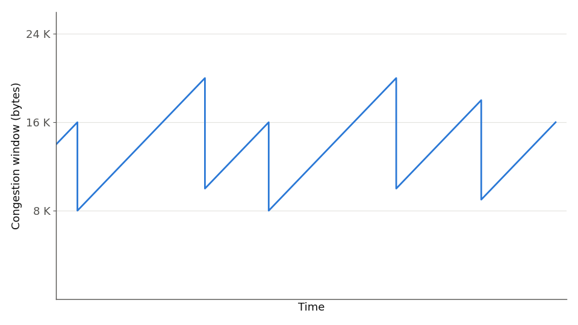

*Figure 14. The sawtooth of the congestion window produced by AIMD congestion control*

AIMD congestion control gives rise to the sawtooth behavior shown in Figure 14, which also illustrates the intuition of bandwidth probing mentioned earlier. TCP increases its congestion window size, and hence its sending rate, linearly until a triple-duplicate-ACK event occurs. It then halves its congestion window but again begins increasing it linearly, probing to see whether there is additional available bandwidth. The height at which loss occurs differs each time because the available bandwidth keeps changing with the traffic of other connections.

TCP's AIMD algorithm was developed from a tremendous amount of engineering insight and experimentation with congestion control in operational networks. Ten years after TCP's development, theoretical analyses showed that TCP's congestion-control algorithm serves as a distributed asynchronous optimization algorithm that simultaneously optimizes several important aspects of user and network performance, and a rich theory of congestion control has since been developed.

> **Note:** **TCP Vegas.** Whereas Reno reacts after experiencing loss, the TCP Vegas algorithm attempts to avoid congestion while maintaining good throughput. Its basic idea is (1) to detect congestion in the routers between source and destination before packet loss occurs, and (2) to lower the sending rate linearly when imminent packet loss is detected. Imminent packet loss is predicted by observing the RTT: the longer the RTT of the packets, the greater the congestion in the routers. This is the delay-based end-to-end congestion control mentioned in Section 3.1.

### 8.2 Long-Term Average Throughput

Given the sawtooth behavior, it is natural to ask what the average throughput, that is, the average rate, of a long-lived TCP connection might be. This analysis ignores the slow-start phases that occur after timeouts, which are typically very short because the sender grows out of them exponentially fast. During a particular round-trip interval, the rate at which TCP sends data is a function of the congestion window and the current RTT. When the window size is w bytes and the current round-trip time is RTT seconds, TCP's transmission rate is roughly w/RTT. TCP then probes for additional bandwidth by increasing w by 1 MSS each RTT until a loss event occurs. Denote by W the value of w when a loss event occurs. Assuming that RTT and W are approximately constant over the duration of the connection, the TCP transmission rate ranges from W/(2 × RTT) to W/RTT.

These assumptions lead to a highly simplified macroscopic model of the steady-state behavior of TCP. The network drops a packet from the connection when the rate increases to W/RTT. The rate is then cut in half and increases by MSS/RTT every RTT until it again reaches W/RTT. This process repeats over and over. Because the throughput increases linearly between the two extreme values, the average throughput is the mean of the two values.

```math
\text{average throughput of a connection} = \frac{1}{2}\left(\frac{W}{2 \cdot RTT} + \frac{W}{RTT}\right) = \frac{0.75 \cdot W}{RTT}
```

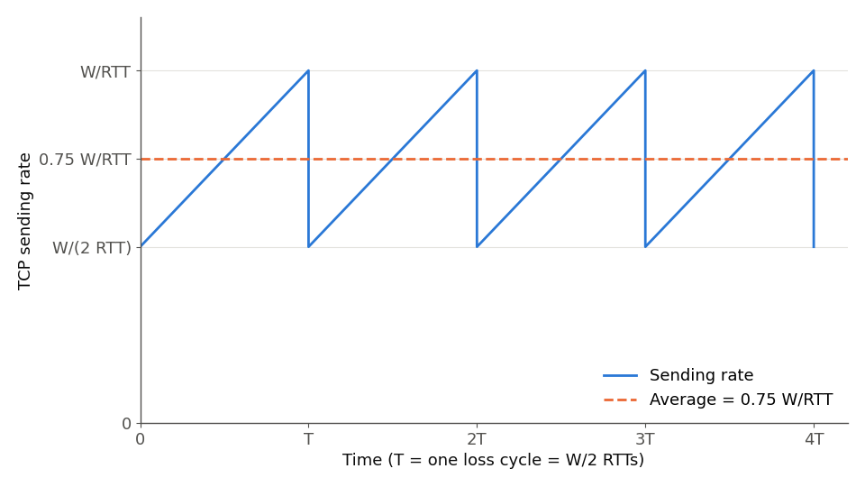

*Figure 15. TCP sending rate and average throughput in the simplified steady-state model*

For example, suppose that the MSS is 1,500 bytes, the window W at loss is 100 segments, and the RTT is 100 ms. The maximum rate W/RTT is 100 × 1,500 × 8 / 0.1 = 12 Mbps, and the rate just after a loss is half of that, 6 Mbps, so the average throughput is 0.75 × 12 = 9 Mbps. Since the window grows by one per RTT from 50 to 100 segments, one sawtooth cycle lasts 50 RTTs, or 5 seconds.

### 8.3 TCP over High-Bandwidth Paths

TCP congestion control has evolved over the years and continues to evolve. What was good for the Internet when the bulk of TCP connections carried SMTP, FTP, and Telnet traffic is not necessarily good for today's HTTP-dominated Internet or for a future Internet with services that are still undreamed of.

The need for continued evolution of TCP can be illustrated by considering the high-speed TCP connections needed for grid- and cloud-computing applications. Suppose that data are to be sent at 10 Gbps through a TCP connection with 1,500-byte segments and a 100 ms RTT. Using the relationship that throughput is the average window divided by the RTT, the average congestion window needed to achieve a throughput of 10 Gbps is as follows.

```math
\bar{w} = \frac{10 \times 10^{9} \times 0.1}{1500 \times 8} \approx 83{,}333 \ \text{segments}
```

With 83,333 segments in flight, it is reasonable to worry about what happens if one of them is lost. Put another way, what fraction of the transmitted segments could be lost while still allowing the TCP congestion-control algorithm of Figure 10 to achieve 10 Gbps? The throughput of a TCP connection as a function of the loss rate L, the round-trip time RTT, and the maximum segment size MSS is as follows.

```math
\text{average throughput of a connection} = \frac{1.22 \cdot MSS}{RTT \sqrt{L}}
```

Solving this formula for L and substituting 10 Gbps gives the tolerable loss rate.

```math
L = \left(\frac{1.22 \cdot MSS}{RTT \cdot \text{throughput}}\right)^{2} = \left(\frac{1.22 \times 12000}{0.1 \times 10^{10}}\right)^{2} \approx 2.1 \times 10^{-10}
```

That is, there may be at most one loss event for about every 4.7 billion segments. Kurose and Ross round this to $`2 \cdot 10^{-10}`$, one loss event for every 5 billion segments. This is a very low rate, so today's TCP congestion-control algorithm has difficulty coping with such high-speed environments. This observation has led a number of researchers to investigate new versions of TCP specifically designed for high-speed environments.

> **Note:** **Deriving the 1.22 × MSS/(RTT √L) formula.** In the model of Section 8.2, express the window as a number of segments W. During one sawtooth cycle the window grows by 1 per RTT from W/2 to W, so the number of segments sent during a cycle is roughly as follows.
>
> ```math
> \frac{W}{2} + \left(\frac{W}{2} + 1\right) + \cdots + W \approx \frac{1}{2}\left(\frac{W}{2} + W\right) \cdot \frac{W}{2} = \frac{3}{8} W^{2}
> ```
>
> One loss occurs per cycle, so the loss rate is $`L = 8/(3W^{2})`$ and $`W = \sqrt{8/(3L)}`$. Substituting this into the average throughput 0.75 × W × MSS/RTT gives the formula above, since $`0.75 \sqrt{8/3} \approx 1.22`$.

---

<br>

## 9. Fairness

### 9.1 Bottleneck Links and Fairness

Consider K TCP connections, each with a different end-to-end path, but all passing through a bottleneck link with transmission rate R bps.

> **Definition:** A **bottleneck link** is the link on a connection's path that becomes congested, while all the other links along that path are not congested and have abundant transmission capacity compared with it.

Suppose each connection is transferring a large file and there is no UDP traffic passing through the bottleneck link. A congestion-control mechanism is said to be **fair** if the average transmission rate of each connection is approximately R/K, that is, if each connection gets an equal share of the link bandwidth.

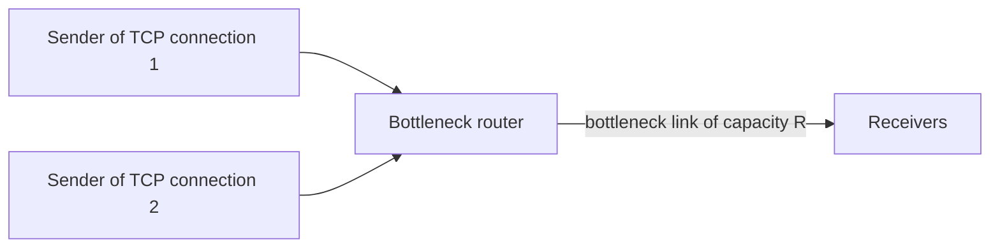

*Figure 16. Two TCP connections sharing a single bottleneck link*

Is TCP's AIMD algorithm fair? The question arises because different TCP connections may start at different times and thus may have different window sizes at a given moment. The next section gives an intuitive explanation of why TCP congestion control converges to an equal share of a bottleneck link's bandwidth among competing TCP connections.

### 9.2 Why AIMD Converges to a Fair Share

Consider the simple case of two TCP connections sharing a single link with transmission rate R, as in Figure 16. Assume that the two connections have the same MSS and RTT, so that equal congestion window sizes give equal throughputs, that both have a large amount of data to send, and that no other TCP connections or UDP datagrams traverse this link. Also ignore the slow-start phase of TCP and assume that the connections operate in congestion-avoidance mode (AIMD) at all times.

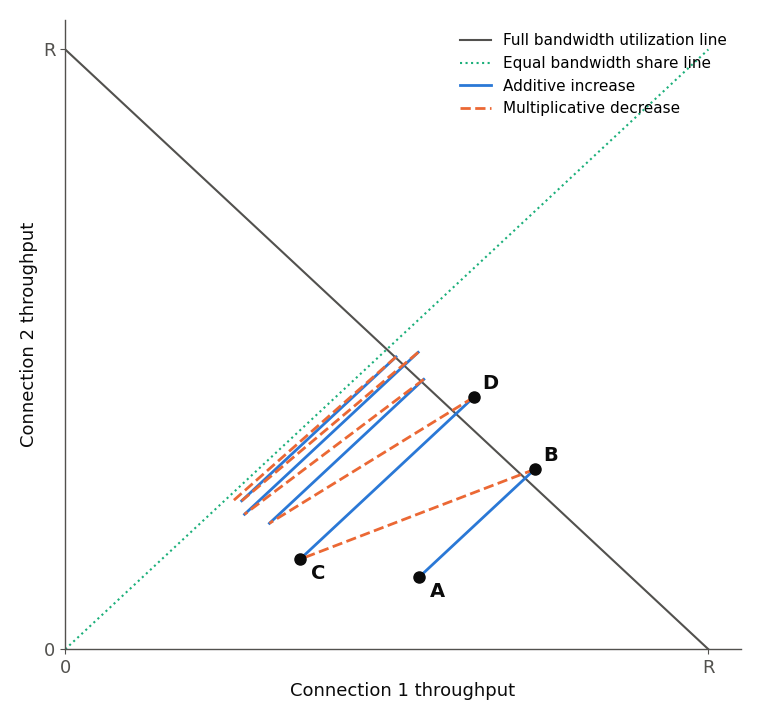

*Figure 17. The throughputs of two TCP connections using AIMD converging to a fair share*

Figure 17 plots the throughputs realized by the two TCP connections. If TCP shares the link bandwidth equally between the two connections, the realized throughputs should fall on the equal bandwidth share line, the 45-degree line from the origin. Ideally, the sum of the two throughputs should also equal R, since an equal but zero share for both connections is not desirable. The goal is therefore to have the realized throughputs fall near the intersection of the equal bandwidth share line and the full bandwidth utilization line.

1. Suppose that at some moment the throughputs of the two connections are at point A. Because the link bandwidth jointly consumed by the two connections is less than R, no loss occurs, and both connections increase their windows by 1 MSS per RTT according to the congestion-avoidance algorithm. The joint throughput therefore moves along a 45-degree line starting from point A, because both connections increase by the same amount.
2. Eventually the jointly consumed bandwidth exceeds R and packet loss occurs. Suppose the two connections experience packet loss at point B. Both halve their windows, so the throughputs move to point C, halfway along the vector from B to the origin.
3. At point C the joint bandwidth use is less than R, so the two connections again increase their throughputs along a 45-degree line starting from C. Eventually loss occurs again, for example at point D, and the two connections again halve their windows. The process repeats.

In this way the bandwidth realized by the two connections eventually fluctuates along the equal bandwidth share line, and the connections converge to this behavior regardless of where they start in the two-dimensional space. The reason becomes clear from the difference between the two throughputs, $`x_1 - x_2`$. Additive increase adds the same amount to both throughputs and so leaves the difference unchanged, while multiplicative decrease halves both throughputs and so halves the difference. After k losses the difference is $`1/2^{k}`$ of its initial value and approaches zero. Figure 17 starts at point A = (0.55R, 0.12R), so the initial difference is 0.43R, and after five losses the difference is only 0.43R/32 ≈ 0.013R. If the decrease were also additive, subtracting the same amount from both connections, the difference would never shrink, so it is multiplicative decrease that produces fairness.

Although a number of idealized assumptions lie behind this scenario, it gives an intuitive feel for why TCP results in an equal sharing of bandwidth among connections.

### 9.3 When Fairness Breaks Down

The idealized scenario of Section 9.2 assumed that only TCP connections traverse the bottleneck link, that the connections have the same RTT, and that only one TCP connection is associated with each host-destination pair. In practice these conditions are typically not met, and client-server applications can obtain very unequal portions of link bandwidth.

- **Differences in RTT.** When multiple connections share a common bottleneck, connections with a smaller RTT are able to grab the available bandwidth more quickly as it becomes free, that is, they open their congestion windows faster, and so they enjoy higher throughput than connections with larger RTTs. As the self-clocking of Section 4.2 shows, the window grows at the rate at which ACKs arrive.
- **UDP.** TCP congestion control regulates an application's transmission rate through the congestion window. Many multimedia applications, such as Internet phone and video conferencing, often do not run over TCP for this very reason: they do not want their transmission rate throttled even when the network is very congested. These applications prefer to run over UDP, which has no built-in congestion control (Chapter 6). Over UDP they can pump their audio and video into the network at a constant rate and occasionally lose packets, rather than reduce their rates to "fair" levels in times of congestion and lose no packets. From the perspective of TCP, multimedia applications running over UDP are not fair: they neither cooperate with other connections nor adjust their transmission rates appropriately. Because TCP decreases its transmission rate in the face of increasing congestion while UDP sources need not, UDP sources can crowd out TCP traffic. Congestion-control mechanisms that prevent UDP traffic from bringing the Internet's throughput to a halt are therefore an area of research (DCCP in Section 10.2).
- **Parallel TCP connections.** Even if UDP traffic could be forced to behave fairly, the fairness problem would not be completely solved, because nothing stops a TCP-based application from using multiple parallel connections. Web browsers, for example, often use multiple parallel TCP connections to transfer the multiple objects within a Web page. When an application uses multiple parallel connections, it gets a larger fraction of the bandwidth of a congested link.

To work through an example of parallel connections, consider a link of rate R supporting nine ongoing client-server applications, each using one TCP connection. If a new application comes along and also uses one TCP connection, there are 10 connections in all, and each application gets approximately the same transmission rate of R/10. If the new application instead uses 11 parallel TCP connections, there are 9 + 11 = 20 connections in all, and if each connection gets R/20, the new application gets 11 × R/20 = 0.55R, an unfair allocation of more than R/2. Because Web traffic is so pervasive in the Internet, such parallel connections are not uncommon.

---

<br>

## 10. Explicit Congestion Notification (ECN)

### 10.1 How ECN Works

Since slow start and congestion avoidance were first standardized in the late 1980s, TCP has implemented the end-to-end congestion control covered in Section 4. A TCP sender receives no explicit congestion indication from the network layer and instead infers congestion from observed packet loss. More recently, extensions to IP and TCP have been proposed, implemented, and deployed that allow the network to signal congestion explicitly to a TCP sender and receiver. This form of network-assisted congestion control is called explicit congestion notification.

> **Definition:** **Explicit congestion notification (ECN)** is a form of network-assisted congestion control in which a congested router marks congestion in the ECN bits of the IP datagram header, and the receiver that gets the mark informs the sender through a TCP acknowledgment so that the sender reduces its congestion window.

Both the TCP and the IP protocols are involved in ECN.

1. **Network layer.** Two bits in the Type of Service field of the IP datagram header are used for ECN (the IP header is covered in Chapter 11). The two bits can represent four values in all. One setting is used by a router to indicate that it is experiencing congestion. This congestion indication is carried in the marked IP datagram to the destination host, which then informs the sending host. When a router is considered congested is not defined; the decision is a configuration choice made possible by the router vendor and decided by the network operator. It is recommended, however, that an ECN congestion indication be set only in the face of persistent congestion. A second setting is used by the sending host to inform routers that the sender and receiver are ECN-capable and thus capable of taking action in response to ECN-indicated network congestion.
2. **Receiver.** When the TCP in the receiving host receives an ECN congestion indication in a received datagram, it informs the TCP in the sending host of the congestion by setting the ECE (ECN Echo) bit in a receiver-to-sender TCP ACK segment (the flags of the TCP header are covered in Chapter 8).
3. **Sender.** When the TCP sender receives an ACK with an ECE congestion indication, it halves its congestion window, as it would in reacting to a lost segment with fast retransmit, and sets the CWR (Congestion Window Reduced) bit in the header of the next TCP segment it sends to the receiver.

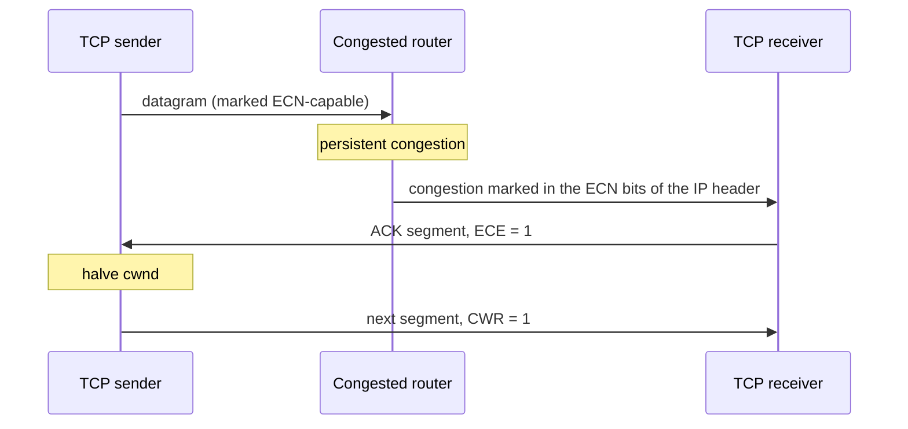

*Figure 18. Explicit congestion notification: network-assisted congestion control*

| Mark | Location | Set by | Meaning |
|:-----|:-----|:-----|:-----|
| Congestion value of the ECN bits | Type of Service field of the IP header | Congested router | A router this datagram passed through is experiencing congestion |
| ECN-capable value of the ECN bits | Type of Service field of the IP header | Sending host | The sender and receiver support ECN |
| ECE | TCP header | Receiver | Echoes the network's congestion indication back to the sender |
| CWR | TCP header | Sender | Tells the receiver that the congestion window has been reduced |

*Table 11. Bits and flags used in ECN*

ECN corresponds to network feedback via the receiver, one of the two pathways of Figure 7, and has the same structure as the forward signaling of Section 3.3. The sender learns of congestion through a marked datagram rather than through segment loss, and the signal takes one round-trip time to come back to the sender.

### 10.2 Other Protocols That Use ECN

Transport-layer protocols other than TCP may also use network-layer-signaled ECN.

- **DCCP (Datagram Congestion Control Protocol).** It provides a low-overhead, congestion-controlled, UDP-like unreliable service that uses ECN. It is one response to the fairness problem of UDP mentioned in Section 9.3.
- **DCTCP (Data Center TCP).** A version of TCP designed specifically for data center networks, which also uses ECN.

---

<br>

## Concept Applications

**True/False Check:**

| Statement | Judgment and Reason |
|:-----|:-----|
| Flow control and congestion control both throttle the sender so that the receiver's receive buffer does not overflow. | **F.** Flow control protects the receive buffer, but congestion control protects the network between the sender and the receiver, that is, the routers' buffers and links. |
| If router buffers are infinite, congestion has no cost. | **F.** As Scenario 1 shows, even with infinite buffers a large queuing delay arises when the arrival rate nears the link capacity. |
| In slow start, cwnd grows by 1 MSS every RTT. | **F.** In slow start cwnd grows by 1 MSS per new ACK, so it doubles every RTT. Growing by 1 MSS every RTT is congestion avoidance. |
| On three duplicate ACKs, TCP Reno cuts cwnd to 1 MSS and returns to slow start. | **F.** That is what TCP Tahoe does. Reno sets ssthresh = cwnd/2 and cwnd = ssthresh + 3 MSS and enters fast recovery. |
| On a timeout, both TCP Tahoe and TCP Reno cut cwnd to 1 MSS and return to slow start. | **T.** A timeout is a stronger sign of congestion, so both versions react strongly. |
| The difference between the throughputs of two connections using AIMD is halved at every multiplicative decrease. | **T.** Additive increase leaves the difference unchanged and multiplicative decrease halves it, so the throughputs converge to a fair share. |
| For congestion control, a Go-Back-N window is better than a Selective Repeat window. | **F.** Go-Back-N retransmits even packets that arrived safely and so adds to the load; the Selective Repeat window is better. |
| In ECN, a router marks congestion by setting the ECE bit of the TCP header. | **F.** The router marks congestion in the ECN bits of the IP header, and the receiver that gets the mark sets the ECE bit of a TCP ACK. |

---

<br>

## Summary

| Concept | Key Summary |
|:-----|:-----|
| Congestion | The state in which the load on a network exceeds its capacity, so packets pile up in router queues and delay and loss grow. |
| Congestion and flow control | Flow control protects the receive buffer and congestion control protects the network, and the send window is min(rwnd, cwnd). |
| Costs of congestion | Large queuing delay, retransmission to compensate for loss, unneeded retransmission, and wasted upstream capacity used by packets dropped along the path, possibly ending in congestion collapse with throughput falling to zero. |
| End-to-end and network-assisted | The end-to-end approach infers congestion from loss and delay, and the network-assisted approach has routers announce congestion with choke packets or packet marking. |
| Open loop and closed loop | Open-loop control prevents congestion in advance with retransmission, window, and acknowledgment policies, and closed-loop control alleviates it with window adjustment, backward and forward signaling, and choke packets. |
| Congestion window | LastByteSent - LastByteAcked ≤ min{cwnd, rwnd}, and the sending rate is roughly cwnd/RTT. |
| Loss events and self-clocking | A timeout or three duplicate ACKs signal congestion, and the arrival of ACKs acts as the clock for window growth. |
| Slow start | cwnd starts at 1 MSS and grows by 1 MSS per new ACK, doubling every RTT, and moves to congestion avoidance when it reaches ssthresh. |
| Congestion avoidance | cwnd grows by 1 MSS every RTT, implemented by adding MSS × (MSS/cwnd) per new ACK. |
| Reaction to loss | On a timeout, ssthresh = cwnd/2 and cwnd = 1 MSS with slow start; on three duplicate ACKs, ssthresh = cwnd/2 and cwnd = ssthresh + 3 MSS with fast recovery. |
| Fast recovery | cwnd grows by 1 MSS per duplicate ACK, and when a new ACK arrives it is reduced to cwnd = ssthresh and congestion avoidance follows. |
| Tahoe and Reno | Tahoe goes to slow start with cwnd = 1 MSS on every loss, and Reno uses fast recovery on three duplicate ACKs. |
| AIMD | Adding 1 MSS per RTT and halving on loss probes for bandwidth in a sawtooth. |
| TCP throughput | The average throughput is 0.75 × W/RTT, and with loss rate L it is 1.22 × MSS/(RTT √L), so 10 Gbps requires a loss rate of about $`2 \times 10^{-10}`$. |
| Fairness | AIMD halves the throughput difference at every decrease and converges to the fair share R/K, but RTT differences, UDP, and parallel connections break fairness. |
| ECN | A router marks congestion in the ECN bits of the IP header, the receiver echoes it with ECE, and the sender halves cwnd and answers with CWR. |

---

<br>

## Self-Check Questions

1. **Tracing the congestion window:** A TCP Reno connection starts with cwnd = 1 MSS and ssthresh = 16 MSS. A timeout occurs in the round in which cwnd is 18 MSS, and later three duplicate ACKs are received in the round in which cwnd is 14 MSS. Assuming that cwnd stops at ssthresh when slow start would overshoot it, find (a) cwnd in each round until the timeout, (b) ssthresh and cwnd just after the timeout, and cwnd in each round until the three-duplicate-ACK event, and (c) ssthresh and cwnd just after the three duplicate ACKs, and cwnd when a new ACK for the missing segment arrives. (d) How would (c) differ for TCP Tahoe?

   <details>
   <summary>Answer</summary>

   (a) Starting from round 1, slow start gives 1, 2, 4, 8, and 16 MSS; at round 5 cwnd reaches ssthresh = 16 and congestion avoidance begins, giving 17 and 18 MSS. The timeout occurs in round 7 (cwnd = 18 MSS). (b) ssthresh = 18/2 = 9 MSS and cwnd = 1 MSS. From round 8 cwnd is 1, 2, 4, and 8 MSS, and in the next round slow start ends at ssthresh, 9 MSS, rather than 16. cwnd then becomes 10, 11, 12, 13, and 14 MSS, and the three duplicate ACKs arrive in round 17 (cwnd = 14 MSS). (c) ssthresh = 14/2 = 7 MSS, and cwnd = 7 + 3 = 10 MSS on entering fast recovery. When the new ACK arrives, cwnd is reduced to ssthresh = 7 MSS, and congestion avoidance continues, giving 8 MSS in the next round. (d) Tahoe also sets ssthresh = 7 MSS but cuts cwnd to 1 MSS and starts again from slow start.

   </details>

2. **Average throughput:** A long-lived TCP connection has a congestion window W of 40 segments when loss occurs, an MSS of 1,500 bytes, and an RTT of 100 ms. Using the model of Section 8.2, find the range of the sending rate and the average throughput.

   <details>
   <summary>Answer</summary>

   W/RTT = 40 × 1,500 × 8 / 0.1 = 4.8 Mbps, and the rate just after a loss, W/(2 × RTT), is 2.4 Mbps. The sending rate varies linearly between 2.4 Mbps and 4.8 Mbps, so the average throughput is 0.75 × 4.8 = 3.6 Mbps.

   </details>

3. **Loss rate on a high-speed path:** A TCP connection with an MSS of 1,500 bytes and an RTT of 100 ms is to achieve an average throughput of 1 Gbps. Find the average congestion window needed and the loss rate L allowed by the formula 1.22 × MSS/(RTT √L).

   <details>
   <summary>Answer</summary>

   The average window is $`10^{9} \times 0.1 / (1500 \times 8) \approx 8{,}333`$ segments. The loss rate is $`L = (1.22 \times 12000 / (0.1 \times 10^{9}))^{2} = (1.464 \times 10^{-4})^{2} \approx 2.1 \times 10^{-8}`$, so there may be at most one loss event for about every 47 million segments. When the throughput grows tenfold, the tolerable loss rate becomes a hundred times smaller.

   </details>

4. **Convergence to fairness:** Two TCP connections share a bottleneck link of capacity R = 10 Mbps. Their throughputs are initially 1 Mbps and 5 Mbps; without loss both grow by 1 Mbps every RTT, and as soon as the sum of the two throughputs exceeds 10 Mbps a loss occurs and both are halved. Find the two throughputs and their difference just after the second decrease, and explain how the difference changes.

   <details>
   <summary>Answer</summary>

   The throughputs grow from (1, 5) to (2, 6), (3, 7), and (4, 8); the sum becomes 12 Mbps, a loss occurs, and they fall to (2, 4). They grow again to (3, 5), (4, 6), and (5, 7); the sum becomes 12 Mbps, and they fall to (2.5, 3.5). The difference is halved at every decrease, from 4 Mbps to 2 Mbps to 1 Mbps. Additive increase leaves the difference unchanged and only multiplicative decrease reduces it, so the two throughputs converge to the same value.

   </details>

5. **Open-loop policies:** State which of Forouzan's open-loop congestion-control policies each of the following designs corresponds to. (a) The receiver does not acknowledge every segment but acknowledges once every two segments, or together with data it has to send. (b) The sender uses Selective Repeat instead of Go-Back-N so that it resends only lost packets. (c) The sender sets its retransmission timeout from the measured RTT so that it does not prematurely retransmit packets that are merely delayed.

   <details>
   <summary>Answer</summary>

   (a) The acknowledgment policy. Acknowledgments are part of the network load, so fewer acknowledgments mean less load. (b) The window policy. Packets that have already arrived are not retransmitted, so no unneeded load is created. (c) The retransmission policy. It prevents the cost of unneeded retransmission in Section 2.2 (c).

   </details>

6. **The cost of retransmission:** In Scenario 2, suppose that the throughput received by the receiving application is 0.4R when the offered load $`\lambda'_{in}`$ is 0.5R. Find the rate and the fraction of retransmitted data among the data the sender transmits.

   <details>
   <summary>Answer</summary>

   The 0.4R delivered to the receiving application is original data, so the remaining 0.5R - 0.4R = 0.1R is the rate of retransmitted data. Its fraction of the transmitted data is 0.1R / 0.5R = 20%. In the example of Kurose and Ross (throughput R/3), retransmitted data amount to R/6, a fraction of about 33%.

   </details>

7. **cwnd during fast recovery:** A TCP Reno sender receives three duplicate ACKs when its cwnd is 16 MSS. Four more duplicate ACKs for the same segment then arrive, followed by a new ACK acknowledging the missing segment. Find ssthresh and cwnd at each point, and cwnd one RTT after the new ACK.

   <details>
   <summary>Answer</summary>

   On the three duplicate ACKs, ssthresh = 16/2 = 8 MSS and cwnd = 8 + 3 = 11 MSS, and the sender enters fast recovery. The four further duplicate ACKs each add 1 MSS, so cwnd becomes 15 MSS. When the new ACK arrives, cwnd is reduced to ssthresh = 8 MSS and congestion avoidance begins, so one RTT later cwnd is 9 MSS. Throughout, ssthresh stays at 8 MSS.

   </details>

8. **How ECN works:** On an ECN-capable TCP connection, a router on the path experiences persistent congestion. Describe in order what the router, the receiver, and the sender do, together with the bit each sets, and state which of the two feedback pathways of Figure 7 this corresponds to.

   <details>
   <summary>Answer</summary>

   The router marks congestion in the ECN bits of the Type of Service field of the header of a passing IP datagram. When the receiver's TCP receives the marked datagram, it sets the ECE bit of the ACK segment it sends to the sender. When the sender's TCP receives an ACK with ECE set, it halves cwnd, as it would on a fast retransmit, and sets the CWR bit of the next segment it sends to announce that the window has been reduced. Because the congestion indication returns to the sender via the receiver, this corresponds to network feedback via the receiver.

   </details>
