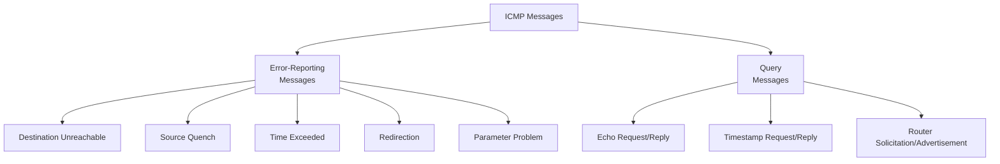
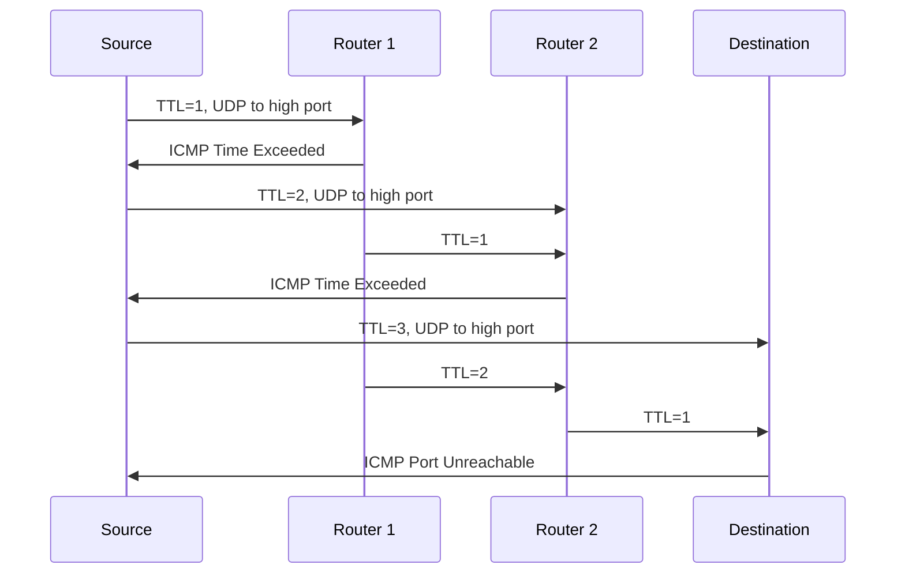

# 9장 — 인터넷 제어 메시지 프로토콜 버전 4 (ICMPv4)

[레포지토리 안내](../../README.ko.md) | [English](Concepts_Lecture.md) | [한국어](Concepts_Lecture.ko.md)

> **최종 수정일:** 2026-10-26
>
> TCP/IP Protocol Suite, Forouzan, Ch 9

> **학습 목표:**
> 1. ICMP 메시지 유형(오류 보고, 질의)을 분류할 수 있다
> 2. ICMP를 사용한 ping과 traceroute를 설명할 수 있다
> 3. ICMP 오류 메시지 포맷과 처리를 분석할 수 있다

---

## 목차

- [1. 개요](#1-개요)
  - [1.1 ICMP가 필요한 이유](#11-icmp가-필요한-이유)
  - [1.2 TCP/IP에서 ICMP의 위치](#12-tcpip에서-icmp의-위치)
  - [1.3 ICMP 캡슐화](#13-icmp-캡슐화)
- [2. ICMP 메시지](#2-icmp-메시지)
  - [2.1 메시지 범주](#21-메시지-범주)
  - [2.2 오류 보고 메시지](#22-오류-보고-메시지)
  - [2.3 질의 메시지](#23-질의-메시지)
- [3. 오류 보고 메시지 상세](#3-오류-보고-메시지-상세)
  - [3.1 목적지 도달 불가](#31-목적지-도달-불가)
  - [3.2 출발지 억제 (사용 중단)](#32-출발지-억제-사용-중단)
  - [3.3 시간 초과](#33-시간-초과)
  - [3.4 리다이렉션](#34-리다이렉션)
  - [3.5 파라미터 문제](#35-파라미터-문제)
- [4. 질의 메시지 상세](#4-질의-메시지-상세)
  - [4.1 에코 요청 및 응답](#41-에코-요청-및-응답)
  - [4.2 타임스탬프 요청 및 응답](#42-타임스탬프-요청-및-응답)
  - [4.3 라우터 요청 및 광고](#43-라우터-요청-및-광고)
- [5. ICMP 응용](#5-icmp-응용)
  - [5.1 Ping](#51-ping)
  - [5.2 Traceroute](#52-traceroute)
- [6. ICMP 보안 고려사항](#6-icmp-보안-고려사항)
- [7. 부록](#7-부록)
  - [7.1 ICMP Type 요약 표](#71-icmp-type-요약-표)
  - [7.2 특정 패킷에 대해 ICMP 오류 메시지가 생성되지 않는 이유](#72-특정-패킷에-대해-icmp-오류-메시지가-생성되지-않는-이유)
- [요약](#요약)
- [점검 문제](#점검-문제)

---

<br>

## 1. 개요

### 1.1 ICMP가 필요한 이유

IP는 여러 한계를 가진 **비신뢰적이고 비연결형**인 데이터그램 전달 프로토콜이다:
- IP는 **오류 제어 없이** 최선형 전달 서비스를 제공한다.
- IP에는 **오류 보고** 및 오류 수정 메커니즘이 없다.
- IP에는 호스트 및 관리 질의를 위한 **메커니즘이 없다**.

**ICMP는 위의 결함을 보완하기 위해 설계되었다.** 그러나 ICMP는 오류를 수정하지 않고 단순히 보고만 한다. 오류 수정은 상위 계층 프로토콜에 맡긴다.

### 1.2 TCP/IP에서 ICMP의 위치

ICMP는 IP와 함께 **네트워크 계층**에서 동작한다:

```text
+---+------+--------+
|IGMP| ICMP |   IP   |   ARP
+---+------+--------+
```

*그림 1. 네트워크 계층에서 ICMP의 위치*

- ICMP는 네트워크 계층 프로토콜로 간주된다.
- 그러나 ICMP 메시지는 상위 계층 프로토콜의 데이터처럼 IP 데이터그램 안에 캡슐화된다.
- ICMP는 IP를 신뢰적으로 만들지 않으며, 문제에 대한 피드백만 제공한다.

### 1.3 ICMP 캡슐화

ICMP 메시지는 IP 데이터그램 내에 캡슐화된다:

```text
+----------+----------+-----------+
| Frame    | IP       | ICMP      |
| Header   | Header   | Message   |
+----------+----------+-----------+
             |
             +-- Protocol field = 1 (ICMP)
```

*그림 2. IP 데이터그램과 프레임에 캡슐화된 ICMP 메시지*

IP 데이터그램의 **Protocol 필드** 값은 IP 데이터가 ICMP 메시지임을 나타내는 **1**이다.

> **핵심:** ICMP는 IP 데이터그램 내에 운반되지만(프로토콜 번호 1) 전송 계층 프로토콜이 아닌 네트워크 계층 프로토콜로 간주된다.

---

<br>

## 2. ICMP 메시지

### 2.1 메시지 범주

ICMP 메시지는 두 가지 큰 범주로 나뉜다:



*그림 3. ICMP 메시지의 범주와 종류*

**일반적인 ICMP 메시지 형식:**

```text
+-+-+-+-+-+-+-+-+-+-+-+-+-+-+-+-+-+-+-+-+-+-+-+-+-+-+-+-+-+-+-+-+
|     Type      |     Code      |         Checksum              |
+-+-+-+-+-+-+-+-+-+-+-+-+-+-+-+-+-+-+-+-+-+-+-+-+-+-+-+-+-+-+-+-+
|                   Rest of Header (varies)                     |
+-+-+-+-+-+-+-+-+-+-+-+-+-+-+-+-+-+-+-+-+-+-+-+-+-+-+-+-+-+-+-+-+
|                   Data Section (varies)                        |
+-+-+-+-+-+-+-+-+-+-+-+-+-+-+-+-+-+-+-+-+-+-+-+-+-+-+-+-+-+-+-+-+
```

*그림 4. ICMP 메시지의 일반 형식*

### 2.2 오류 보고 메시지

**오류 보고 메시지**는 라우터나 호스트가 IP 패킷을 처리할 때 만나는 문제를 보고한다.

**오류 보고 메시지에 대한 중요 규칙:**
- ICMP 오류 메시지를 운반하는 데이터그램에 대해서는 ICMP 오류 메시지를 만들지 않는다(무한 루프 방지).
- 목적지가 멀티캐스트 주소인 데이터그램에 대해서는 ICMP 오류 메시지를 만들지 않는다.
- 목적지가 브로드캐스트 주소인 데이터그램에 대해서는 ICMP 오류 메시지를 만들지 않는다.
- 출발지 주소가 0.0.0.0인 데이터그램에 대해서는 ICMP 오류 메시지를 만들지 않는다.
- 단편화된 데이터그램은 첫 번째 단편에 대해서만 ICMP 오류 메시지를 만든다.

오류 메시지의 데이터 부분에는 항상 다음이 포함된다:
- 원본 데이터그램의 **IP 헤더**
- 원본 데이터그램의 **첫 8바이트 데이터** (보통 TCP/UDP 헤더의 포트 번호를 포함)

### 2.3 질의 메시지

**질의 메시지**는 쌍(요청과 응답)으로 발생한다. 호스트나 네트워크 관리자가 라우터 또는 다른 호스트로부터 특정 정보를 얻을 수 있게 한다. 호스트는 네트워크의 라우터를 발견하고 학습할 수 있으며, 라우터는 노드의 메시지 리다이렉트를 도울 수 있다.

---

<br>

## 3. 오류 보고 메시지 상세

### 3.1 목적지 도달 불가

| Type | Code | 의미 |
|------|------|---------|
| 3 | 0 | 네트워크 도달 불가 |
| 3 | 1 | 호스트 도달 불가 |
| 3 | 2 | 프로토콜 도달 불가 |
| 3 | 3 | 포트 도달 불가 |
| 3 | 4 | 단편화 필요하나 DF 플래그 설정됨 |
| 3 | 5 | 출발지 경로 실패 |

*표 1. 목적지 도달 불가 메시지의 주요 코드*

**Code 3 (포트 도달 불가)** 은 다음과 같은 경우에 흔히 발생한다:
- 목적지 UDP 포트에서 수신 대기 중인 프로세스가 없으면 목적지 호스트가 이 메시지를 보낸다.
- 포트 스캔 중에 자주 발생한다.

**Code 4 (단편화 필요)** 는 다음과 같은 점에서 중요하다:
- 경로 MTU 탐색(Path MTU Discovery, 7장)이 이 메시지를 이용한다.
- 라우터가 DF 플래그 때문에 데이터그램을 단편화할 수 없을 때 생성되므로, 송신자는 경로의 MTU가 더 작다는 사실을 알 수 있다.

### 3.2 출발지 억제 (사용 중단)

- Type 4, Code 0이다.
- 원래 흐름 제어와 혼잡 제어에 사용되었다.
- 라우터는 혼잡 때문에 데이터그램을 폐기할 때 출발지에 이 메시지를 보낼 수 있었다.
- **RFC 6633에서 사용이 중단되었다.** 효과가 없고 해로울 수 있다고 판단되었기 때문이다.
- 현대의 혼잡 제어는 TCP의 혼잡 제어(슬로우 스타트 등)와 ECN을 사용한다.

### 3.3 시간 초과

| Type | Code | 의미 |
|------|------|---------|
| 11 | 0 | 전송 중 TTL 만료 |
| 11 | 1 | 단편 재조립 시간 초과 |

*표 2. 시간 초과 메시지의 코드*

**Code 0 (TTL 만료):**
- 라우터가 TTL을 0으로 감소시키면 데이터그램을 폐기하고 이 메시지를 생성한다.
- **traceroute** 동작의 핵심이다.

**Code 1 (재조립 시간 초과):**
- 재조립 타이머가 만료될 때까지 데이터그램의 단편이 모두 도착하지 않으면 생성된다.
- 이때 목적지는 그때까지 받은 단편을 모두 폐기한다.

### 3.4 리다이렉션

- Type 5이다.
- 라우터가 호스트에게 특정 목적지로 가는 **더 나은 경로가 존재함**을 알리기 위해 보낸다.
- 호스트는 새 다음 홉으로 라우팅 테이블을 갱신한다.

| Code | 의미 |
|------|---------|
| 0 | 네트워크를 위한 리다이렉트 |
| 1 | 호스트를 위한 리다이렉트 |
| 2 | TOS와 네트워크를 위한 리다이렉트 |
| 3 | TOS와 호스트를 위한 리다이렉트 |

*표 3. 리다이렉션 메시지의 코드*

### 3.5 파라미터 문제

- Type 12이다.
- 데이터그램 헤더에 **모호하거나 누락된** 값이 있을 때 보낸다.
- 포인터 필드는 문제가 감지된 바이트의 위치를 가리킨다.

---

<br>

## 4. 질의 메시지 상세

### 4.1 에코 요청 및 응답

| 메시지 | Type | Code |
|---------|------|------|
| Echo Request | 8 | 0 |
| Echo Reply | 0 | 0 |

*표 4. 에코 요청과 응답의 Type과 Code*

- **ping** 유틸리티가 도달 가능성을 테스트하는 데 사용한다.
- 에코 요청에는 식별자와 순서 번호가 들어 있다.
- 에코 응답은 요청의 데이터를 그대로 돌려주어야 한다.

### 4.2 타임스탬프 요청 및 응답

| 메시지 | Type | Code |
|---------|------|------|
| Timestamp Request | 13 | 0 |
| Timestamp Reply | 14 | 0 |

*표 5. 타임스탬프 요청과 응답의 Type과 Code*

- 두 장비 사이의 왕복 시간을 측정하는 데 사용한다.
- originate, receive, transmit의 세 타임스탬프를 담는다.
- 타임스탬프는 UTC 자정부터 지난 시간을 밀리초 단위로 나타낸다.

### 4.3 라우터 요청 및 광고

| 메시지 | Type | Code |
|---------|------|------|
| Router Solicitation | 10 | 0 |
| Router Advertisement | 9 | 0 |

*표 6. 라우터 요청과 광고의 Type과 Code*

- 호스트는 네트워크의 라우터를 발견하기 위해 요청을 보낸다.
- 라우터는 주기적으로 자신의 존재를 광고한다.

---

<br>

## 5. ICMP 응용

### 5.1 Ping

**Ping** (Packet Internet Groper)은 ICMP Echo Request와 Echo Reply를 사용하여 다음을 수행한다:
- 호스트에 도달할 수 있는지 테스트한다.
- 왕복 시간(RTT)을 측정한다.
- 패킷 손실을 확인한다.

```text
$ ping 192.168.1.1
PING 192.168.1.1: 56 data bytes
64 bytes from 192.168.1.1: icmp_seq=0 ttl=64 time=0.456 ms
64 bytes from 192.168.1.1: icmp_seq=1 ttl=64 time=0.389 ms
64 bytes from 192.168.1.1: icmp_seq=2 ttl=64 time=0.412 ms
```

### 5.2 Traceroute

**Traceroute**는 TTL과 ICMP Time Exceeded 메시지를 활용하여 패킷이 목적지까지 거치는 경로를 발견한다:



*그림 5. TTL을 늘려 가며 경로를 찾는 traceroute의 동작*

1. 출발지는 TTL을 1부터 하나씩 늘려 가며 패킷을 보낸다.
2. TTL을 0으로 감소시킨 라우터는 ICMP Time Exceeded를 돌려보낸다.
3. UDP를 사용하는 traceroute에서 목적지는 사용되지 않는 높은 포트 번호로 온 데이터그램에 ICMP Port Unreachable로 응답한다. Windows의 tracert처럼 ICMP Echo Request를 보내는 구현에서는 목적지가 Echo Reply로 응답한다.
4. 출발지는 응답을 보낸 각 라우터의 IP 주소와 RTT를 기록한다.

```text
$ traceroute 8.8.8.8
 1  gateway (192.168.1.1)  0.456 ms  0.389 ms  0.412 ms
 2  isp-router (10.0.0.1)  5.234 ms  5.189 ms  5.211 ms
 3  8.8.8.8  10.567 ms  10.489 ms  10.512 ms
```

---

<br>

## 6. ICMP 보안 고려사항

| 위협 | 설명 | 완화 방법 |
|--------|-------------|------------|
| Ping Flood | ICMP Echo Request로 대상을 압도 | ICMP 속도 제한 |
| Smurf Attack | 위조된 출발지(피해자 IP)로 브로드캐스트 ping | 지향 브로드캐스트 비활성화 |
| Ping of Death | 버퍼 오버플로를 유발하는 초과 크기 ICMP 패킷 | 최신 OS 패치 |
| ICMP Redirect Attack | 트래픽을 우회시키기 위해 위조된 리다이렉트 메시지 | 호스트에서 ICMP 리다이렉트 비활성화 |
| ICMP Tunneling | ICMP Echo 데이터 필드를 사용한 은닉 채널 | 심층 패킷 검사 |

*표 7. ICMP 관련 보안 위협과 완화 방법*

> **핵심:** ICMP는 네트워크 진단에 필수적이지만, 많은 조직에서 공격 표면을 줄이기 위해 방화벽에서 ICMP를 필터링한다. 그러나 ICMP를 완전히 차단하면 경로 MTU 탐색과 네트워크 문제 해결이 중단될 수 있다.

---

<br>

## 7. 부록

### 7.1 ICMP Type 요약 표

| Type | 메시지 | 범주 |
|------|---------|----------|
| 0 | Echo Reply | 질의 |
| 3 | Destination Unreachable | 오류 |
| 4 | Source Quench (사용 중단) | 오류 |
| 5 | Redirect | 오류 |
| 8 | Echo Request | 질의 |
| 9 | Router Advertisement | 질의 |
| 10 | Router Solicitation | 질의 |
| 11 | Time Exceeded | 오류 |
| 12 | Parameter Problem | 오류 |
| 13 | Timestamp Request | 질의 |
| 14 | Timestamp Reply | 질의 |

*표 8. ICMP 메시지의 Type 요약*

### 7.2 특정 패킷에 대해 ICMP 오류 메시지가 생성되지 않는 이유

2.2절의 규칙은 다음 문제를 방지한다:
- **무한 루프**: 오류 메시지에 대해 다시 오류 메시지를 만드는 일이 끝없이 반복될 수 있다.
- **브로드캐스트 폭풍**: 멀티캐스트나 브로드캐스트 패킷 하나를 받은 수많은 수신자가 오류 메시지를 보내면 네트워크가 범람할 수 있다.
- **증폭 공격**: 출발지 주소를 위조한 패킷이 피해자에게 ICMP 메시지를 대량으로 쏟아지게 할 수 있다.

---

<br>

## 요약

| 개념 | 핵심 요약 |
|---------|-----------|
| ICMP 목적 | ICMP는 IP에 오류 보고와 질의 메커니즘이 없다는 점을 보완한다. |
| 캡슐화 | ICMP 메시지는 Protocol 필드 값이 1인 IP 데이터그램 안에 담긴다. |
| 오류 메시지 | ICMP 오류 메시지는 문제를 보고하지만 수정하지는 않는다. |
| 목적지 도달 불가 | 이 메시지는 네트워크, 호스트, 프로토콜, 포트에 도달할 수 없거나 DF 플래그 때문에 단편화할 수 없을 때 보낸다. |
| 시간 초과 | 이 메시지는 TTL이 만료되었거나(traceroute가 이용한다) 단편 재조립 시간이 초과되었을 때 보낸다. |
| 리다이렉션 | 라우터는 리다이렉션 메시지로 호스트에게 더 나은 경로를 알린다. |
| Echo Request/Reply | ping은 Echo Request와 Echo Reply로 도달 가능성을 테스트한다. |
| Ping | ping은 호스트 도달 가능성을 테스트하고 RTT를 측정한다. |
| Traceroute | traceroute는 TTL 값을 늘려 가며 경로를 발견한다. |

---

<br>

## 점검 문제

1. **traceroute의 응답 수:** 출발지와 목적지 사이에 라우터가 3개 있다. UDP를 사용하는 traceroute가 TTL 값마다 탐색 패킷을 3개씩 보낸다면, 목적지에 도달할 때까지 출발지가 받는 ICMP Time Exceeded 메시지와 Port Unreachable 메시지는 각각 몇 개인가? 패킷은 손실되지 않는다고 가정한다.

   <details>
   <summary>정답</summary>

   TTL이 1, 2, 3인 탐색 패킷은 각각 첫째, 둘째, 셋째 라우터에서 TTL이 0이 되므로, 라우터마다 Time Exceeded를 3개씩 보내 모두 3 × 3 = 9개를 받는다. TTL이 4인 탐색 패킷 3개는 목적지에 도달하고, 목적지는 사용되지 않는 포트로 온 데이터그램마다 Port Unreachable을 보내므로 3개를 받는다. 출발지가 보낸 탐색 패킷은 모두 12개이다.

   </details>

2. **ICMP 오류 메시지의 크기:** 라우터가 TTL이 만료된 UDP 데이터그램을 폐기하고 Time Exceeded 메시지를 보낸다. 원본 데이터그램의 IP 헤더는 옵션 없이 20바이트이다. ICMP 오류 메시지의 헤더는 Type, Code, Checksum과 나머지 4바이트를 합쳐 8바이트이다. ICMP 메시지와 이를 운반하는 IP 데이터그램(헤더 20바이트)의 크기를 구하라. 원본 출발지는 이 메시지에서 어떤 포트 정보를 얻는가?

   <details>
   <summary>정답</summary>

   데이터 부분은 원본 IP 헤더 20바이트와 원본 데이터의 첫 8바이트로 이루어지므로 28바이트이다. ICMP 메시지는 8 + 28 = 36바이트이고, 이를 운반하는 IP 데이터그램은 20 + 36 = 56바이트이다. UDP 헤더는 정확히 8바이트이므로, 첫 8바이트에 UDP 헤더 전체가 들어가 출발지는 출발지 포트와 목적지 포트를 모두 알 수 있다. 이 정보로 어느 프로세스의 데이터그램이 폐기되었는지 판단한다.

   </details>

3. **오류 메시지 생성 여부:** 다음 각 경우에 ICMP 오류 메시지를 만드는지 판단하고 이유를 쓰라.
   (a) 라우터가 ICMP Destination Unreachable 메시지를 운반하는 데이터그램의 TTL을 0으로 감소시켰다.
   (b) 라우터가 목적지 주소가 브로드캐스트 주소인 데이터그램을 전달할 수 없다.
   (c) 라우터가 단편화된 데이터그램의 셋째 단편의 TTL을 0으로 감소시켰다.
   (d) 라우터가 ICMP Echo Request를 운반하는 데이터그램의 TTL을 0으로 감소시켰다.

   <details>
   <summary>정답</summary>

   (a)는 만들지 않는다. ICMP 오류 메시지에 대해 다시 오류 메시지를 만들지 않기 때문이다. (b)도 만들지 않는다. 브로드캐스트 목적지를 가진 데이터그램은 예외이기 때문이다. (c)도 만들지 않는다. 단편화된 데이터그램은 첫 번째 단편에 대해서만 오류 메시지를 만들기 때문이다. (d)는 Time Exceeded 메시지를 만든다. Echo Request는 오류 보고 메시지가 아닌 질의 메시지이므로 예외에 해당하지 않으며, traceroute의 ICMP 방식도 이 성질을 이용한다.

   </details>

4. **ping 출력의 해석:** 5.1절의 출력에서 첫 줄은 56 data bytes인데 응답 줄은 64 bytes이다. 두 값의 차이는 무엇이며, 이 에코 응답을 운반하는 IP 데이터그램의 크기는 몇 바이트인가? IP 헤더에는 옵션이 없다고 가정한다.

   <details>
   <summary>정답</summary>

   56바이트는 ICMP 메시지의 데이터 부분이고, 64바이트는 여기에 Type, Code, Checksum, 식별자, 순서 번호로 이루어진 8바이트 ICMP 헤더를 더한 ICMP 메시지 전체이다(56 + 8 = 64). IP 데이터그램은 20바이트 IP 헤더를 더해 64 + 20 = 84바이트이다. 출력의 icmp_seq는 에코 요청과 응답의 순서 번호 필드 값이다.

   </details>
