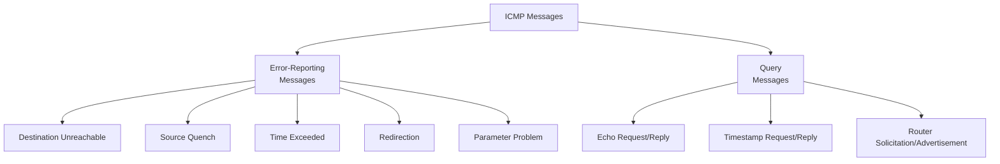
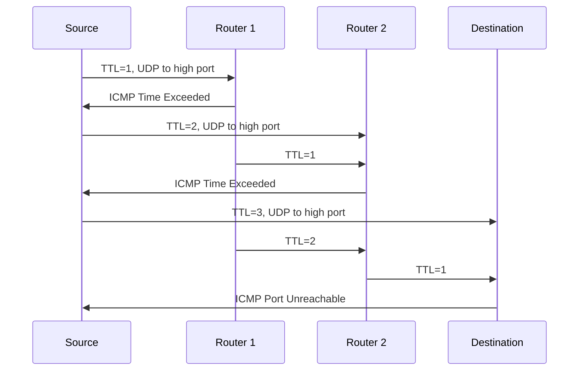

# Chapter 9 — Internet Control Message Protocol Version 4 (ICMPv4)

[Repository Guide](../../README.md) | [English](Concepts_Lecture.md) | [한국어](Concepts_Lecture.ko.md)

> **Last Updated:** 2026-10-17
>
> TCP/IP Protocol Suite, Forouzan, Ch 9

> **Learning Objectives:**
> 1. Classify ICMP message types (error reporting, query)
> 2. Explain ping and traceroute using ICMP
> 3. Analyze ICMP error message format and processing

---

## Table of Contents

- [1. Introduction](#1-introduction)
  - [1.1 Why ICMP is Needed](#11-why-icmp-is-needed)
  - [1.2 ICMP Position in TCP/IP](#12-icmp-position-in-tcpip)
  - [1.3 ICMP Encapsulation](#13-icmp-encapsulation)
- [2. ICMP Messages](#2-icmp-messages)
  - [2.1 Message Categories](#21-message-categories)
  - [2.2 Error-Reporting Messages](#22-error-reporting-messages)
  - [2.3 Query Messages](#23-query-messages)
- [3. Error-Reporting Messages in Detail](#3-error-reporting-messages-in-detail)
  - [3.1 Destination Unreachable](#31-destination-unreachable)
  - [3.2 Source Quench (Deprecated)](#32-source-quench-deprecated)
  - [3.3 Time Exceeded](#33-time-exceeded)
  - [3.4 Redirection](#34-redirection)
  - [3.5 Parameter Problem](#35-parameter-problem)
- [4. Query Messages in Detail](#4-query-messages-in-detail)
  - [4.1 Echo Request and Reply](#41-echo-request-and-reply)
  - [4.2 Timestamp Request and Reply](#42-timestamp-request-and-reply)
  - [4.3 Router Solicitation and Advertisement](#43-router-solicitation-and-advertisement)
- [5. ICMP Applications](#5-icmp-applications)
  - [5.1 Ping](#51-ping)
  - [5.2 Traceroute](#52-traceroute)
- [6. ICMP Security Considerations](#6-icmp-security-considerations)
- [7. Appendix](#7-appendix)
  - [7.1 ICMP Type Summary Table](#71-icmp-type-summary-table)
  - [7.2 Why ICMP Error Messages Are Not Generated for Certain Packets](#72-why-icmp-error-messages-are-not-generated-for-certain-packets)
- [Summary](#summary)
- [Self-Check Questions](#self-check-questions)

---

<br>

## 1. Introduction

### 1.1 Why ICMP is Needed

IP is an **unreliable and connectionless** datagram delivery protocol with several limitations:
- IP provides a best-effort delivery service with **no error control**.
- IP has **no error-reporting** or error-correcting mechanism.
- IP has **no mechanism** for host and management queries.

**ICMP has been designed to compensate for the above deficiencies.** However, ICMP does not correct errors; it simply reports them. Error correction is left to the higher-layer protocols.

### 1.2 ICMP Position in TCP/IP

ICMP operates at the **network layer**, alongside IP:

```text
+---+------+--------+
|IGMP| ICMP |   IP   |   ARP
+---+------+--------+
```

*Figure 1. Position of ICMP in the network layer*

- ICMP is considered a network-layer protocol.
- However, ICMP messages are encapsulated within IP datagrams, like the data of a higher-layer protocol.
- ICMP does not make IP reliable; it only provides feedback about problems.

### 1.3 ICMP Encapsulation

ICMP messages are encapsulated inside IP datagrams:

```text
+----------+----------+-----------+
| Frame    | IP       | ICMP      |
| Header   | Header   | Message   |
+----------+----------+-----------+
             |
             +-- Protocol field = 1 (ICMP)
```

*Figure 2. ICMP message encapsulated in an IP datagram and a frame*

The value of the **protocol field** in the IP datagram is **1** to indicate that the IP data is an ICMP message.

> **Key Point:** ICMP is carried within IP datagrams (protocol number 1) but is considered a network-layer protocol, not a transport-layer protocol.

---

<br>

## 2. ICMP Messages

### 2.1 Message Categories

ICMP messages are divided into two broad categories:



*Figure 3. Categories and types of ICMP messages*

**General ICMP message format:**

```text
+-+-+-+-+-+-+-+-+-+-+-+-+-+-+-+-+-+-+-+-+-+-+-+-+-+-+-+-+-+-+-+-+
|     Type      |     Code      |         Checksum              |
+-+-+-+-+-+-+-+-+-+-+-+-+-+-+-+-+-+-+-+-+-+-+-+-+-+-+-+-+-+-+-+-+
|                   Rest of Header (varies)                     |
+-+-+-+-+-+-+-+-+-+-+-+-+-+-+-+-+-+-+-+-+-+-+-+-+-+-+-+-+-+-+-+-+
|                   Data Section (varies)                        |
+-+-+-+-+-+-+-+-+-+-+-+-+-+-+-+-+-+-+-+-+-+-+-+-+-+-+-+-+-+-+-+-+
```

*Figure 4. General format of an ICMP message*

### 2.2 Error-Reporting Messages

**Error-reporting messages** report problems that a router or host may encounter when it processes an IP packet.

**Important rules for error-reporting messages:**
- No ICMP error message is generated for a datagram carrying an ICMP error message (this prevents infinite loops).
- No ICMP error message is generated for a datagram with a multicast destination.
- No ICMP error message is generated for a datagram with a broadcast destination.
- No ICMP error message is generated for a datagram with source address 0.0.0.0.
- For a fragmented datagram, an ICMP error message is generated only for the first fragment.

The data section of an error message always includes:
- The **IP header** of the original datagram
- The **first 8 bytes of data** from the original datagram (usually contains port numbers from TCP/UDP header)

### 2.3 Query Messages

**Query messages** occur in pairs (request and reply). They help a host or a network manager get specific information from a router or another host. Hosts can discover and learn about routers on their network, and routers can help a node redirect its messages.

---

<br>

## 3. Error-Reporting Messages in Detail

### 3.1 Destination Unreachable

| Type | Code | Meaning |
|------|------|---------|
| 3 | 0 | Network unreachable |
| 3 | 1 | Host unreachable |
| 3 | 2 | Protocol unreachable |
| 3 | 3 | Port unreachable |
| 3 | 4 | Fragmentation needed but DF flag set |
| 3 | 5 | Source route failed |

*Table 1. Main codes of the Destination Unreachable message*

**Code 3 (Port Unreachable)** is commonly seen in the following cases:
- The destination host sends it when no process is listening on the destination UDP port.
- It is often triggered during port scans.

**Code 4 (Fragmentation Needed)** is important for the following reasons:
- Path MTU Discovery relies on this message.
- A router generates it when it cannot fragment a datagram because the DF flag is set, so the sender learns that the path MTU is smaller.

### 3.2 Source Quench (Deprecated)

- It is Type 4, Code 0.
- It was originally used for flow control and congestion control.
- A router could send it to the source when discarding datagrams due to congestion.
- **It was deprecated by RFC 6633.** It was considered ineffective and potentially harmful.
- Modern congestion control relies on TCP congestion control (such as slow start) and ECN.

### 3.3 Time Exceeded

| Type | Code | Meaning |
|------|------|---------|
| 11 | 0 | TTL expired in transit |
| 11 | 1 | Fragment reassembly time exceeded |

*Table 2. Codes of the Time Exceeded message*

**Code 0 (TTL expired):**
- When a router decrements TTL to 0, it discards the datagram and generates this message.
- It is fundamental to the operation of **traceroute**.

**Code 1 (Reassembly timeout):**
- It is generated when not all fragments of a datagram arrive before the reassembly timer expires.
- The destination then discards all fragments received so far.

### 3.4 Redirection

- It is Type 5.
- A router sends it to inform a host that a **better route exists** for a particular destination.
- The host updates its routing table with the new next hop.

| Code | Meaning |
|------|---------|
| 0 | Redirect for network |
| 1 | Redirect for host |
| 2 | Redirect for TOS and network |
| 3 | Redirect for TOS and host |

*Table 3. Codes of the Redirection message*

### 3.5 Parameter Problem

- It is Type 12.
- It is sent when a datagram header contains an **ambiguous or missing** value.
- The pointer field indicates the byte location where the problem was detected.

---

<br>

## 4. Query Messages in Detail

### 4.1 Echo Request and Reply

| Message | Type | Code |
|---------|------|------|
| Echo Request | 8 | 0 |
| Echo Reply | 0 | 0 |

*Table 4. Type and code of echo request and reply*

- The **ping** utility uses them to test reachability.
- An echo request contains an identifier and a sequence number.
- The echo reply must return the data of the request unchanged.

### 4.2 Timestamp Request and Reply

| Message | Type | Code |
|---------|------|------|
| Timestamp Request | 13 | 0 |
| Timestamp Reply | 14 | 0 |

*Table 5. Type and code of timestamp request and reply*

- They are used to determine the round-trip time between two machines.
- They contain three timestamps: originate, receive, and transmit.
- Each timestamp gives the time elapsed since midnight UTC in milliseconds.

### 4.3 Router Solicitation and Advertisement

| Message | Type | Code |
|---------|------|------|
| Router Solicitation | 10 | 0 |
| Router Advertisement | 9 | 0 |

*Table 6. Type and code of router solicitation and advertisement*

- Hosts send solicitations to discover routers on the network.
- Routers periodically advertise their presence.

---

<br>

## 5. ICMP Applications

### 5.1 Ping

**Ping** (Packet Internet Groper) uses ICMP Echo Request and Echo Reply to do the following:
- It tests whether a host is reachable.
- It measures round-trip time (RTT).
- It checks for packet loss.

```text
$ ping 192.168.1.1
PING 192.168.1.1: 56 data bytes
64 bytes from 192.168.1.1: icmp_seq=0 ttl=64 time=0.456 ms
64 bytes from 192.168.1.1: icmp_seq=1 ttl=64 time=0.389 ms
64 bytes from 192.168.1.1: icmp_seq=2 ttl=64 time=0.412 ms
```

### 5.2 Traceroute

**Traceroute** discovers the path packets take to a destination by exploiting TTL and ICMP Time Exceeded messages:



*Figure 5. Operation of traceroute with increasing TTL values*

1. The source sends packets with TTL values that increase by one, starting at 1.
2. Each router that decrements TTL to 0 sends back an ICMP Time Exceeded message.
3. In UDP-based traceroute, the destination responds with ICMP Port Unreachable to a datagram addressed to an unused high port. In implementations that send ICMP Echo Requests, such as Windows tracert, the destination responds with an Echo Reply.
4. The source records the IP address of each responding router and the RTT.

```text
$ traceroute 8.8.8.8
 1  gateway (192.168.1.1)  0.456 ms  0.389 ms  0.412 ms
 2  isp-router (10.0.0.1)  5.234 ms  5.189 ms  5.211 ms
 3  8.8.8.8  10.567 ms  10.489 ms  10.512 ms
```

---

<br>

## 6. ICMP Security Considerations

| Threat | Description | Mitigation |
|--------|-------------|------------|
| Ping Flood | Overwhelm target with ICMP Echo Requests | Rate-limit ICMP |
| Smurf Attack | Broadcast ping with spoofed source (victim's IP) | Disable directed broadcast |
| Ping of Death | Oversized ICMP packet causing buffer overflow | Modern OS patches |
| ICMP Redirect Attack | Forge redirect messages to reroute traffic | Disable ICMP redirects on hosts |
| ICMP Tunneling | Covert channel using ICMP Echo data field | Deep packet inspection |

*Table 7. ICMP-related security threats and mitigations*

> **Key Point:** While ICMP is essential for network diagnostics, many organizations filter ICMP at their firewalls to reduce attack surface. However, completely blocking ICMP can break Path MTU Discovery and network troubleshooting.

---

<br>

## 7. Appendix

### 7.1 ICMP Type Summary Table

| Type | Message | Category |
|------|---------|----------|
| 0 | Echo Reply | Query |
| 3 | Destination Unreachable | Error |
| 4 | Source Quench (deprecated) | Error |
| 5 | Redirect | Error |
| 8 | Echo Request | Query |
| 9 | Router Advertisement | Query |
| 10 | Router Solicitation | Query |
| 11 | Time Exceeded | Error |
| 12 | Parameter Problem | Error |
| 13 | Timestamp Request | Query |
| 14 | Timestamp Reply | Query |

*Table 8. Summary of ICMP message types*

### 7.2 Why ICMP Error Messages Are Not Generated for Certain Packets

The rules in Section 2.2 prevent the following problems:
- **Infinite loops**: Error messages about error messages could repeat endlessly.
- **Broadcast storms**: If the many receivers of a single multicast or broadcast packet sent error messages, they could flood the network.
- **Amplification attacks**: Packets with spoofed source addresses could direct floods of ICMP messages at a victim.

---

<br>

## Summary

| Concept | Key Summary |
|---------|-----------|
| ICMP Purpose | ICMP compensates for IP's lack of error-reporting and query mechanisms. |
| Encapsulation | ICMP messages are carried inside IP datagrams whose protocol field is 1. |
| Error Messages | ICMP error messages report problems but do not correct them. |
| Destination Unreachable | This message is sent when a network, host, protocol, or port is unreachable or when a datagram cannot be fragmented because of the DF flag. |
| Time Exceeded | This message is sent when TTL expires (used by traceroute) or when fragment reassembly times out. |
| Redirect | A router informs a host of a better route with a redirection message. |
| Echo Request/Reply | Ping tests reachability with Echo Request and Echo Reply. |
| Ping | Ping tests host reachability and measures RTT. |
| Traceroute | Traceroute discovers the path by increasing TTL values. |

---

<br>

## Self-Check Questions

1. **Number of traceroute responses:** There are three routers between a source and a destination. If UDP-based traceroute sends three probe packets for each TTL value, how many ICMP Time Exceeded messages and how many Port Unreachable messages does the source receive until it reaches the destination? Assume that no packet is lost.

   <details>
   <summary>Answer</summary>

   Probes with TTL 1, 2, and 3 reach TTL 0 at the first, second, and third router, so each router sends three Time Exceeded messages, for 3 × 3 = 9 in total. The three probes with TTL 4 reach the destination, which sends a Port Unreachable message for each datagram addressed to an unused port, so the source receives 3 of them. The source sends 12 probes in total.

   </details>

2. **Size of an ICMP error message:** A router discards a UDP datagram whose TTL has expired and sends a Time Exceeded message. The IP header of the original datagram is 20 bytes with no options. The header of an ICMP error message is 8 bytes, consisting of Type, Code, Checksum, and 4 more bytes. Find the size of the ICMP message and of the IP datagram carrying it (20-byte header). What port information does the original source obtain from this message?

   <details>
   <summary>Answer</summary>

   The data section consists of the 20-byte original IP header and the first 8 bytes of the original data, so it is 28 bytes. The ICMP message is 8 + 28 = 36 bytes, and the IP datagram carrying it is 20 + 36 = 56 bytes. The UDP header is exactly 8 bytes, so the first 8 bytes contain the entire UDP header, and the source learns both the source port and the destination port. With this information it determines which process's datagram was discarded.

   </details>

3. **Whether an error message is generated:** For each case below, decide whether an ICMP error message is generated and give the reason.
   (a) A router decrements to 0 the TTL of a datagram carrying an ICMP Destination Unreachable message.
   (b) A router cannot forward a datagram whose destination address is a broadcast address.
   (c) A router decrements to 0 the TTL of the third fragment of a fragmented datagram.
   (d) A router decrements to 0 the TTL of a datagram carrying an ICMP Echo Request.

   <details>
   <summary>Answer</summary>

   In (a), no message is generated, because no error message is generated for an ICMP error message. In (b), no message is generated either, because a datagram with a broadcast destination is an exception. In (c), no message is generated, because for a fragmented datagram an error message is generated only for the first fragment. In (d), a Time Exceeded message is generated. An Echo Request is a query message, not an error-reporting message, so it is not an exception, and the ICMP-based form of traceroute relies on this property.

   </details>

4. **Interpreting ping output:** In the output in Section 5.1, the first line says 56 data bytes, but the reply lines say 64 bytes. What accounts for the difference, and how many bytes is the IP datagram carrying this echo reply? Assume that the IP header has no options.

   <details>
   <summary>Answer</summary>

   The 56 bytes are the data section of the ICMP message, and the 64 bytes are the whole ICMP message, which adds the 8-byte ICMP header consisting of Type, Code, Checksum, identifier, and sequence number (56 + 8 = 64). The IP datagram adds the 20-byte IP header, for 64 + 20 = 84 bytes. The icmp_seq value in the output is the sequence number field of the echo request and reply.

   </details>
