# 10장 — 네트워크 계층 개요

[레포지토리 안내](../../README.ko.md) | [English](Concepts_Lecture.md) | [한국어](Concepts_Lecture.ko.md)

> **최종 수정일:** 2026-11-18
>
> Computer Networking: A Top-Down Approach, Kurose and Ross, Ch 4; TCP/IP Protocol Suite, Forouzan, Ch 4

> **학습 목표:**
> 1. 호스트와 라우터에서 네트워크 계층이 하는 일을 설명할 수 있다
> 2. 포워딩과 라우팅, 데이터 평면과 제어 평면을 구별할 수 있다
> 3. 라우터마다 제어 평면을 두는 전통적 방식과 소프트웨어 정의 네트워킹 방식을 비교할 수 있다
> 4. 가능한 네트워크 서비스 모델과 인터넷의 최선형 서비스를 설명할 수 있다
> 5. 가상 회선 네트워크의 설정, 데이터 전송, 해제 단계를 추적하고 데이터그램 방식과 비교할 수 있다
> 6. 송신지, 각 라우터, 목적지에서 제공되는 네트워크 계층 서비스를 설명할 수 있다

---

## 목차

- [1. 블랙박스로 본 인터넷](#1-블랙박스로-본-인터넷)
  - [1.1 두 응용 계층 사이의 메시지](#11-두-응용-계층-사이의-메시지)
  - [1.2 네트워크들의 결합](#12-네트워크들의-결합)
  - [1.3 라우터와 링크 계층 스위치](#13-라우터와-링크-계층-스위치)
- [2. 포워딩과 라우팅](#2-포워딩과-라우팅)
  - [2.1 네트워크 계층의 두 기능](#21-네트워크-계층의-두-기능)
  - [2.2 포워딩 테이블](#22-포워딩-테이블)
  - [2.3 데이터 평면과 제어 평면](#23-데이터-평면과-제어-평면)
  - [2.4 전통적 방식: 모든 라우터에서 라우팅](#24-전통적-방식-모든-라우터에서-라우팅)
  - [2.5 SDN 방식: 원격 컨트롤러](#25-sdn-방식-원격-컨트롤러)
- [3. 네트워크 서비스 모델](#3-네트워크-서비스-모델)
  - [3.1 서비스 모델이 답하는 질문](#31-서비스-모델이-답하는-질문)
  - [3.2 가능한 서비스](#32-가능한-서비스)
  - [3.3 인터넷의 최선형 서비스](#33-인터넷의-최선형-서비스)
- [4. 네트워크 계층의 패킷 교환](#4-네트워크-계층의-패킷-교환)
  - [4.1 데이터그램 방식: 비연결형 서비스](#41-데이터그램-방식-비연결형-서비스)
  - [4.2 비연결형 네트워크의 포워딩](#42-비연결형-네트워크의-포워딩)
  - [4.3 비연결형 네트워크의 지연](#43-비연결형-네트워크의-지연)
  - [4.4 가상 회선 방식: 연결형 서비스](#44-가상-회선-방식-연결형-서비스)
  - [4.5 설정 단계](#45-설정-단계)
  - [4.6 데이터 전송 단계와 해제 단계](#46-데이터-전송-단계와-해제-단계)
  - [4.7 연결형 네트워크의 지연](#47-연결형-네트워크의-지연)
  - [4.8 두 방식의 비교](#48-두-방식의-비교)
- [5. 네트워크 계층 서비스의 예](#5-네트워크-계층-서비스의-예)
  - [5.1 가상의 인터넷 일부](#51-가상의-인터넷-일부)
  - [5.2 논리 주소 지정](#52-논리-주소-지정)
  - [5.3 송신 컴퓨터의 서비스](#53-송신-컴퓨터의-서비스)
  - [5.4 각 라우터의 처리](#54-각-라우터의-처리)
  - [5.5 목적지 컴퓨터의 처리](#55-목적지-컴퓨터의-처리)
- [6. 네트워크 계층의 그 밖의 문제](#6-네트워크-계층의-그-밖의-문제)
  - [6.1 오류 제어](#61-오류-제어)
  - [6.2 흐름 제어](#62-흐름-제어)
  - [6.3 혼잡 제어](#63-혼잡-제어)
  - [6.4 서비스 품질](#64-서비스-품질)
  - [6.5 라우팅](#65-라우팅)
  - [6.6 보안](#66-보안)
- [개념 적용](#개념-적용)
- [요약](#요약)
- [점검 문제](#점검-문제)
- [참고 문헌](#참고-문헌)

---

<br>

## 1. 블랙박스로 본 인터넷

### 1.1 두 응용 계층 사이의 메시지

개념적으로 보면 전 세계의 인터넷은 수백만, 많게는 수십억 대의 컴퓨터를 서로 잇는 하나의 블랙박스 네트워크로 볼 수 있다. 응용의 관점에서 관심사는 한 컴퓨터의 응용 계층이 만든 메시지가 다른 컴퓨터의 응용 계층에 도착하는가 하나뿐이다. 메시지가 네트워크를 어떻게 건너가는지는 상자 안에 감추어져 있다.

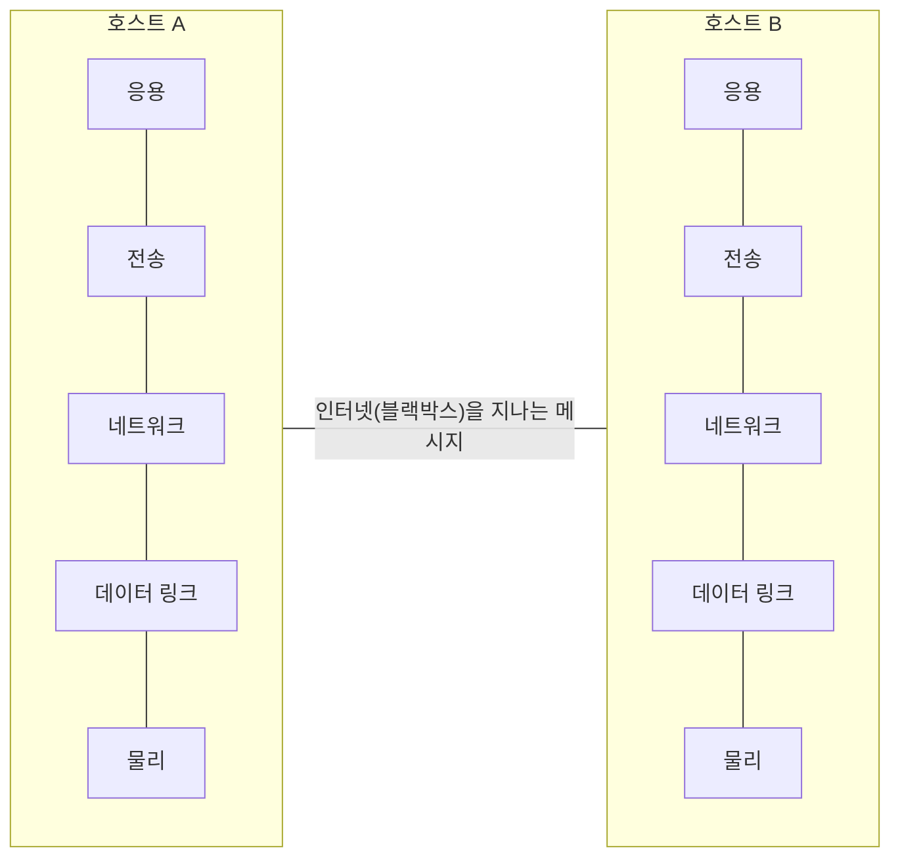

*그림 1. 두 호스트의 응용 계층 사이에 놓인 블랙박스로서의 인터넷*

이 상자를 여는 계층이 네트워크 계층이다. 송신 호스트의 전송 계층은 각 세그먼트를 자신의 네트워크 계층에 넘기고, 네트워크 계층은 그 세그먼트를 수신 호스트의 네트워크 계층까지 운반해야 한다. 이것이 네트워크 계층의 호스트 간 통신 서비스이다. 전송 계층은 네트워크 계층이 이 서비스를 어떻게 구현하는지 모르는 채로 그 위에 프로세스 간 통신을 쌓는다(6장).

### 1.2 네트워크들의 결합

인터넷은 하나의 네트워크가 아니다. 인터넷은 연결 장치로 서로 이어진 많은 네트워크, 즉 링크로 이루어지며, 따라서 LAN과 WAN의 결합이다. 그림 2에서 각 선은 하나의 링크(LAN 또는 WAN)이고, 분홍색 장치는 여러 링크를 잇는 연결 장치이다. 호스트 A와 B는 각자의 링크로 이 결합의 가장자리에 붙어 있다.

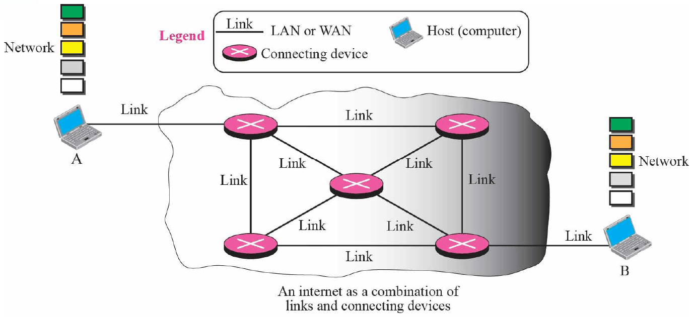

*그림 2. 링크와 연결 장치의 결합으로 이루어진 인터넷*

A에서 B로 가는 패킷은 여러 링크를 건넌다. 각 링크의 끝에서 연결 장치는 패킷을 자신의 다른 링크 가운데 어느 쪽으로 내보낼지 결정해야 한다. 이 결정을 네트워크 계층의 정보로 내리는 연결 장치가 라우터이다. 따라서 전송 계층이나 응용 계층과 달리 네트워크 계층은 경로 위의 모든 호스트와 모든 라우터에서 동작하며, 이 때문에 네트워크 계층 프로토콜은 프로토콜 스택에서 가장 복잡한 편에 속한다.

그림 3은 종단 시스템 H1에서 라우터 R1, R2를 거쳐 종단 시스템 H2로 가는 경로에 관여하는 계층을 보여 준다. H1의 네트워크 계층은 전송 계층에서 세그먼트를 받아 각 세그먼트를 데이터그램으로 캡슐화하고, 그 데이터그램을 가까운 라우터 R1로 보낸다. H2의 네트워크 계층은 가까운 라우터 R2로부터 데이터그램을 받아 전송 계층 세그먼트를 꺼내고 이를 전송 계층으로 올려 보낸다. 각 라우터의 데이터 평면이 맡는 주된 역할은 입력 링크로 들어온 데이터그램을 출력 링크로 포워딩하는 것이다. 제어 평면의 주된 역할은 데이터그램이 종단 간에 전달되도록 이 국지적 포워딩 동작들을 조율하는 것이다.

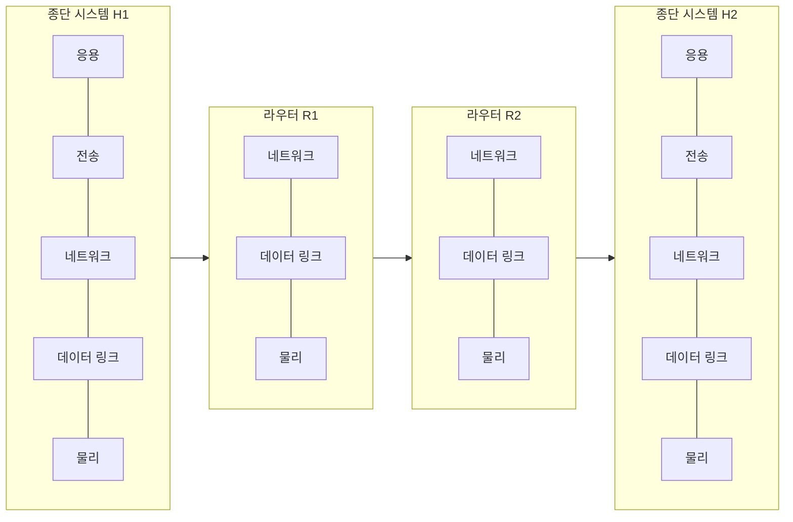

*그림 3. 두 종단 시스템의 프로토콜 스택과 그 사이 라우터의 축소된 스택*

그림 3의 라우터는 물리 계층, 데이터 링크 계층, 네트워크 계층만 있는 축소된 프로토콜 스택을 가진다. 라우터는 응용 계층과 전송 계층 프로토콜을 실행하지 않으므로 라우터에는 네트워크 계층 위에 아무 계층도 없다.

> **핵심:** 네트워크 계층은 모든 호스트와 모든 라우터에 있다. 전송 계층과 응용 계층은 종단 시스템에만 있다.

### 1.3 라우터와 링크 계층 스위치

패킷의 헤더 값에 따라 패킷을 입력 링크 인터페이스에서 출력 링크 인터페이스로 옮기는 장치를 패킷 스위치라고 한다. 패킷 스위치는 어느 헤더를 읽는가에 따라 나뉜다.

> **용어 정의:** **패킷 스위치(packet switch)** 는 패킷 헤더 필드의 값에 따라 패킷을 입력 링크 인터페이스에서 출력 링크 인터페이스로 옮기는 장치이다.

| 패킷 스위치 | 포워딩 결정에 쓰는 헤더 | 계층 |
|:--|:--|:--|
| 링크 계층 스위치 | 링크 계층 프레임의 필드 | 2계층 (20장) |
| 라우터 | 네트워크 계층 데이터그램의 필드 | 3계층 (이 장) |

*표 1. 두 종류의 패킷 스위치와 각자가 읽는 헤더*

이 장은 네트워크 계층을 다루므로 패킷 스위치를 라우터라고 부른다. 포워딩과 스위칭이라는 말은 흔히 같은 뜻으로 쓰이며, 이 장도 그 관례를 따른다.

---

<br>

## 2. 포워딩과 라우팅

### 2.1 네트워크 계층의 두 기능

네트워크 계층의 역할은 단순해 보인다. 송신 호스트에서 수신 호스트로 패킷을 옮기는 것이다. 이를 위해 두 가지 기능이 필요하다.

> **용어 정의:** **포워딩(forwarding)** 은 입력 링크 인터페이스로 들어온 패킷을 알맞은 출력 링크 인터페이스로 옮기는, 라우터 안에서 일어나는 국지적 동작이다.

> **용어 정의:** **라우팅(routing)** 은 패킷이 송신지에서 목적지까지 거쳐 갈 종단 간 경로를 결정하는 네트워크 전체 차원의 과정이다. 이 경로를 계산하는 알고리즘을 라우팅 알고리즘이라고 한다.

두 기능은 범위와 시간 규모가 다르다. 포워딩은 패킷마다 수행되며 매우 짧은 시간, 보통 수 나노초 안에 끝나야 하므로 대개 하드웨어로 구현한다. 라우팅은 네트워크 전체를 고려하고 훨씬 긴 시간 규모, 보통 수 초 단위로 동작하며 흔히 소프트웨어로 구현한다.

자동차 여행이 좋은 비유이다. 운전자가 펜실베이니아에서 플로리다까지 가면서 많은 인터체인지를 지난다고 하자. 인터체인지 하나를 통과하는 일, 즉 한 도로로 들어와서 빠져나갈 도로를 고르는 일이 포워딩에 해당한다. 출발 전에 지도를 보고 가능한 여러 도로 구간의 연결 가운데 하나를 고르는 일, 즉 여행 전체를 계획하는 일이 라우팅에 해당한다.

| 측면 | 포워딩 | 라우팅 |
|:--|:--|:--|
| 범위 | 라우터 하나 | 네트워크 전체 |
| 답하는 질문 | 이 패킷은 어느 출력 링크로 나가는가? | 패킷은 송신지에서 목적지까지 어느 경로로 가야 하는가? |
| 시간 규모 | 패킷당 나노초 | 초 |
| 일반적인 구현 | 하드웨어 | 소프트웨어 |
| 평면 | 데이터 평면 | 제어 평면 |
| 도로 비유 | 인터체인지 하나의 통과 | 여행 전체의 계획 |

*표 2. 포워딩과 라우팅의 비교*

가장 흔한 경우의 포워딩은 패킷 하나를 입력 하나에서 출력 하나로 옮긴다. 24장에서 다루는 더 일반적인 경우에는 라우터가 패킷의 송신지가 알려진 악성 호스트라는 등의 이유로 패킷이 나가지 못하게 막거나, 패킷을 복제해 여러 출력 링크로 보낼 수도 있다.

> **참고:** 많은 저자가 포워딩과 라우팅을 같은 뜻으로 쓴다. 예를 들어 Forouzan은 라우터가 패킷마다 참조하는 표를 라우팅 테이블(routing table)이라고 부른다. 이 정리본은 두 낱말을 위에서 정의한 엄밀한 뜻으로 쓰며, 그 표의 두 이름 사이의 관계는 13장에서 정리한다.

### 2.2 포워딩 테이블

> **용어 정의:** **포워딩 테이블(forwarding table)** 은 도착한 패킷의 헤더 필드 값을 그 패킷을 내보낼 출력 링크 인터페이스에 대응시키는, 라우터 안의 표이다.

라우터는 하나 이상의 헤더 필드 값을 살펴 그 값으로 포워딩 테이블을 조회하는 방식으로 패킷을 포워딩한다. 그 값에 해당하는 항목이 출력 링크 인터페이스를 알려 준다. 표 3은 작은 예이다. 헤더 값이 0110인 패킷이 도착하면 라우터는 0110의 항목을 찾고, 패킷을 내부에서 인터페이스 2로 옮긴다.

| 헤더 값 | 출력 링크 인터페이스 |
|:--|:--|
| 0100 | 3 |
| 0110 | 2 |
| 0111 | 2 |
| 1001 | 1 |

*표 3. 헤더 값을 출력 인터페이스에 대응시키는 국지적 포워딩 테이블*

헤더 값이 무엇인지는 네트워크에 따라 다르다. IP가 쓰는 데이터그램 방식에서는 그 값이 데이터그램의 목적지 주소이고, 표에는 개별 주소가 아니라 주소 접두사가 들어 있으므로 조회는 가장 길게 일치하는 접두사를 찾는 탐색이 된다(13장). 4.4절의 가상 회선 방식에서는 그 값이 짧은 레이블이다.

### 2.3 데이터 평면과 제어 평면

포워딩과 라우팅은 네트워크 계층의 서로 다른 두 부분에 속한다.

> **용어 정의:** **데이터 평면(data plane)** 은 라우터의 입력 링크 하나로 도착한 데이터그램을 출력 링크 가운데 어느 쪽으로 포워딩할지 결정하는, 네트워크 계층의 라우터별 부분이다.

> **용어 정의:** **제어 평면(control plane)** 은 데이터그램이 종단 간 경로를 따라 라우팅되는 방식, 즉 라우터들의 포워딩 테이블을 계산하고 설치하는 방식을 결정하는 네트워크 계층의 네트워크 전체 차원의 논리이다.

두 평면은 포워딩 테이블에서 만난다. 데이터 평면은 패킷마다 표를 읽기만 한다. 제어 평면은 표에 무엇이 들어갈지 정한다. 그러므로 포워딩 테이블이 애초에 어떻게 채워지는가라는 질문이 자연스럽게 생기며, 답은 두 가지이다.

### 2.4 전통적 방식: 모든 라우터에서 라우팅

그림 4의 전통적 방식에서는 라우팅 알고리즘이 모든 라우터에서 실행되므로 포워딩 기능과 라우팅 기능이 모두 각 라우터 안에 들어 있다. 한 라우터의 라우팅 알고리즘은 라우팅 프로토콜에 따라 라우팅 메시지를 주고받으며 다른 라우터의 라우팅 알고리즘과 통신하고, 받은 정보로 자신의 포워딩 테이블 내용을 계산한다. OSPF, BGP 같은 라우팅 알고리즘과 프로토콜은 14장과 15장의 주제이다.

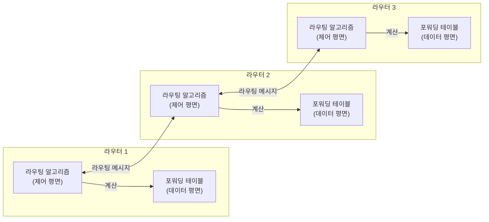

*그림 4. 모든 라우터의 라우팅 알고리즘이 그 라우터의 포워딩 테이블을 계산하는 구조*

두 기능의 목적이 서로 다르다는 점은 운영자가 각 라우터 앞에서 모든 포워딩 테이블을 손으로 설정하는 가상의 네트워크를 생각하면 분명해진다. 이런 네트워크에는 라우팅 프로토콜이 전혀 필요 없다. 물론 운영자들은 패킷이 목적지에 도달하도록 서로 조율해야 한다. 또 수동 설정은 라우팅 프로토콜보다 오류가 나기 쉽고 토폴로지 변화에 훨씬 느리게 대응하므로, 실제 네트워크는 두 기능을 모두 가진다.

### 2.5 SDN 방식: 원격 컨트롤러

사람이 포워딩 테이블을 설정할 수 있다는 관찰은 제어 평면이 반드시 라우터 안에 있을 필요가 없음을 시사한다. 그림 5의 대안에서는 라우터와 물리적으로 분리된 원격 컨트롤러가 모든 라우터의 포워딩 테이블을 계산해 배포한다. 데이터 평면 구성 요소는 그림 4와 같다. 라우팅 장치는 포워딩만 수행하고, 컨트롤러와 라우터는 포워딩 테이블과 그 밖의 라우팅 정보를 담은 메시지를 주고받으며 통신한다.

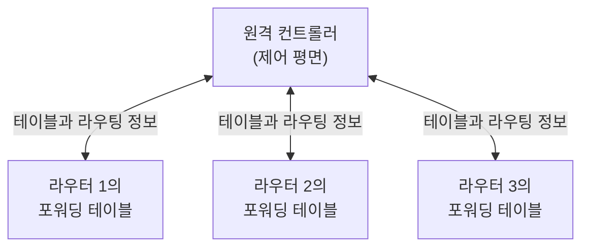

*그림 5. 원격 컨트롤러가 포워딩 테이블을 계산하고 배포하는 구조*

> **용어 정의:** **소프트웨어 정의 네트워킹**(software-defined networking, SDN)은 소프트웨어로 구현한 원격 컨트롤러가 포워딩 테이블을 계산해 포워딩만 수행하는 라우터들에 배포하는 네트워크 계층 구성 방식이다.

포워딩 테이블을 계산하는 컨트롤러가 소프트웨어이므로 이 네트워크를 소프트웨어 정의 네트워크라고 부른다. 컨트롤러는 신뢰성과 중복성이 높은 원격 데이터 센터에서 실행될 수 있고, ISP나 제3자가 관리할 수 있다. 컨트롤러 소프트웨어는 점점 Linux 소스 코드처럼 공개되는 추세여서 ISP와 연구자가 네트워크 계층을 제어하는 논리에 변경을 제안할 수 있다. SDN 제어 평면은 15장에서, SDN 라우터가 수행하는 일반화된 포워딩은 24장에서 다룬다.

| 측면 | 전통적 방식 | SDN 방식 |
|:--|:--|:--|
| 제어 평면의 위치 | 모든 라우터 안 | 원격 컨트롤러 |
| 테이블 계산 방법 | 각 라우터가 라우팅 메시지로 자기 테이블을 계산 | 컨트롤러가 모든 테이블을 계산 |
| 라우터가 하는 일 | 포워딩과 라우팅 | 포워딩만 |
| 데이터 평면 | 각 라우터의 포워딩 테이블 | 같음 |

*표 4. 전통적 제어 평면과 SDN 제어 평면*

---

<br>

## 3. 네트워크 서비스 모델

### 3.1 서비스 모델이 답하는 질문

송신 호스트의 전송 계층이 패킷을 네트워크 계층으로 내려 보낼 때 여러 질문이 생긴다. 전송 계층은 네트워크 계층이 패킷을 목적지까지 전달해 주리라고 믿을 수 있는가? 여러 패킷을 보내면 수신 측 전송 계층에 보낸 순서대로 전달되는가? 연속한 두 전송 사이의 시간 간격이 수신 측에서도 유지되는가? 네트워크가 혼잡에 관한 피드백을 주는가? 이 질문들의 답은 네트워크 계층의 서비스 모델이 정한다.

> **용어 정의:** **네트워크 서비스 모델(network service model)** 은 송신 호스트와 수신 호스트 사이에서 패킷이 종단 간에 전달되는 방식의 특성을 정의한 것이다.

### 3.2 가능한 서비스

네트워크 계층은 표 5의 서비스를 제공할 수 있다. 이 목록은 일부일 뿐이며 변형은 무수히 많다.

| 서비스 | 보장하는 내용 |
|:--|:--|
| 전달 보장 | 송신지가 보낸 패킷은 결국 목적지에 도착한다. |
| 지연 한도가 있는 전달 보장 | 패킷이 정해진 호스트 간 지연 한도, 예를 들어 100 ms 안에 도착한다. |
| 순서대로 전달 | 패킷이 보낸 순서대로 목적지에 도착한다. |
| 최소 대역폭 보장 | 네트워크가 두 호스트 사이에서 정해진 비트율, 예를 들어 1 Mbps의 링크처럼 동작하므로, 송신자가 그 비트율 아래로 보내는 한 모든 패킷이 도착한다. |
| 보안 | 모든 데이터그램을 송신지에서 암호화하고 목적지에서 복호화하므로 모든 전송 계층 세그먼트의 기밀성이 보장된다. |

*표 5. 네트워크 계층이 제공할 수 있는 서비스*

### 3.3 인터넷의 최선형 서비스

> **용어 정의:** **최선형 서비스(best-effort service)** 는 전달, 순서, 종단 간 지연, 최소 대역폭 가운데 어느 것도 보장하지 않는 네트워크 서비스 모델이다.

인터넷의 네트워크 계층은 최선형 서비스라는 단 하나의 서비스만 제공한다. 패킷이 보낸 순서대로 도착한다는 보장이 없고, 결국 전달된다는 보장조차 없다. 종단 간 지연에 한도가 없고 최소 대역폭도 없다. 글자 그대로 읽으면 패킷을 하나도 전달하지 않는 네트워크도 이 정의를 만족하므로, 최선형은 서비스가 없다는 말을 완곡하게 표현한 것처럼 보이기도 한다.

다른 네트워크 구조는 더 강한 서비스 모델을 정의한다. 예를 들어 ATM 구조는 순서대로 전달 보장, 지연 한도, 최소 대역폭 보장을 제공하며(ATM은 21장에 나온다), 인터넷 구조에도 종단 간 지연을 보장하려는 확장이 제안된 적이 있다. 그럼에도 단순한 최선형 모델과 충분한 대역폭 공급의 조합은 동영상 스트리밍, IP 음성과 영상, 실시간 화상 회의를 포함한 폭넓은 응용에 충분하다는 것이 입증되었다.

> **핵심:** 인터넷의 네트워크 계층은 표 5의 다섯 가지 보장 가운데 어느 것도 제공하지 않는다. 신뢰적이고 순서가 지켜지는 전달은 전송 계층의 TCP가 종단 간에 덧붙이지만(8장), 네트워크 자체가 제공하지 않는 지연 한도나 최소 대역폭은 어떤 상위 계층도 덧붙일 수 없다.

---

<br>

## 4. 네트워크 계층의 패킷 교환

네트워크 계층은 패킷 교환 네트워크로 설계되어 있다. 송신지의 메시지는 다루기 쉬운 크기의 패킷, 보통 데이터그램이라 부르는 단위로 나뉘고, 데이터그램은 하나씩 송신지에서 목적지로 전달되며, 목적지는 원래 메시지를 복원하기 전에 이들을 조립한다. 패킷 교환과 회선 교환의 비교는 1장에서 다루었고, 이 절은 패킷 교환 네트워크 계층이 동작할 수 있는 두 방식을 살펴본다. 인터넷의 네트워크 계층은 처음에 비연결형 서비스로 설계되었고 지금도 데이터그램 방식을 쓰지만, MPLS의 레이블 교환(21장)처럼 연결형 서비스를 더하려는 경향도 있다.

> **참고:** 연결이라는 말은 네트워크 계층과 전송 계층에서 뜻이 다르다. TCP 연결 같은 전송 계층 연결은 두 종단 시스템의 상태로만 존재하고, 그 사이의 라우터는 연결에 대해 아무것도 모른다. 반면 연결형 네트워크 계층은 라우터가 직접 경로를 유지하게 하므로 경로 위의 모든 라우터가 그 연결의 항목을 가진다.

### 4.1 데이터그램 방식: 비연결형 서비스

> **용어 정의:** **데이터그램 방식(datagram approach)** 은 모든 패킷을 독립적으로 다루고 각 패킷 헤더의 목적지 주소에 따라 포워딩하는, 패킷 교환 네트워크 계층의 비연결형 동작 방식이다.

인터넷이 시작될 때 네트워크 계층은 단순하게 유지하기 위해 비연결형 서비스로 설계되었다. 네트워크 계층은 각 패킷을 송신지에서 목적지로 전달하는 일만 책임진다. 각 패킷은 같은 메시지의 다른 패킷과 아무 관계가 없는 독립된 개체이다. 한 메시지의 패킷 뒤에는 같은 메시지의 패킷이 올 수도 있고 다른 메시지의 패킷이 올 수도 있으며, 같은 송신지의 패킷이 올 수도 있고 다른 송신지의 패킷이 올 수도 있다. 이런 네트워크의 스위치를 라우터라고 부른다.

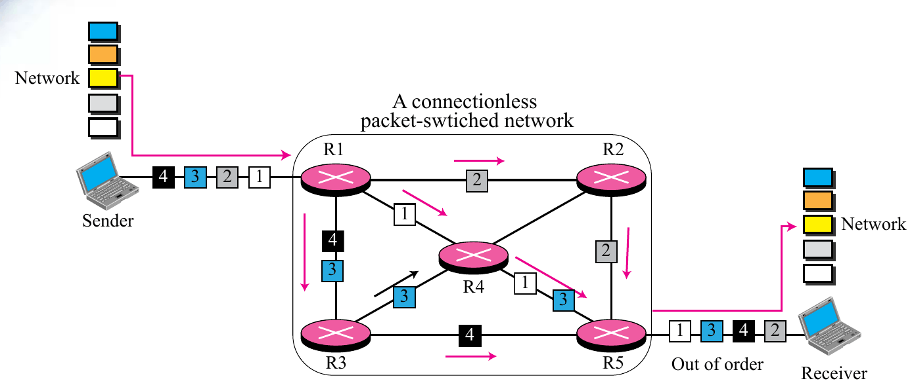

*그림 6. 비연결형 패킷 교환 네트워크*

그림 6에서 송신자는 패킷 1, 2, 3, 4를 차례로 보낸다. 각 라우터가 패킷마다 독립적으로 결정하므로 같은 메시지의 패킷이 같은 경로로 갈 수도 있고 그렇지 않을 수도 있다. 그림에서 패킷들은 R5에 이르기 전에 R2, R3, R4를 지나는 여러 경로로 흩어진다. 경로마다 길이와 큐가 다르므로 패킷은 순서가 뒤바뀐 채 수신자에 도착한다.

순서가 바뀐 채 도착한다는 것은 수신 측이 먼저 온 패킷을 잠시 저장했다가 모든 패킷을 다시 순서대로 정렬한 뒤에야 메시지를 전달해야 한다는 뜻이다. 이런 대기는 실시간 데이터가 아니기 때문에 허용된다. 인터넷에서는 네트워크 계층이 아니라 그 위의 전송 계층이 이 재정렬을 맡는다(8장).

### 4.2 비연결형 네트워크의 포워딩

각 패킷은 헤더에 담긴 정보, 즉 송신지 주소와 목적지 주소에 따라 라우팅된다. 목적지 주소는 패킷이 갈 곳을, 송신지 주소는 패킷이 온 곳을 나타낸다. 라우터는 출력 인터페이스를 고를 때 목적지 주소만 쓴다. 송신지 주소는 패킷을 버려야 해서 송신지에 오류 메시지를 돌려보낼 때 쓰인다(16장).

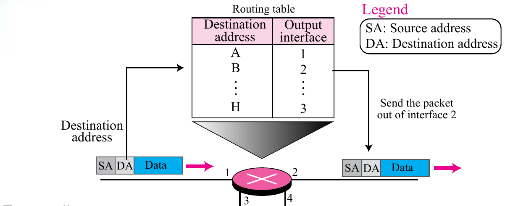

*그림 7. 비연결형 네트워크 라우터의 포워딩 과정*

그림 7에서 라우터의 표는 목적지 주소 A, B, ..., H와 각각의 출력 인터페이스를 나열한다. 송신지 주소 SA와 목적지 주소 DA를 가진 패킷이 인터페이스 1로 도착한다. 라우터는 표에서 DA를 찾아 목적지가 인터페이스 2 쪽에 있음을 알아내고, 패킷을 바꾸지 않은 채 인터페이스 2로 내보낸다. 그림의 표는 2.2절의 포워딩 테이블에서 실제 주소 대신 기호 주소를 쓴 것이다.

> **핵심:** 비연결형 패킷 교환 네트워크에서 포워딩 결정은 패킷의 목적지 주소에 근거한다.

### 4.3 비연결형 네트워크의 지연

패킷 손실과 재전송을 무시하고, 목적지가 모든 패킷을 기다리는 시간도 무시하면 패킷 하나의 지연을 그림 8처럼 모형화할 수 있다. 패킷은 송신지를 떠나 라우터 둘을 건너 목적지에 도착하므로 세 번 전송된다(사건 1, 2, 3).

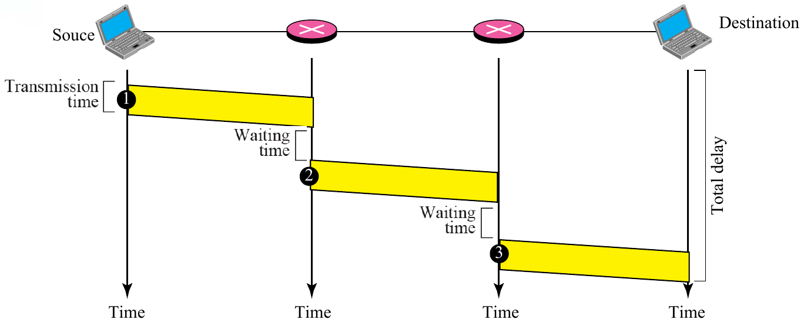

*그림 8. 비연결형 네트워크에서 패킷 하나의 지연*

노란 띠 하나가 전송 한 번이다. 띠의 높이는 전송 시간, 즉 패킷의 모든 비트를 링크에 밀어 넣는 데 걸리는 시간이다. 띠의 기울기는 비트가 링크를 따라 이동하는 데 걸리는 전파 시간이다. 두 띠 사이에서 패킷은 라우터 안에서 기다리며, 그동안 라우터는 헤더를 검사하고 포워딩 테이블을 조회하고 출력 링크가 비기를 기다린다. 전송 시간 한 번을 T, 전파 시간 한 번을 τ, 두 라우터의 대기 시간을 w₁과 w₂라 하면 이 모형의 전체 지연은 다음과 같다.

```math
\text{Total delay} = 3T + 3\tau + w_1 + w_2
```

인터넷의 교환은 네트워크 계층에서 이 데이터그램 방식으로 이루어지므로 메시지의 모든 패킷은 거쳐 가는 모든 라우터에서 각자의 대기 시간을 겪는다. 이 지연 성분들(처리 지연, 큐잉 지연, 전송 지연, 전파 지연)은 1장에서 자세히 다룬다.

### 4.4 가상 회선 방식: 연결형 서비스

> **용어 정의:** **가상 회선(virtual circuit)** 은 데이터 전송 전에 송신지와 목적지 사이에 설정되어 메시지의 모든 패킷이 같은 경로를 따르게 하고, 경로 위의 모든 라우터가 그 연결의 항목을 유지하는 경로이다.

연결형 서비스에서는 한 메시지의 모든 패킷 사이에 관계가 있다. 메시지의 데이터그램을 보내기 전에 그 경로를 정하는 가상 연결을 설정하고, 설정이 끝나면 모든 데이터그램이 그 경로를 따른다. 연결형 서비스는 설정, 데이터 전송, 해제의 세 단계로 만들어진다. 설정 단계에서는 송신지와 목적지 주소를 이용해 라우터에 표 항목을 만든다. 해제 단계에서는 송신지와 목적지가 라우터에 그 항목을 지우라고 알린다. 데이터 전송은 두 단계 사이에서 일어난다.

> **용어 정의:** **레이블(label)** 은 패킷이 어느 가상 회선에 속하는지를 각 라우터에 알려 주기 위해 패킷이 싣고 다니는 짧은 식별자로, 가상 회선 식별자(VCI)나 흐름 레이블이라고도 한다.

모든 패킷은 송신지와 목적지 주소 외에 따라가야 할 가상 경로를 나타내는 레이블을 싣는다. 레이블이 있으면 주소가 쓸모없어 보이지만, 네트워크 계층에서 연결형 서비스를 쓰는 네트워크도 두 가지 이유로 주소를 유지한다. 경로의 일부가 여전히 비연결형 서비스를 쓸 수 있고, 네트워크 계층 프로토콜이 이 주소를 전제로 설계되어 있어서 바꾸는 데 시간이 걸린다.

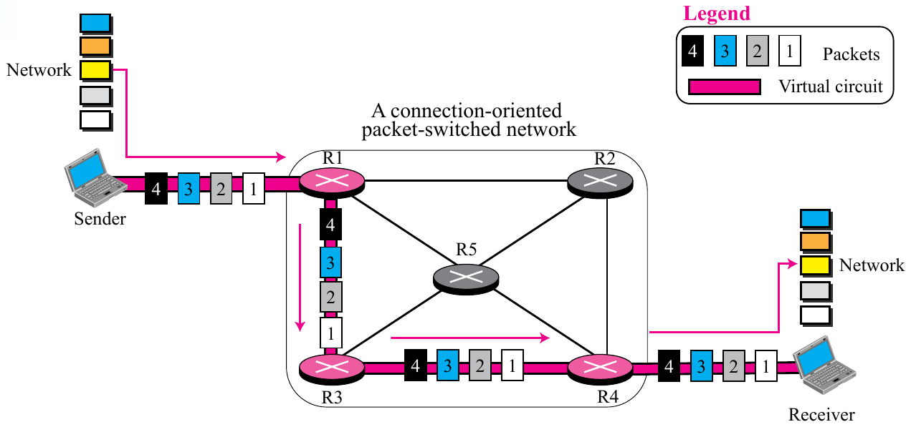

*그림 9. 연결형 패킷 교환 네트워크*

그림 9에서 송신자에서 수신자로 가는 가상 회선은 R1, R3, R4를 지난다. 네 패킷은 모두 이 회선을 따라가며 보낸 순서대로 도착하고, 라우터 R2와 R5는 이 연결에 쓰이지 않는다.

> **핵심:** 연결형 패킷 교환 네트워크에서 포워딩 결정은 패킷의 레이블에 근거한다.

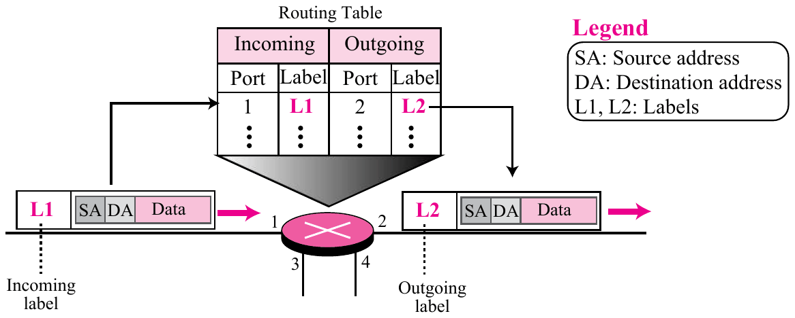

*그림 10. 연결형 네트워크 라우터의 포워딩 과정*

그림 10은 라우터가 레이블이 붙은 패킷을 포워딩하는 방법을 보여 준다. 표에는 입력 포트, 입력 레이블, 출력 포트, 출력 레이블의 네 열이 있다. 레이블 L1을 단 패킷이 포트 1로 도착한다. 라우터는 (포트 1, 레이블 L1) 항목을 찾아 패킷이 레이블 L2를 달고 포트 2로 나간다는 것을 알아내고, L1을 L2로 바꾸어 내보낸다. 따라서 레이블은 이웃한 두 라우터 사이의 링크 하나에서만 의미가 있고 홉마다 바뀐다.

송신지 주소, 목적지 주소, 데이터를 담은 데이터그램은 레이블 뒤에서 변하지 않은 채 운반된다. 즉 데이터그램은 캡슐화되어 있고, 라우터는 그 앞의 레이블만 읽고 고쳐 쓴다. 네트워크가 포워딩에 쓰는 추가 헤더 뒤에 원래 패킷을 온전히 싣고 다니는 이 생각은 MPLS(21장)와 가상 사설망을 위한 터널링(26장)의 바탕이기도 하다.

### 4.5 설정 단계

설정 단계에서는 경로 위의 각 라우터가 가상 회선의 항목을 만든다. 송신지 A가 목적지 B까지 가상 회선을 만들어야 한다고 하자. 송신자와 수신자 사이에서 보조 패킷 두 개, 즉 요청 패킷과 확인 응답 패킷이 오간다.

요청 패킷은 송신지에서 목적지로 가며 송신지와 목적지 주소를 싣는다. 그림 11이 그 이동을 보여 준다.

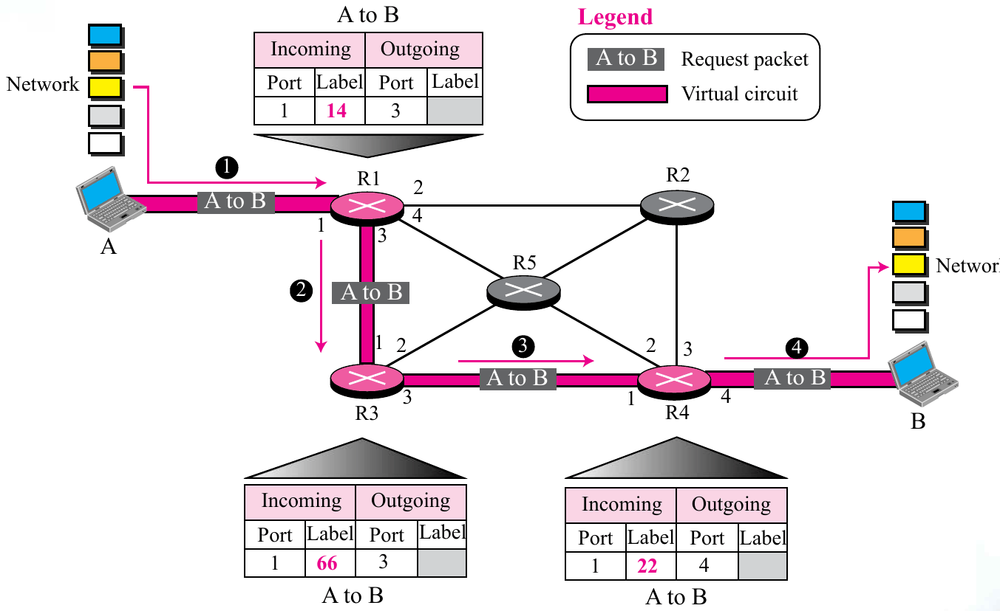

*그림 11. 가상 회선 네트워크에서 요청 패킷 보내기*

1. 송신지 A가 요청 패킷을 라우터 R1에 보낸다.
2. R1은 A에서 B로 가는 패킷이 포트 3으로 나간다는 것을 안다. 이를 어떻게 아는지는 라우팅의 일이다(14장, 15장). R1은 이 회선의 항목을 만들지만 네 열 가운데 세 열만 채울 수 있다. 입력 포트 1을 기록하고, 사용하지 않는 입력 레이블 14를 고르고, 출력 포트 3을 기록한다. 출력 레이블은 아직 모른다. R1은 요청을 포트 3으로 R3에 보낸다.
3. R3도 같은 일을 하여 입력 포트 1, 입력 레이블 66, 출력 포트 3을 채운다.
4. R4는 입력 포트 1, 입력 레이블 22, 출력 포트 4를 채운다.
5. 목적지 B가 요청을 받는다. A로부터 패킷을 받을 준비가 되어 있으면 B는 A에서 오는 패킷에 레이블 77을 배정한다. 이 레이블로 B는 패킷이 다른 송신지가 아니라 A에서 왔음을 안다.

| 라우터 | 입력 포트 | 입력 레이블 | 출력 포트 | 출력 레이블 |
|:--|:--|:--|:--|:--|
| R1 | 1 | 14 | 3 | (미정) |
| R3 | 1 | 66 | 3 | (미정) |
| R4 | 1 | 22 | 4 | (미정) |

*표 6. 요청 패킷이 지나간 뒤 A에서 B로 가는 회선의 항목*

확인 응답 패킷은 목적지에서 송신지로 되돌아가며 항목을 완성한다. 그림 12가 그 이동을 보여 준다.

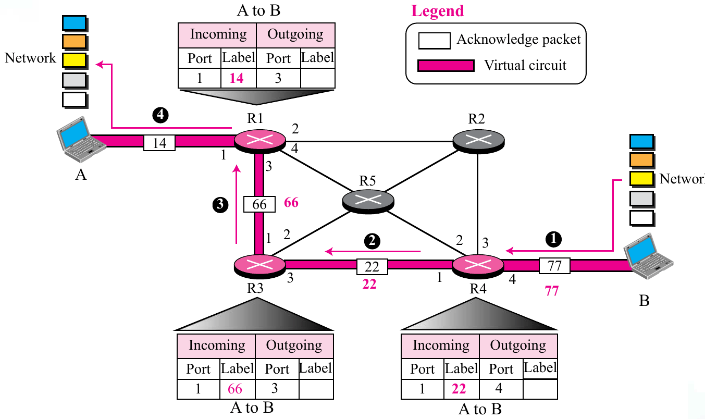

*그림 12. 가상 회선 네트워크의 설정 확인 응답*

1. B가 R4에 확인 응답을 보낸다. 확인 응답은 R4가 어느 항목을 완성할지 알 수 있도록 전역 송신지 주소와 목적지 주소를 싣고, B가 고른 레이블 77도 싣는다. R4는 77을 출력 레이블 열에 적는다. 77은 B에게는 입력 레이블이지만 R4에게는 출력 레이블이라는 점에 유의해야 한다.
2. R4는 자신의 입력 레이블 22를 담은 확인 응답을 R3에 보내고, R3은 22를 출력 레이블로 쓴다.
3. R3은 자신의 입력 레이블 66을 담은 확인 응답을 R1에 보내고, R1은 66을 출력 레이블로 쓴다.
4. R1은 자신의 입력 레이블 14를 담은 확인 응답을 A에 보낸다.
5. A는 B에게 보내는 데이터 패킷의 출력 레이블로 14를 쓴다.

| 라우터 | 입력 포트 | 입력 레이블 | 출력 포트 | 출력 레이블 |
|:--|:--|:--|:--|:--|
| R1 | 1 | 14 | 3 | 66 |
| R3 | 1 | 66 | 3 | 22 |
| R4 | 1 | 22 | 4 | 77 |

*표 7. 확인 응답이 지나간 뒤 완성된 A에서 B로 가는 회선의 항목*

각 노드는 자기 입력 링크에서 받기를 기대하는 레이블을 직접 고르고, 확인 응답은 그 선택을 한 홉 위쪽으로 전달하여 앞 노드의 출력 레이블이 되게 한다. 레이블은 링크 하나 안에서만 유일하면 되므로 같은 번호를 다른 링크에서 다시 쓸 수 있고, 작은 수로 충분하다.

### 4.6 데이터 전송 단계와 해제 단계

모든 라우터가 가상 회선의 항목을 만들고 나면 메시지의 네트워크 계층 패킷을 하나씩 차례로 보낸다. 그림 13은 패킷 하나의 흐름을 따라가지만, 패킷이 1개, 2개, 100개여도 과정은 같다.

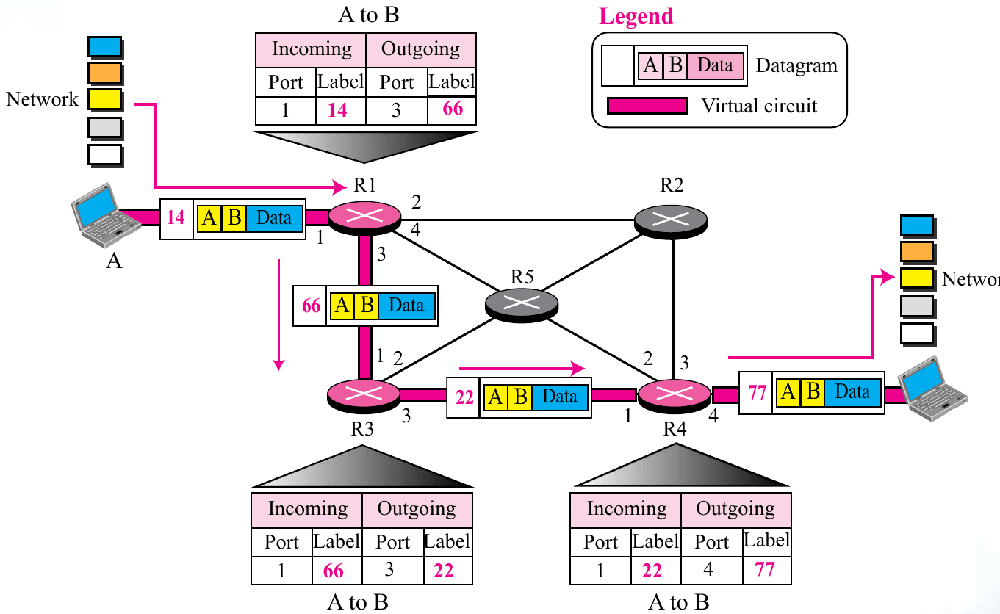

*그림 13. 설정된 가상 회선에서 패킷 하나의 흐름*

송신지 A는 설정 단계에서 R1에게서 받은 레이블 14를 달아 패킷을 보낸다. R1은 패킷을 R3으로 포워딩하면서 레이블을 66으로 바꾼다. R3은 R4로 포워딩하면서 레이블을 22로 바꾼다. R4는 레이블 77을 달아 B에 전달한다. 메시지의 모든 패킷이 같은 레이블 순서 14, 66, 22, 77을 따르므로 패킷은 순서대로 목적지에 도착한다.

해제 단계에서는 송신지 A가 B에게 모든 패킷을 보낸 뒤 특별한 해제 패킷을 보내고, B는 확인 패킷으로 응답한다. 그러면 경로 위의 모든 라우터가 이 회선의 항목을 지운다.

레이블은 작고 라우터가 직접 고른 값이므로 라우터는 표를 탐색하지 않고 입력 레이블을 표의 색인으로 바로 쓸 수 있다. 13장에서 이 색인 조회를 데이터그램 포워딩이 요구하는 목적지 주소 탐색과 비교한다.

### 4.7 연결형 네트워크의 지연

손실과 재전송을 무시하면 연결형 네트워크의 지연을 그림 14처럼 모형화할 수 있다.

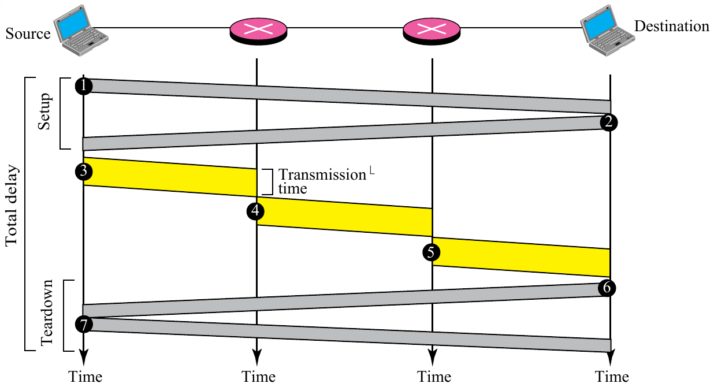

*그림 14. 연결형 네트워크의 지연*

데이터가 움직이기 전에 설정 패킷이 네트워크를 건넌다. 요청이 송신지에서 목적지로 가고(사건 1, 2), 확인 응답이 되돌아온다(사건 3까지). 그다음 데이터 패킷이 세 번 전송되며(사건 3, 4, 5), 경로와 표 항목이 이미 있으므로 모형은 이 전송들 사이에 대기 시간을 그리지 않는다. 데이터 뒤에는 해제 교환이 네트워크를 양방향으로 한 번씩 건넌다(사건 6, 7). 4.3절과 같이 T와 τ를 쓰면 전체 지연은 다음과 같다.

```math
\text{Total delay} = 3T + 3\tau + \text{setup delay} + \text{teardown delay}
```

설정 지연과 해제 지연은 패킷마다가 아니라 연결마다 한 번 치르는 비용이다. 많은 패킷으로 된 긴 메시지를 보내면 이 비용이 나뉘어 작아지지만, 짧은 메시지에서는 이 비용 때문에 연결형 방식이 데이터그램 방식보다 느릴 수 있다.

### 4.8 두 방식의 비교

| 측면 | 데이터그램 방식 | 가상 회선 방식 |
|:--|:--|:--|
| 연결 설정 | 없음 | 설정 단계와 해제 단계 |
| 라우터의 상태 | 연결별 상태 없음 | 경로 위 모든 라우터에 회선마다 항목 하나 |
| 포워딩에 쓰는 정보 | 목적지 주소 | 레이블 |
| 표 조회 | 목적지 주소로 탐색 | 입력 레이블로 색인 |
| 한 메시지 패킷들의 경로 | 패킷마다 다를 수 있음 | 모든 패킷이 같음 |
| 도착 순서 | 보장하지 않음 | 보낸 순서와 같음 |
| 경로 위 라우터의 고장 | 이후 패킷이 다른 경로로 갈 수 있음 | 고장 난 라우터를 지나는 회선이 끊기고 다시 설정해야 함 |
| 고정 비용 | 없음 | 설정 지연과 해제 지연 |
| 예 | 인터넷의 IP | ATM, 프레임 릴레이, X.25 (21장) |

*표 8. 데이터그램 방식과 가상 회선 방식의 비교*

---

<br>

## 5. 네트워크 계층 서비스의 예

### 5.1 가상의 인터넷 일부

네트워크 계층의 서비스는 예를 통해 보면 이해하기 쉽다. 설명은 오늘날 인터넷의 주된 서비스인 비연결형 서비스를 따른다. 출판사 Wonderful Publishing에서 일하는 Alice가 꽃집 Just Flowers의 관리자 Bob에게, 꽃집의 홍보 책자가 인쇄되어 발송할 준비가 되었다고 전자 메일을 보낸다.

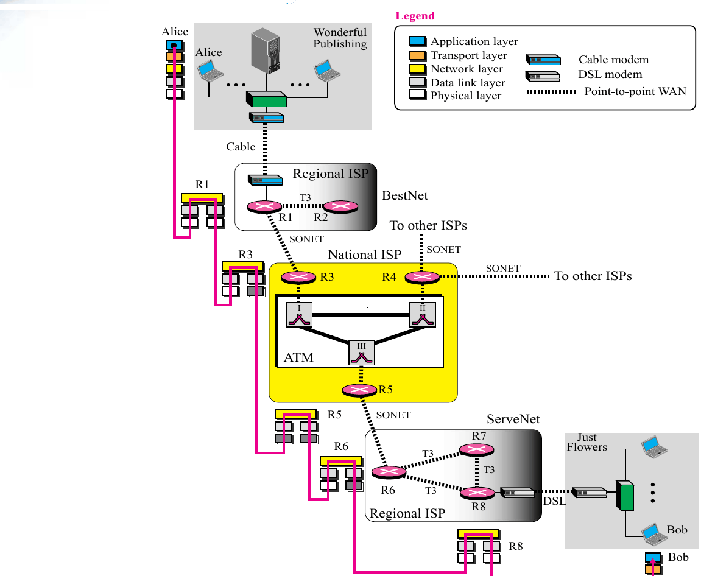

*그림 15. Alice와 Bob 사이의 가상의 인터넷 일부*

Wonderful Publishing은 케이블 WAN을 통해 지역 ISP인 BestNet에 연결된 LAN을 쓴다. Just Flowers도 DSL WAN을 통해 다른 지역 ISP인 ServeNet에 연결된 LAN을 쓴다. 두 지역 ISP는 고속 SONET WAN으로 국가 ISP에 연결되며, 그림에서 국가 ISP의 핵심부는 ATM 네트워크이다. Alice의 메시지는 여러 네트워크 계층 패킷으로 나뉠 수 있고, 이 패킷들은 같은 경로를 따를 수도 있고 그렇지 않을 수도 있다. 패킷 하나를 따라가기 위해 그 패킷이 라우터 R1, R3, R5, R6, R8을 지난다고 가정한다. 두 컴퓨터는 TCP/IP 프로토콜 스위트의 다섯 계층을 모두 쓰고, 라우터는 세 계층만 쓴다.

### 5.2 논리 주소 지정

네트워크 계층은 종단 간 통신을 제공하므로 서로 통신하는 두 컴퓨터에는 네트워크 계층 주소 또는 논리 주소라고 부르는 보편적인 식별 체계가 필요하다. 인터넷은 하나의 주소 공간으로 이를 제공한다. 인터넷을 쓰는 모든 개체는 이 주소 풀에서 유일한 주소를 하나씩 배정받아야 한다. Alice와 Bob은 각각 네트워크 계층 주소가 필요하다. IPv4의 32비트 주소는 12장의 주제이고, IPv6의 128비트 주소는 24장의 주제이다(버전 5는 배치되지 않았다).

### 5.3 송신 컴퓨터의 서비스

송신지의 네트워크 계층은 상위 계층으로부터 데이터, 데이터 길이, 논리 목적지 주소, 네트워크 계층을 사용하는 상위 프로토콜의 프로토콜 ID, 서비스 유형을 받는다. 네트워크 계층은 이 정보로 단편화되었을 수 있는 데이터그램들과 다음 홉의 MAC 주소를 만들어 데이터 링크 계층에 넘긴다. 그림 16이 여기에 관여하는 네 가지 서비스를 보여 준다.

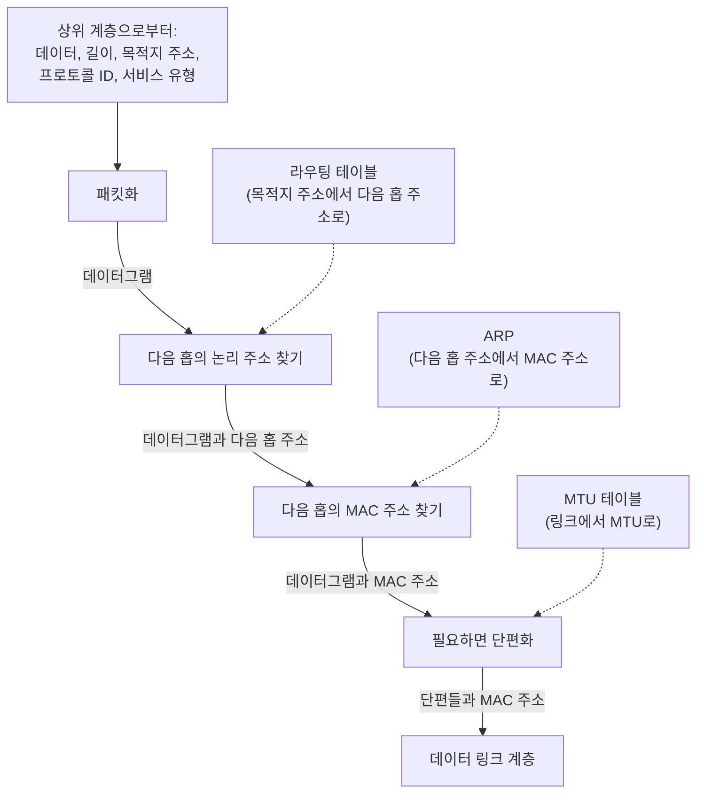

*그림 16. 송신 컴퓨터의 네트워크 계층이 제공하는 서비스*

1. **패킷화.** 네트워크 계층의 첫 임무는 상위 계층의 데이터를 데이터그램으로 캡슐화하는 것이다. 논리 송신지 주소와 목적지 주소, 단편화 정보, 서비스를 요청한 프로토콜의 프로토콜 ID, 데이터 길이, 경우에 따라 옵션을 담은 헤더를 붙인다. 또 헤더에 대해서만 계산한 체크섬도 넣는다(11장). 상위 계층은 목적지 주소만 주며, 모든 호스트는 자기 주소를 알고 있으므로 송신지 주소는 네트워크 계층 자신이 채운다.
2. **다음 홉의 논리 주소 찾기.** 목적지가 송신지와 같은 네트워크에 있지 않으면 데이터그램은 먼저 라우터로 가야 한다. 데이터그램의 송신지 주소와 목적지 주소는 그 라우터에 대해 아무것도 알려 주지 않으므로 네트워크 계층은 표를 참조해 다음 홉의 논리 주소를 찾는다(13장).
3. **다음 홉의 MAC 주소 찾기.** 데이터그램을 실제로 전달하는 것은 네트워크 계층이 아니라 데이터 링크 계층이며, 데이터 링크 계층에는 다음 홉의 MAC 주소가 필요하다. 보조 프로토콜인 주소 결정 프로토콜(ARP)이 다음 홉의 논리 주소를 MAC 주소로 바꾼다(19장).
4. **단편화.** 대부분의 LAN과 WAN은 프레임이 실을 수 있는 데이터의 크기, 즉 최대 전송 단위(MTU)를 제한한다. 데이터그램이 링크의 MTU보다 크면 더 작은 단위로 나눈다. 데이터는 나누지만 헤더는 모든 단편에 반복되어야 하고, 각 단편이 전체 데이터그램의 어디에 있는지 나타내는 정보가 추가된다(11장).

### 5.4 각 라우터의 처리

라우터는 데이터그램 하나에 대해 입력 인터페이스와 출력 인터페이스라는 두 인터페이스와 관계를 맺는다. 라우터의 네트워크 계층은 입력 인터페이스의 데이터 링크 계층에서 데이터그램을 받아 필요하면 단편화하고, 단편들을 출력 인터페이스의 데이터 링크 계층에 넘긴다. 보통 라우터는 상위 계층을 사용하지 않는다.

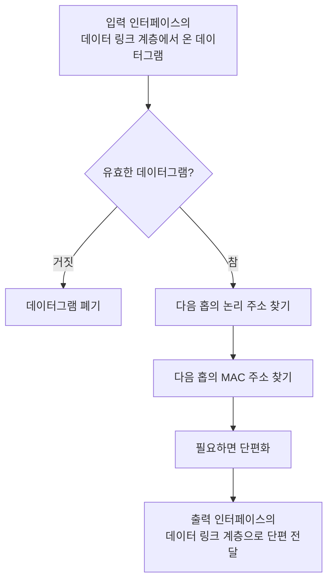

*그림 17. 각 라우터에서 데이터그램의 처리*

마지막 세 단계는 송신지의 마지막 세 서비스와 같다. 다만 그 전에 라우터는 헤더 체크섬으로 데이터그램이 유효한지 검사한다. 유효한 데이터그램이란 헤더가 손상되지 않았고 올바른 라우터에 전달된 데이터그램이다.

### 5.5 목적지 컴퓨터의 처리

목적지의 네트워크 계층은 포워딩이 필요 없으므로 더 단순하다. 도착한 각 데이터그램의 유효성을 확인한 뒤 각 단편의 데이터를 꺼내 저장한다. 모든 단편이 도착하면 데이터를 재조립해 상위 계층에 전달한다. 또 재조립 타이머를 설정하며, 모든 단편이 도착하기 전에 타이머가 만료되면 저장한 단편을 모두 폐기하고 데이터그램 전체를 다시 보낼 수 있도록 오류 메시지를 보낸다.

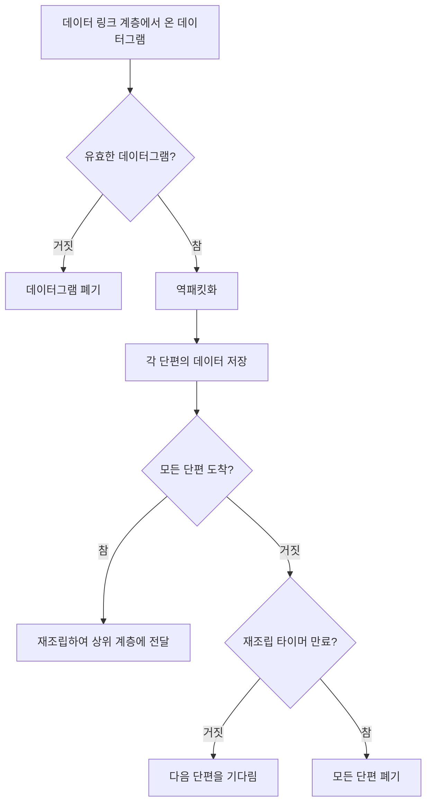

*그림 18. 목적지 컴퓨터에서 데이터그램의 처리*

네트워크 계층은 모든 조각이 도착해 재조립될 때까지 아무것도 전달하지 않으므로 단편화는 상위 계층에 드러나지 않는다. 데이터그램은 송신지에서 단편화되고 다시 어느 라우터에서든 단편화될 수 있으므로 재조립은 섬세한 절차이며, 11장에서 자세히 설명한다.

| 위치 | 네트워크 계층의 서비스 |
|:--|:--|
| 송신 컴퓨터 | 패킷화, 다음 홉 논리 주소 찾기, 다음 홉 MAC 주소 찾기, 단편화 |
| 각 라우터 | 유효성 검사, 다음 홉 논리 주소 찾기, 다음 홉 MAC 주소 찾기, 단편화 |
| 목적지 컴퓨터 | 유효성 검사, 역패킷화, 단편 저장, 타이머를 둔 재조립 |

*표 9. 송신지, 각 라우터, 목적지에서의 네트워크 계층 서비스*

---

<br>

## 6. 네트워크 계층의 그 밖의 문제

네트워크 계층에서 흔히 논의되지만 이 계층에 일부만 구현되었거나 전혀 구현되지 않은 서비스가 몇 가지 있다. 그 일부는 보조 프로토콜이나 나중에 인터넷에 추가된 프로토콜이 제공한다.

### 6.1 오류 제어

오류 제어란 손상되거나 손실되거나 중복된 데이터그램을 검출하고, 검출한 오류를 정정하는 것이다. 인터넷의 네트워크 계층은 실질적인 오류 제어 메커니즘을 제공하지 않는다. 데이터그램이 건너는 모든 네트워크(각 LAN이나 WAN)가 이미 데이터 링크 계층에서 오류 제어를 하므로 이 계층에서는 필요 없어 보일 수 있다. 그러나 홉 단위 오류 제어는 완전한 보호를 주지 못한다. 그림 19처럼 데이터 링크 계층은 링크 위에서 일어나는 일만 검사하므로, 라우터가 데이터그램을 처리하는 동안 생긴 오류는 전혀 검사되지 않는다.

```text
 Source ---------------> Router ---------------> Router ---------------> Destination
          error checking   |     error checking    |      error checking
          (data link)      |     (data link)       |      (data link)
                           |                       |
                    no error checking       no error checking
                    (inside the router)     (inside the router)
```

*그림 19. 데이터 링크 계층의 오류 검사와 경로에서 검사되지 않는 부분*

설계자들은 네트워크 계층을 단순하고 빠르게 유지하고, 엄격한 오류 검사는 그것이 필요한 상위 계층 프로토콜에 맡겼다. 두 번째 이유는 단편화와 관련된다. 라우터가 데이터그램을 단편화하면서 그 일부를 바꿀 수 있으므로, 이 계층에서 오류 제어를 하려면 모든 라우터에서 검사해야 하고 이는 비효율적이다. 대신 설계자들은 헤더만 다루는 체크섬을 넣었다(11장). 이 체크섬은 예를 들어 목적지 주소가 손상된 데이터그램이 잘못된 목적지에 전달되는 것을 막는다. 헤더는 라우터마다 바뀌므로 체크섬은 송신지에서 계산하고 각 라우터에서 다시 계산한다. 또 인터넷은 데이터그램이 폐기되었거나 헤더에 알 수 없는 정보가 있을 때 같은 일부 오류를 ICMP(16장)로 알린다.

### 6.2 흐름 제어

흐름 제어는 수신자를 압도하지 않도록 송신지가 보낼 수 있는 데이터의 양을 조절하는 것이다. 송신지의 상위 계층이 목적지의 상위 계층이 소비하는 속도보다 빨리 데이터를 만들면, 수신자는 송신자를 늦추기 위해 피드백을 보내야 한다. 인터넷의 네트워크 계층은 흐름 제어를 제공하지 않는다. 송신자는 수신자의 준비 상태를 고려하지 않고 데이터그램이 준비되는 대로 보낸다.

이유는 여러 가지이다. 이 계층에는 오류 제어가 없으므로 수신 측 네트워크 계층의 일이 매우 단순해서 압도되는 일이 드물다. 상위 계층은 네트워크 계층의 데이터를 준비되는 즉시 받아 두는 버퍼를 두고 자기 속도로 소비할 수 있다. 마지막으로 대부분의 상위 계층 프로토콜이 이미 흐름 제어를 제공하므로(8장), 흐름 제어를 한 단계 더 두면 네트워크 계층이 복잡해지고 시스템 전체의 효율이 떨어진다.

### 6.3 혼잡 제어

네트워크 계층의 혼잡은 송신지들이 네트워크나 라우터의 용량보다 많은 데이터그램을 보내서 인터넷의 한 영역에 데이터그램이 너무 많이 있는 상황이다. 그러면 일부 라우터가 데이터그램을 버린다. 상위 계층의 오류 제어 메커니즘 때문에 송신자들이 손실된 패킷을 재전송하므로, 버려지는 데이터그램이 많아질수록 상황은 더 나빠질 수 있다. 혼잡이 계속되면 시스템이 붕괴하여 데이터그램이 하나도 전달되지 않는 지점에 이를 수 있다.

비연결형 네트워크에서 혼잡을 제어하는 방법은 여러 가지이다.

- **역방향 신호.** 혼잡의 반대 방향으로 움직이는 데이터그램, 예를 들어 응답이나 확인 응답에 비트를 설정해 송신자에게 속도를 줄이라고 알린다.
- **순방향 신호.** 네트워크 계층은 피드백을 쓰지 않지만 상위 계층이 쓰는 경우, 혼잡 방향으로 움직이는 데이터그램에 비트를 설정해 그 수신자에게 경고한다. 수신자는 상위 계층에 알리고, 상위 계층이 다시 송신지에 알린다.
- **초크 패킷.** 혼잡한 라우터가 송신자에게 특별한 패킷을 보내 속도를 줄이게 한다.
- **패킷 등급 매기기.** 헤더의 한 필드로 일부 패킷을 덜 중요하다고 표시하고, 혼잡한 라우터는 이런 패킷부터 버린다. 여러 패킷으로 나뉜 이미지에서 가장자리 부분의 패킷은 가운데 부분의 패킷보다 덜 중요할 수 있으므로, 이를 버려도 이미지가 크게 변하지 않는다.

> **참고:** Forouzan은 인터넷의 네트워크 계층이 순방향 신호도 역방향 신호도 쓰지 않으며, 초크 패킷은 송신지에 속도를 줄이라고 요청하는 ICMP 메시지로 구현된다고 서술한다. 두 서술 모두 예전 인터넷의 모습이다. 지금의 IPv4 헤더에는 명시적 혼잡 통지(ECN) 비트가 있어 순방향 신호의 한 형태를 실현하며(9장, 11장), ICMP 출발지 억제(source quench) 메시지는 공식적으로 폐기되어 라우터가 이를 보내지 않아야 한다 [1].

연결형 네트워크에서는 혼잡 제어가 더 쉬운 경우가 있다. 한 방법은 혼잡한 영역을 돌아가는 가상 회선을 하나 더 만드는 것이지만, 이는 문제를 다른 라우터로 옮길 수 있다. 더 나은 방법은 설정 단계의 협상이다. 송신자와 수신자는 회선을 설정할 때 트래픽 수준에 합의하고, 라우터는 기존 트래픽에 새 트래픽을 더해도 용량 안에 있을 때만 새 회선을 허용한다. 인터넷의 혼잡 제어는 주로 TCP가 종단 간에 수행하며, 9장에서 자세히 다룬다.

### 6.4 서비스 품질

실시간 음성과 영상 통신 같은 새 응용이 퍼지면서 통신의 서비스 품질(QoS)이 점점 중요해졌다. 인터넷은 네트워크 계층을 건드리지 않기 위해 더 나은 QoS를 위한 장치를 주로 상위 계층에 구현한다. 차별화된 서비스를 지원하는 라우터의 패킷 스케줄링은 13장에서 설명한다.

### 6.5 라우팅

라우팅은 네트워크 계층의 핵심 문제이다. 라우터가 비연결형 서비스에서 데이터그램 포워딩에 쓰는 표, 또는 연결형 서비스의 설정 단계에서 가상 회선을 만드는 데 쓰는 표를 어떻게 만드는가의 문제이다. 라우팅 프로토콜은 호스트와 라우터가 표를 만들고 유지하고 갱신하도록 돕는다. 이들은 네트워크 계층이나 전송 계층의 서비스를 이용하는 별도의 프로토콜이며, 유니캐스트 라우팅과 멀티캐스트 라우팅으로 나뉜다. 14장과 15장에 이르기 전까지는 라우터가 이미 표를 가지고 있다고 가정한다.

### 6.6 보안

인터넷이 설계될 때는 대학의 소수 사용자가 연구용으로 쓰고 다른 사람은 접근할 수 없었으므로 보안은 관심사가 아니었다. 그래서 네트워크 계층은 보안 장치 없이 설계되었다. 오늘날 보안은 중대한 관심사이다. 비연결형 네트워크 계층을 보호하려면 비연결형 서비스를 연결형 서비스로 바꾸는 또 하나의 가상 계층이 필요하며, 이 계층인 IPsec은 암호의 원리와 함께 26장에서 설명한다.

---

<br>

## 개념 적용

**T/F 점검:**

| 문장 | 판단과 근거 |
|:--|:--|
| 라우터는 네트워크 계층을 실행하지만 전송 계층은 실행하지 않는다. | **T.** 라우터는 물리 계층, 데이터 링크 계층, 네트워크 계층만 있는 축소된 프로토콜 스택을 가진다. |
| 포워딩과 라우팅은 같은 기능의 두 이름이다. | **F.** 포워딩은 라우터 하나 안에서 패킷 하나를 입력에서 출력으로 나노초 단위로 옮기는 일이고, 라우팅은 네트워크 전체에 걸쳐 초 단위로 종단 간 경로를 정하는 일이다. |
| SDN 네트워크의 라우터에는 포워딩 테이블이 필요 없다. | **F.** 데이터 평면은 그대로이고 모든 라우터는 여전히 자기 표로 포워딩한다. 표의 계산만 원격 컨트롤러로 옮겨 간다. |
| 인터넷의 네트워크 계층은 순서대로 전달을 보장한다. | **F.** 최선형 서비스는 전달도 순서도 보장하지 않으며, 순서는 TCP가 종단 간에 복원한다. |
| 가상 회선 네트워크에서 레이블은 송신지부터 목적지까지 같은 값을 유지한다. | **F.** 레이블은 링크 하나에서만 의미가 있고 라우터마다 바뀐다. 그림 13의 14, 66, 22, 77이 그 예이다. |
| 데이터그램 네트워크에서 라우터는 패킷마다 독립적으로 결정한다. | **T.** 각 패킷은 자기 목적지 주소로 포워딩되므로 한 메시지의 패킷들이 서로 다른 경로로 갈 수 있다. |
| IPv4 헤더 체크섬으로 네트워크 계층은 데이터의 오류를 정정할 수 있다. | **F.** 체크섬은 헤더만 다루며, 손상된 헤더를 검출해 버리는 데만 쓰인다. |

---

<br>

## 요약

| 개념 | 핵심 요약 |
|---------|-----------|
| 네트워크 계층 | 호스트 간 전달을 제공하며 모든 호스트와 모든 라우터에서 동작하고, 라우터에는 전송 계층과 응용 계층이 없다. |
| 패킷 스위치 | 링크 계층 스위치는 프레임 필드로, 라우터는 데이터그램 필드로 포워딩한다. |
| 포워딩 | 라우터 안에서 패킷마다 입력 링크에서 출력 링크로 옮기는 일로, 하드웨어에서 나노초 단위로 이루어진다. |
| 라우팅 | 라우팅 알고리즘으로 종단 간 경로를 네트워크 전체 차원에서 정하는 일로, 소프트웨어에서 초 단위로 이루어진다. |
| 포워딩 테이블 | 헤더 값을 출력 인터페이스에 대응시키며, 데이터 평면과 제어 평면이 만나는 곳이다. |
| 데이터 평면과 제어 평면 | 데이터 평면은 각 라우터 안에서 패킷을 포워딩하고, 제어 평면은 포워딩 테이블을 계산한다. |
| SDN | 원격 소프트웨어 컨트롤러가 포워딩 테이블을 계산해 배포하고, 라우터는 포워딩만 한다. |
| 서비스 모델 | 가능한 보장은 전달, 지연 한도, 순서, 최소 대역폭, 보안이며, 인터넷은 최선형 서비스만 제공한다. |
| 데이터그램 방식 | 각 패킷을 목적지 주소로 독립적으로 포워딩하므로 패킷이 다른 경로로 가고 순서가 바뀌어 도착할 수 있다. |
| 가상 회선 방식 | 요청 패킷과 확인 응답 패킷으로 회선을 설정하고, 홉마다 바뀌는 레이블로 패킷을 포워딩하며, 끝나면 회선을 해제한다. |
| 지연 모형 | 데이터그램 지연에는 모든 라우터의 대기 시간이 들어가고, 가상 회선 지연에는 연결마다 한 번 설정 지연과 해제 지연이 더해진다. |
| 경로 위의 서비스 | 송신지는 패킷화, 다음 홉 찾기, MAC 주소 찾기, 단편화를 하고, 라우터는 유효성을 검사한 뒤 마지막 세 단계를 반복하며, 목적지는 유효성을 검사하고 재조립한다. |
| 그 밖의 문제 | 인터넷의 네트워크 계층은 오류 제어로 헤더 체크섬만 가지며, 흐름 제어가 없고 혼잡 제어가 제한적이며, 라우팅과 보안은 다른 프로토콜에 의존한다. |

---

<br>

## 점검 문제

1. **가상 회선 설정:** 그림 11의 네트워크에서 A에서 B로 가는 회선을 그림과 같은 포트로 R1, R3, R4를 거쳐 설정한다. 이번에는 R1이 입력 레이블 20, R3이 45, R4가 31, B가 90을 고른다. R1, R3, R4의 완성된 항목과 A가 데이터 패킷에 붙이는 레이블을 쓰라.

   <details>
   <summary>정답</summary>

   각 라우터의 출력 레이블은 다음 노드가 고른 입력 레이블이며, 확인 응답이 이를 위쪽으로 전달한다. R1: 입력 포트 1, 레이블 20, 출력 포트 3, 레이블 45. R3: 입력 포트 1, 레이블 45, 출력 포트 3, 레이블 31. R4: 입력 포트 1, 레이블 31, 출력 포트 4, 레이블 90. R1의 확인 응답이 20을 싣고 오므로 A는 데이터 패킷에 레이블 20을 붙이고, 경로를 따라 레이블은 20, 45, 31, 90 순서로 바뀐다.

   </details>

2. **색인과 탐색:** 가상 회선 네트워크의 라우터는 패킷의 표 항목을 색인으로 찾을 수 있지만 데이터그램 네트워크의 라우터는 표를 탐색해야 하는 이유를 설명하라.

   <details>
   <summary>정답</summary>

   레이블은 라우터가 자기 입력 링크를 위해 직접 고른 작은 수이므로 라우터는 입력 레이블(과 포트)을 표 항목의 위치로 바로 쓸 수 있다. 목적지 주소는 라우터가 고르지 않은 전역 주소이고, 표에는 모든 주소가 아니라 목적지 네트워크 전체에 대한 항목이 들어 있으므로 라우터는 주소에 맞는 항목을 표에서 탐색해야 한다(IP에서는 13장의 가장 길게 일치하는 접두사).

   </details>

3. **지연 성분:** 패킷 세 개로 된 메시지가 송신지에서 라우터 둘을 거쳐 목적지로 간다. 그림 8과 그림 14의 모형으로 데이터그램 네트워크와 가상 회선 네트워크에 나타나는 지연 성분을 나열하고, 각 네트워크가 언제 더 빠른지 말하라.

   <details>
   <summary>정답</summary>

   두 네트워크 모두 각 패킷이 세 링크 각각에서 전송 시간과 전파 시간을 가진다. 데이터그램 네트워크는 모든 패킷을 독립적으로 검사하고 포워딩하므로 패킷마다 두 라우터의 대기 시간이 더해지지만, 설정과 해제는 없다. 가상 회선 네트워크는 메시지 전체에 대해 한 번 설정 지연(네트워크를 가로지르는 요청과 확인 응답)과 해제 지연이 더해지고, 모형은 라우터의 대기 시간을 그리지 않는다. 짧은 메시지에서는 고정된 설정 지연과 해제 지연이 크게 작용하므로 데이터그램 네트워크가 빠르고, 긴 메시지에서는 이 지연이 많은 패킷에 나뉘어 작아진다.

   </details>

4. **인터넷의 서비스 모델:** 인터넷의 네트워크 계층은 표 5의 다섯 서비스 가운데 무엇을 제공하는가? 제공하지 않는 서비스마다 TCP가 그것을 더하는지 말하라.

   <details>
   <summary>정답</summary>

   어느 것도 제공하지 않고 최선형 서비스만 제공한다. TCP는 재전송과 순서 번호로 전달 보장과 순서대로 전달을 종단 간에 더한다. 지연 한도와 최소 대역폭은 네트워크 내부의 자원에 달려 있으므로 TCP가 더할 수 없다. 보안은 최선형 서비스에 속하지 않으며 IPsec이나 TLS 같은 다른 프로토콜이 더한다(26장).

   </details>

5. **데이터 평면과 제어 평면:** 각 동작을 데이터 평면과 제어 평면으로 분류하라. (a) 라우터가 헤더 값 0111을 조회해 패킷을 인터페이스 2로 옮긴다. (b) 라우터들이 최단 경로를 계산하려고 메시지를 주고받는다. (c) 원격 컨트롤러가 라우터에 새 포워딩 테이블을 설치한다. (d) 라우터가 송신지가 알려진 악성 호스트인 패킷을 버린다.

   <details>
   <summary>정답</summary>

   (a) 라우터 하나 안에서 패킷 하나를 포워딩하므로 데이터 평면이다. (b) 라우터마다 수행하는 전통적 라우팅이므로 제어 평면이다. (c) SDN 방식의 제어 평면이다. (d) 데이터 평면이다. 패킷을 막는 일은 라우터의 일반화된 포워딩 동작의 일부이며(24장), 그렇게 하라는 규칙은 제어 평면이 설치했다.

   </details>

6. **도착 순서와 고장:** 패킷 1, 2, 3, 4를 차례로 보낸다. 데이터그램 네트워크에서는 2, 1, 4, 3 순서로 도착할 수 있지만 가상 회선 네트워크에서는 보낸 순서대로 도착하는 이유를 설명하라. 경로 중간의 라우터가 고장 나면 두 네트워크는 어떻게 다른가?

   <details>
   <summary>정답</summary>

   데이터그램 네트워크에서는 라우터가 각 패킷을 목적지 주소로 독립적으로 포워딩하므로 패킷들이 다른 경로와 큐를 거칠 수 있고, 그 경로들의 지연이 다르면 순서가 바뀐다. 가상 회선 네트워크에서는 모든 패킷이 설정 단계에서 정한 단 하나의 경로를 따르므로 순서대로 도착한다. 라우터가 고장 나면 데이터그램 네트워크는 이후 패킷을 다른 경로로 보낼 수 있지만, 가상 회선 네트워크에서는 그 경로를 쓰는 연결이 끊기므로 회선을 다시 설정해야 한다.

   </details>

7. **오류 제어:** 인터넷의 네트워크 계층이 데이터그램 전체가 아니라 헤더만 검사하는 이유 두 가지를 들고, 헤더 체크섬을 라우터마다 다시 계산해야 하는 이유를 설명하라.

   <details>
   <summary>정답</summary>

   첫째, 설계자들은 네트워크 계층을 단순하고 빠르게 만들고 엄격한 오류 검사는 그것이 필요한 상위 계층에 맡기려 했다. 둘째, 라우터에서 일어나는 단편화가 데이터그램을 바꾸므로 데이터그램 전체를 검사하려면 모든 라우터에서 일을 해야 하고, 이는 비효율적이다. 헤더 체크섬을 라우터마다 다시 계산하는 이유는 생존 시간 필드처럼 홉마다 바뀌는 헤더 필드가 있고, 단편화가 일어나면 단편화 필드도 바뀌기 때문이다(11장).

   </details>

---

<br>

## 참고 문헌

1. F. Gont, "Deprecation of ICMP Source Quench Messages," RFC 6633, May 2012. [Online]. Available: https://www.rfc-editor.org/rfc/rfc6633
