# Chapter 10 — Network Layer Overview

[Repository Guide](../../README.md) | [English](Concepts_Lecture.md) | [한국어](Concepts_Lecture.ko.md)

> **Last Updated:** 2026-11-18
>
> Computer Networking: A Top-Down Approach, Kurose and Ross, Ch 4; TCP/IP Protocol Suite, Forouzan, Ch 4

> **Learning Objectives:**
> 1. Describe what the network layer does in hosts and in routers
> 2. Distinguish forwarding from routing and the data plane from the control plane
> 3. Compare the traditional per-router control plane with the software-defined networking approach
> 4. Explain the possible network service models and the best-effort service of the Internet
> 5. Trace the setup, data transfer, and teardown phases of a virtual-circuit network and compare it with the datagram approach
> 6. Explain the network-layer services provided at the source, at each router, and at the destination

---

## Table of Contents

- [1. The Internet as a Black Box](#1-the-internet-as-a-black-box)
  - [1.1 A Message Between Two Application Layers](#11-a-message-between-two-application-layers)
  - [1.2 A Combination of Networks](#12-a-combination-of-networks)
  - [1.3 Routers and Link-Layer Switches](#13-routers-and-link-layer-switches)
- [2. Forwarding and Routing](#2-forwarding-and-routing)
  - [2.1 Two Functions of the Network Layer](#21-two-functions-of-the-network-layer)
  - [2.2 The Forwarding Table](#22-the-forwarding-table)
  - [2.3 Data Plane and Control Plane](#23-data-plane-and-control-plane)
  - [2.4 The Traditional Approach: Routing in Every Router](#24-the-traditional-approach-routing-in-every-router)
  - [2.5 The SDN Approach: A Remote Controller](#25-the-sdn-approach-a-remote-controller)
- [3. Network Service Model](#3-network-service-model)
  - [3.1 Questions a Service Model Answers](#31-questions-a-service-model-answers)
  - [3.2 Possible Services](#32-possible-services)
  - [3.3 The Best-Effort Service of the Internet](#33-the-best-effort-service-of-the-internet)
- [4. Packet Switching at the Network Layer](#4-packet-switching-at-the-network-layer)
  - [4.1 The Datagram Approach: Connectionless Service](#41-the-datagram-approach-connectionless-service)
  - [4.2 Forwarding in a Connectionless Network](#42-forwarding-in-a-connectionless-network)
  - [4.3 Delay in a Connectionless Network](#43-delay-in-a-connectionless-network)
  - [4.4 The Virtual-Circuit Approach: Connection-Oriented Service](#44-the-virtual-circuit-approach-connection-oriented-service)
  - [4.5 Setup Phase](#45-setup-phase)
  - [4.6 Data Transfer and Teardown Phases](#46-data-transfer-and-teardown-phases)
  - [4.7 Delay in a Connection-Oriented Network](#47-delay-in-a-connection-oriented-network)
  - [4.8 Comparison of the Two Approaches](#48-comparison-of-the-two-approaches)
- [5. Network-Layer Services: An Example](#5-network-layer-services-an-example)
  - [5.1 An Imaginary Part of the Internet](#51-an-imaginary-part-of-the-internet)
  - [5.2 Logical Addressing](#52-logical-addressing)
  - [5.3 Services at the Source Computer](#53-services-at-the-source-computer)
  - [5.4 Processing at Each Router](#54-processing-at-each-router)
  - [5.5 Processing at the Destination Computer](#55-processing-at-the-destination-computer)
- [6. Other Network-Layer Issues](#6-other-network-layer-issues)
  - [6.1 Error Control](#61-error-control)
  - [6.2 Flow Control](#62-flow-control)
  - [6.3 Congestion Control](#63-congestion-control)
  - [6.4 Quality of Service](#64-quality-of-service)
  - [6.5 Routing](#65-routing)
  - [6.6 Security](#66-security)
- [Concept Applications](#concept-applications)
- [Summary](#summary)
- [Self-Check Questions](#self-check-questions)
- [References](#references)

---

<br>

## 1. The Internet as a Black Box

### 1.1 A Message Between Two Application Layers

At the conceptual level, the global Internet can be viewed as a black box network that connects millions, if not billions, of computers in the world. From the viewpoint of an application, the only concern is that a message produced by the application layer of one computer reaches the application layer of another computer. How the message crosses the network is hidden inside the box.

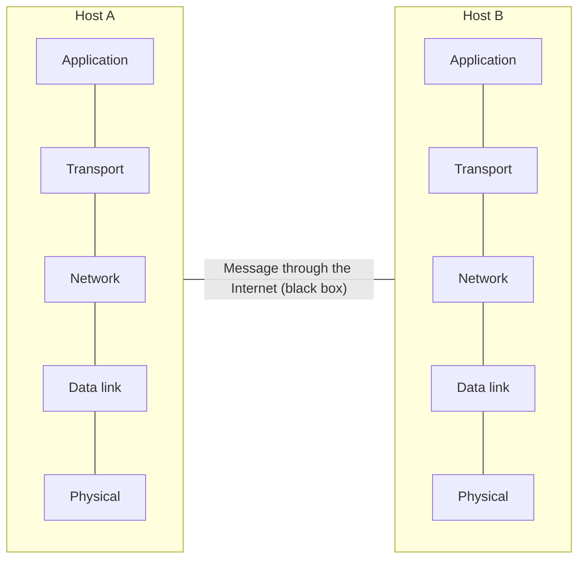

*Figure 1. The Internet as a black box between the application layers of two hosts*

The network layer is the layer that opens this box. The transport layer of the sending host hands each segment to its network layer, and the network layer must carry the segment to the network layer of the receiving host. This is the host-to-host communication service of the network layer. The transport layer builds process-to-process communication on top of this service (Chapter 6) without knowing how the network layer implements it.

### 1.2 A Combination of Networks

The Internet is not one network. It is made of many networks, or links, connected together through connecting devices, so it is a combination of LANs and WANs. In Figure 2, each line is a link (a LAN or a WAN), and each pink device is a connecting device that joins several links. Hosts A and B are attached to the edge of this combination by their own links.

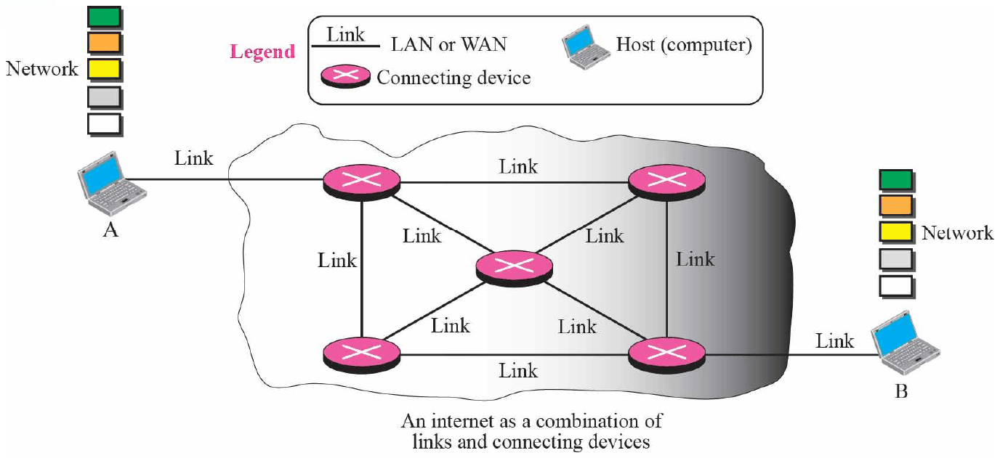

*Figure 2. An internet as a combination of links and connecting devices*

A packet from A to B crosses several links. At the end of each link, a connecting device must decide on which of its other links to send the packet out. The connecting devices that make this decision with network-layer information are routers. Consequently, unlike the transport and application layers, a piece of the network layer runs in every host and in every router on the path, which is why network-layer protocols are among the most complex in the protocol stack.

Figure 3 shows the layers involved on a path from end system H1 to end system H2 through routers R1 and R2. The network layer in H1 takes segments from the transport layer, encapsulates each segment in a datagram, and sends the datagrams to its nearby router R1. The network layer in H2 receives datagrams from its nearby router R2, extracts the transport-layer segments, and delivers them up to the transport layer. The main data-plane role of each router is to forward datagrams from its input links to its output links. The main role of the control plane is to coordinate these local forwarding actions so that datagrams are carried end to end.

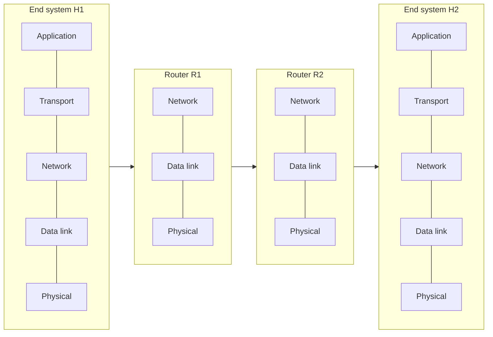

*Figure 3. Protocol stacks of two end systems and the truncated stacks of the routers between them*

The routers in Figure 3 have a truncated protocol stack with only the physical, data link, and network layers. Routers do not run application-layer or transport-layer protocols, so there is nothing above the network layer in a router.

> **Key Point:** The network layer is present in every host and in every router. The transport and application layers are present only in the end systems.

### 1.3 Routers and Link-Layer Switches

A device that transfers a packet from an input link interface to an output link interface according to values in the packet's header is a packet switch. Packet switches differ in which header they read.

> **Definition:** A **packet switch** is a device that transfers a packet from an input link interface to an output link interface according to the values in the packet's header fields.

| Packet switch | Header used for the forwarding decision | Layer |
|:--|:--|:--|
| Link-layer switch | Fields of the link-layer frame | Layer 2 (Chapter 20) |
| Router | Fields of the network-layer datagram | Layer 3 (this chapter) |

*Table 1. Two kinds of packet switches and the headers they read*

This chapter deals with the network layer, so it uses the word router for the packet switch. The words forwarding and switching are often used interchangeably, and this chapter follows that usage.

---

<br>

## 2. Forwarding and Routing

### 2.1 Two Functions of the Network Layer

The role of the network layer looks simple: it moves packets from a sending host to a receiving host. Two functions are needed to do so.

> **Definition:** **Forwarding** is the router-local action of transferring a packet that arrives on an input link interface to the appropriate output link interface.

> **Definition:** **Routing** is the network-wide process that determines the end-to-end paths that packets take from a source to a destination. The algorithms that compute these paths are called routing algorithms.

The two functions differ in scope and in timescale. Forwarding is performed for every packet and must be completed in a very short time, typically a few nanoseconds, so it is usually implemented in hardware. Routing considers the whole network, runs on much longer timescales, typically seconds, and is often implemented in software.

A road trip gives a useful analogy. Suppose a driver travels from Pennsylvania to Florida and passes through many interchanges. Getting through a single interchange, that is, entering from one road and choosing the road on which to leave, corresponds to forwarding. Planning the whole trip on a map before departure, that is, choosing one path among many possible series of road segments, corresponds to routing.

| Aspect | Forwarding | Routing |
|:--|:--|:--|
| Scope | One router | The whole network |
| Question answered | Which output link does this packet leave on? | Which path should packets take from the source to the destination? |
| Timescale | Nanoseconds per packet | Seconds |
| Typical implementation | Hardware | Software |
| Plane | Data plane | Control plane |
| Road analogy | Getting through one interchange | Planning the whole trip |

*Table 2. Forwarding and routing compared*

In the most common case, forwarding moves a packet from one input to one output. In the more general case covered in Chapter 24, a router may also block a packet from leaving, for example because it came from a known malicious host, or duplicate it and send copies over several output links.

> **Note:** Many authors use forwarding and routing interchangeably. Forouzan, for example, calls the table that a router consults for each packet a routing table. These notes use the two words in the precise senses defined above, and Chapter 13 explains the relation between the two names of the table.

### 2.2 The Forwarding Table

> **Definition:** A **forwarding table** is a table in a router that maps values of fields in an arriving packet's header to the output link interface on which the packet should be sent.

A router forwards a packet by examining the value of one or more header fields and using these values to index into its forwarding table. The entry for those values names the output link interface. Table 3 is a small example. A packet whose header value is 0110 arrives, the router finds the entry for 0110, and it moves the packet internally to interface 2.

| Header value | Output link interface |
|:--|:--|
| 0100 | 3 |
| 0110 | 2 |
| 0111 | 2 |
| 1001 | 1 |

*Table 3. A local forwarding table that maps header values to output interfaces*

What the header value is depends on the network. In the datagram approach used by IP, the value is the destination address of the datagram, and the table holds address prefixes rather than single addresses, so the lookup becomes a search for the longest matching prefix (Chapter 13). In the virtual-circuit approach of Section 4.4, the value is a short label.

### 2.3 Data Plane and Control Plane

Forwarding and routing belong to two different parts of the network layer.

> **Definition:** The **data plane** is the per-router part of the network layer that determines how a datagram arriving on one of the router's input links is forwarded to one of its output links.

> **Definition:** The **control plane** is the network-wide logic of the network layer that determines how datagrams are routed along end-to-end paths, that is, how the forwarding tables of the routers are computed and installed.

The forwarding table connects the two planes. The data plane only reads the table, packet by packet. The control plane decides what the table contains. The natural question is therefore how the forwarding tables are filled in the first place, and there are two answers.

### 2.4 The Traditional Approach: Routing in Every Router

In the traditional approach, shown in Figure 4, a routing algorithm runs in each and every router, so both the forwarding function and the routing function are contained in each router. The routing algorithm of one router communicates with the routing algorithms of other routers by exchanging routing messages according to a routing protocol, and from the information it receives it computes the contents of its own forwarding table. Routing algorithms and protocols such as OSPF and BGP are the subject of Chapters 14 and 15.

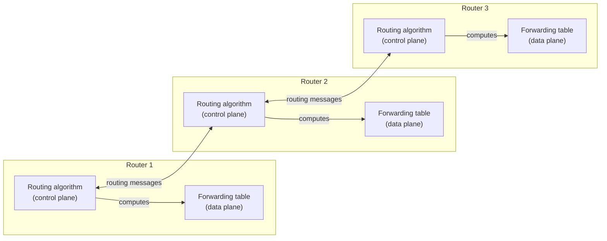

*Figure 4. A routing algorithm in every router computes the router's own forwarding table*

The separate purposes of the two functions become clear in a hypothetical network in which human operators configure every forwarding table by hand while standing at the routers. Such a network needs no routing protocol at all, although the operators would have to coordinate with one another so that packets reach their destinations. Manual configuration would also be more error-prone and much slower to react to changes in the topology than a routing protocol, which is why real networks have both functions.

### 2.5 The SDN Approach: A Remote Controller

The observation that humans could configure forwarding tables suggests that the control plane need not live inside the routers. In the alternative of Figure 5, a remote controller that is physically separate from the routers computes the forwarding tables of all routers and distributes them. The data plane components are the same as in Figure 4. The routing devices perform forwarding only, and the controller and the routers communicate by exchanging messages that contain forwarding tables and other routing information.

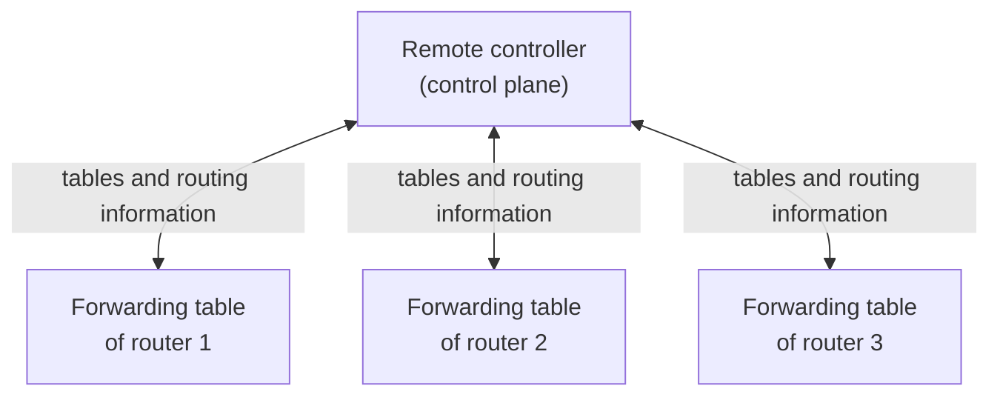

*Figure 5. A remote controller computes and distributes the forwarding tables*

> **Definition:** **Software-defined networking (SDN)** is an approach to the network layer in which a remote controller, implemented in software, computes the forwarding tables and distributes them to routers that perform only forwarding.

The network is called software-defined because the controller that computes the forwarding tables is software. The controller may run in a remote data center with high reliability and redundancy, and it may be managed by the ISP or by a third party. Increasingly the controller software is open, like Linux source code, so ISPs and researchers can propose changes to the logic that controls the network layer. The SDN control plane is treated in Chapter 15, and the generalized forwarding that SDN routers perform is treated in Chapter 24.

| Aspect | Traditional approach | SDN approach |
|:--|:--|:--|
| Where the control plane runs | Inside every router | In a remote controller |
| How tables are computed | Each router computes its own table from routing messages | The controller computes all tables |
| What a router does | Forwarding and routing | Forwarding only |
| Data plane | Forwarding table in each router | The same |

*Table 4. The traditional control plane and the SDN control plane*

---

<br>

## 3. Network Service Model

### 3.1 Questions a Service Model Answers

When the transport layer of a sending host passes a packet down to the network layer, several questions arise. Can the transport layer rely on the network layer to deliver the packet to the destination? When several packets are sent, are they delivered to the receiving transport layer in the order in which they were sent? Is the time between two consecutive transmissions preserved at the receiver? Does the network give any feedback about congestion? The answers are fixed by the service model of the network layer.

> **Definition:** A **network service model** defines the characteristics of the end-to-end delivery of packets between a sending host and a receiving host.

### 3.2 Possible Services

A network layer could offer the services in Table 5. The list is only partial, and countless variations are possible.

| Service | What is guaranteed |
|:--|:--|
| Guaranteed delivery | A packet sent by the source eventually arrives at the destination. |
| Guaranteed delivery with bounded delay | The packet arrives within a specified host-to-host delay bound, for example 100 ms. |
| In-order packet delivery | Packets arrive at the destination in the order in which they were sent. |
| Guaranteed minimal bandwidth | The network behaves like a link of a specified bit rate, for example 1 Mbps, between the two hosts, so all packets arrive as long as the sender stays below that rate. |
| Security | All datagrams are encrypted at the source and decrypted at the destination, so all transport-layer segments are confidential. |

*Table 5. Services that a network layer could provide*

### 3.3 The Best-Effort Service of the Internet

> **Definition:** **Best-effort service** is a network service model that guarantees neither delivery, nor order, nor end-to-end delay, nor a minimal bandwidth.

The network layer of the Internet provides a single service, best-effort service. Packets are not guaranteed to arrive in the order sent, and even their eventual delivery is not guaranteed. There is no bound on the end-to-end delay and no minimal bandwidth. Taken literally, a network that delivered no packets at all would satisfy the definition, so best effort can look like a euphemism for no service.

Other network architectures define stronger service models. The ATM architecture, for example, provides guaranteed in-order delivery, bounded delay, and guaranteed minimal bandwidth (ATM appears in Chapter 21), and extensions of the Internet architecture have been proposed to guarantee end-to-end delay. Nevertheless, the simple best-effort model combined with adequate bandwidth provisioning has proven good enough for a wide range of applications, including video streaming, voice and video over IP, and real-time conferencing.

> **Key Point:** The Internet's network layer provides none of the five guarantees of Table 5. Reliable, in-order delivery is added end to end by TCP in the transport layer (Chapter 8), but no upper layer can add a delay bound or a minimal bandwidth that the network itself does not provide.

---

<br>

## 4. Packet Switching at the Network Layer

The network layer is designed as a packet-switched network. A message at the source is divided into manageable packets, normally called datagrams, the datagrams are transferred individually from the source to the destination, and the destination assembles them before recreating the original message. Chapter 1 compares packet switching with circuit switching; this section looks at the two ways in which a packet-switched network layer can operate. The Internet's network layer was originally designed as a connectionless service and still uses the datagram approach, but there is a tendency to add connection-oriented service, as in the label switching of MPLS (Chapter 21).

> **Note:** The word connection means different things at the network layer and at the transport layer. A transport-layer connection, such as a TCP connection, exists only as state in the two end systems, and the routers between them know nothing about it. A connection-oriented network layer, in contrast, makes the routers themselves keep the path, so that every router on the path holds an entry for the connection.

### 4.1 The Datagram Approach: Connectionless Service

> **Definition:** The **datagram approach** is a connectionless way of operating a packet-switched network layer in which every packet is treated independently and is forwarded according to the destination address in its own header.

When the Internet started, its network layer was designed as a connectionless service to keep it simple: the network layer is responsible only for delivering each packet from the source to the destination. Each packet is an independent entity with no relationship to the other packets of the same message. A packet of a message may be followed by a packet of the same message or of another message, and from the same source or from a different source. The switches of such a network are called routers.

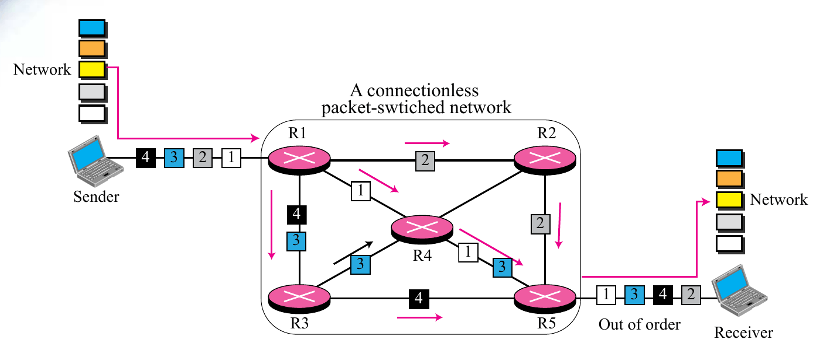

*Figure 6. A connectionless packet-switched network*

In Figure 6, the sender transmits packets 1, 2, 3, and 4 in order. Because each router decides independently for each packet, the packets of the same message may or may not travel the same path: in the figure they are spread over the paths through R2, R3, and R4 before reaching R5. Each path has its own length and queues, so the packets reach the receiver out of order.

Out-of-order arrival means that the receiving side must store the packets that arrive early, put all packets back in order, and only then deliver the message. This waiting is acceptable because the data is not real-time. In the Internet the network layer does not do this reordering; the transport layer above it does (Chapter 8).

### 4.2 Forwarding in a Connectionless Network

Each packet is routed on the basis of the information in its header, namely the source address and the destination address. The destination address defines where the packet should go, and the source address defines where it comes from. The router uses only the destination address to choose the output interface. The source address is used when the packet must be discarded and an error message must be returned to the source (Chapter 16).

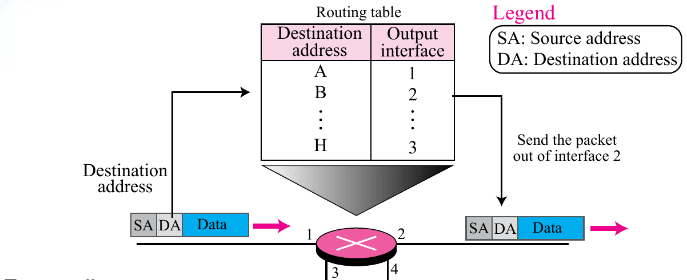

*Figure 7. Forwarding process in a router of a connectionless network*

In Figure 7, the router's table lists the destination addresses A, B, ..., H and an output interface for each. A packet with source address SA and destination address DA arrives on interface 1. The router looks up DA in the table, finds that the destination is reached through interface 2, and sends the unchanged packet out of interface 2. The table in the figure is the forwarding table of Section 2.2 with symbolic addresses in place of real ones.

> **Key Point:** In a connectionless packet-switched network, the forwarding decision is based on the destination address of the packet.

### 4.3 Delay in a Connectionless Network

If packet loss and retransmission are ignored, and the time the destination may spend waiting for all packets is also ignored, the delay of one packet can be modeled as in Figure 8. The packet leaves the source, crosses two routers, and reaches the destination, so it is transmitted three times (events 1, 2, and 3).

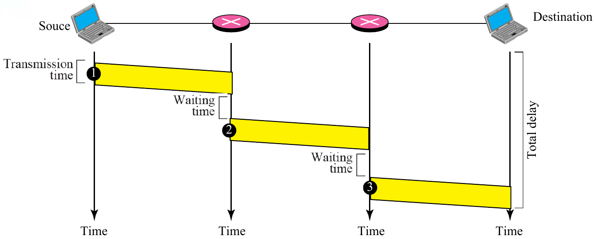

*Figure 8. Delay of one packet in a connectionless network*

Each yellow band is one transmission: its height is the transmission time, the time needed to push all bits of the packet onto the link. The slope of each band is the propagation time, the time a bit needs to travel along the link. Between two bands, the packet waits in the router while the router examines its header, looks up the forwarding table, and waits for the output link. Writing T for one transmission time, τ for one propagation time, and w₁ and w₂ for the waiting times in the two routers, the model gives the following total delay.

```math
\text{Total delay} = 3T + 3\tau + w_1 + w_2
```

Switching in the Internet is done with this datagram approach at the network layer, so every packet of a message experiences its own waiting times in every router it visits. Chapter 1 studies these components (processing, queuing, transmission, and propagation delay) in detail.

### 4.4 The Virtual-Circuit Approach: Connection-Oriented Service

> **Definition:** A **virtual circuit** is a path between a source and a destination that is set up before data transfer, so that all packets of a message follow the same path and every router on the path keeps an entry for the connection.

In a connection-oriented service, there is a relationship between all packets of a message. Before the datagrams of a message are sent, a virtual connection is set up to define their path, and after setup all datagrams follow that path. A connection-oriented service is created in three phases: setup, data transfer, and teardown. In the setup phase, the source and destination addresses are used to make table entries in the routers. In the teardown phase, the source and the destination tell the routers to delete those entries. Data transfer occurs between the two phases.

> **Definition:** A **label** is a short identifier, also called a virtual-circuit identifier (VCI) or flow label, that a packet carries to tell each router which virtual circuit it belongs to.

Besides the source and destination addresses, every packet carries a label that defines the virtual path it should follow. The label may seem to make the addresses useless, but networks that use connection-oriented service at the network layer still keep the addresses for two reasons. Part of the path may still use connectionless service, and the network-layer protocol was designed with these addresses, so changing it takes time.

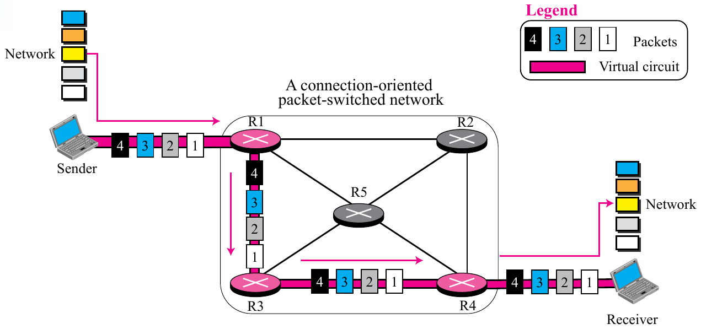

*Figure 9. A connection-oriented packet-switched network*

In Figure 9, the virtual circuit from the sender to the receiver runs through R1, R3, and R4. All four packets follow this circuit and arrive in the order sent; routers R2 and R5 are not used by this connection.

> **Key Point:** In a connection-oriented packet-switched network, the forwarding decision is based on the label of the packet.

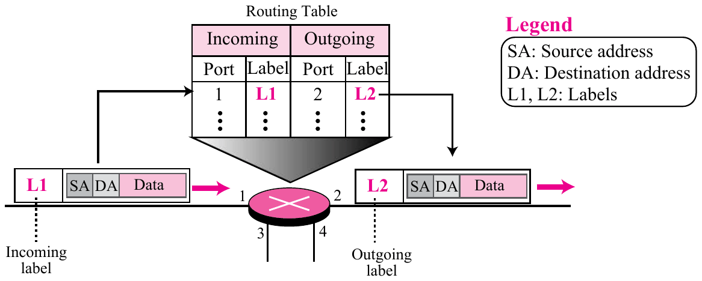

*Figure 10. Forwarding process in a router of a connection-oriented network*

Figure 10 shows how a router forwards a labeled packet. Its table has four columns: incoming port, incoming label, outgoing port, and outgoing label. A packet with label L1 arrives on port 1. The router finds the entry (port 1, label L1), learns that the packet leaves on port 2 with label L2, replaces L1 by L2, and sends it out. A label therefore has meaning only on one link, between two neighboring routers, and changes at every hop.

The datagram with its source address, destination address, and data is carried behind the label without change: it is encapsulated, and the router reads and rewrites only the label in front of it. Carrying an intact packet behind an extra header that the network uses for forwarding is the same idea that underlies MPLS (Chapter 21) and tunneling for virtual private networks (Chapter 26).

### 4.5 Setup Phase

In the setup phase each router on the path creates an entry for the virtual circuit. Suppose source A needs a virtual circuit to destination B. Two auxiliary packets are exchanged between the sender and the receiver: a request packet and an acknowledgment packet.

The request packet travels from the source to the destination and carries the source and destination addresses. Figure 11 shows its trip.

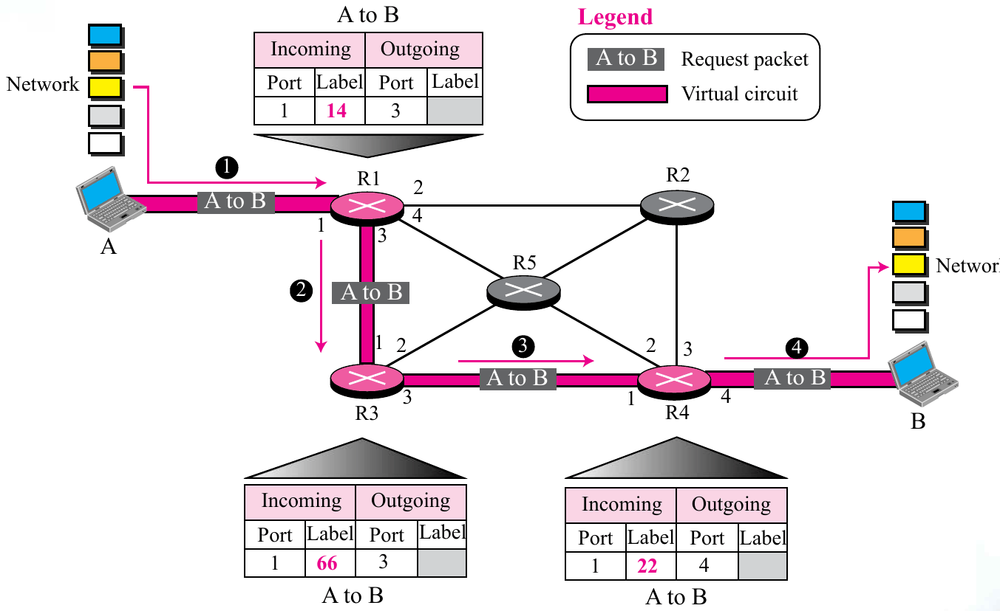

*Figure 11. Sending a request packet in a virtual-circuit network*

1. Source A sends the request packet to router R1.
2. R1 knows that a packet going from A to B leaves through port 3; how it knows this is the job of routing (Chapters 14 and 15). R1 creates an entry for the circuit but can fill only three of its four columns. It records the incoming port 1, chooses an unused incoming label 14, and records the outgoing port 3. The outgoing label is still unknown. R1 forwards the request through port 3 to R3.
3. R3 does the same and fills in incoming port 1, incoming label 66, and outgoing port 3.
4. R4 fills in incoming port 1, incoming label 22, and outgoing port 4.
5. Destination B receives the request. If it is ready to receive packets from A, it assigns the label 77 to the incoming packets from A. This label tells B that the packets come from A and not from another source.

| Router | Incoming port | Incoming label | Outgoing port | Outgoing label |
|:--|:--|:--|:--|:--|
| R1 | 1 | 14 | 3 | (unknown) |
| R3 | 1 | 66 | 3 | (unknown) |
| R4 | 1 | 22 | 4 | (unknown) |

*Table 6. Entries of the circuit from A to B after the request packet*

The acknowledgment packet travels back from the destination to the source and completes the entries. Figure 12 shows its trip.

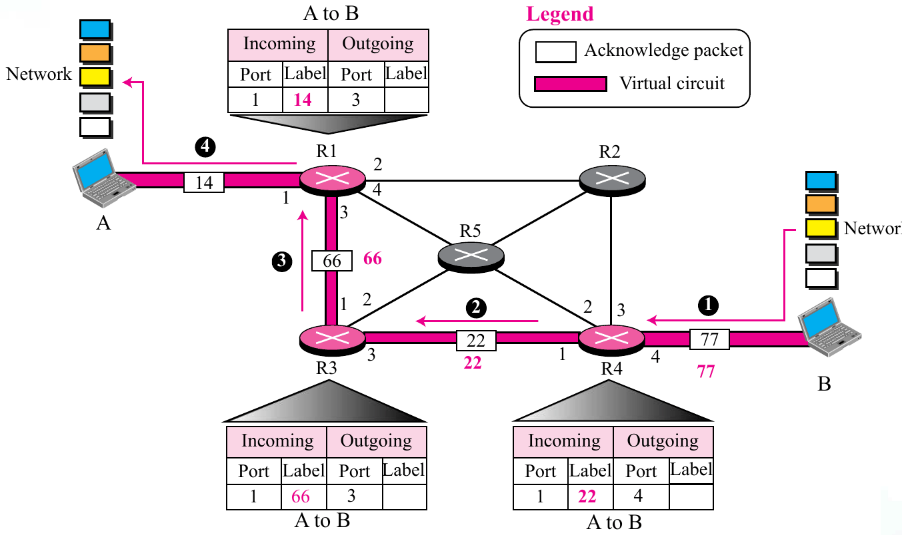

*Figure 12. Setup acknowledgment in a virtual-circuit network*

1. B sends an acknowledgment to R4. It carries the global source and destination addresses, so that R4 knows which entry to complete, and the label 77 chosen by B. R4 writes 77 into the outgoing label column. Note that 77 is the incoming label for B but the outgoing label for R4.
2. R4 sends an acknowledgment to R3 that contains its own incoming label 22, and R3 uses 22 as its outgoing label.
3. R3 sends an acknowledgment to R1 that contains its incoming label 66, and R1 uses 66 as its outgoing label.
4. R1 sends an acknowledgment to A that contains its incoming label 14.
5. A uses 14 as the outgoing label for the data packets it sends to B.

| Router | Incoming port | Incoming label | Outgoing port | Outgoing label |
|:--|:--|:--|:--|:--|
| R1 | 1 | 14 | 3 | 66 |
| R3 | 1 | 66 | 3 | 22 |
| R4 | 1 | 22 | 4 | 77 |

*Table 7. Completed entries of the circuit from A to B after the acknowledgment*

Each node chooses the label it expects on its own incoming link, and the acknowledgment carries that choice one hop upstream, where it becomes the outgoing label of the previous node. Because a label only has to be unique on one link, the same number can be reused on other links, and small numbers are enough.

### 4.6 Data Transfer and Teardown Phases

After all routers have created their entries for the virtual circuit, the network-layer packets of the message are sent one after another. Figure 13 follows one packet, but the process is the same for 1, 2, or 100 packets.

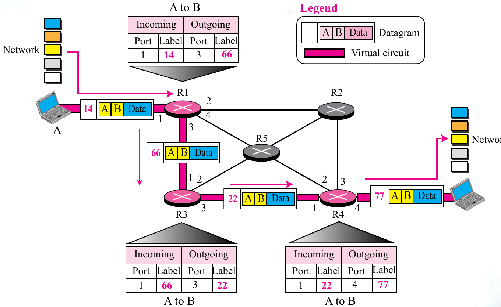

*Figure 13. Flow of one packet in an established virtual circuit*

Source A sends the packet with label 14, which it received from R1 during setup. R1 forwards it to R3 and changes the label to 66. R3 forwards it to R4 and changes the label to 22. R4 delivers it to B with label 77. Every packet of the message follows the same sequence of labels 14, 66, 22, 77, so the packets arrive at the destination in order.

In the teardown phase, source A sends a special teardown packet after it has sent all packets to B, and B responds with a confirmation packet. All routers on the path then delete the entry of the circuit.

Because a label is small and is chosen locally by the router itself, the router can use the incoming label directly as an index into its table instead of searching the table. Chapter 13 compares this lookup by index with the search by destination address that datagram forwarding requires.

### 4.7 Delay in a Connection-Oriented Network

If loss and retransmission are ignored, the delay in a connection-oriented network can be modeled as in Figure 14.

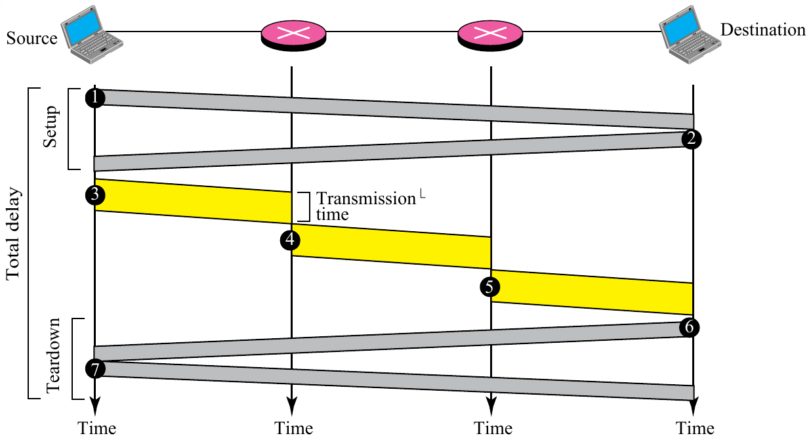

*Figure 14. Delay in a connection-oriented network*

Before any data moves, the setup packets cross the network: the request travels from the source to the destination (events 1 and 2), and the acknowledgment travels back (to event 3). The data packet is then transmitted three times (events 3, 4, and 5), and the model draws no waiting time between these transmissions because the path and the table entries already exist. After the data, the teardown exchange crosses the network once in each direction (events 6 and 7). With T and τ as in Section 4.3, the total delay is the following.

```math
\text{Total delay} = 3T + 3\tau + \text{setup delay} + \text{teardown delay}
```

The setup and teardown delays are paid once per connection, not once per packet. They are amortized when a long message of many packets is sent, but for a short message they can make the connection-oriented approach slower than the datagram approach.

### 4.8 Comparison of the Two Approaches

| Aspect | Datagram approach | Virtual-circuit approach |
|:--|:--|:--|
| Connection setup | None | Setup and teardown phases |
| State in routers | No per-connection state | One entry per circuit in every router on the path |
| Information used for forwarding | Destination address | Label |
| Lookup in the table | Search for the destination address | Index by the incoming label |
| Path of the packets of a message | May differ from packet to packet | The same for all packets |
| Arrival order | Not guaranteed | Same as the sending order |
| Router failure on the path | Later packets can take another path | The circuits through the failed router break and must be set up again |
| Fixed overhead | None | Setup and teardown delay |
| Examples | IP in the Internet | ATM, Frame Relay, X.25 (Chapter 21) |

*Table 8. Comparison of the datagram and virtual-circuit approaches*

---

<br>

## 5. Network-Layer Services: An Example

### 5.1 An Imaginary Part of the Internet

The services of the network layer are easiest to see on an example. The discussion follows the connectionless service, the dominant service of today's Internet. Alice works at a publishing company, Wonderful Publishing, and sends an e-mail to Bob, the manager of a flower shop, Just Flowers, to tell him that the shop's brochure is ready to be shipped.

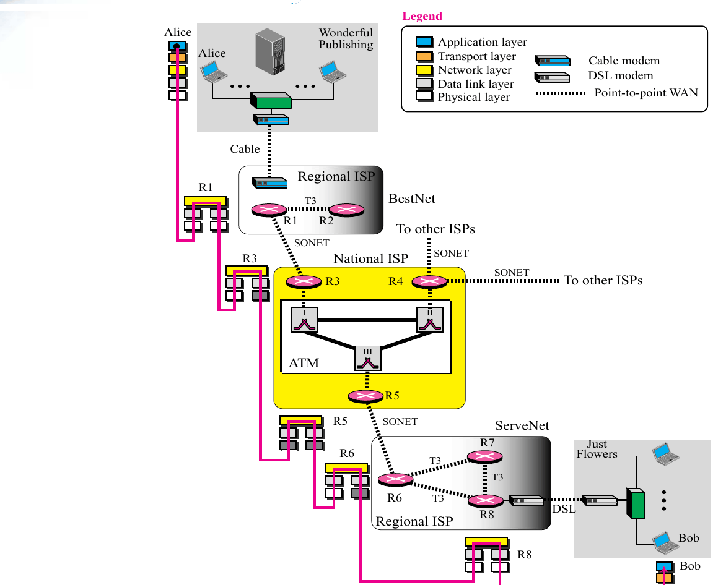

*Figure 15. An imaginary part of the Internet between Alice and Bob*

Wonderful Publishing uses a LAN that is connected through a cable WAN to a regional ISP called BestNet. Just Flowers also uses a LAN, connected through a DSL WAN to another regional ISP called ServeNet. The two regional ISPs are connected through high-speed SONET WANs to a national ISP, whose core in the figure is an ATM network. Alice's message may be split into several network-layer packets, which may or may not follow the same path. Following one packet, assume that it passes through routers R1, R3, R5, R6, and R8. The two computers use all five layers of the TCP/IP protocol suite, while the routers use only three.

### 5.2 Logical Addressing

Since the network layer provides end-to-end communication, the two communicating computers need a universal identification system, called the network-layer address or logical address. The Internet provides it through a single address space: every entity that uses the Internet must be assigned a unique address from this pool. Alice and Bob each need a network-layer address. The 32-bit addresses of IPv4 are the subject of Chapter 12, and the 128-bit addresses of IPv6 are the subject of Chapter 24 (version 5 was never deployed).

### 5.3 Services at the Source Computer

The network layer of the source receives several pieces of information from the upper layer: the data, the length of the data, the logical destination address, the protocol ID of the upper-layer protocol that uses the network layer, and the service type. From them it produces a set of possibly fragmented datagrams together with the MAC address of the next hop, and it passes both to the data link layer. Figure 16 shows the four services involved.

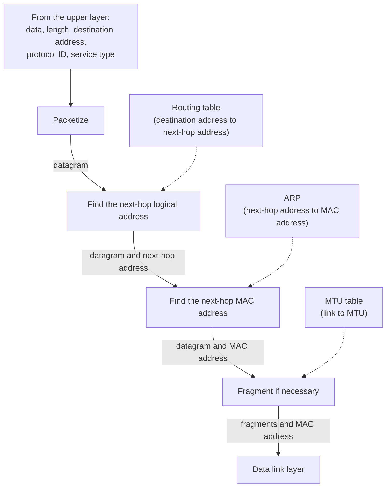

*Figure 16. Services provided by the network layer of the source computer*

1. **Packetizing.** The first duty of the network layer is to encapsulate the data from the upper layer in a datagram. It adds a header that contains the logical source and destination addresses, fragmentation information, the protocol ID of the requesting protocol, the data length, and possibly some options. It also includes a checksum computed over the header only (Chapter 11). The upper layer supplies only the destination address; the source address comes from the network layer itself, since every host knows its own address.
2. **Finding the logical address of the next hop.** If the destination is not on the same network as the source, the datagram must first go to a router. The source and destination addresses in the datagram say nothing about that router, so the network layer consults its table to find the logical address of the next hop (Chapter 13).
3. **Finding the MAC address of the next hop.** The network layer does not deliver the datagram itself; the data link layer does, and the data link layer needs the MAC address of the next hop. An auxiliary protocol, the Address Resolution Protocol (ARP), maps the next-hop logical address to the MAC address (Chapter 19).
4. **Fragmentation.** Most LANs and WANs limit the size of the data that a frame can carry, the maximum transfer unit (MTU). If the datagram is larger than the MTU of the link, it is divided into smaller units. The data is divided, but the header must be repeated in every fragment, and extra information is added to locate each fragment in the whole datagram (Chapter 11).

### 5.4 Processing at Each Router

A router is involved with two interfaces for each datagram: the incoming interface and the outgoing interface. Its network layer receives a datagram from the data link layer of the incoming interface, fragments it if necessary, and delivers the fragments to the data link layer of the outgoing interface. Normally a router does not involve the upper layers.

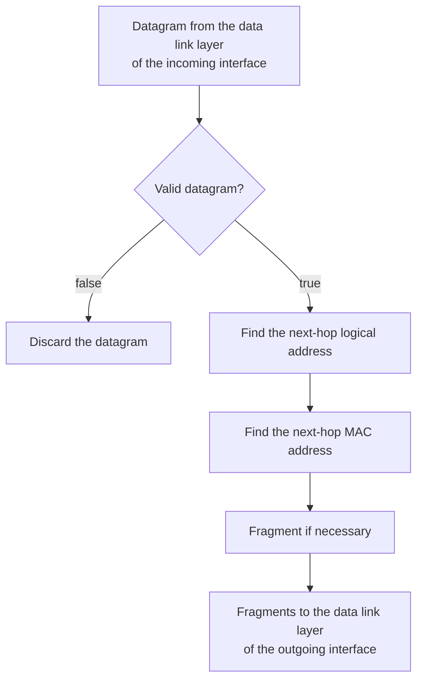

*Figure 17. Processing of a datagram at each router*

The last three steps are the same as the last three services at the source. Before them, however, the router checks the validity of the datagram with the header checksum. A valid datagram is one whose header is not corrupted and that has been delivered to the correct router.

### 5.5 Processing at the Destination Computer

The network layer of the destination is simpler, since no forwarding is needed. After validating each arriving datagram, it extracts the data of each fragment and stores it. When all fragments have arrived, it reassembles the data and delivers it to the upper layer. It also sets a reassembly timer; if the timer expires before all fragments arrive, all stored fragments are destroyed and an error message is sent so that the whole datagram can be resent.

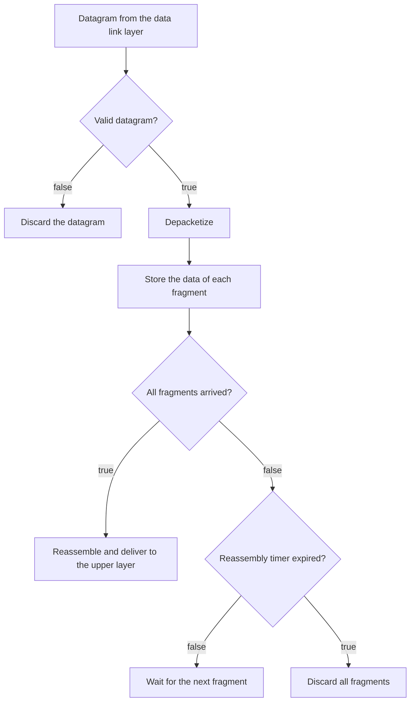

*Figure 18. Processing of a datagram at the destination computer*

Fragmentation is transparent to the upper layer, because the network layer delivers nothing until all pieces have arrived and have been reassembled. A datagram may be fragmented at the source and again at any router, so reassembly is a delicate procedure; Chapter 11 describes it in detail.

| Location | Services of the network layer |
|:--|:--|
| Source computer | Packetizing, finding the next-hop logical address, finding the next-hop MAC address, fragmentation |
| Each router | Validity check, finding the next-hop logical address, finding the next-hop MAC address, fragmentation |
| Destination computer | Validity check, depacketizing, storing fragments, reassembly with a timer |

*Table 9. Network-layer services at the source, at each router, and at the destination*

---

<br>

## 6. Other Network-Layer Issues

Several services are usually discussed for the network layer but are only partially implemented in it, or not at all. Some are provided by auxiliary protocols or by protocols added to the Internet later.

### 6.1 Error Control

Error control means detecting corrupted, lost, or duplicate datagrams and correcting the errors after detection. The network layer of the Internet does not provide a real error-control mechanism. It may seem unnecessary at this layer, because every network that a datagram crosses (each LAN or WAN) already uses error control at the data link layer. Hop-to-hop error control, however, does not give full protection. As Figure 19 shows, errors that occur while a router is processing the datagram are never checked, because the data link layer checks only what happens on the links.

```text
 Source ---------------> Router ---------------> Router ---------------> Destination
          error checking   |     error checking    |      error checking
          (data link)      |     (data link)       |      (data link)
                           |                       |
                    no error checking       no error checking
                    (inside the router)     (inside the router)
```

*Figure 19. Error checking at the data link layer and the unchecked parts of the path*

The designers kept the network layer simple and fast and left rigorous error checking to the upper-layer protocols that need it. A second reason concerns fragmentation: routers may fragment a datagram and thereby change part of it, so error control at this layer would have to be checked at every router, which is inefficient. The designers did add a checksum that covers only the header (Chapter 11). It prevents, for example, the delivery of a datagram to a wrong destination after the destination address has been corrupted. Because the header changes in each router, the checksum is calculated at the source and recalculated at each router. In addition, the Internet uses ICMP (Chapter 16) to report some errors, such as a discarded datagram or a header with unknown information.

### 6.2 Flow Control

Flow control regulates the amount of data a source can send without overwhelming the receiver. If the upper layer at the source produces data faster than the upper layer at the destination can consume it, the receiver needs to send feedback to slow the sender down. The network layer of the Internet provides no flow control: a sender transmits datagrams as soon as they are ready, without regard to the readiness of the receiver.

There are several reasons. Since this layer has no error control, the work of the receiving network layer is so simple that it is rarely overwhelmed. The upper layers can keep buffers that accept data from the network layer as soon as it is ready and consume it at their own pace. Finally, most upper-layer protocols already provide flow control (Chapter 8), so another level of flow control would make the network layer more complicated and the whole system less efficient.

### 6.3 Congestion Control

Congestion at the network layer is a situation in which too many datagrams are present in an area of the Internet, because the sources send more datagrams than the capacity of the network or the routers. Some routers then drop datagrams. As more datagrams are dropped the situation can become worse, because the error-control mechanisms of the upper layers make the senders retransmit the lost packets. If congestion continues, the system can reach a point at which it collapses and no datagram is delivered.

In a connectionless network there are several ways to control congestion.

- **Backward signaling.** A bit is set in a datagram that moves in the direction opposite to the congestion, for example in a response or an acknowledgment, to tell the sender to slow down.
- **Forward signaling.** If the network layer uses no feedback but the upper layer does, a bit is set in a datagram that moves in the direction of the congestion, to warn its receiver, which can inform its upper layer, which in turn informs the source.
- **Choke packet.** A congested router sends a special packet back to the sender to make it slow down.
- **Ranking packets.** A field in the header marks some packets as less important, and a congested router drops those first. For an image divided into many packets, packets for a corner may matter less than packets for the center, so dropping them changes the image little.

> **Note:** Forouzan states that the Internet's network layer uses no forward or backward signaling and realizes the choke packet with an ICMP message that asks the source to slow down. Both statements describe an older Internet. The IPv4 header now contains explicit congestion notification (ECN) bits, a form of forward signaling that Chapters 9 and 11 describe, and the ICMP source quench message was formally deprecated, so routers should not send it [1].

In a connection-oriented network, congestion is sometimes easier to control. One method creates an extra virtual circuit around the congested area, although this may move the problem to other routers. A better method is negotiation during the setup phase: the sender and receiver agree on a traffic level when they set up the circuit, and a router allows a new circuit only if its existing traffic plus the new traffic stays within its capacity. Congestion control in the Internet is mainly done end to end by TCP; Chapter 9 treats it in detail.

### 6.4 Quality of Service

As new applications such as real-time audio and video communication spread, the quality of service (QoS) of communication became more important. To leave the network layer untouched, the provisions for better QoS in the Internet are mostly implemented in the upper layers. The packet scheduling in routers that supports differentiated service is described in Chapter 13.

### 6.5 Routing

Routing is a central issue of the network layer: how a router creates the table that it uses to forward datagrams in a connectionless service, or that helps to create a virtual circuit in the setup phase of a connection-oriented service. Routing protocols help hosts and routers build their tables, maintain them, and update them. These are separate protocols that use the services of the network layer or of the transport layer, and they fall into unicast and multicast routing. Until Chapters 14 and 15, the routers are assumed to already have their tables.

### 6.6 Security

Security was not a concern when the Internet was designed, because a small number of users at universities used it for research and others had no access. The network layer was therefore designed with no security provision. Today security is a major concern. To secure the connectionless network layer, another virtual level is needed that changes the connectionless service into a connection-oriented one; this level, IPsec, is described in Chapter 26 together with the principles of cryptography.

---

<br>

## Concept Applications

**True/False Check:**

| Statement | Judgment and Reason |
|:--|:--|
| A router runs the network layer but not the transport layer. | **T.** A router has a truncated protocol stack with the physical, data link, and network layers only. |
| Forwarding and routing are two names for the same function. | **F.** Forwarding moves one packet from an input to an output inside one router in nanoseconds; routing determines end-to-end paths over the whole network in seconds. |
| In an SDN network, a router does not need a forwarding table. | **F.** The data plane is unchanged and every router still forwards with its table; only the computation of the table moves to the remote controller. |
| The Internet's network layer guarantees in-order delivery. | **F.** Its best-effort service guarantees neither delivery nor order; TCP restores order end to end. |
| In a virtual-circuit network, a label keeps the same value from the source to the destination. | **F.** A label has meaning on one link only and is replaced at every router, as 14, 66, 22, 77 in Figure 13. |
| In a datagram network, a router decides independently for every packet. | **T.** Each packet is forwarded by its own destination address, so packets of one message can take different paths. |
| The IPv4 header checksum lets the network layer correct errors in the data. | **F.** The checksum covers the header only and is used only to detect and discard corrupted headers. |

---

<br>

## Summary

| Concept | Key Summary |
|---------|-----------|
| Network layer | It provides host-to-host delivery and runs in every host and every router, while routers have no transport or application layer. |
| Packet switch | A link-layer switch forwards by frame fields, and a router forwards by datagram fields. |
| Forwarding | It is the router-local, per-packet transfer from an input link to an output link, done in nanoseconds in hardware. |
| Routing | It is the network-wide determination of end-to-end paths by routing algorithms, done in seconds in software. |
| Forwarding table | It maps header values to output interfaces and is the meeting point of the data plane and the control plane. |
| Data and control planes | The data plane forwards packets inside each router, and the control plane computes the forwarding tables. |
| SDN | A remote software controller computes and distributes the forwarding tables, and routers only forward. |
| Service model | Possible guarantees are delivery, bounded delay, order, minimal bandwidth, and security, and the Internet offers only best-effort service. |
| Datagram approach | Each packet is forwarded independently by its destination address, so packets may take different paths and arrive out of order. |
| Virtual-circuit approach | A circuit is set up with request and acknowledgment packets, packets are forwarded by labels that change at every hop, and the circuit is torn down at the end. |
| Delay models | Datagram delay includes waiting times in every router, and virtual-circuit delay adds setup and teardown delays once per connection. |
| Services along the path | The source packetizes, finds the next hop, finds its MAC address, and fragments; routers validate and repeat the last three steps; the destination validates and reassembles. |
| Other issues | The Internet's network layer has only a header checksum for error control, no flow control, limited congestion control, and relies on other protocols for routing and security. |

---

<br>

## Self-Check Questions

1. **Setting up a virtual circuit:** In the network of Figure 11, a circuit from A to B is set up through R1, R3, and R4 with the same ports as in the figure. This time R1 chooses the incoming label 20, R3 chooses 45, R4 chooses 31, and B chooses 90. Write the completed entries of R1, R3, and R4, and the label that A puts on its data packets.

   <details>
   <summary>Answer</summary>

   Each router's outgoing label is the incoming label chosen by the next node, which the acknowledgment carries upstream. R1: incoming port 1, label 20, outgoing port 3, label 45. R3: incoming port 1, label 45, outgoing port 3, label 31. R4: incoming port 1, label 31, outgoing port 4, label 90. The acknowledgment from R1 carries 20, so A sends its data packets with label 20, and the label sequence along the path is 20, 45, 31, 90.

   </details>

2. **Index and search:** Explain why a router in a virtual-circuit network can find the table entry of a packet by indexing, while a router in a datagram network must search its table.

   <details>
   <summary>Answer</summary>

   A label is a small number that the router itself chose for its incoming link, so the router can use the incoming label (with the port) directly as the position of the entry in its table. A destination address is a global address that the router did not choose, and the table holds entries for whole destination networks rather than for every address, so the router must search the table for the entry that matches the address (in IP, the longest matching prefix of Chapter 13).

   </details>

3. **Delay components:** A message of three packets travels from a source through two routers to a destination. Using the models of Figures 8 and 14, list the delay components that appear in a datagram network and in a virtual-circuit network, and state when each network is faster.

   <details>
   <summary>Answer</summary>

   In both networks each packet has a transmission time on each of the three links and a propagation time on each link. The datagram network adds waiting times in the two routers for every packet, because every packet is examined and forwarded independently, but it has no setup or teardown. The virtual-circuit network adds a setup delay (request and acknowledgment across the network) and a teardown delay once for the whole message, and the model draws no waiting time at the routers. The fixed setup and teardown delays dominate for a short message, so the datagram network is faster there; for a long message they are amortized over many packets.

   </details>

4. **Service model of the Internet:** Which of the five services of Table 5 does the Internet's network layer provide? For each service not provided, state whether TCP adds it.

   <details>
   <summary>Answer</summary>

   It provides none of them, only best-effort service. TCP adds guaranteed delivery and in-order delivery end to end through retransmission and sequence numbers. TCP cannot add a delay bound or a minimal bandwidth, because those depend on the resources inside the network. Security is not part of the best-effort service and is added by other protocols such as IPsec or TLS (Chapter 26).

   </details>

5. **Data plane or control plane:** Classify each action as data plane or control plane. (a) A router looks up the header value 0111 and moves the packet to interface 2. (b) Routers exchange messages to compute shortest paths. (c) A remote controller installs a new forwarding table in a router. (d) A router drops a packet whose source is a known malicious host.

   <details>
   <summary>Answer</summary>

   (a) Data plane, since it is forwarding of one packet inside one router. (b) Control plane, the traditional per-router routing. (c) Control plane, the SDN approach. (d) Data plane: blocking a packet is part of the generalized forwarding action of the router (Chapter 24), even though the rule that requires it was installed by the control plane.

   </details>

6. **Arrival order and failures:** Packets 1, 2, 3, and 4 are sent in order. Explain why they can arrive in the order 2, 1, 4, 3 in a datagram network but arrive in the order sent in a virtual-circuit network. How do the two networks differ if a router in the middle of the path fails?

   <details>
   <summary>Answer</summary>

   In a datagram network, routers forward each packet independently by its destination address, so packets can take different paths and queues, and different delays on those paths change the order. In a virtual-circuit network, all packets follow the single path chosen during setup, so they arrive in order. If a router fails, a datagram network can send later packets along another path, but in a virtual-circuit network the connections using that path are broken and the circuit must be set up again.

   </details>

7. **Error control:** Give two reasons why the Internet's network layer checks only its header and not the whole datagram, and explain why the header checksum must be recalculated at every router.

   <details>
   <summary>Answer</summary>

   First, the designers wanted the network layer to be simple and fast and left rigorous error checking to the upper layers that need it. Second, fragmentation at routers changes the datagram, so checking the whole datagram would require work at every router, which is inefficient. The header checksum must be recalculated at every router because some header fields change at each hop, for example the time-to-live field and, after fragmentation, the fragmentation fields (Chapter 11).

   </details>

---

<br>

## References

1. F. Gont, "Deprecation of ICMP Source Quench Messages," RFC 6633, May 2012. [Online]. Available: https://www.rfc-editor.org/rfc/rfc6633
