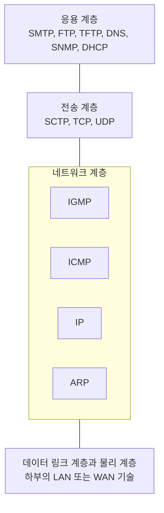
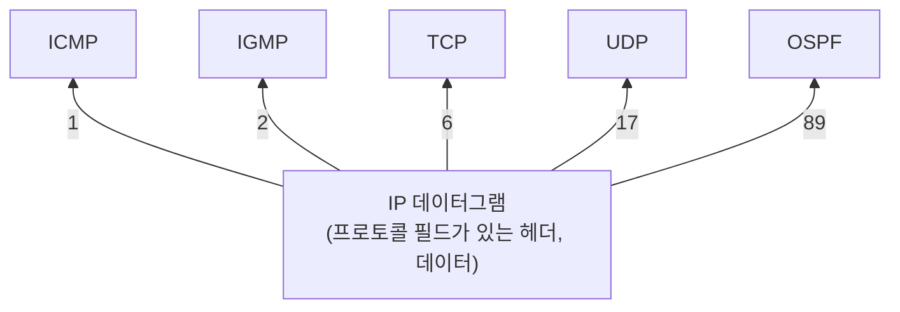
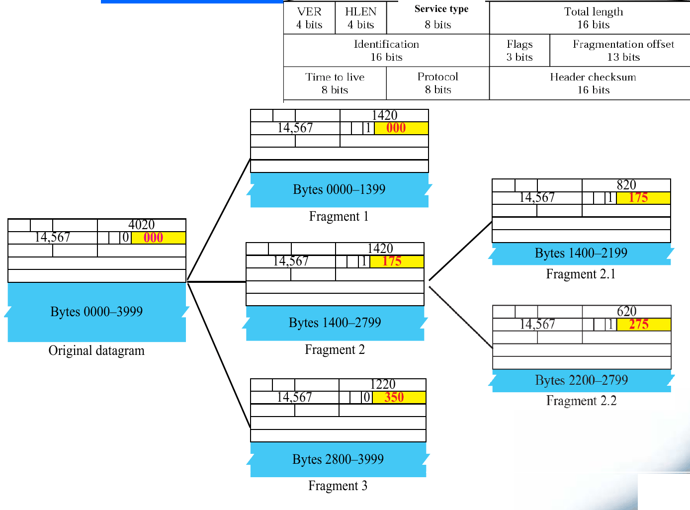
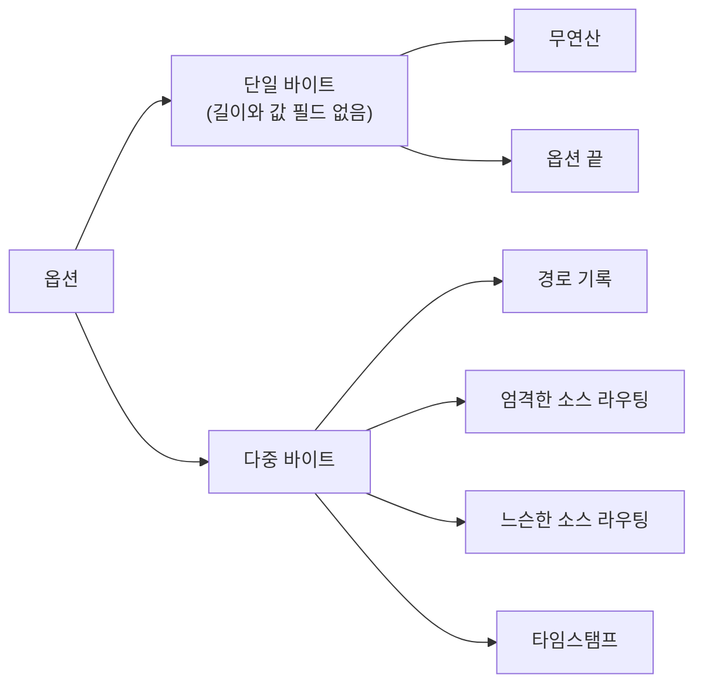
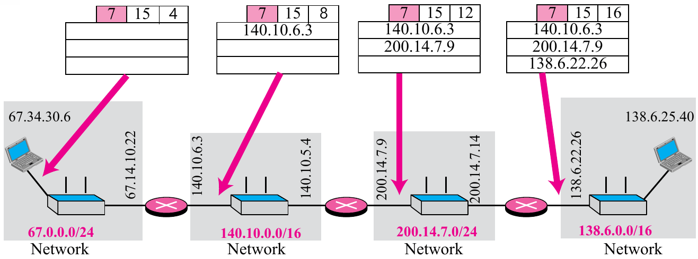
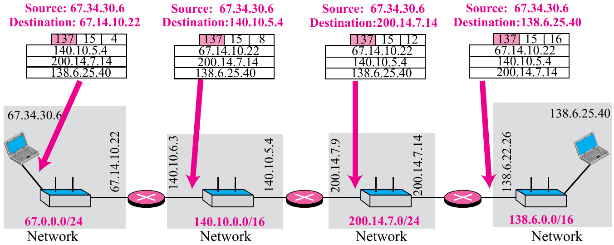
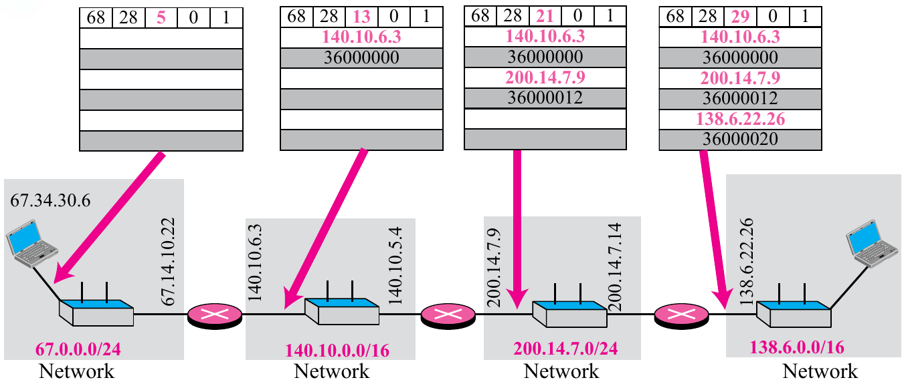
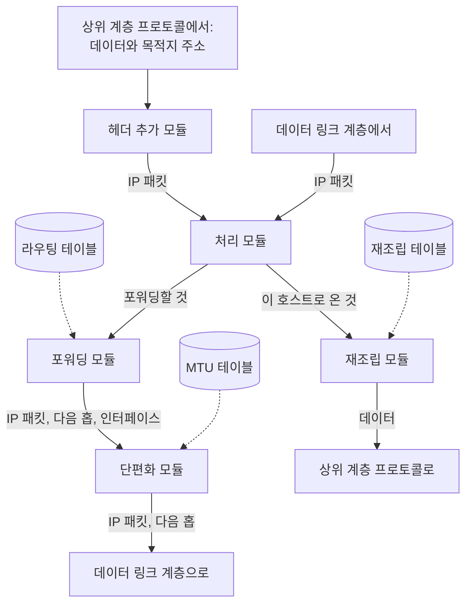

# 11장 — 인터넷 프로토콜 버전 4 (IPv4)

[레포지토리 안내](../../README.ko.md) | [English](Concepts_Lecture.md) | [한국어](Concepts_Lecture.ko.md)

> **최종 수정일:** 2026-11-18
>
> Computer Networking: A Top-Down Approach, Kurose and Ross, Ch 4; TCP/IP Protocol Suite, Forouzan, Ch 7

> **학습 목표:**
> 1. TCP/IP 프로토콜 스위트에서 IP의 위치와 최선형 전달의 의미를 설명할 수 있다
> 2. 이진수나 16진수로 주어진 IPv4 헤더의 모든 필드를 해독할 수 있다
> 3. 주어진 MTU에 대해 데이터그램의 단편을 계산하고 각 단편의 오프셋, 전체 길이, 플래그 값을 구할 수 있다
> 4. 경로 기록, 소스 라우팅, 타임스탬프 옵션의 형식과 라우터 동작을 설명할 수 있다
> 5. IPv4 헤더 체크섬을 1의 보수 산술로 계산하고 검증할 수 있다
> 6. IP 패키지의 모듈들이 협력하여 데이터그램을 처리하는 방식을 설명할 수 있다

---

## 목차

- [1. 인터넷 프로토콜](#1-인터넷-프로토콜)
  - [1.1 TCP/IP 프로토콜 스위트에서 IP의 위치](#11-tcpip-프로토콜-스위트에서-ip의-위치)
  - [1.2 최선형 전달](#12-최선형-전달)
- [2. 데이터그램 형식](#2-데이터그램-형식)
  - [2.1 헤더와 데이터](#21-헤더와-데이터)
  - [2.2 헤더 필드](#22-헤더-필드)
  - [2.3 버전과 헤더 길이](#23-버전과-헤더-길이)
  - [2.4 서비스 유형](#24-서비스-유형)
  - [2.5 전체 길이](#25-전체-길이)
  - [2.6 생존 시간](#26-생존-시간)
  - [2.7 프로토콜](#27-프로토콜)
  - [2.8 체크섬, 주소, 옵션, 데이터](#28-체크섬-주소-옵션-데이터)
  - [2.9 헤더 해독하기](#29-헤더-해독하기)
- [3. 단편화](#3-단편화)
  - [3.1 최대 전송 단위](#31-최대-전송-단위)
  - [3.2 단편화와 재조립을 하는 곳](#32-단편화와-재조립을-하는-곳)
  - [3.3 단편화 관련 필드](#33-단편화-관련-필드)
  - [3.4 단편화의 예](#34-단편화의-예)
  - [3.5 받은 단편의 해석](#35-받은-단편의-해석)
  - [3.6 단편 크기의 계산](#36-단편-크기의-계산)
  - [3.7 경로 MTU 발견](#37-경로-mtu-발견)
- [4. 옵션](#4-옵션)
  - [4.1 옵션 형식](#41-옵션-형식)
  - [4.2 옵션의 범주](#42-옵션의-범주)
  - [4.3 무연산 옵션과 옵션 끝 옵션](#43-무연산-옵션과-옵션-끝-옵션)
  - [4.4 경로 기록](#44-경로-기록)
  - [4.5 엄격한 소스 라우팅](#45-엄격한-소스-라우팅)
  - [4.6 느슨한 소스 라우팅](#46-느슨한-소스-라우팅)
  - [4.7 타임스탬프](#47-타임스탬프)
  - [4.8 여섯 옵션의 유형 필드 읽기](#48-여섯-옵션의-유형-필드-읽기)
  - [4.9 ping과 traceroute로 쓰는 옵션](#49-ping과-traceroute로-쓰는-옵션)
- [5. 체크섬](#5-체크섬)
  - [5.1 체크섬의 원리](#51-체크섬의-원리)
  - [5.2 수신자가 0을 얻는 이유](#52-수신자가-0을-얻는-이유)
  - [5.3 IP 헤더의 체크섬](#53-ip-헤더의-체크섬)
  - [5.4 계산 예](#54-계산-예)
- [6. IP의 보안](#6-ip의-보안)
- [7. IP 패키지](#7-ip-패키지)
  - [7.1 구성 요소](#71-구성-요소)
  - [7.2 헤더 추가 모듈과 처리 모듈](#72-헤더-추가-모듈과-처리-모듈)
  - [7.3 큐, 테이블, 포워딩 모듈](#73-큐-테이블-포워딩-모듈)
  - [7.4 단편화 모듈](#74-단편화-모듈)
  - [7.5 재조립 테이블과 재조립 모듈](#75-재조립-테이블과-재조립-모듈)
- [개념 적용](#개념-적용)
- [요약](#요약)
- [점검 문제](#점검-문제)
- [참고 문헌](#참고-문헌)

---

<br>

## 1. 인터넷 프로토콜

### 1.1 TCP/IP 프로토콜 스위트에서 IP의 위치

**인터넷 프로토콜(Internet Protocol, IP)** 은 TCP/IP 프로토콜들이 사용하는 전송 메커니즘이다. IP는 네트워크 계층의 중심 프로토콜이며, 인터넷을 건너는 모든 전송 계층 세그먼트나 사용자 데이터그램은 IP 데이터그램 안에 실려 이동한다. 그림 1은 IP의 위치를 보여 준다. 그 위에는 전송 프로토콜 SCTP, TCP, UDP와 다시 그 위의 응용 프로토콜이 있다. 네트워크 계층 안에서 IP 옆에는 세 보조 프로토콜이 있다. ICMP는 오류를 보고하고 질의에 응답하며(16장), IGMP는 멀티캐스트 그룹 가입을 관리하고(16장), ARP는 IP 주소를 링크 계층 주소로 바꾼다(19장). 그 아래에는 어떤 LAN이나 WAN 기술이든 올 수 있다.



*그림 1. TCP/IP 프로토콜 스위트에서 IP와 보조 프로토콜의 위치*

오늘날 두 버전의 IP가 쓰인다. 이 장은 널리 배치된 버전 4(IPv4)를 다룬다. IPv4를 대체하기 위해 제안된 버전 6(IPv6)은 24장의 주제이다.

### 1.2 최선형 전달

> **용어 정의:** **최선형 전달(best-effort delivery)** 은 모든 패킷을 전달하려고 노력하지만, 패킷이 도착하는지, 손상 없이 도착하는지, 순서대로 또는 어떤 시간 한도 안에 도착하는지를 보장하지 않는 전달 서비스이다.

IP는 최선형 전달을 제공하는 비신뢰적이고 비연결형인 데이터그램 프로토콜이다. 데이터그램이 손실되거나 손상되거나 중복되거나 지연될 수 있고 IP는 이를 복구하려고 아무것도 하지 않으므로 비신뢰적이다. IP는 자기 헤더의 손상만 검출하고 그런 데이터그램을 버린다. 모든 데이터그램을 설정 없이 다른 데이터그램과 무관하게 독립적으로 처리하므로 비연결형이며, 그래서 한 메시지의 데이터그램들이 서로 다른 경로를 따라 순서가 바뀐 채 도착할 수 있다(10장). 이것은 10장의 최선형 서비스 모델을 프로토콜 안쪽에서 본 모습이다. 신뢰성이 필요하면 IP를 TCP 같은 신뢰적 전송 프로토콜과 짝지어야 한다(8장).

> **핵심:** IP의 단순함은 의도된 것이다. IP는 연결 상태를 유지하지 않고 복구도 하지 않으므로 라우터가 빠르고 단순할 수 있으며, 신뢰성은 응용이 필요로 하는 곳, 즉 종단 시스템에서만 덧붙인다.

---

<br>

## 2. 데이터그램 형식

### 2.1 헤더와 데이터

> **용어 정의:** **데이터그램(datagram)** 은 IP 계층의 패킷으로, 라우팅과 전달에 필요한 정보를 담은 20~60바이트의 헤더와 그 뒤의 데이터로 이루어진 가변 길이 단위이다.

데이터 부분은 보통 전송 계층의 세그먼트(TCP)나 사용자 데이터그램(UDP)을 싣지만, ICMP 메시지 같은 다른 종류의 데이터를 실을 수도 있다. 헤더를 포함한 데이터그램의 전체 길이는 20바이트에서 65,535바이트 사이이다. TCP/IP에서는 헤더를 4바이트(32비트) 단위의 행으로 나타내는 것이 관례이다.

```text
|<------------------------- 20 to 65,535 bytes ------------------------->|
|<----- 20 to 60 bytes ----->|
+----------------------------+-------------------------------------------+
|           Header           |                   Data                    |
+----------------------------+-------------------------------------------+
```

*그림 2. IPv4 데이터그램의 헤더와 데이터*

### 2.2 헤더 필드

```text
 0 1 2 3 4 5 6 7 8 9 0 1 2 3 4 5 6 7 8 9 0 1 2 3 4 5 6 7 8 9 0 1
+-------+-------+---------------+-------------------------------+
|  VER  |  HLEN |  Service type |          Total length         |
| 4 bits| 4 bits|     8 bits    |            16 bits            |
+-------+-------+---------------+-----+-------------------------+
|         Identification        |Flags|   Fragmentation offset  |
|            16 bits            |  3  |         13 bits         |
+---------------+---------------+-----+-------------------------+
|  Time to live |    Protocol   |        Header checksum        |
|     8 bits    |     8 bits    |            16 bits            |
+---------------+---------------+-------------------------------+
|                       Source IP address                       |
|                            32 bits                            |
+---------------------------------------------------------------+
|                     Destination IP address                    |
|                            32 bits                            |
+---------------------------------------------------------------+
|                       Options + padding                       |
|                         0 to 40 bytes                         |
+---------------------------------------------------------------+
```

*그림 3. IPv4 헤더 형식*

두 교재는 일부 필드를 조금 다른 이름으로 부른다. 표 1은 모든 필드를 두 이름, 크기, 역할과 함께 나열하며, 이어지는 소절에서 각 필드를 설명한다.

| 필드 (Forouzan) | Kurose의 이름 | 비트 | 역할 |
|:--|:--|:--|:--|
| 버전 (VER) | Version number | 4 | 데이터그램의 IP 버전, IPv4는 4 |
| 헤더 길이 (HLEN) | Header length | 4 | 4바이트 워드 단위의 헤더 길이 |
| 서비스 유형 | Type of service | 8 | 데이터그램의 서비스 등급 |
| 전체 길이 | Datagram length | 16 | 바이트 단위의 헤더와 데이터 길이 |
| 식별자 | 16-bit identifier | 16 | 단편의 원래 데이터그램 식별 |
| 플래그 | Flags | 3 | 단편화 금지 비트와 추가 단편 비트 |
| 단편화 오프셋 | 13-bit fragmentation offset | 13 | 8바이트 단위의 단편 데이터 위치 |
| 생존 시간 (TTL) | Time-to-live | 8 | 라우터마다 1씩 줄어드는 홉 한도 |
| 프로토콜 | Upper-layer protocol | 8 | 목적지에서 데이터를 받을 프로토콜 |
| 헤더 체크섬 | Header checksum | 16 | 헤더만 대상으로 한 오류 검출 |
| 송신지 주소 | 32-bit source IP address | 32 | 원래 송신자의 IP 주소 |
| 목적지 주소 | 32-bit destination IP address | 32 | 최종 목적지의 IP 주소 |
| 옵션 + 패딩 | Options (if any) | 0-320 | 선택적 확장, 최대 40바이트 |

*표 1. 두 교재가 쓰는 이름과 함께 본 IPv4 헤더 필드*

### 2.3 버전과 헤더 길이

4비트 **버전(VER)** 필드는 IP 프로토콜의 버전을 나타내며, IPv4에서는 4이다. 버전마다 형식이 다르므로 이 필드는 처리하는 기계의 IP 소프트웨어에 데이터그램의 나머지를 어떻게 해석할지 알려 준다. 기계가 다른 버전의 IP를 실행하고 있으면 데이터그램을 잘못 해석하지 않도록 버린다.

> **용어 정의:** **헤더 길이(header length, HLEN)** 는 데이터그램 헤더의 전체 길이를 4바이트 워드 단위로 나타내는 4비트 필드이다.

헤더는 20바이트에서 60바이트 사이의 가변 길이를 가지고 수신자는 데이터가 어디서 시작하는지 알아야 하므로 헤더 길이가 필요하다. 옵션이 없으면 헤더는 20바이트이고 HLEN은 5(이진수 0101, 5 × 4 = 20)이다. 옵션이 최대인 40바이트이면 헤더는 60바이트이고 HLEN은 15(이진수 1111, 15 × 4 = 60)이다. 최소 헤더가 20바이트이므로 HLEN 값 0~4는 결코 유효할 수 없다. 대부분의 데이터그램은 옵션을 싣지 않으므로 일반적인 헤더 길이는 20바이트이다.

**예제 7.1.** 처음 8비트가 `01000010`인 IP 패킷이 도착했다. 수신자는 이 패킷을 버린다. 왜인가? 왼쪽 4비트 `0100`은 버전 4로 올바르다. 다음 4비트 `0010`은 HLEN = 2, 즉 2 × 4 = 8바이트 헤더를 뜻하는데, 헤더는 적어도 20바이트이므로 불가능하다. 패킷이 전송 중에 손상된 것이다.

**예제 7.2.** HLEN이 이진수로 `1000`이다. 이 패킷은 몇 바이트의 옵션을 싣는가? HLEN = 8이므로 헤더는 8 × 4 = 32바이트이다. 처음 20바이트는 기본 헤더이고 나머지 12바이트가 옵션이다.

### 2.4 서비스 유형

8비트 **서비스 유형(service type)** 필드는 라우터에 데이터그램을 어떻게 처리해야 하는지 알려 준다. 원래 설계에서는 **서비스 종류(type of service, TOS)** 라고 불렸으며, 필드의 일부는 데이터그램의 우선순위를, 나머지는 낮은 지연이나 높은 처리량 같은 서비스의 종류를 정의했다. IETF는 나중에 이 필드를 **차등 서비스(differentiated services)** 로 다시 해석했다. Kurose는 type of service라는 이름을 그대로 쓰며 그 목적의 예를 든다. 라우터는 IP 전화 응용의 데이터그램 같은 실시간 데이터그램을 FTP 같은 비실시간 트래픽과 구별할 수 있다. 라우터가 각 등급에 어떤 수준의 서비스를 제공할지는 네트워크 관리자가 설정하는 정책의 문제이다.

```text
         6 bits                   2 bits
+-----------------------------+-------------+
|          Codepoint          |   Unused    |
+-----------------------------+-------------+

Precedence interpretation:     x x x 0 0 0   (3 right-most bits are 0)
Differentiated services:       x x x x x 0   category 1
                               x x x x 1 1   category 2
                               x x x x 0 1   category 3
```

*그림 4. 차등 서비스 해석에 따른 서비스 유형 필드*

이 해석에서 처음 6비트는 **코드포인트(codepoint)** 하위 필드를 이루며, 두 가지 방식으로 쓰일 수 있다.

1. **우선순위 해석.** 코드포인트의 오른쪽 3비트가 0이면 왼쪽 3비트를 옛 TOS 필드의 우선순위 비트처럼 읽으므로, 새 해석은 옛 해석과 호환된다. 우선순위는 0부터 7까지 여덟 단계를 정의한다. 혼잡한 라우터가 데이터그램을 버려야 하면 우선순위가 가장 낮은 것부터 버린다. 예를 들어 네트워크 관리용 데이터그램은 선택적 정보를 담은 데이터그램보다 급하다.
2. **차등 서비스 해석.** 오른쪽 3비트가 모두 0이 아니면 6비트는 64 − 8 = 56가지 서비스를 정의하며, 표 2에 따라 인터넷 기관이나 지역 기관이 배정한다. 첫째 범주는 24개의 코드포인트(0으로 끝나는 것 가운데 우선순위용 8개를 뺀 것)를, 둘째와 셋째 범주는 각각 16개를 가진다.

| 범주 | 코드포인트 | 배정 기관 |
|:--|:--|:--|
| 1 | XXXXX0 | 인터넷 (IETF) |
| 2 | XXXX11 | 지역 (조직) |
| 3 | XXXX01 | 임시 또는 실험용 |

*표 2. 코드포인트의 범주와 배정 기관*

> **참고:** Forouzan은 이 필드의 마지막 2비트를 사용하지 않는다고 설명한다. Kurose는 오늘날 이 필드의 두 비트가 명시적 혼잡 통지(ECN)에 쓰인다고 설명하며, ECN 명세는 바로 이 마지막 두 비트를 ECN 필드로 지정한다 [1]. 혼잡한 라우터는 지나가는 데이터그램의 이 비트를 표시할 수 있고, 그러면 패킷을 버리지 않고도 수신자가, 그리고 수신자를 거쳐 송신자가 혼잡을 알게 된다. TCP가 ECN을 쓰는 방법은 9장에서 설명한다.

### 2.5 전체 길이

16비트 **전체 길이(total length)** 필드는 헤더와 데이터를 합한 데이터그램의 전체 길이를 바이트 단위로 나타낸다. 데이터의 길이는 헤더 길이를 빼서 구한다.

```math
\text{Length of data} = \text{total length} - \text{HLEN} \times 4
```

필드가 16비트이므로 데이터그램은 $`2^{16} - 1 = 65{,}535`$바이트로 제한되며, 그 가운데 20~60바이트가 헤더이다. 실제로는 데이터그램이 1,500바이트보다 큰 경우가 드물며, 그래서 데이터그램이 최대 크기 이더넷 프레임의 페이로드에 들어간다(Kurose).

**예제 7.3.** HLEN이 5(16진수)이고 전체 길이가 0028(16진수)이다. 이 패킷은 몇 바이트의 데이터를 싣는가? 헤더는 옵션 없이 5 × 4 = 20바이트이고 전체 길이는 0x0028 = 40바이트이므로, 패킷은 40 − 20 = 20바이트의 데이터를 싣는다.

프레임이 이미 자신이 어디서 끝나는지 수신자에게 알려 주므로 전체 길이 필드는 불필요해 보일 수 있다. 이 필드가 필요한 이유는 프레임이 데이터그램 외의 것을 실을 때가 있기 때문이다. 예를 들어 이더넷은 프레임 데이터 필드가 46바이트에서 1,500바이트 사이여야 한다고 요구한다. 46바이트보다 짧은 데이터그램 뒤에는 그림 5처럼 패딩이 붙고, 수신자는 실제 데이터그램과 패딩을 구분하기 위해 전체 길이가 필요하다.

```text
           |<----------- Length: minimum 46 bytes ----------->|
+----------+------------------------------+-------------------+----------+
|    L2    |        Data < 46 bytes       |      Padding      |    L2    |
|  header  |       (the IP datagram)      |                   | trailer  |
+----------+------------------------------+-------------------+----------+
```

*그림 5. 작은 데이터그램을 이더넷 프레임에 캡슐화한 모습*

> **핵심:** 전체 길이 필드는 헤더를 포함한 데이터그램의 전체 길이를 나타낸다.

### 2.6 생존 시간

> **용어 정의:** **생존 시간(time to live, TTL)** 은 네트워크에서 데이터그램의 수명을 제한하는 8비트 필드로, 데이터그램을 처리하는 모든 라우터가 1씩 줄이고 값이 0이 되면 데이터그램을 버린다.

이 필드는 원래 방문한 라우터마다 줄여 나가는 시간을 담도록 설계되었다. 그 방식은 동기화된 시계와 각 전달에 걸리는 시간에 대한 지식이 필요했으므로, 오늘날 이 필드는 데이터그램이 방문할 수 있는 홉(라우터)의 수를 제한하는 데 쓰인다. 송신지는 임의의 두 호스트 사이에 있는 라우터 수의 최댓값의 약 두 배를 이 필드에 넣는다. 라우터가 값을 줄인 뒤 0이 되면 데이터그램을 버리고 ICMP 시간 초과 메시지로 송신지에 이를 알린다(16장).

이 필드가 필요한 이유는 포워딩 테이블이 손상되거나 서로 어긋날 수 있기 때문이다. 그렇지 않으면 라우팅 루프에 갇힌 데이터그램이 전달되지 못한 채 라우터 사이를 끝없이 돌 수 있다. TTL은 데이터그램이 정해진 홉 수 뒤에는 사라지도록 보장한다. 두 번째 용도는 데이터그램을 의도적으로 가두는 것이다. 송신지가 이 필드에 1을 넣으면 데이터그램은 지역 네트워크 안에 머문다. 첫 라우터가 값을 0으로 줄이고 데이터그램을 버리기 때문이다.

### 2.7 프로토콜

8비트 **프로토콜(protocol)** 필드는 IP의 서비스를 사용하는 상위 프로토콜을 나타낸다. IP 데이터그램은 TCP, UDP, ICMP, IGMP 같은 여러 상위 프로토콜의 데이터를 캡슐화할 수 있으므로, IP는 송신지에서 여러 프로토콜의 데이터를 다중화하고 목적지에서 역다중화한다. 이 필드는 보통 최종 목적지에서만 쓰이며, 데이터를 어느 프로토콜에 넘길지 IP에 알려 준다.



*그림 6. 프로토콜 필드 값에 따른 데이터그램의 역다중화*

| 값 | 프로토콜 | 값 | 프로토콜 |
|:--|:--|:--|:--|
| 1 | ICMP | 17 | UDP |
| 2 | IGMP | 89 | OSPF |
| 6 | TCP | | |

*표 3. 프로토콜 필드의 값*

Kurose는 하나의 유비를 지적한다. 포트 번호가 전송 계층과 응용 계층을 잇는 접착제인 것처럼(6장), 프로토콜 번호는 네트워크 계층과 전송 계층을 잇는 접착제이다. 링크 계층 프레임에도 링크 계층과 네트워크 계층을 잇는 대응 필드가 있다(20장).

**예제 7.4.** 처음 몇 16진수 숫자가 `45000028 00010000 0102...`인 패킷이 도착했다. 이 패킷은 버려지기 전에 몇 홉을 갈 수 있고, 데이터는 어느 상위 프로토콜의 것인가? TTL은 아홉째 바이트이므로 8바이트(16진수 숫자 16개)를 건너뛴다. 아홉째 바이트는 `01`이므로 패킷은 한 홉만 갈 수 있다. 열째 바이트인 프로토콜 필드는 `02`이므로 데이터는 IGMP의 것이다.

### 2.8 체크섬, 주소, 옵션, 데이터

- **헤더 체크섬(16비트).** 라우터나 호스트가 받은 데이터그램 헤더의 비트 오류를 검출하게 한다. 헤더만 대상으로 하며, TTL 같은 필드가 홉마다 바뀌므로 모든 라우터에서 다시 계산해야 한다. 계산 방법은 5절에서 설명한다.
- **송신지 주소(32비트).** 송신지의 IP 주소이다.
- **목적지 주소(32비트).** 최종 목적지의 IP 주소로, 송신지는 흔히 DNS 조회로 이를 얻는다(5장). 데이터그램이 많은 라우터를 지나더라도 두 주소는 송신 호스트에서 목적지 호스트까지 이동하는 동안 바뀌지 않으며, 다음 홉 라우터의 주소는 IP 헤더에 결코 나타나지 않는다(13장). 유일한 예외는 4절의 소스 라우팅 옵션으로, 이 옵션은 목록의 라우터에서 목적지 필드를 고쳐 쓴다. 주소 자체는 12장에서 다룬다.
- **옵션(0~40바이트).** 헤더를 확장하며 드물게 쓰이도록 의도되었으므로, 그 정보를 모든 헤더에 싣지 않는다. 그래도 옵션의 존재는 처리를 복잡하게 만든다. 헤더 길이가 가변이므로 데이터의 시작 위치를 미리 알 수 없고, 옵션에 따라 라우터가 데이터그램을 처리하는 시간이 크게 달라진다. 이런 이유로 IPv6은 기본 헤더에 옵션을 넣지 않았다(24장). 옵션은 4절에서 설명한다.
- **데이터.** 데이터 필드는 데이터그램이 존재하는 이유이다. 보통 TCP나 UDP 세그먼트를 싣고 ICMP 메시지를 실을 수도 있다. 옵션이 없는 데이터그램의 헤더는 20바이트이므로, 20바이트 헤더의 TCP 세그먼트를 실은 데이터그램은 모두 40바이트의 헤더 부담을 가진다.

> **참고:** IP와 전송 프로토콜이 모두 체크섬을 계산하므로 중복처럼 보인다. Kurose는 이 반복의 이유를 두 가지 든다. IP 체크섬은 IP 헤더만 다루지만 TCP와 UDP 체크섬은 세그먼트 전체를 다룬다. 또 TCP나 UDP와 IP가 반드시 같은 프로토콜 스택에 속할 필요는 없다. TCP는 다른 네트워크 계층 프로토콜 위에서 동작할 수 있고, IP는 TCP나 UDP로 넘기지 않는 데이터를 실을 수 있다.

### 2.9 헤더 해독하기

헤더를 해독한다는 것은 고정된 비트 위치의 필드를 읽는 일이다. 처음 10바이트가 `46 00 00 5C 1C 46 40 00 3C 06`인 헤더를 생각한다.

| 바이트 | 16진수 | 필드와 값 |
|:--|:--|:--|
| 0 (왼쪽 4비트) | 4 | 버전 4 |
| 0 (오른쪽 4비트) | 6 | HLEN 6, 헤더 24바이트이므로 옵션 4바이트 |
| 1 | 00 | 서비스 유형 0 |
| 2-3 | 005C | 전체 길이 92바이트이므로 데이터 92 − 24 = 68바이트 |
| 4-5 | 1C46 | 식별자 7238 |
| 6-7 | 4000 | 이진수 010 뒤에 0이 13개: 예약 0, DF 1, MF 0, 오프셋 0 |
| 8 | 3C | TTL 60 |
| 9 | 06 | 프로토콜 6, TCP |

*표 4. IPv4 헤더의 처음 10바이트 해독*

이 데이터그램은 단편이 아니며(MF = 0, 오프셋 = 0), DF = 1이므로 출력 링크가 92바이트를 실을 수 없는 라우터는 단편화하지 않고 버려야 한다.

---

<br>

## 3. 단편화

### 3.1 최대 전송 단위

데이터그램은 여러 네트워크를 지나갈 수 있다. 각 라우터는 받은 프레임에서 데이터그램을 꺼내어 처리한 뒤 다른 프레임에 캡슐화한다. 받은 프레임의 형식과 크기는 그 프레임이 방금 지나온 네트워크의 프로토콜에, 보내는 프레임의 형식과 크기는 앞으로 지나갈 네트워크의 프로토콜에 따라 정해진다. 예를 들어 LAN과 WAN을 잇는 라우터는 LAN 형식의 프레임을 받아 WAN 형식의 프레임을 보낸다.

> **용어 정의:** **최대 전송 단위(maximum transfer unit, MTU)** 는 링크 계층 프레임의 데이터 필드의 최대 크기, 따라서 그 링크가 프레임 하나로 실을 수 있는 가장 큰 데이터그램의 크기이다.

Forouzan은 이를 maximum transfer unit, Kurose는 maximum transmission unit이라고 부르지만 같은 양을 뜻한다. 대부분의 링크 계층 프로토콜은 네트워크의 하드웨어와 소프트웨어가 부과하는 제약에 따라 프레임 데이터 필드의 최대 크기를 정의한다.

```text
                 +-------------------------------------+
                 |             IP datagram             |
                 +-------------------------------------+
                                    |
                                    v
+----------------+-------------------------------------+----------------+
|     Header     |                 MTU                 |    Trailer     |
|                |  (maximum length of data that can   |                |
|                |   be encapsulated in a frame)       |                |
+----------------+-------------------------------------+----------------+
                                  Frame
```

*그림 7. 프레임의 최대 데이터 필드로서의 MTU*

| 프로토콜 | MTU (바이트) |
|:--|:--|
| Hyperchannel | 65,535 |
| IBM 토큰 링 (16 Mbps) | 17,914 |
| IEEE 802.5 토큰 링 (4 Mbps) | 4,464 |
| FDDI | 4,352 |
| 이더넷 | 1,500 |
| X.25 | 576 |
| PPP (저지연) | 296 |

*표 5. 여러 링크 계층 프로토콜의 MTU*

표 5의 값은 경로 MTU 발견 명세에 실린 대표적인 MTU 목록에서 가져왔으며 [2], Forouzan은 그 가운데 이더넷, FDDI, PPP의 값을 인용한다. IP를 물리 네트워크와 무관하게 만들기 위해 설계자들은 데이터그램의 최대 길이를 65,535바이트로 정했으며, 이는 MTU가 그만큼 큰 네트워크에서 효율적이다. 다른 모든 네트워크에서는 큰 데이터그램을 나누어야 지나갈 수 있다.

> **용어 정의:** **단편화(fragmentation)** 는 데이터그램을 단편이라 부르는 더 작은 데이터그램들로 나누어 각각이 보낼 링크의 MTU에 맞게 하는 것이다.

데이터그램의 데이터만 단편화된다. 각 단편은 자기 헤더를 가지며, 헤더의 필드 대부분은 원본에서 복사하고 몇 개만 바꾼다. 각 단편은 그 자체로 하나의 데이터그램이다. 단편은 MTU가 더 작은 네트워크를 만나면 다시 단편화될 수 있으므로, 데이터그램은 목적지에 이르기 전에 여러 번 단편화될 수 있다.

### 3.2 단편화와 재조립을 하는 곳

데이터그램은 송신 호스트나 경로 위의 어느 라우터에서든 단편화될 수 있다. 전송 계층이 사용 중인 IP와 데이터 링크 계층에 맞는 크기로 데이터를 세그먼트로 나누므로, 보통 송신지는 단편화할 필요가 없다. 그러나 재조립은 목적지 호스트만 한다. 단편들은 서로 다른 경로를 따를 수 있는 독립된 데이터그램이 되며, 모든 단편을 받는다고 확신할 수 있는 곳은 목적지뿐이다. 라우터에서 재조립하면 효율도 떨어진다. Kurose의 설명대로 IPv4 설계자들은 라우터에서 재조립하면 프로토콜이 복잡해지고 라우터가 느려진다고 보았고, 네트워크 코어를 단순하게 유지한다는 원칙에 따라 재조립을 종단 시스템에 두었다. TCP와 UDP는 완전한 세그먼트를 기대하므로 목적지의 네트워크 계층은 무엇이든 전달하기 전에 재조립한다.

데이터그램을 단편화하는 호스트나 라우터는 플래그, 단편화 오프셋, 전체 길이의 세 필드 값을 바꾸어야 한다. 나머지 필드는 복사하고, 옵션 필드는 복사할 수도 있고 하지 않을 수도 있으며(4.1절), 체크섬은 모든 포워딩에서처럼 다시 계산한다.

> **핵심:** DF = 0인 데이터그램이 출력 링크의 MTU보다 크면 그 지점이 송신지이든 어느 라우터이든 거기서 단편화될 수 있지만, 재조립은 최종 목적지에서만 일어난다.

### 3.3 단편화 관련 필드

단편화와 재조립을 지원하는 헤더 필드는 식별자, 플래그, 단편화 오프셋의 세 가지이다.

**식별자(16비트).** 이 필드는 송신 호스트에서 출발하는 데이터그램을 식별한다. 식별자와 송신지 IP 주소의 조합은 데이터그램이 송신지를 떠날 때 그 데이터그램을 유일하게 정의해야 한다. 유일성을 보장하기 위해 IP는 양수로 초기화한 카운터를 쓴다. 데이터그램을 보낼 때 현재 카운터 값을 이 필드에 복사하고 카운터를 1 늘린다. 카운터가 주기억 장치에 유지되는 한 유일성이 보장된다. 데이터그램이 단편화되면 식별자 값은 모든 단편에 복사되므로, 한 데이터그램의 모든 단편은 같은 번호를 가지며 목적지는 이 번호로 어느 단편들이 함께 속하는지 안다.

**플래그(3비트).** 첫째 비트는 예약되어 있다. 둘째는 단편화 금지 비트이고 셋째는 추가 단편 비트이다.

```text
+----------+----------+----------+
| Reserved |    D     |    M     |
+----------+----------+----------+
  D: Do not fragment
  M: More fragments
```

*그림 8. 플래그 필드*

| 비트 | 이름 | 값 0 | 값 1 |
|:--|:--|:--|:--|
| 첫째 | 예약 | 항상 0 | 사용하지 않음 |
| 둘째 | D (단편화 금지, DF) | 필요하면 단편화할 수 있음 | 단편화해서는 안 되며, 사용할 수 있는 어느 네트워크로도 보낼 수 없으면 버리고 송신지에 ICMP 오류 메시지를 보냄 |
| 셋째 | M (추가 단편, MF) | 마지막 단편이거나 유일한 단편 | 이 단편 뒤에 단편이 더 있음 |

*표 6. 플래그 필드 세 비트의 의미*

> **용어 정의:** **단편화 오프셋(fragmentation offset)** 은 원래 데이터그램에서 단편의 데이터가 차지하는 위치를 8바이트 단위로 나타내는 13비트 필드이다.

**단편화 오프셋(13비트).** 13비트 필드는 $`2^{13} - 1 = 8191`$까지만 나타낼 수 있어 65,535바이트 데이터그램의 모든 바이트에 번호를 매기기에 부족하므로, 오프셋은 8바이트 단위로 센다. 8바이트 단위에서 가장 큰 오프셋 8191은 바이트 8191 × 8 = 65,528에 이르며, 이는 최대 크기 데이터그램의 어느 단편의 시작 위치보다도 크다. 그 대가로 마지막 단편을 제외한 모든 단편은 8의 배수 바이트의 데이터를 실어야 하며, 그래야 다음 단편의 첫 바이트가 8의 배수 위치에 온다.

그림 9는 0부터 3999까지 번호가 매겨진 4,000바이트 데이터를 가진 데이터그램을 세 단편으로 나눈 모습이다. 첫째 단편은 바이트 0\~1399를 싣고 오프셋은 0/8 = 0이다. 둘째 단편은 바이트 1400\~2799를 싣고 오프셋은 1400/8 = 175이다. 셋째 단편은 바이트 2800\~3999를 싣고 오프셋은 2800/8 = 350이다.

```text
                                       +---------------------+
                                  +--->| bytes 0000 - 1399   |  Offset = 0000/8 = 0
                                  |    +---------------------+
+----------------------------+    |    +---------------------+
| bytes 0000 ........... 3999|----+--->| bytes 1400 - 2799   |  Offset = 1400/8 = 175
+----------------------------+    |    +---------------------+
       Offset = 0000/8 = 0        |    +---------------------+
                                  +--->| bytes 2800 - 3999   |  Offset = 2800/8 = 350
                                       +---------------------+
```

*그림 9. 4,000바이트 데이터를 가진 데이터그램의 세 단편과 오프셋*

### 3.4 단편화의 예

**Kurose의 예.** 헤더 20바이트와 페이로드 3,980바이트로 된 4,000바이트 데이터그램이 라우터에 도착하여 MTU가 1,500바이트인 링크로 포워딩되어야 한다. 각 단편은 최대 1,500 − 20 = 1,480바이트의 데이터를 실을 수 있고 1,480은 8의 배수이므로, 3,980 데이터 바이트는 1,480 + 1,480 + 1,020으로 나뉜다. 모든 단편은 원본의 식별자, 여기서는 777을 유지한다.

| 단편 | 데이터 바이트 | 전체 길이 | 식별자 | MF | 오프셋 |
|:--|:--|:--|:--|:--|:--|
| 1 | 0-1479 (1,480바이트) | 1,500 | 777 | 1 | 0 |
| 2 | 1480-2959 (1,480바이트) | 1,500 | 777 | 1 | 185 (= 1480/8) |
| 3 | 2960-3979 (1,020바이트) | 1,040 | 777 | 0 | 370 (= 2960/8) |

*표 7. MTU가 1,500바이트인 링크에서 4,000바이트 데이터그램의 단편*

목적지는 세 단편이 모두 도착해야 페이로드를 재조립한다. 하나라도 손실되면 IP는 재전송하지 않으므로 데이터그램 전체가 손실된다.

**단편의 단편.** 그림 10은 그림 9의 단편들을 헤더까지 펼쳐 보인다. 원래 데이터그램은 전체 길이 4,020(헤더 20바이트와 데이터 4,000바이트), 식별자 14,567, M = 0, 오프셋 0을 가진다. 모든 단편은 식별자 14,567을 유지하며, 원래 데이터의 끝을 싣는 단편을 제외한 모든 단편의 M 비트가 1이다.



*그림 10. 단편이 다시 단편화되는 자세한 단편화 예*

바이트 1400\~2799를 싣는 둘째 단편은 나중에 MTU가 더 작은 네트워크를 만나 800바이트와 600바이트 데이터의 단편으로 다시 나뉜다. 새 단편의 오프셋은 단편 2의 시작이 아니라 여전히 원래 데이터그램의 시작부터 재므로, 단편 2.2의 오프셋은 2200/8 = 275이다. 원래 데이터그램의 데이터(바이트 2800\~3999)가 뒤에 더 있으므로 단편 2.2의 M 비트는 1로 남는다.

| 단편 | 데이터 바이트 | 전체 길이 | M | 오프셋 |
|:--|:--|:--|:--|:--|
| 원본 | 0-3999 | 4,020 | 0 | 0 |
| 1 | 0-1399 | 1,420 | 1 | 0 |
| 2 | 1400-2799 | 1,420 | 1 | 175 |
| 2.1 | 1400-2199 | 820 | 1 | 175 |
| 2.2 | 2200-2799 | 620 | 1 | 275 |
| 3 | 2800-3999 | 1,220 | 0 | 350 |

*표 8. 그림 10에 있는 단편들의 헤더 값*

단편들이 서로 다른 경로로 가서 순서가 바뀐 채 도착하더라도, 하나도 손실되지 않았다면 목적지는 다음 전략으로 원래 데이터그램을 재조립할 수 있다.

1. 첫째 단편의 오프셋 값은 0이다.
2. 첫째 단편의 데이터 길이를 8로 나누면 둘째 단편의 오프셋이 된다.
3. 첫째와 둘째 단편의 데이터 길이 합을 8로 나누면 셋째 단편의 오프셋이 된다.
4. 이 과정을 계속하며, 마지막 단편의 M 비트는 0이다.

### 3.5 받은 단편의 해석

M 비트와 오프셋을 함께 보면 목적지는 단편이 어디에 있는지 안다. 표 9는 경우를 정리하고, 예제 7.5~7.9는 이를 적용한다.

| M 비트 | 오프셋 | 결론 |
|:--|:--|:--|
| 0 | 0 | 단편화되지 않은 데이터그램 (유일한 단편) |
| 1 | 0 | 첫째 단편 |
| 1 | 0이 아님 | 중간 단편 |
| 0 | 0이 아님 | 마지막 단편 |

*표 9. M 비트와 오프셋으로 정해지는 단편의 위치*

**예제 7.5.** M = 0인 패킷이 도착했다. 첫째, 마지막, 중간 단편 가운데 무엇이며, 패킷이 단편화되었는지 알 수 있는가? M = 0은 뒤따르는 단편이 없다는 뜻이므로 마지막 단편이다. 단편화되지 않은 패킷도 마지막 단편으로 취급되므로, M만으로는 원래 패킷이 단편화되었는지 알 수 없다.

**예제 7.6.** M = 1인 패킷이 도착했다. 적어도 하나의 단편이 더 뒤따르므로 첫째 또는 중간 단편이며 마지막 단편은 아니다. 둘 중 어느 것인지 정하려면 오프셋 값이 필요하다.

**예제 7.7.** M = 1이고 오프셋이 0인 패킷이 도착했다. M = 1이므로 첫째 또는 중간 단편이고, 오프셋이 0이므로 첫째 단편이다.

**예제 7.8.** 오프셋이 100인 패킷이 도착했다. 첫 데이터 바이트의 번호는 100 × 8 = 800이다. 데이터 길이를 모르면 마지막 바이트의 번호는 정할 수 없다.

**예제 7.9.** 오프셋 100, HLEN 5, 전체 길이 100인 패킷이 도착했다. 첫 바이트는 100 × 8 = 800이다. 헤더는 5 × 4 = 20바이트이므로 단편은 100 − 20 = 80바이트의 데이터를 싣고, 마지막 바이트는 800 + 80 − 1 = 879이다.

### 3.6 단편 크기의 계산

주어진 MTU에 대한 단편 크기는 세 규칙에서 나온다. 각 단편은 자기 헤더를 싣고, 전체 길이가 MTU를 넘어서는 안 되며, 마지막을 제외한 모든 단편은 8의 배수 바이트의 데이터를 실어야 한다. 헤더가 20바이트인 4,000바이트 데이터그램과 출력 MTU 1,400바이트를 예로 든다.

1. 원래 데이터는 4,000 − 20 = 3,980바이트이다.
2. 단편 하나는 최대 1,400 − 20 = 1,380바이트의 데이터를 실을 수 있다.
3. 8의 배수로 내림하면 1,376바이트이다(1,376 / 8 = 172).
4. 꽉 찬 단편 두 개가 2 × 1,376 = 2,752바이트를 싣고, 마지막 단편이 나머지 3,980 − 2,752 = 1,228바이트를 싣는다.

| 단편 | 데이터 바이트 | 전체 길이 | MF | 오프셋 |
|:--|:--|:--|:--|:--|
| 1 | 0-1375 (1,376바이트) | 1,396 | 1 | 0 |
| 2 | 1376-2751 (1,376바이트) | 1,396 | 1 | 172 |
| 3 | 2752-3979 (1,228바이트) | 1,248 | 0 | 344 |

*표 10. MTU가 1,400바이트인 링크에서 4,000바이트 데이터그램의 단편*

> **주의:** 단편마다 1,380바이트를 쓰면 틀린다. 그러면 둘째 단편이 바이트 1380에서 시작하는데, 1380 / 8 = 172.5는 오프셋 필드에 쓸 수 없다. 3단계의 내림이 모든 오프셋을 정수로 만든다.

### 3.7 경로 MTU 발견

단편화는 라우터와 목적지에 일을 더하고, 단편 하나만 잃어도 데이터그램 전체를 잃는다. 송신지가 목적지까지의 경로에서 가장 작은 MTU, 즉 경로 MTU보다 크지 않은 데이터그램을 보내면 단편화를 피할 수 있다.

> **용어 정의:** **경로 MTU 발견(path MTU discovery)** 은 송신지가 단편화 금지 비트를 설정한 데이터그램을 보내고, 라우터가 너무 크다고 알려 오면 크기를 줄여서, 목적지까지의 경로에서 가장 작은 MTU를 알아내는 기법이다.

이 기법은 RFC 1191에 정의되어 있다 [2].

1. 송신지는 DF 비트를 1로 설정한 데이터그램을 처음에는 첫 링크의 MTU 크기로 보낸다.
2. 출력 링크의 MTU가 데이터그램보다 작은 라우터는 이를 단편화할 수 없으므로, 데이터그램을 버리고 "단편화 필요, DF 설정됨" 코드의 ICMP 목적지 도달 불가 메시지를 돌려보낸다(16장). RFC 1191을 따르는 라우터는 이 메시지에 자기 출력 링크의 MTU도 넣는다.
3. 송신지는 데이터그램의 크기를 줄여 다시 보낸다.
4. 이런 메시지 없이 데이터그램이 목적지에 도달하면 그 크기는 경로 MTU 이하이다.

Kurose는 TCP가 최대 세그먼트 크기를 정하는 방법을 설명하면서 이 기법을 언급한다(8장). 이 기법은 ICMP 메시지가 송신지에 도달해야만 동작한다.

---

<br>

## 4. 옵션

IP 데이터그램의 헤더는 두 부분으로 이루어진다. 고정 부분은 20바이트이며 2절에서 설명했다. 가변 부분은 최대 40바이트의 옵션을 담는다. 옵션은 데이터그램에 필수가 아니며 주로 네트워크 시험과 디버깅에 쓰인다. 헤더에서는 선택 사항이지만 옵션 처리는 IP 소프트웨어의 필수 기능이다. 즉 모든 구현은 옵션이 있으면 처리할 수 있어야 한다.

### 4.1 옵션 형식

모든 옵션은 1바이트 유형 필드, 1바이트 길이 필드, 가변 크기의 값 필드로 이루어지며, 이 구조를 흔히 유형-길이-값(TLV)이라고 부른다.

```text
      8 bits            8 bits               Variable length
+-----------------+-----------------+-----------------------------------+
|      Type       |     Length      |               Value               |
+-----------------+-----------------+-----------------------------------+
 1 bit  2 bits  5 bits
+----+--------+------------+
|Copy| Class  |   Number   |
+----+--------+------------+
```

*그림 11. IP 옵션과 그 유형 필드의 형식*

- **유형(8비트).** 표 11에 나열한 복사, 등급, 번호의 세 하위 필드를 담는다.
- **길이(8비트).** 유형 필드와 길이 필드 자신을 포함한 옵션의 전체 길이를 나타낸다. 모든 옵션에 있지는 않다.
- **값(가변).** 특정 옵션이 요구하는 데이터를 담는다. 길이 필드처럼 모든 옵션에 있지는 않다.

| 하위 필드 | 비트 | 값 |
|:--|:--|:--|
| 복사 | 1 | 0: 첫 단편에만 복사, 1: 모든 단편에 복사 |
| 등급 | 2 | 00: 데이터그램 제어, 01: 예약, 10: 디버깅과 관리, 11: 예약 |
| 번호 | 5 | 00000: 옵션 끝, 00001: 무연산, 00011: 느슨한 소스 라우팅, 00100: 타임스탬프, 00111: 경로 기록, 01001: 엄격한 소스 라우팅 |

*표 11. 옵션 유형 필드의 하위 필드*

복사 비트는 단편에 옵션이 들어가는지를 정한다. 복사 비트가 1인 옵션은 모든 단편에, 0인 옵션은 첫 단편에만 들어가야 한다. 등급은 옵션의 일반적인 목적을 정하며 00과 10만 쓰인다. 5비트 번호는 32가지 유형을 정의할 수 있지만 6가지만 쓰인다.

### 4.2 옵션의 범주

쓰이는 여섯 옵션 가운데 둘은 유형 필드만으로 이루어져 길이 필드와 값 필드가 필요 없는 단일 바이트 옵션이다. 나머지 넷은 길이 필드와 값 필드가 필요한 다중 바이트 옵션이다.



*그림 12. IP 옵션의 범주*

### 4.3 무연산 옵션과 옵션 끝 옵션

**무연산 옵션(no-operation option)**(유형 1, `00000001`)은 옵션 사이를 채우는 1바이트 옵션이다. 옵션의 시작이나 다른 옵션 뒤에 오는 옵션을 16비트 또는 32비트 경계에 맞추는 데 쓸 수 있다.

```text
a. No-operation option:   +-------------------+
                          |  Type 1: 00000001 |
                          +-------------------+

b. Aligning the beginning of an option     c. Aligning the next option
+-------+---------------------------+      +---------------------+-------+
| NO-OP |    An 11-byte option      |      |   A 7-byte option   | NO-OP |
+-------+---------------------------+      +---------------------+-------+
                                           |       An 8-byte option      |
                                           +-----------------------------+
```

*그림 13. 무연산 옵션과 정렬에 쓰는 방법*

**옵션 끝 옵션(end-of-option option)**(유형 0, `00000000`)도 1바이트 옵션이며, 옵션 필드의 끝을 채우는 데 쓰인다. 마지막 옵션으로만, 그리고 한 번만 쓸 수 있으며, 수신자는 이 옵션 다음부터 데이터를 찾는다. 옵션 필드를 맞추는 데 1바이트보다 많이 필요하면 무연산 옵션 몇 개를 쓰고 그 뒤에 옵션 끝 옵션 하나를 둔다.

```text
a. End-of-option option:  +-------------------+
                          |  Type 0: 00000000 |
                          +-------------------+

b. Used for padding:
+-----------------------------------------------------+
|                       Options             | END-OP  |
+-----------------------------------------------------+
|                         Data                        |
```

*그림 14. 옵션 끝 옵션과 채움에 쓰는 방법*

### 4.4 경로 기록

> **용어 정의:** **경로 기록 옵션(record-route option)** 은 데이터그램을 처리하는 모든 라우터가 송신지가 마련한 자리에 자기 출력 인터페이스의 IP 주소를 적는 IP 옵션이다.

이 옵션은 라우터 주소를 최대 아홉 개까지 나열할 수 있다. 헤더는 최대 60바이트이고 기본 헤더가 20바이트를 차지하므로, 남은 40바이트에 유형, 길이, 포인터 바이트(3바이트)와 4바이트 주소 최대 아홉 개(36바이트)가 들어간다. 송신지는 방문한 라우터가 채울 빈 자리를 만들어 둔다.

```text
+-------------------+-------------------+-------------------+
|  Type 7: 00000111 |      Length       |      Pointer      |
|                   |  (total length)   |                   |
+-------------------+-------------------+-------------------+
|                    First IP address                       |
|                  (empty when started)                     |
+-----------------------------------------------------------+
|                   Second IP address                       |
|                  (empty when started)                     |
+-----------------------------------------------------------+
|                          ...                              |   only 9 addresses
+-----------------------------------------------------------+   can be listed
|                    Last IP address                        |
|                  (empty when started)                     |
+-----------------------------------------------------------+
```

*그림 15. 경로 기록 옵션의 형식*

**포인터(pointer)** 는 첫 번째 빈 항목의 바이트 번호를 유형 바이트를 1로 세어 담은 오프셋이다. 데이터그램이 송신지를 떠날 때 주소 필드는 모두 비어 있고 포인터는 첫 주소 필드를 가리키는 4이다(바이트 1~3은 유형, 길이, 포인터). 데이터그램을 처리하는 각 라우터는 포인터와 길이를 비교한다.

- 포인터가 길이보다 크면 옵션이 가득 찬 것이므로 라우터는 아무것도 바꾸지 않는다.
- 그렇지 않으면 라우터는 데이터그램이 나가는 인터페이스의 IP 주소를 다음 빈 필드에 넣고(라우터는 인터페이스마다 하나씩 여러 IP 주소를 가진다) 포인터를 4 늘린다.



*그림 16. 데이터그램이 라우터 셋을 지나는 동안의 경로 기록 옵션*

그림 16에서 호스트 67.34.30.6은 주소 세 개가 들어갈 자리가 있는 길이 15(3 + 3 × 4 = 15)의 경로 기록 옵션을 달아 138.6.25.40에 데이터그램을 보낸다. 아래 표는 왼쪽에서 오른쪽으로 옵션을 따라간다.

| 경로 위의 지점 | 기록된 주소 | 포인터 |
|:--|:--|:--|
| 송신지를 떠날 때 | (없음) | 4 |
| 첫째 라우터 뒤 (출력 인터페이스 140.10.6.3) | 140.10.6.3 | 8 |
| 둘째 라우터 뒤 (출력 인터페이스 200.14.7.9) | 140.10.6.3, 200.14.7.9 | 12 |
| 셋째 라우터 뒤 (출력 인터페이스 138.6.22.26) | 140.10.6.3, 200.14.7.9, 138.6.22.26 | 16 |

*표 12. 그림 16의 경로를 따라 본 경로 기록 옵션의 내용*

목적지에서 포인터는 16으로 길이 15보다 크므로, 그 뒤의 라우터가 있다면 옵션이 가득 찼다고 판단한다.

### 4.5 엄격한 소스 라우팅

> **용어 정의:** **엄격한 소스 라우팅(strict source routing)** 은 송신지가 데이터그램이 방문해야 할 모든 라우터를 나열하고, 데이터그램이 목록 밖의 라우터를 방문할 수 없게 하는 IP 옵션이다.

경로를 지정하는 것은 여러 목적에 쓸모가 있다. 송신자는 최소 지연이나 최대 처리량 같은 특정 서비스 유형의 경로를 고르거나, 경쟁사의 네트워크를 피하는 경로처럼 자기 목적에 더 안전하거나 믿을 만한 경로를 고를 수 있다. 데이터그램이 목록에 없는 라우터를 방문하면 버려지고 오류 메시지가 발행된다. 목적지에 도착했는데 방문하지 않은 항목이 남아 있어도 버려지고 오류 메시지가 발행된다. 일반 사용자는 보통 인터넷의 물리적 토폴로지를 모르므로 엄격한 소스 라우팅은 대부분의 사용자가 선택할 방법이 아니다.

```text
+-------------------+-------------------+-------------------+
| Type 137: 10001001|      Length       |      Pointer      |
|                   |  (total length)   |                   |
+-------------------+-------------------+-------------------+
|                    First IP address                       |
|                  (filled when started)                    |
+-----------------------------------------------------------+
|                   Second IP address                       |
|                  (filled when started)                    |
+-----------------------------------------------------------+
|                          ...                              |   only 9 addresses
+-----------------------------------------------------------+   can be listed
|                    Last IP address                        |
|                  (filled when started)                    |
+-----------------------------------------------------------+
```

*그림 17. 엄격한 소스 라우팅 옵션의 형식*

형식은 경로 기록 옵션과 같지만, 모든 주소를 송신자가 채운다는 점이 다르다. 데이터그램을 처리하는 각 라우터는 포인터와 길이를 비교한다.

- 포인터가 길이보다 크면 데이터그램은 이미 목록의 라우터를 모두 방문했으므로 더 갈 수 없으며, 버려지고 오류 메시지가 만들어진다.
- 그렇지 않으면 라우터는 데이터그램의 목적지 주소를 자기 입력 IP 주소와 비교한다. 같으면 포인터가 가리키는 주소와 목적지 주소를 맞바꾸고 포인터를 4 늘린 뒤 데이터그램을 포워딩한다. 다르면 데이터그램을 버리고 오류 메시지를 발행한다.



*그림 18. 데이터그램이 라우터 셋을 지나는 동안의 엄격한 소스 라우팅*

그림 18에서 송신지 67.34.30.6은 둘째와 셋째 라우터의 입력 인터페이스 140.10.5.4, 200.14.7.14와 최종 목적지 138.6.25.40을 나열하고, 첫째 라우터의 주소 67.14.10.22를 목적지 필드에 넣는다. 각 라우터에서 목록의 다음 주소가 목적지 필드로 옮겨 가고, 목적지 필드에 있던 주소(그 라우터의 입력 인터페이스)는 목록으로 들어간다.

| 경로 위의 지점 | 목적지 필드 | 옵션의 주소 | 포인터 |
|:--|:--|:--|:--|
| 송신지를 떠날 때 | 67.14.10.22 | 140.10.5.4, 200.14.7.14, 138.6.25.40 | 4 |
| 첫째 라우터 뒤 | 140.10.5.4 | 67.14.10.22, 200.14.7.14, 138.6.25.40 | 8 |
| 둘째 라우터 뒤 | 200.14.7.14 | 67.14.10.22, 140.10.5.4, 138.6.25.40 | 12 |
| 셋째 라우터 뒤 | 138.6.25.40 | 67.14.10.22, 140.10.5.4, 200.14.7.14 | 16 |

*표 13. 그림 18의 경로를 따라 본 목적지 필드와 옵션의 내용*

데이터그램이 도착하면 목적지 필드에는 실제 목적지가, 옵션에는 데이터그램이 실제로 따라온 경로가 담긴다.

### 4.6 느슨한 소스 라우팅

**느슨한 소스 라우팅 옵션(loose-source-route option)**(유형 131, `10000011`)은 엄격한 소스 라우팅과 비슷하지만 더 느슨하다. 목록의 각 라우터는 반드시 방문해야 하지만, 데이터그램은 그 사이에서 다른 라우터도 방문할 수 있다. 형식은 유형이 131이라는 점을 빼면 그림 17과 같다.

```text
+-------------------+-------------------+-------------------+
| Type 131: 10000011|      Length       |      Pointer      |
|                   |  (total length)   |                   |
+-------------------+-------------------+-------------------+
|          First IP address (filled when started)           |
+-----------------------------------------------------------+
|          Second IP address (filled when started)          |
+-----------------------------------------------------------+
|                          ...                              |   only 9 addresses
+-----------------------------------------------------------+   can be listed
|           Last IP address (filled when started)           |
+-----------------------------------------------------------+
```

*그림 19. 느슨한 소스 라우팅 옵션의 형식*

### 4.7 타임스탬프

**타임스탬프 옵션(timestamp option)**(코드 68, `01000100`)은 라우터가 데이터그램을 처리한 시각을 기록한다. 시각은 세계시(Universal Time) 자정부터의 밀리초로 나타낸다. 데이터그램이 처리된 시각을 알면 사용자와 관리자는 라우터의 동작을 추적하고 데이터그램이 라우터에서 라우터로 가는 데 걸리는 시간을 추정할 수 있다. 모든 라우터가 세계시를 쓰더라도 각자의 시계가 동기화되어 있지 않을 수 있으므로 이는 추정일 뿐이다. 특권이 없는 사용자는 보통 물리적 토폴로지를 모르므로 타임스탬프 옵션은 대부분의 사용자가 선택할 방법이 아니다.

```text
+-------------+-------------+-------------+--------+--------+
|  Code: 68   |   Length    |   Pointer   | O-Flow | Flags  |
|  01000100   |(total len.) |             | 4 bits | 4 bits |
+-------------+-------------+-------------+--------+--------+
|                    First IP address                       |
+-----------------------------------------------------------+
|                    (first timestamp)                      |
+-----------------------------------------------------------+
|                          ...                              |
+-----------------------------------------------------------+
|                     Last IP address                       |
+-----------------------------------------------------------+
|                    (last timestamp)                       |
+-----------------------------------------------------------+
```

*그림 20. 타임스탬프 옵션의 형식*

**오버플로(overflow)** 필드는 남은 필드가 없어 타임스탬프를 추가하지 못한 라우터의 수를 센다. **플래그(flags)** 필드는 방문한 라우터의 책임을 정한다.

| 플래그 | 라우터의 동작 |
|:--|:--|
| 0 | 각 라우터는 주어진 필드에 자기 타임스탬프만 추가한다. |
| 1 | 각 라우터는 자기 출력 IP 주소와 타임스탬프를 추가한다. |
| 3 | 송신지가 IP 주소를 주며, 각 라우터는 주어진 주소를 자기 입력 주소와 비교하여 일치하면 그 주소를 자기 출력 주소로 덮어쓰고 타임스탬프를 추가한다. |

*표 14. 타임스탬프 옵션의 플래그 필드 값*



*그림 21. 데이터그램이 라우터 셋을 지나는 동안의 플래그 1 타임스탬프 옵션*

그림 21에서 옵션은 주소와 타임스탬프 쌍 세 개가 들어갈 길이 28(4 + 3 × 8 = 28), 오버플로 0, 플래그 1을 가진다. 항목 하나가 8바이트이므로 포인터는 초깃값 5에서 8씩 늘어 5, 13, 21, 29가 된다. 라우터들은 140.10.6.3과 36000000, 200.14.7.9와 36000012, 138.6.22.26과 36000020을 기록하므로, 시계가 일치한다면 데이터그램은 처음 두 라우터 사이에서 약 12 ms, 마지막 두 라우터 사이에서 약 8 ms가 걸렸다.

### 4.8 여섯 옵션의 유형 필드 읽기

유형 필드의 가장 왼쪽 비트는 옵션이 모든 단편에 복사되는지를 알려 주고(예제 7.10), 다음 두 비트는 등급을 알려 준다(예제 7.11).

| 옵션 | 유형 (이진수) | 십진수 | 모든 단편에 복사? | 등급 |
|:--|:--|:--|:--|:--|
| 무연산 | 00000001 | 1 | 아니요 | 데이터그램 제어 |
| 옵션 끝 | 00000000 | 0 | 아니요 | 데이터그램 제어 |
| 경로 기록 | 00000111 | 7 | 아니요 | 데이터그램 제어 |
| 엄격한 소스 라우팅 | 10001001 | 137 | 예 | 데이터그램 제어 |
| 느슨한 소스 라우팅 | 10000011 | 131 | 예 | 데이터그램 제어 |
| 타임스탬프 | 01000100 | 68 | 아니요 | 디버깅과 관리 |

*표 15. 여섯 옵션의 복사 비트와 등급*

모든 단편이 지정된 경로를 따라야 하므로 소스 라우팅 옵션은 모든 단편에 복사되어야 한다. 경로나 시각의 기록은 한 번만 있으면 되므로 그런 옵션은 첫 단편에만 실린다.

### 4.9 ping과 traceroute로 쓰는 옵션

UNIX 유틸리티 ping과 traceroute(16장)로 이 옵션들을 시험할 수 있다. 아래 Forouzan의 예는 De Anza College의 서버 fhda.edu를 대상으로 실행한 것이다. 옵션 없는 ping(예제 7.12)은 이 호스트의 주소가 153.18.8.1임을 보여 준다.

```console
$ ping fhda.edu
PING fhda.edu (153.18.8.1) 56(84) bytes of data.
64 bytes from tiptoe.fhda.edu (153.18.8.1): icmp_seq=0 ttl=62 time=1.87 ms
```

`-R` 옵션을 주면(예제 7.13) ping은 경로 기록 옵션을 쓴다. RR 목록은 방문한 인터페이스와 IP 주소를 보여 준다. 송신 호스트 voyager가 목록의 양 끝에, 서버 tiptoe가 가운데에 있으므로 이 목록은 서버로 가는 길과 돌아오는 길을 모두 담고 있다.

```console
$ ping -R fhda.edu
PING fhda.edu (153.18.8.1) 56(124) bytes of data.
64 bytes from tiptoe.fhda.edu (153.18.8.1): icmp_seq=0 ttl=62 time=2.70 ms
RR:     voyager.deanza.fhda.edu (153.18.17.11)
        Dcore_G0_3-69.fhda.edu (153.18.251.3)
        Dbackup_V13.fhda.edu (153.18.191.249)
        tiptoe.fhda.edu (153.18.8.1)
        Dbackup_V62.fhda.edu (153.18.251.34)
        Dcore_G0_1-6.fhda.edu (153.18.31.254)
        voyager.deanza.fhda.edu (153.18.17.11)
```

데이터그램 크기가 84바이트에서 124바이트로 커진다. 주소 아홉 개를 담을 수 있는 경로 기록 옵션(39바이트)과 1바이트의 패딩이 가능한 가장 큰 옵션 필드인 40바이트를 채우기 때문이다.

traceroute 유틸리티도 패킷의 경로를 추적하며, 예제 7.14에서 방문한 라우터 셋을 보여 준다.

```console
$ traceroute fhda.edu
traceroute to fhda.edu (153.18.8.1), 30 hops max, 38 byte packets
 1 Dcore_G0_1-6.fhda.edu (153.18.31.254)  0.972 ms  0.902 ms  0.881 ms
 2 Dbackup_V69.fhda.edu (153.18.251.4)  2.113 ms  1.996 ms  2.059 ms
 3 tiptoe.fhda.edu (153.18.8.1)  1.791 ms  1.741 ms  1.751 ms
```

traceroute의 `-g` 옵션은 느슨한 소스 라우팅을 구현한다(예제 7.15). 패킷은 라우터 153.18.251.4를 반드시 방문해야 하지만 다른 라우터도 방문할 수 있으며, 여기서는 먼저 153.18.31.254를 지난다.

```console
$ traceroute -g 153.18.251.4 fhda.edu.
traceroute to fhda.edu (153.18.8.1), 30 hops max, 46 byte packets
 1 Dcore_G0_1-6.fhda.edu (153.18.31.254)  0.976 ms  0.906 ms  0.889 ms
 2 Dbackup_V69.fhda.edu (153.18.251.4)  2.168 ms  2.148 ms  2.037 ms
```

`-G` 옵션은 엄격한 소스 라우팅을 구현한다(예제 7.16). 패킷은 라우터 153.18.251.4만 방문하도록 강제되므로 출력의 첫 홉이 바로 그 라우터이다.

```console
$ traceroute -G 153.18.251.4 fhda.edu.
traceroute to fhda.edu (153.18.8.1), 30 hops max, 46 byte packets
 1 Dbackup_V69.fhda.edu (153.18.251.4)  2.168 ms  2.148 ms  2.037 ms
```

마지막 두 실행의 패킷은 38바이트가 아니라 46바이트이다. 늘어난 8바이트는 소스 라우팅 옵션이며, 헤더 길이가 4바이트의 배수가 되도록 채워져 있다.

---

<br>

## 5. 체크섬

### 5.1 체크섬의 원리

대부분의 TCP/IP 프로토콜이 쓰는 오류 검출 방법은 **체크섬(checksum)** 이다. 체크섬은 패킷 전송 중에 일어날 수 있는 손상을 막아 준다. 체크섬은 패킷에 덧붙인 중복 정보이다. 송신자가 이를 계산해 패킷과 함께 보내고, 수신자는 체크섬을 포함한 패킷 전체에 같은 계산을 반복한다. 결과가 만족스러우면 패킷을 받아들이고, 그렇지 않으면 거부한다.

> **용어 정의:** **헤더 체크섬(header checksum)** 은 체크섬 필드를 0으로 둔 채 헤더의 모든 16비트 워드를 1의 보수로 더한 합의 1의 보수를 담는 IPv4의 16비트 필드이다.

송신자는 패킷을 n비트(보통 16비트)씩 k개의 구간으로 나눈다. 구간들을 1의 보수 산술로 더해 n비트 합을 얻고, 이 합을 보수화하여(0은 모두 1로, 1은 모두 0으로 바꾸어) 체크섬을 만든다. 수신자는 받은 패킷을 같은 k개의 구간으로 나누어 체크섬까지 모두 더하고 결과를 보수화한다. 최종 결과가 0이면 패킷을 유지하고, 그렇지 않으면 버린다.

```text
          Sender                                          Receiver
+-----------------------+                       +-----------------------+
| Section 1    n bits   |                       | Section 1    n bits   |
| Section 2    n bits   |                       | Section 2    n bits   |
|    ...                |                       |    ...                |
| Checksum     all 0s   |   +--------------+    | Checksum     n bits   |
|    ...                |-->|    Packet    |--->|    ...                |
| Section k    n bits   |   | (n-bit check-|    | Section k    n bits   |
+-----------------------+   |  sum inside) |    +-----------------------+
| Sum          n bits   |   +--------------+    | Sum          n bits   |
| Complement            |                       | Complement            |
| Checksum     n bits   |                       | Result       n bits   |
+-----------------------+                       +-----------------------+
                                                 If the result is 0, keep;
                                                 otherwise, discard.
```

*그림 22. 송신자의 체크섬 계산과 수신자의 검사*

### 5.2 수신자가 0을 얻는 이유

송신자에서 모든 구간의 1의 보수 합을 T라 하자. 1의 보수 산술에서 어떤 수의 보수는 그 수의 음수이므로 체크섬은 −T이다. 수신자는 같은 구간들과 체크섬을 더해 T + (−T)를 얻는데, 이는 1의 보수에서 −0, 즉 모든 비트가 1인 워드이다. −0을 보수화하면 0이 된다. 따라서 최종 결과가 0이면 오류가 검출되지 않은 것이다.

```text
     Sender                     Datagram                      Receiver
+----------------+        +-----------------+        +---------------------------+
| Sum:      T    |  --->  |   T   |   -T    |  --->  | Sum:      T + (-T) = -0   |
| Checksum: -T   |        +-----------------+        | Checksum: -(-0) = 0       |
+----------------+                                   +---------------------------+
```

*그림 23. 1의 보수 산술에서 수신자의 결과가 0이 되는 이유*

> **[논리설계]** 논리설계에서 이진수의 보수 표현으로 배우는 1의 보수는 모든 비트를 뒤집어 얻으며, 어떤 수의 음수를 나타낸다. 1의 보수 덧셈은 최상위 비트에서 나온 자리올림을 버리지 않고 합의 최하위 비트에 다시 더한다(순환 자리올림). 이 표현에서 0은 모든 비트가 0인 형태(+0)와 모든 비트가 1인 형태(−0)의 두 가지가 있으며, 그래서 오류가 없을 때 수신자의 합은 모든 비트가 1이 된다. 6장은 같은 계산을 UDP 체크섬에 적용한 예를 보여 준다.

### 5.3 IP 헤더의 체크섬

IP 헤더의 체크섬도 같은 원리를 따른다. 먼저 체크섬 필드를 0으로 두고, 헤더 전체를 16비트 구간으로 나누어 더한 뒤, 보수화한 합을 체크섬 필드에 넣는다. IP 체크섬은 데이터가 아니라 헤더만 다루며, 그 이유는 두 가지이다.

1. IP 데이터그램에 데이터를 캡슐화하는 모든 상위 프로토콜은 자기 패킷 전체를 다루는 체크섬 필드를 가지므로, IP가 캡슐화된 데이터를 다시 검사할 필요가 없다.
2. 헤더는 라우터마다 바뀌지만 데이터는 바뀌지 않는다. 데이터까지 포함하면 모든 라우터가 패킷 전체에 대해 체크섬을 다시 계산해야 하므로 처리 시간이 늘어난다.

> **핵심:** IP의 체크섬은 데이터가 아니라 헤더만 다루며, TTL 필드(단편화가 일어나면 플래그, 오프셋, 전체 길이 필드도)가 홉마다 바뀌므로 모든 라우터가 다시 계산한다.

### 5.4 계산 예

**예제 7.17.** 그림 24는 옵션이 없는 헤더의 체크섬을 송신자에서 계산한다. 버전 4, HLEN 5, 서비스 유형 0, 전체 길이 28, 식별자 1, 플래그와 오프셋 0, TTL 4, 프로토콜 17(UDP), 송신지 10.12.14.5, 목적지 12.6.7.9이다. 헤더를 16비트 구간 열 개로 나누며, 계산하는 동안 체크섬 필드는 0으로 둔다.

```text
4, 5, and 0     ->   01000101 00000000
28              ->   00000000 00011100
1               ->   00000000 00000001
0 and 0         ->   00000000 00000000
4 and 17        ->   00000100 00010001
0 (checksum)    ->   00000000 00000000
10.12           ->   00001010 00001100
14.5            ->   00001110 00000101
12.6            ->   00001100 00000110
7.9             ->   00000111 00001001
                     -----------------
Sum             ->   01110100 01001110
Checksum        ->   10001011 10110001   (= 0x8BB1 = 35761)
```

*그림 24. 옵션이 없는 헤더에 대한 송신자의 체크섬 계산*

여기서는 어느 덧셈에서도 16번째 비트 밖으로 자리올림이 생기지 않으므로 1의 보수 합은 보통의 합 0x744E와 같다. 그 보수 0x8BB1 = 35761을 체크섬 필드에 넣는다.

**예제 7.18.** 그림 25는 오류가 없다고 가정하고 같은 헤더를 수신자나 중간 라우터에서 검사한다. 이제 체크섬 35761을 포함한 열 구간을 모두 더하고 합을 보수화한다. 결과가 0 열여섯 개이므로 패킷을 받아들인다.

```text
4, 5, and 0     ->   01000101 00000000
28              ->   00000000 00011100
1               ->   00000000 00000001
0 and 0         ->   00000000 00000000
4 and 17        ->   00000100 00010001
Checksum        ->   10001011 10110001
10.12           ->   00001010 00001100
14.5            ->   00001110 00000101
12.6            ->   00001100 00000110
7.9             ->   00000111 00001001
                     -----------------
Sum             ->   11111111 11111111
Checksum        ->   00000000 00000000
```

*그림 25. 수신자의 체크섬 검사*

---

<br>

## 6. IP의 보안

IPv4는 인터넷 전체와 마찬가지로 사용자들이 서로 믿던 시절에 설계되었으므로 아무 보안도 제공하지 않는다. IP에 특히 해당하는 보안 문제는 세 가지이다.

- **패킷 스니핑.** 침입자가 IP 패킷을 가로채 바꾸지 않고 복사한다. 송신자와 수신자가 패킷이 복사된 사실을 모를 수 있으므로 이 수동적 공격은 검출하기가 매우 어렵다. 스니핑 자체는 막을 수 없지만, 패킷을 암호화하면 공격자가 내용을 읽을 수 없으므로 스니핑이 쓸모없어진다.
- **패킷 변조.** 공격자가 패킷을 가로채 내용을 바꾸고 다시 보내면 수신자는 그것이 원래 송신자에게서 왔다고 믿는다. 데이터 무결성 메커니즘을 쓰면 수신자는 내용을 쓰기 전에 패킷이 바뀌었는지 검출할 수 있다.
- **IP 스푸핑.** 공격자가 다른 컴퓨터의 송신지 주소를 담은 IP 패킷을 만든다. 예를 들어 은행에 고객이 보낸 것처럼 꾸민 패킷을 보낸다. 출처 인증 메커니즘이 이 공격을 막는다.

이 공격들은 IP와 함께 쓰는 **IPsec**(IP Security)으로 막는다. IPsec은 두 개체 사이에 연결형 서비스를 만들어, 두 개체가 세 공격을 걱정하지 않고 IP 패킷을 주고받을 수 있게 한다. IPsec은 네 가지 서비스를 제공한다. 두 개체가 알고리즘과 키에 합의하고, 패킷을 암호화해 기밀성을 지켜 스니핑을 무력화하며, 데이터 무결성으로 패킷이 변조되지 않았음을 보장하여 검사를 통과하지 못한 패킷은 버리고, 출처 인증으로 패킷을 사칭자가 만들지 않았음을 확인하여 IP 스푸핑을 막는다. IPsec과 가상 사설망은 26장에서 자세히 다룬다.

> **참고:** IP 데이터그램은 ATM 네트워크 같은 교환 WAN도 건널 수 있다. 이때 데이터그램은 AAL5 적응 계층을 거쳐 여러 개의 48바이트 셀 페이로드에 실리고, ATM 네트워크는 진입 라우터와 진출 라우터 사이에 경로를 만들며, ATMARP라는 프로토콜이 진출 라우터의 IP 주소를 ATM 주소에 대응시킨다. ATM은 21장에서 설명한다.

---

<br>

## 7. IP 패키지

### 7.1 구성 요소

단순화한 가상의 IP 패키지를 보면 이 장의 개념들이 어떻게 맞물리는지 알 수 있다. 단순하게 만들기 위해 이 패키지는 옵션 처리를 생략하고 효율을 희생한다. 패키지는 헤더 추가 모듈, 처리 모듈, 포워딩 모듈, 단편화 모듈, 재조립 모듈, 라우팅 테이블, MTU 테이블, 재조립 테이블의 여덟 구성 요소로 이루어지며, 입력 큐와 출력 큐도 가진다.



*그림 26. 가상 IP 패키지의 구성 요소*

패키지는 데이터 링크 계층이나 상위 프로토콜에서 패킷을 받는다. 상위 계층 프로토콜에서 온 패킷은 127.X.Y.Z 형태의 루프백 주소(12장)를 가지지 않는 한 전송을 위해 데이터 링크 계층으로 넘긴다. 데이터 링크 계층에서 온 패킷은 (라우터에서) 포워딩을 위해 다시 데이터 링크 계층으로 넘기거나, 목적지 주소가 이 스테이션의 주소이면 상위 프로토콜로 넘긴다. 라우터는 여러 네트워크에 연결되어 있으므로 데이터 링크 계층과 주고받는 큐가 여러 개이다.

### 7.2 헤더 추가 모듈과 처리 모듈

**헤더 추가 모듈(header-adding module)** 은 상위 계층 프로토콜에서 데이터와 목적지 IP 주소를 받아, 헤더를 붙여 데이터를 IP 데이터그램으로 캡슐화한다.

```text
1  IP_Adding_Module (data, destination_address)
2  {
3      Encapsulate data in an IP datagram
4      Calculate checksum and insert it in the checksum field
5      Send data to the corresponding queue
6      Return
7  }
```

**처리 모듈(processing module)** 은 패키지의 심장이다. 인터페이스나 헤더 추가 모듈에서 데이터그램을 받으며, 데이터그램은 어디서 왔든 처리되고 라우팅되어야 하므로 두 경우를 똑같이 다룬다.

```text
1  IP_Processing_Module (Datagram)
2  {
3      Remove one datagram from one of the input queues.
4      If (destination address matches a local address)
5      {
6          Send the datagram to the reassembly module.
7          Return.
8      }
9      If (machine is a router)
10     {
11         Decrement TTL.
12     }
13     If (TTL less than or equal to zero)
14     {
15         Discard the datagram.
16         Send an ICMP error message.
17         Return.
18     }
19     Send the datagram to the forwarding module.
20     Return.
21 }
```

이 모듈은 먼저 데이터그램이 최종 목적지에 도착했는지 검사하고(4\~8행), 그렇다면 재조립 모듈로 넘긴다. 노드가 라우터이면 TTL을 줄인다(9\~12행). 그 결과 TTL이 0 이하이면 데이터그램을 버리고 원래 송신자에게 ICMP 메시지를 보낸다(13\~18행). 그렇지 않으면 데이터그램을 포워딩 모듈로 넘긴다(19행).

### 7.3 큐, 테이블, 포워딩 모듈

- **큐.** 입력 큐는 데이터 링크 계층이나 상위 계층 프로토콜에서 온 데이터그램을, 출력 큐는 그쪽으로 갈 데이터그램을 저장한다. 처리 모듈은 입력 큐에서 데이터그램을 꺼내고, 단편화 모듈과 재조립 모듈은 출력 큐에 데이터그램을 넣는다.
- **라우팅 테이블.** 포워딩 모듈이 패킷의 다음 홉 주소를 정하는 데 쓴다(13장은 이를 포워딩 테이블이라고 부른다).
- **포워딩 모듈.** 처리 모듈로부터 포워딩할 패킷을 받아, 다음 스테이션의 IP 주소와 패킷을 내보낼 인터페이스 번호를 찾고(13장), 이 정보와 함께 패킷을 단편화 모듈에 넘긴다.
- **MTU 테이블.** 단편화 모듈이 인터페이스의 MTU를 찾는 데 쓴다. 인터페이스와 MTU의 두 열만 있으면 된다.

### 7.4 단편화 모듈

**단편화 모듈(fragmentation module)** 은 포워딩 모듈로부터 IP 데이터그램, 다음 스테이션의 IP 주소(직접 전달이면 최종 목적지, 간접 전달이면 다음 라우터), 출력 인터페이스 번호를 받는다. 그 인터페이스의 MTU를 MTU 테이블에서 찾는다. 데이터그램이 MTU보다 크면 이를 단편화하여 각 단편에 헤더를 붙이고, 주소 결정과 전달을 위해 단편들을 ARP 패키지(19장)로 보낸다.

```text
1  IP_Fragmentation_Module (datagram)
2  {
3      Extract the size of datagram
4      If (size > MTU of the corresponding network)
5      {
6          If (D bit is set)
7          {
8              Discard datagram
9              Send an ICMP error message
10             return
11         }
12         Else
13         {
14             Calculate maximum size
15             Divide the segment into fragments
16             Add header to each fragment
17             Add required options to each fragment
18             Send fragment
19             return
20         }
21     }
22     Else
23     {
24         Send the datagram
25     }
26     Return.
27 }
```

6행은 3.3절의 DF 비트를 구현하고, 14행은 MTU에 맞는 8의 배수 데이터 크기 가운데 가장 큰 값을 계산하며(3.6절), 17행은 복사 비트가 요구하는 옵션을 복사한다(4.1절).

### 7.5 재조립 테이블과 재조립 모듈

**재조립 테이블(reassembly table)** 은 재조립 중인 데이터그램마다 다섯 필드를 가진다.

| 필드 | 의미 |
|:--|:--|
| 상태 (St.) | FREE 또는 IN-USE |
| 송신지 주소 (S. A.) | 데이터그램의 송신지 IP 주소 |
| 데이터그램 ID (D. I.) | 데이터그램과 그 모든 단편을 유일하게 정의하는 번호 |
| 타임아웃 (T. O.) | 모든 단편이 도착해야 하는 미리 정한 시간 |
| 단편 (F.) | 지금까지 받은 단편들의 연결 리스트를 가리키는 포인터 |

*표 16. 재조립 테이블의 필드*

**재조립 모듈(reassembly module)** 은 처리 모듈로부터 최종 목적지에 도착한 단편들을 받는다. 단편화되지 않은 데이터그램은 단편이 하나뿐인 데이터그램으로 취급한다. IP는 비연결형이므로 단편들이 순서가 바뀌어 도착할 수 있고, 서로 다른 데이터그램의 단편이 섞일 수 있다. 이 모듈은 각 단편이 속한 데이터그램을 찾고, 각 데이터그램의 단편을 정렬하며, 모든 단편이 도착하면 데이터그램을 재조립한다. 단편이 빠진 채 타임아웃이 만료되면 단편들을 버린다.

```text
1  IP_Reassembly_Module (datagram)
2  {
3      If (offset value = 0 AND M = 0)
4      {
5          Send datagram to the appropriate queue
6          Return
7      }
8      Search the reassembly table for the entry
9      If (entry not found)
10     {
11         Create a new entry
12     }
13     Insert datagram into the linked list
14     If (all fragments have arrived)
15     {
16         Reassemble the fragment
17         Deliver the fragment to upper-layer protocol
18         return
19     }
20     Else
21     {
22         If (time-out expired)
23         {
24             Discard all fragments
25             Send an ICMP error message
26         }
27     }
28     Return.
29 }
```

3행은 표 9의 첫 행으로 단편화되지 않은 데이터그램을 알아보고 곧바로 전달한다. 8행에서 찾는 항목은 송신지 주소와 데이터그램 ID의 쌍으로 식별되며, 이 쌍이 바로 3.3절에서 유일해야 한다고 한 쌍이다.

---

<br>

## 개념 적용

**T/F 점검:**

| 문장 | 판단과 근거 |
|:--|:--|
| HLEN 필드가 3인 데이터그램은 옵션이 없으면 유효할 수 있다. | **F.** HLEN = 3은 12바이트 헤더를 뜻하지만 모든 헤더는 적어도 20바이트이므로 HLEN은 적어도 5여야 한다. |
| 전체 길이 필드는 데이터의 길이만 나타낸다. | **F.** 헤더와 데이터를 합한 길이를 나타내며, 데이터 길이는 전체 길이 − HLEN × 4이다. |
| 데이터그램을 단편화하는 라우터는 각 단편의 식별자 필드를 바꾼다. | **F.** 식별자는 모든 단편에 그대로 복사되며, 단편화하는 노드가 바꾸는 것은 플래그, 오프셋, 전체 길이 필드이다. |
| 마지막을 제외한 모든 단편은 8의 배수 바이트의 데이터를 싣는다. | **T.** 오프셋을 8바이트 단위로 세므로 다음 단편은 8의 배수 위치에서 시작해야 한다. |
| 단편의 단편의 오프셋은 나뉜 단편의 시작부터 잰다. | **F.** 항상 원래 데이터그램의 시작부터 재며, 오프셋 275인 단편 2.2가 그 예이다. |
| 라우터는 단편을 포워딩하기 전에 재조립한다. | **F.** 최종 목적지만 재조립하며, 라우터는 단편을 독립된 데이터그램으로 포워딩한다. |
| 엄격한 소스 라우팅 옵션은 모든 단편에 복사된다. | **T.** 모든 단편이 지정된 경로를 따라야 하므로 그 유형 10001001의 복사 비트가 1이다. |
| IPv4 체크섬은 모든 라우터에서 다시 계산해야 한다. | **T.** TTL이 홉마다 바뀌고 체크섬은 헤더 전체를 다룬다. |

---

<br>

## 요약

| 개념 | 핵심 요약 |
|---------|-----------|
| IP | 호스트 사이에 최선형 전달을 제공하는 비신뢰적이고 비연결형인 데이터그램 프로토콜이다. |
| 데이터그램 | 20~60바이트의 헤더를 가지며 전체 길이가 최대 65,535바이트인 가변 길이 패킷이다. |
| HLEN | 헤더 길이를 4바이트 워드 단위로 나타내며 5(20바이트)에서 15(60바이트)까지이다. |
| 서비스 유형 | 원래 서비스 종류였고, 지금은 6비트가 차등 서비스 코드포인트를 이루고 2비트가 ECN을 싣는다. |
| 전체 길이 | 헤더와 데이터를 합한 길이이므로 데이터 길이는 전체 길이 − HLEN × 4이며, 데이터그램과 프레임 패딩을 구분하게 한다. |
| TTL | 홉 수를 제한하며, 각 라우터가 1씩 줄이고 0이 되면 데이터그램을 버린다. |
| 프로토콜 | 역다중화를 위해 상위 프로토콜(1 ICMP, 2 IGMP, 6 TCP, 17 UDP, 89 OSPF)을 나타낸다. |
| MTU | 프레임의 가장 큰 데이터 필드이며 링크마다 다르다. |
| 단편화 | MTU보다 큰 데이터그램은 송신지나 어느 라우터에서든 나뉘며, 목적지만 재조립한다. |
| 단편화 필드 | 식별자는 단편을 묶고, M 비트는 마지막을 뺀 모든 단편에 표시되며, DF는 단편화를 금지하고, 오프셋은 위치를 8바이트 단위로 나타낸다. |
| 경로 MTU 발견 | 송신지는 DF = 1로 보내고, 라우터가 ICMP 단편화 필요 메시지를 돌려보내면 데이터그램을 줄인다. |
| 옵션 | 최대 40바이트의 TLV 필드로, 유형에 복사 비트, 등급, 번호가 있으며 여섯 옵션이 쓰인다. |
| 경로 기록과 소스 라우팅 | 라우터는 포인터 위치에 출력 주소를 적고, 소스 라우팅은 방문할 라우터를 엄격하게 또는 느슨하게 지정한다. |
| 타임스탬프 | 라우터가 세계시 자정부터의 밀리초로 시각을 기록하며, 플래그에 따라 주소도 함께 기록한다. |
| 체크섬 | 헤더 워드들의 1의 보수 합의 1의 보수이며, 헤더만 다루고 라우터마다 다시 계산한다. |
| 보안 | IP는 스니핑, 변조, 스푸핑에 노출되며, IPsec이 암호화, 무결성, 출처 인증으로 이에 대응한다. |
| IP 패키지 | 헤더 추가, 처리, 포워딩, 단편화, 재조립 모듈이 큐와 세 테이블을 통해 협력한다. |

---

<br>

## 점검 문제

1. **헤더 길이와 데이터 길이:** HLEN 필드가 7이고 전체 길이 필드가 0x0050인 데이터그램의 헤더 길이, 옵션 길이, 데이터 길이를 구하라.

   <details>
   <summary>정답</summary>

   헤더 길이는 7 × 4 = 28바이트이므로 옵션은 28 − 20 = 8바이트를 차지한다. 전체 길이 0x0050은 80바이트이므로 데이터 길이는 80 − 28 = 52바이트이다.

   </details>

2. **헤더 해독:** IPv4 헤더의 처음 10바이트가 16진수로 `45 00 00 3C 00 07 20 B9 01 11`이다. 헤더 길이, 전체 길이와 데이터 길이, 식별자, DF와 MF 값, 오프셋, TTL, 상위 프로토콜을 구하라. 이 데이터그램에 대해 무엇을 결론지을 수 있는가?

   <details>
   <summary>정답</summary>

   `4`는 버전 4, `5`는 HLEN 5로 옵션 없는 20바이트 헤더이다. 전체 길이 0x003C = 60바이트이므로 데이터는 40바이트이다. 식별자는 0x0007 = 7이다. 바이트 6~7은 0x20B9 = 이진수 0010 0000 1011 1001이므로 예약 비트 0, DF = 0, MF = 1이고, 오프셋은 0 0000 1011 1001 = 185이므로 데이터는 바이트 185 × 8 = 1480에서 시작한다. TTL은 0x01 = 1, 프로토콜은 0x11 = 17로 UDP이다. 이 데이터그램은 UDP 데이터그램의 중간 단편(MF = 1, 오프셋이 0이 아님)이며, TTL = 1이므로 다음 라우터는 이를 포워딩하지 않고 버린다.

   </details>

3. **단편화:** 데이터 2,400바이트와 20바이트 헤더를 가진 데이터그램(DF = 0)이 MTU가 1,000바이트인 링크를 건너야 한다. 각 단편의 데이터 크기, 전체 길이, 오프셋, MF 값을 구하라.

   <details>
   <summary>정답</summary>

   단편 하나는 최대 1,000 − 20 = 980바이트의 데이터를 실을 수 있지만, 마지막을 제외한 모든 단편은 8의 배수를 실어야 하므로 976바이트로 내림한다(976 / 8 = 122). 2,400 = 976 + 976 + 448이므로 단편은 셋이다. 단편 1: 데이터 976바이트, 전체 길이 996, 오프셋 0, MF 1. 단편 2: 976바이트, 전체 길이 996, 오프셋 122, MF 1. 단편 3: 448바이트, 전체 길이 468, 오프셋 244(= 1952 / 8), MF 0.

   </details>

4. **단편의 위치:** 어떤 단편이 MF = 0, 오프셋 100, HLEN 5, 전체 길이 1,020을 가진다. 첫째, 중간, 마지막 단편 가운데 무엇이며, 첫 데이터 바이트와 마지막 데이터 바이트의 번호(0부터 셈)는 무엇인가? 원래 데이터그램의 데이터 길이는 얼마인가?

   <details>
   <summary>정답</summary>

   MF = 0이고 오프셋이 0이 아니므로 마지막 단편이다. 첫 바이트 번호는 100 × 8 = 800이다. 데이터 길이는 1,020 − 5 × 4 = 1,000바이트이므로 마지막 바이트 번호는 800 + 1,000 − 1 = 1,799이다. 마지막 단편이 바이트 1,799에서 끝나므로 원래 데이터는 1,800바이트이다.

   </details>

5. **경로 기록 포인터:** 송신지가 주소 아홉 개가 들어갈 자리가 있는 경로 기록 옵션을 단 데이터그램을 보낸다. 옵션의 길이와 처음 포인터는 무엇인가? 라우터 셋을 지난 뒤의 포인터는 무엇이며, 라우터는 옵션이 가득 찬 것을 어떻게 알아보는가?

   <details>
   <summary>정답</summary>

   길이는 3 + 9 × 4 = 39바이트이고 처음 포인터는 4이다. 각 라우터가 주소 하나를 넣고 포인터를 4 늘리므로 라우터 셋을 지나면 포인터는 4 + 3 × 4 = 16이다. 라우터 아홉을 지나면 포인터는 4 + 9 × 4 = 40으로 길이 39보다 크므로, 그 뒤의 라우터는 포인터가 길이보다 큰 것을 보고 옵션을 바꾸지 않는다.

   </details>

6. **체크섬 계산:** 버전 4, HLEN 5, 서비스 유형 0, 전체 길이 84, 식별자 256, DF = 1이고 오프셋 0, TTL 32, 프로토콜 17, 송신지 172.16.10.1, 목적지 172.16.20.2인 데이터그램의 헤더 체크섬을 계산하라.

   <details>
   <summary>정답</summary>

   체크섬 필드를 0으로 둔 16비트 워드 열 개는 16진수로 4500, 0054, 0100, 4000, 2011, 0000, AC10, 0A01, AC10, 1402이다. 이들의 보통 합은 0x21C88이다. 16번째 비트 밖으로 나간 자리올림 2를 하위 16비트에 다시 더하면 0x1C88 + 0x2 = 0x1C8A이다. 체크섬은 그 보수 0xFFFF − 0x1C8A = 0xE375이다. 수신자가 0xE375를 포함한 열 워드를 모두 더하면 0xFFFF를 얻고 그 보수는 0이므로 헤더를 받아들인다.

   </details>

7. **TTL과 체크섬:** 라우터가 다른 네트워크로 포워딩해야 하는 데이터그램 두 개를 받았다. 하나는 TTL이 5이고 다른 하나는 1이다. 라우터는 각각을 어떻게 처리하는가? 라우터가 데이터그램을 포워딩할 때마다 헤더 체크섬을 다시 계산해야 하는 이유는 무엇인가?

   <details>
   <summary>정답</summary>

   TTL이 5인 데이터그램은 TTL을 4로 줄여 다음 홉으로 포워딩한다. TTL이 1인 데이터그램은 줄이면 TTL이 0이 되므로 버리고 송신지에 ICMP 시간 초과 메시지를 보낸다. 체크섬은 헤더 전체에 대해 계산되고 TTL 필드는 라우터마다 바뀌므로 체크섬도 다시 계산해야 한다. 단편화가 일어나면 플래그, 오프셋, 전체 길이 필드도 바뀐다.

   </details>

8. **옵션과 단편화:** 느슨한 소스 라우팅 옵션과 타임스탬프 옵션을 단 데이터그램이 세 단편으로 나뉜다. 어느 단편이 어느 옵션을 싣고, 그 이유는 무엇인가?

   <details>
   <summary>정답</summary>

   느슨한 소스 라우팅 옵션의 유형 10000011은 복사 비트가 1이므로 세 단편 모두에 복사된다. 모든 단편이 목록의 라우터를 방문해야 하기 때문이다. 타임스탬프 옵션의 유형 01000100은 복사 비트가 0이므로 첫 단편에만 들어간다. 시각은 한 번만 기록하면 충분하기 때문이다.

   </details>

---

<br>

## 참고 문헌

1. K. Ramakrishnan, S. Floyd, and D. Black, "The Addition of Explicit Congestion Notification (ECN) to IP," RFC 3168, Sep. 2001. [Online]. Available: https://www.rfc-editor.org/rfc/rfc3168
2. J. Mogul and S. Deering, "Path MTU Discovery," RFC 1191, Nov. 1990. [Online]. Available: https://www.rfc-editor.org/rfc/rfc1191
