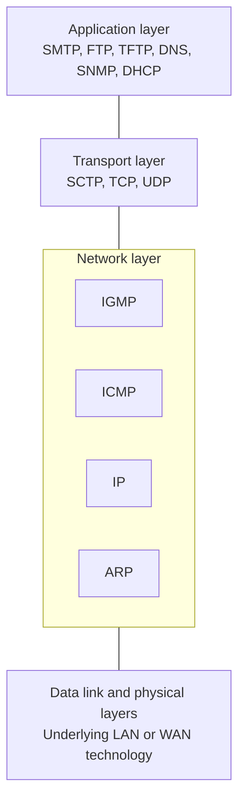
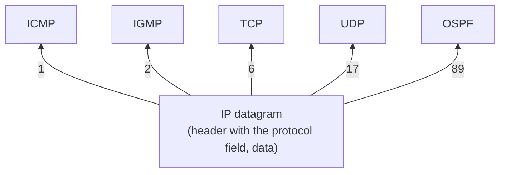
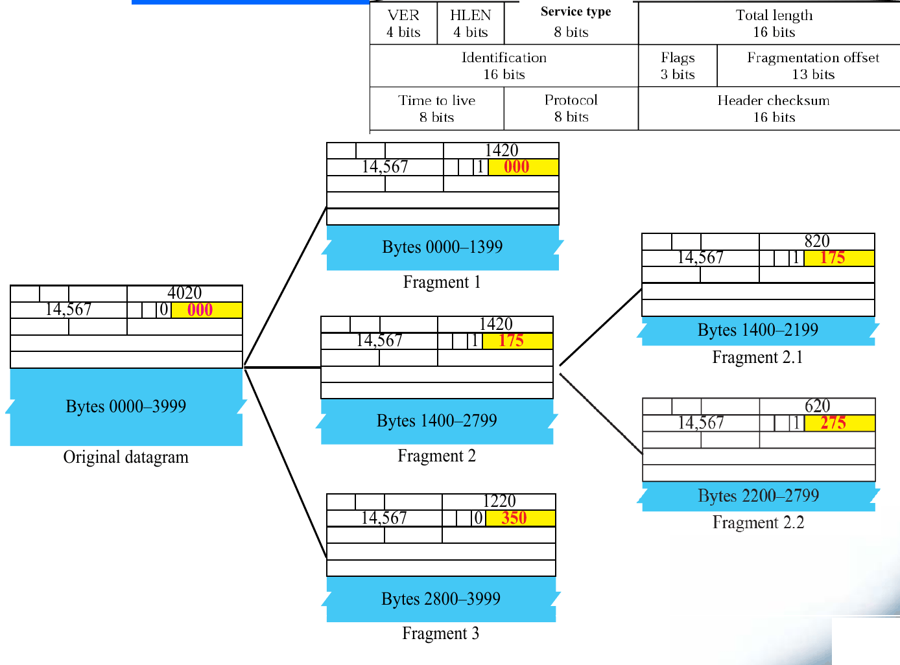
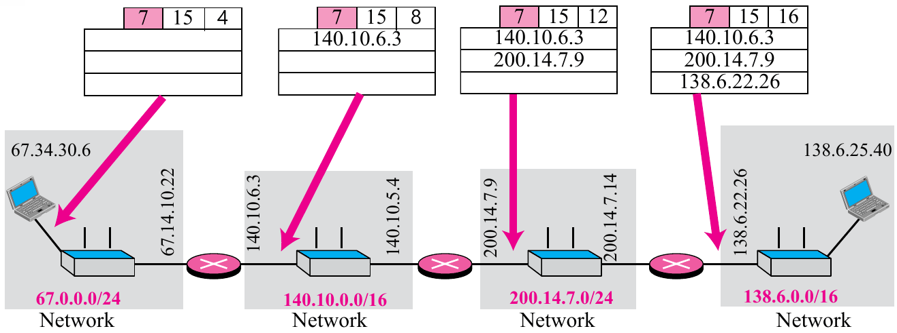
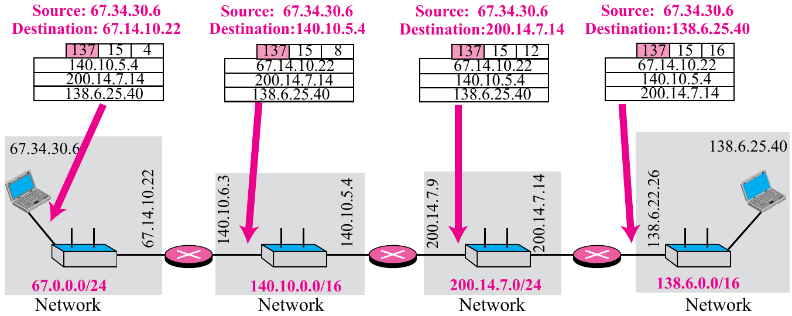
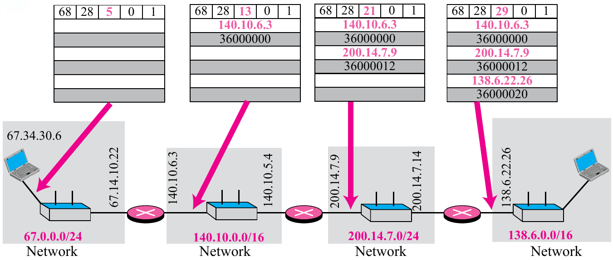
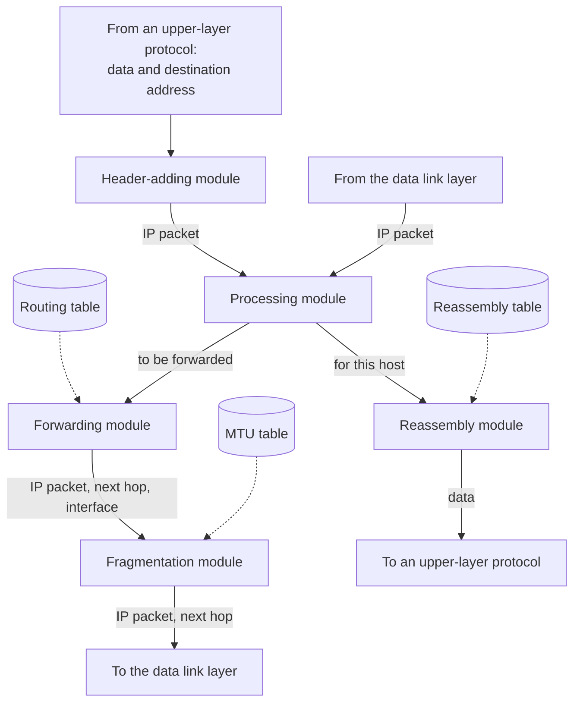

# Chapter 11 — Internet Protocol Version 4 (IPv4)

[Repository Guide](../../README.md) | [English](Concepts_Lecture.md) | [한국어](Concepts_Lecture.ko.md)

> **Last Updated:** 2026-11-18
>
> Computer Networking: A Top-Down Approach, Kurose and Ross, Ch 4; TCP/IP Protocol Suite, Forouzan, Ch 7

> **Learning Objectives:**
> 1. Explain the position of IP in the TCP/IP protocol suite and the meaning of best-effort delivery
> 2. Decode every field of an IPv4 header from its binary or hexadecimal form
> 3. Compute the fragments of a datagram for a given MTU, including the offset, total length, and flag values of each fragment
> 4. Describe the format and the router actions of the record-route, source-route, and timestamp options
> 5. Compute and verify the IPv4 header checksum in one's complement arithmetic
> 6. Explain how the modules of an IP package cooperate to process a datagram

---

## Table of Contents

- [1. The Internet Protocol](#1-the-internet-protocol)
  - [1.1 Position of IP in the TCP/IP Protocol Suite](#11-position-of-ip-in-the-tcpip-protocol-suite)
  - [1.2 Best-Effort Delivery](#12-best-effort-delivery)
- [2. Datagram Format](#2-datagram-format)
  - [2.1 Header and Data](#21-header-and-data)
  - [2.2 The Header Fields](#22-the-header-fields)
  - [2.3 Version and Header Length](#23-version-and-header-length)
  - [2.4 Service Type](#24-service-type)
  - [2.5 Total Length](#25-total-length)
  - [2.6 Time to Live](#26-time-to-live)
  - [2.7 Protocol](#27-protocol)
  - [2.8 Checksum, Addresses, Options, and Data](#28-checksum-addresses-options-and-data)
  - [2.9 Decoding a Header](#29-decoding-a-header)
- [3. Fragmentation](#3-fragmentation)
  - [3.1 Maximum Transfer Unit](#31-maximum-transfer-unit)
  - [3.2 Who Fragments and Who Reassembles](#32-who-fragments-and-who-reassembles)
  - [3.3 Fields Related to Fragmentation](#33-fields-related-to-fragmentation)
  - [3.4 Fragmentation Examples](#34-fragmentation-examples)
  - [3.5 Interpreting a Received Fragment](#35-interpreting-a-received-fragment)
  - [3.6 Computing Fragment Sizes](#36-computing-fragment-sizes)
  - [3.7 Path MTU Discovery](#37-path-mtu-discovery)
- [4. Options](#4-options)
  - [4.1 Option Format](#41-option-format)
  - [4.2 Categories of Options](#42-categories-of-options)
  - [4.3 No-Operation and End-of-Option](#43-no-operation-and-end-of-option)
  - [4.4 Record Route](#44-record-route)
  - [4.5 Strict Source Route](#45-strict-source-route)
  - [4.6 Loose Source Route](#46-loose-source-route)
  - [4.7 Timestamp](#47-timestamp)
  - [4.8 Reading the Type Field of the Six Options](#48-reading-the-type-field-of-the-six-options)
  - [4.9 Options with ping and traceroute](#49-options-with-ping-and-traceroute)
- [5. Checksum](#5-checksum)
  - [5.1 The Checksum Idea](#51-the-checksum-idea)
  - [5.2 Why the Receiver Obtains Zero](#52-why-the-receiver-obtains-zero)
  - [5.3 The Checksum in the IP Header](#53-the-checksum-in-the-ip-header)
  - [5.4 Worked Example](#54-worked-example)
- [6. Security of IP](#6-security-of-ip)
- [7. The IP Package](#7-the-ip-package)
  - [7.1 Components](#71-components)
  - [7.2 Header-Adding and Processing Modules](#72-header-adding-and-processing-modules)
  - [7.3 Queues, Tables, and the Forwarding Module](#73-queues-tables-and-the-forwarding-module)
  - [7.4 Fragmentation Module](#74-fragmentation-module)
  - [7.5 Reassembly Table and Reassembly Module](#75-reassembly-table-and-reassembly-module)
- [Concept Applications](#concept-applications)
- [Summary](#summary)
- [Self-Check Questions](#self-check-questions)
- [References](#references)

---

<br>

## 1. The Internet Protocol

### 1.1 Position of IP in the TCP/IP Protocol Suite

The **Internet Protocol (IP)** is the transmission mechanism used by the TCP/IP protocols. It is the central protocol of the network layer, and every transport-layer segment or user datagram that crosses the Internet travels inside an IP datagram. Figure 1 shows where IP sits. Above it are the transport protocols SCTP, TCP, and UDP, and the application protocols above them. Beside it in the network layer are three auxiliary protocols: ICMP reports errors and answers queries (Chapter 16), IGMP manages multicast group membership (Chapter 16), and ARP maps IP addresses to link-layer addresses (Chapter 19). Below it is any underlying LAN or WAN technology.



*Figure 1. Position of IP and its auxiliary protocols in the TCP/IP protocol suite*

Two versions of IP are in use today. This chapter studies version 4 (IPv4), which is the widely deployed version. Version 6 (IPv6), proposed to replace IPv4, is the subject of Chapter 24.

### 1.2 Best-Effort Delivery

> **Definition:** **Best-effort delivery** is a delivery service that tries to deliver every packet but guarantees neither that the packet arrives, nor that it arrives intact, nor that packets arrive in order or within any time limit.

IP is an unreliable and connectionless datagram protocol that provides best-effort delivery. It is unreliable because a datagram may be lost, corrupted, duplicated, or delayed, and IP does nothing to recover it; IP detects only corruption of its own header and discards such a datagram. It is connectionless because every datagram is handled independently, with no setup and no relation to other datagrams, so datagrams of one message may follow different routes and arrive out of order (Chapter 10). This is the best-effort service model of Chapter 10 seen from inside the protocol. When reliability is needed, IP must be paired with a reliable transport protocol such as TCP (Chapter 8).

> **Key Point:** The simplicity of IP is deliberate. Because IP keeps no state about connections and does no recovery, routers can be fast and simple, and reliability is added only where an application needs it, in the end systems.

---

<br>

## 2. Datagram Format

### 2.1 Header and Data

> **Definition:** A **datagram** is the packet of the IP layer, a variable-length unit made of a header of 20 to 60 bytes that contains the information needed for routing and delivery, followed by the data.

The data part normally carries a transport-layer segment (TCP) or user datagram (UDP), but it can also carry other kinds of data, such as ICMP messages. The total length of a datagram, header included, is between 20 and 65,535 bytes. It is customary in TCP/IP to show the header in 4-byte (32-bit) rows.

```text
|<------------------------- 20 to 65,535 bytes ------------------------->|
|<----- 20 to 60 bytes ----->|
+----------------------------+-------------------------------------------+
|           Header           |                   Data                    |
+----------------------------+-------------------------------------------+
```

*Figure 2. The header and the data of an IPv4 datagram*

### 2.2 The Header Fields

```text
 0 1 2 3 4 5 6 7 8 9 0 1 2 3 4 5 6 7 8 9 0 1 2 3 4 5 6 7 8 9 0 1
+-------+-------+---------------+-------------------------------+
|  VER  |  HLEN |  Service type |          Total length         |
| 4 bits| 4 bits|     8 bits    |            16 bits            |
+-------+-------+---------------+-----+-------------------------+
|         Identification        |Flags|   Fragmentation offset  |
|            16 bits            |  3  |         13 bits         |
+---------------+---------------+-----+-------------------------+
|  Time to live |    Protocol   |        Header checksum        |
|     8 bits    |     8 bits    |            16 bits            |
+---------------+---------------+-------------------------------+
|                       Source IP address                       |
|                            32 bits                            |
+---------------------------------------------------------------+
|                     Destination IP address                    |
|                            32 bits                            |
+---------------------------------------------------------------+
|                       Options + padding                       |
|                         0 to 40 bytes                         |
+---------------------------------------------------------------+
```

*Figure 3. Format of the IPv4 header*

The two textbooks use slightly different names for some fields. Table 1 lists every field with both names, its size, and its role; the following subsections explain each field.

| Field (Forouzan) | Name in Kurose | Bits | Role |
|:--|:--|:--|:--|
| Version (VER) | Version number | 4 | IP version of the datagram, 4 for IPv4 |
| Header length (HLEN) | Header length | 4 | Length of the header in 4-byte words |
| Service type | Type of service | 8 | Class of service of the datagram |
| Total length | Datagram length | 16 | Length of header plus data in bytes |
| Identification | 16-bit identifier | 16 | Identifies the original datagram of a fragment |
| Flags | Flags | 3 | Do-not-fragment and more-fragments bits |
| Fragmentation offset | 13-bit fragmentation offset | 13 | Position of the fragment's data in 8-byte units |
| Time to live (TTL) | Time-to-live | 8 | Hop limit, decremented by each router |
| Protocol | Upper-layer protocol | 8 | Protocol that receives the data at the destination |
| Header checksum | Header checksum | 16 | Error detection over the header only |
| Source address | 32-bit source IP address | 32 | IP address of the original sender |
| Destination address | 32-bit destination IP address | 32 | IP address of the final destination |
| Options + padding | Options (if any) | 0-320 | Optional extensions, at most 40 bytes |

*Table 1. Fields of the IPv4 header with the names used by the two textbooks*

### 2.3 Version and Header Length

The 4-bit **version (VER)** field defines the version of the IP protocol, which is 4 for IPv4. It tells the IP software of the processing machine how to interpret the rest of the datagram, because different versions use different formats. If the machine runs another version of IP, the datagram is discarded rather than interpreted incorrectly.

> **Definition:** The **header length (HLEN)** is a 4-bit field that gives the total length of the datagram header in 4-byte words.

The header length is needed because the header has a variable length between 20 and 60 bytes, and the receiver must know where the data begins. Without options the header is 20 bytes and HLEN is 5 (binary 0101, 5 × 4 = 20). With the maximum 40 bytes of options the header is 60 bytes and HLEN is 15 (binary 1111, 15 × 4 = 60). Since the minimum header is 20 bytes, an HLEN value from 0 to 4 can never be valid. Most datagrams carry no options, so the typical header is 20 bytes long.

**Example 7.1.** An IP packet arrives whose first 8 bits are `01000010`. The receiver discards the packet. Why? The left 4 bits, `0100`, give version 4, which is correct. The next 4 bits, `0010`, give HLEN = 2, a header of 2 × 4 = 8 bytes, which is impossible because the header has at least 20 bytes. The packet was corrupted in transmission.

**Example 7.2.** HLEN is `1000` in binary. How many bytes of options does the packet carry? HLEN = 8, so the header is 8 × 4 = 32 bytes. The first 20 bytes are the base header, and the remaining 12 bytes are options.

### 2.4 Service Type

The 8-bit **service type** field tells routers how the datagram should be handled. In the original design it was called **type of service (TOS)**: part of the field defined the precedence of the datagram and the rest defined the kind of service, such as low delay or high throughput. The IETF later reinterpreted the field as **differentiated services**. Kurose keeps the name type of service and gives an example of its purpose: a router could distinguish real-time datagrams, such as those of an IP telephony application, from non-real-time traffic such as FTP. The level of service a router provides for each class is a policy decision configured by the network administrator.

```text
         6 bits                   2 bits
+-----------------------------+-------------+
|          Codepoint          |   Unused    |
+-----------------------------+-------------+

Precedence interpretation:     x x x 0 0 0   (3 right-most bits are 0)
Differentiated services:       x x x x x 0   category 1
                               x x x x 1 1   category 2
                               x x x x 0 1   category 3
```

*Figure 4. The service type field in the differentiated services interpretation*

In this interpretation the first 6 bits form the **codepoint** subfield, which can be used in two ways.

1. **Precedence interpretation.** When the 3 right-most bits of the codepoint are 0s, the 3 left-most bits are read like the precedence bits of the old TOS field, so the new interpretation is compatible with the old one. Precedence defines eight priority levels, 0 to 7. If a congested router must discard datagrams, it discards those with the lowest precedence first; a datagram for network management, for example, is more urgent than one carrying optional information.
2. **Differentiated services interpretation.** When the 3 right-most bits are not all 0s, the 6 bits define 64 − 8 = 56 services, assigned by the Internet or by local authorities according to Table 2. The first category contains 24 codepoints (those ending in 0, minus the 8 precedence codepoints) and the second and third categories contain 16 each.

| Category | Codepoint | Assigning authority |
|:--|:--|:--|
| 1 | XXXXX0 | Internet (IETF) |
| 2 | XXXX11 | Local (organizations) |
| 3 | XXXX01 | Temporary or experimental |

*Table 2. Categories of codepoints and their assigning authorities*

> **Note:** Forouzan describes the last 2 bits of the field as unused. Kurose notes that two bits of the field are now used for explicit congestion notification (ECN), and the ECN specification designates exactly these last two bits as the ECN field [1]. A congested router can mark them in a passing datagram so that the receiver, and through it the sender, learns of the congestion without a packet being dropped. Chapter 9 explains how TCP uses ECN.

### 2.5 Total Length

The 16-bit **total length** field defines the total length of the datagram, header plus data, in bytes. The length of the data is found by subtracting the header length.

```math
\text{Length of data} = \text{total length} - \text{HLEN} \times 4
```

Since the field has 16 bits, a datagram is limited to $`2^{16} - 1 = 65{,}535`$ bytes, of which 20 to 60 are header. In practice datagrams are rarely larger than 1,500 bytes, which lets a datagram fit in the payload of a maximally sized Ethernet frame (Kurose).

**Example 7.3.** HLEN is 5 (hexadecimal) and total length is 0028 (hexadecimal). How many bytes of data does the packet carry? The header is 5 × 4 = 20 bytes with no options, the total length is 0x0028 = 40 bytes, so the packet carries 40 − 20 = 20 bytes of data.

A frame already tells the receiver where it ends, so the total length field may look unnecessary. It is needed because a frame sometimes carries more than the datagram. Ethernet, for example, requires the data field of a frame to be between 46 and 1,500 bytes. A datagram shorter than 46 bytes is followed by padding, as in Figure 5, and the receiver needs the total length to separate the real datagram from the padding.

```text
           |<----------- Length: minimum 46 bytes ----------->|
+----------+------------------------------+-------------------+----------+
|    L2    |        Data < 46 bytes       |      Padding      |    L2    |
|  header  |       (the IP datagram)      |                   | trailer  |
+----------+------------------------------+-------------------+----------+
```

*Figure 5. Encapsulation of a small datagram in an Ethernet frame*

> **Key Point:** The total length field defines the total length of the datagram including the header.

### 2.6 Time to Live

> **Definition:** The **time to live (TTL)** is an 8-bit field that limits the lifetime of a datagram in the network; every router that processes the datagram decrements it by one and discards the datagram when the value reaches zero.

The field was originally designed to hold a time that each visited router would decrement. That scheme required synchronized clocks and knowledge of how long each transfer takes, so today the field is used to limit the number of hops (routers) that a datagram can visit. The source stores a value that is roughly twice the maximum number of routers between any two hosts. If the value is zero after a router decrements it, the router discards the datagram and reports the event to the source with an ICMP time-exceeded message (Chapter 16).

The field is needed because forwarding tables can become corrupted or inconsistent. A datagram caught in a routing loop could otherwise circulate between routers forever without being delivered; TTL guarantees that it disappears after a bounded number of hops. A second use is to confine a datagram deliberately. A source that stores 1 in the field keeps the datagram on its local network: the first router decrements the value to 0 and discards it.

### 2.7 Protocol

The 8-bit **protocol** field defines the higher-level protocol that uses the services of IP. An IP datagram can encapsulate data from several higher-level protocols, such as TCP, UDP, ICMP, and IGMP, so IP multiplexes data from different protocols at the source and demultiplexes it at the destination. The field is normally used only at the final destination, where it tells IP to which protocol the data must be delivered.



*Figure 6. Demultiplexing of a datagram by the value of the protocol field*

| Value | Protocol | Value | Protocol |
|:--|:--|:--|:--|
| 1 | ICMP | 17 | UDP |
| 2 | IGMP | 89 | OSPF |
| 6 | TCP | | |

*Table 3. Values of the protocol field*

Kurose points out an analogy: the protocol number is the glue that binds the network layer to the transport layer, just as the port number is the glue that binds the transport layer to the application layer (Chapter 6). The link-layer frame has a corresponding field that binds the link layer to the network layer (Chapter 20).

**Example 7.4.** A packet arrives whose first hexadecimal digits are `45000028 00010000 0102...`. How many hops can it travel before being dropped, and to which upper-layer protocol do its data belong? The TTL is the ninth byte, so 8 bytes (16 hexadecimal digits) are skipped. The ninth byte is `01`: the packet can travel only one hop. The tenth byte, the protocol field, is `02`, so the data belong to IGMP.

### 2.8 Checksum, Addresses, Options, and Data

- **Header checksum (16 bits).** It lets a router or host detect bit errors in the header of a received datagram. It covers the header only and must be recomputed at every router, because fields such as TTL change at each hop. Section 5 explains its calculation.
- **Source address (32 bits).** It is the IP address of the source.
- **Destination address (32 bits).** It is the IP address of the final destination, which the source often obtains through a DNS lookup (Chapter 5). Both addresses remain unchanged while the datagram travels from the source host to the destination host, even though the datagram passes through many routers; the next-hop router's address never appears in the IP header (Chapter 13). The only exception is the source-route options of Section 4, which rewrite the destination field at the listed routers. Chapter 12 studies the addresses themselves.
- **Options (0 to 40 bytes).** They extend the header and are meant to be used rarely, so their information is not carried in every header. Their existence still complicates processing: the header has a variable length, so the start of the data cannot be known in advance, and the time a router needs to process a datagram varies greatly with the options. For these reasons IPv6 does not include options in its base header (Chapter 24). Section 4 describes the options.
- **Data.** The data field is the reason the datagram exists. It usually carries a TCP or UDP segment, and it can also carry ICMP messages. A datagram without options has a 20-byte header, so a datagram that carries a TCP segment with a 20-byte header has 40 bytes of header overhead in total.

> **Note:** Both IP and the transport protocols compute a checksum, which looks redundant. Kurose gives two reasons for the repetition. The IP checksum covers only the IP header, while the TCP and UDP checksums cover the whole segment. In addition, TCP or UDP and IP need not belong to the same protocol stack: TCP could run over another network-layer protocol, and IP can carry data that is not passed to TCP or UDP.

### 2.9 Decoding a Header

Decoding a header means reading fields at fixed bit positions. Consider a header whose first 10 bytes are `46 00 00 5C 1C 46 40 00 3C 06`.

| Bytes | Hex | Field and value |
|:--|:--|:--|
| 0 (left 4 bits) | 4 | Version 4 |
| 0 (right 4 bits) | 6 | HLEN 6, header of 24 bytes, so 4 bytes of options |
| 1 | 00 | Service type 0 |
| 2-3 | 005C | Total length 92 bytes, so 92 − 24 = 68 bytes of data |
| 4-5 | 1C46 | Identification 7238 |
| 6-7 | 4000 | Binary 010 followed by 13 zeros: reserved 0, DF 1, MF 0, offset 0 |
| 8 | 3C | TTL 60 |
| 9 | 06 | Protocol 6, TCP |

*Table 4. Decoding the first 10 bytes of an IPv4 header*

The datagram is not a fragment (MF = 0 and offset = 0), and because DF = 1, a router whose outgoing link cannot carry 92 bytes must discard it instead of fragmenting it.

---

<br>

## 3. Fragmentation

### 3.1 Maximum Transfer Unit

A datagram can travel through different networks. Each router decapsulates the datagram from the frame it receives, processes it, and encapsulates it in another frame. The format and size of a received frame depend on the protocol of the network the frame has just crossed, and those of a sent frame depend on the network it is about to cross. A router that connects a LAN to a WAN, for example, receives frames in the LAN format and sends frames in the WAN format.

> **Definition:** The **maximum transfer unit (MTU)** is the maximum size of the data field of a link-layer frame, and therefore the largest datagram that the link can carry in one frame.

Forouzan calls it the maximum transfer unit and Kurose the maximum transmission unit; both mean the same quantity. Most link-layer protocols define a maximum size for the data field of their frames, imposed by the hardware and software of the network.

```text
                 +-------------------------------------+
                 |             IP datagram             |
                 +-------------------------------------+
                                    |
                                    v
+----------------+-------------------------------------+----------------+
|     Header     |                 MTU                 |    Trailer     |
|                |  (maximum length of data that can   |                |
|                |   be encapsulated in a frame)       |                |
+----------------+-------------------------------------+----------------+
                                  Frame
```

*Figure 7. The MTU as the maximum data field of a frame*

| Protocol | MTU (bytes) |
|:--|:--|
| Hyperchannel | 65,535 |
| IBM Token Ring (16 Mbps) | 17,914 |
| IEEE 802.5 Token Ring (4 Mbps) | 4,464 |
| FDDI | 4,352 |
| Ethernet | 1,500 |
| X.25 | 576 |
| PPP (low delay) | 296 |

*Table 5. MTUs of several link-layer protocols*

The values of Table 5 are taken from the list of common MTUs in the path MTU discovery specification [2]; Forouzan quotes the Ethernet, FDDI, and PPP values among them. To make IP independent of the physical network, its designers set the maximum datagram length to 65,535 bytes, which is efficient on a network whose MTU is that large. On every other network a large datagram must be divided to pass through.

> **Definition:** **Fragmentation** is the division of a datagram into smaller datagrams, called fragments, so that each fits the MTU of the link on which it is sent.

Only the data of a datagram is fragmented. Each fragment carries its own header, with most fields copied from the original and a few changed, and each fragment is itself a datagram. A fragment may be fragmented again if it meets a network with an even smaller MTU, so a datagram can be fragmented several times before it reaches the destination.

### 3.2 Who Fragments and Who Reassembles

A datagram can be fragmented by the source host or by any router on the path. The source usually does not need to, because the transport layer divides the data into segments that fit the IP and data link layers in use. Reassembly, however, is done only by the destination host. Fragments become independent datagrams that may follow different routes, and only the destination is sure to receive all of them. Reassembling in the routers would also cost efficiency: as Kurose explains, the designers of IPv4 felt that reassembly in routers would complicate the protocol and slow routers down, and following the principle of keeping the network core simple, they put reassembly in the end systems. TCP and UDP expect complete segments, so the destination's network layer reassembles before delivering anything.

When a datagram is fragmented, the host or router that fragments it must change the values of three fields: flags, fragmentation offset, and total length. The other fields are copied, the option field may or may not be copied (Section 4.1), and the checksum is recalculated as in every forwarding.

> **Key Point:** If a datagram with DF = 0 is larger than the MTU of its outgoing link, it can be fragmented at that point, whether that point is the source or any router, but it is reassembled only at the final destination.

### 3.3 Fields Related to Fragmentation

Three header fields support fragmentation and reassembly: identification, flags, and fragmentation offset.

**Identification (16 bits).** This field identifies a datagram that originates at the source host. The combination of the identification and the source IP address must uniquely define a datagram as it leaves the source. To guarantee uniqueness, IP uses a counter initialized to a positive number: when it sends a datagram it copies the current counter value into the field and increments the counter by one. As long as the counter is kept in main memory, uniqueness is guaranteed. When a datagram is fragmented, the identification value is copied into all fragments, so all fragments of a datagram carry the same number, which tells the destination which fragments belong together.

**Flags (3 bits).** The first bit is reserved. The second is the do-not-fragment bit, and the third is the more-fragments bit.

```text
+----------+----------+----------+
| Reserved |    D     |    M     |
+----------+----------+----------+
  D: Do not fragment
  M: More fragments
```

*Figure 8. The flags field*

| Bit | Name | Value 0 | Value 1 |
|:--|:--|:--|:--|
| 1st | Reserved | Always 0 | Not used |
| 2nd | D (do not fragment, DF) | The datagram may be fragmented if necessary | The datagram must not be fragmented; if it cannot pass through any available network, it is discarded and an ICMP error message is sent to the source |
| 3rd | M (more fragments, MF) | This is the last fragment or the only one | More fragments follow this one |

*Table 6. Meaning of the three bits of the flags field*

> **Definition:** The **fragmentation offset** is a 13-bit field that gives the position of a fragment's data in the original datagram, measured in units of 8 bytes.

**Fragmentation offset (13 bits).** The offset is measured in 8-byte units because a 13-bit field can represent only values up to $`2^{13} - 1 = 8191`$, too small to number every byte of a 65,535-byte datagram. In 8-byte units the largest offset, 8191, reaches byte 8191 × 8 = 65,528, beyond the start of any fragment of a maximal datagram. The price is that every fragment except the last must carry a number of data bytes that is a multiple of 8, so that the first byte of the next fragment falls on a multiple of 8.

Figure 9 shows a datagram with 4,000 bytes of data, numbered 0 to 3999, divided into three fragments. The first fragment carries bytes 0 to 1399 and its offset is 0/8 = 0. The second carries bytes 1400 to 2799 with offset 1400/8 = 175. The third carries bytes 2800 to 3999 with offset 2800/8 = 350.

```text
                                       +---------------------+
                                  +--->| bytes 0000 - 1399   |  Offset = 0000/8 = 0
                                  |    +---------------------+
+----------------------------+    |    +---------------------+
| bytes 0000 ........... 3999|----+--->| bytes 1400 - 2799   |  Offset = 1400/8 = 175
+----------------------------+    |    +---------------------+
       Offset = 0000/8 = 0        |    +---------------------+
                                  +--->| bytes 2800 - 3999   |  Offset = 2800/8 = 350
                                       +---------------------+
```

*Figure 9. Offsets of three fragments of a datagram with 4,000 bytes of data*

### 3.4 Fragmentation Examples

**Kurose's example.** A datagram of 4,000 bytes, 20 bytes of header plus 3,980 bytes of payload, arrives at a router and must be forwarded on a link whose MTU is 1,500 bytes. Each fragment can carry at most 1,500 − 20 = 1,480 bytes of data, and 1,480 is a multiple of 8, so the 3,980 data bytes are divided as 1,480 + 1,480 + 1,020. All fragments keep the identification of the original, here 777.

| Fragment | Data bytes | Total length | Identification | MF | Offset |
|:--|:--|:--|:--|:--|:--|
| 1 | 0-1479 (1,480 bytes) | 1,500 | 777 | 1 | 0 |
| 2 | 1480-2959 (1,480 bytes) | 1,500 | 777 | 1 | 185 (= 1480/8) |
| 3 | 2960-3979 (1,020 bytes) | 1,040 | 777 | 0 | 370 (= 2960/8) |

*Table 7. Fragments of a 4,000-byte datagram on a link with an MTU of 1,500 bytes*

The destination reassembles the payload only when all three fragments have arrived. If one of them is lost, the whole datagram is lost, because IP never retransmits.

**A fragment of a fragment.** Figure 10 expands the fragments of Figure 9 into their headers. The original datagram has total length 4,020 (20 bytes of header plus 4,000 of data), identification 14,567, M = 0, and offset 0. Every fragment keeps identification 14,567, and the M bit is 1 in every fragment except the one that carries the end of the original data.



*Figure 10. A detailed fragmentation example with a fragment that is fragmented again*

The second fragment, which carries bytes 1400 to 2799, later meets a network with a smaller MTU and is itself divided into fragments of 800 and 600 bytes of data. The offset of each new fragment is still measured from the start of the original datagram, not from the start of fragment 2, so fragment 2.2 has offset 2200/8 = 275. Its M bit stays 1 because more data of the original datagram (bytes 2800 to 3999) follow it.

| Fragment | Data bytes | Total length | M | Offset |
|:--|:--|:--|:--|:--|
| Original | 0-3999 | 4,020 | 0 | 0 |
| 1 | 0-1399 | 1,420 | 1 | 0 |
| 2 | 1400-2799 | 1,420 | 1 | 175 |
| 2.1 | 1400-2199 | 820 | 1 | 175 |
| 2.2 | 2200-2799 | 620 | 1 | 275 |
| 3 | 2800-3999 | 1,220 | 0 | 350 |

*Table 8. Header values of the fragments in Figure 10*

Even if the fragments follow different paths and arrive out of order, the destination can reassemble the original datagram, provided none is lost, with the following strategy.

1. The first fragment has an offset value of 0.
2. Dividing the data length of the first fragment by 8 gives the offset of the second fragment.
3. Dividing the total data length of the first and second fragments by 8 gives the offset of the third fragment.
4. The process continues, and the last fragment has an M bit of 0.

### 3.5 Interpreting a Received Fragment

The M bit and the offset together tell the destination where a fragment lies. Table 9 summarizes the cases, and Examples 7.5 to 7.9 apply them.

| M bit | Offset | Conclusion |
|:--|:--|:--|
| 0 | 0 | An unfragmented datagram (the only fragment) |
| 1 | 0 | The first fragment |
| 1 | Not 0 | A middle fragment |
| 0 | Not 0 | The last fragment |

*Table 9. Position of a fragment determined from the M bit and the offset*

**Example 7.5.** A packet arrives with M = 0. Is it the first, the last, or a middle fragment, and do we know whether the packet was fragmented? M = 0 means no more fragments follow, so it is the last fragment. Whether the original packet was fragmented cannot be told from M alone, because an unfragmented packet is also treated as the last fragment.

**Example 7.6.** A packet arrives with M = 1. At least one more fragment follows, so it is the first or a middle fragment, but not the last. Deciding between the two requires the offset value.

**Example 7.7.** A packet arrives with M = 1 and offset 0. Because M = 1 it is the first or a middle fragment, and because the offset is 0 it is the first fragment.

**Example 7.8.** A packet arrives with offset 100. The first data byte is number 100 × 8 = 800. The number of the last byte cannot be determined without the length of the data.

**Example 7.9.** A packet arrives with offset 100, HLEN 5, and total length 100. The first byte is 100 × 8 = 800. The header is 5 × 4 = 20 bytes, so the fragment carries 100 − 20 = 80 bytes of data, and the last byte is 800 + 80 − 1 = 879.

### 3.6 Computing Fragment Sizes

The fragment sizes for a given MTU follow from three rules: each fragment carries its own header, its total length must not exceed the MTU, and every fragment except the last must carry a multiple of 8 data bytes. Take a datagram of 4,000 bytes with a 20-byte header and an outgoing MTU of 1,400 bytes.

1. The original data is 4,000 − 20 = 3,980 bytes.
2. A fragment can carry at most 1,400 − 20 = 1,380 bytes of data.
3. Rounding down to a multiple of 8 gives 1,376 bytes (1,376 / 8 = 172).
4. Two full fragments carry 2 × 1,376 = 2,752 bytes, and the last fragment carries the remaining 3,980 − 2,752 = 1,228 bytes.

| Fragment | Data bytes | Total length | MF | Offset |
|:--|:--|:--|:--|:--|
| 1 | 0-1375 (1,376 bytes) | 1,396 | 1 | 0 |
| 2 | 1376-2751 (1,376 bytes) | 1,396 | 1 | 172 |
| 3 | 2752-3979 (1,228 bytes) | 1,248 | 0 | 344 |

*Table 10. Fragments of a 4,000-byte datagram on a link with an MTU of 1,400 bytes*

> **Caution:** Using 1,380 bytes per fragment would be wrong. The second fragment would then start at byte 1380, and 1380 / 8 = 172.5 cannot be written in the offset field. The rounding in step 3 is what makes every offset an integer.

### 3.7 Path MTU Discovery

Fragmentation costs work in routers and at the destination, and the loss of one fragment loses the whole datagram. A source can avoid fragmentation if it sends datagrams no larger than the smallest MTU on the path to the destination, the path MTU.

> **Definition:** **Path MTU discovery** is a technique by which a source finds the smallest MTU on the path to a destination by sending datagrams with the do-not-fragment bit set and reducing their size when routers report that they are too large.

The technique is specified in RFC 1191 [2].

1. The source sends its datagrams with the DF bit set to 1, initially at the MTU of its first link.
2. A router whose outgoing link has an MTU smaller than the datagram cannot fragment it, so it discards the datagram and returns an ICMP destination-unreachable message with the code fragmentation needed and DF set (Chapter 16). A router that follows RFC 1191 also includes the MTU of its outgoing link in the message.
3. The source reduces the size of its datagrams and retries.
4. When datagrams reach the destination without such messages, their size is at most the path MTU.

Kurose mentions this technique when explaining how TCP chooses its maximum segment size (Chapter 8). The technique works only if the ICMP messages reach the source.

---

<br>

## 4. Options

The header of an IP datagram has two parts. The fixed part is 20 bytes long and was described in Section 2. The variable part holds the options, at most 40 bytes. Options are not required in a datagram and are used mainly for network testing and debugging. Although options are optional in the header, option processing is required of the IP software: every implementation must be able to handle options that are present.

### 4.1 Option Format

Every option is composed of a 1-byte type field, a 1-byte length field, and a variable-sized value field, a structure often called type-length-value (TLV).

```text
      8 bits            8 bits               Variable length
+-----------------+-----------------+-----------------------------------+
|      Type       |     Length      |               Value               |
+-----------------+-----------------+-----------------------------------+
 1 bit  2 bits  5 bits
+----+--------+------------+
|Copy| Class  |   Number   |
+----+--------+------------+
```

*Figure 11. Format of an IP option and of its type field*

- **Type (8 bits).** It contains three subfields, copy, class, and number, listed in Table 11.
- **Length (8 bits).** It gives the total length of the option, including the type and length fields themselves. It is not present in every option.
- **Value (variable).** It contains the data that a specific option requires. Like the length field, it is not present in every option.

| Subfield | Bits | Values |
|:--|:--|:--|
| Copy | 1 | 0: copy only in the first fragment; 1: copy into all fragments |
| Class | 2 | 00: datagram control; 01: reserved; 10: debugging and management; 11: reserved |
| Number | 5 | 00000: end of option; 00001: no operation; 00011: loose source route; 00100: timestamp; 00111: record route; 01001: strict source route |

*Table 11. Subfields of the option type field*

The copy bit controls the presence of the option in fragments. Options with copy bit 1 must appear in every fragment, and options with copy bit 0 only in the first. The class defines the general purpose of the option; only 00 and 10 are in use. The 5-bit number could define 32 types, but only 6 are in use.

### 4.2 Categories of Options

Of the six options in use, two are single-byte options, which consist of the type field alone and need no length or value field. The other four are multiple-byte options, which need the length and value fields.

```mermaid
graph LR
    O["Options"] --> S["Single-byte<br/>(no length and value fields)"]
    O --> M["Multiple-byte"]
    S --> NOP["No operation"]
    S --> EOO["End of option"]
    M --> RR["Record route"]
    M --> SSR["Strict source route"]
    M --> LSR["Loose source route"]
    M --> TS["Timestamp"]
```



*Figure 12. Categories of IP options*

### 4.3 No-Operation and End-of-Option

The **no-operation option** (type 1, `00000001`) is a 1-byte option used as a filler between options. It can align the beginning of an option, or align the option that follows another option, on a 16-bit or 32-bit boundary.

```text
a. No-operation option:   +-------------------+
                          |  Type 1: 00000001 |
                          +-------------------+

b. Aligning the beginning of an option     c. Aligning the next option
+-------+---------------------------+      +---------------------+-------+
| NO-OP |    An 11-byte option      |      |   A 7-byte option   | NO-OP |
+-------+---------------------------+      +---------------------+-------+
                                           |       An 8-byte option      |
                                           +-----------------------------+
```

*Figure 13. The no-operation option and its use for alignment*

The **end-of-option option** (type 0, `00000000`) is also a 1-byte option, used for padding at the end of the option field. It can be used only as the last option, and only once; after it the receiver looks for the data. If more than 1 byte is needed to align the option field, some no-operation options are used, followed by one end-of-option option.

```text
a. End-of-option option:  +-------------------+
                          |  Type 0: 00000000 |
                          +-------------------+

b. Used for padding:
+-----------------------------------------------------+
|                       Options             | END-OP  |
+-----------------------------------------------------+
|                         Data                        |
```

*Figure 14. The end-of-option option and its use for padding*

### 4.4 Record Route

> **Definition:** The **record-route option** is an IP option in which every router that handles a datagram writes the IP address of its outgoing interface into slots prepared by the source.

The option can list up to nine router addresses. The header can be at most 60 bytes, the base header takes 20, and the 40 remaining bytes hold the type, length, and pointer bytes (3 bytes) plus at most nine 4-byte addresses (36 bytes). The source creates empty placeholder fields that the visited routers fill.

```text
+-------------------+-------------------+-------------------+
|  Type 7: 00000111 |      Length       |      Pointer      |
|                   |  (total length)   |                   |
+-------------------+-------------------+-------------------+
|                    First IP address                       |
|                  (empty when started)                     |
+-----------------------------------------------------------+
|                   Second IP address                       |
|                  (empty when started)                     |
+-----------------------------------------------------------+
|                          ...                              |   only 9 addresses
+-----------------------------------------------------------+   can be listed
|                    Last IP address                        |
|                  (empty when started)                     |
+-----------------------------------------------------------+
```

*Figure 15. Format of the record-route option*

The **pointer** is an offset that contains the byte number, counted from 1 at the type byte, of the first empty entry. When the datagram leaves the source all address fields are empty and the pointer is 4, pointing to the first address field (bytes 1 to 3 are type, length, and pointer). Each router that processes the datagram compares the pointer with the length.

- If the pointer is greater than the length, the option is full, and the router makes no change.
- Otherwise the router inserts the IP address of the interface from which the datagram leaves into the next empty field (a router has several IP addresses, one per interface) and increments the pointer by 4.



*Figure 16. The record-route option as a datagram crosses three routers*

In Figure 16 the host 67.34.30.6 sends a datagram to 138.6.25.40 with a record-route option of length 15, which has room for three addresses (3 + 3 × 4 = 15). The trace below follows the option from left to right.

| Point on the path | Addresses recorded | Pointer |
|:--|:--|:--|
| Leaving the source | (none) | 4 |
| After the first router (outgoing interface 140.10.6.3) | 140.10.6.3 | 8 |
| After the second router (outgoing interface 200.14.7.9) | 140.10.6.3, 200.14.7.9 | 12 |
| After the third router (outgoing interface 138.6.22.26) | 140.10.6.3, 200.14.7.9, 138.6.22.26 | 16 |

*Table 12. Contents of the record-route option along the path of Figure 16*

At the destination the pointer is 16, greater than the length 15, so any further router would find the option full.

### 4.5 Strict Source Route

> **Definition:** **Strict source routing** is an IP option in which the source lists every router that the datagram must visit, and the datagram may visit no router outside the list.

Dictating the route can serve several purposes. The sender can choose a route with a specific type of service, such as minimum delay or maximum throughput, or a route that is safer or more reliable for its purpose, for example one that avoids a competitor's network. If a datagram visits a router that is not on the list, it is discarded and an error message is issued. If it arrives at the destination while some entries were not visited, it is also discarded with an error message. Regular users do not usually know the physical topology of the Internet, so strict source routing is not the choice of most users.

```text
+-------------------+-------------------+-------------------+
| Type 137: 10001001|      Length       |      Pointer      |
|                   |  (total length)   |                   |
+-------------------+-------------------+-------------------+
|                    First IP address                       |
|                  (filled when started)                    |
+-----------------------------------------------------------+
|                   Second IP address                       |
|                  (filled when started)                    |
+-----------------------------------------------------------+
|                          ...                              |   only 9 addresses
+-----------------------------------------------------------+   can be listed
|                    Last IP address                        |
|                  (filled when started)                    |
+-----------------------------------------------------------+
```

*Figure 17. Format of the strict-source-route option*

The format is that of the record-route option, except that the sender fills in all addresses. Each router that processes the datagram compares the pointer with the length.

- If the pointer is greater than the length, the datagram has already visited all listed routers; it cannot travel further, so it is discarded with an error message.
- Otherwise the router compares the destination address of the datagram with its own incoming IP address. If they are equal, it swaps the address pointed to by the pointer with the destination address, increments the pointer by 4, and forwards the datagram. If they are not equal, it discards the datagram and issues an error message.



*Figure 18. Strict source routing as a datagram crosses three routers*

In Figure 18 the source 67.34.30.6 lists the incoming interfaces 140.10.5.4 and 200.14.7.14 of the second and third routers and the final destination 138.6.25.40, and it puts the first router's address 67.14.10.22 in the destination field. At each router the next listed address moves into the destination field, and the address that was in the destination field (the router's incoming interface) moves into the list.

| Point on the path | Destination field | Addresses in the option | Pointer |
|:--|:--|:--|:--|
| Leaving the source | 67.14.10.22 | 140.10.5.4, 200.14.7.14, 138.6.25.40 | 4 |
| After the first router | 140.10.5.4 | 67.14.10.22, 200.14.7.14, 138.6.25.40 | 8 |
| After the second router | 200.14.7.14 | 67.14.10.22, 140.10.5.4, 138.6.25.40 | 12 |
| After the third router | 138.6.25.40 | 67.14.10.22, 140.10.5.4, 200.14.7.14 | 16 |

*Table 13. Destination field and option contents along the path of Figure 18*

When the datagram arrives, its destination field holds the real destination and the option holds the route it actually followed.

### 4.6 Loose Source Route

The **loose-source-route option** (type 131, `10000011`) is similar to the strict source route but more relaxed. Each router in the list must be visited, but the datagram may also visit other routers between them. Its format is the same as that of Figure 17 with type 131.

```text
+-------------------+-------------------+-------------------+
| Type 131: 10000011|      Length       |      Pointer      |
|                   |  (total length)   |                   |
+-------------------+-------------------+-------------------+
|          First IP address (filled when started)           |
+-----------------------------------------------------------+
|          Second IP address (filled when started)          |
+-----------------------------------------------------------+
|                          ...                              |   only 9 addresses
+-----------------------------------------------------------+   can be listed
|           Last IP address (filled when started)           |
+-----------------------------------------------------------+
```

*Figure 19. Format of the loose-source-route option*

### 4.7 Timestamp

The **timestamp option** (code 68, `01000100`) records the time at which routers process the datagram. The time is expressed in milliseconds from midnight, Universal Time. Knowing when a datagram is processed helps users and managers track the behavior of routers and estimate the time it takes a datagram to go from one router to another. It is only an estimate, because the routers' local clocks may not be synchronized even if all of them use Universal Time. Non-privileged users do not usually know the physical topology, so the timestamp option is not a choice for most users.

```text
+-------------+-------------+-------------+--------+--------+
|  Code: 68   |   Length    |   Pointer   | O-Flow | Flags  |
|  01000100   |(total len.) |             | 4 bits | 4 bits |
+-------------+-------------+-------------+--------+--------+
|                    First IP address                       |
+-----------------------------------------------------------+
|                    (first timestamp)                      |
+-----------------------------------------------------------+
|                          ...                              |
+-----------------------------------------------------------+
|                     Last IP address                       |
+-----------------------------------------------------------+
|                    (last timestamp)                       |
+-----------------------------------------------------------+
```

*Figure 20. Format of the timestamp option*

The **overflow** field counts the routers that could not add their timestamp because no more fields were available. The **flags** field specifies the responsibilities of the visited routers.

| Flag | Router action |
|:--|:--|
| 0 | Each router adds only its timestamp in the provided field. |
| 1 | Each router adds its outgoing IP address and its timestamp. |
| 3 | The IP addresses are given by the source; each router compares the given address with its own incoming address and, if they match, overwrites it with its outgoing address and adds its timestamp. |

*Table 14. Values of the flags field of the timestamp option*



*Figure 21. The timestamp option with flag 1 as a datagram crosses three routers*

In Figure 21 the option has length 28, room for three address and timestamp pairs (4 + 3 × 8 = 28), overflow 0, and flag 1. Each entry takes 8 bytes, so the pointer advances by 8 from its initial value 5: 5, 13, 21, 29. The routers record 140.10.6.3 with 36000000, 200.14.7.9 with 36000012, and 138.6.22.26 with 36000020, so, if the clocks agree, the datagram took about 12 ms between the first two routers and 8 ms between the last two.

### 4.8 Reading the Type Field of the Six Options

The left-most bit of the type field tells whether an option is copied into every fragment (Example 7.10), and the next two bits give its class (Example 7.11).

| Option | Type (binary) | Decimal | Copied into all fragments? | Class |
|:--|:--|:--|:--|:--|
| No operation | 00000001 | 1 | No | Datagram control |
| End of option | 00000000 | 0 | No | Datagram control |
| Record route | 00000111 | 7 | No | Datagram control |
| Strict source route | 10001001 | 137 | Yes | Datagram control |
| Loose source route | 10000011 | 131 | Yes | Datagram control |
| Timestamp | 01000100 | 68 | No | Debugging and management |

*Table 15. Copy bit and class of the six options*

The source-route options must be copied into every fragment, since every fragment must follow the dictated route. A record of the route or of times needs to be kept only once, so those options travel only in the first fragment.

### 4.9 Options with ping and traceroute

The UNIX utilities ping and traceroute (Chapter 16) can exercise these options. Forouzan's examples below were run against the server fhda.edu of De Anza College. A plain ping (Example 7.12) shows that the host's address is 153.18.8.1.

```console
$ ping fhda.edu
PING fhda.edu (153.18.8.1) 56(84) bytes of data.
64 bytes from tiptoe.fhda.edu (153.18.8.1): icmp_seq=0 ttl=62 time=1.87 ms
```

With the `-R` option (Example 7.13), ping uses the record-route option. The RR list shows the interfaces and IP addresses visited. The source host voyager appears at both ends of the list and the server tiptoe in the middle, so the list covers the way to the server and the way back.

```console
$ ping -R fhda.edu
PING fhda.edu (153.18.8.1) 56(124) bytes of data.
64 bytes from tiptoe.fhda.edu (153.18.8.1): icmp_seq=0 ttl=62 time=2.70 ms
RR:     voyager.deanza.fhda.edu (153.18.17.11)
        Dcore_G0_3-69.fhda.edu (153.18.251.3)
        Dbackup_V13.fhda.edu (153.18.191.249)
        tiptoe.fhda.edu (153.18.8.1)
        Dbackup_V62.fhda.edu (153.18.251.34)
        Dcore_G0_1-6.fhda.edu (153.18.31.254)
        voyager.deanza.fhda.edu (153.18.17.11)
```

The datagram size grows from 84 to 124 bytes: the record-route option with room for nine addresses (39 bytes) and 1 byte of padding fill the largest possible option field of 40 bytes.

The traceroute utility also tracks the route of a packet; in Example 7.14 it shows the three routers visited.

```console
$ traceroute fhda.edu
traceroute to fhda.edu (153.18.8.1), 30 hops max, 38 byte packets
 1 Dcore_G0_1-6.fhda.edu (153.18.31.254)  0.972 ms  0.902 ms  0.881 ms
 2 Dbackup_V69.fhda.edu (153.18.251.4)  2.113 ms  1.996 ms  2.059 ms
 3 tiptoe.fhda.edu (153.18.8.1)  1.791 ms  1.741 ms  1.751 ms
```

The `-g` option of traceroute implements loose source routing (Example 7.15): the packet must visit router 153.18.251.4 but may visit others as well, and here it passes through 153.18.31.254 first.

```console
$ traceroute -g 153.18.251.4 fhda.edu.
traceroute to fhda.edu (153.18.8.1), 30 hops max, 46 byte packets
 1 Dcore_G0_1-6.fhda.edu (153.18.31.254)  0.976 ms  0.906 ms  0.889 ms
 2 Dbackup_V69.fhda.edu (153.18.251.4)  2.168 ms  2.148 ms  2.037 ms
```

The `-G` option implements strict source routing (Example 7.16): the packet is forced to visit only router 153.18.251.4, so the first hop of the output is that router.

```console
$ traceroute -G 153.18.251.4 fhda.edu.
traceroute to fhda.edu (153.18.8.1), 30 hops max, 46 byte packets
 1 Dbackup_V69.fhda.edu (153.18.251.4)  2.168 ms  2.148 ms  2.037 ms
```

The packets of the last two runs are 46 bytes long instead of 38; the 8 extra bytes are the source-route option, padded so that the header length stays a multiple of 4 bytes.

---

<br>

## 5. Checksum

### 5.1 The Checksum Idea

The error detection method used by most TCP/IP protocols is the **checksum**. It protects against corruption that may occur during the transmission of a packet. The checksum is redundant information added to the packet: the sender calculates it and sends it with the packet, and the receiver repeats the same calculation on the whole packet, checksum included. If the result is satisfactory, the packet is accepted; otherwise it is rejected.

> **Definition:** The **header checksum** of IPv4 is a 16-bit field that holds the one's complement of the one's complement sum of all 16-bit words of the header, computed with the checksum field set to zero.

At the sender, the packet is divided into k sections of n bits each (n is usually 16). The sections are added in one's complement arithmetic, giving an n-bit sum, and the sum is complemented (every 0 changed to 1 and every 1 to 0) to produce the checksum. The receiver divides the received packet into the same k sections, adds all of them including the checksum, and complements the result. If the final result is 0, the packet is kept; otherwise it is discarded.

```text
          Sender                                          Receiver
+-----------------------+                       +-----------------------+
| Section 1    n bits   |                       | Section 1    n bits   |
| Section 2    n bits   |                       | Section 2    n bits   |
|    ...                |                       |    ...                |
| Checksum     all 0s   |   +--------------+    | Checksum     n bits   |
|    ...                |-->|    Packet    |--->|    ...                |
| Section k    n bits   |   | (n-bit check-|    | Section k    n bits   |
+-----------------------+   |  sum inside) |    +-----------------------+
| Sum          n bits   |   +--------------+    | Sum          n bits   |
| Complement            |                       | Complement            |
| Checksum     n bits   |                       | Result       n bits   |
+-----------------------+                       +-----------------------+
                                                 If the result is 0, keep;
                                                 otherwise, discard.
```

*Figure 22. Checksum calculation at the sender and checking at the receiver*

### 5.2 Why the Receiver Obtains Zero

Let T be the one's complement sum of all sections at the sender. In one's complement arithmetic the complement of a number is its negative, so the checksum is −T. The receiver adds the same sections plus the checksum and obtains T + (−T), which in one's complement is −0, the word of all 1s. Complementing −0 gives 0. Thus a final result of 0 means that no error was detected.

```text
     Sender                     Datagram                      Receiver
+----------------+        +-----------------+        +---------------------------+
| Sum:      T    |  --->  |   T   |   -T    |  --->  | Sum:      T + (-T) = -0   |
| Checksum: -T   |        +-----------------+        | Checksum: -(-0) = 0       |
+----------------+                                   +---------------------------+
```

*Figure 23. Why the receiver's result is zero in one's complement arithmetic*

> **[Digital Logic Design]** The one's complement, studied in Digital Logic Design as a complement representation of binary numbers, is obtained by inverting every bit, and it represents the negative of a number. One's complement addition does not discard a carry out of the most significant bit; it adds the carry back to the least significant bit of the sum (end-around carry). In this representation 0 has two forms, all 0s (+0) and all 1s (−0), which is why the receiver's sum is all 1s when there is no error. Chapter 6 shows the same calculation for the UDP checksum.

### 5.3 The Checksum in the IP Header

In the IP header the checksum follows the same principle. First the checksum field is set to 0, then the whole header is divided into 16-bit sections that are added together, and the complemented sum is inserted into the checksum field. The IP checksum covers only the header, not the data, for two reasons.

1. All higher-level protocols that encapsulate data in an IP datagram have a checksum field that covers their whole packet, so IP need not check the encapsulated data again.
2. The header changes at every router, but the data do not. If the data were included, every router would have to recalculate the checksum over the whole packet, which would increase the processing time.

> **Key Point:** The checksum in IP covers only the header, not the data, and every router recalculates it because the TTL field (and, after fragmentation, the flags, offset, and total length fields) changes at each hop.

### 5.4 Worked Example

**Example 7.17.** Figure 24 computes the checksum at the sender for a header without options: version 4, HLEN 5, service type 0, total length 28, identification 1, flags and offset 0, TTL 4, protocol 17 (UDP), source 10.12.14.5, destination 12.6.7.9. The header is divided into ten 16-bit sections, with the checksum field set to 0 during the calculation.

```text
4, 5, and 0     ->   01000101 00000000
28              ->   00000000 00011100
1               ->   00000000 00000001
0 and 0         ->   00000000 00000000
4 and 17        ->   00000100 00010001
0 (checksum)    ->   00000000 00000000
10.12           ->   00001010 00001100
14.5            ->   00001110 00000101
12.6            ->   00001100 00000110
7.9             ->   00000111 00001001
                     -----------------
Sum             ->   01110100 01001110
Checksum        ->   10001011 10110001   (= 0x8BB1 = 35761)
```

*Figure 24. Checksum calculation at the sender for a header without options*

No addition produces a carry out of the 16th bit here, so the one's complement sum equals the ordinary sum 0x744E. Its complement, 0x8BB1 = 35761, is inserted into the checksum field.

**Example 7.18.** Figure 25 checks the same header at the receiver, or at an intermediate router, assuming that no errors occurred. All ten sections, now including the checksum 35761, are added and the sum is complemented. The result is sixteen 0s, so the packet is accepted.

```text
4, 5, and 0     ->   01000101 00000000
28              ->   00000000 00011100
1               ->   00000000 00000001
0 and 0         ->   00000000 00000000
4 and 17        ->   00000100 00010001
Checksum        ->   10001011 10110001
10.12           ->   00001010 00001100
14.5            ->   00001110 00000101
12.6            ->   00001100 00000110
7.9             ->   00000111 00001001
                     -----------------
Sum             ->   11111111 11111111
Checksum        ->   00000000 00000000
```

*Figure 25. Checksum verification at the receiver*

---

<br>

## 6. Security of IP

IPv4, like the whole Internet, was designed when its users trusted one another, and it provides no security. Three security issues apply particularly to IP.

- **Packet sniffing.** An intruder intercepts an IP packet and copies it without changing it. This passive attack is very difficult to detect, because the sender and the receiver may never know that the packet was copied. Sniffing cannot be stopped, but encrypting the packet makes it useless, since the attacker cannot read the contents.
- **Packet modification.** The attacker intercepts the packet, changes its contents, and sends it on, and the receiver believes it came from the original sender. A data integrity mechanism lets the receiver detect that the packet was changed before using its contents.
- **IP spoofing.** An attacker creates an IP packet that carries the source address of another computer, for example a packet sent to a bank that pretends to come from a customer. An origin authentication mechanism prevents this attack.

These attacks are countered by **IPsec** (IP Security), used together with IP. IPsec creates a connection-oriented service between two entities, which can then exchange IP packets without worrying about the three attacks. It provides four services: the two entities agree on algorithms and keys; packets are encrypted for privacy, which defeats sniffing; data integrity guarantees that a packet was not modified, and a packet that fails the test is discarded; and origin authentication ensures that a packet was not created by an impostor, which prevents IP spoofing. Chapter 26 treats IPsec and virtual private networks in detail.

> **Note:** IP datagrams can also cross switched WANs such as ATM networks. There a datagram is carried in several 48-byte cell payloads through the AAL5 adaptation layer, the ATM network creates a route between an entering-point router and an exiting-point router, and a protocol called ATMARP binds the IP address of the exiting-point router to its ATM address. Chapter 21 describes ATM.

---

<br>

## 7. The IP Package

### 7.1 Components

A simplified, hypothetical IP package shows how the concepts of this chapter fit together. For simplicity, the package omits option processing and sacrifices efficiency. It involves eight components: a header-adding module, a processing module, a forwarding module, a fragmentation module, a reassembly module, a routing table, an MTU table, and a reassembly table. It also includes input and output queues.



*Figure 26. Components of a hypothetical IP package*

The package receives a packet either from the data link layer or from a higher-level protocol. A packet from an upper-layer protocol is delivered to the data link layer for transmission, unless it carries a loopback address of the form 127.X.Y.Z (Chapter 12). A packet from the data link layer is either delivered to the data link layer again for forwarding (in a router) or delivered to a higher-level protocol if its destination address is an address of this station. There are several queues to and from the data link layer, because a router is connected to several networks.

### 7.2 Header-Adding and Processing Modules

The **header-adding module** receives data from an upper-layer protocol together with the destination IP address and encapsulates the data in an IP datagram by adding the header.

```text
1  IP_Adding_Module (data, destination_address)
2  {
3      Encapsulate data in an IP datagram
4      Calculate checksum and insert it in the checksum field
5      Send data to the corresponding queue
6      Return
7  }
```

The **processing module** is the heart of the package. It receives a datagram from an interface or from the header-adding module and treats both cases the same way, since a datagram must be processed and routed regardless of where it comes from.

```text
1  IP_Processing_Module (Datagram)
2  {
3      Remove one datagram from one of the input queues.
4      If (destination address matches a local address)
5      {
6          Send the datagram to the reassembly module.
7          Return.
8      }
9      If (machine is a router)
10     {
11         Decrement TTL.
12     }
13     If (TTL less than or equal to zero)
14     {
15         Discard the datagram.
16         Send an ICMP error message.
17         Return.
18     }
19     Send the datagram to the forwarding module.
20     Return.
21 }
```

The module first checks whether the datagram has reached its final destination (lines 4 to 8); if so, it passes the datagram to the reassembly module. If the node is a router, it decrements TTL (lines 9 to 12). If TTL is then less than or equal to zero, it discards the datagram and sends an ICMP message to the original sender (lines 13 to 18). Otherwise it passes the datagram to the forwarding module (line 19).

### 7.3 Queues, Tables, and the Forwarding Module

- **Queues.** Input queues store datagrams coming from the data link layer or from upper-layer protocols, and output queues store datagrams going to them. The processing module removes datagrams from the input queues, and the fragmentation and reassembly modules add datagrams to the output queues.
- **Routing table.** The forwarding module uses it to determine the next-hop address of a packet (Chapter 13 calls it the forwarding table).
- **Forwarding module.** It receives a packet to be forwarded from the processing module, finds the IP address of the next station and the number of the interface through which the packet must be sent (Chapter 13), and passes the packet with this information to the fragmentation module.
- **MTU table.** The fragmentation module uses it to find the MTU of an interface. It can have just two columns, interface and MTU.

### 7.4 Fragmentation Module

The **fragmentation module** receives from the forwarding module an IP datagram, the IP address of the next station (the final destination in a direct delivery or the next router in an indirect delivery), and the outgoing interface number. It consults the MTU table for that interface. If the datagram is larger than the MTU, the module fragments it, adds a header to each fragment, and sends the fragments to the ARP package (Chapter 19) for address resolution and delivery.

```text
1  IP_Fragmentation_Module (datagram)
2  {
3      Extract the size of datagram
4      If (size > MTU of the corresponding network)
5      {
6          If (D bit is set)
7          {
8              Discard datagram
9              Send an ICMP error message
10             return
11         }
12         Else
13         {
14             Calculate maximum size
15             Divide the segment into fragments
16             Add header to each fragment
17             Add required options to each fragment
18             Send fragment
19             return
20         }
21     }
22     Else
23     {
24         Send the datagram
25     }
26     Return.
27 }
```

Line 6 implements the DF bit of Section 3.3, line 14 computes the largest data size that is a multiple of 8 and fits the MTU (Section 3.6), and line 17 copies the options whose copy bit requires it (Section 4.1).

### 7.5 Reassembly Table and Reassembly Module

The **reassembly table** has five fields for each datagram being reassembled.

| Field | Meaning |
|:--|:--|
| State (St.) | FREE or IN-USE |
| Source address (S. A.) | Source IP address of the datagram |
| Datagram ID (D. I.) | Number that uniquely defines a datagram and all of its fragments |
| Time-out (T. O.) | Predetermined time within which all fragments must arrive |
| Fragments (F.) | Pointer to a linked list of the fragments received so far |

*Table 16. Fields of the reassembly table*

The **reassembly module** receives from the processing module the fragments that have arrived at their final destination. It treats an unfragmented datagram as a datagram with a single fragment. IP is connectionless, so fragments may arrive out of order and fragments of different datagrams may be intermixed. The module finds the datagram to which each fragment belongs, orders the fragments of each datagram, and reassembles a datagram when all its fragments have arrived. If the time-out expires while a fragment is missing, it discards the fragments.

```text
1  IP_Reassembly_Module (datagram)
2  {
3      If (offset value = 0 AND M = 0)
4      {
5          Send datagram to the appropriate queue
6          Return
7      }
8      Search the reassembly table for the entry
9      If (entry not found)
10     {
11         Create a new entry
12     }
13     Insert datagram into the linked list
14     If (all fragments have arrived)
15     {
16         Reassemble the fragment
17         Deliver the fragment to upper-layer protocol
18         return
19     }
20     Else
21     {
22         If (time-out expired)
23         {
24             Discard all fragments
25             Send an ICMP error message
26         }
27     }
28     Return.
29 }
```

Line 3 recognizes an unfragmented datagram by the first row of Table 9 and delivers it at once. The entry searched in line 8 is identified by the pair of source address and datagram ID, which is exactly the pair that Section 3.3 requires to be unique.

---

<br>

## Concept Applications

**True/False Check:**

| Statement | Judgment and Reason |
|:--|:--|
| A datagram whose HLEN field is 3 can be valid if it carries no options. | **F.** HLEN = 3 means a 12-byte header, but every header has at least 20 bytes, so HLEN must be at least 5. |
| The total length field gives the length of the data only. | **F.** It gives the length of the header plus the data; the data length is total length − HLEN × 4. |
| A router that fragments a datagram changes the identification field of each fragment. | **F.** The identification is copied unchanged into all fragments; the fragmenting node changes the flags, offset, and total length fields. |
| Every fragment except the last carries a number of data bytes that is a multiple of 8. | **T.** The offset is counted in 8-byte units, so the next fragment must start at a multiple of 8. |
| The offset of a fragment of a fragment is measured from the start of the fragment that was divided. | **F.** It is always measured from the start of the original datagram, as fragment 2.2 with offset 275 shows. |
| Routers reassemble fragments before forwarding them. | **F.** Only the final destination reassembles; routers forward fragments as independent datagrams. |
| The strict-source-route option is copied into every fragment. | **T.** Its type 10001001 has copy bit 1, because every fragment must follow the dictated route. |
| The IPv4 checksum must be recalculated at every router. | **T.** TTL changes at every hop, and the checksum covers the whole header. |

---

<br>

## Summary

| Concept | Key Summary |
|---------|-----------|
| IP | It is an unreliable, connectionless datagram protocol that provides best-effort delivery between hosts. |
| Datagram | It is a variable-length packet with a header of 20 to 60 bytes and a total length of at most 65,535 bytes. |
| HLEN | It gives the header length in 4-byte words, from 5 (20 bytes) to 15 (60 bytes). |
| Service type | It was the type of service; today 6 bits form a differentiated-services codepoint and 2 bits carry ECN. |
| Total length | It covers header plus data, so the data length is total length − HLEN × 4, and it separates the datagram from frame padding. |
| TTL | It limits the number of hops; each router decrements it and discards the datagram when it reaches 0. |
| Protocol | It names the upper-layer protocol (1 ICMP, 2 IGMP, 6 TCP, 17 UDP, 89 OSPF) for demultiplexing. |
| MTU | It is the largest data field of a frame, and it differs from link to link. |
| Fragmentation | A datagram larger than the MTU is divided by the source or any router, and only the destination reassembles it. |
| Fragmentation fields | Identification groups the fragments, the M bit marks all but the last, DF forbids fragmentation, and the offset gives the position in 8-byte units. |
| Path MTU discovery | The source sends with DF = 1 and shrinks its datagrams when routers return ICMP fragmentation-needed messages. |
| Options | They are TLV fields of at most 40 bytes whose type holds a copy bit, a class, and a number; six options are in use. |
| Record and source routes | Routers write their outgoing addresses at the pointer, and source routes dictate the routers to visit, strictly or loosely. |
| Timestamp | Routers record times in milliseconds since midnight UT, with or without their addresses according to the flags. |
| Checksum | It is the one's complement of the one's complement sum of the header words, covers only the header, and is recalculated at each router. |
| Security | IP is open to sniffing, modification, and spoofing, which IPsec counters with encryption, integrity, and origin authentication. |
| IP package | Header-adding, processing, forwarding, fragmentation, and reassembly modules cooperate through queues and three tables. |

---

<br>

## Self-Check Questions

1. **Header length and data length:** For a datagram whose HLEN field is 7 and whose total length field is 0x0050, find the header length, the options length, and the data length.

   <details>
   <summary>Answer</summary>

   The header length is 7 × 4 = 28 bytes, so the options take 28 − 20 = 8 bytes. Total length 0x0050 is 80 bytes, so the data length is 80 − 28 = 52 bytes.

   </details>

2. **Decoding a header:** The first 10 bytes of an IPv4 header are `45 00 00 3C 00 07 20 B9 01 11` in hexadecimal. Find the header length, the total and data lengths, the identification, the values of DF and MF, the offset, the TTL, and the upper-layer protocol. What can be concluded about this datagram?

   <details>
   <summary>Answer</summary>

   `4` is version 4 and `5` is HLEN 5, a 20-byte header without options. Total length 0x003C = 60 bytes, so there are 40 bytes of data. Identification 0x0007 = 7. Bytes 6-7 are 0x20B9 = 0010 0000 1011 1001 in binary: the reserved bit is 0, DF = 0, MF = 1, and the offset is 0 0000 1011 1001 = 185, so the data starts at byte 185 × 8 = 1480. TTL is 0x01 = 1 and the protocol is 0x11 = 17, UDP. The datagram is a middle fragment (MF = 1, offset not 0) of a UDP datagram, and since TTL = 1 the next router will discard it instead of forwarding it.

   </details>

3. **Fragmentation:** A datagram with 2,400 bytes of data and a 20-byte header (DF = 0) must cross a link whose MTU is 1,000 bytes. Find the data size, total length, offset, and MF value of each fragment.

   <details>
   <summary>Answer</summary>

   A fragment can carry at most 1,000 − 20 = 980 bytes of data, but every fragment except the last must carry a multiple of 8, so the size is rounded down to 976 bytes (976 / 8 = 122). Since 2,400 = 976 + 976 + 448, there are three fragments. Fragment 1: 976 bytes of data, total length 996, offset 0, MF 1. Fragment 2: 976 bytes, total length 996, offset 122, MF 1. Fragment 3: 448 bytes, total length 468, offset 244 (= 1952 / 8), MF 0.

   </details>

4. **Position of a fragment:** A fragment has MF = 0, offset 100, HLEN 5, and total length 1,020. Is it the first, a middle, or the last fragment, and what are the numbers of its first and last data bytes (counting from 0)? What is the data length of the original datagram?

   <details>
   <summary>Answer</summary>

   MF = 0 and the offset is not 0, so it is the last fragment. The first byte number is 100 × 8 = 800. The data length is 1,020 − 5 × 4 = 1,000 bytes, so the last byte number is 800 + 1,000 − 1 = 1,799. Since the last fragment ends at byte 1,799, the original data is 1,800 bytes long.

   </details>

5. **Record-route pointer:** A source sends a datagram with a record-route option that has room for nine addresses. What are the length of the option and the initial pointer? What is the pointer after three routers, and how does a router recognize that the option is full?

   <details>
   <summary>Answer</summary>

   The length is 3 + 9 × 4 = 39 bytes, and the initial pointer is 4. Each router adds one address and increments the pointer by 4, so after three routers the pointer is 4 + 3 × 4 = 16. After nine routers the pointer is 4 + 9 × 4 = 40, which is greater than the length 39, so any further router finds the pointer greater than the length and leaves the option unchanged.

   </details>

6. **Computing a checksum:** Compute the header checksum of a datagram with version 4, HLEN 5, service type 0, total length 84, identification 256, DF = 1 and offset 0, TTL 32, protocol 17, source 172.16.10.1, and destination 172.16.20.2.

   <details>
   <summary>Answer</summary>

   The ten 16-bit words, with the checksum field set to 0, are 4500, 0054, 0100, 4000, 2011, 0000, AC10, 0A01, AC10, 1402 (hexadecimal). Their ordinary sum is 0x21C88. The carry 2 out of the 16th bit is added back to the low 16 bits: 0x1C88 + 0x2 = 0x1C8A. The checksum is the complement, 0xFFFF − 0x1C8A = 0xE375. A receiver that adds all ten words including 0xE375 obtains 0xFFFF, whose complement is 0, so the header is accepted.

   </details>

7. **TTL and checksum:** A router receives two datagrams that must be forwarded to another network. One has TTL 5 and the other has TTL 1. How does the router handle each? Why must the router recalculate the header checksum every time it forwards a datagram?

   <details>
   <summary>Answer</summary>

   The datagram with TTL 5 has its TTL reduced to 4 and is forwarded to the next hop. For the datagram with TTL 1, decrementing makes the TTL 0, so the router discards it and sends an ICMP time-exceeded message to the source. The checksum is computed over the whole header, and the TTL field changes at every router, so the checksum must be recalculated as well. If fragmentation occurs, the flags, offset, and total length fields also change.

   </details>

8. **Options and fragmentation:** A datagram carries a loose-source-route option and a timestamp option and is fragmented into three fragments. Which fragments carry which option, and why?

   <details>
   <summary>Answer</summary>

   The loose-source-route option has type 10000011, whose copy bit is 1, so it is copied into all three fragments; every fragment must visit the listed routers. The timestamp option has type 01000100, whose copy bit is 0, so it appears only in the first fragment; recording the times once is enough.

   </details>

---

<br>

## References

1. K. Ramakrishnan, S. Floyd, and D. Black, "The Addition of Explicit Congestion Notification (ECN) to IP," RFC 3168, Sep. 2001. [Online]. Available: https://www.rfc-editor.org/rfc/rfc3168
2. J. Mogul and S. Deering, "Path MTU Discovery," RFC 1191, Nov. 1990. [Online]. Available: https://www.rfc-editor.org/rfc/rfc1191
