# 12장 — IPv4 주소

[레포지토리 안내](../../README.ko.md) | [English](Concepts_Lecture.md) | [한국어](Concepts_Lecture.ko.md)

> **최종 수정일:** 2026-11-18
>
> Computer Networking: A Top-Down Approach, Kurose and Ross, Ch 4; TCP/IP Protocol Suite, Forouzan, Ch 5, 18

> **학습 목표:**
> 1. IPv4 주소를 이진, 점-십진, 16진 표기법 사이에서 변환하고 비트 단위 NOT, AND, OR 연산을 적용할 수 있다
> 2. 서로 연결된 시스템의 서브넷을 찾고 클래스 기반 주소의 클래스, 네트워크 주소, 기본 마스크를 구할 수 있다
> 3. 주소 하나와 접두사 길이로부터 클래스 없는 블록의 주소 개수, 첫 주소, 마지막 주소를 구할 수 있다
> 4. 같은 크기의 서브넷과 가변 길이 서브넷을 설계하고 주소 집약을 설명할 수 있다
> 5. 특수 주소와 DHCP가 호스트를 설정하는 방식을 설명할 수 있다
> 6. NAT 라우터의 변환 테이블을 추적할 수 있다

---

## 목차

- [1. 주소 공간과 표기법](#1-주소-공간과-표기법)
  - [1.1 IPv4 주소](#11-ipv4-주소)
  - [1.2 이진, 점-십진, 16진 표기법](#12-이진-점-십진-16진-표기법)
  - [1.3 점-십진 표기법의 오류 찾기](#13-점-십진-표기법의-오류-찾기)
  - [1.4 주소의 범위](#14-주소의-범위)
- [2. 비트 단위 연산](#2-비트-단위-연산)
  - [2.1 NOT](#21-not)
  - [2.2 AND](#22-and)
  - [2.3 OR](#23-or)
- [3. 인터페이스와 서브넷](#3-인터페이스와-서브넷)
  - [3.1 인터페이스마다 하나의 주소](#31-인터페이스마다-하나의-주소)
  - [3.2 서브넷](#32-서브넷)
- [4. 클래스 기반 주소 지정](#4-클래스-기반-주소-지정)
  - [4.1 다섯 클래스](#41-다섯-클래스)
  - [4.2 클래스 찾기](#42-클래스-찾기)
  - [4.3 netid와 hostid](#43-netid와-hostid)
  - [4.4 클래스별 블록](#44-클래스별-블록)
  - [4.5 2단계 주소 지정과 정보 추출](#45-2단계-주소-지정과-정보-추출)
  - [4.6 예시 인터넷의 네트워크 주소](#46-예시-인터넷의-네트워크-주소)
  - [4.7 네트워크 마스크](#47-네트워크-마스크)
  - [4.8 3단계 주소 지정: 서브넷팅](#48-3단계-주소-지정-서브넷팅)
  - [4.9 슈퍼넷팅](#49-슈퍼넷팅)
  - [4.10 클래스 기반 주소 지정의 문제](#410-클래스-기반-주소-지정의-문제)
- [5. 클래스 없는 주소 지정](#5-클래스-없는-주소-지정)
  - [5.1 가변 길이 블록](#51-가변-길이-블록)
  - [5.2 접두사와 접미사](#52-접두사와-접미사)
  - [5.3 슬래시 표기법](#53-슬래시-표기법)
  - [5.4 블록 정보 추출](#54-블록-정보-추출)
  - [5.5 블록 할당](#55-블록-할당)
  - [5.6 클래스 기반 주소 지정과의 관계](#56-클래스-기반-주소-지정과의-관계)
  - [5.7 클래스 없는 블록의 서브넷팅](#57-클래스-없는-블록의-서브넷팅)
  - [5.8 할당의 계층](#58-할당의-계층)
- [6. 주소 블록의 획득과 집약](#6-주소-블록의-획득과-집약)
  - [6.1 ISP와 ICANN에서 받는 블록](#61-isp와-icann에서-받는-블록)
  - [6.2 주소 집약](#62-주소-집약)
- [7. 특수 주소](#7-특수-주소)
  - [7.1 특수 블록](#71-특수-블록)
  - [7.2 블록마다 있는 특수 주소](#72-블록마다-있는-특수-주소)
  - [7.3 접두사 길이 빠른 참조](#73-접두사-길이-빠른-참조)
- [8. DHCP](#8-dhcp)
  - [8.1 호스트가 알아야 할 정보](#81-호스트가-알아야-할-정보)
  - [8.2 이전 프로토콜](#82-이전-프로토콜)
  - [8.3 DHCP의 네 단계](#83-dhcp의-네-단계)
  - [8.4 서로 다른 네트워크의 클라이언트와 서버](#84-서로-다른-네트워크의-클라이언트와-서버)
  - [8.5 UDP 포트, TFTP, 오류 제어](#85-udp-포트-tftp-오류-제어)
  - [8.6 패킷 형식](#86-패킷-형식)
  - [8.7 정적 할당과 동적 할당](#87-정적-할당과-동적-할당)
  - [8.8 전이 상태](#88-전이-상태)
  - [8.9 한계와 보안](#89-한계와-보안)
- [9. NAT](#9-nat)
  - [9.1 동기](#91-동기)
  - [9.2 주소 변환](#92-주소-변환)
  - [9.3 변환 테이블](#93-변환-테이블)
  - [9.4 포트 번호를 쓰는 NAT](#94-포트-번호를-쓰는-nat)
  - [9.5 반론과 NAT 통과](#95-반론과-nat-통과)
- [10. 주소 고갈과 IPv6](#10-주소-고갈과-ipv6)
- [개념 적용](#개념-적용)
- [요약](#요약)
- [점검 문제](#점검-문제)
- [참고 문헌](#참고-문헌)

---

<br>

## 1. 주소 공간과 표기법

### 1.1 IPv4 주소

TCP/IP 프로토콜 스위트의 IP 계층에서 인터넷에 연결된 각 장치를 식별하는 데 쓰는 식별자를 **인터넷 주소** 또는 **IP 주소**라고 한다. IP에는 두 버전이 있으므로 IP 주소도 IPv4 주소와 IPv6 주소의 두 종류가 있다. 이 장은 IPv4를, 24장은 IPv6를 다룬다.

> **용어 정의:** **IPv4 주소(IPv4 address)** 는 호스트나 라우터가 인터넷에 연결된 지점을 유일하고 보편적으로 정의하는 32비트 주소이다.

이 정의에서 세 가지 성질이 나온다.

- **주소는 장치가 아니라 연결에 속한다.** IP 주소는 인터페이스, 즉 호스트나 라우터와 그 링크 하나 사이의 경계의 주소이다(3절). 링크 셋에 연결된 라우터는 IP 주소를 셋 가진다.
- **유일성.** 인터넷의 두 장치가 같은 시각에 같은 주소를 가질 수 없다. 인터페이스 둘로 연결된 장치는 주소를 둘 가진다.
- **보편성.** 주소 체계는 인터넷에 연결된 모든 호스트가 받아들여야 하는 단 하나의 표준이다.

> **용어 정의:** **주소 공간(address space)** 은 프로토콜이 사용할 수 있는 주소의 전체 개수이다.

IPv4 주소는 32비트이므로 IPv4의 주소 공간은 $`2^{32}`$ = 4,294,967,296개, 약 40억 개이다. 제약이 없다면 40억 대가 넘는 장치를 인터넷에 연결할 수 있겠지만, 실제로 이 공간은 주소를 원하는 장치의 수보다 훨씬 작다. 이 부족이 NAT(9절)와 IPv6(24장)가 생긴 이유이다.

### 1.2 이진, 점-십진, 16진 표기법

흔히 쓰는 표기법은 세 가지이다. **이진 표기법**(밑 2)은 주소를 32비트로 쓰며, 보통 8비트 바이트(옥텟)마다 공백을 둔다. 이진 표기법은 정확하지만 읽기 어려우므로 주소는 보통 점-십진 표기법으로 쓴다.

> **용어 정의:** **점-십진 표기법(dotted-decimal notation)** 은 IPv4 주소를 바이트마다 0에서 255 사이의 십진수 하나로 바꾸어, 네 수를 점으로 구분해 쓰는 표현이다.

각 수가 0부터 255까지의 한 자리이므로 점-십진 표기법은 밑 256으로 볼 수 있다. **16진 표기법**(밑 16)은 4비트마다 16진수 한 자리로 써서 주소를 16진수 여덟 자리로 나타내며, 앞에 `0x`를 붙이거나 아래첨자 16을 단다. 16진 표기법은 네트워크 프로그래밍에서 흔히 쓰인다.

```text
Binary:           10000000   00001011   00000011   00011111
Dotted-decimal:     128    .    11    .     3    .    31

Binary:          0111 0101  1001 0101  0001 1101  1110 1010
Hexadecimal:       7    5    9    5     1    D     E    A    = 0x75951DEA
```

*그림 1. 이진과 점-십진 표기법으로 쓴 주소, 이진과 16진 표기법으로 쓴 또 다른 주소*

**예제 5.1**은 8비트 묶음을 각각 십진값으로 바꾸어 이진 주소를 점-십진 표기법으로 변환하고, **예제 5.4**는 그 가운데 둘을 4비트 묶음마다 16진수 한 자리로 바꾸어 16진수로 변환한다. **예제 5.2**는 반대로 각 십진수를 8비트 이진수로 바꾼다.

| 이진수 | 점-십진 | 16진수 |
|:--|:--|:--|
| 10000001 00001011 00001011 11101111 | 129.11.11.239 | 0x810B0BEF |
| 11000001 10000011 00011011 11111111 | 193.131.27.255 | 0xC1831BFF |
| 11100111 11011011 10001011 01101111 | 231.219.139.111 | |
| 11111001 10011011 11111011 00001111 | 249.155.251.15 | |

*표 1. 예제 5.1과 5.4의 변환*

| 점-십진 | 이진수 |
|:--|:--|
| 111.56.45.78 | 01101111 00111000 00101101 01001110 |
| 221.34.7.82 | 11011101 00100010 00000111 01010010 |
| 241.8.56.12 | 11110001 00001000 00111000 00001100 |
| 75.45.34.78 | 01001011 00101101 00100010 01001110 |

*표 2. 예제 5.2의 변환*

### 1.3 점-십진 표기법의 오류 찾기

점-십진 주소는 정확히 네 개의 수로 이루어지고, 각 수는 0~255 사이이며 앞에 0을 붙이지 않고, 이진 표기법과 십진 표기법을 섞어 쓰지 않는다. **예제 5.3**은 이 규칙을 적용한다.

| 주소 | 오류 |
|:--|:--|
| 111.56.045.78 | 045에 앞자리 0이 있음 |
| 221.34.7.8.20 | 수가 다섯 개이며, 주소는 정확히 네 개여야 함 |
| 75.45.301.14 | 301은 0-255 범위 밖 |
| 11100010.23.14.67 | 이진 표기법과 점-십진 표기법의 혼용, 십진 표기에서는 첫 바이트를 0~255의 수(226)로 써야 함 |

*표 3. 예제 5.3 주소들의 오류*

### 1.4 주소의 범위

주소 산술은 각 바이트가 한 자리가 되는 밑 256에서 가장 쉽다. 범위 안의 주소 개수는 마지막 주소와 첫 주소의 차에 1을 더한 값이다.

**예제 5.5.** 범위의 첫 주소가 146.102.29.0이고 마지막 주소가 146.102.32.255이다. 밑 256에서 빼면 0.0.3.255이다. 이를 십진수로 바꾸고 1을 더하면 주소 개수가 된다.

```math
(0 \times 256^3 + 0 \times 256^2 + 3 \times 256^1 + 255 \times 256^0) + 1 = 1024
```

**예제 5.6.** 범위의 첫 주소가 14.11.45.96이고 범위에 주소가 32개 있다. 주소 개수에서 1을 뺀 31은 밑 256으로 0.0.0.31이다. 이를 밑 256에서 첫 주소에 더하면 마지막 주소가 된다.

```math
14.11.45.96 + 0.0.0.31 = 14.11.45.127
```

---

<br>

## 2. 비트 단위 연산

주소 계산은 32비트 수에 적용하는 세 가지 비트 단위 연산 NOT, AND, OR에 기댄다. 각 연산은 모든 비트(또는 같은 위치의 비트 쌍)마다 독립적으로 작용한다. 점-십진 표기법에서는 각 연산에 바이트 단위로 쓰는 지름길도 있다.

### 2.1 NOT

NOT 연산은 32비트 입력 하나와 32비트 출력 하나를 가지며 모든 비트를 뒤집는다. 0은 1이, 1은 0이 된다. 마스크의 보수를 구하는 데 쓰인다.

| 입력 | 출력 |
|:--|:--|
| 0 | 1 |
| 1 | 0 |

*표 4. 한 비트에 대한 NOT 연산*

**예제 5.7.** 17.121.14.35에 비트 단위로 NOT을 적용하면 238.134.241.220이다. 점-십진 표기법의 지름길은 각 바이트를 255에서 빼는 것이다. 255 − 17 = 238, 255 − 121 = 134, 255 − 14 = 241, 255 − 35 = 220이다.

```text
Original number:   00010001  01111001  00001110  00100011     17.121.14.35
Complement:        11101110  10000110  11110001  11011100    238.134.241.220
```

### 2.2 AND

AND 연산은 32비트 입력 둘과 32비트 출력 하나를 가진다. 두 입력의 대응 비트가 모두 1일 때만 출력 비트가 1이다. 마스크와 AND하면 마스크가 1인 비트는 남고 나머지는 지워지며, 네트워크 주소는 이렇게 추출한다.

| 입력 1 | 입력 2 | 출력 |
|:--|:--|:--|
| 0 | 0 | 0 |
| 0 | 1 | 0 |
| 1 | 0 | 0 |
| 1 | 1 | 1 |

*표 5. 비트 쌍 하나에 대한 AND 연산*

**예제 5.8.** 17.121.14.35 AND 255.255.140.0은 17.121.12.0이다.

```text
First number:      00010001  01111001  00001110  00100011     17.121.14.35
Second number:     11111111  11111111  10001100  00000000    255.255.140.0
Result:            00010001  01111001  00001100  00000000     17.121.12.0
```

두 지름길을 쓰면 32비트를 모두 쓰지 않아도 된다.

1. **첫째 지름길.** 두 바이트 가운데 하나가 255이면 결과는 다른 바이트이고, 하나가 0이면 결과는 0이다. 예제 5.8의 첫째, 둘째, 넷째 바이트가 이렇게 정해진다.
2. **둘째 지름길.** 그렇지 않으면 두 바이트를 2의 거듭제곱의 합으로 쓰고, 양쪽에 모두 있는 거듭제곱만 남긴다. 셋째 바이트에서 14 = 8 + 4 + 2이고 140 = 128 + 8 + 4이므로 14 AND 140 = 8 + 4 = 12이다.

```text
Powers:      128   64   32   16    8    4    2    1
Byte (14):     0 +  0 +  0 +  0 +  8 +  4 +  2 +  0
Byte (140):  128 +  0 +  0 +  0 +  8 +  4 +  0 +  0
Result (12):   0 +  0 +  0 +  0 +  8 +  4 +  0 +  0
```

### 2.3 OR

OR 연산은 32비트 입력 둘과 32비트 출력 하나를 가진다. 대응하는 입력 비트 가운데 적어도 하나가 1이면 출력 비트가 1이다. 마스크의 보수와 OR하면 모든 호스트 비트가 1이 되며, 블록의 마지막 주소는 이렇게 구한다.

| 입력 1 | 입력 2 | 출력 |
|:--|:--|:--|
| 0 | 0 | 0 |
| 0 | 1 | 1 |
| 1 | 0 | 1 |
| 1 | 1 | 1 |

*표 6. 비트 쌍 하나에 대한 OR 연산*

**예제 5.9.** 17.121.14.35 OR 255.255.140.0은 255.255.142.35이다. 지름길은 AND의 것과 짝을 이룬다. 한 바이트가 255이면 결과는 255이고, 한 바이트가 0이면 결과는 다른 바이트이다. 그 밖에는 어느 한쪽에라도 있는 2의 거듭제곱을 모두 남긴다. 14 OR 140 = 128 + 8 + 4 + 2 = 142이다.

```text
First number:      00010001  01111001  00001110  00100011     17.121.14.35
Second number:     11111111  11111111  10001100  00000000    255.255.140.0
Result:            11111111  11111111  10001110  00100011    255.255.142.35
```

> **[논리설계]** NOT, AND, OR는 논리설계에서 배우는 부울 대수와 논리 게이트의 기본 연산이다. IP 주소 계산은 이 연산들을 주소와 마스크의 같은 위치에 있는 비트 쌍마다 비트 단위로 적용한다. 마스크와 AND하면 마스크가 1인 네트워크 비트만 남고 나머지는 0이 되며, 뒤집은 마스크와 OR하면 모든 호스트 비트가 1이 된다.

---

<br>

## 3. 인터페이스와 서브넷

### 3.1 인터페이스마다 하나의 주소

호스트는 보통 네트워크로 가는 링크를 하나만 가진다. 호스트와 물리적 링크 사이의 경계를 **인터페이스(interface)** 라고 한다. 라우터는 한 링크로 받은 데이터그램을 다른 링크로 포워딩하므로 반드시 링크를 둘 이상 가지며, 라우터와 각 링크 사이의 경계도 인터페이스이다. 모든 호스트와 라우터 인터페이스가 IP 데이터그램을 보내고 받을 수 있으므로, IP는 각 인터페이스가 자기 IP 주소를 가지도록 요구한다. 따라서 IP 주소는 엄밀하게는 호스트나 라우터가 아니라 인터페이스에 결부된다.

그렇다고 주소를 임의로 고를 수는 없다. 인터페이스 주소의 일부는 그 인터페이스가 연결된 서브넷이 정한다. 그림 2는 인터페이스 셋을 가진 라우터 하나가 호스트 일곱 대를 잇는 모습이다.

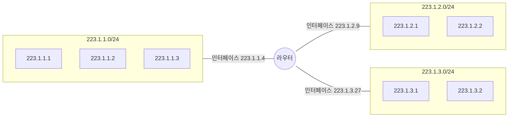

*그림 2. 서브넷 셋에 있는 라우터 하나와 호스트 일곱 대의 인터페이스 주소*

왼쪽의 호스트 셋과 그들이 연결된 라우터 인터페이스는 모두 223.1.1.xxx 꼴의 주소, 즉 같은 왼쪽 24비트를 가진다. 이들은 라우터가 없는 네트워크, 예를 들어 스위치를 거치는 이더넷 LAN(20장)이나 무선 액세스 포인트(22장)로 서로 연결되어 있다.

### 3.2 서브넷

> **용어 정의:** **서브넷(subnet)** 은 중간에 라우터 없이 서로 연결되어 직접 도달할 수 있는 인터페이스들의 집합이며, 한 서브넷의 모든 인터페이스는 주소의 왼쪽 비트들이 같다.

서브넷은 IP 네트워크 또는 간단히 네트워크라고도 부른다. IP 주소 지정은 각 서브넷에 223.1.1.0/24 같은 주소를 배정하며, 여기서 "/24"는 32비트 값의 왼쪽 24비트가 서브넷 주소를 정의한다는 뜻이다. Kurose는 이 /24 표기를 서브넷 마스크라고 부른다. 서브넷 223.1.1.0/24는 호스트 인터페이스 223.1.1.1, 223.1.1.2, 223.1.1.3과 라우터 인터페이스 223.1.1.4로 이루어지며, 여기에 추가되는 호스트는 223.1.1.xxx 꼴의 주소를 가져야 한다. 그림 2에는 서브넷 223.1.2.0/24와 223.1.3.0/24가 더 있다.

서브넷은 여러 호스트를 라우터에 잇는 LAN에 한정되지 않는다. 그림 3에서 라우터 셋은 점대점 링크로 서로 연결되어 있고, 각 라우터는 호스트 두 대가 있는 LAN에도 연결된다.

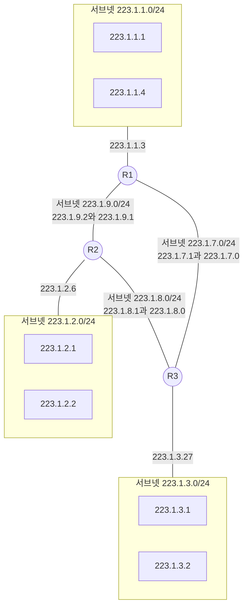

*그림 3. 서브넷 여섯 개를 잇는 라우터 셋*

Kurose는 임의의 연결된 시스템에서 서브넷을 찾는 간단한 방법을 제시한다. 각 인터페이스를 호스트나 라우터에서 떼어 내어, 인터페이스가 끝점을 이루는 고립된 네트워크의 섬들을 만든다. 각 섬이 하나의 서브넷이다. 이 방법을 그림 3에 적용하면 섬이 여섯 개 나온다. LAN 셋 223.1.1.0/24, 223.1.2.0/24, 223.1.3.0/24와 점대점 링크 셋 223.1.9.0/24(R1과 R2), 223.1.8.0/24(R2와 R3), 223.1.7.0/24(R3과 R1)이다. 따라서 LAN 구간과 점대점 링크가 여럿인 조직은 서브넷을 여럿 가진다. 원리상 이 서브넷들의 주소는 서로 무관할 수 있지만, 실제로는 5절과 6절에서 설명하는 이유로 접두사의 상당 부분을 공유하는 경우가 많다.

> **핵심:** 서브넷은 라우터를 건너지 않고 도달할 수 있는 인터페이스의 집합이며, 라우터 인터페이스는 그 인터페이스 쪽의 서브넷에 속한다. 따라서 인터페이스가 k개인 라우터는 서브넷 k개에 걸쳐 있다.

---

<br>

## 4. 클래스 기반 주소 지정

IPv4 주소 지정은 처음에 클래스라는 개념을 썼으며, 이 구조를 클래스 기반 주소 지정이라고 한다. 1990년대 중반에 새 구조인 클래스 없는 주소 지정이 도입되었고, 오늘날 쓰이는 것은 이것이다(5절). 그래도 클래스 기반 주소 지정을 배울 가치가 있다. 그 용어(netid, hostid, 기본 마스크, 서브넷팅)가 클래스 없는 주소 지정에도 남아 있고, 왜 바꾸어야 했는지를 설명해 주기 때문이다.

> **용어 정의:** **클래스 기반 주소 지정(classful addressing)** 은 주소 공간을 A부터 E까지 고정된 다섯 클래스로 나누고, 주소의 클래스가 네트워크 부분의 길이를 정하는 IPv4의 원래 주소 구조이다.

### 4.1 다섯 클래스

주소 공간은 A, B, C, D, E의 다섯 클래스로 나뉘며, 각 클래스는 공간의 고정된 부분을 차지한다. 클래스 A는 주소 공간의 절반, 클래스 B는 4분의 1, 클래스 C는 8분의 1, 클래스 D와 E는 각각 16분의 1을 차지한다.

| 클래스 | 앞 비트 | 첫 바이트 | 주소 개수 | 공간에서의 비율 | 용도 |
|:--|:--|:--|:--|:--|:--|
| A | 0 | 0-127 | $`2^{31}`$ = 2,147,483,648 | 50% | 유니캐스트, 대규모 조직 |
| B | 10 | 128-191 | $`2^{30}`$ = 1,073,741,824 | 25% | 유니캐스트, 중규모 조직 |
| C | 110 | 192-223 | $`2^{29}`$ = 536,870,912 | 12.5% | 유니캐스트, 소규모 조직 |
| D | 1110 | 224-239 | $`2^{28}`$ = 268,435,456 | 6.25% | 멀티캐스트 |
| E | 1111 | 240-255 | $`2^{28}`$ = 268,435,456 | 6.25% | 예약 |

*표 7. 다섯 클래스가 차지하는 주소 공간*

### 4.2 클래스 찾기

주소의 클래스는 처음 몇 비트로 정해지므로 주소에서 바로 읽을 수 있다.

- **이진 표기법에서는** 앞 비트로 클래스를 찾는다. A는 0, B는 10, C는 110, D는 1110, E는 1111이다. 그림 4는 이 절차를 보여 주며, 최대 네 비트만 검사한다.
- **점-십진 표기법에서는** 첫 바이트의 범위로 클래스를 찾는다. A는 0\~127, B는 128\~191, C는 192\~223, D는 224\~239, E는 240\~255이다.

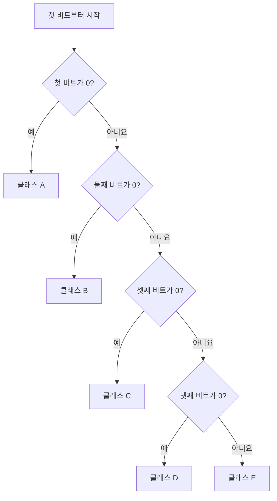

*그림 4. 이진 표기법에서 주소의 클래스 찾기*

| 예제 | 주소 | 근거 | 클래스 |
|:--|:--|:--|:--|
| 5.10a | 00000001 00001011 00001011 11101111 | 첫 비트가 0 | A |
| 5.10b | 11000001 10000011 00011011 11111111 | 처음 두 비트가 1, 셋째가 0 | C |
| 5.10c | 10100111 11011011 10001011 01101111 | 첫 비트가 1, 둘째가 0 | B |
| 5.10d | 11111001 10011011 11111011 00001111 | 처음 네 비트가 1 | E |
| 5.11a | 227.12.14.87 | 첫 바이트 227이 224와 239 사이 | D |
| 5.11b | 193.14.56.22 | 첫 바이트 193이 192와 223 사이 | C |
| 5.11c | 14.23.120.8 | 첫 바이트 14가 0과 127 사이 | A |
| 5.11d | 252.5.15.111 | 첫 바이트 252가 240과 255 사이 | E |

*표 8. 예제 5.10과 5.11의 클래스 찾기*

### 4.3 netid와 hostid

클래스 A, B, C의 주소는 두 부분으로 나뉜다. 각 부분의 길이는 클래스에 따라 다르다.

> **용어 정의:** **netid** 는 네트워크를 식별하는 클래스 기반 주소의 왼쪽 부분이며, 클래스 A, B, C에서 각각 1, 2, 3바이트이다.

> **용어 정의:** **hostid** 는 netid가 정의하는 네트워크 위의 호스트를 식별하는 클래스 기반 주소의 나머지 부분이다.

```text
          Byte 1      Byte 2      Byte 3      Byte 4
Class A: | Netid     | Hostid                            |
Class B: | Netid                 | Hostid                |
Class C: | Netid                             | Hostid    |
Class D: | Multicast address                             |
Class E: | Reserved for future use                       |
```

*그림 5. 클래스별 netid와 hostid*

netid는 동네의 이름이고 hostid는 그 동네 안의 집 번호라고 생각하면 이해하기 쉽다. netid 비트 수는 한 클래스가 가질 수 있는 동네의 수를, hostid 비트 수는 동네마다 들어 있는 주소의 수를 정한다. 클래스 A는 동네가 적고 동네마다 $`2^{24}`$개의 주소가 있으며, 클래스 C는 동네가 많고 동네마다 $`2^{8}`$개의 주소만 있다. 클래스 D와 E는 netid와 hostid로 나뉘지 않는다.

### 4.4 클래스별 블록

netid 값 하나가 조직 하나에 줄 수 있는 주소 블록 하나를 정의한다.

- **클래스 A**는 $`2^{7}`$ = 128개 블록(앞 한 비트가 고정되어 netid가 7비트 남음)을 가지며, 블록마다 $`2^{24}`$ = 16,777,216개의 주소가 있다. 클래스 A는 연결된 호스트나 라우터가 매우 많은 대규모 조직을 위해 설계되었다. netid 0인 블록(0.0.0.0\~0.255.255.255)과 netid 127인 블록(127.0.0.0\~127.255.255.255)은 특수 블록(7절)이므로 조직에 줄 수 있는 블록은 126개이다.
- **클래스 B**는 $`2^{14}`$ = 16,384개 블록을 가지며 블록마다 $`2^{16}`$ = 65,536개의 주소가 있고, 중규모 조직을 위해 설계되었다.
- **클래스 C**는 $`2^{21}`$ = 2,097,152개 블록을 가지며 블록마다 $`2^{8}`$ = 256개의 주소가 있고, 소규모 조직을 위해 설계되었다.
- **클래스 D**는 224.0.0.0부터 239.255.255.255까지 268,435,456개 주소의 블록 하나뿐이며 멀티캐스트에 쓰인다. 이 클래스의 각 주소는 인터넷 위의 호스트 그룹 하나를 정의한다.
- **클래스 E**는 240.0.0.0부터 255.255.255.255까지 블록 하나뿐이며 미래를 위해 예약되어 있어 대부분이 낭비된다. 그 마지막 주소 255.255.255.255는 특수 주소로 쓰인다(7절).

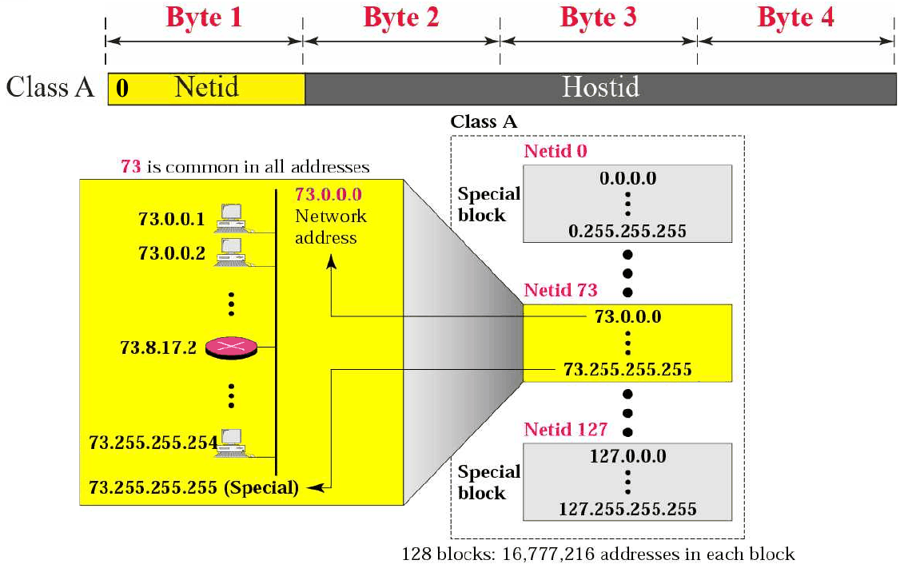

*그림 6. 클래스 A의 블록들과 netid가 73인 블록*

그림 6은 netid가 73인 클래스 A 블록을 확대해 보여 준다. 이 블록의 모든 주소는 첫 바이트 73을 공유한다. 첫 주소 73.0.0.0은 블록 자체를 식별하는 네트워크 주소이고, 마지막 주소 73.255.255.255는 특수 주소로 남겨 두며, 그 사이의 73.0.0.1부터 73.255.255.254까지를 호스트와 라우터에 준다.

### 4.5 2단계 주소 지정과 정보 추출

클래스 기반 주소 지정이 설계될 때 인터넷은 네트워크들의 네트워크로 여겨졌다. 각 조직이 네트워크를 만들고 클래스 A, B, C 가운데 하나의 블록을 받았다. 따라서 각 주소는 netid와 hostid의 두 단계를 가진다. netid가 n비트이면 hostid는 32 − n비트이며, n은 클래스 A, B, C에서 각각 8, 16, 24이다.

```text
|<-------- n bits -------->|<------ (32 - n) bits ------>|
+--------------------------+-----------------------------+
|          netid           |           hostid            |
+--------------------------+-----------------------------+
|<----------------------- 32 bits ---------------------->|
                  Class A: n = 8   Class B: n = 16   Class C: n = 24
```

*그림 7. 클래스 기반 주소 지정의 2단계 주소*

**예제 5.12.** 2단계 주소 지정은 다른 체계에도 있다. 미국의 전화번호는 지역 번호와 지역 내 번호로 이루어진다. (626) 3581301에서 지역 번호 626은 netid에, 지역 내 번호 3581301은 hostid에 비길 수 있다.

> **용어 정의:** **네트워크 주소(network address)** 는 블록의 첫 주소, 즉 호스트 부분이 모두 0인 주소이며, 네트워크 자체를 식별하고 라우터가 패킷을 그 네트워크로 라우팅할 때 쓰는 주소이다.

클래스 기반 주소 지정에서 조직에 주는 주소 범위는 클래스 A, B, C의 블록 하나 전체이며, 범위 전체를 네트워크 주소로부터 추론할 수 있다. 블록 안의 아무 주소나 주어지면, 클래스와 그에 따른 n을 아는 한 세 가지 정보를 추출할 수 있다.

```math
N = 2^{32-n}
```

- **주소 개수:** 위의 N이다.
- **첫 주소:** 왼쪽 n비트를 유지하고 오른쪽 32 − n비트를 0으로 만든다.
- **마지막 주소:** 왼쪽 n비트를 유지하고 오른쪽 32 − n비트를 1로 만든다.

| 예제 | 주어진 주소 | 클래스와 n | 주소 개수 | 첫 주소 | 마지막 주소 |
|:--|:--|:--|:--|:--|:--|
| 5.13 | 73.22.17.25 | A, n = 8 | $`2^{24}`$ = 16,777,216 | 73.0.0.0 | 73.255.255.255 |
| 5.14 | 180.8.17.9 | B, n = 16 | $`2^{16}`$ = 65,536 | 180.8.0.0 | 180.8.255.255 |
| 5.15 | 200.11.8.45 | C, n = 24 | $`2^{8}`$ = 256 | 200.11.8.0 | 200.11.8.255 |

*표 9. 예제 5.13~5.15에서 추출한 정보*

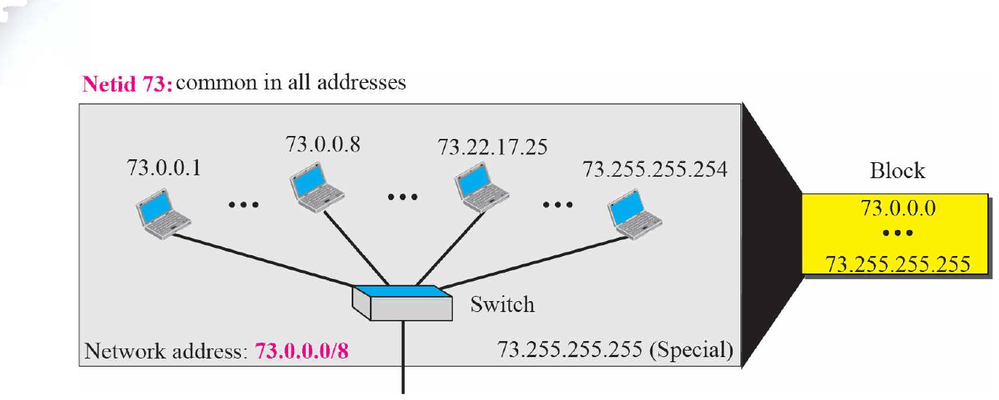

*그림 8. 예제 5.13의 블록을 쓰는 네트워크의 한 가지 구성*

그림 8은 예제 5.13의 가능한 구성을 보여 준다. netid 73은 모든 주소에 공통이고, 네트워크 주소 73.0.0.0/8이 네트워크 전체를 식별하며, 73.255.255.255는 특수 주소로 남겨 둔다. 네트워크 주소 뒤의 /8은 netid의 길이를 나타낸다. 예제 5.14와 5.15의 네트워크도 같은 방식으로 180.8.0.0/16과 200.11.8.0/24로 쓴다.

### 4.6 예시 인터넷의 네트워크 주소

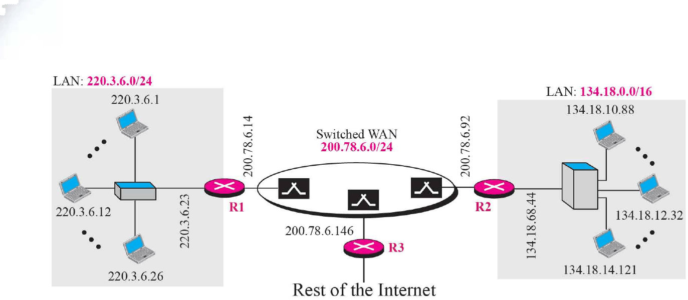

*그림 9. 네트워크 셋으로 이루어진 예시 인터넷*

그림 9는 네트워크 셋이 있는 인터넷의 일부를 보여 준다.

1. 네트워크 주소가 220.3.6.0인 LAN(클래스 C)
2. 네트워크 주소가 134.18.0.0인 LAN(클래스 B)
3. 여러 라우터를 잇는, 네트워크 주소가 200.78.6.0인 교환 WAN(클래스 C). R1은 이를 왼쪽 LAN에, R2는 오른쪽 LAN에, R3은 인터넷의 나머지에 잇는다.

각 라우터는 연결된 네트워크마다 주소를 하나씩 가지며, R1의 경우 220.3.6.23과 200.78.6.14이다. 네트워크 주소는 네트워크의 식별자이다. 라우터의 표에는 호스트 주소가 아니라 네트워크 주소가 나열되며, 라우터는 목적지가 속한 네트워크를 찾아 패킷을 라우팅한다. 예를 들어 134.18.14.121로 가는 패킷은 네트워크 134.18.0.0 쪽으로 보내진다. 100.78.77.76으로 가는 패킷은 세 네트워크 어디에도 속하지 않으므로 R1이나 R2는 이를 인터넷의 나머지로 나가는 출구인 R3 쪽으로 보내고, 그 너머의 라우터들이 찾기를 이어 간다. 패킷이 계속 떠돌면 결국 TTL이 0이 되어 버려진다(11장).

### 4.7 네트워크 마스크

앞의 방법은 네트워크 주소를 개념적으로 추출한다. 라우터는 대신 알고리즘을 쓴다. 패킷을 올바른 네트워크로 라우팅하려면 라우터는 패킷 헤더의 목적지 주소에서 네트워크 주소를 추출해야 하며, 이를 마스크로 한다.

> **용어 정의:** **기본 마스크(default mask)** 는 클래스 기반 주소 지정의 네트워크 마스크로, 왼쪽 n비트가 1이고 나머지 32 − n비트가 0인 32비트 수이며, n은 그 클래스의 netid 길이이다.

| 클래스 | 이진 마스크 | 점-십진 | 접두사 |
|:--|:--|:--|:--|
| A | 11111111 00000000 00000000 00000000 | 255.0.0.0 | /8 |
| B | 11111111 11111111 00000000 00000000 | 255.255.0.0 | /16 |
| C | 11111111 11111111 11111111 00000000 | 255.255.255.0 | /24 |

*표 10. 클래스 A, B, C의 기본 마스크*

네트워크 주소는 목적지 주소와 기본 마스크를 AND하여 구한다. 마스크 비트 1은 주소 비트를 그대로 통과시키고(X AND 1 = X), 마스크 비트 0은 지우므로(X AND 0 = 0), 결과는 블록의 netid를 유지하고 hostid를 0으로 만든다. 네트워크 주소 자신을 포함해 블록의 어느 주소에 마스크를 적용해도 같은 네트워크 주소가 나온다.

**예제 5.16.** 라우터가 목적지 주소 201.24.67.32인 패킷을 받는다. 첫 바이트 201은 클래스 C이므로 라우터는 기본 마스크 255.255.255.0을 적용한다. 첫째 지름길에 따라 결과는 201.24.67.0이다.

```text
Destination address:   201 .  24 .  67 .  32
Default mask:          255 . 255 . 255 .   0
Network address:       201 .  24 .  67 .   0
```

### 4.8 3단계 주소 지정: 서브넷팅

2단계 주소 지정은 곧 부족함이 드러났으며, 이유는 두 가지였다. 클래스 A나 B 블록을 받은 조직은 보안과 관리를 위해 큰 네트워크를 여러 하위 네트워크로 나눌 필요가 있었다. 또 클래스 A와 B의 블록은 거의 고갈되었고 클래스 C 블록은 대부분의 조직에 너무 작았으므로, 클래스 A나 B 블록을 가진 조직이 이를 더 작은 하위 블록으로 나누어 나누어 쓸 수 있게 할 필요가 있었다.

> **용어 정의:** **서브넷팅(subnetting)** 은 주소의 네트워크 부분을 늘려, 주소 블록 하나를 각자의 서브네트워크 주소를 가진 서브넷이라는 더 작은 블록들로 나누는 것이다.

서브넷팅은 주소에 셋째 단계를 더한다. hostid의 일부가 subnetid가 되어, 주소는 사이트(netid), subnetid, hostid로 이루어진다. **예제 5.17**은 이를 전화번호 (626) 358-1301과 비교한다. 626은 지역 번호, 358은 국번, 1301은 가입자 번호이다.

```text
a. Without subnetting:   |  141 . 14  |  192 . 2              |
                         |   Netid    |  Hostid               |

b. With subnetting:      |  141 . 14  |  192        |  . 192  |
                         |   Site     |  Subnetid   | Hostid  |
```

*그림 10. 서브넷팅하지 않은 주소와 서브넷팅한 주소*

**예제 5.18.** 그림 11은 서브넷팅하기 전에 클래스 B 주소를 쓰는 네트워크이다. 호스트가 거의 $`2^{16}`$개인 네트워크 하나가 단일 연결로 인터넷의 라우터 하나에 연결되어 있다. /16은 netid의 길이를 나타낸다.

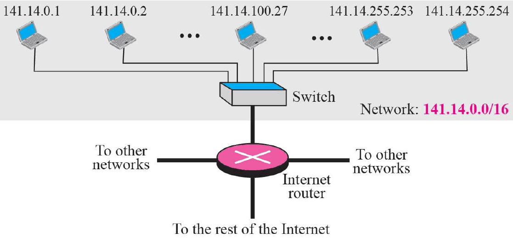

*그림 11. 서브넷팅하기 전의 클래스 B 네트워크*

**예제 5.19.** 그림 12는 같은 네트워크를 서브넷팅한 뒤의 모습이다. 네트워크 전체는 여전히 같은 라우터를 통해 인터넷에 연결되어 있지만, 이제 사설 사이트 라우터를 써서 네트워크를 서브네트워크 넷으로 나눈다. 인터넷의 나머지는 여전히 네트워크 하나 141.14.0.0/16만 보지만, 안쪽에는 각각 호스트가 거의 $`2^{14}`$개인 서브네트워크가 넷 있다. 이런 네트워크는 건물 네 동에 학부 넷이 있는 대학 캠퍼스의 것일 수 있다. 각 학부는 자기 서브네트워크를 가지지만, 캠퍼스는 인터넷의 나머지에게 하나의 네트워크이다. /16과 /18은 netid와 subnetid의 길이를 나타낸다.

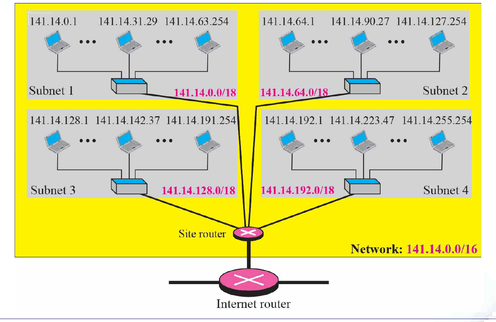

*그림 12. 서브넷 넷으로 나눈 같은 클래스 B 네트워크*

넷으로 나누려면 $`2^{2} = 4`$이므로 네트워크 부분이 2비트 더 필요하며, 그래서 서브넷은 /18이다. 일반적으로 서브넷팅하지 않은 네트워크에는 네트워크 마스크(기본 마스크)를, 각 서브네트워크에는 **서브넷 마스크(subnet mask)** 를 쓴다. 서브넷팅은 netid를 subnetid로 늘리고 hostid를 줄인다.

```text
                 |<------- n bits ------->|<------ 32 - n bits ------>|
Network mask:    |         netid          |          hostid           |
                                    Change -->|
Subnetwork mask: |            subnetid              |      hostid     |
                 |<----------- n_i bits ----------->|<- 32 - n_i bits ->|
```

*그림 13. 네트워크 마스크와 서브네트워크 마스크*

네트워크를 같은 크기의 서브네트워크 s개(s는 2의 거듭제곱)로 나눌 때 각 subnetid의 길이는 다음과 같으며, n은 netid의 길이이다.

```math
n_{\text{sub}} = n + \log_2 s
```

**예제 5.20.** 예제 5.19에서는 클래스 B 네트워크를 서브네트워크 네 개로 나눈다. n = 16이므로 모든 서브넷은 $`n_{\text{sub}} = 16 + \log_2 4 = 18`$을 가진다. 서브넷 마스크는 1이 18개, 0이 14개인 255.255.192.0이며, 클래스 B의 네트워크 마스크 255.255.0.0과 다르다.

네트워크를 서브넷팅하면 각 서브넷의 첫 주소가 그 서브넷의 식별자가 되고, 라우터는 이를 써서 패킷을 그 서브넷으로 라우팅한다. 서브넷의 아무 주소나 주어지면 라우터는 그 주소와 서브넷 마스크를 AND하여 서브넷 주소를 구한다. 기본 마스크를 대신 적용하면 그림 14처럼 네트워크 주소가 나온다.

```text
a. Without subnetting:   141.14.72.24  AND  255.255.0.0    =  141.14.0.0   (network address)
b. With subnetting:      141.14.72.24  AND  255.255.192.0  =  141.14.64.0  (subnet address)
```

*그림 14. 같은 주소의 네트워크 주소와 서브넷 주소*

**예제 5.21.** 예제 5.19의 서브넷 2에 있는 주소 하나가 141.14.120.77이다. 첫째, 둘째, 넷째 바이트는 첫째 지름길로, 셋째 바이트는 둘째 지름길로 구한다. 120 = 64 + 32 + 16 + 8이고 192 = 128 + 64이므로 120 AND 192 = 64이다. 서브넷 주소는 141.14.64.0이다.

```text
Address:          141 .  14 . 120 .  77
Mask:             255 . 255 . 192 .   0
Subnet address:   141 .  14 .  64 .   0
```

### 4.9 슈퍼넷팅

대부분의 조직이 자기 블록을 나누어 주려 하지 않았으므로 서브넷팅은 주소 고갈을 해결하지 못했다. 클래스 C 블록은 아직 남아 있었지만 블록 하나는 대부분의 새 조직에 너무 작았다. 그 해결책 가운데 하나가 슈퍼넷팅이었다.

> **용어 정의:** **슈퍼넷팅(supernetting)** 은 주소의 네트워크 부분을 줄여, 연속한 여러 클래스 C 블록을 슈퍼네트워크라는 하나의 더 큰 블록으로 합치는 것이다.

예를 들어 주소가 1,000개 필요한 조직은 클래스 C 블록 넷을 받을 수 있다. **슈퍼넷 마스크(supernet mask)** 는 서브넷 마스크의 반대이다. 클래스 C의 서브넷 마스크는 기본 마스크보다 1이 많고, 클래스 C의 슈퍼넷 마스크는 1이 적다. 클래스 C 블록 하나를 하위 블록 8개로 나누려면 1이 셋 더 필요하고($`2^{3} = 8`$), 클래스 C 블록 8개를 슈퍼블록 하나로 합치려면 1이 셋 덜 필요하다.

```text
Subnet mask:    11111111 11111111 11111111 11100000    n_sub   = 24 + 3 = 27   (divide 1 block into 8)
Default mask:   11111111 11111111 11111111 00000000    n       = 24
Supernet mask:  11111111 11111111 11111000 00000000    n_super = 24 - 3 = 21   (combine 8 blocks into 1)
```

*그림 15. 클래스 C의 서브넷 마스크, 기본 마스크, 슈퍼넷 마스크*

합치는 클래스 C 블록의 수 c는 2의 거듭제곱이어야 하며, supernetid의 길이는 다음과 같다.

```math
n_{\text{super}} = n - \log_2 c
```

슈퍼넷팅은 새로운 문제 두 가지를 낳았다. 블록 수가 2의 거듭제곱이어야 하므로 블록이 일곱 개 필요한 조직도 여덟 개를 받아야 했고, 이는 주소를 낭비했다. 또 슈퍼넷팅과 서브넷팅이 함께 쓰이면서 인터넷의 패킷 라우팅이 복잡해졌다.

### 4.10 클래스 기반 주소 지정의 문제

클래스 기반 주소 지정은 주소 공간의 상당 부분을 낭비했고 실제 조직의 크기에 맞출 수 없었다.

- **고정된 블록 크기.** 블록 크기는 256, 65,536, 16,777,216개의 세 가지뿐이었다. 클래스 C(/24) 네트워크는 256개 주소 가운데 둘이 특수 용도로 예약되므로(7절) 호스트를 최대 $`2^{8} - 2 = 254`$대만 수용할 수 있어 많은 조직에 너무 작았고, 클래스 B(/16) 네트워크는 호스트를 65,534대까지 지원하여 너무 컸다.
- **낭비와 고갈.** Kurose의 예에서 호스트가 2,000대인 조직은 보통 클래스 B 블록을 받았고, 그러면 다른 어떤 조직도 쓸 수 없는 주소가 63,000개 넘게 남는다. 클래스 B 공간은 빠르게 고갈되었고, 받은 클래스 A 블록 안의 주소 대부분은 쓰이지 않았으며, 클래스 E 블록은 거의 전부 예약되어 있었다.
- **제한적인 해결책.** 서브넷팅과 슈퍼넷팅은 낭비를 일부만 줄였고 주소 분배와 라우팅 과정을 더 복잡하게 만들었다.

---

<br>

## 5. 클래스 없는 주소 지정

### 5.1 가변 길이 블록

주소 고갈의 장기적 해결책은 더 큰 주소 공간이며, 이는 더 긴 주소와 새 패킷 형식을 요구한다. 이 해결책인 IPv6가 24장의 주제이다. 같은 IPv4 주소 공간을 유지하되 주소 분배 방식을 바꾸어 각 조직이 공정한 몫을 받게 하는 단기적 해결책도 고안되었다. 이 해결책은 여전히 IPv4 주소를 쓰며 클래스 없는 주소 지정이라고 부른다. 주소 분배에서 클래스라는 특권을 없앤 것이다.

또 다른 동기는 인터넷 서비스 제공자(ISP)에서 왔다. 1990년대에 ISP가 부상했다. ISP는 자기 인터넷 사이트를 직접 운영하고 싶지 않은 개인, 소기업, 중규모 조직에 인터넷 접속을 제공한다. ISP는 넓은 주소 범위를 받아 이를 1, 2, 4, 8, 16개 등의 묶음으로 나누어 각 가정이나 소기업에 범위를 주며, 고객은 다이얼업 모뎀, DSL, 케이블 모뎀으로 연결된다. 고객마다 IPv4 주소가 몇 개씩 필요하다.

클래스 없는 주소 지정에서는 주소 공간 전체를 어느 클래스에도 속하지 않는, 서로 겹치지 않는 가변 길이 블록들로 나눈다. 이론적으로 블록은 $`2^{0}, 2^{1}, 2^{2}, \ldots, 2^{32}`$개의 주소를 가질 수 있다. 유일한 제약은 블록의 주소 개수가 2의 거듭제곱이어야 한다는 것이다.

```text
Address space:  |Block 1|  Block 2  | ... |Block i| Block i+1 | ... |Block m-1|Block m|
```

*그림 16. 클래스 없는 주소 지정의 가변 길이 블록*

블록의 크기는 호스트 비트 수에서 나오므로, 주소 개수를 정하면 호스트 비트 수가 정해지고, 그에 따라 마스크가 정해진다.

### 5.2 접두사와 접미사

클래스 기반 주소 지정의 2단계 개념은 그대로 이어진다. 클래스 없는 블록은 netid 역할을 하는 접두사와 hostid 역할을 하는 접미사로 나뉜다. 블록 안의 모든 주소는 같은 접두사를 가지고, 각 주소는 서로 다른 접미사를 가진다.

```text
|<-------- n bits -------->|<------ (32 - n) bits ------>|
+--------------------------+-----------------------------+
|          Prefix          |           Suffix            |
|        (network)         |           (host)            |
+--------------------------+-----------------------------+
```

*그림 17. 클래스 없는 주소의 접두사와 접미사*

> **용어 정의:** **클래스 없는 주소 지정(classless addressing, CIDR)** 은 블록의 길이가 가변이고, 네트워크 부분(접두사)이 어떤 길이든 될 수 있으며, 블록의 주소 개수가 2의 거듭제곱인 IPv4 주소 구조이다.

Kurose는 인터넷의 주소 배정 전략을 클래스 없는 도메인 간 라우팅(CIDR, "사이더"로 발음)이라고 부르며, 이것이 서브넷 주소 지정을 일반화한 것이라고 설명한다.

> **용어 정의:** **접두사 길이(prefix length)** 는 클래스 없는 주소의 접두사를 이루는 왼쪽 비트의 수 n이며, 블록은 $`2^{32-n}`$개의 주소를 가진다.

클래스 없는 주소 지정에서 접두사는 네트워크를, 접미사는 호스트를 정의한다. 접두사 길이는 0부터 32까지 어떤 값이든 될 수 있으며, 블록의 주소 개수는 접두사 길이에 반비례한다. n이 작으면 블록이 크고 n이 크면 블록이 작다(**예제 5.24**). 두 극단을 보면 이해에 도움이 된다.

- **예제 5.22.** 인터넷 전체가 주소 4,294,967,296개짜리 단일 블록이면 접두사 길이는 0, 접미사 길이는 32이다. 32비트 모두가 변하여 $`2^{32}`$개의 호스트를 정의한다.
- **예제 5.23.** 인터넷을 주소가 하나씩인 블록 4,294,967,296개로 나누면 접두사 길이는 32, 접미사 길이는 0이다. $`2^{32}`$개의 블록을 정의하는 데 32비트가 모두 필요하며, 각 블록의 유일한 주소는 블록 자체가 정의한다.

### 5.3 슬래시 표기법

클래스 기반 주소 지정에서는 netid 길이가 주소에 내재되어 있다. 주소의 클래스가 netid 길이 8, 16, 24를 알려 준다. 클래스 없는 주소 지정에서는 주소 하나만으로 접두사 길이를 알 수 없다. 그 주소가 어떤 접두사 길이의 블록에든 속할 수 있기 때문이다. 따라서 블록은 그 주소 가운데 하나와 접두사 길이를 함께 써서 정의하며, 이를 **슬래시 표기법(slash notation)** 또는 CIDR 표기법으로 a.b.c.d/n처럼 쓴다.

```text
+------+---+------+---+------+---+------+---+-----+
| byte | . | byte | . | byte | . | byte | / |  n  |
+------+---+------+---+------+---+------+---+-----+
                                                 ^ prefix length
```

*그림 18. 슬래시 표기법*

**예제 5.25.** 주소 230.8.24.56은 많은 블록에 속할 수 있다. 셋째 바이트 24는 이진수로 00011000이다. 접두사 길이가 20이면 셋째 바이트의 처음 4비트(0001)가 고정되므로, 셋째 바이트는 00010000 = 16부터 00011111 = 31까지, 넷째 바이트는 0부터 255까지 변한다. 표 11은 여러 접두사 길이에 대한 블록을 나열한다.

| 접두사 길이 | 블록 |
|:--|:--|
| 16 | 230.8.0.0 ~ 230.8.255.255 |
| 20 | 230.8.16.0 ~ 230.8.31.255 |
| 26 | 230.8.24.0 ~ 230.8.24.63 |
| 27 | 230.8.24.32 ~ 230.8.24.63 |
| 29 | 230.8.24.56 ~ 230.8.24.63 |
| 31 | 230.8.24.56 ~ 230.8.24.57 |

*표 11. 여러 접두사 길이에서 230.8.24.56을 포함하는 블록*

접두사 길이는 마스크도 정한다. 1이 n개, 그 뒤에 0이 32 − n개인 마스크이다. **예제 5.26**은 슬래시 표기법으로 쓴 주소 셋을 읽는다.

| 주소 | 네트워크 마스크 | 접두사 길이 | 접미사 길이 |
|:--|:--|:--|:--|
| 12.23.24.78/8 | 255.0.0.0 (1이 8개, 0이 24개) | 8 | 24 |
| 130.11.232.156/16 | 255.255.0.0 (1이 16개, 0이 16개) | 16 | 16 |
| 167.199.170.82/27 | 255.255.255.224 (1이 27개, 0이 5개) | 27 | 5 |

*표 12. 예제 5.26 주소들의 마스크*

> **핵심:** 클래스 없는 주소 지정에서 블록을 정의하려면 블록의 주소 하나와 접두사 길이가 모두 필요하다.

### 5.4 블록 정보 추출

블록의 주소 하나와 접두사 길이 n이 주어지면 2절의 비트 연산으로 세 가지 정보를 구한다.

1. **주소 개수:** $`N = 2^{32-n}`$이다.
2. **첫 주소:** 주어진 주소와 마스크를 AND한다. 이것이 블록의 네트워크 주소이다.
3. **마지막 주소:** 주어진 주소와 마스크의 보수를 OR한다.

**예제 5.27.** 블록의 주소 하나가 167.199.170.82/27이다. 마스크는 1이 27개, 0이 5개인 255.255.255.224이므로 블록은 $`2^{32-27} = 2^{5} = 32`$개의 주소를 가진다. 실제로 계산할 것은 넷째 바이트뿐이며, 82 = 01010010이다.

```text
Address in binary:            10100111 11000111 10101010 01010010
Network mask:                 11111111 11111111 11111111 11100000
First address (AND):          10100111 11000111 10101010 01000000   = 167.199.170.64

Address in binary:            10100111 11000111 10101010 01010010
Complement of network mask:   00000000 00000000 00000000 00011111
Last address (OR):            10100111 11000111 10101010 01011111   = 167.199.170.95
```

처음 27비트는 유지되고 마지막 5비트만 변하므로, 블록은 167.199.170.64/27부터 167.199.170.95/27까지이다.

**예제 5.28.** 블록의 주소 하나가 17.63.110.114/24이다. 마스크는 255.255.255.0이고 블록은 $`2^{32-24}`$ = 256개의 주소를 가진다. 첫째 지름길에 따라 첫 주소는 17.63.110.0/24이고, 보수 0.0.0.255와 OR한 마지막 주소는 17.63.110.255/24이다.

**예제 5.29.** 블록의 주소 하나가 110.23.120.14/20이다. 마스크는 255.255.240.0이고 블록은 $`2^{32-20}`$ = 4,096개의 주소를 가진다. 첫째 지름길로 바이트 1, 2, 4를, 둘째 지름길로 바이트 3을 처리한다.

```text
                       Byte 1   Byte 2   Byte 3   Byte 4
Address:                  110       23      120       14
Network mask:             255      255      240        0
First address (AND):      110       23      112        0      (120 AND 240 = 64+32+16 = 112)

Address:                  110       23      120       14
Complement of mask:         0        0       15      255
Last address (OR):        110       23      127      255      (120 OR 15 = 112+15 = 127)
```

블록은 110.23.112.0/20부터 110.23.127.255/20까지이다.

### 5.5 블록 할당

주소 할당은 국제 인터넷 주소 관리 기구(ICANN)라는 전역 기관이 책임진다. ICANN은 보통 큰 블록을 ISP에 배정하고, ISP는 이를 사용자들에게 분배한다(6절). 클래스 없는 도메인 간 라우팅은 할당하는 블록에 세 가지 제약을 둔다.

1. 요청한 주소 개수 N은 2의 거듭제곱이어야 한다.
2. 접두사 길이는 주소 개수에서 나온다.

```math
N = 2^{32-n} \quad\Longleftrightarrow\quad n = 32 - \log_2 N
```

3. 블록은 할당되지 않은 주소가 연속으로 있는 곳에 할당해야 하며, 첫 주소가 접미사 비트가 모두 0인 네트워크 주소가 되도록 첫 주소는 N으로 나누어떨어져야 한다.

**예제 5.30.** ISP가 주소 1,000개짜리 블록을 요청한다.

- 1,000은 2의 거듭제곱이 아니므로 1,024 = $`2^{10}`$개의 주소를 준다. 접미사 길이는 10이다.
- 접두사 길이는 $`n = 32 - \log_2 1024 = 22`$이다.
- 시작 주소로는 1,024로 나누어떨어지는 18.14.12.0을 고른다.

할당된 블록은 18.14.12.0/22이며, 첫 주소는 18.14.12.0/22, 마지막 주소는 18.14.15.255/22이다. 1,024개의 주소가 셋째 바이트가 12부터 15까지, 넷째 바이트가 256개 값 전체에 걸치는 하나의 동네를 이룬다고 보면 이해하기 쉽다. 라우터는 목적지의 처음 22비트를 검사하여 그 목적지가 이 동네에 사는지 알 수 있다.

### 5.6 클래스 기반 주소 지정과의 관계

클래스 기반 주소 지정은 클래스 없는 주소 지정의 특수한 경우이다. 클래스 기반 블록은 접두사 길이가 클래스로 고정된 클래스 없는 블록이다.

| 클래스 | 접두사 길이 | 클래스 | 접두사 길이 |
|:--|:--|:--|:--|
| A | /8 | D | /4 |
| B | /16 | E | /4 |
| C | /24 | | |

*표 13. 클래스 기반 블록의 접두사 길이*

클래스 D와 E는 각각 고정된 앞 4비트 1110과 1111을 가진 블록 하나를 이루므로 접두사 길이가 4이다.

### 5.7 클래스 없는 블록의 서브넷팅

조직은 블록을 받으면 필요에 맞게 서브넷을 만들 수 있다. 서브넷 접두사 길이를 정의하기 위해 접두사 길이가 늘어난다. 서브넷 설계는 세 조건을 만족해야 한다.

1. 각 서브넷의 주소 개수는 2의 거듭제곱이어야 한다.
2. 각 서브넷의 접두사 길이는 아래 식에서 나오며, N은 받은 주소의 전체 개수, n은 블록의 접두사 길이, $`N_{\text{sub}}`$는 그 서브넷에 배정한 주소 개수이다.
3. 큰 서브넷부터 주소를 배정하며, 각 서브넷의 첫 주소는 그 서브넷의 주소 개수로 나누어떨어져야 한다.

```math
n_{\text{sub}} = n + \log_2 \frac{N}{N_{\text{sub}}}
```

서브넷에 주소를 할당하는 제약은 네트워크에 주소를 할당하는 제약(5.5절)과 나란하다. 예를 들어 블록을 같은 크기로 16등분하면 각 부분이 N/16개의 주소를 가지므로 접두사에 4비트가 더해진다.

**예제 5.32(같은 크기의 서브넷).** 어떤 조직이 130.34.12.64/26을 받았고, 호스트 수가 같은 서브넷 넷이 필요하다. 블록은 $`N = 2^{32-26} = 64`$개의 주소를 가지며 130.34.12.64/26부터 130.34.12.127/26까지이다. 각 서브넷은 16개의 주소를 받으므로(64/16은 2의 거듭제곱) 서브넷 접두사는 $`26 + \log_2 (64/16) = 28`$, 즉 2비트가 늘어난다. 서브넷은 첫 사용 가능 주소부터 할당하며, 각 시작 주소는 16으로 나누어떨어진다.

```text
                     N = 64 addresses, n = 26
130.34.12.64/26 |------------------------------------------| 130.34.12.127/26

     N = 16         N = 16          N = 16          N = 16
|--- n = 28 ---|--- n = 28 ---|--- n = 28 ---|--- n = 28 ---|
130.34.12.64/28 130.34.12.80/28 130.34.12.96/28 130.34.12.112/28 ... 130.34.12.127/28
```

*그림 19. 예제 5.32의 같은 크기 서브넷 넷*

**예제 5.33(가변 길이 서브넷).** 어떤 조직이 14.24.74.0/24로 시작하는 블록을 받았으며, 이 블록은 $`2^{32-24}`$ = 256개의 주소를 가지고 14.24.74.0/24부터 14.24.74.255/24까지이다. 조직에는 주소 120개, 60개, 10개짜리 하위 블록 셋이 필요하다. 어느 것도 2의 거듭제곱이 아니므로 각각 올림하고, 가장 큰 것부터 할당한다.

| 하위 블록 | 요청 | 할당 | 접두사 길이 | 첫 주소 | 마지막 주소 |
|:--|:--|:--|:--|:--|:--|
| a | 120 | 128 | 24 + log₂(256/128) = 25 | 14.24.74.0/25 | 14.24.74.127/25 |
| b | 60 | 64 | 24 + log₂(256/64) = 26 | 14.24.74.128/26 | 14.24.74.191/26 |
| c | 10 | 16 | 24 + log₂(256/16) = 28 | 14.24.74.192/28 | 14.24.74.207/28 |

*표 14. 예제 5.33의 가변 길이 하위 블록 셋*

세 하위 블록이 128 + 64 + 16 = 208개의 주소를 쓰므로, 14.24.74.208부터 14.24.74.255까지 48개의 주소가 예비로 남는다. 원 그림으로 보면 256개의 주소 가운데 절반이 첫 서브넷에(접두사 1비트 증가), 4분의 1이 둘째에(2비트 증가), 16분의 1이 셋째에(4비트 증가) 간다.

```text
                         N = 256 addresses, n = 24
14.24.74.0/24 |----------------------------------------------------------| 14.24.74.255/24

         N = 128                       N = 64          16      48
|--------- n = 25 ----------|------- n = 26 ------|n = 28|-- unused --|
14.24.74.0/25                14.24.74.128/26       14.24.74.192/28
```

*그림 20. 예제 5.33의 가변 길이 하위 블록*

**예제 5.34(사무소가 셋인 회사).** 어떤 회사에 중앙, 동부, 서부의 세 사무소가 있다. 중앙 사무소는 사설 WAN 회선으로 동부와 서부 사무소에 연결된다. 회사는 70.12.100.128/26으로 시작하는 주소 64개짜리 블록을 받았고, 경영진은 중앙 사무소에 32개를 할당하고 나머지를 두 사무소에 나누기로 했다.

| 사무소 | 주소 수 | 접두사 길이 | 범위 |
|:--|:--|:--|:--|
| 중앙 | 32 | 26 + log₂(64/32) = 27 | 70.12.100.128/27 ~ 70.12.100.159/27 |
| 동부 | 16 | 26 + log₂(64/16) = 28 | 70.12.100.160/28 ~ 70.12.100.175/28 |
| 서부 | 16 | 26 + log₂(64/16) = 28 | 70.12.100.176/28 ~ 70.12.100.191/28 |

*표 15. 예제 5.34의 할당*

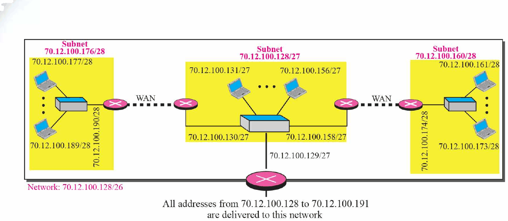

*그림 21. 예제 5.34의 구성*

중앙 사무소는 주소 셋을 라우터에 쓰고 하위 블록의 마지막 주소를 예비로 남겨 둔다. 동부와 서부 사무소는 각각 주소 하나를 라우터에 쓰고 마지막 주소를 남겨 둔다. 회사는 점대점 WAN 링크에 주소를 쓰지 않는다. 바깥에서 오는 70.12.100.128부터 70.12.100.191까지의 모든 주소가 이 네트워크로 전달된다.

### 5.8 할당의 계층

**예제 5.35.** 어떤 ISP가 주소 65,536개를 가진 190.100.0.0/16으로 시작하는 블록을 받았다. ISP는 세 고객 그룹에 주소를 나누어 주어야 한다. 각각 약 256개의 주소가 필요한 고객 64곳, 각각 약 128개가 필요한 고객 128곳, 각각 약 64개가 필요한 고객 128곳이다. 설계는 두 단계이다. 첫 단계에서 ISP는 그룹마다 하위 블록 하나를 할당한다.

| 그룹 | 그룹의 주소 수 | 접두사 길이 | 하위 블록 |
|:--|:--|:--|:--|
| 1 | 64 × 256 = 16,384 | 16 + log₂(65,536/16,384) = 18 | 190.100.0.0/18 ~ 190.100.63.255/18 |
| 2 | 128 × 128 = 16,384 | 16 + log₂(65,536/16,384) = 18 | 190.100.64.0/18 ~ 190.100.127.255/18 |
| 3 | 128 × 64 = 8,192 | 16 + log₂(65,536/8,192) = 19 | 190.100.128.0/19 ~ 190.100.159.255/19 |

*표 16. 예제 5.35의 첫째 계층*

세 그룹이 40,960개의 주소를 쓰므로 190.100.160.0부터 190.100.255.255까지 24,576개의 주소가 미래의 고객을 위해 배정되지 않은 채 남는다. 둘째 단계에서 각 그룹의 하위 블록을 고객들에게 나눈다.

| 그룹 | 고객 접두사 | 첫 고객 | 마지막 고객 |
|:--|:--|:--|:--|
| 1 | 18 + log₂(16,384/256) = 24 | 고객 001: 190.100.0.0/24 | 고객 064: 190.100.63.0/24 |
| 2 | 18 + log₂(16,384/128) = 25 | 고객 001: 190.100.64.0/25 | 고객 128: 190.100.127.128/25 |
| 3 | 19 + log₂(8,192/64) = 26 | 고객 001: 190.100.128.0/26 | 고객 128: 190.100.159.192/26 |

*표 17. 예제 5.35의 둘째 계층*

각 고객은 하위 블록의 첫 주소를 서브넷 주소로 쓰고 마지막 주소를 특수 주소로 남겨 둔다. 인터넷의 나머지는 항목 하나 190.100.0.0/16만으로 이 고객 320곳 어디에든 도달할 수 있으며, 6절은 이 이점을 집약이라고 부른다.

---

<br>

## 6. 주소 블록의 획득과 집약

### 6.1 ISP와 ICANN에서 받는 블록

서브넷에 쓸 주소 블록을 얻기 위해 네트워크 관리자는 보통 ISP에 연락하고, ISP는 자신이 이미 할당받은 더 큰 블록에서 주소를 내준다. Kurose의 예에서 ISP는 200.23.16.0/20을 할당받아, 이를 연속한 같은 크기의 /23 블록 여덟 개로 나누어 최대 여덟 조직에 하나씩 준다.

| 소유자 | 블록 | 이진수 (끝쪽 공백 앞까지가 접두사 비트) |
|:--|:--|:--|
| ISP | 200.23.16.0/20 | 11001000 00010111 0001 0000 00000000 |
| 조직 0 | 200.23.16.0/23 | 11001000 00010111 0001000 0 00000000 |
| 조직 1 | 200.23.18.0/23 | 11001000 00010111 0001001 0 00000000 |
| 조직 2 | 200.23.20.0/23 | 11001000 00010111 0001010 0 00000000 |
| ... | ... | ... |
| 조직 7 | 200.23.30.0/23 | 11001000 00010111 0001111 0 00000000 |

*표 18. ISP의 /20 블록을 여덟 조직에 나눈 모습*

ISP 자신은 전역 기관에서 블록을 받는다. IP 주소는 비영리 기구인 ICANN의 권한 아래 관리되며, ICANN은 DNS 루트 서버(5장)도 관리하고 도메인 이름도 배정한다. ICANN은 ARIN, RIPE, APNIC, LACNIC 같은 지역 인터넷 등록 기관에 주소를 할당하고, 이 기관들이 자기 지역 안에서 주소를 할당하고 관리한다.

### 6.2 주소 집약

> **용어 정의:** **주소 집약(address aggregation)** 은 경로 집약 또는 경로 요약이라고도 하며, 접두사 하나로 그 접두사 안에 주소가 있는 많은 네트워크를 광고하는 것이다.

계층적 할당이 집약을 가능하게 한다. 그림 22에서 Kurose가 Fly-By-Night-ISP라고 부르는 표 18의 ISP는, 처음 20비트가 200.23.16.0/20과 일치하는 데이터그램이면 무엇이든 자신에게 보내라고 바깥 세계에 광고한다. 나머지 세계는 이 블록 안에 각자 서브넷을 가진 조직이 여덟 개 있다는 사실을 알 필요가 없다.

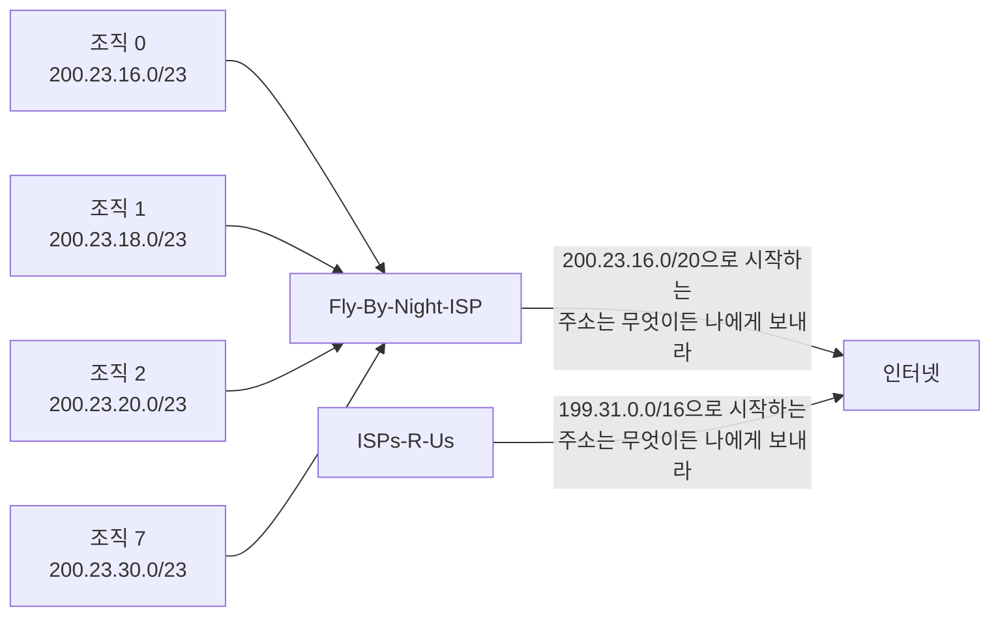

*그림 22. 계층적 주소 지정과 경로 집약*

집약은 주소가 ISP에 블록 단위로, 다시 ISP에서 조직으로 할당될 때 가장 잘 동작한다. Fly-By-Night-ISP가 블록이 199.31.0.0/16인 다른 ISP인 ISPs-R-Us를 인수하고, 조직 1이 이제 ISPs-R-Us를 통해 인터넷에 연결한다고 하자. 조직 1의 라우터와 호스트의 주소를 모두 다시 매기는 것은 비용이 크므로, 조직 1은 보통 블록 200.23.18.0/23을 유지한다. Fly-By-Night-ISP는 계속 200.23.16.0/20을 광고하고, ISPs-R-Us는 199.31.0.0/16과 더 구체적인 블록 200.23.18.0/23을 함께 광고한다.

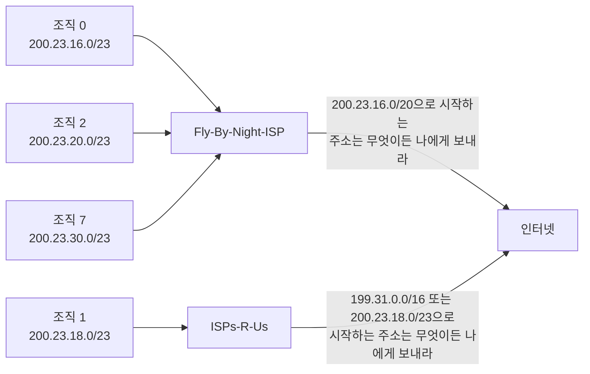

*그림 23. 조직 1로 가는 더 구체적인 경로를 가진 ISPs-R-Us*

200.23.18.0/23 안의 주소로 데이터그램을 포워딩해야 하는 인터넷의 라우터는 일치하는 블록 두 개, 200.23.16.0/20과 200.23.18.0/23을 본다. 라우터는 최장 접두사 일치를 써서 가장 길고 가장 구체적인 일치 접두사를 광고하는 ISPs-R-Us 쪽으로 포워딩한다. 최장 접두사 일치와 포워딩 테이블의 집약은 13장에서 자세히 다룬다.

> **핵심:** 조직 바깥의 라우터는 그 조직 주소의 앞쪽 접두사 비트만 고려하므로, 항목 a.b.c.d/x 하나로 조직 안의 어느 목적지로든 패킷을 포워딩할 수 있다. 이것이 인터넷의 포워딩 테이블을 작게 유지하는 원리이다.

---

<br>

## 7. 특수 주소

클래스 기반 주소 지정에서는 일부 주소를 특수 용도로 예약했으며, 클래스 없는 주소 지정도 그 가운데 일부를 물려받는다. 특수 블록과 각 블록 안의 특수 주소의 두 종류가 있다.

### 7.1 특수 블록

**모두 0인 주소.** 주소 하나만 담은 블록 0.0.0.0/32는 호스트가 자기 주소를 모르는 채 IPv4 패킷을 보내야 할 때를 위해 예약되어 있다. 호스트는 부트스트랩 때 이 주소를 쓴다. 자기 주소를 알아내기 위해 0.0.0.0을 송신지 주소로, 제한 브로드캐스트 주소를 목적지 주소로 하여 DHCP 서버(8절)에 패킷을 보낸다. DHCP 서버는 주소를 할당해 주는 서버이며, DHCP는 응용 계층 프로토콜이다.

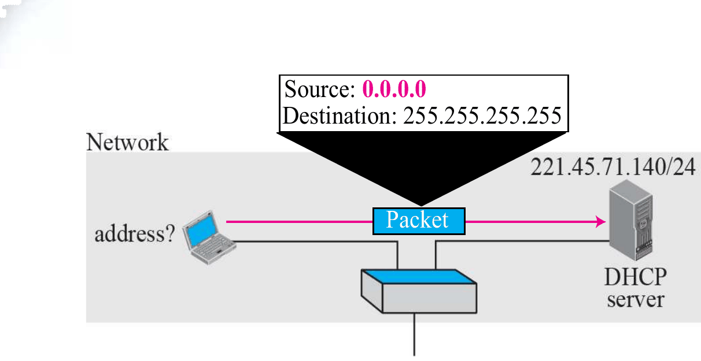

*그림 24. 모두 0인 주소의 사용 예*

> **용어 정의:** **제한 브로드캐스트 주소(limited broadcast address)** 는 현재 네트워크의 모든 호스트에 패킷을 보낼 때 목적지로 쓰는 단일 주소 255.255.255.255이며, 라우터는 이런 패킷을 포워딩하지 않는다.

**모두 1인 주소.** 블록 255.255.255.255/32는 제한 브로드캐스트 주소로 예약되어 있다. 자기 네트워크의 다른 모든 호스트에 메시지를 보내려는 호스트는 이 주소를 목적지 주소로 쓰며, 네트워크의 모든 장치가 그 패킷을 받아 처리한다. 라우터는 이 패킷을 막아 브로드캐스트를 지역 네트워크에 가둔다. 이 주소로 보낸 패킷은 결코 네트워크 밖으로 나가지 않는다.

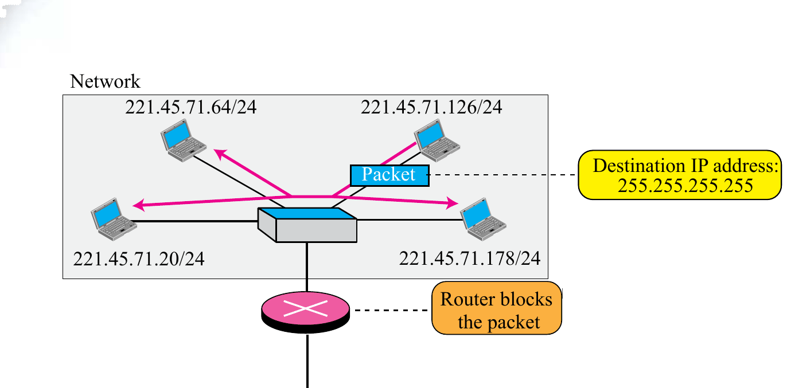

*그림 25. 제한 브로드캐스트 주소의 예*

> **용어 정의:** **루프백 주소(loopback address)** 는 127.0.0.0/8 블록의 주소로, 패킷이 기계 밖으로 나가지 않고 보낸 기계 자신의 프로토콜 소프트웨어로 되돌아오게 한다.

**루프백 주소.** 블록 127.0.0.0/8은 기계의 소프트웨어를 시험하는 데 쓰인다. 127.x.y.z 주소로 보낸 패킷은 기계를 떠나지 않고 프로토콜 소프트웨어로 되돌아온다. ping 같은 응용은 루프백 주소로 패킷을 보내 IPv4 소프트웨어가 패킷을 받아 처리할 수 있는지 시험할 수 있고, 그림 26처럼 클라이언트 프로세스는 루프백 주소로 같은 기계의 서버 프로세스에 메시지를 보낼 수 있다. 루프백 주소는 목적지 주소로만 쓸 수 있다.

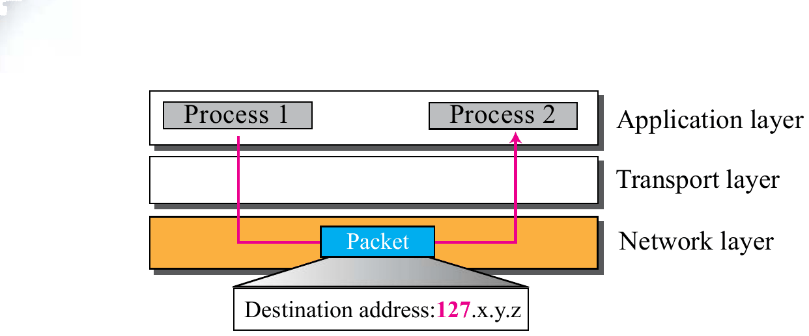

*그림 26. 루프백 주소의 예*

> **용어 정의:** **사설 주소(private address)** 는 사설 네트워크용으로 예약된 블록의 주소로, 네트워크 안에서는 자유롭게 쓸 수 있지만 전역적으로 인식되지 않으며 공용 인터넷에서 결코 라우팅되지 않는다.

**사설 주소.** 여러 블록이 사설용으로 배정되어 있다. 이들은 단독으로 쓰이거나 네트워크 주소 변환(9절)과 함께 쓰인다. RFC 1918은 표 19의 세 블록을 예약한다 [1]. 블록 192.168.0.0/16은 가정 네트워크에서 흔히 쓰이며, 9.4절에 나오는 Kurose의 가정 네트워크 예는 10.0.0.0/24를 쓴다.

| 블록 | 범위 | 주소 개수 |
|:--|:--|:--|
| 10.0.0.0/8 | 10.0.0.0 ~ 10.255.255.255 | 16,777,216 |
| 172.16.0.0/12 | 172.16.0.0 ~ 172.31.255.255 | 1,048,576 |
| 192.168.0.0/16 | 192.168.0.0 ~ 192.168.255.255 | 65,536 |

*표 19. 사설 네트워크용으로 예약된 블록*

> **참고:** Forouzan의 사설 주소 표에는 169.254.0.0/16도 있다. 이 블록은 IPv4 링크 로컬 블록이다. 호스트는 이 블록의 주소를 스스로 설정할 수 있으며, 그 주소는 같은 링크에 있는 장치와 통신하는 데만 유효하다 [2].

**멀티캐스트 주소.** 예전의 클래스 D인 블록 224.0.0.0/4는 멀티캐스트 통신용으로 예약되어 있다(16장).

### 7.2 블록마다 있는 특수 주소

의무는 아니지만 각 블록의 주소 둘을 특수 주소로 쓰고 어떤 호스트에도 배정하지 않는 것이 권장된다. 다만 블록이나 하위 블록이 매우 작으면 이 주소들을 내줄 여유가 없다.

- **네트워크 주소.** 접미사 비트가 모두 0인 블록의 첫 주소는 어떤 호스트가 아니라 네트워크 자체(배선)를 정의한다(4.5절). 서브넷의 첫 주소는 서브넷 주소이며 같은 역할을 한다.
- **직접 브로드캐스트 주소.** 접미사 비트가 모두 1인 블록의 마지막 주소는 특정 네트워크의 모든 호스트에 패킷을 보내는 데 쓰인다.

> **용어 정의:** **직접 브로드캐스트 주소(directed broadcast address)** 는 접미사 비트가 모두 1인 블록의 마지막 주소이며, 이 주소로 보낸 패킷은 그 특정 네트워크의 모든 호스트에 전달된다.

라우터는 보통 특정 네트워크의 모든 호스트에 패킷을 보낼 때 직접 브로드캐스트 주소를 쓰며, 모든 호스트는 이 목적지의 패킷을 받아들인다. 목적지 주소로만 쓸 수 있다. 그림 27에서 라우터는 221.45.71.255로 데이터그램을 보낸다. 접두사 221.45.71은 네트워크 221.45.71.0/24를 지정하고, 모두 1인 접미사는 그 네트워크의 모든 호스트를 뜻한다.

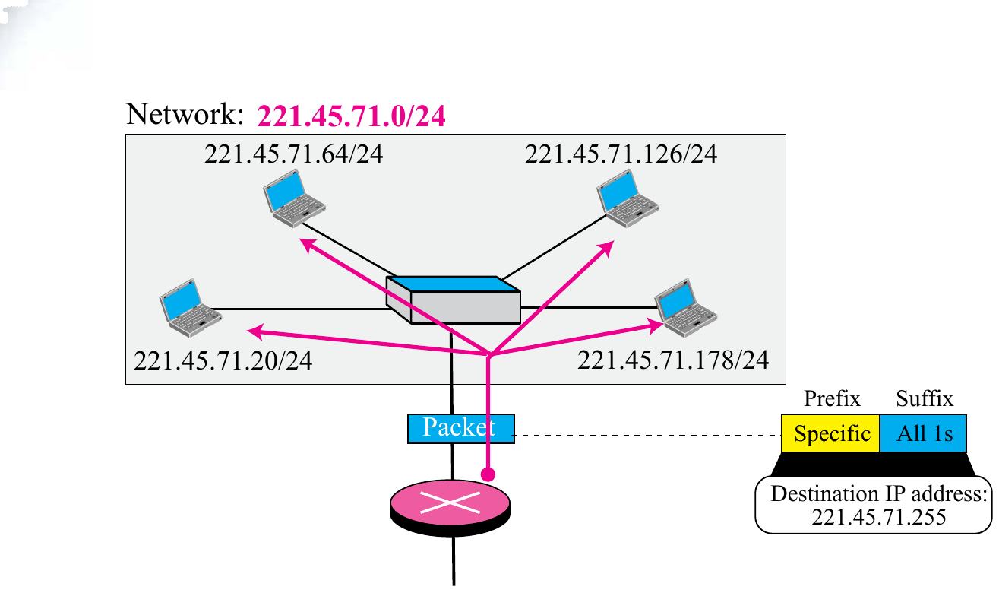

*그림 27. 직접 브로드캐스트 주소의 예*

221.45.71.0/24 같은 블록에서 접두사는 그대로 두고 접미사 8비트를 모두 0(00000000)으로 비우면 네트워크 주소 221.45.71.0이, 모두 1(11111111)로 채우면 직접 브로드캐스트 주소 221.45.71.255가 된다. 제한 브로드캐스트 주소는 범위가 다르다. 제한 브로드캐스트는 송신자 자신의 네트워크에만 닿지만, 직접 브로드캐스트는 바깥에서 특정 네트워크를 향해 보낼 수 있다.

| 주소 | 의미 | 쓰임 |
|:--|:--|:--|
| 0.0.0.0 | 주소를 모르는 이 호스트 | 송신지 전용, 부트스트랩 때 |
| 255.255.255.255 | 제한 브로드캐스트 | 목적지 전용, 현재 네트워크 |
| 127.x.y.z | 루프백 | 목적지 전용, 같은 기계 |
| 10/8, 172.16/12, 192.168/16 | 사설 | 사설 네트워크 안 |
| 224.0.0.0/4 | 멀티캐스트 | 그룹의 목적지 |
| 접미사가 모두 0 | 네트워크 주소 | 네트워크 식별 |
| 접미사가 모두 1 | 직접 브로드캐스트 | 목적지 전용, 네트워크의 모든 호스트 |

*표 20. 특수 주소*

### 7.3 접두사 길이 빠른 참조

아래 표는 흔히 쓰는 접두사 길이마다 마스크, 주소 개수, 그리고 네트워크 주소와 직접 브로드캐스트 주소를 남겨 둘 때 호스트에 줄 수 있는 주소 개수를 나열한다. 주소가 둘뿐인 /31 블록은 브로드캐스트 주소가 필요 없는 점대점 링크에서 두 주소를 모두 쓸 수 있도록 RFC 3021이 허용한다 [3]. /32 블록은 주소 하나이다.

| 접두사 | 마스크 | 주소 수 | 호스트에 쓸 수 있는 주소 수 |
|:--|:--|:--|:--|
| /8 | 255.0.0.0 | 16,777,216 | 16,777,214 |
| /16 | 255.255.0.0 | 65,536 | 65,534 |
| /24 | 255.255.255.0 | 256 | 254 |
| /25 | 255.255.255.128 | 128 | 126 |
| /26 | 255.255.255.192 | 64 | 62 |
| /27 | 255.255.255.224 | 32 | 30 |
| /28 | 255.255.255.240 | 16 | 14 |
| /29 | 255.255.255.248 | 8 | 6 |
| /30 | 255.255.255.252 | 4 | 2 |
| /31 | 255.255.255.254 | 2 | 2 (점대점 링크) |
| /32 | 255.255.255.255 | 1 | 1 (주소 하나) |

*표 21. 접두사 길이별 마스크, 주소 수, 호스트에 쓸 수 있는 주소 수*

---

<br>

## 8. DHCP

### 8.1 호스트가 알아야 할 정보

조직은 주소 블록을 받으면 호스트와 라우터 인터페이스에 개별 주소를 배정한다. 라우터 주소는 보통 시스템 관리자가 수동으로 설정한다. 호스트 주소도 수동으로 설정할 수 있지만 보통은 프로토콜이 설정한다. TCP/IP를 쓰는 컴퓨터에는 보통 네 가지 정보가 필요하다.

1. 자신의 IP 주소
2. 서브넷 마스크
3. 라우터(기본 라우터, 흔히 기본 게이트웨이라 부름)의 IP 주소
4. 이름 서버(로컬 DNS 서버, 5장)의 IP 주소

이 정보를 설정 파일에 둘 수도 있지만, 디스크 없는 컴퓨터나 처음 부팅하는 컴퓨터에는 그런 파일이 없고, 정보가 기계가 연결된 네트워크에 따라 달라지므로 제조사가 ROM에 저장해 둘 수도 없다.

> **용어 정의:** **동적 호스트 구성 프로토콜**(Dynamic Host Configuration Protocol, DHCP)은 호스트에 IP 주소, 서브넷 마스크, 기본 라우터 주소, 이름 서버 주소를 자동으로 제공하는 클라이언트-서버 프로토콜이다.

DHCP는 호스트를 연결할 때의 네트워크 관련 작업을 자동화하므로 흔히 플러그 앤드 플레이 또는 제로컨프(zero-configuration) 프로토콜이라고 부른다. 호스트가 자주 들어오고 나가는 가정 접속 네트워크, 기업 네트워크, 무선 LAN에서 널리 쓰인다. 노트북을 들고 기숙사에서 도서관으로, 다시 강의실로 옮겨 다니는 학생은 장소마다 새 서브넷에 연결되어 새 주소가 필요한데, DHCP는 이를 수동 설정 없이 처리한다. DHCP는 UDP 위에서 동작하므로 응용 계층 프로토콜이지만, 그 목적은 네트워크 계층을 설정하는 것이다.

### 8.2 이전 프로토콜

- **RARP.** 인터넷 초기에는 역주소 결정 프로토콜(RARP)이 부팅한 컴퓨터에 IP 주소를 제공했다. RARP는 ARP(19장)의 변형이었다. ARP는 IP 주소를 물리 주소에 대응시키고, RARP는 물리 주소를 IP 주소에 대응시킨다. RARP는 두 가지 이유로 폐기되었다. 데이터 링크 계층의 브로드캐스트 서비스를 써서 네트워크마다 RARP 서버가 있어야 했고, 네 가지 정보 가운데 IP 주소만 제공할 수 있었다.
- **BOOTP.** DHCP의 전신인 부트스트랩 프로토콜(BOOTP)은 두 결함을 극복한 클라이언트-서버 프로토콜이다. 서버가 인터넷 어디에든 있을 수 있고 네 가지 정보를 모두 제공할 수 있다. 그러나 BOOTP는 정적 설정 프로토콜이다. 서버는 클라이언트의 물리 주소를 미리 정한 IP 주소에 묶어 둔 표에서 찾는다. 따라서 다른 네트워크로 옮겨 가는 호스트나 임시 주소를 원하는 호스트를 다룰 수 없다.

DHCP는 BOOTP의 후속이며 BOOTP와 하위 호환된다. DHCP는 임시 주소의 동적 할당을 더한다.

### 8.3 DHCP의 네 단계

가장 단순한 경우 서브넷마다 DHCP 서버가 있다. 새로 도착한 호스트에게 DHCP는 네 단계 과정이다. 그림 28과 표 22는 223.1.2.5의 서버와 새로 도착한 클라이언트 사이의 교환을 보여 준다. yiaddr("your Internet address") 필드는 클라이언트에게 할당하는 주소를 담는다.

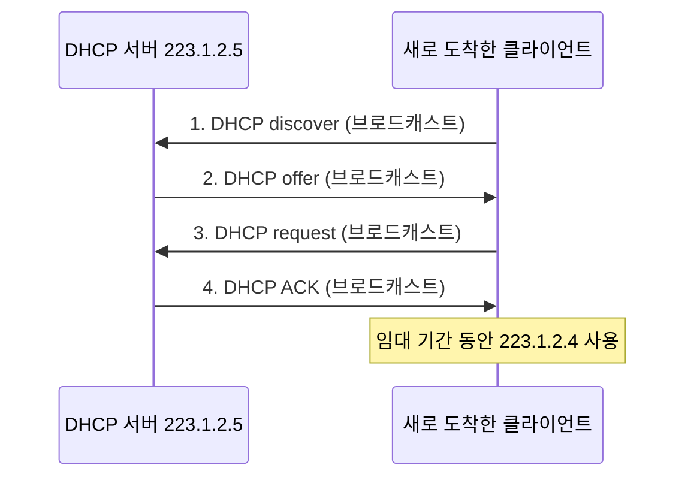

*그림 28. DHCP 클라이언트와 서버의 상호 작용*

| 메시지 | 송신지 (IP, 포트) | 목적지 (IP, 포트) | yiaddr | 트랜잭션 ID | 그 밖의 필드 |
|:--|:--|:--|:--|:--|:--|
| DHCP discover | 0.0.0.0, 68 | 255.255.255.255, 67 | 0.0.0.0 | 654 | |
| DHCP offer | 223.1.2.5, 67 | 255.255.255.255, 68 | 223.1.2.4 | 654 | 서버 ID 223.1.2.5, 수명 3600 s |
| DHCP request | 0.0.0.0, 68 | 255.255.255.255, 67 | 223.1.2.4 | 655 | 서버 ID 223.1.2.5, 수명 3600 s |
| DHCP ACK | 223.1.2.5, 67 | 255.255.255.255, 68 | 223.1.2.4 | 655 | 서버 ID 223.1.2.5, 수명 3600 s |

*표 22. 그림 28에 있는 DHCP 메시지 네 개의 필드*

1. **DHCP 서버 발견.** 클라이언트는 DHCP discover 메시지를 UDP 세그먼트에 담아 포트 67로 보낸다. 클라이언트는 자신이 들어가는 네트워크의 주소도, DHCP 서버의 주소도 모르므로 제한 브로드캐스트 주소 255.255.255.255를 목적지로, "이 호스트" 주소 0.0.0.0을 송신지로 쓴다. 링크 계층은 이 프레임을 서브넷의 모든 노드에 브로드캐스트한다.
2. **DHCP 서버 제안.** discover 메시지를 받은 DHCP 서버는 DHCP offer 메시지로 응답하며, 클라이언트에게 아직 유니캐스트 데이터그램을 받을 주소가 없으므로 이 메시지도 255.255.255.255로 브로드캐스트한다. offer에는 discover 메시지의 트랜잭션 ID, 제안하는 IP 주소, 네트워크 마스크, **임대 기간**이 담긴다. 서브넷에 서버가 여럿 있을 수 있으므로 클라이언트는 offer를 여러 개 받을 수 있다.
3. **DHCP 요청.** 클라이언트는 offer 하나를 골라 설정 매개변수를 되돌려 주는 DHCP request 메시지로 응답한다.
4. **DHCP ACK.** 서버는 요청한 매개변수를 확인하는 DHCP ACK 메시지로 응답한다. 이제 클라이언트는 임대 기간 동안 그 주소를 쓸 수 있다.

> **용어 정의:** **임대 기간(lease time)** 은 DHCP가 할당한 주소가 유효한 기간이며, 이 기간이 끝나면 클라이언트는 임대를 갱신하거나 주소 사용을 멈추어야 한다.

서버는 보통 임대 기간을 몇 시간이나 며칠로 정한다. 3단계의 request는 클라이언트가 자신이 고른 서버를 알고 있는데도 브로드캐스트된다. 여러 서버가 offer를 보냈을 수 있는데, 브로드캐스트한 request에는 선택한 서버의 식별자가 담겨 있으므로, 선택되지 않은 서버들은 클라이언트가 자기 offer를 거절했음을 알고 제안한 주소를 풀어 줄 수 있다 [4]. 따라서 DHCP 서버가 둘 이상 있어도 DHCP가 올바르게 동작하는 것은 이 브로드캐스트 request 덕분이다.

> **참고:** Forouzan은 서버가 브로드캐스트나 유니캐스트 가운데 어느 쪽으로든 응답할 수 있다고 설명한다. 서버는 클라이언트의 요청에서 물리 주소를 알 수 있어 ARP를 쓸 필요가 없으므로 유니캐스트 응답이 가능하지만, ARP를 건너뛰는 것을 허용하지 않는 시스템도 있어 그런 경우 브로드캐스트를 쓴다. Kurose의 그림은 브로드캐스트하는 경우를 보여 준다.

### 8.4 서로 다른 네트워크의 클라이언트와 서버

클라이언트가 한 네트워크에, 서버가 여러 네트워크를 사이에 둔 다른 네트워크에 있을 수 있다. 클라이언트는 서버의 주소를 모르므로 요청을 브로드캐스트하지만, 브로드캐스트 IP 데이터그램은 라우터를 지나갈 수 없다. 모든 비트가 1인 주소는 제한 브로드캐스트 주소이고 라우터는 그런 패킷을 버린다.

> **용어 정의:** **릴레이 에이전트(relay agent)** 는 DHCP 서버의 유니캐스트 주소를 알고, 포트 67에서 브로드캐스트 DHCP 메시지를 기다렸다가 이를 유니캐스트 데이터그램으로 서버에 전달하는, 클라이언트 네트워크 위의 호스트나 라우터이다.

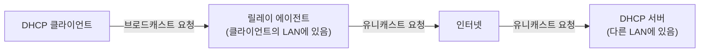

*그림 29. 서로 다른 네트워크의 클라이언트와 서버 사이의 릴레이 에이전트*

릴레이 에이전트가 보내는 패킷은 유니캐스트 목적지 주소를 가지므로 어느 라우터든 이를 서버까지 라우팅할 수 있다. 요청의 한 필드에 릴레이 에이전트의 IP 주소가 들어 있으므로 서버는 메시지가 릴레이 에이전트를 거쳐 왔음을 알고, 응답을 릴레이 에이전트에 보내며, 릴레이 에이전트가 이를 클라이언트에 넘긴다. Kurose는 릴레이 에이전트가 보통 라우터라고 설명한다. 이렇게 하면 자기 DHCP 서버가 없는 네트워크도 이웃 네트워크의 서버에서 주소를 받을 수 있다.

### 8.5 UDP 포트, TFTP, 오류 제어

서버는 잘 알려진 포트 67을 쓰며 이는 보통의 방식이다. 클라이언트도 잘 알려진 포트 68을 쓰는데, 클라이언트는 보통 임시 포트를 쓰므로 이는 이례적이다. 이유는 브로드캐스트 응답이다. 호스트 A가 임시 포트 2017에서 DHCP 클라이언트를 실행하고, 같은 네트워크의 호스트 B가 우연히 같은 임시 포트 2017에서 DAYTIME 클라이언트를 실행한다고 하자. 포트 2017로 가는 브로드캐스트 응답은 두 호스트 모두에서 전달되므로, DHCP 메시지가 호스트 B의 DAYTIME 클라이언트에 도착한다. 1024보다 작은 잘 알려진 포트인 68을 쓰면 어떤 호스트도 68을 임시 포트로 고를 수 없으므로 이런 일을 막는다. 두 호스트가 모두 DHCP 클라이언트를 실행하면 둘 다 브로드캐스트 응답을 받는데, 교환마다 무작위로 고르는 **트랜잭션 ID**가 각 클라이언트에게 그 응답이 자기 것인지 알려 준다. 두 호스트가 같은 시각에 같은 ID를 고를 가능성은 매우 낮다.

서버는 클라이언트가 부팅에 필요로 할 수 있는 정보를 모두 보내지는 않는다. 응답에는 완전한 부팅 정보가 담긴 파일의 경로 이름을 넣을 수 있고, 클라이언트는 역시 UDP 위의 TFTP(4장)로 그 파일을 가져온다.

DHCP는 오류 제어를 제공하지 않는 UDP 위에서 동작하므로 두 가지 방법으로 스스로 오류 제어를 한다.

1. DHCP는 원래 선택 사항인 UDP 체크섬을 쓰도록 요구한다(6장).
2. 클라이언트는 타이머를 쓰고, 응답이 오지 않으면 요청을 재전송한다. 정전 뒤처럼 많은 호스트가 동시에 재전송할 때 생기는 혼잡을 막기 위해, DHCP는 각 클라이언트가 무작위 수로 타이머를 정하게 한다.

### 8.6 패킷 형식

```text
 0 1 2 3 4 5 6 7 8 9 0 1 2 3 4 5 6 7 8 9 0 1 2 3 4 5 6 7 8 9 0 1
+---------------+---------------+---------------+---------------+
| Operation code| Hardware type |Hardware length|   Hop count   |
+---------------+---------------+---------------+---------------+
|                         Transaction ID                        |
+-------------------------------+-------------------------------+
|       Number of seconds       |             Flags             |
+-------------------------------+-------------------------------+
|                       Client IP address                       |
+---------------------------------------------------------------+
|                        Your IP address                        |
+---------------------------------------------------------------+
|                       Server IP address                       |
+---------------------------------------------------------------+
|                       Gateway IP address                      |
+---------------------------------------------------------------+
|               Client hardware address (16 bytes)              |
+---------------------------------------------------------------+
|                     Server name (64 bytes)                    |
+---------------------------------------------------------------+
|                   Boot file name (128 bytes)                  |
+---------------------------------------------------------------+
|                   Options (variable length)                   |
+---------------------------------------------------------------+
```

*그림 30. DHCP 패킷 형식*

| 필드 | RFC 2131의 이름 | 크기 | 의미 |
|:--|:--|:--|:--|
| 연산 코드 | op | 1바이트 | 요청(1) 또는 응답(2) |
| 하드웨어 유형 | htype | 1바이트 | 물리 네트워크의 유형, 이더넷은 1 |
| 하드웨어 길이 | hlen | 1바이트 | 물리 주소의 길이, 이더넷은 6 |
| 홉 수 | hops | 1바이트 | 클라이언트가 0으로 두며, 메시지를 중계할 때 릴레이 에이전트가 쓸 수 있음 |
| 트랜잭션 ID | xid | 4바이트 | 클라이언트가 정하고 서버가 돌려주어 응답과 요청을 짝지음 |
| 경과 초 | secs | 2바이트 | 클라이언트가 주소 획득이나 갱신을 시작한 뒤 지난 초 |
| 플래그 | flags | 2바이트 | 가장 왼쪽 비트만 쓰며, 1이면 브로드캐스트 응답을 강제 |
| 클라이언트 IP 주소 | ciaddr | 4바이트 | 클라이언트에게 주소가 있으면 그 주소, 없으면 0 |
| 당신의 IP 주소 | yiaddr | 4바이트 | 클라이언트에게 배정한 주소, 서버가 채움 |
| 서버 IP 주소 | siaddr | 4바이트 | 서버의 주소, 서버가 채움 |
| 게이트웨이 IP 주소 | giaddr | 4바이트 | 라우터의 주소, 중계된 메시지에서는 릴레이 에이전트의 주소 |
| 클라이언트 하드웨어 주소 | chaddr | 16바이트 | 클라이언트의 물리 주소 |
| 서버 이름 | sname | 64바이트 | 서버의 도메인 이름(선택) |
| 부트 파일 이름 | file | 128바이트 | 부트 파일의 전체 경로 이름(선택) |
| 옵션 | options | 가변 | 마스크, 기본 라우터 같은 추가 정보 |

*표 23. DHCP 패킷의 필드*

둘째 열의 필드 이름은 DHCP 명세의 것이며, 홉 수와 경과 초의 의미도 명세를 따른다 [4]. Forouzan은 홉 수를 패킷이 갈 수 있는 최대 홉 수로, 경과 초를 클라이언트가 부팅을 시작한 뒤 지난 시간으로 설명한다. 주소가 없는 클라이언트는 자신에게 배정되는 주소로 온 유니캐스트 데이터그램을 버릴 수 있으므로 플래그가 있다. 이 비트를 설정하면 서버에 브로드캐스트를 요청한다. 옵션 필드는 IP 주소처럼 99.130.83.99로 쓰는 매직 쿠키라는 수로 시작하고, 그 뒤에 태그 1(서브넷 마스크), 태그 3(기본 라우터), 태그 6(DNS 서버) 같은 태그-길이-값 형식의 옵션이 이어진다. 태그 53은 DHCP 메시지 유형을 담는다. 1 DHCPDISCOVER, 2 DHCPOFFER, 3 DHCPREQUEST, 4 DHCPDECLINE, 5 DHCPACK, 6 DHCPNAK, 7 DHCPRELEASE, 8 DHCPINFORM이다.

### 8.7 정적 할당과 동적 할당

DHCP는 정적 주소 할당과 동적 주소 할당을 모두 제공한다.

- **정적 할당.** 서버에는 물리 주소를 IP 주소에 정적으로 묶어 둔 데이터베이스가 있다. 이 방식에서 DHCP는 BOOTP처럼 동작한다.
- **동적 할당.** 서버에는 사용 가능한 주소의 풀인 둘째 데이터베이스가 있다. 클라이언트가 임시 주소를 요청하면 서버는 풀에서 쓰이지 않는 주소를 꺼내 협상 가능한 기간 동안 배정한다.

요청이 오면 서버는 먼저 정적 데이터베이스를 확인하며, 클라이언트의 물리 주소가 거기 있으면 영구 주소를 돌려준다. 그렇지 않으면 서버는 풀에서 주소를 골라 배정하고 그 바인딩을 동적 데이터베이스에 추가한다. 풀에서 온 주소는 임시 주소이다. 서버는 특정 기간의 임대를 발행하며, 임대가 끝나면 클라이언트는 주소 사용을 멈추거나 임대를 갱신해야 한다. 서버는 갱신에 동의할 수도 있고 거절할 수도 있다. 동적으로 할당된 주소는 바뀔 수 있으므로 호스트의 DNS 레코드도 함께 바뀌어야 한다. 동적 DNS(DDNS)에서는 이름과 주소의 바인딩이 정해지면 보통 DHCP가 그 정보를 주 DNS 서버로 보내고, 주 서버가 영역을 갱신한다(5장).

### 8.8 전이 상태

동적 할당에서 DHCP 클라이언트는 보내고 받는 메시지에 따라 상태를 옮겨 다니는 상태 기계로 동작한다. 그림 31은 주요 상태를 보여 준다.

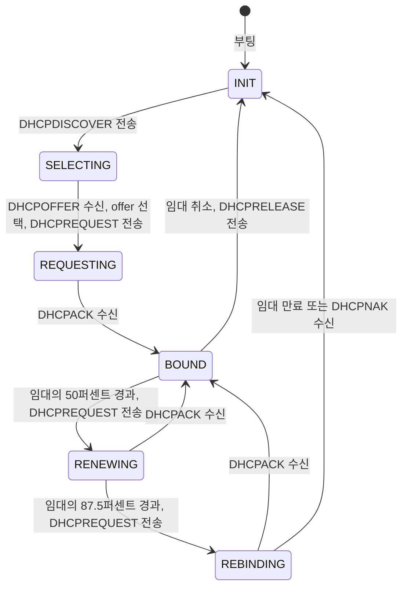

*그림 31. DHCP 클라이언트의 전이도*

- **INIT.** 클라이언트가 처음 시작하면 포트 67을 써서 DHCPDISCOVER 메시지를 브로드캐스트한다.
- **SELECTING.** 서비스를 제공할 수 있는 서버들이 주소와, 경우에 따라 임대 기간을 제안하는 DHCPOFFER 메시지로 응답한다. Forouzan의 설명에 따르면 기본 임대 기간은 1시간이고, offer를 보낸 서버는 제안한 주소를 잠가 다른 클라이언트가 받지 못하게 한다. 클라이언트는 offer 하나를 골라 선택한 서버에 DHCPREQUEST를 보낸다. offer가 오지 않으면 클라이언트는 2초 간격으로 네 번 더 시도하고, 그래도 없으면 5분 동안 쉬었다가 다시 시도한다.
- **REQUESTING.** 클라이언트는 자신의 물리 주소와 IP 주소를 묶어 주는 DHCPACK를 받을 때까지 기다린 뒤 BOUND로 옮겨 간다.
- **BOUND.** 클라이언트는 임대가 끝날 때까지 주소를 쓴다. 임대의 50퍼센트가 지나면 갱신을 요청하는 DHCPREQUEST를 보내고 RENEWING으로 옮겨 간다. 임대를 취소하고 INIT으로 돌아갈 수도 있다.
- **RENEWING.** DHCPACK가 오면 클라이언트는 타이머를 다시 맞추고 BOUND로 돌아간다. 임대의 87.5퍼센트가 지날 때까지 DHCPACK가 오지 않으면 REBINDING으로 옮겨 간다.
- **REBINDING.** DHCPACK가 오면 BOUND로 돌아간다. DHCPNAK가 오거나 임대가 만료되면 INIT으로 돌아가 다른 주소를 얻으려 한다.

따라서 클라이언트는 갱신 타이머(T1), 재바인딩 타이머(T2), 만료 타이머의 세 타이머를 쓴다. 서버가 정하지 않으면 기본값은 임대 기간의 50퍼센트, 87.5퍼센트, 100퍼센트이다. DHCP 명세는 이 기본값을 T1 = 0.5 × 임대 기간, T2 = 0.875 × 임대 기간으로 정하며, RENEWING에서는 임대를 준 서버에 요청을 유니캐스트로 보내고 REBINDING에서는 어느 서버든 응답할 수 있도록 요청을 브로드캐스트한다고 규정한다 [4]. 더는 주소가 필요 없는 클라이언트는 DHCPRELEASE 메시지로 주소를 일찍 반납할 수도 있으며, 그러면 서버는 그 주소를 다른 클라이언트에 배정할 수 있다.

| 8시간 임대에서의 시각 | 사건 | 클라이언트의 동작 |
|:--|:--|:--|
| 0시간 | DHCPACK 수신 | BOUND로 들어가 주소 사용 |
| 4시간 (T1, 50%) | 갱신 타이머 만료 | RENEWING으로 들어가 임대 서버에 DHCPREQUEST 유니캐스트 |
| 7시간 (T2, 87.5%) | DHCPACK 없이 재바인딩 타이머 만료 | REBINDING으로 들어가 어느 서버에든 DHCPREQUEST 브로드캐스트 |
| 8시간 (100%) | DHCPACK 없이 임대 만료 | 주소 사용을 멈추고 INIT으로 복귀 |

*표 24. 8시간 임대의 타이머*

### 8.9 한계와 보안

DHCP에는 이동성 측면에서 중대한 결점이 하나 있다. 노드는 새 서브넷에 연결할 때마다 DHCP에서 새 주소를 받으므로, 이동 노드가 서브넷 사이를 옮겨 다니는 동안에는 원격 응용과의 TCP 연결을 유지할 수 없다. 25장에서 이동 노드가 옮겨 다니면서도 영구 주소를 유지하게 하는 모바일 IP를 설명한다.

DHCP는 보호 장치도 거의 없다. DHCP 명세 자체가 인가되지 않은 DHCP 서버를 쉽게 세울 수 있고, 악의적인 클라이언트가 사용 가능한 자원을 모두 차지할 수 있다고 밝힌다 [4]. 여기서 두 가지 공격이 나온다.

- **불법 서버.** 공격자가 세운 서버는 discover 메시지에 응답하여 클라이언트에게 잘못되거나 중복된 주소, 위장한 라우터의 주소 같은 거짓 설정 정보, 예를 들어 자신의 주소를 기본 라우터로 줄 수 있고, 그러면 클라이언트의 트래픽이 공격자를 거친다.
- **풀 고갈.** 주소를 계속 요청하는 악의적 클라이언트는 서버 풀의 모든 주소를 가져가, 정당한 클라이언트가 더는 주소를 얻지 못하게 할 수 있다.

---

<br>

## 9. NAT

### 9.1 동기

ISP를 통한 주소 분배는 새로운 문제를 낳았다. ISP는 소기업이나 가정에 작은 주소 범위를 준다. 기업이 커지거나 가정에 더 넓은 범위가 필요해져도, 그 범위의 앞뒤 주소가 이미 다른 네트워크에 할당되었을 수 있으므로 ISP가 요구를 들어주지 못할 수 있다. Kurose도 SOHO(small office, home office) 네트워크에서 같은 문제를 설명한다. 가정의 장치 수(휴대 전화, 태블릿, 게임기, TV, 프린터)는 계속 늘어나며, IP 주소를 관리하고 싶은 가정 사용자는 드물다.

그러나 대부분의 작은 네트워크에서는 컴퓨터 가운데 일부만 동시에 인터넷에 접속하므로, 전역 주소의 수가 컴퓨터 수와 같을 필요가 없다. 컴퓨터가 20대이고 그 가운데 동시에 인터넷에 접속하는 것은 많아야 5대인 소기업을 생각한다. 나머지는 인터넷 접속이 필요 없는 업무를 하거나 서로 통신한다. 이 기업은 내부 통신에 사설 주소 20개(또는 25개)를 쓰고, 외부 통신을 위해 ISP에서 전역 주소 5개를 받을 수 있다. 그러면 사설 주소와 전역 주소를 서로 대응시키는 메커니즘이 필요하다.

> **용어 정의:** **네트워크 주소 변환**(network address translation, NAT)은 라우터가 사이트 데이터그램의 사설 주소(그리고 흔히 쓰이는 형태에서는 포트 번호까지)를 전역 주소로 바꾸어, 사이트가 안에서는 사설 주소를 쓰고 바깥으로는 적은 수의 전역 주소만 쓰게 하는 기법이다.

사설 네트워크는 주소가 그 안의 장치들에게만 의미가 있는 사설 주소 영역(realm)을 이룬다. 수십만 개의 가정 네트워크가 10.0.0.0/24 같은 같은 블록을 쓸 수 있으므로, 이 주소는 한 가정 네트워크의 장치 사이에서는 쓸 수 있지만 전역 인터넷에서 패킷의 송신지나 목적지로는 결코 쓸 수 없다. 사이트는 NAT 기능을 가진 라우터를 통해 전역 인터넷과 단 하나의 연결을 가져야 한다.

### 9.2 주소 변환

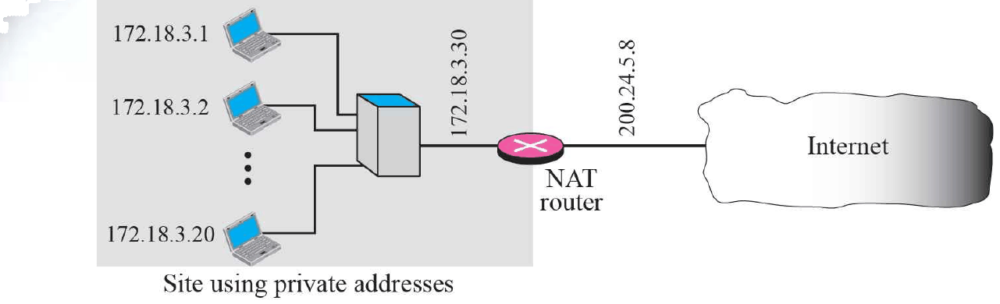

*그림 32. NAT 라우터 뒤에서 사설 주소를 쓰는 사이트*

그림 32의 사이트는 사설 주소 172.18.3.1~172.18.3.20을 쓴다. NAT 라우터는 사이트 쪽에 사설 주소 172.18.3.30 하나, 인터넷 쪽에 전역 주소 200.24.5.8 하나를 가진다. 사설 네트워크는 인터넷의 나머지에 드러나지 않으며, 인터넷의 나머지는 주소가 200.24.5.8인 NAT 라우터만 본다.

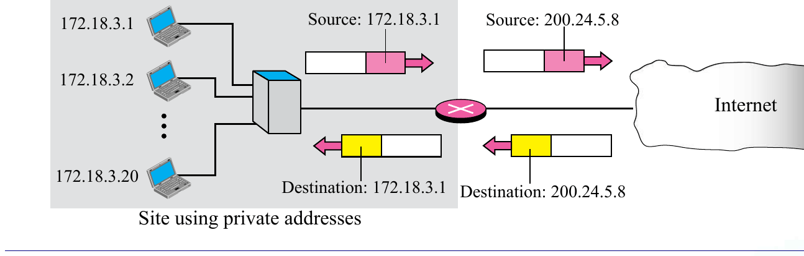

*그림 33. NAT 라우터의 주소 변환*

나가는 모든 패킷은 NAT 라우터를 거치며, 라우터는 사설 송신지 주소를 자신의 전역 주소 200.24.5.8로 바꾼다. 들어오는 모든 패킷도 라우터를 거치며, 라우터는 목적지 주소 200.24.5.8을 172.18.3.1 같은 알맞은 사설 주소로 바꾼다.

### 9.3 변환 테이블

나가는 패킷의 송신지 주소를 바꾸는 것은 간단하다. 어려운 질문은 사설 호스트가 수십, 수백 대일 수 있는데 라우터가 들어오는 패킷의 사설 목적지를 어떻게 찾는가이다. 답은 변환 테이블이다.

> **용어 정의:** **NAT 변환 테이블(NAT translation table)** 은 사설 네트워크에서 시작한 통신마다 사설 주소(와 포트)와 외부 정보 사이의 대응을 기록하여, 들어오는 패킷을 올바른 사설 호스트로 돌려보낼 수 있게 하는 NAT 라우터 안의 표이다.

Forouzan은 표의 세 가지 형태를 설명한다.

**IP 주소 하나 쓰기.** 가장 단순한 형태의 표는 사설 주소와 외부 주소(나가는 패킷의 목적지)의 두 열을 가진다. 그림 34는 네 단계를 보여 준다.

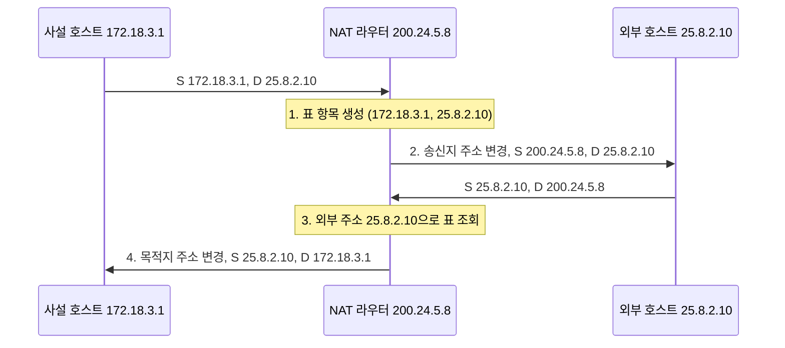

*그림 34. 사설 주소와 외부 주소의 표를 쓰는 변환*

| 사설 | 외부 |
|:--|:--|
| 172.18.3.1 | 25.8.2.10 |
| ... | ... |

*표 25. 두 열짜리 변환 테이블*

라우터는 나가는 패킷의 송신지를 바꿀 때 목적지를 기록하고(1단계) 송신지 주소를 바꾼다(2단계). 응답이 돌아오면 라우터는 응답의 송신지 주소 25.8.2.10을 외부 주소로 써서 사설 주소를 찾고(3단계), 목적지 주소를 172.18.3.1로 바꾼다(4단계). 이 방식에서는 통신을 언제나 사설 네트워크가 시작해야 한다. NAT는 주로 고객에게 주소 하나만 배정하는 ISP가 쓰며, 고객과 인터넷의 통신은 HTTP나 FTP 같은 클라이언트 프로그램에서 시작되고, 고객에게 오는 전자 메일은 고객이 POP 같은 프로토콜로 가져갈 때까지 ISP 메일 서버의 메일함에서 기다린다(4장). 이런 형태의 NAT를 쓰는 사설 네트워크는 바깥의 클라이언트를 위한 서버를 운영할 수 없다.

**IP 주소 풀 쓰기.** 전역 주소가 하나뿐이면 주소 쌍이 연결을 식별해야 하므로, 한 외부 호스트에 동시에 접근할 수 있는 사설 호스트는 하나뿐이다. 라우터는 대신 전역 주소 풀, 예를 들어 200.24.5.8, 200.24.5.9, 200.24.5.10, 200.24.5.11을 써서 사설 호스트 넷이 같은 외부 호스트와 동시에 통신하게 할 수 있다. 그래도 결점이 남는다. 같은 목적지로는 연결을 넷보다 많이 만들 수 없고, 어떤 사설 호스트도 같은 외부 호스트의 두 서버 프로그램(HTTP와 TELNET 등)에 동시에 접근할 수 없으며, 두 사설 호스트가 같은 외부 서버 프로그램에 동시에 접근할 수 없다.

**IP 주소와 포트 번호를 함께 쓰기.** 사설 호스트와 외부 서버 프로그램 사이에 다대다 관계를 허용하려면 표에 정보가 더 필요하다. 사설 호스트 둘, 172.18.3.1과 172.18.3.2가 모두 외부 호스트 25.8.3.2의 HTTP 서버에 접근한다고 하자. 사설 주소, 사설 포트, 외부 주소, 외부 포트, 전송 프로토콜의 다섯 열을 두면 모호함이 사라진다.

| 사설 주소 | 사설 포트 | 외부 주소 | 외부 포트 | 전송 프로토콜 |
|:--|:--|:--|:--|:--|
| 172.18.3.1 | 1400 | 25.8.3.2 | 80 | TCP |
| 172.18.3.2 | 1401 | 25.8.3.2 | 80 | TCP |
| ... | ... | ... | ... | ... |

*표 26. 다섯 열짜리 변환 테이블*

HTTP 응답이 돌아오면 그 송신지 주소(25.8.3.2)와 목적지 포트(1400)의 조합이 응답을 보낼 사설 호스트를 가리킨다. 이 방식이 동작하려면 임시 포트(1400과 1401)가 유일해야 한다.

### 9.4 포트 번호를 쓰는 NAT

Kurose는 오늘날 표준이 된 형태, 즉 NAT 라우터가 포트 번호까지 고쳐 쓰는 형태를 설명한다. 그림 35에서 가정 네트워크는 10.0.0.0/24를 쓴다. NAT 라우터의 가정 쪽 인터페이스는 10.0.0.4이고, WAN 쪽 주소는 138.76.29.7 하나이다. 가정에서 인터넷으로 나가는 모든 트래픽의 송신지 주소는 138.76.29.7이고, 들어오는 모든 트래픽의 목적지 주소도 138.76.29.7이어야 한다. 바깥 세계에서 NAT 라우터는 라우터가 아니라 IP 주소 하나를 가진 장치 하나처럼 보인다. 라우터의 주소와 가정의 주소는 흔히 모두 DHCP에서 온다. 라우터는 ISP의 DHCP 서버에서 WAN 주소를 받고, 스스로 DHCP 서버를 실행하여 가정의 컴퓨터들에 주소를 준다.

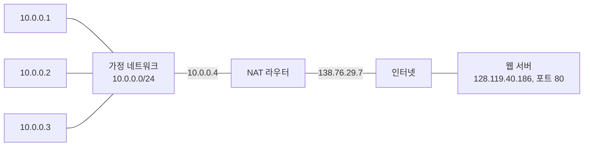

*그림 35. NAT 라우터 뒤의 가정 네트워크*

호스트 10.0.0.1의 사용자가 서버 128.119.40.186의 포트 80에 웹 페이지를 요청한다고 하자.

1. 호스트 10.0.0.1은 임의의 송신지 포트 3345를 골라 데이터그램을 LAN으로 보낸다.
2. NAT 라우터는 새 송신지 포트 5001을 만들고, 송신지 주소를 자신의 WAN 주소 138.76.29.7로, 송신지 포트 3345를 5001로 바꾼 뒤 NAT 변환 테이블에 항목을 추가한다. 라우터는 현재 표에 없는 포트라면 무엇이든 고를 수 있다.
3. 데이터그램이 바뀐 사실을 모르는 웹 서버는 목적지 주소 138.76.29.7, 목적지 포트 5001로 응답한다.
4. NAT 라우터는 목적지 주소와 포트로 표를 조회하여 10.0.0.1과 3345를 찾고, 목적지 주소와 포트를 고쳐 쓴 뒤 데이터그램을 가정 네트워크로 포워딩한다.

| WAN 쪽 | LAN 쪽 |
|:--|:--|
| 138.76.29.7, 5001 | 10.0.0.1, 3345 |
| ... | ... |

*표 27. 그림 35의 NAT 변환 테이블*

포트 번호 필드가 16비트이므로 WAN 쪽 주소 하나로 동시 연결을 60,000개 넘게 지원할 수 있다. 가정의 두 호스트가 우연히 3345 같은 같은 송신지 포트를 골라도, 라우터가 두 연결에 서로 다른 WAN 쪽 포트를 주므로 혼동이 생기지 않는다.

### 9.5 반론과 NAT 통과

NAT는 널리 배치되었지만 비판도 있다.

- **포트는 호스트가 아니라 프로세스를 가리키기 위한 것이다.** 포트 번호로 호스트를 식별하면 가정 네트워크 안의 서버에 문제가 생긴다. 서버 프로세스는 잘 알려진 포트에서 요청을 기다리고, P2P 응용의 피어는 들어오는 연결을 받아야 하는데, NAT 라우터에는 바깥에서 시작한 연결의 표 항목이 없다. Kurose는 두 가지 기술적 해결책을 든다. STUN 같은 NAT 통과 도구 [5]와, 호스트가 가까운 NAT를 발견하고 설정하게 하는 프로토콜인 UPnP(Universal Plug and Play)이다. 관리자가 NAT 라우터를 정적으로 설정하여 특정한 잘 알려진 포트로 들어오는 세션을 언제나 사설 네트워크의 특정 노드로 보내게 할 수도 있다 [6]. 포트 포워딩이라고 부르는 이런 정적 대응을 쓰면 사설 네트워크 안의 서버에 바깥에서 도달할 수 있다.
- **라우터는 3계층 장치여야 한다.** 구조를 중시하는 사람들은 라우터가 패킷을 네트워크 계층까지만 처리해야 하고, 호스트들은 IP 주소는 물론 포트 번호까지 고치는 중간 노드 없이 서로 직접 통신해야 한다고 주장한다.

이동성도 같은 문제를 드러낸다. 한 NAT 라우터 뒤에 있는 호스트 A가 메시지 서버를 통해 호스트 B에 메시지를 보낸 뒤, 다른 NAT 라우터 뒤의 네트워크로 옮겨 가 A'로 보인다고 하자. 서버의 이전 항목은 A의 예전 대응을 가리키므로, A'가 안쪽에서 새 연결을 열어 새 대응이 만들어질 때까지 서버는 A'에 응답할 수 없다.

좋든 싫든 NAT는 인터넷의 중요한 구성 요소가 되었으며, 네트워크 계층에서 동작하지만 전통적 포워딩과 다른 기능, 예를 들어 NAT, 부하 분산, 방화벽 기능을 하는 미들박스라는 장치들도 마찬가지이다. 24장의 일반화된 포워딩은 이런 미들박스 기능 몇 가지와 전통적 포워딩을 하나의 통합된 방식으로 수행할 수 있다.

---

<br>

## 10. 주소 고갈과 IPv6

클래스 없는 주소 지정, 사설 주소, NAT는 32비트 IPv4 주소 공간의 수명을 늘리지만 공간을 넓히지는 못한다. 장기적 해결책은 128비트 주소를 쓰는 IPv6이며, 그 주소 지정과 데이터그램 형식은 24장의 주제이다.

---

<br>

## 개념 적용

**T/F 점검:**

| 문장 | 판단과 근거 |
|:--|:--|
| 인터페이스가 셋인 라우터는 IP 주소를 하나 가진다. | **F.** 주소는 인터페이스에 속하므로 라우터는 자신이 걸친 서브넷마다 하나씩 주소 셋을 가진다. |
| 192.168.1.256은 올바른 점-십진 주소이다. | **F.** 각 바이트는 0과 255 사이여야 한다. |
| 클래스 없는 주소 지정에서 주소 167.199.170.82만으로 그 블록이 정해진다. | **F.** 같은 주소가 모든 접두사 길이의 블록에 속하므로 접두사 길이도 주어져야 한다. |
| CIDR로 할당하는 블록은 주소를 1,000개 가질 수 있다. | **F.** 주소 개수는 2의 거듭제곱이어야 하므로 1,024개를 준다. |
| 블록 18.14.12.0/22는 올바른 할당이다. | **T.** 18.14.12.0은 1,024로 나누어떨어지므로 마지막 10비트가 모두 0이다. |
| 255.255.255.255로 보낸 패킷은 라우터가 모든 네트워크로 포워딩한다. | **F.** 제한 브로드캐스트 주소이므로 라우터가 막는다. |
| 주소가 없는 DHCP 클라이언트는 discover 메시지를 송신지 주소 0.0.0.0으로 보낸다. | **T.** 자기 주소를 모르므로 모두 0인 주소를 쓴다. |
| 포트 기반 NAT에서 바깥의 호스트는 아무 설정 없이 안쪽 서버로 연결을 열 수 있다. | **F.** 바깥에서 시작한 연결에 대한 표 항목이 라우터에 없으므로 포트 포워딩, UPnP, 통과 도구가 필요하다. |

---

<br>

## 요약

| 개념 | 핵심 요약 |
|---------|-----------|
| IPv4 주소 | 인터페이스의 유일하고 보편적인 32비트 주소이며, 주소 공간에는 $`2^{32}`$개의 주소가 있다. |
| 표기법 | 주소는 이진, 점-십진(밑 256), 16진으로 쓰며, 점-십진에서는 0~255의 수 네 개로 쓴다. |
| 비트 연산 | NOT은 마스크의 보수를 구하고, 마스크와의 AND는 첫(네트워크) 주소를, 마스크 보수와의 OR는 마지막 주소를 준다. |
| 서브넷 | 라우터를 건너지 않고 도달할 수 있는 인터페이스의 집합이며, 모든 인터페이스를 장치에서 떼어 내어 찾는다. |
| 클래스 기반 주소 지정 | 다섯 클래스가 netid 길이를 8, 16, 24비트(A, B, C)로 고정하고, D는 멀티캐스트에, E는 미래에 예약한다. |
| 기본 마스크 | 255.0.0.0, 255.255.0.0, 255.255.255.0이며, 주소와 AND하면 클래스 기반 네트워크 주소가 나온다. |
| 서브넷팅 | 네트워크 부분을 log₂ s비트 늘려 블록을 서브넷 s개로 나눈다. |
| 슈퍼넷팅 | 네트워크 부분을 log₂ c비트 줄여 클래스 C 블록 c개를 합치지만, 낭비와 복잡한 라우팅을 대가로 치른다. |
| CIDR | 블록은 어떤 접두사 길이든 가질 수 있고, 크기는 2의 거듭제곱이며, 첫 주소는 크기로 나누어떨어진다. |
| 블록 정보 | a.b.c.d/n에서 블록은 $`2^{32-n}`$개의 주소를 가지며, 첫 주소와 마지막 주소는 AND와 OR로 구한다. |
| 서브넷 설계 | 각 서브넷은 2의 거듭제곱 크기와 접두사 n + log₂(N/N_sub)를 가지며, 큰 서브넷부터 할당한다. |
| 집약 | 접두사 하나로 많은 네트워크를 광고하며, 더 구체적인 예외는 최장 접두사 일치가 처리한다. |
| 특수 주소 | 0.0.0.0, 255.255.255.255, 127/8, 사설 블록, 멀티캐스트 224/4, 네트워크 주소, 직접 브로드캐스트가 예약된 의미를 가진다. |
| DHCP | discover, offer, request, ACK로 호스트에 임대 기간 동안의 주소를 주며, 임대의 50퍼센트에 갱신하고 87.5퍼센트에 재바인딩한다. |
| NAT | 라우터가 변환 테이블로 사설 주소와 포트를 자신의 전역 주소와 포트로 바꾸며, 주소를 아끼지만 들어오는 연결을 막는다. |

---

<br>

## 점검 문제

1. **첫 주소와 마지막 주소:** 블록의 주소 하나가 192.168.37.200/27이다. 마스크, 주소 개수, 첫 주소, 마지막 주소를 구하라.

   <details>
   <summary>정답</summary>

   마스크는 1이 27개인 255.255.255.224이고 블록은 $`2^{32-27} = 32`$개의 주소를 가진다. 넷째 바이트만 바뀐다. 200 = 11001000이고 200 AND 224 = 11000000 = 192이므로 첫 주소는 192.168.37.192이다. 보수 31과 OR하면 11011111 = 223이므로 마지막 주소는 192.168.37.223이다.

   </details>

2. **같은 크기의 서브넷:** 어떤 조직이 130.34.12.128/26을 받았고 같은 크기의 서브넷이 여덟 개 필요하다. 서브넷 접두사 길이와 각 서브넷의 첫 주소와 마지막 주소를 구하라.

   <details>
   <summary>정답</summary>

   블록은 130.34.12.128부터 130.34.12.191까지 64개의 주소를 가진다. 각 서브넷은 64/8 = 8개의 주소를 받으므로 접두사는 $`26 + \log_2 8 = 29`$이다. 서브넷은 130.34.12.128/29(.128-.135), .136/29(.136-.143), .144/29(.144-.151), .152/29(.152-.159), .160/29(.160-.167), .168/29(.168-.175), .176/29(.176-.183), .184/29(.184-.191)이다. 각 시작 주소는 8로 나누어떨어진다.

   </details>

3. **가변 길이 서브넷:** 어떤 조직이 14.24.74.0/24를 받았고 호스트 100대, 50대, 20대를 위한 서브넷 셋이 필요하다. 네트워크 주소와 직접 브로드캐스트 주소를 남겨 둔 뒤에도 각 서브넷에 호스트가 들어가도록 서브넷을 설계하고, 남는 주소를 구하라.

   <details>
   <summary>정답</summary>

   호스트 100대에는 주소 128개(쓸 수 있는 것 126개), 50대에는 64개(62개), 20대에는 32개(30개)가 필요하다. 가장 큰 것부터 할당하면 14.24.74.0/25(14.24.74.0-14.24.74.127), 14.24.74.128/26(14.24.74.128-14.24.74.191), 14.24.74.192/27(14.24.74.192-14.24.74.223)이다. 14.24.74.224부터 14.24.74.255까지 32개의 주소가 예비로 남는다.

   </details>

4. **DHCP 메시지:** 그림 28에서 어느 메시지가 브로드캐스트 주소로 보내지며, DHCP request까지 브로드캐스트하는 이유는 무엇인가? 임대 기간이 8시간이면 클라이언트는 언제 RENEWING과 REBINDING 상태에 들어가며, 각 상태에서 요청을 어떻게 보내는가?

   <details>
   <summary>정답</summary>

   네 메시지 모두 255.255.255.255로 보내진다. discover는 클라이언트가 자기 주소도 서버의 주소도 모르므로 브로드캐스트하고, offer와 ACK는 클라이언트에게 아직 유니캐스트 데이터그램을 받을 주소가 없으므로 브로드캐스트한다. request는 offer를 보낸 모든 서버가 어느 서버가 선택되었는지 알게 하려고 브로드캐스트하며, 선택되지 않은 서버는 제안한 주소를 풀어 줄 수 있다. 클라이언트는 T1 = 4시간에 RENEWING에 들어가 임대를 준 서버에 요청을 유니캐스트하고, T2 = 7시간에 REBINDING에 들어가 어느 서버에든 요청을 브로드캐스트한다. 8시간까지 DHCPACK가 오지 않으면 주소 사용을 멈추고 INIT으로 돌아간다.

   </details>

5. **NAT 변환 테이블:** 그림 35의 NAT 라우터(WAN 주소 138.76.29.7) 뒤에서 호스트 10.0.0.1이 포트 3345에서 128.119.40.186의 포트 80으로 연결을 열고, 이어서 호스트 10.0.0.2도 포트 3345에서 같은 서버로 연결을 연다. 라우터는 새 포트 5001과 5002를 차례로 배정한다. 변환 테이블을 쓰고, 138.76.29.7의 포트 5002로 도착한 응답이 어디로 가는지 설명하라.

   <details>
   <summary>정답</summary>

   표에는 (138.76.29.7, 5001) ↔ (10.0.0.1, 3345)와 (138.76.29.7, 5002) ↔ (10.0.0.2, 3345)의 두 항목이 있다. 두 호스트 모두 송신지 포트 3345를 썼지만, 나가는 데이터그램은 같은 송신지 주소와 서로 다른 송신지 포트 5001과 5002로 나가므로 서버는 서로 다른 연결 둘을 본다. 138.76.29.7의 포트 5002로 온 응답은 둘째 항목과 일치하므로, 라우터는 목적지를 10.0.0.2의 포트 3345로 고쳐 쓰고 가정 네트워크로 포워딩한다.

   </details>

6. **클래스와 기본 마스크:** 227.12.14.87과 193.14.56.22의 클래스를 구하고, 있다면 기본 마스크와 네트워크 주소를 구하라.

   <details>
   <summary>정답</summary>

   227은 224와 239 사이이므로 227.12.14.87은 클래스 D(멀티캐스트) 주소이다. 클래스 D는 netid와 hostid로 나뉘지 않으므로 기본 마스크도 네트워크 주소도 없다. 193은 192와 223 사이이므로 193.14.56.22는 클래스 C이고, 기본 마스크는 255.255.255.0, 네트워크 주소는 193.14.56.0이다.

   </details>

7. **네트워크 주소와 브로드캐스트 주소:** 172.16.45.200/20을 포함하는 블록의 네트워크 주소, 직접 브로드캐스트 주소, 주소 개수를 구하라.

   <details>
   <summary>정답</summary>

   /20의 마스크는 255.255.240.0이다. 셋째 바이트 45 = 00101101을 11110000과 AND하면 00100000 = 32이므로 네트워크 주소는 172.16.32.0이다. 45를 00001111과 OR하면 00101111 = 47이고 넷째 바이트는 255가 되므로 직접 브로드캐스트 주소는 172.16.47.255이다. 블록은 $`2^{32-20} = 2^{12} = 4096`$개의 주소를 가진다.

   </details>

8. **집약:** 200.10.8.0/24, 200.10.9.0/24, 200.10.10.0/24, 200.10.11.0/24를 블록 하나로 집약하라. 200.10.9.0/24부터 200.10.12.0/24까지의 블록 넷은 /22 하나로 집약할 수 있는가?

   <details>
   <summary>정답</summary>

   셋째 바이트 8\~11은 이진수로 00001000\~00001011이며 처음 6비트 000010을 공유하므로, 공통 접두사는 16 + 6 = 22비트이고 집약 결과는 200.10.8.0/22이다. 블록 9\~12는 /22 하나를 이룰 수 없다. /22 블록은 셋째 바이트가 4로 나누어떨어지는 곳에서 시작해야 하는데, 9\~12는 8\~11 블록과 12\~15 블록에 걸쳐 있기 때문이다.

   </details>

---

<br>

## 참고 문헌

1. Y. Rekhter, B. Moskowitz, D. Karrenberg, G. J. de Groot, and E. Lear, "Address Allocation for Private Internets," RFC 1918, Feb. 1996. [Online]. Available: https://www.rfc-editor.org/rfc/rfc1918
2. S. Cheshire, B. Aboba, and E. Guttman, "Dynamic Configuration of IPv4 Link-Local Addresses," RFC 3927, May 2005. [Online]. Available: https://www.rfc-editor.org/rfc/rfc3927
3. A. Retana, R. White, V. Fuller, and D. McPherson, "Using 31-Bit Prefixes on IPv4 Point-to-Point Links," RFC 3021, Dec. 2000. [Online]. Available: https://www.rfc-editor.org/rfc/rfc3021
4. R. Droms, "Dynamic Host Configuration Protocol," RFC 2131, Mar. 1997. [Online]. Available: https://www.rfc-editor.org/rfc/rfc2131
5. J. Rosenberg, R. Mahy, P. Matthews, and D. Wing, "Session Traversal Utilities for NAT (STUN)," RFC 5389, Oct. 2008. [Online]. Available: https://www.rfc-editor.org/rfc/rfc5389
6. P. Srisuresh and K. Egevang, "Traditional IP Network Address Translator (Traditional NAT)," RFC 3022, Jan. 2001. [Online]. Available: https://www.rfc-editor.org/rfc/rfc3022
