# Chapter 12 — IPv4 Addresses

[Repository Guide](../../README.md) | [English](Concepts_Lecture.md) | [한국어](Concepts_Lecture.ko.md)

> **Last Updated:** 2026-11-18
>
> Computer Networking: A Top-Down Approach, Kurose and Ross, Ch 4; TCP/IP Protocol Suite, Forouzan, Ch 5, 18

> **Learning Objectives:**
> 1. Convert IPv4 addresses among binary, dotted-decimal, and hexadecimal notation and apply the bitwise NOT, AND, and OR operations to them
> 2. Identify the subnets of an interconnected system and find the class, network address, and default mask of a classful address
> 3. Find the number of addresses, the first address, and the last address of a classless block from one address and its prefix length
> 4. Design equal and variable-length subnets and explain address aggregation
> 5. Explain the special addresses and how DHCP configures a host
> 6. Trace the translation table of a NAT router

---

## Table of Contents

- [1. Address Space and Notation](#1-address-space-and-notation)
  - [1.1 IPv4 Addresses](#11-ipv4-addresses)
  - [1.2 Binary, Dotted-Decimal, and Hexadecimal Notation](#12-binary-dotted-decimal-and-hexadecimal-notation)
  - [1.3 Finding Errors in Dotted-Decimal Notation](#13-finding-errors-in-dotted-decimal-notation)
  - [1.4 Ranges of Addresses](#14-ranges-of-addresses)
- [2. Bitwise Operations](#2-bitwise-operations)
  - [2.1 NOT](#21-not)
  - [2.2 AND](#22-and)
  - [2.3 OR](#23-or)
- [3. Interfaces and Subnets](#3-interfaces-and-subnets)
  - [3.1 An Address per Interface](#31-an-address-per-interface)
  - [3.2 Subnets](#32-subnets)
- [4. Classful Addressing](#4-classful-addressing)
  - [4.1 The Five Classes](#41-the-five-classes)
  - [4.2 Finding the Class](#42-finding-the-class)
  - [4.3 Netid and Hostid](#43-netid-and-hostid)
  - [4.4 Blocks in Each Class](#44-blocks-in-each-class)
  - [4.5 Two-Level Addressing and Information Extraction](#45-two-level-addressing-and-information-extraction)
  - [4.6 Network Addresses in a Sample Internet](#46-network-addresses-in-a-sample-internet)
  - [4.7 Network Mask](#47-network-mask)
  - [4.8 Three-Level Addressing: Subnetting](#48-three-level-addressing-subnetting)
  - [4.9 Supernetting](#49-supernetting)
  - [4.10 Problems of Classful Addressing](#410-problems-of-classful-addressing)
- [5. Classless Addressing](#5-classless-addressing)
  - [5.1 Variable-Length Blocks](#51-variable-length-blocks)
  - [5.2 Prefix and Suffix](#52-prefix-and-suffix)
  - [5.3 Slash Notation](#53-slash-notation)
  - [5.4 Extracting Information from a Block](#54-extracting-information-from-a-block)
  - [5.5 Block Allocation](#55-block-allocation)
  - [5.6 Relation to Classful Addressing](#56-relation-to-classful-addressing)
  - [5.7 Subnetting a Classless Block](#57-subnetting-a-classless-block)
  - [5.8 A Hierarchy of Allocations](#58-a-hierarchy-of-allocations)
- [6. Obtaining and Aggregating Address Blocks](#6-obtaining-and-aggregating-address-blocks)
  - [6.1 Blocks from an ISP and from ICANN](#61-blocks-from-an-isp-and-from-icann)
  - [6.2 Address Aggregation](#62-address-aggregation)
- [7. Special Addresses](#7-special-addresses)
  - [7.1 Special Blocks](#71-special-blocks)
  - [7.2 Special Addresses in Each Block](#72-special-addresses-in-each-block)
  - [7.3 Quick Reference for Prefix Lengths](#73-quick-reference-for-prefix-lengths)
- [8. DHCP](#8-dhcp)
  - [8.1 What a Host Needs to Know](#81-what-a-host-needs-to-know)
  - [8.2 Previous Protocols](#82-previous-protocols)
  - [8.3 The Four Steps of DHCP](#83-the-four-steps-of-dhcp)
  - [8.4 Client and Server on Different Networks](#84-client-and-server-on-different-networks)
  - [8.5 UDP Ports, TFTP, and Error Control](#85-udp-ports-tftp-and-error-control)
  - [8.6 Packet Format](#86-packet-format)
  - [8.7 Static and Dynamic Allocation](#87-static-and-dynamic-allocation)
  - [8.8 Transition States](#88-transition-states)
  - [8.9 Limitations and Security](#89-limitations-and-security)
- [9. NAT](#9-nat)
  - [9.1 Motivation](#91-motivation)
  - [9.2 Address Translation](#92-address-translation)
  - [9.3 Translation Tables](#93-translation-tables)
  - [9.4 NAT with Port Numbers](#94-nat-with-port-numbers)
  - [9.5 Objections and NAT Traversal](#95-objections-and-nat-traversal)
- [10. Address Exhaustion and IPv6](#10-address-exhaustion-and-ipv6)
- [Concept Applications](#concept-applications)
- [Summary](#summary)
- [Self-Check Questions](#self-check-questions)
- [References](#references)

---

<br>

## 1. Address Space and Notation

### 1.1 IPv4 Addresses

The identifier used in the IP layer of the TCP/IP protocol suite to identify each device connected to the Internet is called the **Internet address** or **IP address**. There are two versions of IP and therefore two kinds of IP address, IPv4 and IPv6; this chapter deals with IPv4, and Chapter 24 with IPv6.

> **Definition:** An **IPv4 address** is a 32-bit address that uniquely and universally defines the connection of a host or a router to the Internet.

Three properties follow from this definition.

- **An address belongs to a connection, not to a device.** An IP address is the address of an interface, the boundary between a host or router and one of its links (Section 3). A router connected to three links has three IP addresses.
- **Unique.** Two devices on the Internet can never have the same address at the same time. A device connected through two interfaces has two addresses.
- **Universal.** The addressing system is a single standard that every host connected to the Internet must accept.

> **Definition:** The **address space** of a protocol is the total number of addresses that the protocol can use.

An IPv4 address has 32 bits, so the address space of IPv4 is $`2^{32}`$ = 4,294,967,296 addresses, about 4 billion. If there were no restrictions, more than 4 billion devices could be connected to the Internet, but in practice the space is far smaller than the number of devices that want an address. This scarcity is the reason for NAT (Section 9) and for IPv6 (Chapter 24).

### 1.2 Binary, Dotted-Decimal, and Hexadecimal Notation

Three notations are common. In **binary notation** (base 2) the address is written as 32 bits, usually with a space between each 8-bit byte (octet). Binary is precise but hard to read, so addresses are usually written in dotted-decimal notation.

> **Definition:** **Dotted-decimal notation** is the representation of an IPv4 address as four decimal numbers between 0 and 255, one for each byte, separated by dots.

Dotted-decimal notation can be seen as base 256, since each number is a digit from 0 to 255. In **hexadecimal notation** (base 16) each group of 4 bits is written as one hexadecimal digit, so the address becomes 8 hexadecimal digits, marked with the prefix `0x` or the subscript 16. Hexadecimal notation is common in network programming.

```text
Binary:           10000000   00001011   00000011   00011111
Dotted-decimal:     128    .    11    .     3    .    31

Binary:          0111 0101  1001 0101  0001 1101  1110 1010
Hexadecimal:       7    5    9    5     1    D     E    A    = 0x75951DEA
```

*Figure 1. The same address in binary and dotted-decimal notation, and another address in binary and hexadecimal notation*

**Example 5.1** converts binary addresses to dotted-decimal notation by replacing each group of 8 bits with its decimal value, and **Example 5.4** converts two of them to hexadecimal by replacing each group of 4 bits with a hexadecimal digit. **Example 5.2** goes the other way, replacing each decimal number with its 8-bit binary equivalent.

| Binary | Dotted-decimal | Hexadecimal |
|:--|:--|:--|
| 10000001 00001011 00001011 11101111 | 129.11.11.239 | 0x810B0BEF |
| 11000001 10000011 00011011 11111111 | 193.131.27.255 | 0xC1831BFF |
| 11100111 11011011 10001011 01101111 | 231.219.139.111 | |
| 11111001 10011011 11111011 00001111 | 249.155.251.15 | |

*Table 1. Conversions of Examples 5.1 and 5.4*

| Dotted-decimal | Binary |
|:--|:--|
| 111.56.45.78 | 01101111 00111000 00101101 01001110 |
| 221.34.7.82 | 11011101 00100010 00000111 01010010 |
| 241.8.56.12 | 11110001 00001000 00111000 00001100 |
| 75.45.34.78 | 01001011 00101101 00100010 01001110 |

*Table 2. Conversions of Example 5.2*

### 1.3 Finding Errors in Dotted-Decimal Notation

A dotted-decimal address has exactly four numbers, each between 0 and 255, written without leading zeros, and binary and decimal notation are never mixed. **Example 5.3** applies these rules.

| Address | Error |
|:--|:--|
| 111.56.045.78 | Leading zero in 045 |
| 221.34.7.8.20 | Five numbers; an address has exactly four |
| 75.45.301.14 | 301 is outside the range 0-255 |
| 11100010.23.14.67 | Mixture of binary and dotted-decimal notation; in decimal the first byte must be written as a number from 0 to 255 (226) |

*Table 3. Errors in the addresses of Example 5.3*

### 1.4 Ranges of Addresses

Address arithmetic is easiest in base 256, where each byte is one digit. The number of addresses in a range is the difference between the last and the first address, plus 1.

**Example 5.5.** The first address of a range is 146.102.29.0 and the last is 146.102.32.255. Subtracting in base 256 gives 0.0.3.255. Converting to decimal and adding 1 gives the number of addresses.

```math
(0 \times 256^3 + 0 \times 256^2 + 3 \times 256^1 + 255 \times 256^0) + 1 = 1024
```

**Example 5.6.** The first address of a range is 14.11.45.96 and the range has 32 addresses. The number of addresses minus 1 is 31, which is 0.0.0.31 in base 256. Adding it to the first address in base 256 gives the last address.

```math
14.11.45.96 + 0.0.0.31 = 14.11.45.127
```

---

<br>

## 2. Bitwise Operations

Address calculations rely on three bitwise operations applied to 32-bit numbers: NOT, AND, and OR. Each operation acts on every bit (or every pair of bits in the same position) independently. In dotted-decimal notation each operation also has short cuts that work byte by byte.

### 2.1 NOT

The NOT operation has one 32-bit input and one 32-bit output, and it inverts every bit: 0 becomes 1 and 1 becomes 0. It is used to find the complement of a mask.

| Input | Output |
|:--|:--|
| 0 | 1 |
| 1 | 0 |

*Table 4. The NOT operation on one bit*

**Example 5.7.** Applying NOT to 17.121.14.35 bit by bit gives 238.134.241.220. In dotted-decimal notation the short cut is to subtract each byte from 255: 255 − 17 = 238, 255 − 121 = 134, 255 − 14 = 241, and 255 − 35 = 220.

```text
Original number:   00010001  01111001  00001110  00100011     17.121.14.35
Complement:        11101110  10000110  11110001  11011100    238.134.241.220
```

### 2.2 AND

The AND operation has two 32-bit inputs and one 32-bit output. A bit of the output is 1 only when the corresponding bits of both inputs are 1. AND with a mask keeps the bits where the mask is 1 and clears the rest, which is how a network address is extracted.

| Input 1 | Input 2 | Output |
|:--|:--|:--|
| 0 | 0 | 0 |
| 0 | 1 | 0 |
| 1 | 0 | 0 |
| 1 | 1 | 1 |

*Table 5. The AND operation on one pair of bits*

**Example 5.8.** 17.121.14.35 AND 255.255.140.0 gives 17.121.12.0.

```text
First number:      00010001  01111001  00001110  00100011     17.121.14.35
Second number:     11111111  11111111  10001100  00000000    255.255.140.0
Result:            00010001  01111001  00001100  00000000     17.121.12.0
```

Two short cuts avoid writing all 32 bits.

1. **First short cut.** If one of the two bytes is 255, the result is the other byte; if one of them is 0, the result is 0. This settles the first, second, and fourth bytes of Example 5.8.
2. **Second short cut.** Otherwise, write both bytes as sums of powers of 2 and keep only the powers that appear in both. For the third byte, 14 = 8 + 4 + 2 and 140 = 128 + 8 + 4, so 14 AND 140 = 8 + 4 = 12.

```text
Powers:      128   64   32   16    8    4    2    1
Byte (14):     0 +  0 +  0 +  0 +  8 +  4 +  2 +  0
Byte (140):  128 +  0 +  0 +  0 +  8 +  4 +  0 +  0
Result (12):   0 +  0 +  0 +  0 +  8 +  4 +  0 +  0
```

### 2.3 OR

The OR operation has two 32-bit inputs and one 32-bit output. A bit of the output is 1 when at least one of the corresponding input bits is 1. OR with the complement of a mask sets every host bit to 1, which is how the last address of a block is found.

| Input 1 | Input 2 | Output |
|:--|:--|:--|
| 0 | 0 | 0 |
| 0 | 1 | 1 |
| 1 | 0 | 1 |
| 1 | 1 | 1 |

*Table 6. The OR operation on one pair of bits*

**Example 5.9.** 17.121.14.35 OR 255.255.140.0 gives 255.255.142.35. The short cuts mirror those of AND: if one byte is 255 the result is 255, and if one byte is 0 the result is the other byte. Otherwise the result keeps every power of 2 that appears in either byte: 14 OR 140 = 128 + 8 + 4 + 2 = 142.

```text
First number:      00010001  01111001  00001110  00100011     17.121.14.35
Second number:     11111111  11111111  10001100  00000000    255.255.140.0
Result:            11111111  11111111  10001110  00100011    255.255.142.35
```

> **[Digital Logic Design]** NOT, AND, and OR are the basic operations of Boolean algebra and the logic gates studied in Digital Logic Design. IP address calculations apply them bitwise, to each pair of bits in the same position of the address and the mask. AND with the mask keeps the network bits where the mask is 1 and clears the rest, and OR with the inverted mask sets every host bit to 1.

---

<br>

## 3. Interfaces and Subnets

### 3.1 An Address per Interface

A host typically has a single link into the network. The boundary between the host and its physical link is called an **interface**. A router receives a datagram on one link and forwards it on another, so it necessarily has two or more links, and the boundary between the router and each of its links is also an interface. Because every host and router interface can send and receive IP datagrams, IP requires each interface to have its own IP address. An IP address is therefore technically associated with an interface rather than with the host or router that contains it.

Addresses cannot be chosen arbitrarily, however: part of an interface's address is determined by the subnet to which it is connected. Figure 2 shows one router with three interfaces interconnecting seven hosts.

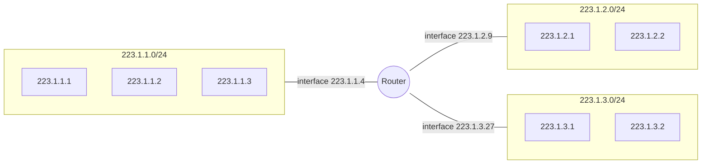

*Figure 2. Interface addresses of one router and seven hosts in three subnets*

The three hosts at the left and the router interface to which they are connected all have addresses of the form 223.1.1.xxx, that is, the same leftmost 24 bits. They are interconnected by a network that contains no routers, for example an Ethernet LAN through a switch (Chapter 20) or a wireless access point (Chapter 22).

### 3.2 Subnets

> **Definition:** A **subnet** is a set of interfaces that are interconnected without any intervening router, so that they can reach each other directly; all interfaces on a subnet share the same leftmost bits of their addresses.

A subnet is also called an IP network, or simply a network. IP addressing assigns an address to each subnet, such as 223.1.1.0/24, where the "/24" indicates that the leftmost 24 bits of the 32-bit quantity define the subnet address. Kurose calls this /24 notation a subnet mask. The subnet 223.1.1.0/24 consists of the three host interfaces 223.1.1.1, 223.1.1.2, and 223.1.1.3 and the router interface 223.1.1.4, and any host added to it must have an address of the form 223.1.1.xxx. Figure 2 has two more subnets, 223.1.2.0/24 and 223.1.3.0/24.

A subnet is not limited to a LAN that connects several hosts to a router. In Figure 3, three routers are interconnected by point-to-point links, and each router also connects to a LAN with two hosts.

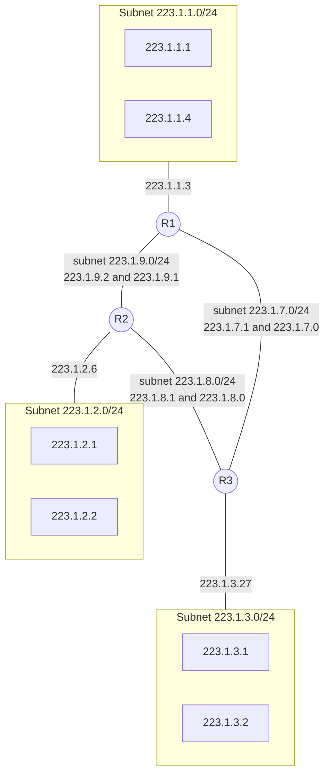

*Figure 3. Three routers interconnecting six subnets*

To determine the subnets of any interconnected system, Kurose gives a simple recipe: detach each interface from its host or router, creating islands of isolated networks, with interfaces terminating the end points of the isolated networks. Each island is a subnet. Applied to Figure 3, the recipe produces six islands: the three LANs 223.1.1.0/24, 223.1.2.0/24, and 223.1.3.0/24, and the three point-to-point links 223.1.9.0/24 (R1 to R2), 223.1.8.0/24 (R2 to R3), and 223.1.7.0/24 (R3 to R1). An organization with several LAN segments and point-to-point links therefore has several subnets. In principle their addresses could be unrelated, but in practice they usually share much of their prefix, for the reasons explained in Sections 5 and 6.

> **Key Point:** A subnet is a set of interfaces reachable without crossing a router, and a router interface belongs to the subnet on its side. A router with k interfaces therefore touches k subnets.

---

<br>

## 4. Classful Addressing

IPv4 addressing at first used the concept of classes; this architecture is called classful addressing. In the mid-1990s a new architecture, classless addressing, was introduced, and it is the one in use today (Section 5). Classful addressing is still worth studying, both because its vocabulary (netid, hostid, default mask, subnetting) survives in classless addressing and because it explains why the change was necessary.

> **Definition:** **Classful addressing** is the original IPv4 addressing architecture in which the address space is divided into five fixed classes, A to E, and the class of an address determines the length of its network part.

### 4.1 The Five Classes

The address space is divided into five classes, A, B, C, D, and E, each occupying a fixed part of the space. Class A covers half of the address space, class B a quarter, class C an eighth, and classes D and E a sixteenth each.

| Class | Leading bits | First byte | Number of addresses | Share of the space | Use |
|:--|:--|:--|:--|:--|:--|
| A | 0 | 0-127 | $`2^{31}`$ = 2,147,483,648 | 50% | Unicast, large organizations |
| B | 10 | 128-191 | $`2^{30}`$ = 1,073,741,824 | 25% | Unicast, midsize organizations |
| C | 110 | 192-223 | $`2^{29}`$ = 536,870,912 | 12.5% | Unicast, small organizations |
| D | 1110 | 224-239 | $`2^{28}`$ = 268,435,456 | 6.25% | Multicast |
| E | 1111 | 240-255 | $`2^{28}`$ = 268,435,456 | 6.25% | Reserved |

*Table 7. Occupation of the address space by the five classes*

### 4.2 Finding the Class

The class of an address is determined by its first few bits, so it can be read directly from the address.

- **In binary notation,** the class is found from the leading bits: 0 for A, 10 for B, 110 for C, 1110 for D, and 1111 for E. Figure 4 shows the procedure, which checks at most four bits.
- **In dotted-decimal notation,** the class is found from the range of the first byte: 0-127 for A, 128-191 for B, 192-223 for C, 224-239 for D, and 240-255 for E.

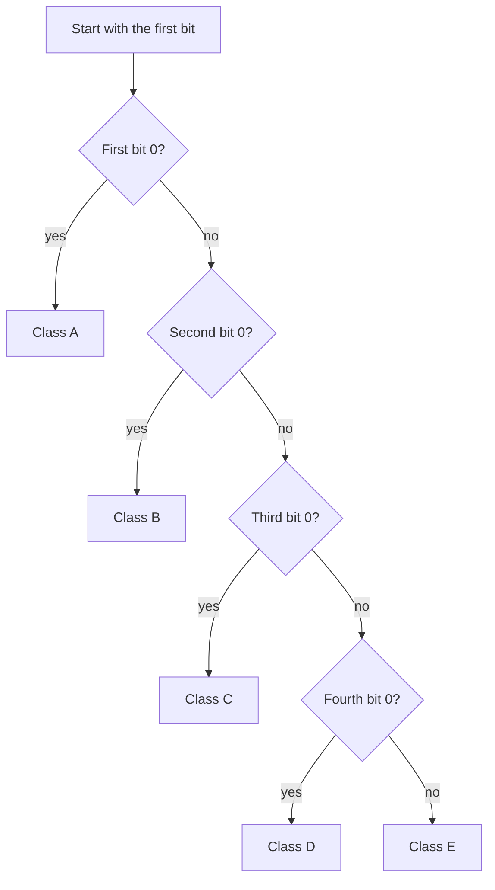

*Figure 4. Finding the class of an address in binary notation*

| Example | Address | Reasoning | Class |
|:--|:--|:--|:--|
| 5.10a | 00000001 00001011 00001011 11101111 | First bit is 0 | A |
| 5.10b | 11000001 10000011 00011011 11111111 | First two bits are 1, third is 0 | C |
| 5.10c | 10100111 11011011 10001011 01101111 | First bit is 1, second is 0 | B |
| 5.10d | 11111001 10011011 11111011 00001111 | First four bits are 1 | E |
| 5.11a | 227.12.14.87 | First byte 227 is between 224 and 239 | D |
| 5.11b | 193.14.56.22 | First byte 193 is between 192 and 223 | C |
| 5.11c | 14.23.120.8 | First byte 14 is between 0 and 127 | A |
| 5.11d | 252.5.15.111 | First byte 252 is between 240 and 255 | E |

*Table 8. Finding the class in Examples 5.10 and 5.11*

### 4.3 Netid and Hostid

In classes A, B, and C an address is divided into two parts. The lengths of the parts depend on the class.

> **Definition:** The **netid** is the leftmost part of a classful address that identifies the network; it is 1, 2, or 3 bytes long in classes A, B, and C.

> **Definition:** The **hostid** is the remaining part of a classful address that identifies a host on the network defined by the netid.

```text
          Byte 1      Byte 2      Byte 3      Byte 4
Class A: | Netid     | Hostid                            |
Class B: | Netid                 | Hostid                |
Class C: | Netid                             | Hostid    |
Class D: | Multicast address                             |
Class E: | Reserved for future use                       |
```

*Figure 5. Netid and hostid in each class*

A useful picture is that a netid names a neighborhood and a hostid names a house in it. The number of netid bits fixes how many neighborhoods a class can have, and the number of hostid bits fixes how many addresses each neighborhood contains. Class A has few neighborhoods, each with $`2^{24}`$ addresses, and class C has many neighborhoods, each with only $`2^{8}`$ addresses. Classes D and E are not divided into netid and hostid.

### 4.4 Blocks in Each Class

Each value of the netid defines one block of addresses that can be granted to one organization.

- **Class A** has $`2^{7}`$ = 128 blocks (one leading bit is fixed, leaving 7 bits of netid), each with $`2^{24}`$ = 16,777,216 addresses. Class A was designed for large organizations with a very large number of attached hosts or routers. The blocks with netid 0 (0.0.0.0 to 0.255.255.255) and netid 127 (127.0.0.0 to 127.255.255.255) are special blocks (Section 7), so 126 blocks remain for organizations.
- **Class B** has $`2^{14}`$ = 16,384 blocks, each with $`2^{16}`$ = 65,536 addresses, designed for midsize organizations.
- **Class C** has $`2^{21}`$ = 2,097,152 blocks, each with $`2^{8}`$ = 256 addresses, designed for small organizations.
- **Class D** has a single block, 224.0.0.0 to 239.255.255.255, with 268,435,456 addresses used for multicasting. Each address in this class defines one group of hosts on the Internet.
- **Class E** has a single block, 240.0.0.0 to 255.255.255.255, reserved for future purposes; most of it is wasted. Its last address, 255.255.255.255, is used as a special address (Section 7).

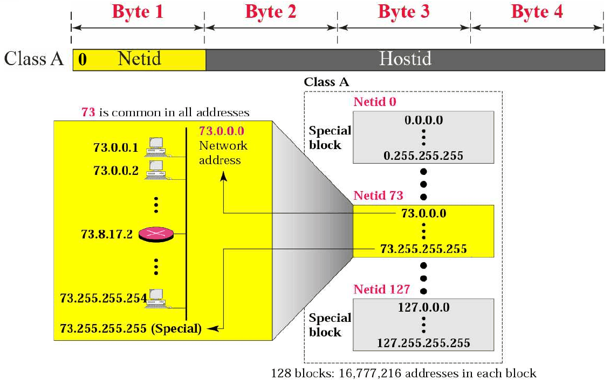

*Figure 6. The blocks of class A and the block with netid 73*

Figure 6 zooms into the class A block with netid 73. All its addresses share the first byte 73. The first address, 73.0.0.0, is the network address that identifies the block itself, and the last address, 73.255.255.255, is kept as a special address; the addresses in between, from 73.0.0.1 to 73.255.255.254, are given to hosts and routers.

### 4.5 Two-Level Addressing and Information Extraction

When classful addressing was designed, the Internet was seen as a network of networks: each organization created a network and received a block in class A, B, or C. Each address therefore has two levels, netid and hostid. If the netid has n bits, the hostid has 32 − n bits, where n is 8, 16, or 24 for classes A, B, and C.

```text
|<-------- n bits -------->|<------ (32 - n) bits ------>|
+--------------------------+-----------------------------+
|          netid           |           hostid            |
+--------------------------+-----------------------------+
|<----------------------- 32 bits ---------------------->|
                  Class A: n = 8   Class B: n = 16   Class C: n = 24
```

*Figure 7. Two-level addressing in classful addressing*

**Example 5.12.** Two-level addressing also appears in other systems. A telephone number in the United States consists of an area code and a local part: in (626) 3581301, the area code 626 can be compared with the netid and the local part 3581301 with the hostid.

> **Definition:** The **network address** of a block is its first address, the address whose host part is all 0s; it identifies the network itself and is the address that routers use to route a packet toward that network.

The range of addresses granted to an organization in classful addressing is a whole block in class A, B, or C, and the whole range can be inferred from the network address. Given any address in a block, three pieces of information can be extracted once the class, and hence n, is known.

```math
N = 2^{32-n}
```

- **Number of addresses:** N, as above.
- **First address:** keep the leftmost n bits and set the rightmost 32 − n bits to 0.
- **Last address:** keep the leftmost n bits and set the rightmost 32 − n bits to 1.

| Example | Given address | Class and n | Number of addresses | First address | Last address |
|:--|:--|:--|:--|:--|:--|
| 5.13 | 73.22.17.25 | A, n = 8 | $`2^{24}`$ = 16,777,216 | 73.0.0.0 | 73.255.255.255 |
| 5.14 | 180.8.17.9 | B, n = 16 | $`2^{16}`$ = 65,536 | 180.8.0.0 | 180.8.255.255 |
| 5.15 | 200.11.8.45 | C, n = 24 | $`2^{8}`$ = 256 | 200.11.8.0 | 200.11.8.255 |

*Table 9. Information extracted in Examples 5.13 to 5.15*

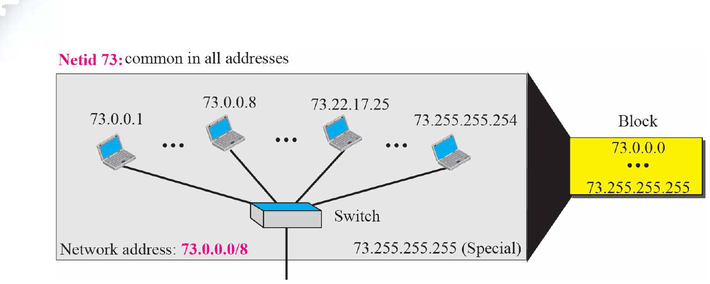

*Figure 8. A possible network that uses the block of Example 5.13*

Figure 8 shows a possible configuration for Example 5.13. The netid 73 is common to all addresses, the network address 73.0.0.0/8 identifies the whole network, and 73.255.255.255 is kept as a special address. The /8 written after the network address shows the length of the netid; the networks of Examples 5.14 and 5.15 are written 180.8.0.0/16 and 200.11.8.0/24 in the same way.

### 4.6 Network Addresses in a Sample Internet

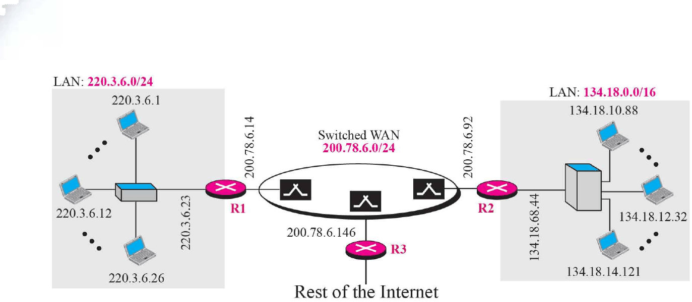

*Figure 9. A sample internet with three networks*

Figure 9 shows part of an internet with three networks:

1. a LAN with network address 220.3.6.0 (class C);
2. a LAN with network address 134.18.0.0 (class B);
3. a switched WAN with network address 200.78.6.0 (class C) that connects several routers; R1 connects it to the left LAN, R2 to the right LAN, and R3 to the rest of the Internet.

Each router has one address on each network it connects, such as 220.3.6.23 and 200.78.6.14 for R1. The network address is the identifier of a network: a router's table lists network addresses, not host addresses, and the router routes a packet by finding the network to which its destination belongs. A packet for 134.18.14.121, for example, is sent toward the network 134.18.0.0. A packet for 100.78.77.76 belongs to none of the three networks, so R1 or R2 sends it toward R3, the exit to the rest of the Internet, and the routers beyond continue the search. If a packet keeps wandering, its TTL eventually reaches zero and it is discarded (Chapter 11).

### 4.7 Network Mask

The methods above extract a network address conceptually. Routers use an algorithm instead: to route a packet to the correct network, a router must extract the network address from the destination address in the packet header, and it does so with a mask.

> **Definition:** A **default mask** (network mask) in classful addressing is a 32-bit number whose leftmost n bits are 1s and whose remaining 32 − n bits are 0s, where n is the netid length of the class.

| Class | Mask in binary | Dotted-decimal | Prefix |
|:--|:--|:--|:--|
| A | 11111111 00000000 00000000 00000000 | 255.0.0.0 | /8 |
| B | 11111111 11111111 00000000 00000000 | 255.255.0.0 | /16 |
| C | 11111111 11111111 11111111 00000000 | 255.255.255.0 | /24 |

*Table 10. Default masks of classes A, B, and C*

The network address is found by ANDing the destination address with the default mask. A mask bit 1 lets the address bit pass unchanged (X AND 1 = X), and a mask bit 0 clears it (X AND 0 = 0), so the result retains the netid of the block and sets the hostid to zero. Applying the mask to any address of the block, including the network address itself, gives the same network address.

**Example 5.16.** A router receives a packet with destination address 201.24.67.32. The first byte 201 shows class C, so the router applies the default mask 255.255.255.0. By the first short cut the result is 201.24.67.0.

```text
Destination address:   201 .  24 .  67 .  32
Default mask:          255 . 255 . 255 .   0
Network address:       201 .  24 .  67 .   0
```

### 4.8 Three-Level Addressing: Subnetting

Two-level addressing soon proved insufficient, for two reasons. An organization granted a class A or B block needed to divide its large network into several subnetworks for better security and management. In addition, since blocks in classes A and B were almost depleted and class C blocks were too small for most organizations, an organization with a class A or B block could divide it into smaller subblocks and share them.

> **Definition:** **Subnetting** is the division of a block of addresses into smaller blocks, called subnets, each with its own subnetwork address, by lengthening the network part of the address.

Subnetting adds a third level to the address. Part of the hostid becomes a subnetid, so an address consists of the site (netid), the subnetid, and the hostid. **Example 5.17** compares this with the telephone number (626) 358-1301, in which 626 is the area code, 358 the exchange, and 1301 the subscriber connection.

```text
a. Without subnetting:   |  141 . 14  |  192 . 2              |
                         |   Netid    |  Hostid               |

b. With subnetting:      |  141 . 14  |  192        |  . 192  |
                         |   Site     |  Subnetid   | Hostid  |
```

*Figure 10. An address without and with subnetting*

**Example 5.18.** Figure 11 shows a network with class B addresses before subnetting. It is one network of almost $`2^{16}`$ hosts, connected through a single connection to a router of the Internet; the /16 shows the length of the netid.

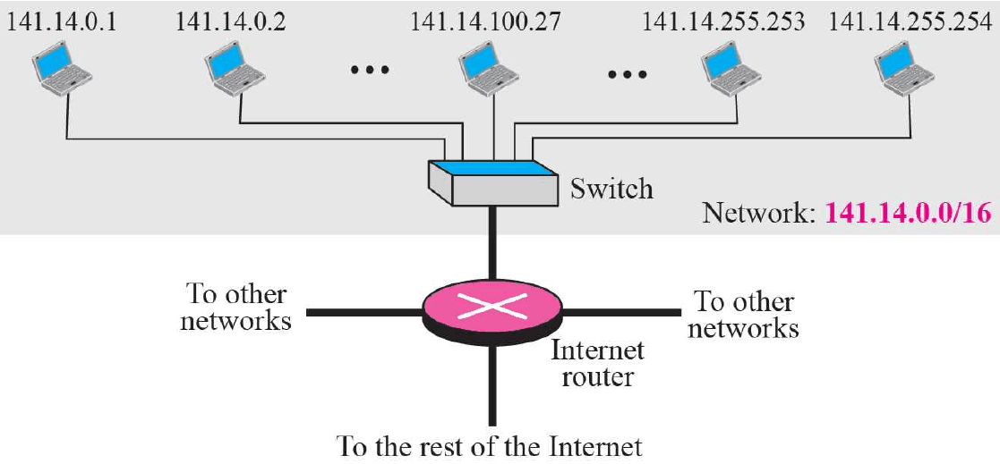

*Figure 11. A class B network before subnetting*

**Example 5.19.** Figure 12 shows the same network after subnetting. The whole network is still connected to the Internet through the same router, but it now uses a private site router to divide the network into four subnetworks. The rest of the Internet still sees one network, 141.14.0.0/16, while internally there are four subnetworks, each with almost $`2^{14}`$ hosts. Such a network could belong to a university campus with four schools in four buildings: each school has its own subnetwork, but the campus is a single network for the rest of the Internet. The /16 and /18 show the lengths of the netid and of the subnetids.

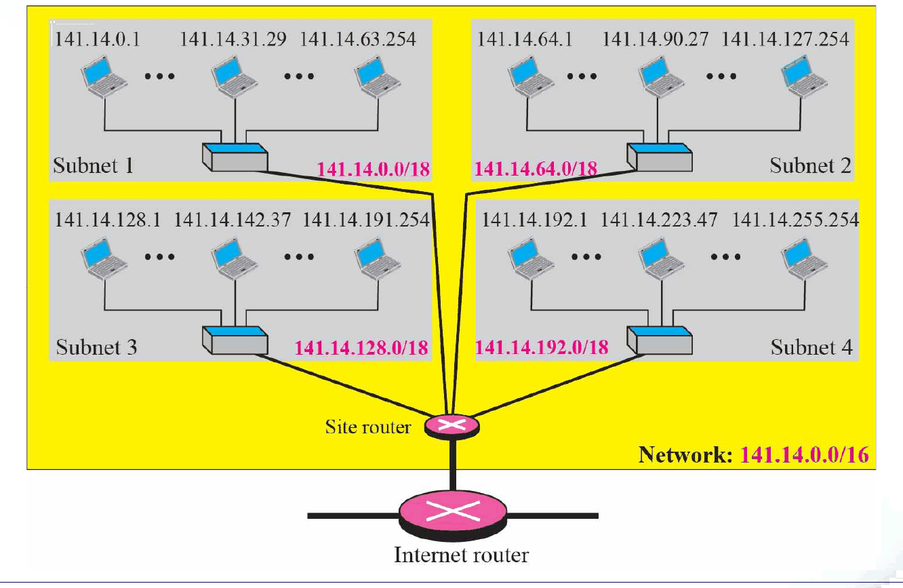

*Figure 12. The same class B network divided into four subnets*

Dividing into four requires 2 more bits of network part, since $`2^{2} = 4`$, which is why the subnets are /18. In general, the network mask (default mask) is used when a network is not subnetted, and a **subnet mask** is used for each subnetwork. Subnetting lengthens the netid into a subnetid and shortens the hostid.

```text
                 |<------- n bits ------->|<------ 32 - n bits ------>|
Network mask:    |         netid          |          hostid           |
                                    Change -->|
Subnetwork mask: |            subnetid              |      hostid     |
                 |<----------- n_i bits ----------->|<- 32 - n_i bits ->|
```

*Figure 13. The network mask and the subnetwork mask*

When a network is divided into s subnetworks of equal size, where s is a power of 2, the length of each subnetid is the following, with n the length of the netid.

```math
n_{\text{sub}} = n + \log_2 s
```

**Example 5.20.** In Example 5.19 a class B network is divided into four subnetworks. With n = 16, every subnet has $`n_{\text{sub}} = 16 + \log_2 4 = 18`$. The subnet mask has eighteen 1s and fourteen 0s, which is 255.255.192.0, different from the class B network mask 255.255.0.0.

When a network is subnetted, the first address of each subnet is the identifier of the subnet, and routers use it to route packets to that subnet. Given any address of a subnet, a router finds the subnet address by ANDing the address with the subnet mask. Applying the default mask instead gives the network address, as in Figure 14.

```text
a. Without subnetting:   141.14.72.24  AND  255.255.0.0    =  141.14.0.0   (network address)
b. With subnetting:      141.14.72.24  AND  255.255.192.0  =  141.14.64.0  (subnet address)
```

*Figure 14. The network address and the subnet address of the same address*

**Example 5.21.** One address of subnet 2 in Example 5.19 is 141.14.120.77. The first, second, and fourth bytes follow from the first short cut, and the third byte from the second short cut: 120 = 64 + 32 + 16 + 8 and 192 = 128 + 64, so 120 AND 192 = 64. The subnet address is 141.14.64.0.

```text
Address:          141 .  14 . 120 .  77
Mask:             255 . 255 . 192 .   0
Subnet address:   141 .  14 .  64 .   0
```

### 4.9 Supernetting

Subnetting could not solve the depletion of addresses, because most organizations did not want to share their blocks. Class C blocks were still available, but a single class C block was too small for most new organizations. One solution was supernetting.

> **Definition:** **Supernetting** is the combination of several contiguous class C blocks into one larger block, called a supernetwork, by shortening the network part of the address.

An organization that needs 1,000 addresses, for example, can be granted four class C blocks. A **supernet mask** is the reverse of a subnet mask: a subnet mask for class C has more 1s than the default mask, and a supernet mask for class C has fewer 1s. Dividing one class C block into 8 subblocks needs three more 1s ($`2^{3} = 8`$), and combining 8 class C blocks into one superblock needs three fewer 1s.

```text
Subnet mask:    11111111 11111111 11111111 11100000    n_sub   = 24 + 3 = 27   (divide 1 block into 8)
Default mask:   11111111 11111111 11111111 00000000    n       = 24
Supernet mask:  11111111 11111111 11111000 00000000    n_super = 24 - 3 = 21   (combine 8 blocks into 1)
```

*Figure 15. Subnet, default, and supernet masks for class C*

The number of class C blocks combined, c, must be a power of 2, and the length of the supernetid is the following.

```math
n_{\text{super}} = n - \log_2 c
```

Supernetting created two new problems. Because the number of blocks must be a power of 2, an organization that needed seven blocks had to be granted eight, which wasted addresses. And supernetting together with subnetting complicated the routing of packets in the Internet.

### 4.10 Problems of Classful Addressing

Classful addressing wasted a large part of the address space and could not adapt to the sizes of real organizations.

- **Fixed block sizes.** Only three block sizes existed, 256, 65,536, and 16,777,216 addresses. A class C (/24) network could accommodate at most $`2^{8} - 2 = 254`$ hosts, since two of its 256 addresses are reserved for special use (Section 7), which was too small for many organizations, while a class B (/16) network supported up to 65,534 hosts, which was too large.
- **Waste and depletion.** Kurose's example: an organization with 2,000 hosts was typically allocated a class B block, which leaves more than 63,000 addresses that no other organization could use. The class B space was rapidly depleted, while most class A addresses inside a granted block were never used and almost the whole class E block was reserved.
- **Limited remedies.** Subnetting and supernetting reduced the waste only partly and made the distribution of addresses and the routing process more complicated.

---

<br>

## 5. Classless Addressing

### 5.1 Variable-Length Blocks

The long-term solution to address depletion is a larger address space, which requires longer addresses and therefore a new packet format; this solution, IPv6, is the subject of Chapter 24. A short-term solution was also devised that keeps the same IPv4 address space but changes how addresses are distributed so that each organization gets a fair share. This solution still uses IPv4 addresses and is called classless addressing: the class privilege was removed from the distribution of addresses.

Another motivation came from Internet service providers. During the 1990s ISPs came into prominence. An ISP provides Internet access to individuals, small businesses, and midsize organizations that do not want to run their own Internet site. An ISP is granted a large range of addresses and subdivides it into groups of 1, 2, 4, 8, 16, and so on, giving a range to each household or small business, whose customers connect through a dial-up modem, DSL, or cable modem. Each customer needs some IPv4 addresses.

In classless addressing the whole address space is divided into nonoverlapping blocks of variable length that belong to no class. In theory a block can contain $`2^{0}, 2^{1}, 2^{2}, \ldots, 2^{32}`$ addresses. The only restriction is that the number of addresses in a block must be a power of 2.

```text
Address space:  |Block 1|  Block 2  | ... |Block i| Block i+1 | ... |Block m-1|Block m|
```

*Figure 16. Variable-length blocks in classless addressing*

The size of a block follows from the number of host bits, so choosing the number of addresses fixes the number of host bits, which in turn fixes the mask.

### 5.2 Prefix and Suffix

The two-level idea of classful addressing carries over. A classless block is divided into a prefix, which plays the role of the netid, and a suffix, which plays the role of the hostid. All addresses in a block have the same prefix, and each address has a different suffix.

```text
|<-------- n bits -------->|<------ (32 - n) bits ------>|
+--------------------------+-----------------------------+
|          Prefix          |           Suffix            |
|        (network)         |           (host)            |
+--------------------------+-----------------------------+
```

*Figure 17. Prefix and suffix of a classless address*

> **Definition:** **Classless addressing (CIDR)** is the IPv4 addressing architecture in which blocks have variable length, the network part (prefix) may have any length, and the number of addresses in a block is a power of 2.

Kurose calls the Internet's address assignment strategy classless interdomain routing (CIDR, pronounced "cider") and notes that it generalizes subnet addressing.

> **Definition:** The **prefix length** is the number of leftmost bits, n, that form the prefix of a classless address; the block then contains $`2^{32-n}`$ addresses.

In classless addressing the prefix defines the network and the suffix defines the host. The prefix length can be any value from 0 to 32, and the number of addresses in a block is inversely related to it: a small n means a large block, and a large n means a small block (**Example 5.24**). The two extremes are instructive.

- **Example 5.22.** If the whole Internet is one single block with 4,294,967,296 addresses, the prefix length is 0 and the suffix length is 32: all 32 bits vary to define $`2^{32}`$ hosts.
- **Example 5.23.** If the Internet is divided into 4,294,967,296 blocks of one address each, the prefix length is 32 and the suffix length is 0: all 32 bits are needed to define $`2^{32}`$ blocks, and the only address in each block is defined by the block itself.

### 5.3 Slash Notation

In classful addressing the netid length is inherent in the address: the class of an address gives the netid length of 8, 16, or 24. In classless addressing the prefix length cannot be found from a single address, because the address can belong to blocks with any prefix length. A block is therefore defined by one of its addresses together with the prefix length, written in **slash notation** (CIDR notation) as a.b.c.d/n.

```text
+------+---+------+---+------+---+------+---+-----+
| byte | . | byte | . | byte | . | byte | / |  n  |
+------+---+------+---+------+---+------+---+-----+
                                                 ^ prefix length
```

*Figure 18. Slash notation*

**Example 5.25.** The address 230.8.24.56 can belong to many blocks. The third byte, 24, is 00011000 in binary. With prefix length 20, the first 4 bits of the third byte are fixed (0001), so the third byte ranges from 00010000 = 16 to 00011111 = 31 and the fourth byte from 0 to 255. Table 11 lists the block for several prefix lengths.

| Prefix length | Block |
|:--|:--|
| 16 | 230.8.0.0 to 230.8.255.255 |
| 20 | 230.8.16.0 to 230.8.31.255 |
| 26 | 230.8.24.0 to 230.8.24.63 |
| 27 | 230.8.24.32 to 230.8.24.63 |
| 29 | 230.8.24.56 to 230.8.24.63 |
| 31 | 230.8.24.56 to 230.8.24.57 |

*Table 11. Blocks that contain 230.8.24.56 for several prefix lengths*

The prefix length also defines the mask: a mask of n 1s followed by 32 − n 0s. **Example 5.26** reads three addresses in slash notation.

| Address | Network mask | Prefix length | Suffix length |
|:--|:--|:--|:--|
| 12.23.24.78/8 | 255.0.0.0 (eight 1s, twenty-four 0s) | 8 | 24 |
| 130.11.232.156/16 | 255.255.0.0 (sixteen 1s, sixteen 0s) | 16 | 16 |
| 167.199.170.82/27 | 255.255.255.224 (twenty-seven 1s, five 0s) | 27 | 5 |

*Table 12. Masks of the addresses in Example 5.26*

> **Key Point:** In classless addressing, one address of the block and the prefix length are both needed to define the block.

### 5.4 Extracting Information from a Block

Given one address in a block and its prefix length n, the three pieces of information are found with the bitwise operations of Section 2.

1. **Number of addresses:** $`N = 2^{32-n}`$.
2. **First address:** AND the given address with the mask. It is the network address of the block.
3. **Last address:** OR the given address with the complement of the mask.

**Example 5.27.** One address of a block is 167.199.170.82/27. The mask has twenty-seven 1s and five 0s, 255.255.255.224, so the block has $`2^{32-27} = 2^{5} = 32`$ addresses. Only the fourth byte needs real work: 82 = 01010010.

```text
Address in binary:            10100111 11000111 10101010 01010010
Network mask:                 11111111 11111111 11111111 11100000
First address (AND):          10100111 11000111 10101010 01000000   = 167.199.170.64

Address in binary:            10100111 11000111 10101010 01010010
Complement of network mask:   00000000 00000000 00000000 00011111
Last address (OR):            10100111 11000111 10101010 01011111   = 167.199.170.95
```

The first 27 bits are kept; only the last 5 bits vary, so the block runs from 167.199.170.64/27 to 167.199.170.95/27.

**Example 5.28.** One address of a block is 17.63.110.114/24. The mask is 255.255.255.0 and the block has $`2^{32-24}`$ = 256 addresses. By the first short cut, the first address is 17.63.110.0/24 and the last address, ORing with the complement 0.0.0.255, is 17.63.110.255/24.

**Example 5.29.** One address of a block is 110.23.120.14/20. The mask is 255.255.240.0 and the block has $`2^{32-20}`$ = 4,096 addresses. The first short cut handles bytes 1, 2, and 4, and the second short cut handles byte 3.

```text
                       Byte 1   Byte 2   Byte 3   Byte 4
Address:                  110       23      120       14
Network mask:             255      255      240        0
First address (AND):      110       23      112        0      (120 AND 240 = 64+32+16 = 112)

Address:                  110       23      120       14
Complement of mask:         0        0       15      255
Last address (OR):        110       23      127      255      (120 OR 15 = 112+15 = 127)
```

The block runs from 110.23.112.0/20 to 110.23.127.255/20.

### 5.5 Block Allocation

Address allocation is the responsibility of a global authority, the Internet Corporation for Assigned Names and Numbers (ICANN). ICANN usually assigns a large block to an ISP, which distributes it to its users (Section 6). Classless interdomain routing imposes three restrictions on an allocated block.

1. The number of requested addresses, N, must be a power of 2.
2. The prefix length follows from the number of addresses.

```math
N = 2^{32-n} \quad\Longleftrightarrow\quad n = 32 - \log_2 N
```

3. The block must be allocated where there is a contiguous range of unallocated addresses, and its first address must be divisible by N, so that the first address is a network address whose suffix bits are all 0.

**Example 5.30.** An ISP requests a block of 1,000 addresses.

- Since 1,000 is not a power of 2, 1,024 = $`2^{10}`$ addresses are granted; the suffix length is 10.
- The prefix length is $`n = 32 - \log_2 1024 = 22`$.
- The beginning address is chosen as 18.14.12.0, which is divisible by 1,024.

The granted block is 18.14.12.0/22; its first address is 18.14.12.0/22 and its last address is 18.14.15.255/22. A useful way to see it: the 1,024 addresses form a neighborhood whose third byte runs from 12 to 15 and whose fourth byte runs over all 256 values, and a router can tell whether a destination lives in this neighborhood by checking its first 22 bits.

### 5.6 Relation to Classful Addressing

Classful addressing is a special case of classless addressing. A classful block is a classless block whose prefix length is fixed by its class.

| Class | Prefix length | Class | Prefix length |
|:--|:--|:--|:--|
| A | /8 | D | /4 |
| B | /16 | E | /4 |
| C | /24 | | |

*Table 13. Prefix lengths of the classful blocks*

Classes D and E each form one block with the fixed 4 leading bits 1110 and 1111, which is why their prefix length is 4.

### 5.7 Subnetting a Classless Block

When an organization is granted a block, it can create subnets to meet its needs; the prefix length increases to define the subnet prefix length. A subnet design must satisfy three conditions.

1. The number of addresses in each subnet must be a power of 2.
2. The prefix length of each subnet follows from the formula below, where N is the total number of addresses granted, n the prefix length of the block, and $`N_{\text{sub}}`$ the number of addresses assigned to the subnet.
3. Addresses are assigned to the larger subnets first, and the first address of each subnet must be divisible by the number of addresses in that subnet.

```math
n_{\text{sub}} = n + \log_2 \frac{N}{N_{\text{sub}}}
```

The restrictions on allocating addresses to a subnet are parallel to those for allocating addresses to a network (Section 5.5). For example, dividing a block into 16 equal parts adds 4 bits to the prefix, since each part has N/16 addresses.

**Example 5.32 (equal subnets).** An organization is granted 130.34.12.64/26 and needs four subnets with an equal number of hosts. The block has $`N = 2^{32-26} = 64`$ addresses, from 130.34.12.64/26 to 130.34.12.127/26. Each subnet receives 16 addresses (64/16 is a power of 2), so each subnet prefix is $`26 + \log_2 (64/16) = 28`$, that is, 2 more bits. The subnets are allocated from the first available address, and each starting address is divisible by 16.

```text
                     N = 64 addresses, n = 26
130.34.12.64/26 |------------------------------------------| 130.34.12.127/26

     N = 16         N = 16          N = 16          N = 16
|--- n = 28 ---|--- n = 28 ---|--- n = 28 ---|--- n = 28 ---|
130.34.12.64/28 130.34.12.80/28 130.34.12.96/28 130.34.12.112/28 ... 130.34.12.127/28
```

*Figure 19. The four equal subnets of Example 5.32*

**Example 5.33 (variable-length subnets).** An organization is granted the block beginning at 14.24.74.0/24, which has $`2^{32-24}`$ = 256 addresses, from 14.24.74.0/24 to 14.24.74.255/24. It needs three subblocks of 120, 60, and 10 addresses. None of these is a power of 2, so each is rounded up, and the largest is allocated first.

| Subblock | Requested | Allocated | Prefix length | First address | Last address |
|:--|:--|:--|:--|:--|:--|
| a | 120 | 128 | 24 + log₂(256/128) = 25 | 14.24.74.0/25 | 14.24.74.127/25 |
| b | 60 | 64 | 24 + log₂(256/64) = 26 | 14.24.74.128/26 | 14.24.74.191/26 |
| c | 10 | 16 | 24 + log₂(256/16) = 28 | 14.24.74.192/28 | 14.24.74.207/28 |

*Table 14. The three variable-length subblocks of Example 5.33*

The three subblocks use 128 + 64 + 16 = 208 addresses, so 48 addresses, from 14.24.74.208 to 14.24.74.255, are left in reserve. Viewed as a pie, the 256 addresses are halved for the first subnet (1 more prefix bit), a quarter goes to the second (2 more bits), and a sixteenth to the third (4 more bits).

```text
                         N = 256 addresses, n = 24
14.24.74.0/24 |----------------------------------------------------------| 14.24.74.255/24

         N = 128                       N = 64          16      48
|--------- n = 25 ----------|------- n = 26 ------|n = 28|-- unused --|
14.24.74.0/25                14.24.74.128/26       14.24.74.192/28
```

*Figure 20. The variable-length subblocks of Example 5.33*

**Example 5.34 (a company with three offices).** A company has three offices, Central, East, and West. The Central office is connected to the East and West offices by private WAN lines. The company is granted a block of 64 addresses beginning at 70.12.100.128/26, and the management allocates 32 addresses to the Central office and divides the rest between the other two offices.

| Office | Addresses | Prefix length | Range |
|:--|:--|:--|:--|
| Central | 32 | 26 + log₂(64/32) = 27 | 70.12.100.128/27 to 70.12.100.159/27 |
| East | 16 | 26 + log₂(64/16) = 28 | 70.12.100.160/28 to 70.12.100.175/28 |
| West | 16 | 26 + log₂(64/16) = 28 | 70.12.100.176/28 to 70.12.100.191/28 |

*Table 15. Allocation of Example 5.34*

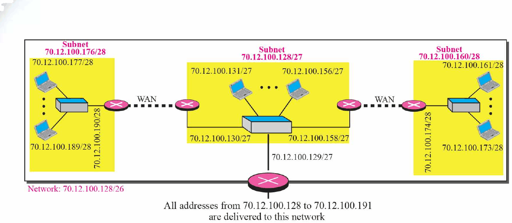

*Figure 21. The configuration of Example 5.34*

The Central office uses three of its addresses for its routers and reserves the last address of its subblock; the East and West offices each use one address for a router and reserve their last address. The company uses no addresses for the point-to-point WAN links. All addresses from 70.12.100.128 to 70.12.100.191 are delivered to this network from the outside.

### 5.8 A Hierarchy of Allocations

**Example 5.35.** An ISP is granted the block starting at 190.100.0.0/16, with 65,536 addresses. It must distribute addresses to three groups of customers: 64 customers that each need about 256 addresses, 128 customers that each need about 128 addresses, and 128 customers that each need about 64 addresses. The design has two levels. In the first step, the ISP allocates one subblock to each group.

| Group | Addresses for the group | Prefix length | Subblock |
|:--|:--|:--|:--|
| 1 | 64 × 256 = 16,384 | 16 + log₂(65,536/16,384) = 18 | 190.100.0.0/18 to 190.100.63.255/18 |
| 2 | 128 × 128 = 16,384 | 16 + log₂(65,536/16,384) = 18 | 190.100.64.0/18 to 190.100.127.255/18 |
| 3 | 128 × 64 = 8,192 | 16 + log₂(65,536/8,192) = 19 | 190.100.128.0/19 to 190.100.159.255/19 |

*Table 16. First level of the hierarchy in Example 5.35*

The three groups use 40,960 addresses, so 24,576 addresses, from 190.100.160.0 to 190.100.255.255, remain unassigned for future customers. In the second step, each group's subblock is divided among its customers.

| Group | Customer prefix | First customer | Last customer |
|:--|:--|:--|:--|
| 1 | 18 + log₂(16,384/256) = 24 | Customer 001: 190.100.0.0/24 | Customer 064: 190.100.63.0/24 |
| 2 | 18 + log₂(16,384/128) = 25 | Customer 001: 190.100.64.0/25 | Customer 128: 190.100.127.128/25 |
| 3 | 19 + log₂(8,192/64) = 26 | Customer 001: 190.100.128.0/26 | Customer 128: 190.100.159.192/26 |

*Table 17. Second level of the hierarchy in Example 5.35*

Each customer uses the first address of its subblock as the subnet address and reserves the last address as a special address. The rest of the Internet needs only one entry, 190.100.0.0/16, to reach any of these 320 customers; this is the benefit that Section 6 calls aggregation.

---

<br>

## 6. Obtaining and Aggregating Address Blocks

### 6.1 Blocks from an ISP and from ICANN

To obtain a block of addresses for its subnets, a network administrator usually contacts its ISP, which provides addresses from a larger block already allocated to the ISP. In Kurose's example, an ISP has been allocated 200.23.16.0/20 and divides it into eight equal contiguous blocks of /23, one for each of up to eight organizations.

| Owner | Block | Binary (prefix bits before the space at the end) |
|:--|:--|:--|
| ISP | 200.23.16.0/20 | 11001000 00010111 0001 0000 00000000 |
| Organization 0 | 200.23.16.0/23 | 11001000 00010111 0001000 0 00000000 |
| Organization 1 | 200.23.18.0/23 | 11001000 00010111 0001001 0 00000000 |
| Organization 2 | 200.23.20.0/23 | 11001000 00010111 0001010 0 00000000 |
| ... | ... | ... |
| Organization 7 | 200.23.30.0/23 | 11001000 00010111 0001111 0 00000000 |

*Table 18. An ISP's /20 block divided among eight organizations*

The ISP itself gets its block from the global authority. IP addresses are managed under the authority of ICANN, a nonprofit organization that also manages the DNS root servers (Chapter 5) and assigns domain names. ICANN allocates addresses to regional Internet registries, such as ARIN, RIPE, APNIC, and LACNIC, which allocate and manage addresses within their regions.

### 6.2 Address Aggregation

> **Definition:** **Address aggregation** (route aggregation or route summarization) is the use of a single prefix to advertise many networks whose addresses lie in that prefix.

Hierarchical allocation makes aggregation possible. In Figure 22, the ISP of Table 18, which Kurose calls Fly-By-Night-ISP, advertises to the outside world that it should be sent any datagram whose first 20 address bits match 200.23.16.0/20. The rest of the world need not know that this block contains eight organizations, each with its own subnets.

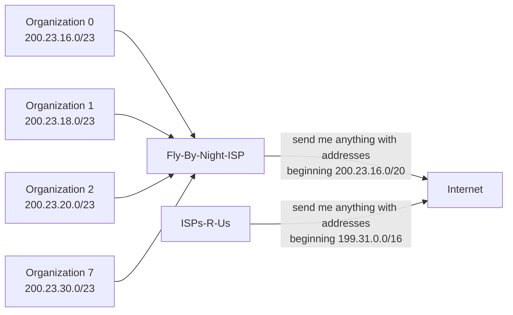

*Figure 22. Hierarchical addressing and route aggregation*

Aggregation works best when addresses are allocated in blocks to ISPs and then from ISPs to organizations. Suppose Fly-By-Night-ISP acquires another ISP, ISPs-R-Us, whose block is 199.31.0.0/16, and Organization 1 now connects to the Internet through ISPs-R-Us. Renumbering all of Organization 1's routers and hosts would be costly, so Organization 1 usually keeps its block 200.23.18.0/23. Fly-By-Night-ISP continues to advertise 200.23.16.0/20, and ISPs-R-Us advertises both 199.31.0.0/16 and the more specific block 200.23.18.0/23.

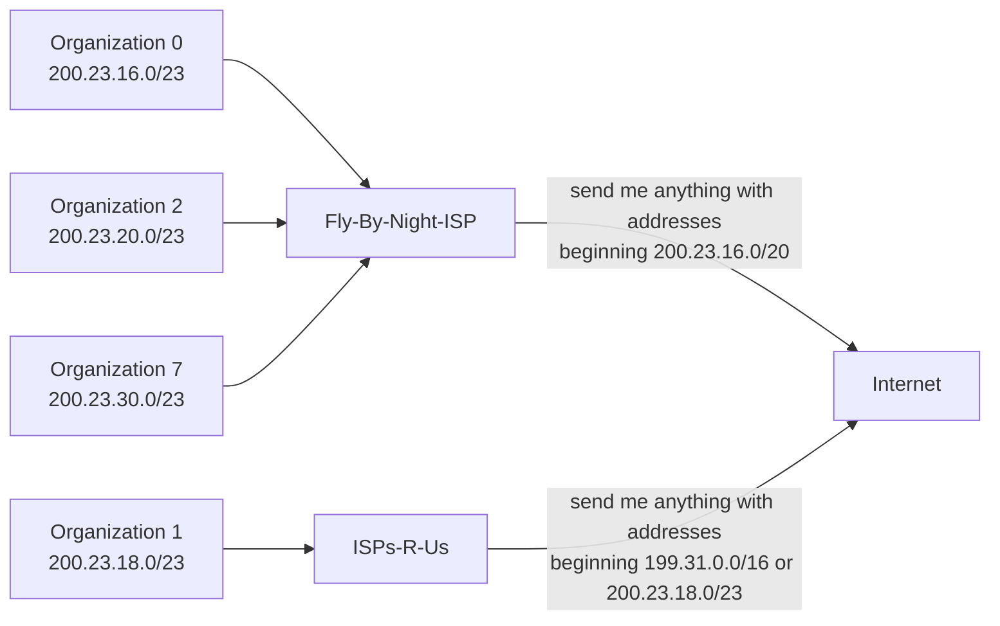

*Figure 23. ISPs-R-Us has a more specific route to Organization 1*

A router in the Internet that must forward a datagram to an address in 200.23.18.0/23 sees two matching blocks, 200.23.16.0/20 and 200.23.18.0/23. It uses longest prefix matching and forwards toward ISPs-R-Us, which advertises the longest, most specific matching prefix. Chapter 13 studies longest prefix matching and aggregation in forwarding tables in detail.

> **Key Point:** Routers outside an organization consider only the leading prefix bits of its addresses, so a single entry a.b.c.d/x is enough to forward packets to any destination in the organization. This is what keeps forwarding tables in the Internet small.

---

<br>

## 7. Special Addresses

In classful addressing some addresses were reserved for special purposes, and classless addressing inherits some of them. There are two kinds: special blocks, and special addresses inside each block.

### 7.1 Special Blocks

**All-zeros address.** The block 0.0.0.0/32, which contains a single address, is reserved for communication when a host needs to send an IPv4 packet but does not know its own address. A host uses it at bootstrap time: it sends a packet to a DHCP server (Section 8) with 0.0.0.0 as the source address and the limited broadcast address as the destination address, to find its own address. A DHCP server is the server that assigns addresses, and DHCP is an application-layer protocol.

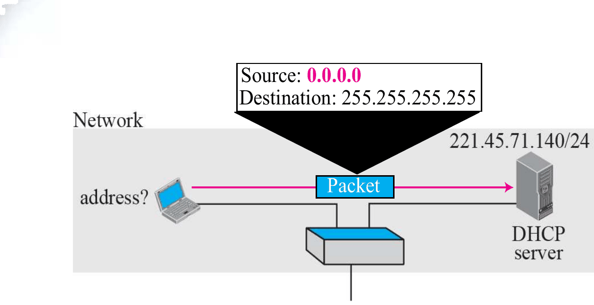

*Figure 24. Example of using the all-zeros address*

> **Definition:** The **limited broadcast address** is the single address 255.255.255.255, used as a destination to send a packet to every host on the current network; routers do not forward such a packet.

**All-ones address.** The block 255.255.255.255/32 is reserved for the limited broadcast address. A host that wants to send a message to every other host on its network uses it as the destination address, and every device on the network receives and processes the packet. A router blocks the packet, which confines the broadcast to the local network: a packet sent to this address never leaves the network.

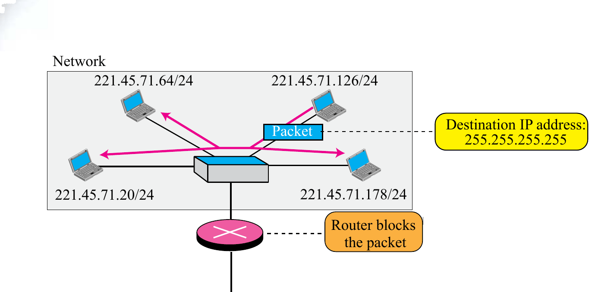

*Figure 25. Example of the limited broadcast address*

> **Definition:** A **loopback address** is an address in the block 127.0.0.0/8 that delivers a packet back to the sending machine's own protocol software without the packet leaving the machine.

**Loopback addresses.** The block 127.0.0.0/8 is used to test the software on a machine. A packet sent to an address 127.x.y.z never leaves the machine; it returns to the protocol software. An application such as ping can send a packet to a loopback address to test whether the IPv4 software can receive and process packets, and a client process can use a loopback address to send a message to a server process on the same machine, as in Figure 26. A loopback address can be used only as a destination address.

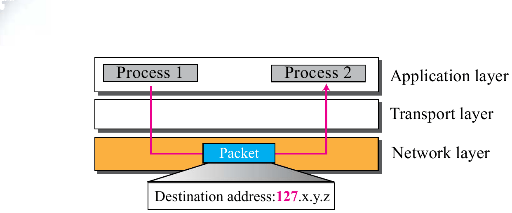

*Figure 26. Example of a loopback address*

> **Definition:** A **private address** is an address from a block reserved for private networks, which can be used freely inside a network but is not recognized globally and is never routed in the public Internet.

**Private addresses.** Several blocks are assigned for private use. They are used either in isolation or together with network address translation (Section 9). RFC 1918 reserves the three blocks of Table 19 [1]. The block 192.168.0.0/16 is often used in home networks, and Kurose's home-network example in Section 9.4 uses 10.0.0.0/24.

| Block | Range | Number of addresses |
|:--|:--|:--|
| 10.0.0.0/8 | 10.0.0.0 to 10.255.255.255 | 16,777,216 |
| 172.16.0.0/12 | 172.16.0.0 to 172.31.255.255 | 1,048,576 |
| 192.168.0.0/16 | 192.168.0.0 to 192.168.255.255 | 65,536 |

*Table 19. Blocks reserved for private networks*

> **Note:** Forouzan's table of private addresses also lists 169.254.0.0/16. This block is the IPv4 link-local block: a host can configure an address in it by itself, and such an address is valid only for communication with devices on the same link [2].

**Multicast addresses.** The block 224.0.0.0/4, formerly class D, is reserved for multicast communication (Chapter 16).

### 7.2 Special Addresses in Each Block

It is recommended, though not mandatory, that two addresses of each block be used as special addresses and not be assigned to any host. If a block or subblock is very small, however, it cannot afford to give up these addresses.

- **Network address.** The first address of a block, whose suffix bits are all 0s, defines the network itself (the cabling) and not any host (Section 4.5). The first address of a subnet is the subnet address and plays the same role.
- **Directed broadcast address.** The last address of a block, whose suffix bits are all 1s, is used to send a packet to all hosts in a specific network.

> **Definition:** A **directed broadcast address** is the last address of a block, whose suffix bits are all 1s; a packet sent to it is delivered to every host of that specific network.

A router usually uses a directed broadcast address to send a packet to all hosts in a specific network, and all hosts accept a packet with this destination. It can be used only as a destination address. In Figure 27, the router sends a datagram to 221.45.71.255: the prefix 221.45.71 specifies the network 221.45.71.0/24 and the suffix of all 1s means every host on it.

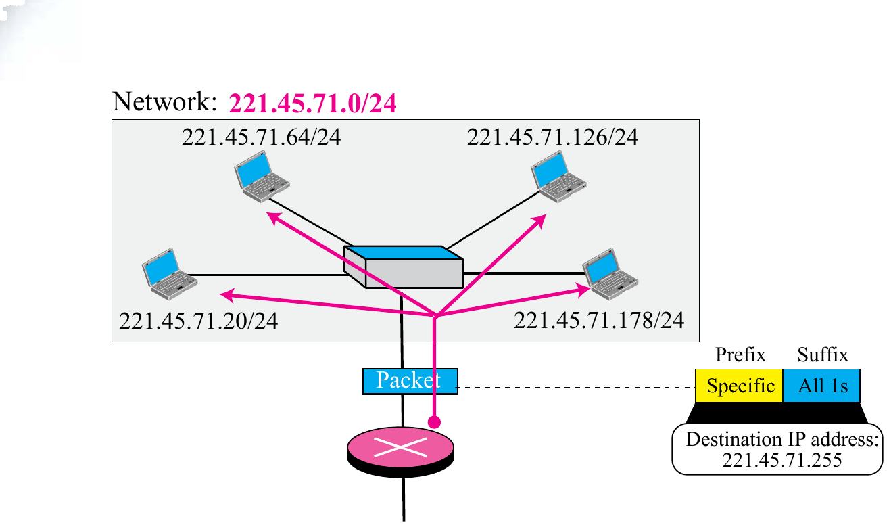

*Figure 27. Example of a directed broadcast address*

Within a block such as 221.45.71.0/24, keeping the prefix and setting the 8 suffix bits to all 0s (00000000) gives the network address 221.45.71.0, and setting them to all 1s (11111111) gives the directed broadcast address 221.45.71.255. The limited broadcast address differs in scope: it reaches only the sender's own network, whereas a directed broadcast can be sent from outside toward a specific network.

| Address | Meaning | Use |
|:--|:--|:--|
| 0.0.0.0 | This host, address unknown | Source only, at bootstrap |
| 255.255.255.255 | Limited broadcast | Destination only, current network |
| 127.x.y.z | Loopback | Destination only, same machine |
| 10/8, 172.16/12, 192.168/16 | Private | Inside private networks |
| 224.0.0.0/4 | Multicast | Destination of a group |
| Suffix all 0s | Network address | Identifies a network |
| Suffix all 1s | Directed broadcast | Destination only, all hosts of a network |

*Table 20. Special addresses*

### 7.3 Quick Reference for Prefix Lengths

The table below lists, for common prefix lengths, the mask, the number of addresses, and the number of addresses left for hosts when the network address and the directed broadcast address are reserved. For a /31 block, which has only two addresses, RFC 3021 allows both to be used on a point-to-point link, where no broadcast address is needed [3]. A /32 block is a single address.

| Prefix | Mask | Addresses | Usable host addresses |
|:--|:--|:--|:--|
| /8 | 255.0.0.0 | 16,777,216 | 16,777,214 |
| /16 | 255.255.0.0 | 65,536 | 65,534 |
| /24 | 255.255.255.0 | 256 | 254 |
| /25 | 255.255.255.128 | 128 | 126 |
| /26 | 255.255.255.192 | 64 | 62 |
| /27 | 255.255.255.224 | 32 | 30 |
| /28 | 255.255.255.240 | 16 | 14 |
| /29 | 255.255.255.248 | 8 | 6 |
| /30 | 255.255.255.252 | 4 | 2 |
| /31 | 255.255.255.254 | 2 | 2 (point-to-point link) |
| /32 | 255.255.255.255 | 1 | 1 (a single address) |

*Table 21. Mask, number of addresses, and usable host addresses by prefix length*

---

<br>

## 8. DHCP

### 8.1 What a Host Needs to Know

Once an organization has a block of addresses, it assigns individual addresses to the host and router interfaces. Router addresses are usually configured manually by a system administrator. Host addresses can also be configured manually, but usually a protocol does it. A computer that uses TCP/IP normally needs four pieces of information:

1. its own IP address;
2. its subnet mask;
3. the IP address of a router (the default router, often called the default gateway);
4. the IP address of a name server (the local DNS server, Chapter 5).

These could be stored in a configuration file, but a diskless computer or a computer booted for the first time cannot have them, and the information cannot be stored in ROM by the manufacturer because it depends on the network to which the machine is connected.

> **Definition:** The **Dynamic Host Configuration Protocol** (DHCP) is a client-server protocol that automatically provides a host with an IP address, subnet mask, default router address, and name server address.

Because DHCP automates the network-related aspects of connecting a host, it is often called a plug-and-play or zeroconf (zero-configuration) protocol. It is widely used in residential access networks, enterprise networks, and wireless LANs, where hosts join and leave frequently. A student who carries a laptop from a dormitory to a library to a classroom connects to a new subnet, and needs a new address, at each place; DHCP handles this without any manual configuration. DHCP runs over UDP and is therefore an application-layer protocol, although its purpose is to configure the network layer.

### 8.2 Previous Protocols

- **RARP.** At the beginning of the Internet, the Reverse Address Resolution Protocol provided the IP address for a booted computer. It was a version of ARP (Chapter 19): ARP maps an IP address to a physical address, and RARP maps a physical address to an IP address. RARP is deprecated for two reasons: it used the broadcast service of the data link layer, so a RARP server had to be present on each network, and it could provide only the IP address, not all four pieces of information.
- **BOOTP.** The Bootstrap Protocol, the predecessor of DHCP, is a client-server protocol that overcame both deficiencies: its server can be anywhere in the Internet, and it can provide all four pieces of information. BOOTP, however, is a static configuration protocol. Its server looks up the client's physical address in a table that binds it to a predetermined IP address. It cannot handle a host that moves to another network or a host that wants a temporary address.

DHCP is the successor of BOOTP and is backward compatible with it. It adds dynamic allocation of temporary addresses.

### 8.3 The Four Steps of DHCP

In the simplest case each subnet has a DHCP server. For a newly arriving host, DHCP is a four-step process. Figure 28 and Table 22 show the exchange between a server at 223.1.2.5 and an arriving client. The field yiaddr ("your Internet address") carries the address being allocated to the client.

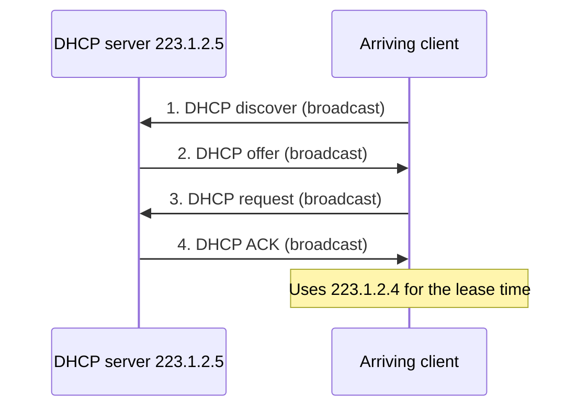

*Figure 28. DHCP client-server interaction*

| Message | Source (IP, port) | Destination (IP, port) | yiaddr | Transaction ID | Other fields |
|:--|:--|:--|:--|:--|:--|
| DHCP discover | 0.0.0.0, 68 | 255.255.255.255, 67 | 0.0.0.0 | 654 | |
| DHCP offer | 223.1.2.5, 67 | 255.255.255.255, 68 | 223.1.2.4 | 654 | Server ID 223.1.2.5, lifetime 3600 s |
| DHCP request | 0.0.0.0, 68 | 255.255.255.255, 67 | 223.1.2.4 | 655 | Server ID 223.1.2.5, lifetime 3600 s |
| DHCP ACK | 223.1.2.5, 67 | 255.255.255.255, 68 | 223.1.2.4 | 655 | Server ID 223.1.2.5, lifetime 3600 s |

*Table 22. Fields of the four DHCP messages in Figure 28*

1. **DHCP server discovery.** The client sends a DHCP discover message in a UDP segment to port 67. It knows neither the address of the network it is joining nor the address of a DHCP server, so it uses the limited broadcast address 255.255.255.255 as the destination and the "this host" address 0.0.0.0 as the source. The link layer broadcasts the frame to all nodes on the subnet.
2. **DHCP server offers.** A DHCP server that receives the discover message responds with a DHCP offer message, also broadcast to 255.255.255.255, because the client does not yet have an address at which it could receive a unicast datagram. The offer contains the transaction ID of the discover message, the proposed IP address, the network mask, and the **lease time**. Several servers may be present on the subnet, so the client may receive several offers.
3. **DHCP request.** The client chooses one offer and responds with a DHCP request message that echoes back the configuration parameters.
4. **DHCP ACK.** The server responds with a DHCP ACK message that confirms the requested parameters. The client can now use the address for the lease time.

> **Definition:** The **lease time** is the period for which an address allocated by DHCP is valid; the client must renew the lease or stop using the address when it expires.

Servers commonly set the lease time to several hours or days. The request in step 3 is also broadcast, even though the client knows the server it chose. Several servers may have made offers, and the broadcast request carries the identifier of the selected server, so the servers that were not selected learn that the client declined their offers and can release the addresses they offered [4]. The broadcast request is therefore what lets DHCP work correctly when two or more DHCP servers are present.

> **Note:** Forouzan notes that a server may answer with either a broadcast or a unicast message. A unicast reply is possible because the server knows the client's physical address from its request and need not use ARP, but some systems do not allow ARP to be bypassed and therefore use broadcast. Kurose's figure shows the broadcast case.

### 8.4 Client and Server on Different Networks

A client may be on one network and the server on another, separated by several networks. The request is broadcast because the client does not know the server's address, but a broadcast IP datagram cannot pass through a router: an address of all 1s is a limited broadcast address, and a router discards such a packet.

> **Definition:** A **relay agent** is a host or router on the client's network that knows the unicast address of a DHCP server, listens for broadcast DHCP messages on port 67, and forwards them to the server as unicast datagrams.

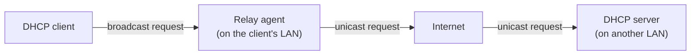

*Figure 29. A relay agent between a client and a server on different networks*

The packet that the relay agent sends carries a unicast destination address, so any router can route it to the server. The server knows that the message came from a relay agent because a field of the request holds the relay agent's IP address, and it sends its reply to the relay agent, which passes it on to the client. Kurose notes that the relay agent is typically a router. In this way a network with no DHCP server of its own can obtain addresses from a server on a neighboring network.

### 8.5 UDP Ports, TFTP, and Error Control

The server uses the well-known port 67, which is normal. The client also uses a well-known port, 68, which is unusual: clients normally use ephemeral ports. The reason is the broadcast reply. Suppose host A runs a DHCP client on ephemeral port 2017 and host B on the same network happens to run a DAYTIME client on the same ephemeral port 2017. A broadcast reply to port 2017 would be delivered by both hosts, so a DHCP message would reach the DAYTIME client of host B. Using port 68, a well-known port below 1024, prevents this, since no host can choose 68 as an ephemeral port. If two hosts both run DHCP clients, both receive the broadcast reply, and the **transaction ID**, chosen at random for each exchange, tells each client whether the reply is its own; two hosts are very unlikely to choose the same ID at the same time.

The server does not send all the information a client may need for booting. Its reply can give the pathname of a file that holds the complete booting information, and the client retrieves that file with TFTP (Chapter 4), also over UDP.

DHCP runs over UDP, which provides no error control, so DHCP provides its own in two ways.

1. DHCP requires UDP to use its checksum, which is otherwise optional (Chapter 6).
2. The client uses timers and retransmits a request if no reply arrives. To prevent a traffic jam when many hosts retransmit at the same time, for example after a power failure, DHCP makes each client use a random number to set its timers.

### 8.6 Packet Format

```text
 0 1 2 3 4 5 6 7 8 9 0 1 2 3 4 5 6 7 8 9 0 1 2 3 4 5 6 7 8 9 0 1
+---------------+---------------+---------------+---------------+
| Operation code| Hardware type |Hardware length|   Hop count   |
+---------------+---------------+---------------+---------------+
|                         Transaction ID                        |
+-------------------------------+-------------------------------+
|       Number of seconds       |             Flags             |
+-------------------------------+-------------------------------+
|                       Client IP address                       |
+---------------------------------------------------------------+
|                        Your IP address                        |
+---------------------------------------------------------------+
|                       Server IP address                       |
+---------------------------------------------------------------+
|                       Gateway IP address                      |
+---------------------------------------------------------------+
|               Client hardware address (16 bytes)              |
+---------------------------------------------------------------+
|                     Server name (64 bytes)                    |
+---------------------------------------------------------------+
|                   Boot file name (128 bytes)                  |
+---------------------------------------------------------------+
|                   Options (variable length)                   |
+---------------------------------------------------------------+
```

*Figure 30. Format of a DHCP packet*

| Field | Name in RFC 2131 | Size | Meaning |
|:--|:--|:--|:--|
| Operation code | op | 1 byte | Request (1) or reply (2) |
| Hardware type | htype | 1 byte | Type of physical network, 1 for Ethernet |
| Hardware length | hlen | 1 byte | Length of the physical address, 6 for Ethernet |
| Hop count | hops | 1 byte | Set to 0 by the client; relay agents may use it when the message is relayed |
| Transaction ID | xid | 4 bytes | Set by the client and returned by the server to match replies with requests |
| Number of seconds | secs | 2 bytes | Seconds elapsed since the client began acquiring or renewing its address |
| Flags | flags | 2 bytes | Only the leftmost bit is used: 1 forces a broadcast reply |
| Client IP address | ciaddr | 4 bytes | The client's address if it has one, otherwise 0 |
| Your IP address | yiaddr | 4 bytes | The address assigned to the client, filled by the server |
| Server IP address | siaddr | 4 bytes | The server's address, filled by the server |
| Gateway IP address | giaddr | 4 bytes | The address of a router; in a relayed message, the relay agent's address |
| Client hardware address | chaddr | 16 bytes | The physical address of the client |
| Server name | sname | 64 bytes | Optional domain name of the server |
| Boot file name | file | 128 bytes | Optional full pathname of the boot file |
| Options | options | Variable | Additional information such as the mask and default router |

*Table 23. Fields of a DHCP packet*

The field names in the second column are those of the DHCP specification [4], and the meanings of the hop count and number of seconds follow it; Forouzan describes the hop count as the maximum number of hops the packet can travel and the number of seconds as the time since the client started to boot. The flag exists because a client without an address may discard a unicast datagram addressed to the address it is being assigned; setting the bit asks the server to broadcast. The options field begins with a number called the magic cookie, written like an IP address as 99.130.83.99, and continues with options in tag-length-value form, such as tag 1 (subnet mask), tag 3 (default router), and tag 6 (DNS server). Tag 53 carries the DHCP message type: 1 DHCPDISCOVER, 2 DHCPOFFER, 3 DHCPREQUEST, 4 DHCPDECLINE, 5 DHCPACK, 6 DHCPNAK, 7 DHCPRELEASE, and 8 DHCPINFORM.

### 8.7 Static and Dynamic Allocation

DHCP provides both static and dynamic address allocation.

- **Static allocation.** The server has a database that statically binds physical addresses to IP addresses. In this mode DHCP behaves like BOOTP.
- **Dynamic allocation.** The server has a second database, a pool of available addresses. When a client requests a temporary address, the server takes an unused address from the pool and assigns it for a negotiable period.

When a request arrives, the server first checks its static database; if the client's physical address is there, the permanent address is returned. Otherwise the server selects an address from the pool, assigns it, and adds the binding to the dynamic database. The addresses from the pool are temporary: the server issues a lease for a specific period, and when the lease expires the client must stop using the address or renew the lease. The server may agree or disagree with a renewal. Because a dynamically allocated address can change, the DNS records of the host must change with it: in dynamic DNS (DDNS), when a binding between a name and an address is determined, the information is sent, usually by DHCP, to a primary DNS server, which updates its zone (Chapter 5).

### 8.8 Transition States

For dynamic allocation the DHCP client acts as a state machine that moves between states according to the messages it sends and receives. Figure 31 shows the main states.

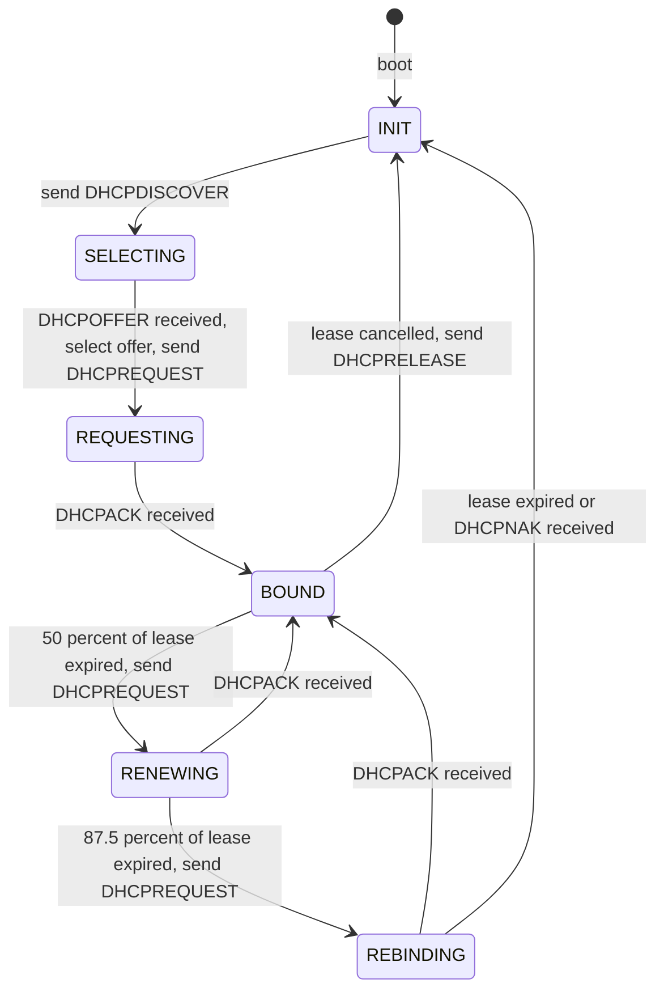

*Figure 31. Transition diagram of a DHCP client*

- **INIT.** When the client first starts, it broadcasts a DHCPDISCOVER message, using port 67.
- **SELECTING.** The servers that can provide the service answer with DHCPOFFER messages that offer an address and possibly a lease duration; in Forouzan's description the default is 1 hour, and a server that sends an offer locks the offered address so that no other client gets it. The client chooses one offer and sends a DHCPREQUEST to the selected server. If no offer arrives, the client tries four more times, 2 seconds apart, and then sleeps for 5 minutes before trying again.
- **REQUESTING.** The client waits until it receives a DHCPACK, which creates the binding between its physical address and its IP address, and then moves to BOUND.
- **BOUND.** The client uses the address until the lease expires. When 50 percent of the lease has passed, it sends a DHCPREQUEST to ask for renewal and moves to RENEWING. It can also cancel the lease and return to INIT.
- **RENEWING.** If a DHCPACK arrives, the client resets its timer and returns to BOUND. If no DHCPACK arrives by the time 87.5 percent of the lease has passed, it moves to REBINDING.
- **REBINDING.** If a DHCPACK arrives, the client returns to BOUND. If a DHCPNAK arrives or the lease expires, it returns to INIT and tries to obtain another address.

The client therefore uses three timers: the renewal timer (T1), the rebinding timer (T2), and the expiration timer. If the server does not specify them, the defaults are 50 percent, 87.5 percent, and 100 percent of the lease time. The DHCP specification fixes these defaults as T1 = 0.5 × lease and T2 = 0.875 × lease, and it specifies that in RENEWING the client sends its request by unicast to the server that granted the lease, while in REBINDING it broadcasts the request so that any server can answer [4]. A client that no longer needs its address may also release it early with a DHCPRELEASE message, so that the server can assign the address to another client.

| Time in an 8-hour lease | Event | Client action |
|:--|:--|:--|
| 0 h | DHCPACK received | Enter BOUND and use the address |
| 4 h (T1, 50%) | Renewal timer expires | Enter RENEWING and unicast a DHCPREQUEST to the leasing server |
| 7 h (T2, 87.5%) | Rebinding timer expires without a DHCPACK | Enter REBINDING and broadcast a DHCPREQUEST to any server |
| 8 h (100%) | Lease expires without a DHCPACK | Stop using the address and return to INIT |

*Table 24. Timers of an 8-hour lease*

### 8.9 Limitations and Security

DHCP has one significant shortcoming for mobility. A node obtains a new address from DHCP each time it connects to a new subnet, so a TCP connection to a remote application cannot be maintained while a mobile node moves between subnets. Chapter 25 describes mobile IP, which lets a mobile node keep a permanent address as it moves.

DHCP also offers little protection. The DHCP specification itself states that unauthorized DHCP servers may easily be set up and that a malicious client could claim all available resources for itself [4]. Two attacks follow.

- **Rogue server.** A server set up by an attacker can answer discover messages and give clients false configuration information, such as incorrect or duplicate addresses or the address of a spoofed router, for example its own address as the default router, so that their traffic passes through the attacker.
- **Exhaustion of the pool.** A malicious client that keeps requesting addresses can take every address in the server's pool, so that legitimate clients can no longer obtain an address.

---

<br>

## 9. NAT

### 9.1 Motivation

The distribution of addresses through ISPs created a new problem. An ISP grants a small range of addresses to a small business or a household. If the business grows or the household needs a larger range, the ISP may be unable to grant it, because the addresses before and after the range may already be allocated to other networks. Kurose describes the same problem for small office, home office (SOHO) networks: the number of devices at home (phones, tablets, game consoles, TVs, printers) keeps growing, and few homeowners want to manage IP addresses.

In most small networks, however, only part of the computers need to access the Internet at the same time, so the number of global addresses need not equal the number of computers. Consider a small business with 20 computers, of which at most 5 access the Internet at the same time; the others do tasks without Internet access or communicate with each other. The business can use 20 (or 25) private addresses for internal communication and obtain 5 global addresses from its ISP for communication with the outside. A mechanism is then needed that maps between private and global addresses.

> **Definition:** **Network address translation (NAT)** is a technique by which a router replaces the private addresses (and, in its common form, the port numbers) of a site's datagrams with global addresses, so that a site can use private addresses internally and only a few global addresses externally.

A private network forms a realm with private addresses, a network whose addresses have meaning only to devices inside it. Hundreds of thousands of home networks may use the same block, such as 10.0.0.0/24, so these addresses can be used between devices of one home network but never as the source or destination of a packet in the global Internet. The site must have a single connection to the global Internet through a NAT-capable router.

### 9.2 Address Translation

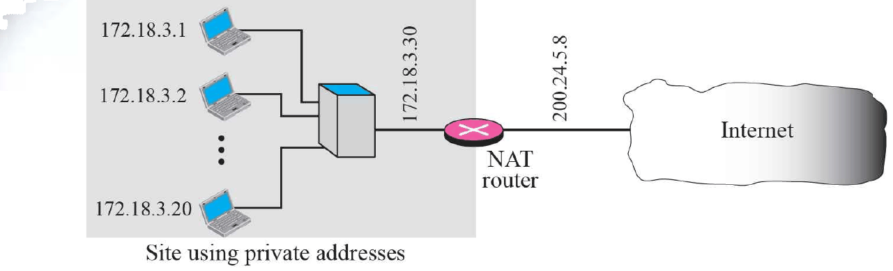

*Figure 32. A site using private addresses behind a NAT router*

In Figure 32 the site uses the private addresses 172.18.3.1 to 172.18.3.20. The NAT router has one private address, 172.18.3.30, on the site side and one global address, 200.24.5.8, on the Internet side. The private network is transparent to the rest of the Internet, which sees only the NAT router with address 200.24.5.8.

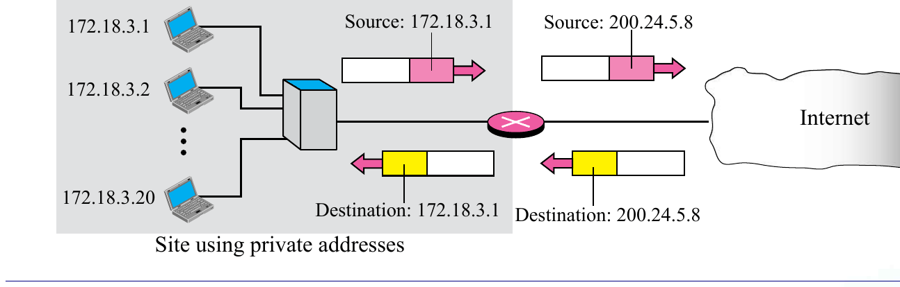

*Figure 33. Address translation in a NAT router*

All outgoing packets pass through the NAT router, which replaces the private source address with its global address, 200.24.5.8. All incoming packets also pass through the router, which replaces the destination address 200.24.5.8 with the appropriate private address, such as 172.18.3.1.

### 9.3 Translation Tables

Translating the source address of an outgoing packet is straightforward. The hard question is how the router finds the private destination of an incoming packet, since there may be tens or hundreds of private hosts. The answer is a translation table.

> **Definition:** A **NAT translation table** is a table in a NAT router that records, for each communication started from the private network, the mapping between the private address (and port) and the external information, so that incoming packets can be returned to the right private host.

Forouzan describes three forms of the table.

**Using one IP address.** In its simplest form the table has two columns, the private address and the external address (the destination of the outgoing packet). Figure 34 shows the four steps.

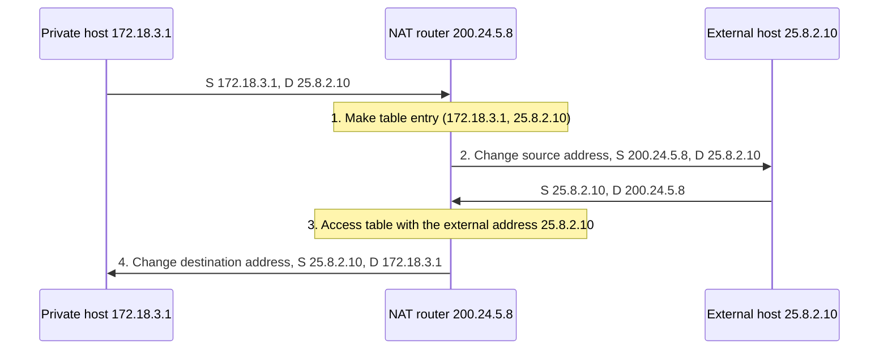

*Figure 34. Translation with a table of private and external addresses*

| Private | External |
|:--|:--|
| 172.18.3.1 | 25.8.2.10 |
| ... | ... |

*Table 25. A two-column translation table*

When the router translates the source of an outgoing packet, it notes the destination (step 1) and changes the source address (step 2). When the response comes back, the router uses the source address of the response, 25.8.2.10, as the external address to find the private address (step 3) and changes the destination address to 172.18.3.1 (step 4). In this strategy the communication must always be initiated by the private network. NAT is used mostly by ISPs that assign a single address to a customer, whose communication with the Internet starts from client programs such as HTTP or FTP, and e-mail arriving for the customer waits in the mailbox of the ISP's mail server until the customer retrieves it with a protocol such as POP (Chapter 4). A private network that uses this form of NAT cannot run a server for clients outside it.

**Using a pool of IP addresses.** With only one global address, only one private host can access a given external host at a time, because the pair of addresses must identify the connection. The router can instead use a pool of global addresses, for example 200.24.5.8, 200.24.5.9, 200.24.5.10, and 200.24.5.11, so that four private hosts can communicate with the same external host at the same time. Drawbacks remain: no more than four connections can be made to the same destination, no private host can access two server programs (such as HTTP and TELNET) on the same external host at the same time, and two private hosts cannot access the same external server program at the same time.

**Using both IP addresses and port numbers.** To allow a many-to-many relationship between private hosts and external server programs, the table needs more information. Suppose two private hosts, 172.18.3.1 and 172.18.3.2, both access the HTTP server on the external host 25.8.3.2. With five columns, private address, private port, external address, external port, and transport protocol, the ambiguity disappears.

| Private address | Private port | External address | External port | Transport protocol |
|:--|:--|:--|:--|:--|
| 172.18.3.1 | 1400 | 25.8.3.2 | 80 | TCP |
| 172.18.3.2 | 1401 | 25.8.3.2 | 80 | TCP |
| ... | ... | ... | ... | ... |

*Table 26. A five-column translation table*

When the HTTP response comes back, the combination of its source address (25.8.3.2) and its destination port (1400) identifies the private host to which it should be directed. For this to work, the ephemeral ports (1400 and 1401) must be unique.

### 9.4 NAT with Port Numbers

Kurose describes the form that has become standard, in which the NAT router also rewrites port numbers. In Figure 35, a home network uses 10.0.0.0/24; the NAT router's interface on the home side is 10.0.0.4 and its single address on the WAN side is 138.76.29.7. All traffic leaving the home for the Internet has source address 138.76.29.7, and all traffic entering must have destination address 138.76.29.7. To the outside world the NAT router does not look like a router but like a single device with a single IP address. Often both the router's address and the home addresses come from DHCP: the router obtains its WAN address from the ISP's DHCP server, and it runs a DHCP server itself to give addresses to the computers at home.

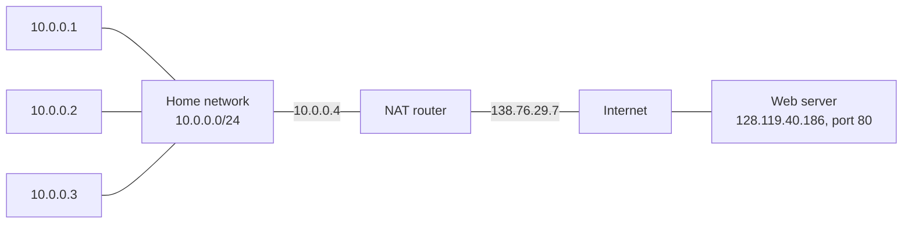

*Figure 35. A home network behind a NAT router*

Suppose a user on host 10.0.0.1 requests a Web page from the server 128.119.40.186, port 80.

1. Host 10.0.0.1 chooses an arbitrary source port, 3345, and sends the datagram into the LAN.
2. The NAT router generates a new source port, 5001, replaces the source address with its WAN address 138.76.29.7 and the source port 3345 with 5001, and adds an entry to its NAT translation table. It may choose any port not currently in the table.
3. The Web server, unaware that the datagram was modified, replies to destination address 138.76.29.7, destination port 5001.
4. The NAT router indexes its table with the destination address and port, finds 10.0.0.1 and 3345, rewrites the destination address and port, and forwards the datagram into the home network.

| WAN side | LAN side |
|:--|:--|
| 138.76.29.7, 5001 | 10.0.0.1, 3345 |
| ... | ... |

*Table 27. The NAT translation table of Figure 35*

The port number field is 16 bits long, so a single WAN-side address can support more than 60,000 simultaneous connections. Two home hosts that happen to choose the same source port, such as 3345, cause no confusion, because the router gives their connections different WAN-side ports.

### 9.5 Objections and NAT Traversal

NAT has been widely deployed, but it has detractors.

- **Ports are meant to address processes, not hosts.** Using port numbers to identify hosts causes problems for servers in the home network: a server process waits for requests at a well-known port, and a peer in a P2P application must accept incoming connections, but a NAT router has no table entry for a connection that starts outside. Kurose names two technical solutions: NAT traversal tools such as STUN [5], and Universal Plug and Play (UPnP), a protocol that lets a host discover and configure a nearby NAT. An administrator can also configure the NAT router statically so that sessions arriving at a given well-known port are always directed to a given node in the private network [6]; with such a static mapping, called port forwarding, a server inside the private network becomes reachable from outside.
- **Routers should be layer 3 devices.** Architectural purists argue that routers are meant to process packets only up to the network layer, and that hosts should talk to each other directly, without intervening nodes that modify IP addresses, let alone port numbers.

Mobility exposes the same issue. Suppose host A behind one NAT router sends a message to host B through a messaging server, and A then moves to a network behind another NAT router, where it appears as A'. The server's earlier entry points to A's old mapping, so it cannot reply to A' until A' opens a new connection from inside and a new mapping is created.

Like it or not, NAT has become an important component of the Internet, together with other so-called middleboxes that operate at the network layer but perform functions different from traditional forwarding, such as NAT, load balancing, and firewalling. The generalized forwarding of Chapter 24 can perform several of these middlebox functions, as well as traditional forwarding, in a common integrated way.

---

<br>

## 10. Address Exhaustion and IPv6

Classless addressing, private addresses, and NAT extend the life of the 32-bit IPv4 address space, but they do not enlarge it. The long-term solution is IPv6, with 128-bit addresses, whose addressing and datagram format are the subject of Chapter 24.

---

<br>

## Concept Applications

**True/False Check:**

| Statement | Judgment and Reason |
|:--|:--|
| A router with three interfaces has one IP address. | **F.** An address belongs to an interface, so the router has three addresses, one in each subnet it touches. |
| 192.168.1.256 is a valid dotted-decimal address. | **F.** Each byte must be between 0 and 255. |
| In classless addressing, the address 167.199.170.82 alone determines its block. | **F.** The same address belongs to blocks of every prefix length; the prefix length must also be given. |
| A block granted under CIDR may contain 1,000 addresses. | **F.** The number of addresses must be a power of 2, so 1,024 addresses are granted. |
| The block 18.14.12.0/22 is a valid allocation. | **T.** 18.14.12.0 is divisible by 1,024, so its last 10 bits are all 0. |
| A packet sent to 255.255.255.255 is forwarded by routers to every network. | **F.** It is the limited broadcast address; routers block it. |
| A DHCP client with no address sends its discover message with source address 0.0.0.0. | **T.** It does not know its own address, so it uses the all-zeros address. |
| With port-based NAT, a host outside can open a connection to a server inside without any configuration. | **F.** The router has no table entry for a connection started from outside; port forwarding, UPnP, or a traversal tool is needed. |

---

<br>

## Summary

| Concept | Key Summary |
|---------|-----------|
| IPv4 address | It is a unique and universal 32-bit address of an interface, and the address space has $`2^{32}`$ addresses. |
| Notation | Addresses are written in binary, dotted-decimal (base 256), or hexadecimal, with four numbers from 0 to 255 in dotted-decimal. |
| Bitwise operations | NOT complements a mask, AND with a mask gives the first (network) address, and OR with the complement of the mask gives the last address. |
| Subnet | It is a set of interfaces reachable without crossing a router, found by detaching every interface from its device. |
| Classful addressing | Five classes fix the netid length at 8, 16, or 24 bits (A, B, C) and reserve D for multicast and E for the future. |
| Default mask | It is 255.0.0.0, 255.255.0.0, or 255.255.255.0, and ANDing it with an address gives the classful network address. |
| Subnetting | It lengthens the network part by log₂ s bits to divide a block into s subnets. |
| Supernetting | It shortens the network part by log₂ c bits to combine c class C blocks, at the cost of waste and complex routing. |
| CIDR | Blocks have any prefix length, sizes that are powers of 2, and first addresses divisible by their size. |
| Block information | From a.b.c.d/n, the block has $`2^{32-n}`$ addresses, and the first and last addresses are found with AND and OR. |
| Subnet design | Each subnet has a power-of-2 size, prefix n + log₂(N/N_sub), and larger subnets are allocated first. |
| Aggregation | One prefix advertises many networks, and longest prefix matching handles more specific exceptions. |
| Special addresses | 0.0.0.0, 255.255.255.255, 127/8, private blocks, multicast 224/4, network address, and directed broadcast have reserved meanings. |
| DHCP | Discover, offer, request, and ACK give a host an address for a lease, renewed at 50 percent and rebound at 87.5 percent of the lease. |
| NAT | A router translates private addresses and ports to its global address and port with a translation table, which saves addresses but breaks incoming connections. |

---

<br>

## Self-Check Questions

1. **First and last addresses:** One address of a block is 192.168.37.200/27. Find the mask, the number of addresses, the first address, and the last address.

   <details>
   <summary>Answer</summary>

   The mask has twenty-seven 1s, 255.255.255.224, and the block has $`2^{32-27} = 32`$ addresses. Only the fourth byte changes: 200 = 11001000, and 200 AND 224 = 11000000 = 192, so the first address is 192.168.37.192. ORing with the complement 31 gives 11011111 = 223, so the last address is 192.168.37.223.

   </details>

2. **Equal subnets:** An organization is granted 130.34.12.128/26 and needs eight subnets of equal size. Find the subnet prefix length and the first and last address of each subnet.

   <details>
   <summary>Answer</summary>

   The block has 64 addresses, from 130.34.12.128 to 130.34.12.191. Each subnet gets 64/8 = 8 addresses, so the prefix is $`26 + \log_2 8 = 29`$. The subnets are 130.34.12.128/29 (.128-.135), .136/29 (.136-.143), .144/29 (.144-.151), .152/29 (.152-.159), .160/29 (.160-.167), .168/29 (.168-.175), .176/29 (.176-.183), and .184/29 (.184-.191). Each starting address is divisible by 8.

   </details>

3. **Variable-length subnets:** An organization is granted 14.24.74.0/24 and needs three subnets for 100, 50, and 20 hosts. Design the subnets so that each has room for its hosts after reserving the network and directed broadcast addresses, and find the addresses left over.

   <details>
   <summary>Answer</summary>

   100 hosts need 128 addresses (126 usable), 50 hosts need 64 (62 usable), and 20 hosts need 32 (30 usable). Allocating the largest first: 14.24.74.0/25 (14.24.74.0-14.24.74.127), 14.24.74.128/26 (14.24.74.128-14.24.74.191), and 14.24.74.192/27 (14.24.74.192-14.24.74.223). The 32 addresses from 14.24.74.224 to 14.24.74.255 remain in reserve.

   </details>

4. **DHCP messages:** In Figure 28, which messages are sent to the broadcast address, and why is even the DHCP request broadcast? For a lease of 8 hours, when does the client enter the RENEWING and REBINDING states, and how does it send its request in each?

   <details>
   <summary>Answer</summary>

   All four messages are sent to 255.255.255.255. The discover is broadcast because the client knows neither its own address nor a server's address; the offer and the ACK are broadcast because the client has no address yet at which it could receive a unicast datagram. The request is broadcast so that every server that made an offer learns which server was selected; the others can release their offered addresses. The client enters RENEWING at T1 = 4 hours and unicasts its request to the server that granted the lease, and it enters REBINDING at T2 = 7 hours and broadcasts its request to any server. If no DHCPACK arrives by 8 hours, it stops using the address and returns to INIT.

   </details>

5. **NAT translation table:** Behind the NAT router of Figure 35 (WAN address 138.76.29.7), host 10.0.0.1 opens a connection from port 3345 to 128.119.40.186, port 80, and then host 10.0.0.2 also opens a connection from port 3345 to the same server. The router assigns new ports 5001 and 5002 in that order. Write the translation table, and explain where a reply arriving at 138.76.29.7, port 5002 is sent.

   <details>
   <summary>Answer</summary>

   The table has two entries: (138.76.29.7, 5001) ↔ (10.0.0.1, 3345) and (138.76.29.7, 5002) ↔ (10.0.0.2, 3345). Both hosts used source port 3345, but their outgoing datagrams leave with the same source address and different source ports, 5001 and 5002, so the server sees two distinct connections. A reply to 138.76.29.7, port 5002 matches the second entry, so the router rewrites its destination to 10.0.0.2, port 3345, and forwards it into the home network.

   </details>

6. **Class and default mask:** Find the class of 227.12.14.87 and 193.14.56.22, and the default mask and network address where they exist.

   <details>
   <summary>Answer</summary>

   227 lies between 224 and 239, so 227.12.14.87 is a class D (multicast) address; class D is not divided into netid and hostid, so it has no default mask or network address. 193 lies between 192 and 223, so 193.14.56.22 is class C, its default mask is 255.255.255.0, and its network address is 193.14.56.0.

   </details>

7. **Network and broadcast addresses:** Find the network address, the directed broadcast address, and the number of addresses of the block that contains 172.16.45.200/20.

   <details>
   <summary>Answer</summary>

   The mask for /20 is 255.255.240.0. The third byte 45 = 00101101 ANDed with 11110000 gives 00100000 = 32, so the network address is 172.16.32.0. ORing 45 with 00001111 gives 00101111 = 47, and the fourth byte becomes 255, so the directed broadcast address is 172.16.47.255. The block has $`2^{32-20} = 2^{12} = 4096`$ addresses.

   </details>

8. **Aggregation:** Aggregate 200.10.8.0/24, 200.10.9.0/24, 200.10.10.0/24, and 200.10.11.0/24 into one block. Can the four blocks from 200.10.9.0/24 to 200.10.12.0/24 be aggregated into a single /22?

   <details>
   <summary>Answer</summary>

   The third bytes 8-11 are 00001000-00001011 in binary and share the first 6 bits 000010, so the common prefix has 16 + 6 = 22 bits and the aggregate is 200.10.8.0/22. The blocks 9-12 cannot form a single /22: a /22 block must start at a third byte divisible by 4, and 9-12 spans the 8-11 block and the 12-15 block.

   </details>

---

<br>

## References

1. Y. Rekhter, B. Moskowitz, D. Karrenberg, G. J. de Groot, and E. Lear, "Address Allocation for Private Internets," RFC 1918, Feb. 1996. [Online]. Available: https://www.rfc-editor.org/rfc/rfc1918
2. S. Cheshire, B. Aboba, and E. Guttman, "Dynamic Configuration of IPv4 Link-Local Addresses," RFC 3927, May 2005. [Online]. Available: https://www.rfc-editor.org/rfc/rfc3927
3. A. Retana, R. White, V. Fuller, and D. McPherson, "Using 31-Bit Prefixes on IPv4 Point-to-Point Links," RFC 3021, Dec. 2000. [Online]. Available: https://www.rfc-editor.org/rfc/rfc3021
4. R. Droms, "Dynamic Host Configuration Protocol," RFC 2131, Mar. 1997. [Online]. Available: https://www.rfc-editor.org/rfc/rfc2131
5. J. Rosenberg, R. Mahy, P. Matthews, and D. Wing, "Session Traversal Utilities for NAT (STUN)," RFC 5389, Oct. 2008. [Online]. Available: https://www.rfc-editor.org/rfc/rfc5389
6. P. Srisuresh and K. Egevang, "Traditional IP Network Address Translator (Traditional NAT)," RFC 3022, Jan. 2001. [Online]. Available: https://www.rfc-editor.org/rfc/rfc3022
