# 13장 — 전달, 포워딩, 라우터 구조

[레포지토리 안내](../../README.ko.md) | [English](Concepts_Lecture.md) | [한국어](Concepts_Lecture.ko.md)

> **최종 수정일:** 2026-11-18
>
> Computer Networking: A Top-Down Approach, Kurose and Ross, Ch 4; TCP/IP Protocol Suite, Forouzan, Ch 6

> **학습 목표:**
> 1. 직접 전달과 간접 전달을 구별하고 호스트나 라우터가 어느 쪽을 수행하는지 판단할 수 있다
> 2. 다음 홉 방식, 네트워크 특정 방식, 호스트 특정 방식, 기본 방식의 포워딩 기법을 설명할 수 있다
> 3. 최장 접두사 일치를 포함하여 클래스 기반과 클래스 없는 포워딩 테이블에서 패킷의 포워딩을 추적할 수 있다
> 4. 주소 집약, 계층적 라우팅, 레이블 기반 포워딩을 설명할 수 있다
> 5. 라우터의 구성 요소, 스위칭 패브릭, 큐잉과 HOL 블로킹이 일어나는 곳을 설명할 수 있다
> 6. FIFO, 우선순위, 라운드 로빈, 가중 공정 큐잉 스케줄링 방식을 비교할 수 있다

---

## 목차

- [1. 전달](#1-전달)
  - [1.1 직접 전달](#11-직접-전달)
  - [1.2 간접 전달](#12-간접-전달)
- [2. 포워딩 기법](#2-포워딩-기법)
  - [2.1 포워딩과 포워딩 테이블](#21-포워딩과-포워딩-테이블)
  - [2.2 다음 홉 방식](#22-다음-홉-방식)
  - [2.3 네트워크 특정 방식](#23-네트워크-특정-방식)
  - [2.4 호스트 특정 방식](#24-호스트-특정-방식)
  - [2.5 기본 방식](#25-기본-방식)
- [3. 클래스 기반 주소에서의 포워딩](#3-클래스-기반-주소에서의-포워딩)
  - [3.1 서브넷팅이 없을 때의 포워딩](#31-서브넷팅이-없을-때의-포워딩)
  - [3.2 클래스 기반 포워딩의 예](#32-클래스-기반-포워딩의-예)
  - [3.3 서브넷팅이 있을 때의 포워딩](#33-서브넷팅이-있을-때의-포워딩)
- [4. 클래스 없는 주소에서의 포워딩](#4-클래스-없는-주소에서의-포워딩)
  - [4.1 마스크 열이 있는 테이블](#41-마스크-열이-있는-테이블)
  - [4.2 클래스 없는 포워딩의 추적](#42-클래스-없는-포워딩의-추적)
  - [4.3 테이블로부터 토폴로지 추측하기](#43-테이블로부터-토폴로지-추측하기)
  - [4.4 최장 접두사 일치](#44-최장-접두사-일치)
  - [4.5 테이블 탐색](#45-테이블-탐색)
- [5. 주소 집약과 계층적 라우팅](#5-주소-집약과-계층적-라우팅)
  - [5.1 주소 집약](#51-주소-집약)
  - [5.2 집약의 예외](#52-집약의-예외)
  - [5.3 계층적 라우팅](#53-계층적-라우팅)
  - [5.4 지리적 라우팅](#54-지리적-라우팅)
- [6. 레이블 기반 포워딩](#6-레이블-기반-포워딩)
  - [6.1 탐색과 색인](#61-탐색과-색인)
  - [6.2 MPLS](#62-mpls)
- [7. 라우터 구조](#7-라우터-구조)
  - [7.1 라우터의 구성 요소](#71-라우터의-구성-요소)
  - [7.2 입력 포트 처리](#72-입력-포트-처리)
  - [7.3 스위칭 패브릭](#73-스위칭-패브릭)
  - [7.4 출력 포트 처리](#74-출력-포트-처리)
  - [7.5 큐잉이 일어나는 곳](#75-큐잉이-일어나는-곳)
  - [7.6 패킷 스케줄링](#76-패킷-스케줄링)
- [개념 적용](#개념-적용)
- [요약](#요약)
- [점검 문제](#점검-문제)

---

<br>

## 1. 전달

네트워크 계층은 하부 물리 네트워크가 패킷을 다루는 일을 감독하며, 이 일을 패킷의 **전달(delivery)** 이라고 한다. 패킷을 최종 목적지까지 전달하는 방법은 직접 전달과 간접 전달의 두 가지이다. 여러 네트워크를 건너는 패킷은 간접 전달을 차례로 겪은 뒤 정확히 한 번 직접 전달된다.

### 1.1 직접 전달

> **용어 정의:** **직접 전달(direct delivery)** 은 호스트나 라우터가 자신과 같은 물리 네트워크에 연결된 최종 목적지로 패킷을 전달하는 것이다.

직접 전달은 두 상황에서 일어난다. 패킷의 송신지와 목적지가 같은 물리 네트워크에 있을 때, 그리고 경로의 마지막 라우터가 목적지 호스트에 패킷을 전달할 때이다. 그림 1에서 호스트 A는 같은 링크의 호스트 B에 직접 전달하고, 라우터는 인터넷의 나머지에서 온 패킷을 B에 직접 전달한다.

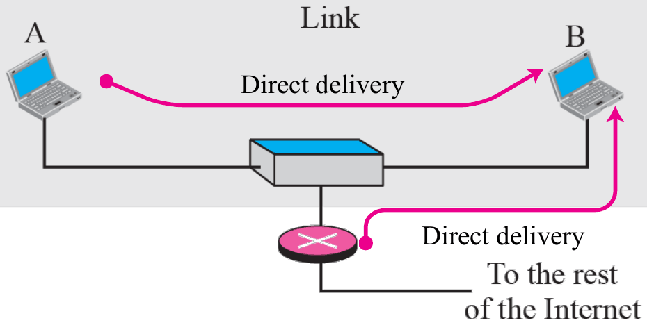

*그림 1. 한 네트워크 안의 직접 전달과 마지막 라우터의 직접 전달*

송신자는 전달이 직접인지 쉽게 판단할 수 있다. 목적지의 네트워크 주소(netid, 또는 마스크로 얻은 접두사)를 추출하여 자신이 연결된 네트워크의 주소와 비교한다. 같으면 직접 전달이다.

### 1.2 간접 전달

> **용어 정의:** **간접 전달(indirect delivery)** 은 최종 목적지가 전달자와 같은 네트워크에 있지 않아서 호스트나 라우터가 패킷을 라우터에 전달하는 것이다.

간접 전달에서 패킷은 최종 목적지와 같은 물리 네트워크에 연결된 라우터에 이를 때까지 라우터에서 라우터로 이동한다. 다음 라우터를 정하기 위해 전달자는 자기 표에서 다음 홉의 IP 주소를 찾는다.

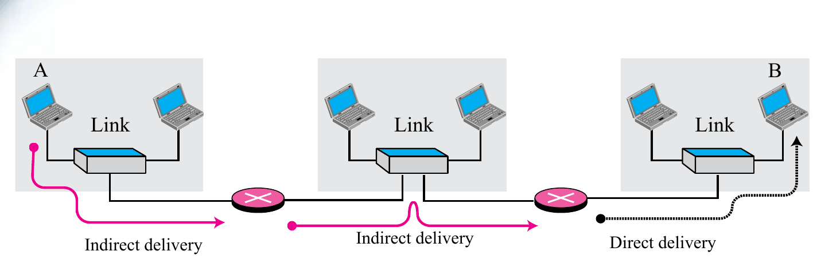

*그림 2. 간접 전달들과 그 뒤의 마지막 직접 전달*

그림 2에서 호스트 A는 패킷을 첫 라우터에 간접 전달하고, 첫 라우터는 둘째 라우터에 간접 전달하며, 둘째 라우터가 마지막으로 호스트 B에 직접 전달한다. 따라서 두 전달은 다음 홉이 있는가로 구별된다. 간접 전달은 패킷을 다음 홉 라우터로 보내고, 직접 전달은 목적지 자체로 보낸다.

> **핵심:** 전달에는 언제나 마지막 하나의 직접 전달이 있다. 그 앞에는 패킷을 다른 라우터로 포워딩하는 라우터마다 하나씩, 0개 이상의 간접 전달이 있다.

---

<br>

## 2. 포워딩 기법

### 2.1 포워딩과 포워딩 테이블

포워딩은 패킷을 목적지로 가는 경로 위에 놓는 것, 즉 다음 홉으로 전달하는 것이다. 포워딩을 하려면 호스트나 라우터에 표가 있어야 한다. 목적지마다 완전한 경로를 찾아 두는 단순한 해법은 오늘날의 인터네트워크에서 불가능하므로, 여러 기법이 표를 다룰 수 있는 크기로 유지하고 보안 같은 문제도 처리한다.

> **참고:** Forouzan은 호스트나 라우터가 패킷마다 참조하는 표를 라우팅 테이블(routing table)이라고 부른다. 이 정리본은 Kurose를 따라 이 표를 포워딩에 쓰이는 표라는 뜻에서 포워딩 테이블이라고 부른다(10장). 라우팅 테이블이라는 이름은 RIP, OSPF, BGP 같은 라우팅 프로토콜이 만드는 표(14장, 15장)에만 쓰며, 포워딩 테이블은 그 표에서 만들어진다.

### 2.2 다음 홉 방식

> **용어 정의:** **다음 홉 방식(next-hop method)** 은 표가 목적지까지의 완전한 경로 정보 대신 다음 홉의 주소만 담는 포워딩 기법이다.

그림 3에서 호스트 A는 라우터 R1과 R2를 거쳐 호스트 B로 보낸다. 완전한 경로에 기반한 표는 다음 라우터들이 이미 가진 정보를 되풀이하므로, 다음 홉 방식은 다음 한 단계만 남긴다. 표들의 항목은 서로 일관되어야 하며, 그래야 A에서 다음 홉을 따라가면 실제로 B에 이른다.


*그림 3. 라우터 둘을 거쳐 호스트 A에서 호스트 B로 가는 경로*

| 표의 주인 | a. 경로 기반: 목적지 | 경로 | b. 다음 홉 기반: 목적지 | 다음 홉 |
|:--|:--|:--|:--|:--|
| A | 호스트 B | R1, R2, 호스트 B | 호스트 B | R1 |
| R1 | 호스트 B | R2, 호스트 B | 호스트 B | R2 |
| R2 | 호스트 B | 호스트 B | 호스트 B | (없음, 직접 전달) |

*표 1. 완전한 경로에 기반한 표와 다음 홉에 기반한 표*

### 2.3 네트워크 특정 방식

> **용어 정의:** **네트워크 특정 방식(network-specific method)** 은 표가 목적지 호스트마다가 아니라 목적지 네트워크마다 항목 하나를 가지는 포워딩 기법이다.

같은 네트워크에 연결된 모든 호스트를 하나의 개체로 다룬다. 네트워크에 호스트가 1,000대 붙어 있으면 표에는 1,000개가 아니라 항목 하나만 있다. 그림 4에서 네트워크 N1의 호스트 S가 네트워크 N2의 호스트 A, B, C, D에 이르려면 호스트 특정 표에서는 항목이 넷 필요하지만 네트워크 특정 표에서는 하나면 된다.

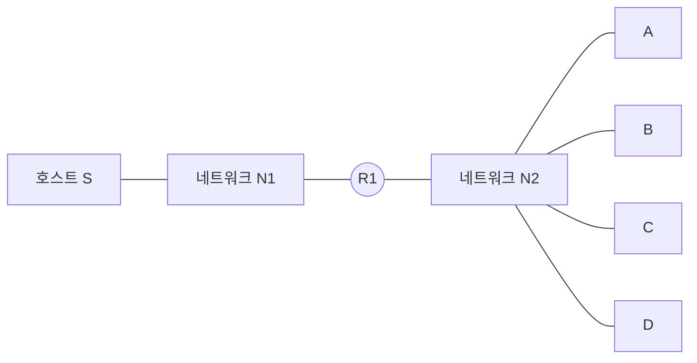

*그림 4. 라우터 R1을 거쳐 네트워크 N2의 호스트 넷에 이르는 호스트 S*

| S의 호스트 특정 표: 목적지 | 다음 홉 | S의 네트워크 특정 표: 목적지 | 다음 홉 |
|:--|:--|:--|:--|
| A | R1 | N2 | R1 |
| B | R1 | | |
| C | R1 | | |
| D | R1 | | |

*표 2. 호스트 S의 호스트 특정 표와 네트워크 특정 표*

### 2.4 호스트 특정 방식

> **용어 정의:** **호스트 특정 방식(host-specific method)** 은 표가 특정 목적지 호스트에 대한 항목을 담는 포워딩 기법이다.

근거는 네트워크 특정 방식의 반대이다. 효율을 희생하고 통제를 얻는다. 관리자는 한 호스트로 가는 패킷이 특정 경로를 따르기를 원할 수 있다. 그림 5에서 호스트 A는 보통 R1을 거쳐 네트워크 N2에, R3을 거쳐 네트워크 N3에 이른다. 호스트 특정 항목 하나를 두면 다른 목적지에 이르는 방식과 상관없이 N3에 있는 호스트 B로 가는 모든 패킷이 R3으로 간다. 호스트 특정 라우팅은 경로를 점검하거나 보안 조치를 마련하는 등의 목적에 쓰인다.

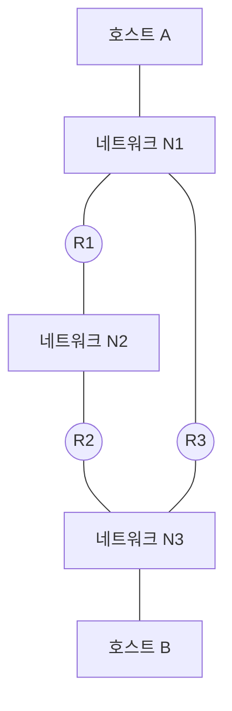

*그림 5. 호스트 A가 호스트 B에 대해 호스트 특정 항목을 쓰는 토폴로지*

| 목적지 | 다음 홉 |
|:--|:--|
| 호스트 B | R3 |
| N2 | R1 |
| N3 | R3 |
| ... | ... |

*표 3. 호스트 특정 항목이 있는 호스트 A의 표*

### 2.5 기본 방식

> **용어 정의:** **기본 경로(default route)** 는 보통 네트워크 주소 0.0.0.0으로 쓰는 표 항목으로, 다른 어느 항목과도 일치하지 않는 모든 목적지에 쓰인다.

그림 6에서 호스트 A는 라우터 둘이 있는 네트워크 N1에 연결되어 있다. R1은 네트워크 N2로, R2는 인터넷의 나머지로 이어진다. 호스트 A는 인터넷의 모든 네트워크를 나열하는 대신 N2의 항목 하나와, 나머지를 모두 기본 라우터 R2로 보내는 기본 항목 하나만 둔다.

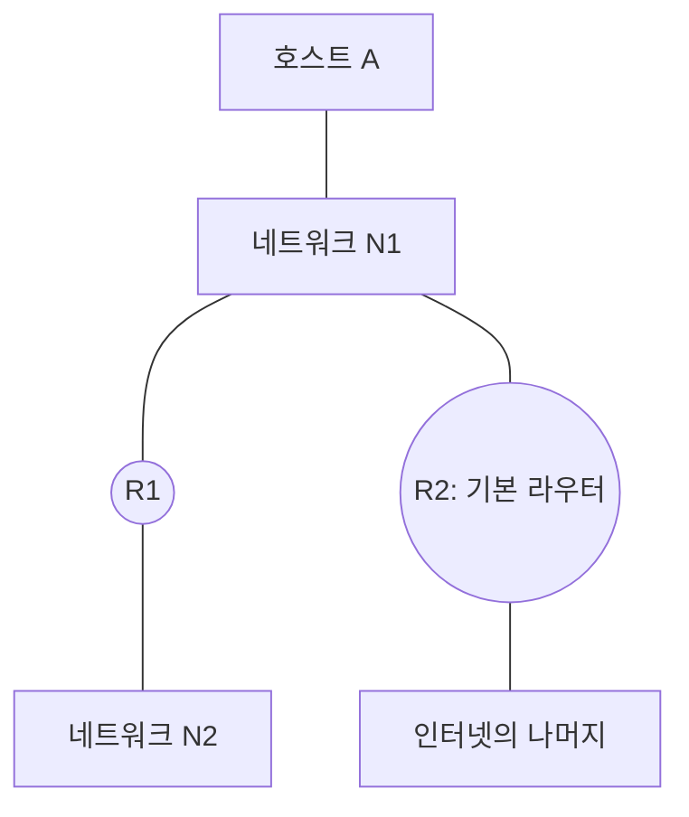

*그림 6. 기본 라우터를 가진 호스트*

| 목적지 | 다음 홉 |
|:--|:--|
| N2 | R1 |
| 기본 | R2 |

*표 4. 기본 항목이 있는 호스트 A의 표*

---

<br>

## 3. 클래스 기반 주소에서의 포워딩

### 3.1 서브넷팅이 없을 때의 포워딩

클래스 기반 주소 지정(12장)에서 전역 인터넷의 라우터 대부분은 서브넷팅과 관계가 없으며, 서브넷팅은 조직 안에서 일어난다. 클래스 기반 주소에 내재된 기본 마스크 덕분에 포워딩이 단순하다. 일반적인 라우터는 클래스 A, B, C마다 하나씩 표 셋을 두어 탐색을 효율적으로 한다. 각 표에는 적어도 열이 셋 있다.

| 열 | 의미 |
|:--|:--|
| 네트워크 주소 | 목적지 호스트가 있는 네트워크, 포워딩은 보통 네트워크 특정 방식 |
| 다음 홉 주소 | 간접 전달에서 패킷을 넘겨줄 라우터, 직접 전달이면 비어 있음 |
| 인터페이스 번호 | 패킷을 내보낼 출력 포트, m0, m1 등으로 표기 |

*표 5. 클래스 기반 포워딩 테이블의 열*

포워딩 모듈은 다섯 단계로 동작한다.

1. 패킷의 목적지 주소를 추출한다.
2. 목적지 주소의 사본을 만들어 오른쪽으로 28비트 이동한다. 결과는 처음 4비트의 값 0\~15이며 이것이 클래스를 알려 준다. 0\~7은 클래스 A, 8\~11은 B, 12와 13은 C, 14는 D, 15는 E이다. 이 단순한 모듈은 클래스 D나 E 주소를 오류로 보고한다.
3. 클래스와 목적지 주소로 네트워크 주소를 추출한다. 그 클래스의 기본 마스크를 적용하면 된다.
4. 그 클래스의 표에서 네트워크 주소를 찾아 다음 홉 주소와 인터페이스 번호를 얻는다. 일치하는 항목이 없으면 기본 항목을 쓴다.
5. 다음 홉 주소와 인터페이스 번호를 ARP(19장)에 넘기고, ARP는 다음 홉의 물리 주소를 찾아 데이터 링크 계층에 패킷 전달을 요청한다.

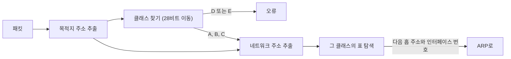

*그림 7. 서브넷팅이 없는 클래스 기반 주소용 단순화한 포워딩 모듈*

### 3.2 클래스 기반 포워딩의 예

**예제 6.1.** 그림 8은 라우터 R1 주변의 가상 인터넷 일부이다. R1은 인터페이스 m0으로 네트워크 111.0.0.0/8에, m1로 145.80.0.0/16에, m2로 170.14.0.0/16에 연결된다. 네트워크 111.0.0.0/8에는 인터넷의 나머지로 가는 기본 라우터 R2(111.30.31.18)와, 네트워크 192.16.7.0/24로 이어지는 라우터 R3(111.15.17.32)도 있다.

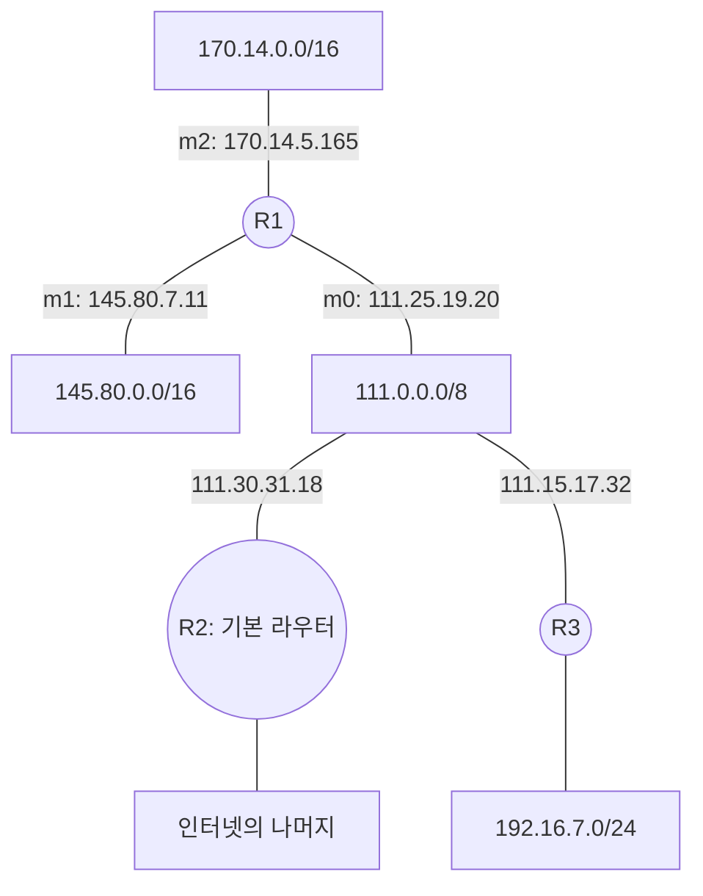

*그림 8. 예제 6.1의 구성*

| 클래스 | 네트워크 주소 | 다음 홉 주소 | 인터페이스 |
|:--|:--|:--|:--|
| A | 111.0.0.0 | (없음) | m0 |
| B | 145.80.0.0 | (없음) | m1 |
| B | 170.14.0.0 | (없음) | m2 |
| C | 192.16.7.0 | 111.15.17.32 | m0 |
| 기본 | | 111.30.31.18 | m0 |

*표 6. 라우터 R1의 클래스별 표 셋과 기본 항목*

R1이 직접 연결된 네트워크의 다음 홉 열은 비어 있다. 이런 경우 ARP에 넘기는 다음 홉 주소는 단순히 패킷의 목적지 주소이다.

**예제 6.2.** R1이 목적지 주소 192.16.7.14인 패킷을 받는다. 이진수로 11000000 00010000 00000111 00001110이다. 사본을 오른쪽으로 28비트 이동하면 00001100 = 12이므로 클래스 C이다. 왼쪽 24비트만 남기면 네트워크 주소 192.16.7.0이 나오고, 이는 클래스 C 표의 첫 행에 있다. 다음 홉 주소 111.15.17.32와 인터페이스 m0을 ARP에 넘긴다.

**예제 6.3.** R1이 목적지 주소 167.24.160.5인 패킷을 받는다. 이진수로 10100111 00011000 10100000 00000101이다. 오른쪽으로 28비트 이동하면 00001010 = 10이므로 클래스 B이다. 왼쪽 16비트를 남기면 네트워크 주소 167.24.0.0이 나온다. 클래스 B 표에는 일치하는 항목이 없으므로 패킷은 기본 라우터로 간다. 다음 홉 주소 111.30.31.18과 인터페이스 m0을 ARP에 넘긴다.

### 3.3 서브넷팅이 있을 때의 포워딩

조직이 네트워크를 서브넷팅하면 조직 안의 라우터는 서브넷으로 포워딩해야 한다. 고정 길이 서브넷팅에서는 라우터에 표 하나만 있으면 되며, 모듈은 다음과 같이 동작한다.

1. 패킷의 목적지 주소를 추출한다.
2. 목적지가 표의 호스트 특정 항목과 일치하면 그 항목에서 다음 홉과 인터페이스 번호를 꺼낸다.
3. 목적지 주소와 서브넷 마스크로 서브넷 주소를 추출한다.
4. 표에서 서브넷 주소를 찾아 다음 홉 주소와 인터페이스 번호를 얻고, 일치하는 항목이 없으면 기본 항목을 쓴다.
5. 다음 홉 주소와 인터페이스 번호를 ARP에 넘긴다.

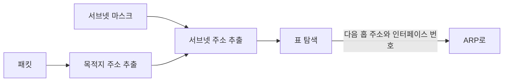

*그림 9. 서브넷팅이 있는 클래스 기반 주소용 단순화한 포워딩 모듈*

**예제 6.4.** 그림 10은 12장의 캠퍼스 네트워크처럼, 사이트 145.14.0.0/16의 /18 블록인 서브넷 넷에 연결된 라우터이다. 라우터는 m0~m3으로 서브넷들에, m4로 인터넷의 나머지에 연결되며, 서브넷 마스크는 /18이다.

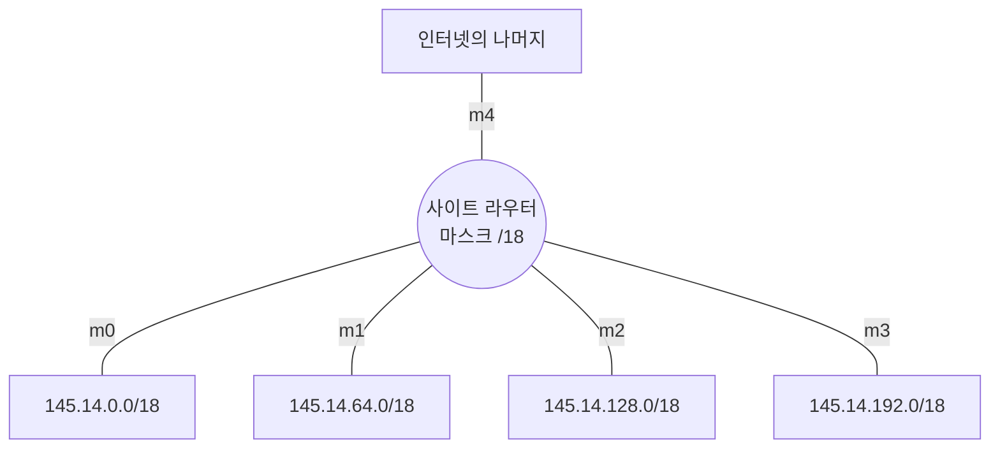

*그림 10. 예제 6.4의 구성: 서브넷이 넷인 사이트 145.14.0.0/16*

| 서브넷 주소 | 다음 홉 주소 | 인터페이스 |
|:--|:--|:--|
| 145.14.0.0 | (없음) | m0 |
| 145.14.64.0 | (없음) | m1 |
| 145.14.128.0 | (없음) | m2 |
| 145.14.192.0 | (없음) | m3 |
| 0.0.0.0 | 기본 라우터 | m4 |

*표 7. 예제 6.4 사이트 라우터의 표*

**예제 6.5.** 라우터가 목적지 주소 145.14.32.78인 패킷을 받는다. 셋째 바이트 32 = 00100000을 /18 마스크의 셋째 바이트 11000000과 AND하면 0이므로 서브넷 주소는 145.14.0.0이다. 다음 홉 주소인 목적지 자신 145.14.32.78과 출력 인터페이스 m0을 ARP에 넘긴다.

**예제 6.6.** 네트워크 145.14.0.0의 호스트가 7.22.67.91로 패킷을 보낸다. 라우터는 마스크 /18을 적용해 7.22.64.0을 얻는다. 이 주소는 표에 없으므로 라우터는 m4를 통해 패킷을 기본 라우터로 보낸다.

---

<br>

## 4. 클래스 없는 주소에서의 포워딩

### 4.1 마스크 열이 있는 테이블

클래스 없는 주소 지정에서는 주소 공간 전체가 하나의 개체이다. 클래스가 없으므로 목적지 주소 자체로는 네트워크 부분이 몇 비트인지 알 수 없다. 따라서 표에 마스크(/n) 열이 하나 더 필요하며, 표 하나가 클래스별 표 셋을 대신한다.

> **핵심:** 클래스 기반 주소 지정의 포워딩 테이블에는 적어도 열이 셋, 클래스 없는 주소 지정에서는 적어도 넷(마스크, 네트워크 주소, 다음 홉 주소, 인터페이스)이 필요하다.

**예제 6.7.** 그림 11은 인터페이스가 넷인 라우터 R1이다. 인터페이스 m0(180.70.65.135)은 네트워크 180.70.65.128/25에, m1(201.4.16.2)은 201.4.16.0/22에, m2(180.70.65.194)는 180.70.65.192/26에, m3(201.4.22.3)은 201.4.22.0/24에 있다. 네트워크 180.70.65.192/26에는 인터넷의 나머지로 이어지는 기본 라우터 180.70.65.200도 있다. 표 8은 R1의 포워딩 테이블이다.

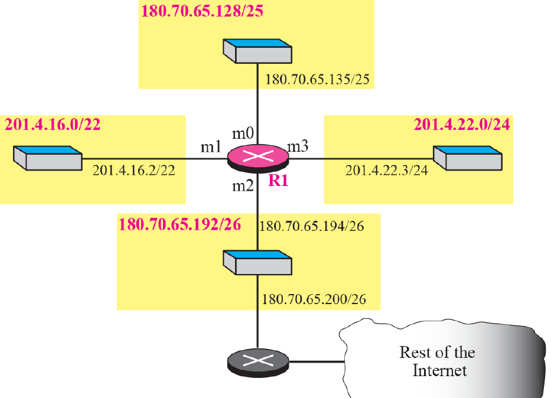

*그림 11. 예제 6.7의 구성*

| 마스크 | 네트워크 주소 | 다음 홉 | 인터페이스 |
|:--|:--|:--|:--|
| /26 | 180.70.65.192 | (없음) | m2 |
| /25 | 180.70.65.128 | (없음) | m0 |
| /24 | 201.4.22.0 | (없음) | m3 |
| /22 | 201.4.16.0 | (없음) | m1 |
| 기본 | 기본 | 180.70.65.200 | m2 |

*표 8. 예제 6.7의 라우터 R1의 포워딩 테이블*

### 4.2 클래스 없는 포워딩의 추적

모듈은 항목마다 차례로 그 항목의 마스크를 목적지 주소에 적용하고 결과를 그 항목의 네트워크 주소와 비교한다. 처음 일치한 항목이 다음 홉과 인터페이스를 정한다. 표가 가장 긴 마스크부터 가장 짧은 마스크 순서로 정렬되어 있으므로 처음 일치한 항목이 가장 구체적인 항목이기도 하다(4.4절).

**예제 6.8.** 목적지 주소 180.70.65.140인 패킷이 R1에 도착한다. 넷째 바이트는 140 = 10001100이다.

```text
Row 1: 180.70.65.140 AND /26 (255.255.255.192) = 180.70.65.128   != 180.70.65.192
Row 2: 180.70.65.140 AND /25 (255.255.255.128) = 180.70.65.128   == 180.70.65.128   -> match, m0
```

다음 홉 주소(이 경우 패킷의 목적지 주소)와 인터페이스 m0을 ARP에 넘긴다.

**예제 6.9.** 목적지 주소 201.4.22.35인 패킷이 R1에 도착한다. 넷째 바이트는 35 = 00100011이다.

```text
Row 1: 201.4.22.35 AND /26 = 201.4.22.0   != 180.70.65.192
Row 2: 201.4.22.35 AND /25 = 201.4.22.0   != 180.70.65.128
Row 3: 201.4.22.35 AND /24 = 201.4.22.0   == 201.4.22.0      -> match, m3
```

패킷의 목적지 주소와 인터페이스 m3을 ARP에 넘긴다.

**예제 6.10.** 목적지 주소 18.24.32.78인 패킷이 R1에 도착한다. 모든 마스크를 적용해도 일치하는 네트워크 주소가 없다. 모듈은 표의 끝에 이르면 다음 홉 주소 180.70.65.200과 인터페이스 m2를 ARP에 넘긴다. 이는 아마 기본 라우터를 거쳐 인터넷의 다른 곳으로 보내야 하는 나가는 패킷일 것이다.

### 4.3 테이블로부터 토폴로지 추측하기

**예제 6.11.** 라우터의 표만으로 그 구성을 알아낼 수 있는가? 표 9는 라우터 R1의 표이다.

| 마스크 | 네트워크 주소 | 다음 홉 주소 | 인터페이스 |
|:--|:--|:--|:--|
| /26 | 140.6.12.64 | 180.14.2.5 | m2 |
| /24 | 130.4.8.0 | 190.17.6.2 | m1 |
| /16 | 110.70.0.0 | (없음) | m0 |
| /16 | 180.14.0.0 | (없음) | m2 |
| /16 | 190.17.0.0 | (없음) | m1 |
| 기본 | 기본 | 110.70.4.6 | m0 |

*표 9. 예제 6.11의 라우터 R1의 표*

다음 홉이 없는 항목은 R1에 직접 연결된 네트워크이다. m0의 110.70.0.0/16, m1의 190.17.0.0/16, m2의 180.14.0.0/16이다. 다음 홉이 있는 항목은 원격 네트워크이다. 130.4.8.0/24에는 m1 네트워크 위의 라우터 190.17.6.2를 거쳐, 140.6.12.64/26에는 m2 네트워크 위의 라우터 180.14.2.5를 거쳐 이른다. 기본 라우터 110.70.4.6은 m0의 네트워크에 있다. 그림 12는 이 표와 맞는 토폴로지이다. 라우터 R2, R3과 원격 네트워크 사이에 무엇이 있는지는 알 수 없다.

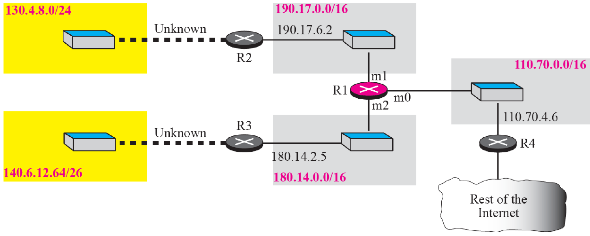

*그림 12. 예제 6.11의 추측한 토폴로지*

### 4.4 최장 접두사 일치

목적지 주소는 둘 이상의 항목과 일치할 수 있다. Kurose의 예가 그 이유를 보여 준다. 라우터에 0부터 3까지 번호가 붙은 링크가 넷 있고, 주소 범위에 따라 포워딩한다.

| 목적지 주소 범위 | 링크 인터페이스 |
|:--|:--|
| 11001000 00010111 00010000 00000000 ~ 11001000 00010111 00010111 11111111 | 0 |
| 11001000 00010111 00011000 00000000 ~ 11001000 00010111 00011000 11111111 | 1 |
| 11001000 00010111 00011001 00000000 ~ 11001000 00010111 00011111 11111111 | 2 |
| 그 밖 | 3 |

*표 10. Kurose 예의 주소 범위와 링크 인터페이스*

주소마다 항목을 하나씩 두는 표라면 항목이 40억 개 넘게 필요하다. 대신 라우터는 접두사를 맞추며, 항목 네 개로 충분하다.

| 접두사 | 같은 접두사의 슬래시 표기 | 링크 인터페이스 |
|:--|:--|:--|
| 11001000 00010111 00010 | 200.23.16.0/21 | 0 |
| 11001000 00010111 00011000 | 200.23.24.0/24 | 1 |
| 11001000 00010111 00011 | 200.23.24.0/21 | 2 |
| 그 밖 | 0.0.0.0/0 | 3 |

*표 11. Kurose 예의 접두사 포워딩 테이블*

목적지 11001000 00010111 00010110 10100001(200.23.22.161)은 첫 항목과만 일치하므로 링크 0으로 간다. 그런데 목적지 11001000 00010111 00011000 10101010(200.23.24.170)은 셋째 접두사가 200.23.24.0부터 200.23.31.255까지를 덮으므로 24비트인 둘째 항목과 21비트인 셋째 항목 모두와 일치한다.

> **용어 정의:** **최장 접두사 일치(longest prefix matching)** 는 목적지 주소가 표의 여러 항목과 일치할 때 라우터가 가장 길게 일치하는 접두사의 항목을 쓰는 포워딩 규칙이다.

이 규칙에 따라 200.23.24.170은 가장 구체적으로 일치하는 링크 1로 간다. Forouzan은 같은 원리를 최장 마스크 일치(longest mask matching)라고 부른다. 표를 가장 긴 마스크부터 가장 짧은 마스크 순서로 정렬하여, 마스크 /27, /26, /24가 있으면 /27 항목이 맨 앞에, /24 항목이 맨 뒤에 오게 하면 처음 찾은 일치 항목이 가장 긴 것이 된다. 최장 접두사 일치가 있기에 집약된 항목과 더 구체적인 예외 항목이 함께 있을 수 있다(5.2절).

> **핵심:** 라우터는 임의의 순서에서 처음 찾은 항목이 아니라 가장 길게 일치하는 접두사를 골라야 한다. 표를 마스크 길이가 줄어드는 순서로 정렬하면 처음 일치한 항목이 가장 긴 것이 된다.

### 4.5 테이블 탐색

클래스 기반 주소 지정의 탐색 알고리즘은 클래스 없는 주소 지정에 맞게 바뀌어야 했다.

- **클래스 기반 주소 지정의 탐색.** 표를 클래스마다 하나씩 버킷 셋으로 나눌 수 있다. 라우터는 주소에 내재된 기본 마스크를 적용해 버킷을 고르고 그 버킷만 탐색한다. 주소의 처음 비트들에 따라 클래스 A에 버킷 8개, B에 4개, C에 2개를 두는 라우터도 있다.
- **클래스 없는 주소 지정의 탐색.** 목적지 주소에는 네트워크 정보가 없다. 가장 단순한 방법은 표를 접두사 길이마다 하나씩 버킷으로 나누고 가장 긴 접두사부터 차례로 시도하는 것인데, 시간이 오래 걸린다. 더 나은 해법은 자료 구조를 바꾸는 것으로, 트리나 특별한 트리인 트라이(trie)를 쓸 수 있다.

링크 속도가 높으면 조회도 빨라야 한다. Kurose는 10 Gbps 입력 링크와 64바이트 데이터그램이면 입력 포트가 다음 데이터그램이 도착하기 전까지 데이터그램 하나를 처리할 시간이 64 × 8 / 10¹⁰ s = 51.2 ns뿐이므로, 조회를 하드웨어로 하고 선형 탐색을 넘어서는 기법을 써야 한다고 지적한다. 흔히 삼진 내용 주소화 메모리(TCAM)를 쓴다. 32비트 IP 주소를 메모리에 넣으면 메모리가 일치하는 항목의 내용을 사실상 상수 시간에 돌려준다.

> **[컴퓨터구조]** 컴퓨터구조에서 캐시, 메모리 계층과 함께 배우는 내용 주소화 메모리는 주소가 아니라 내용으로 탐색하며, 저장된 모든 워드를 입력과 병렬로 비교한다. 삼진 CAM은 비트마다 0, 1, "상관없음"을 저장하므로 200.23.16.0/21 같은 항목은 접두사 21비트와 상관없음 11비트로 저장된다. 항목을 접두사 길이가 줄어드는 순서로 저장하고 처음 일치한 항목을 고르면, TCAM은 가장 길게 일치하는 접두사를 한 번의 조회로 찾는다. 그 밖에는 메모리 접근 시간이 조회의 한계이므로, 칩 위의 DRAM과 더 빠른 SRAM을 함께 쓰는 설계가 쓰인다.

---

<br>

## 5. 주소 집약과 계층적 라우팅

### 5.1 주소 집약

클래스 기반 주소 지정에서는 조직 바깥의 사이트마다, 그 사이트가 서브넷팅되어 있더라도 표에 항목이 하나뿐이었다. 주소 공간을 다룰 수 있는 많은 블록으로 나누는 클래스 없는 주소 지정에서는 항목 수가 늘어나는 경향이 있고, 표를 탐색하는 시간도 늘어난다. 주소 집약(12장)이 이 문제를 완화한다.

그림 13에서 라우터 R1은 주소가 64개씩인 조직 넷의 네트워크에 연결되어 있고, 라우터 R2는 R1에서 멀리 떨어져 있다. 각 패킷이 올바른 조직에 이르러야 하므로 R1에는 더 긴 표가 필요하다. R2의 표는 매우 작아도 된다. 목적지가 140.24.7.0부터 140.24.7.255까지인 모든 패킷은 조직에 상관없이 m0으로 나간다.

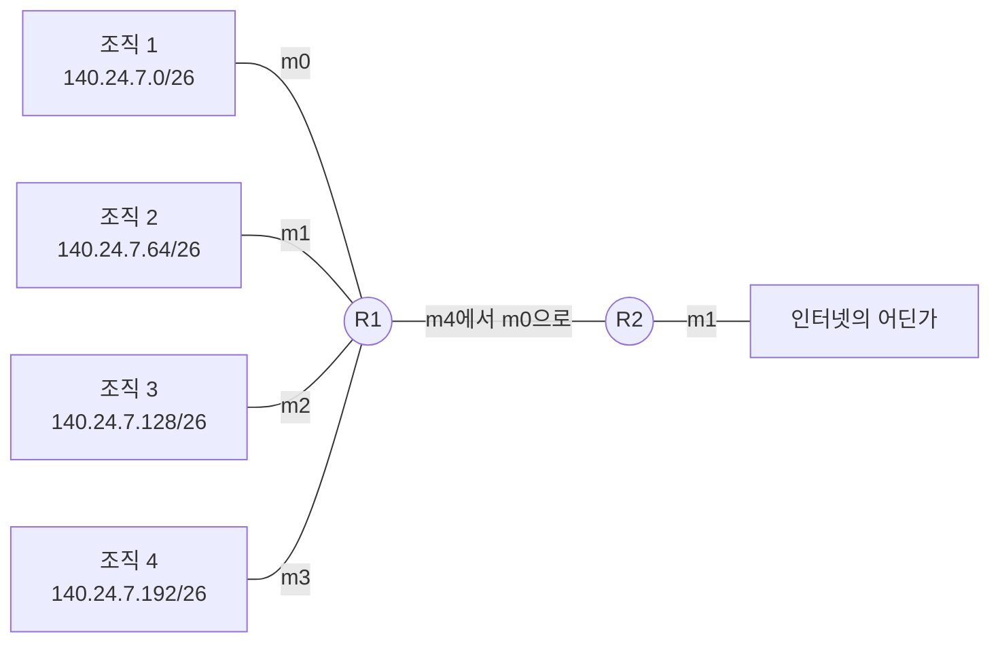

*그림 13. 조직 넷의 주소 집약*

| 라우터 | 마스크 | 네트워크 주소 | 다음 홉 주소 | 인터페이스 |
|:--|:--|:--|:--|:--|
| R1 | /26 | 140.24.7.0 | (없음) | m0 |
| R1 | /26 | 140.24.7.64 | (없음) | m1 |
| R1 | /26 | 140.24.7.128 | (없음) | m2 |
| R1 | /26 | 140.24.7.192 | (없음) | m3 |
| R1 | /0 | 0.0.0.0 | 기본 라우터 | m4 |
| R2 | /24 | 140.24.7.0 | (없음) | m0 |
| R2 | /0 | 0.0.0.0 | 기본 라우터 | m1 |

*표 12. R2에서 집약한 R1과 R2의 표*

조직 넷의 블록은 더 큰 블록 하나 140.24.7.0/24로 집약된다. 서브넷팅과 생각은 비슷하지만 여기에는 공통 사이트가 없으며, 각 조직의 네트워크는 독립적이다. 집약은 여러 단계로 할 수도 있다. 조직들의 주소를 블록 하나로 집약할 수 없다면 R2에도 더 긴 표가 필요했을 것이다.

### 5.2 집약의 예외

조직 4가 R1에 연결될 수 없어 블록 140.24.7.192/26을 유지한 채 셋째 라우터 R3에 연결된다고 하자. 최장 접두사 일치 덕분에 집약은 여전히 쓸 수 있다. R2는 R1 쪽의 집약 항목 140.24.7.0/24를 유지하고, R3 쪽의 더 구체적인 항목 140.24.7.192/26을 그 앞에 정렬하여 추가한다.

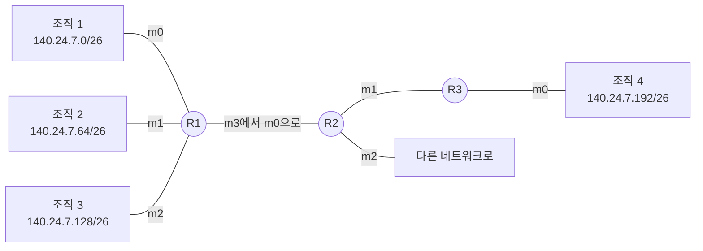

*그림 14. 나머지 세 조직과 떨어진 조직 4*

| 마스크 | 네트워크 주소 | 다음 홉 주소 | 인터페이스 |
|:--|:--|:--|:--|
| /26 | 140.24.7.192 | (R3) | m1 |
| /24 | 140.24.7.0 | (R1) | m0 |
| /0 | 0.0.0.0 | 기본 라우터 | m2 |

*표 13. 가장 긴 마스크부터 가장 짧은 마스크 순서로 정렬한 R2의 표*

140.24.7.200으로 가는 패킷이 R2에 도착한다. 첫 마스크 /26을 적용하면 140.24.7.192가 나와 일치하므로 패킷은 m1으로 R3 쪽에 나가 조직 4에 이른다. 표가 가장 긴 접두사부터 정렬되어 있지 않다면 /24 마스크가 먼저 일치하여 패킷은 잘못 R1으로 보내질 것이다. 12장에 나온 Kurose의 Fly-By-Night-ISP와 ISPs-R-Us 예는 같은 상황을 ISP 규모에서 본 것이다.

### 5.3 계층적 라우팅

거대한 표 문제를 풀기 위해 표가 백본 ISP, 지역 ISP, 지역 내 ISP로 나뉘는 인터넷의 계층을 따르게 할 수 있다. 지역 내 ISP는 큰 블록 a.b.c.d/n 하나를 배정받아 이를 m이 n보다 큰 여러 크기의 작은 블록 e.f.g.h/m으로 나누어 고객에게 준다. 인터넷의 나머지는 이 분할을 알 필요가 없다. 그 ISP의 모든 고객이 a.b.c.d/n으로 정의되므로 세계의 모든 라우터는 이 고객 전부를 위해 항목 하나만 가지면 된다. ISP 안의 라우터는 하위 블록을 구별하며, 대규모 조직인 고객은 서브넷팅으로 단계를 더할 수 있다. 클래스 없는 라우팅에서는 클래스 없는 주소 지정의 규칙을 따르는 한 계층의 단계 수에 제한이 없다.

**예제 6.12.** 어떤 지역 ISP가 120.14.64.0부터 시작하는 주소 16,384개, 즉 120.14.64.0/18을 받았다. ISP는 이 블록을 주소 4,096개(/20)짜리 하위 블록 넷으로 나누어 셋을 지역 내 ISP 셋에 주고, 둘째 블록은 미래를 위해 남겨 둔다.

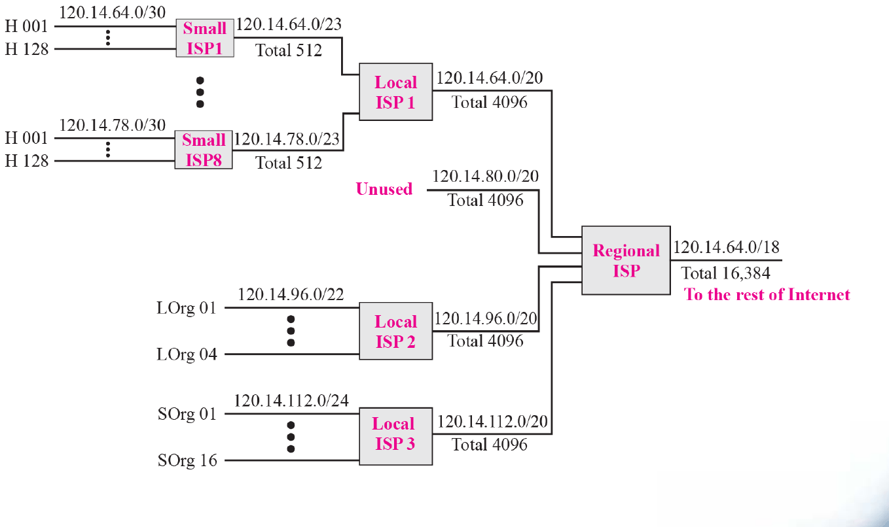

*그림 15. 예제 6.12의 ISP를 따르는 계층적 라우팅*

| 단계 | 소유자 | 블록 | 분할 |
|:--|:--|:--|:--|
| 1 | 지역 ISP | 120.14.64.0/18 (주소 16,384개) | /20 블록 넷으로 |
| 2 | 지역 내 ISP 1 | 120.14.64.0/20 (4,096개) | /23 소규모 ISP 여덟(각 512개)으로 |
| 2 | (미사용) | 120.14.80.0/20 (4,096개) | 예비 |
| 2 | 지역 내 ISP 2 | 120.14.96.0/20 (4,096개) | /22 대규모 조직 넷(각 1,024개)으로 |
| 2 | 지역 내 ISP 3 | 120.14.112.0/20 (4,096개) | /24 소규모 조직 열여섯(각 256개)으로 |
| 3 | 소규모 ISP 1 | 120.14.64.0/23 (512개) | /30 가정 128곳(각 4개)으로 |

*표 14. 예제 6.12의 계층 단계*

첫째 지역 내 ISP는 하위 블록을 더 작은 블록 여덟 개로 나누어 소규모 ISP마다 하나씩 주므로 각 소규모 ISP는 /23을 가진다. 각 소규모 ISP는 주소를 4개씩 쓰는 가정 128곳(H001\~H128)을 서비스하므로 각 가정은 /30($`2^{32-30} = 4`$)을 가진다. 소규모 ISP 1은 120.14.64.0/30부터 120.14.65.252/30까지, 소규모 ISP 8은 120.14.78.0/30부터 120.14.79.252/30까지의 가정을 서비스한다. 둘째 지역 내 ISP는 주소 1,024개(/22)짜리 블록 넷을 대규모 조직 넷 LOrg01\~LOrg04에 120.14.96.0/22부터 120.14.108.0/22까지 준다. 셋째 지역 내 ISP는 주소 256개(/24)짜리 블록 열여섯을 소규모 조직 열여섯 SOrg01\~SOrg16에 120.14.112.0/24부터 120.14.127.0/24까지 준다.

계층은 포워딩에서 드러난다. 인터넷의 모든 라우터는 목적지가 120.14.64.0부터 120.14.127.255까지인 패킷을 지역 ISP로 보낸다. 지역 ISP는 목적지가 120.14.64.0부터 120.14.79.255까지인 모든 패킷을 지역 내 ISP 1로 보낸다. 그 안에서 지역 내 ISP 1은 목적지가 120.14.64.0부터 120.14.64.3까지인 모든 패킷을 가정 H001로 보낸다.

### 5.4 지리적 라우팅

표 크기를 더 줄이려면 계층적 라우팅을 지리적 라우팅으로 확장할 수 있다. 주소 공간 전체를 몇 개의 큰 블록으로 나누어 아메리카에 하나, 유럽에 하나, 아시아에 하나, 아프리카에 하나 하는 식으로 배정한다. 그러면 유럽 밖 ISP의 라우터는 유럽으로 가는 패킷을 위한 항목 하나만, 아메리카 밖 라우터는 아메리카로 가는 패킷을 위한 항목 하나만 가지면 된다.

---

<br>

## 6. 레이블 기반 포워딩

### 6.1 탐색과 색인

1980년대에 IP가 라우팅을 교환으로 대체하는 연결형 프로토콜처럼 동작하게 하려는 노력이 시작되었다. 비연결형 네트워크(데이터그램 방식)에서 라우터는 패킷 헤더의 목적지 주소에 따라 패킷을 포워딩한다. 연결형 네트워크(10장의 가상 회선 방식)에서 스위치는 패킷에 붙은 레이블에 따라 패킷을 포워딩한다. 목적지 주소에 따른 포워딩은 보통 표의 내용을 탐색하고, 레이블에 따른 포워딩은 레이블을 색인으로 써서 표에 접근한다. 즉 라우팅은 탐색을, 교환은 접근을 수반한다.

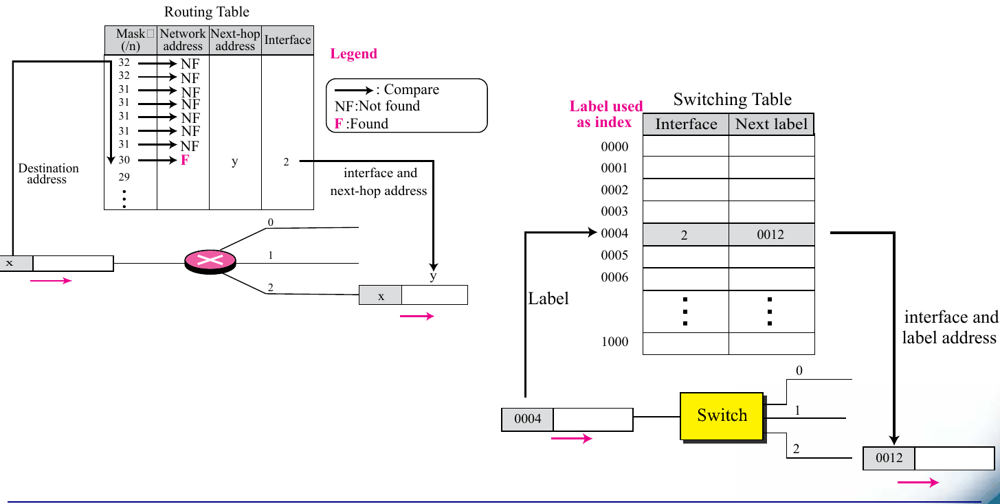

*그림 16. 목적지 주소에 따른 포워딩과 레이블에 따른 포워딩*

**예제 6.13.** 그림 16의 왼쪽에서 라우터는 최장 일치 알고리즘으로 목적지 주소에 따라 포워딩한다. 항목마다 마스크를 적용해 목적지 네트워크 주소를 구하고 항목의 네트워크 주소와 비교한다. 마스크가 /32, /31 등인 항목은 찾지 못하다가(NF) 마스크가 /30인 항목을 찾는다(F). 그러면 라우터는 그 항목의 다음 홉 주소와 인터페이스 번호를 ARP에 넘긴다. 비교마다 시간이 들고, 비교 횟수는 표가 커질수록 늘어난다.

**예제 6.14.** 그림 16의 오른쪽에서 스위치는 레이블 0004인 패킷을 받는다. 스위치는 레이블을 바로 교환 테이블의 색인으로 쓴다. 행 0004는 패킷이 새 레이블 0012를 달고 인터페이스 2로 나간다고 알려 준다. 표의 크기와 상관없이 표에서 정보를 찾는 일은 즉시 끝난다.

### 6.2 MPLS

1980년대에 여러 제조사가 교환 기술을 구현한 라우터를 만들었고, IETF는 나중에 **다중 프로토콜 레이블 교환(Multiprotocol Label Switching, MPLS)** 이라는 표준을 승인했다. 이 표준에서는 인터넷의 일부 전통적 라우터를 라우터로도 스위치로도 동작할 수 있는 MPLS 라우터로 바꿀 수 있다. MPLS 라우터는 라우터로 동작할 때 목적지 주소에 따라, 스위치로 동작할 때 레이블에 따라 패킷을 포워딩한다.

IP로 연결형 교환을 흉내 내려면 패킷에 레이블을 싣는 필드가 필요하다. IPv4 형식은 이런 확장을 허용하지 않으므로(IPv6는 흐름 레이블을 제공한다, 24장), IPv4 패킷을 MPLS 패킷에 캡슐화한다. 즉 MPLS가 데이터 링크 계층과 네트워크 계층 사이의 계층인 것처럼 IP 헤더 앞에 MPLS 헤더를 붙인다.

```text
         +-------------+---------------+----------------------------+
<------  | MPLS header |   IP header   |         IP payload         |
         +-------------+---------------+----------------------------+

MPLS header = a stack of 32-bit subheaders:
+------------------------------+-------+---+---------------+
|          Label (20)          |Exp (3)| S |    TTL (8)    |
+------------------------------+-------+---+---------------+
|          Label (20)          |Exp (3)| S |    TTL (8)    |
+------------------------------+-------+---+---------------+
```

*그림 17. IP 패킷에 붙인 MPLS 헤더와 그 하위 헤더의 형식*

| 필드 | 비트 | 의미 |
|:--|:--|:--|
| 레이블 | 20 | 라우터의 표를 색인하는 데 쓰는 레이블 |
| Exp | 3 | 실험용으로 예약 |
| S | 1 | 스택 비트, 1이면 스택의 마지막 하위 헤더 |
| TTL | 8 | IP의 TTL처럼 라우터마다 1씩 줄며, 0이 되면 루프를 막기 위해 패킷을 버림 |

*표 15. MPLS 하위 헤더의 필드*

레이블 스택은 계층적 라우팅과 비슷한 계층적 교환을 가능하게 한다. 예를 들어 레이블이 둘인 패킷은 위쪽 레이블로 조직 바깥의 스위치들을 지나고, 아래쪽 레이블로 조직 안의 목적지 서브넷에 이를 수 있다. MPLS와 ISP의 MPLS 활용은 21장에서 더 설명한다.

---

<br>

## 7. 라우터 구조

### 7.1 라우터의 구성 요소

지금까지 라우터는 입력 포트로 패킷을 받아 표를 참조하고 각 패킷을 출력 포트로 내보내는 블랙박스였다. 상자를 열어 보면 라우터에는 입력 포트, 출력 포트, 라우팅 프로세서, 스위칭 패브릭의 네 구성 요소가 있다.

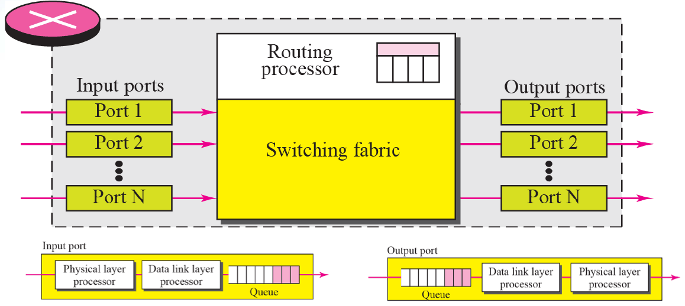

*그림 18. 라우터의 네 구성 요소와 포트의 구조*

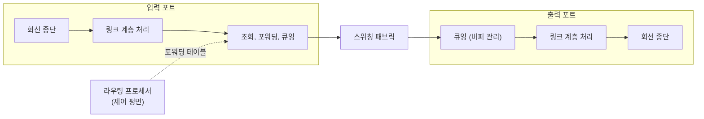

*그림 19. 라우터의 구성 요소를 지나는 패킷의 경로*

- **입력 포트.** 입력 포트는 들어오는 물리 링크를 종단하고(물리 계층 기능), 반대편의 링크 계층과 상호 동작하는 데 필요한 링크 계층 기능을 수행하며, 조회를 한다. 여기서 포워딩 테이블을 참조해 출력 포트를 정한다. 또 패킷이 스위칭 패브릭을 건너기 전까지 담아 두는 버퍼도 가진다. 라우팅 프로토콜 정보를 담은 패킷 같은 제어 패킷은 라우팅 프로세서로 보낸다. 여기서 포트는 물리적인 라우터 인터페이스를 뜻하며, 6장의 소프트웨어 포트와 다르다.
- **스위칭 패브릭.** 입력 포트를 출력 포트에 잇는다. 라우터 안에 완전히 들어 있는, 네트워크 라우터 안의 네트워크이다. 그 속도가 입력 큐와 출력 큐의 크기, 그리고 패킷 전달의 전체 지연에 영향을 준다.
- **출력 포트.** 출력 포트는 입력 포트와 같은 기능을 반대 순서로 수행한다. 스위칭 패브릭에서 받은 패킷을 큐에 넣고, 각 패킷을 프레임에 캡슐화하여 나가는 링크로 전송한다. 링크가 양방향이면 출력 포트는 보통 같은 라인 카드에서 그 링크의 입력 포트와 짝을 이룬다. 라인 카드(line card)는 하나 이상의 링크에 대한 포트 하드웨어를 링크 계층 처리까지 포함하여 싣는 회로 기판이며, 한 라인 카드에 여러 포트를 모아 두는 경우가 많다.
- **라우팅 프로세서.** 제어 평면 기능을 수행한다. 전통적 라우터에서는 라우팅 프로토콜(14장, 15장)을 실행하고, 라우팅 테이블과 링크 상태 정보를 유지하며, 포워딩 테이블을 계산한다. SDN 라우터에서는 원격 컨트롤러와 통신해 포워딩 테이블 항목을 받아 입력 포트에 설치한다. 네트워크 관리 기능(17장)도 수행한다. Forouzan은 라우팅 프로세서를 다음 홉과 출력 포트를 찾는 구성 요소로 설명하며, 이 활동을 테이블 조회라고 부르고, 새 라우터들은 이 기능을 입력 포트로 옮기고 있다고 덧붙인다.

입력 포트, 출력 포트, 스위칭 패브릭은 데이터 평면을 이루며 나노초 시간 규모에서 동작하므로 거의 언제나 하드웨어로 구현한다. 제어 기능은 밀리초나 초 시간 규모에서 동작하므로 보통 전통적인 CPU인 라우팅 프로세서에서 실행되는 소프트웨어로 구현한다.

Kurose는 라우터를 회전 교차로에 비유한다. 진입로와 진입 검문소는 입력 포트에 해당하며, 검문소 직원이 차마다 빠져나갈 출구를 조회한다(목적지 기반 포워딩). 회전 교차로 자체는 스위칭 패브릭에, 출구 도로는 출력 포트에 해당한다. 일반화된 포워딩(24장)에서는 직원이 차의 출발지 같은 다른 요인으로도 출구를 고르거나, 운행에 적합하지 않은 차를 막을 수 있다. 이 비유는 이 절의 설계 질문도 드러낸다. 직원이 느리면, 차들이 회전 교차로를 천천히 지나가면, 대부분의 차가 같은 출구로 가려 하면 어떤 일이 생기는가?

### 7.2 입력 포트 처리

입력 포트의 조회는 라우터 동작의 핵심이다. 포워딩 테이블은 라우팅 프로세서가 계산하거나 원격 SDN 컨트롤러에서 받아, 별도의 버스로 모든 라인 카드에 복사한다. 이 그림자 사본 덕분에 각 입력 포트는 패킷마다 라우팅 프로세서를 부르지 않고 국지적으로 포워딩을 결정하며, 집중된 병목을 피한다. 조회 자체는 최장 접두사 일치를 쓴다(4.4절).

조회는 입력 포트의 가장 중요한 동작이지만 유일한 동작은 아니다. 입력 포트는 물리 계층과 링크 계층 처리도 하고, 패킷의 버전 번호, 체크섬, TTL을 검사하여 뒤의 둘을 고쳐 쓰며(11장), 받은 데이터그램 수 같은 네트워크 관리용 카운터를 갱신한다. 조회가 끝나면 패킷을 스위칭 패브릭으로 보내며, 패브릭이 다른 입력의 패킷으로 바쁘면 입력 포트의 큐에 넣는다.

목적지 주소를 조회하고(일치) 패킷을 지정된 출력 포트로 보내는(동작) 일은 많은 네트워크 장치에서 볼 수 있는 일반적인 "일치 더하기 동작" 추상의 특수한 경우이다. 링크 계층 스위치는 링크 계층 주소를 맞추고(20장), 방화벽은 헤더 필드가 주어진 기준과 일치하는 패킷을 버리며(26장), NAT는 항목과 일치하는 포트 번호를 고쳐 쓴다(12장). 24장은 이런 방향으로 포워딩을 일반화한다.

### 7.3 스위칭 패브릭

> **용어 정의:** **스위칭 패브릭(switching fabric)** 은 패킷을 입력 포트에서 출력 포트로 옮기는 라우터의 부분이다.

스위칭 패브릭은 라우터의 심장이다. Kurose는 이를 만드는 세 가지 방법을 설명한다.

```text
a. Switching via memory            b. Switching via a bus          c. Switching via an interconnection
                                                                      network (crossbar)
 A ->+--------+-> X                 A -->-+--------> X                      X     Y     Z
     |        |                           |                            A ---+-----+-----+---
 B ->| Memory |-> Y                 B -->-+--------> Y                      |     |     |
     |        |                           |                            B ---+-----+-----+---
 C ->+--------+-> Z                 C -->-+--------> Z                      |     |     |
   (CPU copies every packet)          (one shared bus)                 C ---+-----+-----+---
                                                                      (a crosspoint closes at each +)
```

*그림 20. 세 가지 교환 기법*

- **메모리를 통한 교환.** 초기 라우터는 전통적인 컴퓨터였다. 입력 포트가 인터럽트로 라우팅 프로세서에 알리면 패킷이 프로세서 메모리로 복사되고, 프로세서가 출력 포트를 조회한 뒤 패킷을 출력 포트의 버퍼로 복사했다. 메모리 대역폭이 초당 최대 B개의 패킷을 메모리에 쓰거나 읽을 수 있다면, 패킷마다 한 번 쓰고 한 번 읽으므로 포워딩 처리량은 B/2보다 작아야 한다. 공유 버스로 한 번에 메모리 읽기나 쓰기 하나만 할 수 있으므로, 출력이 서로 다르더라도 두 패킷을 동시에 포워딩할 수 없다. 일부 현대 라우터도 메모리로 교환하지만, 조회와 메모리 저장은 입력 라인 카드의 처리 장치가 한다.
- **버스를 통한 교환.** 입력 포트가 라우팅 프로세서 없이 공유 버스로 패킷을 출력 포트에 바로 옮긴다. 입력 포트는 출력 포트를 가리키는 스위치 내부 레이블을 앞에 붙이고, 모든 출력 포트가 패킷을 받지만 레이블과 일치하는 포트만 패킷을 남기고 레이블을 뗀다. 한 번에 한 패킷만 버스를 건널 수 있으므로 교환 속도는 버스 속도로 제한된다. 회전 교차로 비유로는 교차로에 차가 한 대만 들어갈 수 있는 것과 같다. 작은 지역 네트워크와 기업 네트워크의 라우터에는 이것으로 충분한 경우가 많다.
- **상호 연결 네트워크를 통한 교환.** **크로스바 스위치(crossbar switch)** 는 입력 포트 N개를 출력 포트 N개에 잇는 버스 2N개로 이루어진다. 각 세로 버스는 각 가로 버스와 교차점에서 만나며, 스위치 패브릭 컨트롤러가 교차점을 열거나 닫을 수 있다. A에서 Y로 패킷을 포워딩하려면 컨트롤러가 버스 A와 Y의 교차점을 닫는다. B에서 X로 가는 패킷은 동시에 갈 수 있으므로 크로스바는 여러 패킷을 병렬로 포워딩한다. 크로스바는 비차단형이다. 다른 패킷이 같은 출력 포트로 가고 있지 않은 한 패킷은 출력 포트로 가는 길이 막히지 않는다. 그러나 같은 출력으로 가는 두 패킷은 동시에 건널 수 없으므로 하나는 입력에서 기다려야 한다.

더 정교한 상호 연결 네트워크는 여러 단계의 교환 요소를 써서 서로 다른 입력의 패킷들이 같은 출력을 향해 동시에 나아가게 한다. 스위칭 패브릭 N개를 병렬로 돌려 라우터의 용량을 늘릴 수도 있다. 입력 포트는 패킷을 조각 K개로 나누어 N개 패브릭 가운데 K개로 흩어 보내고, 출력 포트가 이를 다시 조립한다.

Forouzan은 다단계 패브릭 두 가지를 설명한다. 반얀 나무에서 이름을 딴 **반얀 스위치(banyan switch)** 는 각 단계에 마이크로스위치가 있는 다단계 스위치로, 패킷의 출력 포트를 이진 문자열로 쓴 값에 따라 패킷을 보낸다. 입력 n개와 출력 n개이면 log₂ n 단계가 있고, 각 단계에 마이크로스위치가 n/2개 있다. 첫 단계는 출력 포트의 가장 높은 자리 비트로, 둘째 단계는 둘째 비트로 패킷을 보내는 식이다.

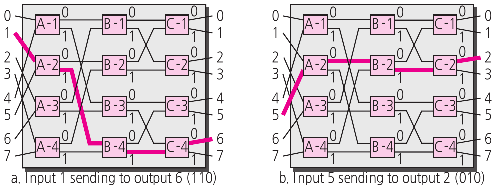

*그림 21. 8×8 반얀 스위치의 경로 선택*

그림 21은 입력 8개와 출력 8개이므로 log₂ 8 = 3단계이다. a에서 입력 1의 패킷은 이진수로 110인 출력 6으로 가야 한다. 마이크로스위치 A-2가 첫 비트(1)로, B-4가 둘째 비트(1)로, C-4가 셋째 비트(0)로 패킷을 보낸다. b에서 입력 5의 패킷은 010인 출력 2로 가야 한다. A-2가 0으로, B-2가 1로, C-2가 0으로 보낸다. 각 마이크로스위치는 비트가 0이면 위쪽 출력으로, 1이면 아래쪽 출력으로 패킷을 보낸다.

반얀 스위치에서는 두 패킷이 같은 출력으로 가지 않더라도 경로가 마이크로스위치 출력을 공유하면 내부 충돌이 생길 수 있다. 도착한 패킷을 목적지 포트에 따라 정렬하면 이 문제가 풀린다. K. E. Batcher가 반얀 스위치 앞에 두는 정렬 스위치를 설계했고, 이 조합을 **Batcher-반얀 스위치(Batcher-banyan switch)** 라고 한다. 둘 사이에는 보통 트랩이라는 하드웨어 모듈을 더한다. 트랩은 같은 출력 목적지를 가진 패킷들이 동시에 반얀 스위치에 들어가지 못하게 하여, 각 틱마다 목적지 하나에 패킷 하나만 지나가고 나머지는 다음 틱을 기다리게 한다.

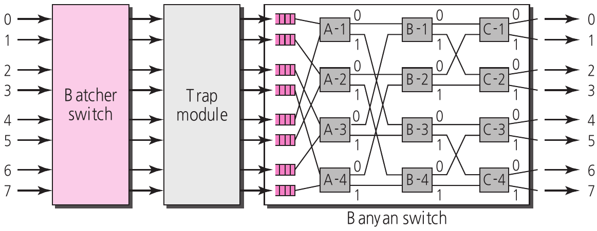

*그림 22. Batcher-반얀 스위치*

> **[컴퓨터구조]** 세 가지 교환 기법은 컴퓨터구조에서 배우는 다중 프로세서의 상호 연결과 닮았다. 메모리를 통한 교환은 처리량이 메모리 대역폭에 묶인 공유 메모리 다중 프로세서와 같고, 버스는 한 번에 한 전송만 허용하며, 크로스바나 다단계 네트워크(반얀 네트워크 등)는 더 많은 하드웨어 비용으로 여러 전송을 병렬로 허용한다.

### 7.4 출력 포트 처리

출력 포트 처리는 출력 포트의 메모리에 저장된 패킷을 출력 링크로 전송한다. 전송할 패킷을 골라 큐에서 꺼내고, 링크 계층과 물리 계층의 전송 기능을 수행한다. Forouzan의 출력 포트는 입력 포트를 거꾸로 한 것이다. 큐, 데이터 링크 계층 처리기, 물리 계층 처리기의 순서이다.

### 7.5 큐잉이 일어나는 곳

회전 교차로의 진입로와 출구 모두에서 차가 기다릴 수 있듯이, 패킷 큐는 입력 포트와 출력 포트 모두에 생길 수 있다. 어디에서 얼마나 큐잉이 생기는지는 트래픽 부하, 스위칭 패브릭의 속도, 회선 속도에 달려 있다. 큐가 커지면 라우터의 메모리가 바닥나 패킷이 손실된다. 네트워크 안에서 패킷이 실제로 버려지는 곳이 바로 여기이다.

입력 포트 N개와 출력 포트 N개가 모두 같은 회선 속도 $`R_{\text{line}}`$을 가지고, 패킷 길이가 고정되어 있으며, 동기적으로 도착한다고 하자. 패브릭이 패킷을 입력에서 출력으로 옮기는 속도를 $`R_{\text{switch}}`$라 하자. $`R_{\text{switch}}`$가 $`R_{\text{line}}`$의 N배이면 입력에서는 무시할 만한 큐잉만 생긴다. 입력 N개가 모두 같은 출력으로 가는 패킷을 받더라도 패킷 N개의 묶음이 다음 묶음이 도착하기 전에 패브릭을 건너기 때문이다.

**입력 큐잉.** 패브릭이 충분히 빠르지 않으면 패킷은 입력 포트에서 차례를 기다린다. 모든 링크 속도가 같고, 한 입력에서 주어진 출력으로 패킷 하나가 건너는 데 패킷 하나가 도착하는 시간이 걸리며, 패킷이 각 입력 큐를 FCFS 순서로 떠나는 크로스바 패브릭을 생각한다. 출력이 서로 다른 패킷들은 병렬로 건널 수 있지만, 두 입력 큐 맨 앞의 패킷들이 같은 출력으로 가면 하나는 막힌다.

> **용어 정의:** **HOL 블로킹(head-of-the-line blocking)** 은 입력 큐 스위치에서 큐에 있는 패킷이 자신의 출력 포트가 비어 있는데도 큐 맨 앞의 패킷이 막혀 있어 기다려야 하는 상황이다.

```text
Time t: output port contention, only one dark packet can be transferred

 Input 1:  [  ][  ][D->X]  ====>  fabric  ====>  Output X  (upper)
 Input 2:  [  ][  ][    ]                        Output Y  (middle)
 Input 3:  [  ][L->Y][D->X]                      Output Z  (lower)

Time t+1: the fabric chose input 1; input 3 waits

 Input 1:  [  ][  ][    ]                        Output X: D (from input 1)
 Input 2:  [  ][  ][    ]                        Output Y: (idle)
 Input 3:  [  ][L->Y][D->X]                      Output Z
           the light packet L waits behind D although output Y is free
```

*그림 23. 입력 큐 스위치의 HOL 블로킹*

그림 23에서 입력 1과 입력 3 맨 앞의 어두운 패킷은 모두 출력 X로 간다. 패브릭이 입력 1의 패킷을 옮기므로 입력 3의 어두운 패킷은 기다린다. 그 뒤에서 출력 Y로 가는 밝은 패킷도, 출력 Y를 원하는 다른 패킷이 없는데도 기다려야 한다. Kurose는 HOL 블로킹 때문에 일정한 가정 아래에서 입력 링크의 도착률이 용량의 58퍼센트에만 이르러도 입력 큐가 한없이 커진다는 결과를 인용한다.

**출력 큐잉.** $`R_{\text{switch}}`$가 $`R_{\text{line}}`$의 N배여도 출력 포트에는 큐가 생길 수 있다. N개 입력 모두에 도착한 패킷이 같은 출력으로 가면, 나가는 링크로 패킷 하나를 보내는 시간 동안 그 출력에 패킷 N개가 도착하여 기다려야 한다. 그다음 하나를 보내는 동안 다시 N개가 도착할 수 있고, 이렇게 계속되다가 출력 포트의 메모리가 바닥난다. 도착한 패킷을 둘 자리가 없으면 라우터는 도착한 패킷을 버리거나(**드롭 테일(drop-tail)** 정책), 자리를 만들기 위해 이미 큐에 있는 패킷을 없앤다. 버퍼가 차기 전에 패킷을 버리거나 표시하여 송신자에게 혼잡 신호를 줄 수도 있다. 이런 정책을 능동 큐 관리(AQM)라고 하며, 가장 널리 연구된 것 가운데 하나가 RED(Random Early Detection)이다.

**필요한 버퍼 크기.** 오랫동안 경험 법칙은 버퍼 크기 B가 평균 왕복 시간과 링크 용량 C의 곱이어야 한다는 것이었다. 그러면 RTT가 250 ms인 10 Gbps 링크에는 B = RTT × C = 0.25 s × 10 Gbps = 2.5 Gbit가 필요하다. 최근 연구는 링크를 지나는 TCP 흐름의 수 N이 크면 훨씬 적은 버퍼로 충분하다고 시사한다.

```math
B = \frac{\text{RTT} \cdot C}{\sqrt{N}}
```

예를 들어 같은 링크에 흐름이 10,000개 있으면 B = 2.5 Gbit / 100 = 25 Mbit이다. 백본 링크에는 보통 흐름이 많으므로 감소 폭이 크다.

### 7.6 패킷 스케줄링

> **용어 정의:** **패킷 스케줄링(packet scheduling)** 은 출력 포트에서 큐에 있는 패킷 가운데 다음에 나가는 링크로 보낼 패킷을 고르는 일이다.

아래 예에서는 Kurose의 그림과 같은 형태로, 패킷 다섯 개가 시각 0, 1.5, 2.5, 7.5, 13에 도착하고 각각 전송에 3 시간 단위가 필요하다고 둔다.

**FIFO(first-in-first-out).** FCFS(first-come-first-served)라고도 하는 FIFO는 도착한 순서대로 패킷을 보낸다. 도착한 패킷을 둘 버퍼 공간이 없으면 폐기 정책이 어느 패킷을 버릴지 정한다.

```text
Packet:      1      2      3      4      5
Arrival:     0      1.5    2.5    7.5    13
Service:   0-3    3-6    6-9    9-12   13-16
Departure:   3      6      9      12     16      (link idle from 12 to 13)
```

**우선순위 큐잉.** 도착한 패킷을 우선순위 등급으로 분류하며, 등급마다 큐가 따로 있다. 운영자는 예를 들어 포트 번호로 식별한 네트워크 관리 패킷이나, 전자 메일보다 실시간 IP 음성 패킷에 우선순위를 줄 수 있다. 스케줄러는 큐가 비어 있지 않은 가장 높은 등급에서 패킷을 보내며, 같은 등급 안에서는 FIFO 순서를 따른다. 비선점 우선순위 큐잉에서는 일단 시작한 전송을 중단하지 않는다.

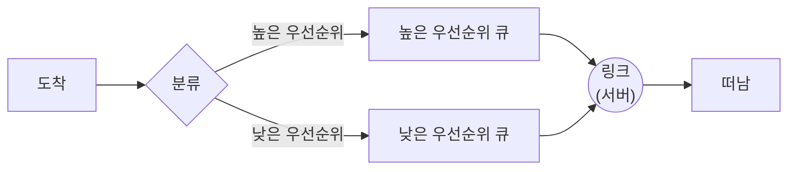

*그림 24. 우선순위 큐잉 모형*

패킷 1, 3, 4가 높은 등급, 패킷 2와 5가 낮은 등급이면 패킷 3이 늦게 도착했는데도 패킷 2보다 먼저 나간다. 패킷 4는 패킷 2를 보내는 중인 7.5에 도착하므로 그 전송이 끝날 때까지 기다린다.

```text
Service:   1 (0-3)   3 (3-6)   2 (6-9)   4 (9-12)   5 (13-16)
Departure order: 1, 3, 2, 4, 5
```

**라운드 로빈.** 우선순위 큐잉처럼 패킷을 등급으로 나누지만, 스케줄러는 엄격한 우선순위 대신 등급을 번갈아 서비스한다. 등급 1 패킷, 등급 2 패킷, 다시 등급 1 패킷 하는 식이다. **작업 보존형(work-conserving)** 방식은 큐에 패킷이 있는 한 링크를 놀리지 않으므로, 라운드 로빈 스케줄러는 차례인 등급에 패킷이 없으면 곧바로 다음 등급으로 넘어간다. 패킷 1, 2, 4가 등급 1, 패킷 3과 5가 등급 2이면, 패킷 1 다음에 스케줄러는 등급 2(패킷 3)를, 이어서 등급 1(패킷 2)을 서비스한다. 그다음에는 패킷 4만 큐에 있으므로 그것을 보낸다.

```text
Service:   1 (0-3)   3 (3-6)   2 (6-9)   4 (9-12)   5 (13-16)
Departure order: 1, 3, 2, 4, 5
```

> **용어 정의:** **가중 공정 큐잉(weighted fair queuing, WFQ)** 은 등급을 돌아가며 서비스하되 각 등급 i에 가중치 $`w_i`$에 비례하는 링크 속도의 몫을 보장하는 작업 보존형 스케줄링 방식이다.

**가중 공정 큐잉.** 라우터에 널리 구현된 일반화한 라운드 로빈인 WFQ도 등급을 차례로 서비스하지만, 각 등급 i는 가중치 $`w_i`$를 가진다. 등급 i에 보낼 패킷이 있는 동안 그 등급은 아래 몫의 서비스를 받으며, 분모의 합은 패킷이 큐에 있는 등급들에 대해 취한다.

```math
\frac{w_i}{\sum_j w_j}
```

모든 등급에 패킷이 있는 최악의 경우 합은 모든 등급에 대해 취하므로, 속도 R인 링크에서 등급 i는 언제나 적어도 다음 처리량을 얻는다.

```math
R \cdot \frac{w_i}{\sum_j w_j}
```

이 설명은 이상화한 것이다. 패킷은 이산적이고, 한 패킷의 전송을 중단하고 다른 패킷의 전송을 시작하지 않는다. 라운드 로빈은 가중치가 모두 같은 WFQ의 특수한 경우이다.

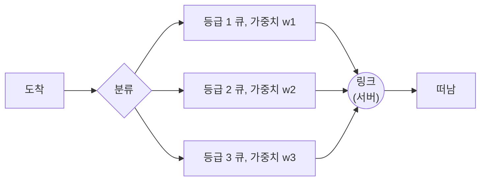

*그림 25. 가중 공정 큐잉 모형*

| 방식 | 등급 | 서비스 순서 | 보장 |
|:--|:--|:--|:--|
| FIFO | 하나 | 도착 순서 | 등급별 보장 없음 |
| 우선순위 | 여럿, 순위 있음 | 비어 있지 않은 가장 높은 등급부터 | 낮은 등급은 굶을 수 있음 |
| 라운드 로빈 | 여럿 | 등급을 차례로 | 활성 등급마다 같은 몫 |
| WFQ | 여럿, 가중치 있음 | 가중치에 따라 등급을 차례로 | 등급 i에 적어도 $`R \cdot w_i / \sum_j w_j`$ |

*표 16. 패킷 스케줄링 방식의 비교*

---

<br>

## 개념 적용

**T/F 점검:**

| 문장 | 판단과 근거 |
|:--|:--|
| 모든 패킷의 마지막 전달은 직접 전달이다. | **T.** 마지막 라우터, 또는 목적지가 자기 네트워크에 있으면 송신지가 언제나 같은 네트워크의 목적지에 전달한다. |
| 네트워크 특정 표에는 원격 네트워크의 호스트마다 항목이 하나씩 필요하다. | **F.** 네트워크 전체에 항목 하나면 되며, 그것이 이 방식의 목적이다. |
| 클래스 기반 라우터에서 처음 4비트가 1100인 목적지는 클래스 C 표에서 탐색한다. | **T.** 1100 = 12이고, 처음 4비트의 값 12와 13은 클래스 C를 뜻한다. |
| 라우터가 처음 일치한 항목에서 멈춘다면 클래스 없는 포워딩 테이블의 항목은 어떤 순서여도 된다. | **F.** 처음 일치한 항목이 가장 긴 접두사가 되도록 항목을 가장 긴 마스크부터 가장 짧은 마스크 순서로 정렬해야 한다. |
| 레이블에 따른 포워딩은 표 전체를 탐색해야 한다. | **F.** 레이블을 색인으로 쓰므로 항목에 바로 접근한다. |
| 크로스바 스위치는 같은 출력으로 가는 두 패킷을 동시에 옮길 수 있다. | **F.** 출력이 서로 다를 때만 비차단형이며, 같은 출력으로 가는 패킷은 입력에서 기다려야 한다. |
| 패브릭이 회선보다 N배 빨라도 출력 포트에서 큐잉이 생길 수 있다. | **T.** 패킷 하나를 보내는 시간 동안 출력 하나로 패킷 N개가 도착할 수 있다. |
| WFQ에서 한 등급은 언제나 정확히 자기 가중치를 모든 가중치의 합으로 나눈 몫을 받는다. | **F.** 그 몫은 최솟값이며, 다른 등급에 패킷이 없으면 WFQ는 작업 보존형이므로 그 등급이 더 많이 받는다. |

---

<br>

## 요약

| 개념 | 핵심 요약 |
|---------|-----------|
| 직접 전달과 간접 전달 | 목적지가 전달자의 네트워크에 있으면 직접 전달, 패킷이 다음 홉 라우터로 가면 간접 전달이다. |
| 포워딩 기법 | 다음 홉 방식은 다음 홉만, 네트워크 특정 방식은 네트워크마다 항목 하나를, 호스트 특정 방식은 개별 호스트의 항목을, 기본 방식은 모든 것을 받는 항목 하나를 저장한다. |
| 클래스 기반 포워딩 | 라우터는 주소를 28비트 이동하여 클래스를 찾고, 기본 마스크를 적용한 뒤 그 클래스의 표를 탐색한다. |
| 서브넷팅이 있는 포워딩 | 라우터는 서브넷 마스크를 적용하고 서브넷 주소의 표 하나를 탐색한다. |
| 클래스 없는 포워딩 | 마스크 열이 있는 표 하나를 가장 긴 마스크부터 가장 짧은 마스크까지 차례로 적용하며 탐색한다. |
| 최장 접두사 일치 | 여러 항목이 일치하면 가장 긴 접두사가 이기며, 그래서 집약된 항목과 더 구체적인 항목이 함께 있을 수 있다. |
| 표 탐색 | 클래스 기반 표는 클래스마다 버킷 하나를 쓰고, 클래스 없는 표는 회선 속도의 조회를 위해 접두사별 버킷, 트라이, TCAM이 필요하다. |
| 집약과 계층 | 연속한 블록을 접두사 하나로 광고하고, ISP 계층과 지리적 블록이 표를 작게 유지한다. |
| 레이블 기반 포워딩 | 스위치는 탐색 대신 레이블을 색인으로 쓰며(접근), MPLS는 IP 헤더 앞에 32비트 레이블 하위 헤더의 스택을 붙인다. |
| 라우터 구성 요소 | 입력 포트, 스위칭 패브릭, 출력 포트가 하드웨어 데이터 평면을 이루고, 라우팅 프로세서가 소프트웨어로 제어 평면을 실행한다. |
| 스위칭 패브릭 | 메모리와 버스 패브릭은 한 번에 한 패킷을 옮기고, 크로스바, 반얀, Batcher-반얀 패브릭은 여러 패킷을 병렬로 옮긴다. |
| 큐잉 | 입력 큐는 HOL 블로킹을 겪고, 많은 입력이 한 출력을 향하면 출력 큐가 생기며, 드롭 테일이나 AQM이 버릴 패킷을 정한다. |
| 버퍼 크기 | 고전적 규칙은 B = RTT × C이며, 흐름이 N개이면 RTT × C / √N으로 줄어든다. |
| 스케줄링 | FIFO는 도착 순서로, 우선순위는 등급 순위로, 라운드 로빈은 차례로, WFQ는 최소 속도를 보장하는 가중치로 서비스한다. |

---

<br>

## 점검 문제

1. **직접 전달과 간접 전달:** 호스트 192.168.10.37/26이 192.168.10.70과 192.168.10.12로 패킷을 보낸다. 각 경우가 직접 전달인지 간접 전달인지 판단하라.

   <details>
   <summary>정답</summary>

   /26의 마스크는 255.255.255.192이다. 37 AND 192 = 0이므로 송신자의 네트워크 주소는 192.168.10.0이다. 70 AND 192 = 64이므로 192.168.10.70의 네트워크 주소는 192.168.10.64이고, 송신자의 네트워크와 다르므로 간접 전달이다. 패킷은 기본 라우터로 간다. 12 AND 192 = 0이므로 192.168.10.12는 같은 네트워크에 있고 직접 전달이다.

   </details>

2. **최장 접두사 일치:** 포워딩 테이블이 130.40.0.0/16을 R1으로, 130.40.32.0/19를 R2로, 130.40.36.0/22를 R3으로, 0.0.0.0/0을 R4로 보낸다. (a) 130.40.38.5, (b) 130.40.50.1, (c) 130.41.0.1의 다음 홉을 구하라.

   <details>
   <summary>정답</summary>

   (a) 셋째 바이트 38 = 00100110을 /19 마스크의 셋째 바이트 224와 AND하면 32, /22 마스크의 셋째 바이트 252와 AND하면 36이다. 네 항목이 모두 일치하므로 접두사가 가장 긴 /22 항목을 쓰고 다음 홉은 R3이다. (b) 50 AND 224 = 32이므로 /19 항목은 일치하지만, 50 AND 252 = 48이므로 /22 항목은 일치하지 않는다. 다음 홉은 R2이다. (c) 130.41.0.1 AND 255.255.0.0 = 130.41.0.0은 130.40.0.0과 다르므로 기본 항목만 일치하고 다음 홉은 R4이다.

   </details>

3. **예외가 있는 집약:** 라우터가 172.20.16.0/24부터 172.20.23.0/24까지의 여덟 네트워크를 모두 R1으로 보낸다. 이 항목들을 하나로 집약하라. 172.20.20.0/24만 R2로 가야 한다면 표를 어떻게 만들어야 하는가?

   <details>
   <summary>정답</summary>

   셋째 바이트 16\~23은 이진수로 00010000\~00010111이고 처음 5비트 00010을 공유하므로 공통 접두사는 16 + 5 = 21비트이다. 16은 8의 배수이므로 항목들은 다음 홉이 R1인 단일 항목 172.20.16.0/21로 집약된다. 예외를 위해 다음 홉이 R2인 항목 172.20.20.0/24를 /21 항목 앞에 추가한다. 172.20.20.x로 가는 패킷은 두 항목 모두와 일치하지만 최장 접두사 일치에 따라 R2로 가고, 나머지 일곱 네트워크로 가는 패킷은 R1으로 간다.

   </details>

4. **클래스 기반 포워딩 모듈:** 클래스 기반 라우터가 150.25.7.9로 가는 패킷을 받는다. 28비트 이동의 결과는 무엇이고, 라우터는 어느 클래스 표에서 어떤 네트워크 주소를 탐색하는가?

   <details>
   <summary>정답</summary>

   150 = 10010110이므로 처음 4비트는 1001이고 이동 결과는 9이다. 값 8\~11은 클래스 B를 뜻한다. 기본 마스크 255.255.0.0을 적용하면 네트워크 주소 150.25.0.0이 나오며, 라우터는 이를 클래스 B 표에서 탐색한다.

   </details>

5. **클래스 없는 표의 추적:** 예제 6.7의 표 8로 목적지 주소가 (a) 180.70.65.210, (b) 201.4.17.9인 패킷의 포워딩을 추적하라.

   <details>
   <summary>정답</summary>

   (a) 넷째 바이트 210 = 11010010이고 첫 마스크 /26을 적용하면 11000000 = 192이므로 180.70.65.210 AND /26 = 180.70.65.192가 첫 행과 일치한다. 목적지 주소 자신과 인터페이스 m2를 ARP에 넘긴다(직접 전달). (b) /26, /25, /24 마스크는 201.4.17.0을 주며 처음 세 행 어디와도 일치하지 않는다. /22 마스크는 셋째 바이트의 처음 6비트를 남긴다. 17 = 00010001 AND 11111100 = 00010000 = 16이므로 201.4.16.0이 되어 넷째 행과 일치한다. 목적지 주소와 인터페이스 m1을 ARP에 넘긴다.

   </details>

6. **클래스 없는 표 만들기:** 라우터 R은 인터페이스 m0이 네트워크 10.1.0.0/16에, m1이 네트워크 10.2.4.0/24에 있다. 주소 10.2.4.1이 네트워크 10.2.4.0/24에 있는 라우터 S가 네트워크 10.3.0.0/16으로 이어지며, 기본 라우터 10.1.0.254는 네트워크 10.1.0.0/16에 있다. 최장 접두사 일치에 맞게 정렬한 R의 표를 쓰라.

   <details>
   <summary>정답</summary>

   네트워크 10.3.0.0/16에는 주소 10.2.4.1이 m1의 네트워크에 있는 S를 거쳐 이르므로 그 항목은 m1을 쓴다. 가장 긴 마스크부터 정렬하면 /24 10.2.4.0, 다음 홉 없음, m1; /16 10.1.0.0, 다음 홉 없음, m0; /16 10.3.0.0, 다음 홉 10.2.4.1, m1; /0 0.0.0.0, 다음 홉 10.1.0.254, m0이다. 두 /16 항목에 동시에 일치하는 주소는 없으므로 둘의 순서는 상관없고, 기본 항목은 맨 끝에 와야 한다.

   </details>

7. **HOL 블로킹:** 2×2 입력 큐 크로스바 스위치에서 입력 1에는 (맨 앞부터) 출력 1로 가는 패킷과 출력 2로 가는 패킷이, 입력 2에는 출력 1로 가는 패킷과 출력 2로 가는 패킷이 있다. 각 시간 슬롯에 입력마다 패킷 하나가 떠날 수 있고, 출력마다 패킷 하나를 받을 수 있다. 두 맨 앞 패킷이 같은 출력을 원하면 패브릭이 언제나 입력 1을 택한다면, 네 패킷을 모두 전달하는 데 슬롯이 몇 개 필요하고 HOL 블로킹은 어디서 일어나는가?

   <details>
   <summary>정답</summary>

   슬롯 1: 두 맨 앞 패킷이 모두 출력 1을 원하므로 입력 1의 패킷이 가고 입력 2의 맨 앞 패킷은 기다린다. 출력 2가 놀고 있는데도 출력 2로 가는 입력 2의 둘째 패킷이 그 뒤에서 막히며, 이것이 HOL 블로킹이다. 슬롯 2: 이제 입력 1의 맨 앞은 출력 2를, 입력 2의 맨 앞은 출력 1을 원하므로 둘이 병렬로 간다. 슬롯 3: 입력 2에 남은 패킷이 출력 2로 간다. HOL 블로킹이 없다면 두 슬롯이면 충분하지만 세 슬롯이 필요하다.

   </details>

8. **WFQ 몫:** 10 Mbps 링크가 가중치 1, 2, 2인 세 등급으로 WFQ를 쓴다. 모든 등급에 패킷이 있을 때 각 등급의 보장 속도와, 등급 2와 3에만 패킷이 있을 때의 속도를 구하라.

   <details>
   <summary>정답</summary>

   모든 등급이 활성이면 가중치 합이 5이므로 등급 1은 1/5 × 10 = 2 Mbps, 등급 2와 3은 각각 2/5 × 10 = 4 Mbps를 받는다. 등급 1에 패킷이 없으면 WFQ는 작업 보존형이고 합은 등급 2와 3에 대해서만 취하여 4이므로, 각각 2/4 × 10 = 5 Mbps를 받는다.

   </details>
