# Chapter 13 — Delivery, Forwarding, and Router Architecture

[Repository Guide](../../README.md) | [English](Concepts_Lecture.md) | [한국어](Concepts_Lecture.ko.md)

> **Last Updated:** 2026-11-18
>
> Computer Networking: A Top-Down Approach, Kurose and Ross, Ch 4; TCP/IP Protocol Suite, Forouzan, Ch 6

> **Learning Objectives:**
> 1. Distinguish direct delivery from indirect delivery and decide which one a host or router performs
> 2. Explain the next-hop, network-specific, host-specific, and default forwarding techniques
> 3. Trace the forwarding of a packet through classful and classless forwarding tables, including longest prefix matching
> 4. Explain address aggregation, hierarchical routing, and label-based forwarding
> 5. Describe the components of a router, the switching fabrics, and where queuing and HOL blocking occur
> 6. Compare the FIFO, priority, round robin, and weighted fair queuing scheduling disciplines

---

## Table of Contents

- [1. Delivery](#1-delivery)
  - [1.1 Direct Delivery](#11-direct-delivery)
  - [1.2 Indirect Delivery](#12-indirect-delivery)
- [2. Forwarding Techniques](#2-forwarding-techniques)
  - [2.1 Forwarding and the Forwarding Table](#21-forwarding-and-the-forwarding-table)
  - [2.2 Next-Hop Method](#22-next-hop-method)
  - [2.3 Network-Specific Method](#23-network-specific-method)
  - [2.4 Host-Specific Method](#24-host-specific-method)
  - [2.5 Default Method](#25-default-method)
- [3. Forwarding with Classful Addressing](#3-forwarding-with-classful-addressing)
  - [3.1 Forwarding without Subnetting](#31-forwarding-without-subnetting)
  - [3.2 Examples of Classful Forwarding](#32-examples-of-classful-forwarding)
  - [3.3 Forwarding with Subnetting](#33-forwarding-with-subnetting)
- [4. Forwarding with Classless Addressing](#4-forwarding-with-classless-addressing)
  - [4.1 A Table with a Mask Column](#41-a-table-with-a-mask-column)
  - [4.2 Tracing Classless Forwarding](#42-tracing-classless-forwarding)
  - [4.3 Guessing a Topology from a Table](#43-guessing-a-topology-from-a-table)
  - [4.4 Longest Prefix Matching](#44-longest-prefix-matching)
  - [4.5 Searching the Table](#45-searching-the-table)
- [5. Address Aggregation and Hierarchical Routing](#5-address-aggregation-and-hierarchical-routing)
  - [5.1 Address Aggregation](#51-address-aggregation)
  - [5.2 An Exception to Aggregation](#52-an-exception-to-aggregation)
  - [5.3 Hierarchical Routing](#53-hierarchical-routing)
  - [5.4 Geographical Routing](#54-geographical-routing)
- [6. Forwarding Based on Labels](#6-forwarding-based-on-labels)
  - [6.1 Searching and Indexing](#61-searching-and-indexing)
  - [6.2 MPLS](#62-mpls)
- [7. Router Architecture](#7-router-architecture)
  - [7.1 Components of a Router](#71-components-of-a-router)
  - [7.2 Input Port Processing](#72-input-port-processing)
  - [7.3 Switching Fabrics](#73-switching-fabrics)
  - [7.4 Output Port Processing](#74-output-port-processing)
  - [7.5 Where Queuing Occurs](#75-where-queuing-occurs)
  - [7.6 Packet Scheduling](#76-packet-scheduling)
- [Concept Applications](#concept-applications)
- [Summary](#summary)
- [Self-Check Questions](#self-check-questions)

---

<br>

## 1. Delivery

The network layer supervises the handling of packets by the underlying physical networks; this handling is the **delivery** of a packet. The delivery of a packet to its final destination is accomplished with two methods, direct and indirect. A packet that crosses several networks experiences a sequence of indirect deliveries followed by exactly one direct delivery.

### 1.1 Direct Delivery

> **Definition:** **Direct delivery** is the delivery of a packet by a host or router to a final destination connected to the same physical network as the deliverer.

Direct delivery occurs in two situations: when the source and the destination of the packet are on the same physical network, and when the last router on the path delivers the packet to the destination host. In Figure 1, host A delivers directly to host B on the same link, and the router delivers directly to B a packet that came from the rest of the Internet.

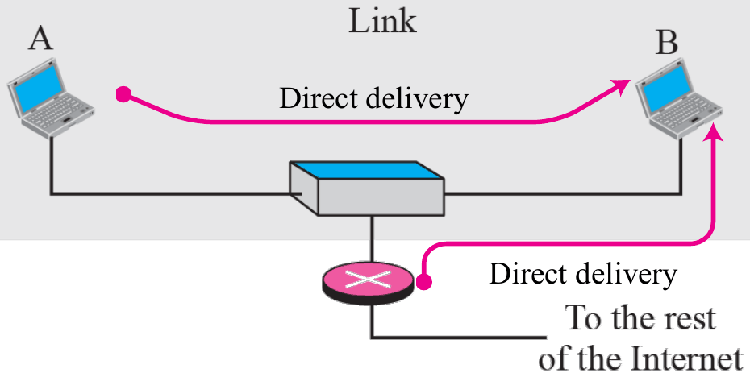

*Figure 1. Direct delivery on one network and from the last router*

The sender can easily decide whether the delivery is direct. It extracts the network address of the destination (the netid, or the prefix with the mask) and compares it with the address of the network to which it is connected. If they match, the delivery is direct.

### 1.2 Indirect Delivery

> **Definition:** **Indirect delivery** is the delivery of a packet by a host or router to a router, because the final destination is not on the same network as the deliverer.

In an indirect delivery the packet goes from router to router until it reaches one connected to the same physical network as its final destination. To decide which router comes next, the deliverer uses its table to find the IP address of the next hop.

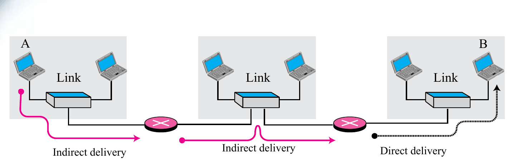

*Figure 2. Indirect deliveries followed by a final direct delivery*

In Figure 2, host A delivers the packet indirectly to the first router, which delivers it indirectly to the second router, which finally delivers it directly to host B. The two kinds of delivery are therefore distinguished by whether there is a next hop: an indirect delivery sends the packet to a next-hop router, while a direct delivery sends it to the destination itself.

> **Key Point:** A delivery always involves one direct delivery, the last one. It involves zero or more indirect deliveries before it, one for each router that forwards the packet to another router.

---

<br>

## 2. Forwarding Techniques

### 2.1 Forwarding and the Forwarding Table

Forwarding means placing the packet on its route to its destination, that is, delivering it to the next hop. It requires a host or router to have a table. The simple solution of looking up the complete route of each destination is impossible in today's internetwork, so several techniques keep the table at a manageable size and also handle issues such as security.

> **Note:** Forouzan calls the table that a host or router consults for every packet a routing table. These notes call it the forwarding table, following Kurose, because it is used by forwarding (Chapter 10). The name routing table is kept for the tables that routing protocols such as RIP, OSPF, and BGP build (Chapters 14 and 15), from which the forwarding table is derived.

### 2.2 Next-Hop Method

> **Definition:** The **next-hop method** is a forwarding technique in which the table holds only the address of the next hop for a destination instead of information about the complete route.

In Figure 3, host A sends to host B through routers R1 and R2. Tables based on the complete route repeat information that the next routers already have, so the next-hop method keeps only the next step. The entries of the tables must be consistent with one another, so that following the next hops from A actually leads to B.

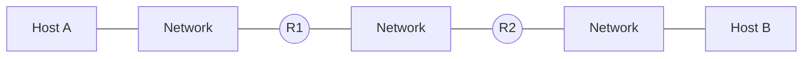

*Figure 3. A path from host A to host B through two routers*

| Table of | a. Based on route: Destination | Route | b. Based on next hop: Destination | Next hop |
|:--|:--|:--|:--|:--|
| A | Host B | R1, R2, Host B | Host B | R1 |
| R1 | Host B | R2, Host B | Host B | R2 |
| R2 | Host B | Host B | Host B | (none, direct delivery) |

*Table 1. Tables based on the complete route and tables based on the next hop*

### 2.3 Network-Specific Method

> **Definition:** The **network-specific method** is a forwarding technique in which the table has one entry for each destination network instead of one entry for each destination host.

All hosts connected to the same network are treated as one entity. If 1,000 hosts are attached to a network, the table has one entry for them instead of 1,000. In Figure 4, host S on network N1 needs four entries in a host-specific table to reach hosts A, B, C, and D on network N2, but only one entry in a network-specific table.

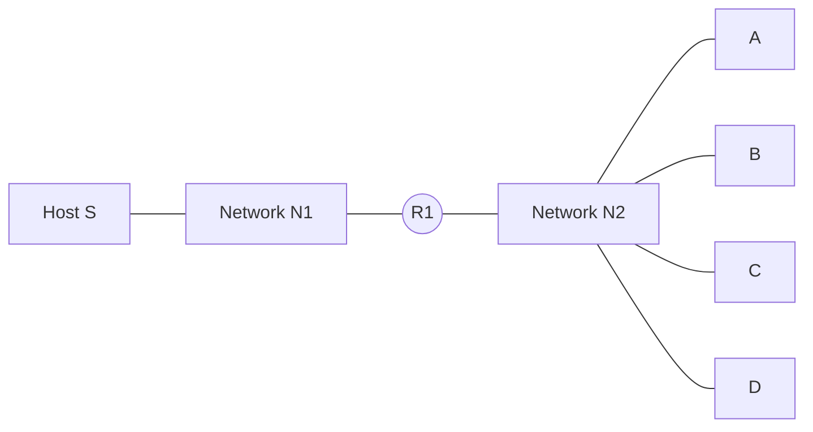

*Figure 4. Host S reaches four hosts of network N2 through router R1*

| Host-specific table for S: Destination | Next hop | Network-specific table for S: Destination | Next hop |
|:--|:--|:--|:--|
| A | R1 | N2 | R1 |
| B | R1 | | |
| C | R1 | | |
| D | R1 | | |

*Table 2. A host-specific table and a network-specific table for host S*

### 2.4 Host-Specific Method

> **Definition:** The **host-specific method** is a forwarding technique in which the table contains an entry for a particular destination host.

The rationale is the inverse of the network-specific method: efficiency is sacrificed for control. An administrator may want packets for one host to follow a particular route. In Figure 5, host A normally reaches network N2 through R1 and network N3 through R3. A single host-specific entry makes all packets for host B, which is on N3, go to R3, regardless of how other destinations are reached. Host-specific routing is used for purposes such as checking a route or providing security measures.

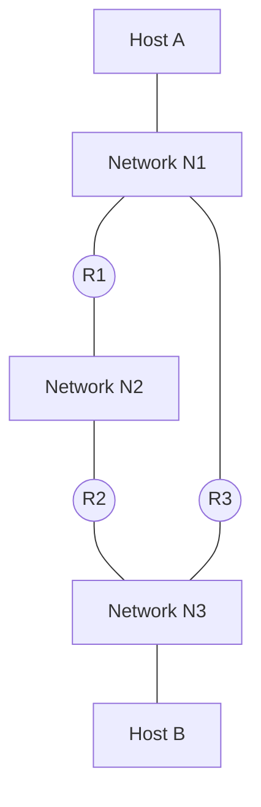

*Figure 5. A topology in which host A uses a host-specific entry for host B*

| Destination | Next hop |
|:--|:--|
| Host B | R3 |
| N2 | R1 |
| N3 | R3 |
| ... | ... |

*Table 3. The table of host A with a host-specific entry*

### 2.5 Default Method

> **Definition:** A **default route** is a table entry, usually written with the network address 0.0.0.0, that is used for every destination that matches no other entry.

In Figure 6, host A is connected to network N1 with two routers. R1 leads to network N2, and R2 leads to the rest of the Internet. Instead of listing every network of the Internet, host A keeps one entry for N2 and one default entry that sends everything else to R2, the default router.

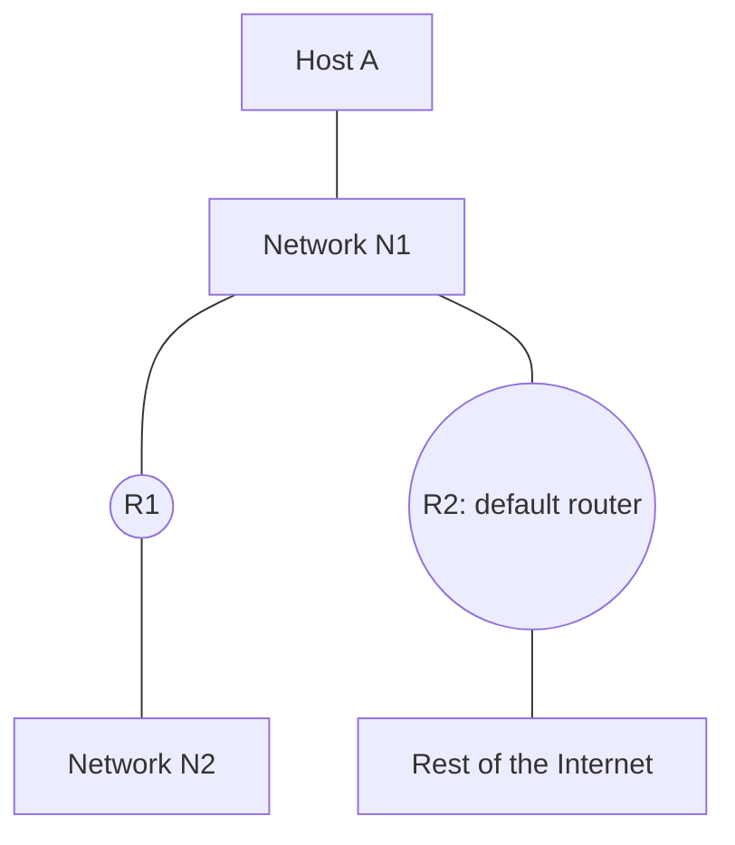

*Figure 6. A host with a default router*

| Destination | Next hop |
|:--|:--|
| N2 | R1 |
| Default | R2 |

*Table 4. The table of host A with a default entry*

---

<br>

## 3. Forwarding with Classful Addressing

### 3.1 Forwarding without Subnetting

In classful addressing (Chapter 12), most routers in the global Internet are not involved in subnetting, which happens inside organizations. The default mask that is inherent in a classful address makes forwarding simple. A typical router keeps three tables, one for each of classes A, B, and C, which makes searching more efficient. Each table has at least three columns.

| Column | Meaning |
|:--|:--|
| Network address | The network where the destination host is located; forwarding is normally network-specific. |
| Next-hop address | The router to which the packet must be delivered in an indirect delivery; empty for a direct delivery. |
| Interface number | The outgoing port from which the packet is sent, written m0, m1, and so on. |

*Table 5. Columns of a classful forwarding table*

The forwarding module works in five steps.

1. It extracts the destination address of the packet.
2. It makes a copy of the destination address and shifts it 28 bits to the right. The result is the value of the first 4 bits, from 0 to 15, which gives the class: 0 to 7 is class A, 8 to 11 is B, 12 and 13 are C, 14 is D, and 15 is E. A class D or E address is reported as an error by this simple module.
3. It uses the class and the destination address to extract the network address, by applying the default mask of the class.
4. It searches the table of that class for the network address to find the next-hop address and the interface number. If no match is found, it uses the default.
5. It passes the next-hop address and the interface number to ARP (Chapter 19), which finds the physical address of the next hop and asks the data link layer to deliver the packet.

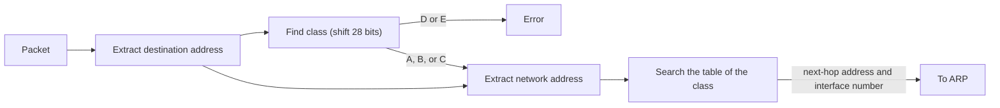

*Figure 7. A simplified forwarding module for classful addresses without subnetting*

### 3.2 Examples of Classful Forwarding

**Example 6.1.** Figure 8 shows an imaginary part of the Internet around router R1. R1 connects through interface m0 to network 111.0.0.0/8, through m1 to 145.80.0.0/16, and through m2 to 170.14.0.0/16. On network 111.0.0.0/8 there are also router R2 (111.30.31.18), the default router toward the rest of the Internet, and router R3 (111.15.17.32), which leads to network 192.16.7.0/24.

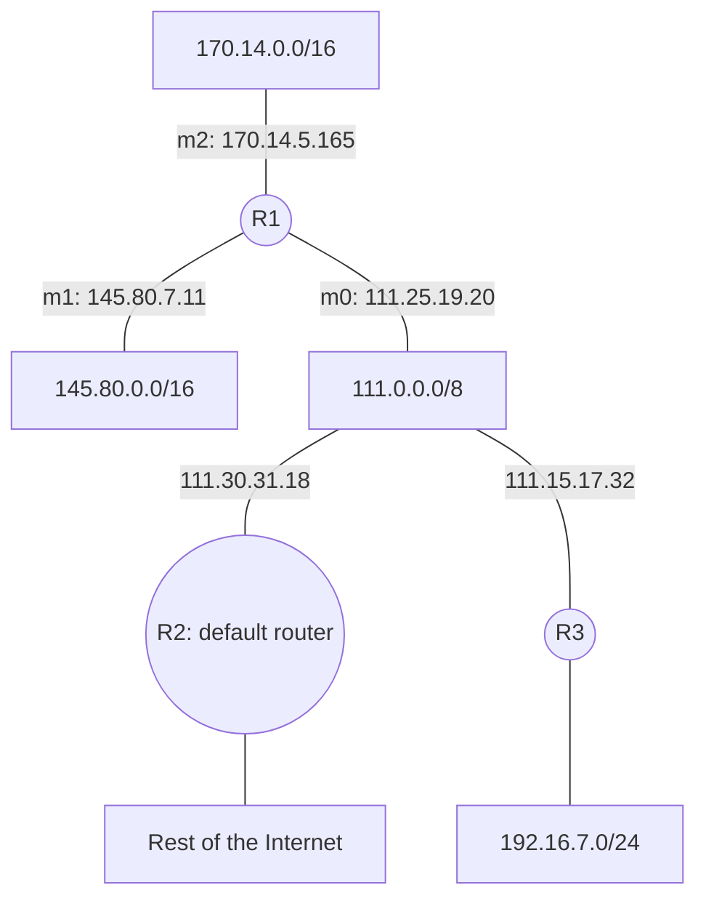

*Figure 8. Configuration of Example 6.1*

| Class | Network address | Next-hop address | Interface |
|:--|:--|:--|:--|
| A | 111.0.0.0 | (none) | m0 |
| B | 145.80.0.0 | (none) | m1 |
| B | 170.14.0.0 | (none) | m2 |
| C | 192.16.7.0 | 111.15.17.32 | m0 |
| Default | | 111.30.31.18 | m0 |

*Table 6. The three classful tables of router R1 and its default entry*

The next-hop column is empty for the networks to which R1 is directly connected. For these, the next-hop address given to ARP is simply the destination address of the packet.

**Example 6.2.** R1 receives a packet with destination address 192.16.7.14, which is 11000000 00010000 00000111 00001110 in binary. Shifting a copy 28 bits to the right gives 00001100 = 12, so the class is C. Masking off all but the leftmost 24 bits gives the network address 192.16.7.0, which is found in the first row of the class C table. The next-hop address 111.15.17.32 and the interface m0 are passed to ARP.

**Example 6.3.** R1 receives a packet with destination address 167.24.160.5, which is 10100111 00011000 10100000 00000101 in binary. Shifting 28 bits to the right gives 00001010 = 10, so the class is B. Keeping the leftmost 16 bits gives the network address 167.24.0.0. The class B table has no matching entry, so the packet goes to the default router: the next-hop address 111.30.31.18 and the interface m0 are passed to ARP.

### 3.3 Forwarding with Subnetting

When an organization subnets its network, the routers inside it must forward to subnets. With fixed-length subnetting, the router needs only one table, and its module works as follows.

1. It extracts the destination address of the packet.
2. If the destination matches a host-specific entry of the table, it takes the next-hop address and interface number from that entry.
3. It uses the destination address and the subnet mask to extract the subnet address.
4. It searches the table for the subnet address to find the next-hop address and the interface number; if no match is found, it uses the default.
5. It passes the next-hop address and the interface number to ARP.

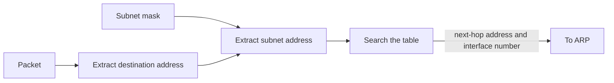

*Figure 9. A simplified forwarding module for classful addresses with subnetting*

**Example 6.4.** Figure 10 shows a router connected to four subnets of the site 145.14.0.0/16, each a /18 block, like the campus network of Chapter 12. The router connects to the subnets through m0 to m3 and to the rest of the Internet through m4, and its subnet mask is /18.

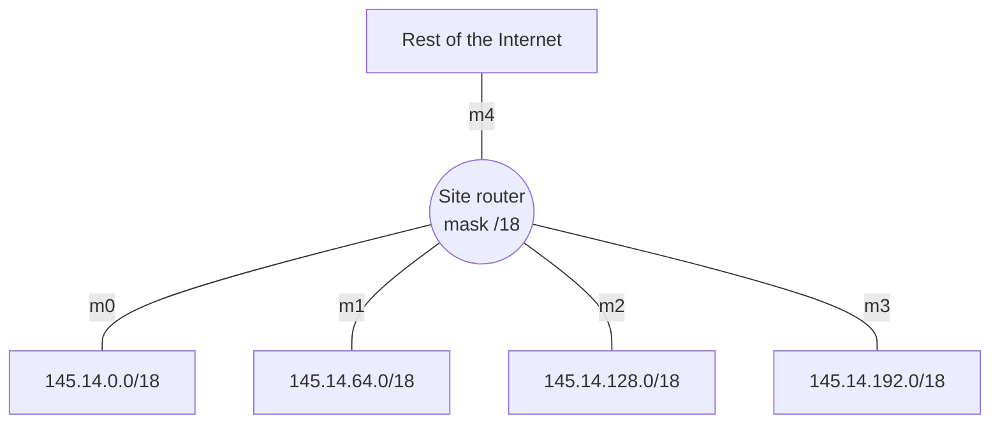

*Figure 10. Configuration of Example 6.4: a site 145.14.0.0/16 with four subnets*

| Subnet address | Next-hop address | Interface |
|:--|:--|:--|
| 145.14.0.0 | (none) | m0 |
| 145.14.64.0 | (none) | m1 |
| 145.14.128.0 | (none) | m2 |
| 145.14.192.0 | (none) | m3 |
| 0.0.0.0 | default router | m4 |

*Table 7. The table of the site router in Example 6.4*

**Example 6.5.** The router receives a packet with destination address 145.14.32.78. The third byte is 32 = 00100000; ANDed with 11000000 (the third byte of the /18 mask) it gives 0, so the subnet address is 145.14.0.0. The packet is delivered to ARP with the next-hop address 145.14.32.78, the destination itself, and the outgoing interface m0.

**Example 6.6.** A host in network 145.14.0.0 sends a packet to 7.22.67.91. The router applies the mask /18 and obtains 7.22.64.0. This address is not in the table, so the router sends the packet to the default router through m4.

---

<br>

## 4. Forwarding with Classless Addressing

### 4.1 A Table with a Mask Column

In classless addressing the whole address space is one entity; there are no classes, so the destination address itself does not tell how many bits form the network part. The table therefore needs one more column, the mask (/n), and one table replaces the three class tables.

> **Key Point:** In classful addressing a forwarding table has at least three columns; in classless addressing it needs at least four: mask, network address, next-hop address, and interface.

**Example 6.7.** Figure 11 shows router R1 with four interfaces. Interface m0 (180.70.65.135) is on network 180.70.65.128/25, m1 (201.4.16.2) on 201.4.16.0/22, m2 (180.70.65.194) on 180.70.65.192/26, and m3 (201.4.22.3) on 201.4.22.0/24. Network 180.70.65.192/26 also contains the default router 180.70.65.200, which leads to the rest of the Internet. Table 8 is the forwarding table of R1.

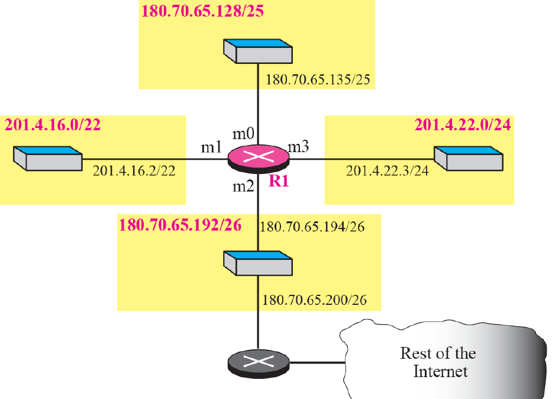

*Figure 11. Configuration of Example 6.7*

| Mask | Network address | Next hop | Interface |
|:--|:--|:--|:--|
| /26 | 180.70.65.192 | (none) | m2 |
| /25 | 180.70.65.128 | (none) | m0 |
| /24 | 201.4.22.0 | (none) | m3 |
| /22 | 201.4.16.0 | (none) | m1 |
| Default | Default | 180.70.65.200 | m2 |

*Table 8. The forwarding table of router R1 in Example 6.7*

### 4.2 Tracing Classless Forwarding

For each entry in turn, the module applies the entry's mask to the destination address and compares the result with the entry's network address. The first match determines the next hop and interface. The table is sorted from the longest mask to the shortest, so the first match is also the most specific one (Section 4.4).

**Example 6.8.** A packet arrives at R1 with destination address 180.70.65.140. The fourth byte is 140 = 10001100.

```text
Row 1: 180.70.65.140 AND /26 (255.255.255.192) = 180.70.65.128   != 180.70.65.192
Row 2: 180.70.65.140 AND /25 (255.255.255.128) = 180.70.65.128   == 180.70.65.128   -> match, m0
```

The next-hop address, which in this case is the destination address of the packet, and the interface m0 are passed to ARP.

**Example 6.9.** A packet arrives at R1 with destination address 201.4.22.35. The fourth byte is 35 = 00100011.

```text
Row 1: 201.4.22.35 AND /26 = 201.4.22.0   != 180.70.65.192
Row 2: 201.4.22.35 AND /25 = 201.4.22.0   != 180.70.65.128
Row 3: 201.4.22.35 AND /24 = 201.4.22.0   == 201.4.22.0      -> match, m3
```

The destination address of the packet and the interface m3 are passed to ARP.

**Example 6.10.** A packet arrives at R1 with destination address 18.24.32.78. All masks are applied, and no network address matches. When the module reaches the end of the table, it gives the next-hop address 180.70.65.200 and the interface m2 to ARP. This is probably an outgoing packet that must be sent, through the default router, to some other place in the Internet.

### 4.3 Guessing a Topology from a Table

**Example 6.11.** Can the configuration of a router be found from its table alone? Table 9 is the table of router R1.

| Mask | Network address | Next-hop address | Interface |
|:--|:--|:--|:--|
| /26 | 140.6.12.64 | 180.14.2.5 | m2 |
| /24 | 130.4.8.0 | 190.17.6.2 | m1 |
| /16 | 110.70.0.0 | (none) | m0 |
| /16 | 180.14.0.0 | (none) | m2 |
| /16 | 190.17.0.0 | (none) | m1 |
| Default | Default | 110.70.4.6 | m0 |

*Table 9. The table of router R1 in Example 6.11*

The entries without a next hop are networks directly connected to R1: 110.70.0.0/16 on m0, 190.17.0.0/16 on m1, and 180.14.0.0/16 on m2. The entries with a next hop are remote networks: 130.4.8.0/24 is reached through 190.17.6.2, a router on the network of m1, and 140.6.12.64/26 through 180.14.2.5, a router on the network of m2. The default router 110.70.4.6 lies on the network of m0. Figure 12 shows a topology consistent with the table. What lies between the routers R2 and R3 and the remote networks is unknown.

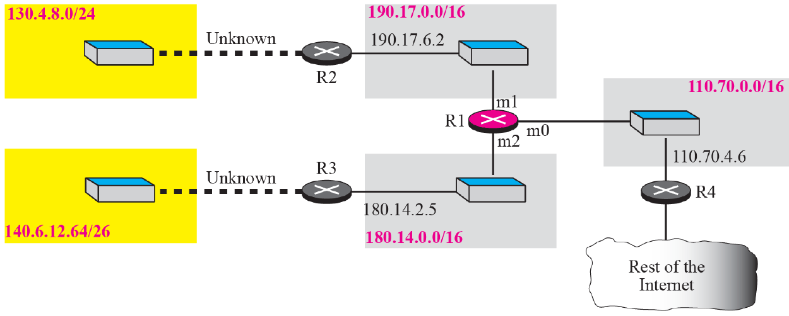

*Figure 12. A guessed topology for Example 6.11*

### 4.4 Longest Prefix Matching

A destination address may match more than one entry. Kurose's example shows why. A router has four links, numbered 0 to 3, and forwards by address ranges.

| Destination address range | Link interface |
|:--|:--|
| 11001000 00010111 00010000 00000000 through 11001000 00010111 00010111 11111111 | 0 |
| 11001000 00010111 00011000 00000000 through 11001000 00010111 00011000 11111111 | 1 |
| 11001000 00010111 00011001 00000000 through 11001000 00010111 00011111 11111111 | 2 |
| Otherwise | 3 |

*Table 10. Address ranges and link interfaces of Kurose's example*

A table with one entry per address would need more than 4 billion entries. Instead the router matches prefixes, and four entries suffice.

| Prefix | Same prefix in slash notation | Link interface |
|:--|:--|:--|
| 11001000 00010111 00010 | 200.23.16.0/21 | 0 |
| 11001000 00010111 00011000 | 200.23.24.0/24 | 1 |
| 11001000 00010111 00011 | 200.23.24.0/21 | 2 |
| Otherwise | 0.0.0.0/0 | 3 |

*Table 11. The prefix forwarding table of Kurose's example*

The destination 11001000 00010111 00010110 10100001 (200.23.22.161) matches only the first entry, so it goes to link 0. The destination 11001000 00010111 00011000 10101010 (200.23.24.170), however, matches both the 24-bit second entry and the 21-bit third entry, because the third prefix covers 200.23.24.0 to 200.23.31.255.

> **Definition:** **Longest prefix matching** is the forwarding rule by which, when a destination address matches several entries of the table, the router uses the entry with the longest matching prefix.

By this rule 200.23.24.170 goes to link 1, the most specific match. Forouzan states the same principle as longest mask matching: the table is sorted from the longest mask to the shortest, so that if there are masks /27, /26, and /24, the /27 entries come first and the /24 entries last, and the first match found is the longest one. Longest prefix matching is what lets aggregated entries and more specific exception entries coexist (Section 5.2).

> **Key Point:** A router must pick the longest matching prefix, not the first entry it finds in arbitrary order. Sorting the table by decreasing mask length makes the first match the longest one.

### 4.5 Searching the Table

The search algorithms of classful addressing had to change for classless addressing.

- **Searching in classful addressing.** The table can be divided into three buckets, one per class. The router applies the default mask inherent in the address to choose the bucket and searches only that bucket. Some routers even use 8 buckets for class A, 4 for class B, and 2 for class C, based on the first bits of the address.
- **Searching in classless addressing.** The destination address carries no network information. The simplest method divides the table into buckets, one per prefix length, and tries the longest prefix first, then the next, and so on, which takes a long time. A better solution changes the data structure, for example to a tree or a trie, a special kind of tree.

At high link rates the lookup must also be fast. Kurose points out that with a 10 Gbps input link and a 64-byte datagram, the input port has only 64 × 8 / 10¹⁰ s = 51.2 ns to process a datagram before the next one may arrive, so lookup must be done in hardware and with techniques beyond a linear search. Ternary content addressable memories (TCAMs) are often used: a 32-bit IP address is presented to the memory, which returns the content of the matching entry in essentially constant time.

> **[Computer Architecture]** A content addressable memory, studied in Computer Architecture together with caches and memory hierarchies, is searched by content rather than by address: every stored word is compared with the input in parallel. A ternary CAM stores, for each bit, 0, 1, or "don't care", so an entry such as 200.23.16.0/21 stores its 21 prefix bits and 11 don't-care bits. If the entries are stored in order of decreasing prefix length and the first matching entry is selected, a TCAM finds the longest matching prefix in a single lookup. Memory access time is otherwise the limit of lookup, which is why designs combine on-chip DRAM with faster SRAM.

---

<br>

## 5. Address Aggregation and Hierarchical Routing

### 5.1 Address Aggregation

With classful addressing there was one table entry for each site outside an organization, even if the site was subnetted. With classless addressing, which divides the address space into many manageable blocks, the number of entries tends to grow, and so does the time needed to search the table. Address aggregation (Chapter 12) alleviates the problem.

In Figure 13, router R1 is connected to the networks of four organizations, each with 64 addresses, and router R2 is somewhere far from R1. R1 needs a longer table, because each packet must reach the right organization. R2 can have a very small table: every packet with a destination from 140.24.7.0 to 140.24.7.255 leaves through m0, regardless of the organization.

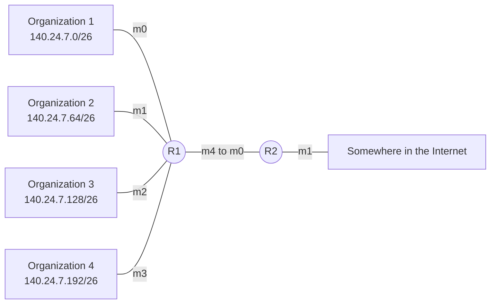

*Figure 13. Address aggregation of four organizations*

| Router | Mask | Network address | Next-hop address | Interface |
|:--|:--|:--|:--|:--|
| R1 | /26 | 140.24.7.0 | (none) | m0 |
| R1 | /26 | 140.24.7.64 | (none) | m1 |
| R1 | /26 | 140.24.7.128 | (none) | m2 |
| R1 | /26 | 140.24.7.192 | (none) | m3 |
| R1 | /0 | 0.0.0.0 | default router | m4 |
| R2 | /24 | 140.24.7.0 | (none) | m0 |
| R2 | /0 | 0.0.0.0 | default router | m1 |

*Table 12. The tables of R1 and R2 with aggregation at R2*

The blocks of the four organizations are aggregated into one larger block, 140.24.7.0/24. Although the idea is similar to subnetting, there is no common site here: the network of each organization is independent. Aggregation can also have several levels. R2 would need a longer table if the organizations had addresses that could not be aggregated into one block.

### 5.2 An Exception to Aggregation

Suppose organization 4 cannot be connected to R1 and is attached to a third router R3 instead, while keeping its block 140.24.7.192/26. Aggregation can still be used, thanks to longest prefix matching. R2 keeps the aggregated entry for 140.24.7.0/24 toward R1 and adds a more specific entry for 140.24.7.192/26 toward R3, sorted before it.

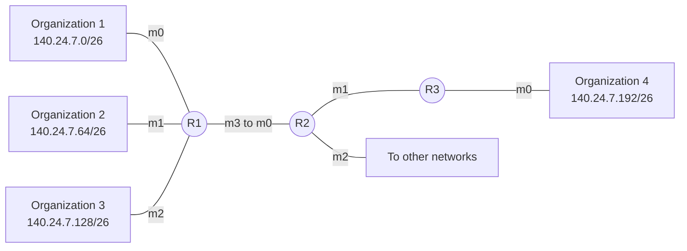

*Figure 14. Organization 4 separated from the other three organizations*

| Mask | Network address | Next-hop address | Interface |
|:--|:--|:--|:--|
| /26 | 140.24.7.192 | (R3) | m1 |
| /24 | 140.24.7.0 | (R1) | m0 |
| /0 | 0.0.0.0 | default router | m2 |

*Table 13. The table of R2 sorted from the longest mask to the shortest*

A packet for 140.24.7.200 arrives at R2. The first mask, /26, gives 140.24.7.192, which matches, so the packet leaves through m1 toward R3 and reaches organization 4. If the table were not sorted with the longest prefix first, the /24 mask would match first and the packet would be sent wrongly to R1. Kurose's Fly-By-Night-ISP and ISPs-R-Us example in Chapter 12 is the same situation at the scale of ISPs.

### 5.3 Hierarchical Routing

To solve the problem of gigantic tables, the tables can follow the hierarchy of the Internet, which is divided into backbone, regional, and local ISPs. A local ISP is assigned one large block a.b.c.d/n and divides it into smaller blocks of different sizes e.f.g.h/m, with m greater than n, for its customers. The rest of the Internet does not need to know this division: all customers of the local ISP are defined as a.b.c.d/n, so every router in the world needs only one entry for all of them. Inside the ISP, routers recognize the subblocks, and a customer that is a large organization can add further levels by subnetting. In classless routing the levels of hierarchy are unlimited, as long as the rules of classless addressing are followed.

**Example 6.12.** A regional ISP is granted 16,384 addresses starting from 120.14.64.0, that is, 120.14.64.0/18. It divides the block into 4 subblocks of 4,096 addresses (/20), assigns three of them to three local ISPs, and reserves the second for future use.

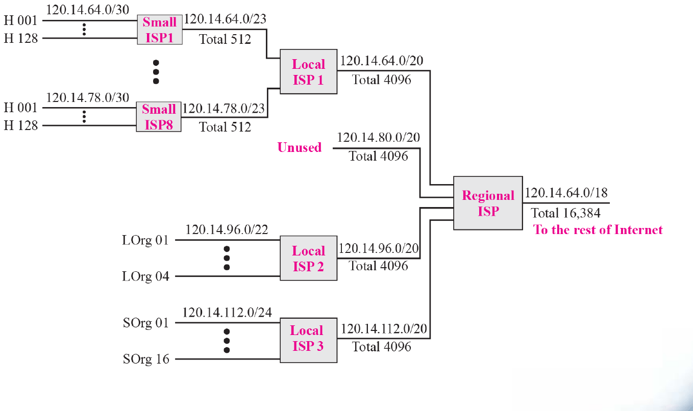

*Figure 15. Hierarchical routing with ISPs in Example 6.12*

| Level | Owner | Block | Division |
|:--|:--|:--|:--|
| 1 | Regional ISP | 120.14.64.0/18 (16,384 addresses) | Into 4 blocks of /20 |
| 2 | Local ISP 1 | 120.14.64.0/20 (4,096) | Into 8 small ISPs of /23 (512 each) |
| 2 | (unused) | 120.14.80.0/20 (4,096) | Reserved |
| 2 | Local ISP 2 | 120.14.96.0/20 (4,096) | Into 4 large organizations of /22 (1,024 each) |
| 2 | Local ISP 3 | 120.14.112.0/20 (4,096) | Into 16 small organizations of /24 (256 each) |
| 3 | Small ISP 1 | 120.14.64.0/23 (512) | Into 128 households of /30 (4 each) |

*Table 14. The levels of the hierarchy in Example 6.12*

The first local ISP divides its subblock into 8 smaller blocks, one for each small ISP, so each small ISP has a /23. Each small ISP serves 128 households (H001 to H128), each using four addresses, so each household has a /30 ($`2^{32-30} = 4`$); small ISP 1 serves households from 120.14.64.0/30 to 120.14.65.252/30, and small ISP 8 from 120.14.78.0/30 to 120.14.79.252/30. The second local ISP assigns its 4 blocks of 1,024 addresses (/22) to four large organizations, LOrg01 to LOrg04, from 120.14.96.0/22 to 120.14.108.0/22. The third local ISP assigns its 16 blocks of 256 addresses (/24) to sixteen small organizations, SOrg01 to SOrg16, from 120.14.112.0/24 to 120.14.127.0/24.

The hierarchy shows in the forwarding. All routers in the Internet send a packet with a destination from 120.14.64.0 to 120.14.127.255 to the regional ISP. The regional ISP sends every packet with a destination from 120.14.64.0 to 120.14.79.255 to local ISP 1. Inside, local ISP 1 sends every packet with a destination from 120.14.64.0 to 120.14.64.3 to household H001.

### 5.4 Geographical Routing

To decrease the size of the tables even further, hierarchical routing can be extended to geographical routing. The entire address space is divided into a few large blocks, one for America, one for Europe, one for Asia, one for Africa, and so on. The routers of ISPs outside Europe then have only one entry for packets to Europe, the routers outside America only one entry for packets to America, and so on.

---

<br>

## 6. Forwarding Based on Labels

### 6.1 Searching and Indexing

In the 1980s an effort started to make IP behave like a connection-oriented protocol in which routing is replaced by switching. In a connectionless network (the datagram approach), a router forwards a packet based on the destination address in its header. In a connection-oriented network (the virtual-circuit approach of Chapter 10), a switch forwards a packet based on the label attached to it. Forwarding by destination address normally searches the contents of a table, while forwarding by label accesses the table using the label as an index: routing involves searching, and switching involves accessing.

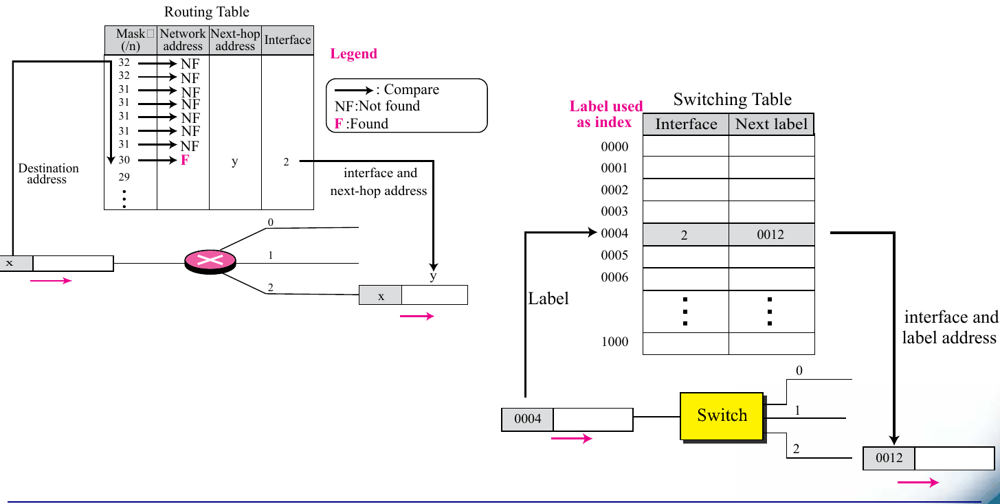

*Figure 16. Forwarding by destination address and forwarding by label*

**Example 6.13.** At the left of Figure 16, a router forwards by destination address with the longest match algorithm. For each entry it applies the mask to find the destination network address and compares it with the network address of the entry; the entries with masks /32, /31, and so on are not found (NF), until an entry with mask /30 is found (F). The router then passes the next-hop address and the interface number of that entry to ARP. Each comparison costs time, and the number of comparisons grows with the table.

**Example 6.14.** At the right of Figure 16, a switch receives a packet with label 0004. It uses the label directly as the index of its switching table: row 0004 says that the packet leaves through interface 2 with the new label 0012. Finding the information in the table is immediate, whatever the size of the table.

### 6.2 MPLS

During the 1980s several vendors created routers that implement switching technology, and the IETF later approved a standard called **Multiprotocol Label Switching (MPLS)**. In this standard, some conventional routers of the Internet can be replaced by MPLS routers that can behave both as a router and as a switch. Behaving as a router, an MPLS router forwards a packet based on its destination address; behaving as a switch, it forwards a packet based on its label.

To simulate connection-oriented switching with IP, the packet needs a field that carries a label. The IPv4 format does not allow this extension (IPv6 provides a flow label, Chapter 24), so the IPv4 packet is encapsulated in an MPLS packet: an MPLS header is added in front of the IP header, as though MPLS were a layer between the data link layer and the network layer.

```text
         +-------------+---------------+----------------------------+
<------  | MPLS header |   IP header   |         IP payload         |
         +-------------+---------------+----------------------------+

MPLS header = a stack of 32-bit subheaders:
+------------------------------+-------+---+---------------+
|          Label (20)          |Exp (3)| S |    TTL (8)    |
+------------------------------+-------+---+---------------+
|          Label (20)          |Exp (3)| S |    TTL (8)    |
+------------------------------+-------+---+---------------+
```

*Figure 17. An MPLS header added to an IP packet and the format of its subheaders*

| Field | Bits | Meaning |
|:--|:--|:--|
| Label | 20 | Label used to index the table of the router |
| Exp | 3 | Reserved for experimental purposes |
| S | 1 | Stack bit; 1 means this is the last subheader in the stack |
| TTL | 8 | Like the TTL of IP, decremented by each router; the packet is discarded at 0 to prevent loops |

*Table 15. Fields of an MPLS subheader*

A stack of labels allows hierarchical switching, similar to hierarchical routing. A packet with two labels, for example, can use the top label to be switched through the switches outside an organization and the bottom label to reach the destination subnet inside it. MPLS and its use by ISPs are described further in Chapter 21.

---

<br>

## 7. Router Architecture

### 7.1 Components of a Router

So far a router has been a black box that accepts packets on its input ports, consults a table, and sends each packet out of an output port. Opening the box, a router has four components: input ports, output ports, the routing processor, and the switching fabric.

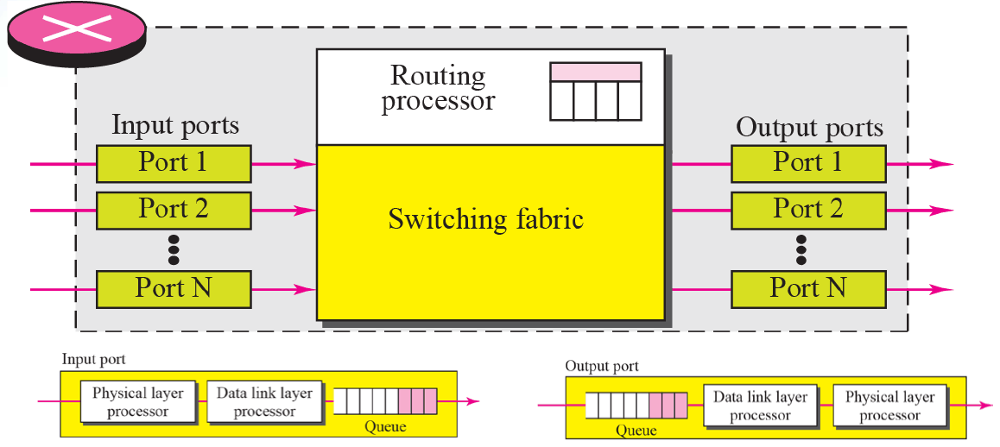

*Figure 18. The four components of a router and the structure of its ports*

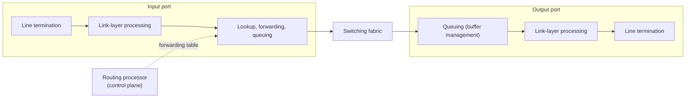

*Figure 19. The path of a packet through the components of a router*

- **Input ports.** An input port terminates an incoming physical link (physical-layer functions), performs the link-layer functions needed to interoperate with the link layer at the other side, and performs the lookup: here the forwarding table is consulted to determine the output port. It also has buffers that hold packets before they cross the switching fabric. Control packets, such as those that carry routing protocol information, are forwarded to the routing processor. The word port here means a physical router interface, which is different from the software ports of Chapter 6.
- **Switching fabric.** It connects the input ports to the output ports. It is entirely contained in the router, a network inside a network router. Its speed affects the size of the input and output queues and the overall delay of packet delivery.
- **Output ports.** An output port performs the same functions as an input port in the reverse order: it queues the packets received from the switching fabric, encapsulates each in a frame, and transmits it on the outgoing link. When a link is bidirectional, its output port is typically paired with its input port on the same line card, the circuit board that carries the port hardware, including the link-layer processing, of one or more links; several ports are often combined on one line card.
- **Routing processor.** It performs the control-plane functions. In a traditional router it executes the routing protocols (Chapters 14 and 15), maintains routing tables and link state information, and computes the forwarding table. In an SDN router it communicates with the remote controller to receive forwarding table entries and installs them in the input ports. It also performs network management functions (Chapter 17). Forouzan describes the routing processor as the component that finds the next hop and the output port, an activity called table lookup, and notes that newer routers move this function to the input ports.

The input ports, output ports, and switching fabric form the data plane and are almost always implemented in hardware, because they work on a nanosecond timescale. The control functions work on a millisecond or second timescale and are usually implemented in software running on the routing processor, a traditional CPU.

Kurose compares a router with a roundabout. The entry road and entry station correspond to the input port, where an attendant looks up the exit for each car (destination-based forwarding); the roundabout itself corresponds to the switching fabric; and the exit road corresponds to the output port. In generalized forwarding (Chapter 24), the attendant could choose the exit from other factors as well, such as the car's origin, or block a car that is not roadworthy. The analogy also raises the design questions of this section: what happens if the attendant is slow, if cars cross the roundabout slowly, or if most cars want the same exit?

### 7.2 Input Port Processing

The lookup at the input port is central to a router's operation. The forwarding table is computed by the routing processor, or received from a remote SDN controller, and copied over a separate bus to every line card. With this shadow copy, each input port makes forwarding decisions locally, without calling the routing processor for every packet, which avoids a centralized bottleneck. The lookup itself uses longest prefix matching (Section 4.4).

Lookup is the most important action of the input port, but not the only one. The input port also performs physical-layer and link-layer processing; checks the packet's version number, checksum, and TTL and rewrites the last two (Chapter 11); and updates counters used for network management, such as the number of datagrams received. After the lookup, the packet is sent into the switching fabric, or, if the fabric is busy with packets from other inputs, it is queued at the input port.

Looking up a destination address (match) and sending the packet to the specified output port (action) is a specific case of a general "match plus action" abstraction found in many network devices. A link-layer switch matches link-layer addresses (Chapter 20), a firewall drops packets whose header fields match given criteria (Chapter 26), and a NAT rewrites port numbers that match an entry (Chapter 12). Chapter 24 generalizes forwarding along these lines.

### 7.3 Switching Fabrics

> **Definition:** A **switching fabric** is the part of a router that transfers packets from the input ports to the output ports.

The switching fabric is at the very heart of a router. Kurose describes three ways to build it.

```text
a. Switching via memory            b. Switching via a bus          c. Switching via an interconnection
                                                                      network (crossbar)
 A ->+--------+-> X                 A -->-+--------> X                      X     Y     Z
     |        |                           |                            A ---+-----+-----+---
 B ->| Memory |-> Y                 B -->-+--------> Y                      |     |     |
     |        |                           |                            B ---+-----+-----+---
 C ->+--------+-> Z                 C -->-+--------> Z                      |     |     |
   (CPU copies every packet)          (one shared bus)                 C ---+-----+-----+---
                                                                      (a crosspoint closes at each +)
```

*Figure 20. Three switching techniques*

- **Switching via memory.** The earliest routers were traditional computers. An input port signaled the routing processor with an interrupt, the packet was copied into processor memory, the processor looked up the output port and copied the packet to the output port's buffer. If the memory bandwidth allows at most B packets per second to be written into or read from memory, the forwarding throughput must be less than B/2, since each packet is written once and read once. Two packets cannot be forwarded at the same time, even to different outputs, because only one memory read or write can be done at a time over the shared bus. Some modern routers still switch via memory, but the lookup and the storing into memory are done by processing on the input line cards.
- **Switching via a bus.** An input port transfers a packet directly to the output port over a shared bus, without the routing processor. The input port prepends a switch-internal label that indicates the output port; all output ports receive the packet, but only the one that matches the label keeps it, and removes the label. Only one packet can cross the bus at a time, so the switching speed is limited to the bus speed; in the roundabout analogy, only one car can be in the roundabout at a time. This is often sufficient for routers in small local area and enterprise networks.
- **Switching via an interconnection network.** A **crossbar switch** consists of 2N buses that connect N input ports to N output ports. Each vertical bus intersects each horizontal bus at a crosspoint, which the switch fabric controller can open or close. To forward a packet from A to Y, the controller closes the crosspoint of buses A and Y. A packet from B can go to X at the same time, so a crossbar forwards several packets in parallel. It is non-blocking: a packet is not blocked from its output port as long as no other packet is currently going to that port. Two packets for the same output, however, cannot cross at the same time; one must wait at its input.

More sophisticated interconnection networks use several stages of switching elements, so that packets from different inputs can proceed toward the same output at the same time. A router's capacity can also be scaled by running N switching fabrics in parallel: an input port breaks a packet into K chunks, sprays them through K of the N fabrics, and the output port reassembles them.

Forouzan describes two multistage fabrics. A **banyan switch**, named after the banyan tree, is a multistage switch with microswitches at each stage that route a packet according to its output port written as a binary string. For n inputs and n outputs there are log₂ n stages with n/2 microswitches each. The first stage routes the packet according to the highest-order bit of the output port, the second stage according to the second bit, and so on.

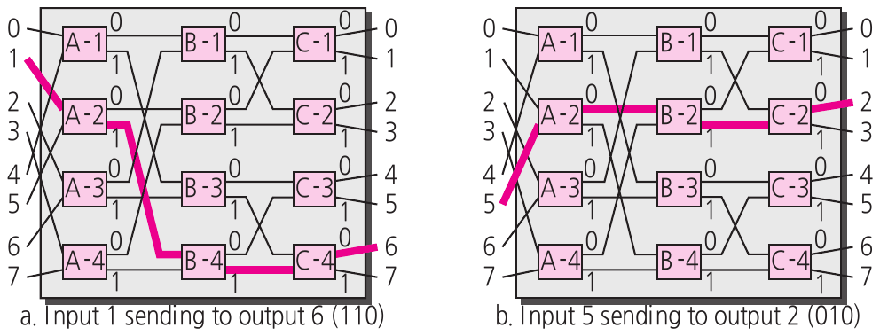

*Figure 21. Routing in an 8-by-8 banyan switch*

Figure 21 has eight inputs and eight outputs, so log₂ 8 = 3 stages. In part a, a packet at input 1 must go to output 6, which is 110 in binary: microswitch A-2 routes it by the first bit (1), B-4 by the second bit (1), and C-4 by the third bit (0). In part b, a packet at input 5 must go to output 2, which is 010: A-2 routes it by 0, B-2 by 1, and C-2 by 0. Each microswitch sends the packet to its upper output for bit 0 and its lower output for bit 1.

A banyan switch can suffer internal collisions even when two packets are not heading for the same output, because their paths may share a microswitch output. Sorting the arriving packets by destination port solves this problem. K. E. Batcher designed a sorting switch placed before the banyan switch, and the combination is called the **Batcher-banyan switch**. A hardware module called a trap is usually added between them; it prevents packets with the same output destination from entering the banyan switch at the same time, so that only one packet for each destination passes at each tick and the others wait for the next tick.

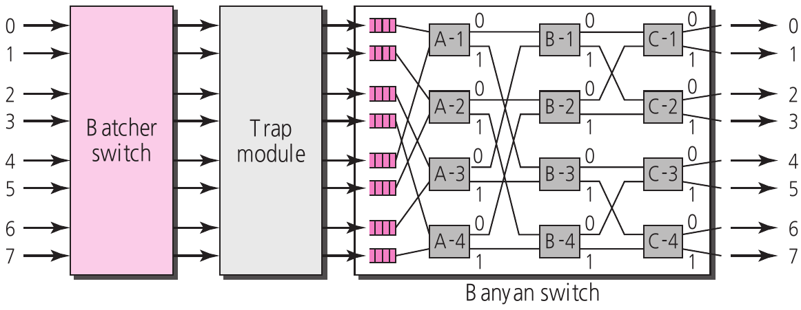

*Figure 22. A Batcher-banyan switch*

> **[Computer Architecture]** The three switching techniques mirror the interconnects of multiprocessors studied in Computer Architecture. Switching via memory resembles a shared-memory multiprocessor whose throughput is bounded by memory bandwidth, a bus allows one transfer at a time, and a crossbar or a multistage network (such as the banyan network) allows several transfers in parallel at a higher hardware cost.

### 7.4 Output Port Processing

Output port processing takes packets stored in the output port's memory and transmits them over the output link. It selects and dequeues packets for transmission and performs the link-layer and physical-layer transmission functions. Forouzan's output port is the input port in reverse order: queue, data link layer processor, physical layer processor.

### 7.5 Where Queuing Occurs

Packet queues can form at both the input ports and the output ports, as cars may wait at both the entries and the exits of the roundabout. Where and how much queuing occurs depends on the traffic load, the speed of the switching fabric, and the line speed. When the queues grow large, the router's memory can be exhausted, and packets are lost; this is where packets are actually dropped inside the network.

Suppose N input ports and N output ports all have the same line rate $`R_{\text{line}}`$, packets have a fixed length, and they arrive synchronously. Let $`R_{\text{switch}}`$ be the rate at which the fabric moves packets from inputs to outputs. If $`R_{\text{switch}}`$ is N times $`R_{\text{line}}`$, only negligible queuing occurs at the inputs, because even if all N inputs receive packets for the same output, each batch of N packets crosses the fabric before the next batch arrives.

**Input queuing.** If the fabric is not fast enough, packets queue at the input ports to wait their turn. Consider a crossbar fabric in which all links have the same speed, one packet crosses from an input to a given output in the time a packet takes to arrive, and packets leave each input queue in FCFS order. Packets for different outputs can cross in parallel, but if the packets at the heads of two input queues are destined for the same output, one of them is blocked.

> **Definition:** **Head-of-the-line (HOL) blocking** is the situation in an input-queued switch in which a queued packet must wait even though its output port is free, because the packet at the head of its queue is blocked.

```text
Time t: output port contention, only one dark packet can be transferred

 Input 1:  [  ][  ][D->X]  ====>  fabric  ====>  Output X  (upper)
 Input 2:  [  ][  ][    ]                        Output Y  (middle)
 Input 3:  [  ][L->Y][D->X]                      Output Z  (lower)

Time t+1: the fabric chose input 1; input 3 waits

 Input 1:  [  ][  ][    ]                        Output X: D (from input 1)
 Input 2:  [  ][  ][    ]                        Output Y: (idle)
 Input 3:  [  ][L->Y][D->X]                      Output Z
           the light packet L waits behind D although output Y is free
```

*Figure 23. HOL blocking in an input-queued switch*

In Figure 23, the dark packets at the heads of input 1 and input 3 are both destined for output X. The fabric transfers the packet of input 1, so the dark packet of input 3 waits. The light packet behind it, destined for output Y, must also wait, even though nothing else wants output Y. Kurose cites a result that, because of HOL blocking, the input queues grow without bound under certain assumptions as soon as the arrival rate on the input links reaches only 58 percent of their capacity.

**Output queuing.** Queues can form at the output ports even if $`R_{\text{switch}}`$ is N times $`R_{\text{line}}`$. If packets arriving at all N inputs are destined for the same output, N packets arrive at that output in the time it takes to send one packet on the outgoing link, and they must wait. Then N more packets may arrive while just one is sent, and so on, until the output port's memory is exhausted. When there is no room for an arriving packet, the router either drops the arriving packet, a policy called **drop-tail**, or removes already queued packets to make room. It may also drop or mark a packet before the buffer is full, to signal congestion to the sender; such policies are called active queue management (AQM), and one of the most widely studied is Random Early Detection (RED).

**Amount of buffering needed.** For many years the rule of thumb was that the amount of buffering B should equal an average round-trip time times the link capacity C. A 10 Gbps link with an RTT of 250 ms would then need B = RTT × C = 0.25 s × 10 Gbps = 2.5 Gbits. More recent work suggests that when a large number N of TCP flows pass through a link, much less is needed.

```math
B = \frac{\text{RTT} \cdot C}{\sqrt{N}}
```

With 10,000 flows on the same link, for example, B = 2.5 Gbits / 100 = 25 Mbits. Backbone links typically carry many flows, so the reduction is significant.

### 7.6 Packet Scheduling

> **Definition:** **Packet scheduling** is the choice, made at an output port, of which queued packet to transmit next on the outgoing link.

The examples below use five packets that arrive at times 0, 1.5, 2.5, 7.5, and 13 and need 3 time units each to be transmitted, the pattern of Kurose's figures.

**First-in-first-out (FIFO).** FIFO, also called first-come-first-served (FCFS), transmits packets in the order in which they arrived. If there is not enough buffer space for an arriving packet, the discarding policy decides which packet is dropped.

```text
Packet:      1      2      3      4      5
Arrival:     0      1.5    2.5    7.5    13
Service:   0-3    3-6    6-9    9-12   13-16
Departure:   3      6      9      12     16      (link idle from 12 to 13)
```

**Priority queuing.** Arriving packets are classified into priority classes, each with its own queue. An operator may give priority to network management packets, identified for example by their port numbers, or to real-time voice over IP packets over e-mail. The scheduler transmits a packet from the highest priority class that has a nonempty queue, in FIFO order within a class. Under non-preemptive priority queuing, a transmission is not interrupted once it has begun.

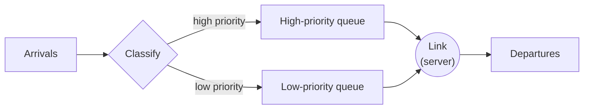

*Figure 24. The priority queuing model*

With packets 1, 3, and 4 in the high-priority class and packets 2 and 5 in the low-priority class, packet 3 is sent before packet 2 although it arrived later. Packet 4 arrives at 7.5 while packet 2 is being sent and waits until it finishes.

```text
Service:   1 (0-3)   3 (3-6)   2 (6-9)   4 (9-12)   5 (13-16)
Departure order: 1, 3, 2, 4, 5
```

**Round robin.** Packets are sorted into classes as in priority queuing, but the scheduler alternates service among the classes instead of giving strict priority: a class 1 packet, then a class 2 packet, then a class 1 packet, and so on. A **work-conserving** discipline never leaves the link idle while any packet is queued, so a round robin scheduler that finds no packet of the class whose turn it is moves at once to the next class. With packets 1, 2, and 4 in class 1 and packets 3 and 5 in class 2, after packet 1 the scheduler serves class 2 (packet 3), then class 1 (packet 2); packet 4 is then the only queued packet and is sent next.

```text
Service:   1 (0-3)   3 (3-6)   2 (6-9)   4 (9-12)   5 (13-16)
Departure order: 1, 3, 2, 4, 5
```

> **Definition:** **Weighted fair queuing (WFQ)** is a work-conserving scheduling discipline that serves classes in a circular manner and guarantees each class i a fraction of the link rate proportional to its weight $`w_i`$.

**Weighted fair queuing.** WFQ, a generalized round robin widely implemented in routers, also serves the classes in turn, but each class i has a weight $`w_i`$. During any interval in which class i has packets to send, it receives the fraction of service below, where the sum is taken over the classes that also have queued packets.

```math
\frac{w_i}{\sum_j w_j}
```

In the worst case, when all classes have queued packets, the sum is over all classes, so on a link of rate R class i always achieves a throughput of at least the following.

```math
R \cdot \frac{w_i}{\sum_j w_j}
```

This description is idealized: packets are discrete, and a packet's transmission is not interrupted to begin another. Round robin is the special case of WFQ with equal weights.

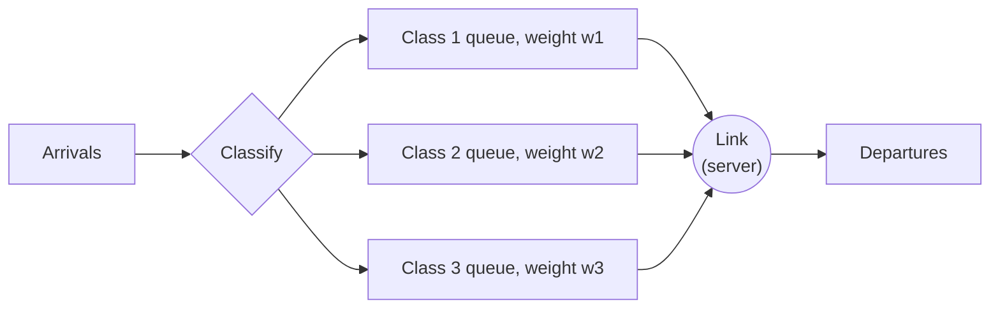

*Figure 25. The weighted fair queuing model*

| Discipline | Classes | Order of service | Guarantee |
|:--|:--|:--|:--|
| FIFO | One | Arrival order | None per class |
| Priority | Several, ranked | Highest nonempty class first | Low classes may starve |
| Round robin | Several | Classes in turn | Equal share for each active class |
| WFQ | Several, weighted | Classes in turn, by weight | At least $`R \cdot w_i / \sum_j w_j`$ for class i |

*Table 16. Comparison of the packet scheduling disciplines*

---

<br>

## Concept Applications

**True/False Check:**

| Statement | Judgment and Reason |
|:--|:--|
| The last delivery of every packet is a direct delivery. | **T.** The last router, or the source if the destination is on its own network, always delivers to the destination on the same network. |
| A network-specific table needs one entry for each host of a remote network. | **F.** It needs one entry for the whole network; that is the purpose of the method. |
| In a classful router, a destination whose first 4 bits are 1100 is searched in the class C table. | **T.** 1100 = 12, and values 12 and 13 of the first 4 bits mean class C. |
| A classless forwarding table may list its entries in any order if the router stops at the first match. | **F.** The entries must be sorted from the longest mask to the shortest so that the first match is the longest prefix. |
| Forwarding by label requires a search of the whole table. | **F.** The label is used as an index, so the entry is accessed directly. |
| A crossbar switch can transfer two packets to the same output at the same time. | **F.** It is non-blocking only for different outputs; packets for the same output must wait at the inputs. |
| Queuing can occur at the output ports even if the fabric is N times faster than the lines. | **T.** N packets may arrive for one output in the time needed to send one packet. |
| Under WFQ, a class always receives exactly its weight divided by the sum of all weights. | **F.** That fraction is the minimum; when other classes have no packets, the class receives more, because WFQ is work-conserving. |

---

<br>

## Summary

| Concept | Key Summary |
|---------|-----------|
| Direct and indirect delivery | Delivery is direct when the destination is on the deliverer's network and indirect when the packet goes to a next-hop router. |
| Forwarding techniques | The next-hop method stores only the next hop, the network-specific method one entry per network, the host-specific method entries for single hosts, and the default method one catch-all entry. |
| Classful forwarding | The router shifts the address 28 bits to find the class, applies the default mask, and searches the table of that class. |
| Forwarding with subnetting | The router applies the subnet mask and searches one table of subnet addresses. |
| Classless forwarding | One table with a mask column is searched by applying each mask in turn, from the longest to the shortest. |
| Longest prefix matching | When several entries match, the longest prefix wins, which lets aggregated and more specific entries coexist. |
| Table search | Classful tables use one bucket per class; classless tables need per-prefix buckets, tries, or TCAMs for line-rate lookup. |
| Aggregation and hierarchy | Contiguous blocks are advertised as one prefix, and ISP hierarchies and geographical blocks keep tables small. |
| Label-based forwarding | A switch uses the label as an index (accessing) instead of searching, and MPLS adds a stack of 32-bit label subheaders before the IP header. |
| Router components | Input ports, a switching fabric, and output ports form the hardware data plane, and the routing processor runs the control plane in software. |
| Switching fabrics | Memory and bus fabrics transfer one packet at a time, while crossbar, banyan, and Batcher-banyan fabrics transfer several in parallel. |
| Queuing | Input queues suffer HOL blocking, output queues form when many inputs target one output, and drop-tail or AQM decides what is dropped. |
| Buffer sizing | The classic rule is B = RTT × C, reduced to RTT × C / √N for N flows. |
| Scheduling | FIFO serves in arrival order, priority by class rank, round robin by turns, and WFQ by weights with a guaranteed minimum rate. |

---

<br>

## Self-Check Questions

1. **Direct and indirect delivery:** Host 192.168.10.37/26 sends packets to 192.168.10.70 and 192.168.10.12. Decide whether each case is a direct or an indirect delivery.

   <details>
   <summary>Answer</summary>

   The mask for /26 is 255.255.255.192. Since 37 AND 192 = 0, the sender's network address is 192.168.10.0. Since 70 AND 192 = 64, the network address of 192.168.10.70 is 192.168.10.64, which differs from the sender's network, so this is an indirect delivery: the packet goes to the default router. Since 12 AND 192 = 0, 192.168.10.12 is on the same network, so this is a direct delivery.

   </details>

2. **Longest prefix matching:** A forwarding table sends 130.40.0.0/16 to R1, 130.40.32.0/19 to R2, 130.40.36.0/22 to R3, and 0.0.0.0/0 to R4. Find the next hop for (a) 130.40.38.5, (b) 130.40.50.1, and (c) 130.41.0.1.

   <details>
   <summary>Answer</summary>

   (a) The third byte 38 = 00100110 ANDed with 224, the third byte of the /19 mask, gives 32, and ANDed with 252, the third byte of the /22 mask, gives 36. All four entries match, so the /22 entry with the longest prefix is used and the next hop is R3. (b) Since 50 AND 224 = 32, the /19 entry matches, but since 50 AND 252 = 48, the /22 entry does not. The next hop is R2. (c) 130.41.0.1 AND 255.255.0.0 = 130.41.0.0 differs from 130.40.0.0, so only the default entry matches and the next hop is R4.

   </details>

3. **Aggregation with an exception:** A router sends all eight networks from 172.20.16.0/24 to 172.20.23.0/24 to R1. Aggregate these entries into one. If only 172.20.20.0/24 must go to R2, how should the table be built?

   <details>
   <summary>Answer</summary>

   The third bytes 16-23 are 00010000-00010111 in binary and share the first 5 bits 00010, so the common prefix is 16 + 5 = 21 bits; 16 is a multiple of 8, so the entries aggregate into the single entry 172.20.16.0/21 with next hop R1. For the exception, add the entry 172.20.20.0/24 with next hop R2 and place it before the /21 entry. Packets to 172.20.20.x match both entries, but longest prefix matching sends them to R2, and packets to the other seven networks go to R1.

   </details>

4. **Classful forwarding module:** A classful router receives a packet for 150.25.7.9. What does the 28-bit shift give, in which class table does the router search, and for which network address?

   <details>
   <summary>Answer</summary>

   150 = 10010110, so the first 4 bits are 1001 and the shift gives 9. Values 8 to 11 mean class B. Applying the default mask 255.255.0.0 gives the network address 150.25.0.0, which the router searches for in the class B table.

   </details>

5. **Tracing a classless table:** Using Table 8 of Example 6.7, trace the forwarding of packets with destination addresses (a) 180.70.65.210 and (b) 201.4.17.9.

   <details>
   <summary>Answer</summary>

   (a) The fourth byte 210 = 11010010; the first mask /26 gives 11000000 = 192, so 180.70.65.210 AND /26 = 180.70.65.192, which matches the first row. The destination address itself and interface m2 are passed to ARP (direct delivery). (b) The /26, /25, and /24 masks give 201.4.17.0, which matches none of the first three rows. The /22 mask keeps the first 6 bits of the third byte: 17 = 00010001 AND 11111100 = 00010000 = 16, giving 201.4.16.0, which matches the fourth row. The destination address and interface m1 are passed to ARP.

   </details>

6. **Building a classless table:** Router R has interface m0 on network 10.1.0.0/16 and interface m1 on network 10.2.4.0/24. Router S, whose address 10.2.4.1 is on network 10.2.4.0/24, leads to network 10.3.0.0/16, and the default router 10.1.0.254 is on network 10.1.0.0/16. Write R's table sorted for longest prefix matching.

   <details>
   <summary>Answer</summary>

   Network 10.3.0.0/16 is reached through S, whose address 10.2.4.1 is on the network of m1, so its entry uses m1. Sorted from the longest mask: /24 10.2.4.0, next hop none, m1; /16 10.1.0.0, next hop none, m0; /16 10.3.0.0, next hop 10.2.4.1, m1; /0 0.0.0.0, next hop 10.1.0.254, m0. The two /16 entries can be in either order, because no address matches both, and the default entry must be last.

   </details>

7. **HOL blocking:** In a 2-by-2 input-queued crossbar switch, input 1 holds packets (head first) for output 1 and then output 2, and input 2 holds packets for output 1 and then output 2. In each time slot one packet can leave each input, and each output can accept one packet. If the fabric always favors input 1 when both heads want the same output, how many slots are needed to deliver all four packets, and where does HOL blocking occur?

   <details>
   <summary>Answer</summary>

   Slot 1: both heads want output 1; input 1's packet goes, and input 2's head waits. Input 2's second packet, for output 2, is blocked behind it although output 2 is idle; this is HOL blocking. Slot 2: input 1's head now wants output 2 and input 2's head wants output 1, so both go in parallel. Slot 3: input 2's remaining packet goes to output 2. Three slots are needed, whereas two would suffice without HOL blocking.

   </details>

8. **WFQ shares:** A 10 Mbps link uses WFQ with three classes of weights 1, 2, and 2. Find the guaranteed rate of each class when all classes have packets, and the rates when only classes 2 and 3 have packets.

   <details>
   <summary>Answer</summary>

   With all classes active, the sum of the weights is 5, so class 1 gets 1/5 × 10 = 2 Mbps and classes 2 and 3 get 2/5 × 10 = 4 Mbps each. When class 1 has no packets, WFQ is work-conserving and the sum is taken over classes 2 and 3 only, which is 4, so each gets 2/4 × 10 = 5 Mbps.

   </details>
