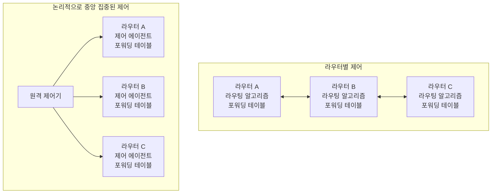
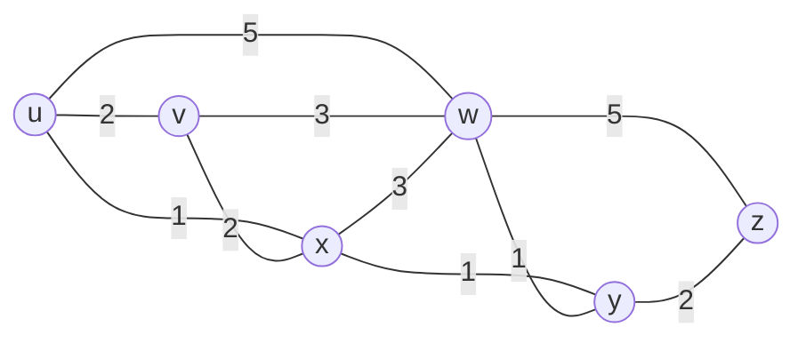
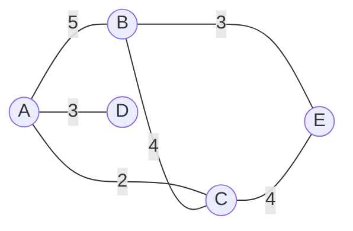
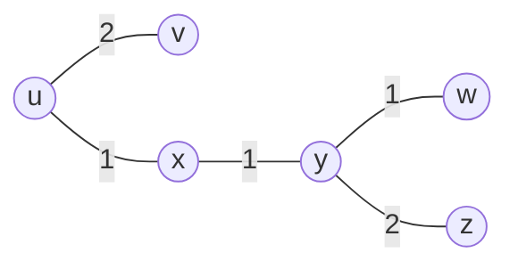
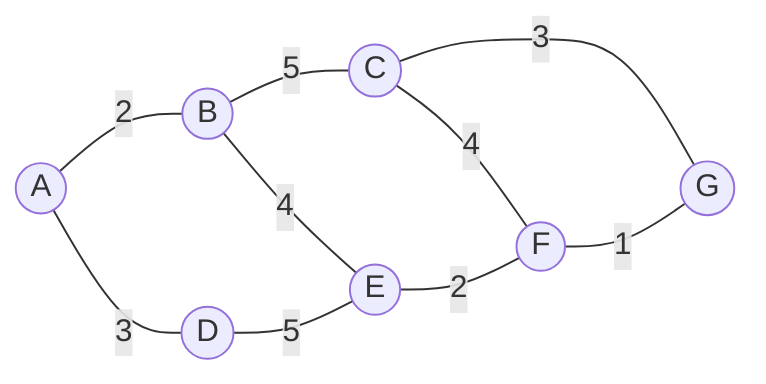
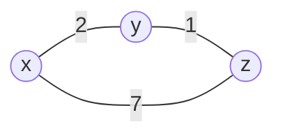
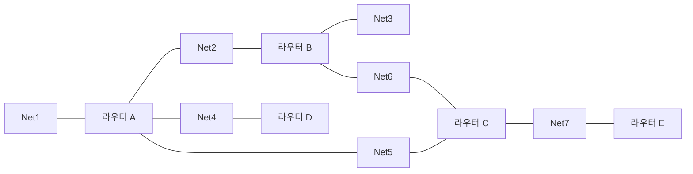
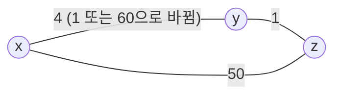
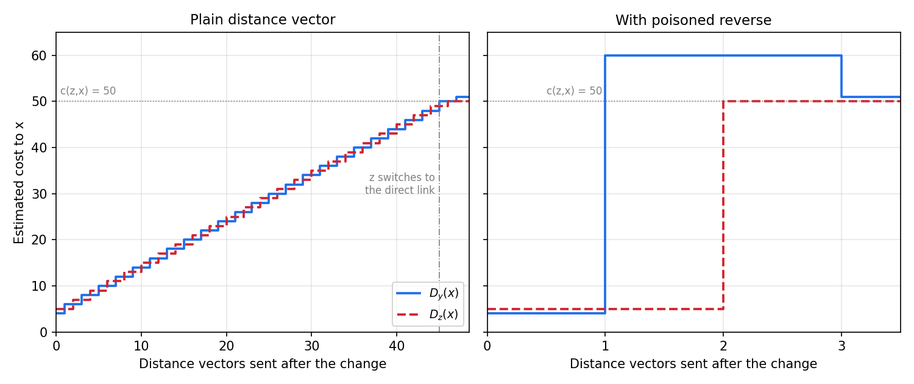
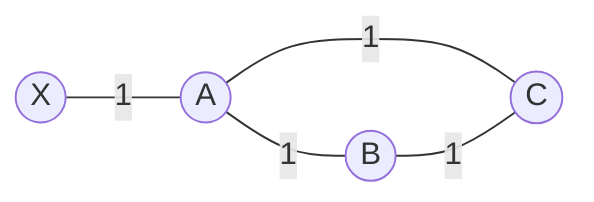

# 14장 — 라우팅 알고리즘

[레포지토리 안내](../../README.ko.md) | [English](Concepts_Lecture.md) | [한국어](Concepts_Lecture.ko.md)

> **최종 수정일:** 2026-11-18
>
> Computer Networking: A Top-Down Approach, Kurose and Ross, Ch 5; TCP/IP Protocol Suite, Forouzan, Ch 11

> **학습 목표:**
> 1. 라우팅 문제를 가중 그래프의 최소 비용 경로 문제로 표현할 수 있다
> 2. 라우팅 알고리즘을 전역과 분산, 정적과 동적, 부하 민감과 부하 둔감으로 분류할 수 있다
> 3. Dijkstra 알고리즘을 단계별로 수행하여 최소 비용 경로 트리와 포워딩 테이블을 구할 수 있다
> 4. Bellman-Ford 식으로 거리 벡터를 갱신하고 수렴 과정을 추적할 수 있다
> 5. 무한 카운트 문제의 원인과 스플릿 호라이즌, 포이즌 리버스의 효과와 한계를 설명할 수 있다
> 6. 링크 상태 알고리즘과 거리 벡터 알고리즘을 메시지 복잡도, 수렴 속도, 견고성으로 비교할 수 있다

---

## 목차

- [1. 제어 평면과 라우팅](#1-제어-평면과-라우팅)
  - [1.1 포워딩 테이블을 만드는 두 가지 방식](#11-포워딩-테이블을-만드는-두-가지-방식)
  - [1.2 비용과 메트릭](#12-비용과-메트릭)
  - [1.3 정적 테이블, 동적 테이블, 라우팅 프로토콜](#13-정적-테이블-동적-테이블-라우팅-프로토콜)
- [2. 라우팅 문제의 그래프 모델](#2-라우팅-문제의-그래프-모델)
  - [2.1 그래프와 링크 비용](#21-그래프와-링크-비용)
  - [2.2 최소 비용 경로](#22-최소-비용-경로)
  - [2.3 라우팅 알고리즘의 분류](#23-라우팅-알고리즘의-분류)
- [3. 링크 상태 라우팅](#3-링크-상태-라우팅)
  - [3.1 모든 노드가 같은 지도를 가진다](#31-모든-노드가-같은-지도를-가진다)
  - [3.2 링크 상태 패킷과 플러딩](#32-링크-상태-패킷과-플러딩)
  - [3.3 Dijkstra 알고리즘](#33-dijkstra-알고리즘)
  - [3.4 단계별 추적](#34-단계별-추적)
  - [3.5 최단 경로 트리와 포워딩 테이블](#35-최단-경로-트리와-포워딩-테이블)
  - [3.6 일곱 노드 예제](#36-일곱-노드-예제)
  - [3.7 계산 복잡도](#37-계산-복잡도)
  - [3.8 혼잡 민감 비용과 경로 진동](#38-혼잡-민감-비용과-경로-진동)
- [4. 거리 벡터 라우팅](#4-거리-벡터-라우팅)
  - [4.1 Bellman-Ford 식](#41-bellman-ford-식)
  - [4.2 거리 벡터 알고리즘](#42-거리-벡터-알고리즘)
  - [4.3 세 노드 예제](#43-세-노드-예제)
  - [4.4 네트워크를 목적지로 하는 거리 벡터 라우팅](#44-네트워크를-목적지로-하는-거리-벡터-라우팅)
  - [4.5 링크 비용의 감소: 좋은 소식은 빨리 퍼진다](#45-링크-비용의-감소-좋은-소식은-빨리-퍼진다)
  - [4.6 링크 비용의 증가: 나쁜 소식과 무한 카운트](#46-링크-비용의-증가-나쁜-소식과-무한-카운트)
  - [4.7 두 노드 루프와 무한대의 재정의](#47-두-노드-루프와-무한대의-재정의)
  - [4.8 스플릿 호라이즌과 포이즌 리버스](#48-스플릿-호라이즌과-포이즌-리버스)
  - [4.9 세 노드 불안정](#49-세-노드-불안정)
- [5. 링크 상태 알고리즘과 거리 벡터 알고리즘의 비교](#5-링크-상태-알고리즘과-거리-벡터-알고리즘의-비교)
  - [5.1 메시지 복잡도](#51-메시지-복잡도)
  - [5.2 수렴 속도](#52-수렴-속도)
  - [5.3 견고성](#53-견고성)
- [개념 적용](#개념-적용)
- [요약](#요약)
- [점검 문제](#점검-문제)

---

<br>

## 1. 제어 평면과 라우팅

### 1.1 포워딩 테이블을 만드는 두 가지 방식

라우터는 도착한 패킷의 헤더를 보고 포워딩 테이블을 찾아 패킷을 알맞은 출력 링크로 내보낸다. 이 동작은 라우터 하나 안에서 나노초 단위로 일어나는 **데이터 평면(data plane)** 의 일이며, 10장과 13장에서 다루었다. 이 장과 15장은 그 포워딩 테이블의 내용이 어디서 오는가, 즉 네트워크 전체에 걸친 **제어 평면(control plane)** 의 논리를 다룬다.

제어 평면을 구성하는 방식은 크게 두 가지이다.

- **라우터별 제어(per-router control):** 모든 라우터 안에서 라우팅 알고리즘이 실행된다. 각 라우터의 라우팅 구성 요소는 다른 라우터의 라우팅 구성 요소와 메시지를 주고받으며 자기 포워딩 테이블의 값을 계산한다. 인터넷은 수십 년 동안 이 방식을 써 왔으며, 15장의 OSPF와 BGP도 이 방식에 속한다.
- **논리적으로 중앙 집중된 제어(logically centralized control):** 별도의 제어기(controller)가 모든 라우터의 포워딩 테이블을 계산하여 내려보낸다. 각 라우터에는 **제어 에이전트(control agent, CA)** 가 있어 제어기와 통신하고 제어기의 명령을 수행할 뿐이며, 제어 에이전트끼리 직접 메시지를 주고받거나 테이블 계산에 참여하지 않는다.



*그림 1. 라우터별 제어와 논리적으로 중앙 집중된 제어*

"논리적으로" 중앙 집중되었다는 말은 라우터와 응용이 제어 서비스를 하나의 중앙 지점처럼 이용한다는 뜻이다. 실제 제어기는 장애 허용과 성능 확장을 위해 여러 서버로 구현되는 경우가 많다. 이 방식은 **소프트웨어 정의 네트워킹(software-defined networking, SDN)** 의 바탕이 되며, 15장에서 자세히 다룬다.

> **핵심:** 어느 방식을 쓰든 패킷은 출발지 호스트에서 목적지 호스트까지 정해진 라우터의 순서를 따라 이동해야 한다. 그 순서, 곧 경로를 계산하는 것이 라우팅 알고리즘이며, 이 장의 알고리즘은 두 방식 모두에 쓰인다.

### 1.2 비용과 메트릭

라우터는 보통 여러 네트워크에 연결되어 있으므로, 패킷을 받을 때마다 어느 쪽으로 넘길지 정해야 한다. 이 결정은 최적화 문제이다. 무엇이 최적인지를 정하기 위해 링크나 네트워크를 지나는 데 **비용(cost)** 을 매기며, 이 비용을 **메트릭(metric)** 이라고도 한다. 비용이 크면 나쁜 경로, 작으면 좋은 경로로 본다.

> **용어 정의:** **메트릭(metric)** 은 링크나 네트워크를 지나는 데 매긴 비용으로, 라우팅 알고리즘이 경로의 좋고 나쁨을 비교하는 기준이다.

메트릭은 목표에 따라 다르게 정한다. 처리량을 최대로 하고 싶다면 처리량이 높은 링크에 낮은 비용을, 처리량이 낮은 링크에 높은 비용을 매긴다. 지연을 최소로 하고 싶다면 지연이 작은 링크의 비용을 낮게 한다. 링크의 물리적 길이(대양 횡단 링크는 짧은 지상 링크보다 비싸다), 링크 속도, 링크 사용에 드는 금전적 비용도 비용이 될 수 있다. 모든 링크의 비용을 1로 두면 비용은 경로가 지나는 링크의 수, 곧 **홉 수(hop count)** 가 된다.

### 1.3 정적 테이블, 동적 테이블, 라우팅 프로토콜

라우팅 테이블은 정적일 수도 있고 동적일 수도 있다. **정적(static)** 테이블은 관리자가 직접 항목을 입력한 테이블이고, **동적(dynamic)** 테이블은 인터넷의 어딘가에 변화가 생길 때 자동으로 갱신되는 테이블이다. 오늘날의 인터넷에서는 링크가 끊기거나 더 좋은 경로가 생길 때마다 테이블이 곧바로 바뀌어야 하므로 동적 테이블이 필요하다.

> **용어 정의:** **라우팅 프로토콜(routing protocol)** 은 라우터들이 서로에게 인터넷의 변화를 알리고, 받은 정보를 결합하여 라우팅 테이블을 갱신하는 규칙과 절차의 모음이다.

라우팅 프로토콜 덕분에 한 도시의 라우터가 멀리 떨어진 다른 지역의 네트워크 장애를 알 수 있다. 라우팅 프로토콜은 다시 하나의 관리 영역 안을 담당하는 **내부(interior)** 프로토콜과 관리 영역 사이를 담당하는 **외부(exterior)** 프로토콜로 나뉘며, 이 구분과 실제 프로토콜(RIP, OSPF, BGP)은 15장에서 다룬다. 이 장은 그 프로토콜들의 바탕이 되는 두 알고리즘, 링크 상태 알고리즘과 거리 벡터 알고리즘에 집중한다.

> **참고:** **라우팅 테이블과 포워딩 테이블.** 이 장에서 라우팅 알고리즘이 계산하는 표(목적지, 비용, 다음 홉)를 라우팅 테이블이라 부르고, 그 결과에서 목적지마다 다음 홉(출력 링크)만 뽑아 데이터 평면이 실제로 찾아보는 표를 포워딩 테이블이라 부른다. 두 표의 관계는 3.5절에서 예로 보인다.

---

<br>

## 2. 라우팅 문제의 그래프 모델

### 2.1 그래프와 링크 비용

라우팅 문제는 그래프로 나타낸다. **그래프(graph)** $`G = (N, E)`$ 는 노드의 집합 $`N`$ 과 간선의 모음 $`E`$ 로 이루어지며, 각 간선은 $`N`$ 의 두 노드의 쌍이다. 네트워크 계층 라우팅에서 노드는 패킷의 포워딩 결정이 이루어지는 라우터를 나타내고, 간선은 라우터 사이의 물리 링크를 나타낸다.



*그림 2. 여섯 라우터로 이루어진 네트워크의 그래프 모델*

간선에는 그 링크의 비용을 나타내는 값이 붙는다. 간선 $`(x, y)`$ 의 비용을 $`c(x, y)`$ 로 쓰고, 두 노드 사이에 간선이 없으면 $`c(x, y) = \infty`$ 로 둔다. 이 장에서는 간선에 방향이 없는 무향 그래프만 다루므로 $`c(x, y) = c(y, x)`$ 이다. 방향마다 비용이 다른 링크로 알고리즘을 확장하는 것은 어렵지 않다. $`(x, y)`$ 가 $`E`$ 에 속하면 노드 $`y`$ 를 노드 $`x`$ 의 **이웃(neighbor)** 이라고 한다.

> **[자료구조]** 라우터 안에서 그래프는 보통 인접 리스트나 인접 행렬로 저장한다. 인접 리스트는 각 노드에 이웃과 링크 비용의 목록을 두므로 간선이 적은 네트워크에서 메모리를 아끼고, 인접 행렬은 $`c(x, y)`$ 를 한 번의 접근으로 얻는 대신 노드 수의 제곱에 비례하는 공간을 쓴다.

### 2.2 최소 비용 경로

그래프 $`G = (N, E)`$ 에서 **경로(path)** 는 연속한 두 노드의 쌍 $`(x_1, x_2), (x_2, x_3), \ldots, (x_{p-1}, x_p)`$ 가 모두 $`E`$ 의 간선인 노드의 열 $`(x_1, x_2, \ldots, x_p)`$ 이다. 경로의 비용은 경로를 이루는 간선 비용의 합이다.

```math
c(x_1, x_2) + c(x_2, x_3) + \cdots + c(x_{p-1}, x_p)
```

> **용어 정의:** **최소 비용 경로(least-cost path)** 는 두 노드를 잇는 모든 경로 가운데 경로 비용이 가장 작은 경로이다.

그림 2에서 출발지 u와 목적지 w 사이의 최소 비용 경로는 비용이 3인 (u, x, y, w)이다. 직접 링크 (u, w)의 비용 5보다 세 링크를 거치는 경로가 더 싸다는 점에 주목할 필요가 있다. 모든 링크의 비용이 같으면 최소 비용 경로는 링크 수가 가장 적은 **최단 경로(shortest path)** 와 같아진다.

그림 2에서 u부터 z까지의 최소 비용 경로를 눈으로 찾으면, 대부분의 사람은 몇 개의 경로를 따라가 본 뒤 그중 하나가 가장 싸다고 스스로 납득한다. 그러나 u에서 z로 가는 단순 경로(같은 노드를 두 번 지나지 않는 경로)는 17개나 된다. 사람의 두뇌가 네트워크 전체 정보를 가지고 한곳에서 계산했다는 점에서 이 과정은 중앙 집중형 라우팅 알고리즘의 한 예이다.

### 2.3 라우팅 알고리즘의 분류

라우팅 알고리즘은 세 가지 기준으로 분류한다.

첫째 기준은 알고리즘이 쓰는 정보의 범위이다.

> **용어 정의:** **전역 라우팅 알고리즘(global routing algorithm)** 은 모든 노드 사이의 연결 관계와 모든 링크 비용을 입력으로 받아, 네트워크 전체에 관한 완전한 지식으로 최소 비용 경로를 계산하는 알고리즘이다.

전역 알고리즘(Kurose와 Ross의 용어로는 중앙 집중형 라우팅 알고리즘)은 계산에 앞서 전체 정보를 어떻게든 모아야 한다. 계산 자체는 한곳(그림 1의 원격 제어기)에서 할 수도 있고 모든 라우터의 라우팅 구성 요소에서 똑같이 반복할 수도 있다. 어느 경우든 핵심은 알고리즘이 모든 링크의 상태를 안다는 점이므로, 전역 알고리즘을 흔히 **링크 상태(link-state, LS) 알고리즘**이라 부른다.

> **용어 정의:** **분산 라우팅 알고리즘(decentralized routing algorithm)** 은 어떤 노드도 전체 링크 비용을 알지 못한 채, 각 노드가 직접 연결된 링크의 비용에서 출발하여 이웃과 계산 결과를 반복해서 주고받으며 최소 비용 경로를 점차 계산하는 알고리즘이다.

4절의 **거리 벡터(distance-vector, DV) 알고리즘**이 대표적인 분산 알고리즘이다. 이웃 사이의 메시지 교환에 기대므로 라우터끼리 직접 상호작용하는 라우터별 제어에 자연스럽게 맞는다.

둘째 기준은 경로가 바뀌는 빈도이다. **정적 라우팅 알고리즘(static routing algorithm)** 에서는 경로가 매우 느리게, 흔히 사람이 링크 비용을 직접 고칠 때만 바뀐다. **동적 라우팅 알고리즘(dynamic routing algorithm)** 은 트래픽 부하나 토폴로지가 바뀔 때 경로를 바꾸며, 주기적으로 실행되거나 변화에 직접 반응하여 실행된다. 동적 알고리즘은 변화에 빨리 대응하는 대신 라우팅 루프와 경로 진동 같은 문제에 더 취약하다.

셋째 기준은 링크 비용이 혼잡을 반영하는가이다. **부하 민감(load-sensitive) 알고리즘**에서는 링크의 현재 혼잡 정도에 따라 링크 비용이 바뀌므로, 혼잡한 링크를 피하는 경로를 고르게 된다. 초기 ARPAnet의 라우팅 알고리즘은 부하 민감형이었으나 여러 어려움을 겪었다. 오늘날의 인터넷 라우팅 프로토콜(RIP, OSPF, BGP)은 링크 비용이 현재나 최근의 혼잡을 명시적으로 반영하지 않는 **부하 둔감(load-insensitive)** 방식이다.

| 기준 | 한쪽 | 다른 쪽 |
|:-----|:-----|:-----|
| 정보의 범위 | 전역(링크 상태): 모든 링크 비용을 알고 계산 | 분산(거리 벡터): 이웃과의 반복 교환으로 계산 |
| 경로가 바뀌는 빈도 | 정적: 사람의 개입으로 느리게 변화 | 동적: 부하나 토폴로지 변화에 따라 변화 |
| 혼잡의 반영 | 부하 민감: 링크 비용이 혼잡을 반영 | 부하 둔감: 링크 비용이 혼잡과 무관 |

*표 1. 라우팅 알고리즘의 세 가지 분류 기준*

---

<br>

## 3. 링크 상태 라우팅

### 3.1 모든 노드가 같은 지도를 가진다

링크 상태 라우팅의 발상은 간단하다. 영역 안의 모든 노드가 전체 토폴로지, 즉 노드와 링크의 목록, 연결 방식, 링크의 종류, 비용, 상태(사용 가능 여부)를 안다면 각 노드는 그 지도 위에서 Dijkstra 알고리즘을 실행하여 자기 라우팅 테이블을 만들 수 있다. 같은 지도를 가진 두 사람이 서로 다른 도시에서 출발하면 각자 다른 길을 고르듯이, 모든 노드는 같은 토폴로지를 쓰지만 계산의 출발점이 자기 자신이므로 노드마다 라우팅 테이블이 다르다.

처음부터 전체 토폴로지를 아는 노드는 없다. 그러나 각 노드는 자기 링크의 상태(종류, 상태, 비용)라는 부분 지식을 가지고 있으며, 이 부분 지식을 모두 합치면 전체 토폴로지가 된다.



*그림 3. 다섯 노드로 이루어진 영역의 토폴로지*

그림 3에서 A는 자신이 B와 비용 5, C와 비용 2, D와 비용 3으로 연결되어 있음을 안다. C는 A와 비용 2, B와 비용 4, E와 비용 4로 연결되어 있음을 알고, D는 A와 비용 3으로만 연결되어 있음을 안다. 같은 링크를 양 끝의 두 노드가 모두 알고 있으므로 지식이 겹치지만, 바로 그 겹침 덕분에 각 노드가 모은 지식으로 영역 전체의 공통 그림을 만들 수 있다.

### 3.2 링크 상태 패킷과 플러딩

각 노드가 같은 라우팅 테이블 계산 결과에 이르기까지는 네 단계가 필요하다.

1. 각 노드가 자기 링크의 상태를 담은 **링크 상태 패킷(link state packet, LSP)** 을 만든다.
2. 만든 LSP를 다른 모든 라우터에 효율적이고 신뢰성 있게 퍼뜨린다. 이 과정을 **플러딩(flooding)** 이라 한다.
3. 각 노드가 자신을 뿌리로 하는 최단 경로 트리를 만든다.
4. 최단 경로 트리에서 라우팅 테이블을 계산한다.

LSP에는 최소한 노드의 식별자, 링크의 목록, 순서 번호, 나이가 들어간다. 앞의 두 항목은 토폴로지를 만드는 데 필요하다. **순서 번호**는 플러딩을 돕고 새 LSP와 옛 LSP를 구별하게 하며, **나이(age)** 는 오래된 LSP가 영역 안에 오래 남지 않게 한다.

LSP는 두 경우에 만들어진다.

- 영역의 토폴로지가 바뀌었을 때 만든다. 이렇게 변화가 일어나는 즉시 LSP를 퍼뜨리는 것이 모든 노드에 토폴로지 변화를 빨리 알리는 주된 방법이다.
- 주기적으로 만든다. 이 주기는 거리 벡터 라우팅의 주기보다 훨씬 길며, 구현에 따라 보통 60분에서 2시간이다. 주기적 LSP는 변화를 알리기 위한 것이 아니라 오래된 정보를 영역에서 지우기 위한 것이며, 주기를 길게 잡아 플러딩이 만드는 트래픽을 줄인다.

> **용어 정의:** **플러딩(flooding)** 은 노드가 만든 LSP를 이웃뿐 아니라 영역 안의 다른 모든 노드에 전달하기 위해, 새 LSP를 받은 노드가 그것을 받은 인터페이스를 뺀 모든 인터페이스로 다시 내보내는 방식이다.

플러딩은 다음 규칙을 따른다.

1. LSP를 만든 노드는 모든 인터페이스로 LSP의 사본을 보낸다.
2. LSP를 받은 노드는 이미 가지고 있는 사본과 순서 번호를 비교한다. 새로 온 LSP가 더 오래된 것이면 버린다. 더 새로운 것이면 옛 LSP를 버리고 새 LSP를 보관한 뒤, 그 LSP가 들어온 인터페이스를 뺀 모든 인터페이스로 사본을 보낸다.

규칙 2 덕분에 인터페이스가 하나뿐인 노드에서 플러딩이 멈추고, 같은 LSP가 영역 안을 끝없이 돌지 않는다. 플러딩이 끝나면 모든 노드는 동일하고 완전한 네트워크 지도를 갖게 된다. 인터넷의 OSPF(15장)는 이런 링크 상태 브로드캐스트를 실제로 구현한 프로토콜이다.

### 3.3 Dijkstra 알고리즘

> **용어 정의:** **링크 상태 알고리즘(link-state algorithm)** 은 플러딩으로 모은 네트워크 전체의 토폴로지와 링크 비용을 입력으로 하여, 각 노드가 스스로 모든 목적지까지의 최소 비용 경로를 계산하는 라우팅 알고리즘이다.

링크 상태 알고리즘이 쓰는 계산법은 고안자의 이름을 딴 Dijkstra 알고리즘이다.

> **용어 정의:** **Dijkstra 알고리즘(Dijkstra's algorithm)** 은 출발 노드에서 다른 모든 노드까지의 최소 비용 경로를, 아직 확정되지 않은 노드 가운데 현재 비용이 가장 작은 노드를 하나씩 확정하고 그 이웃의 비용을 갱신하는 일을 반복하여 구하는 알고리즘이다.

Dijkstra 알고리즘은 반복적이며, $`k`$ 번째 반복이 끝나면 $`k`$ 개 목적지까지의 최소 비용 경로가 확정된다는 성질을 가진다. 그리고 이 $`k`$ 개의 경로는 모든 목적지의 최소 비용 경로 가운데 비용이 가장 작은 $`k`$ 개이다. 출발 노드를 u라 하고 다음 기호를 쓴다.

- $`D(v)`$: 현재 반복까지 알려진, 출발 노드에서 목적지 $`v`$ 까지의 최소 비용 경로의 비용
- $`p(v)`$: 현재의 최소 비용 경로에서 $`v`$ 바로 앞의 노드($`v`$ 의 이웃)
- $`N'`$: 출발 노드에서의 최소 비용 경로가 확정된 노드의 집합

알고리즘은 초기화 단계와 반복 단계로 이루어진다. 반복은 네트워크의 노드 수만큼 수행되며, 끝나면 출발 노드에서 다른 모든 노드까지의 최소 비용 경로가 계산되어 있다.

```text
Link-State (LS) Algorithm for Source Node u

 1  Initialization:
 2    N' = {u}
 3    for all nodes v
 4      if v is a neighbor of u
 5        then D(v) = c(u, v)
 6      else D(v) = ∞
 7
 8  Loop
 9    find w not in N' such that D(w) is a minimum
10    add w to N'
11    update D(v) for each neighbor v of w and not in N':
12      D(v) = min(D(v), D(w) + c(w, v))
13    /* new cost to v is either old cost to v or known
14       least path cost to w plus cost from w to v */
15  until N' = N
```

12행이 알고리즘의 핵심이다. $`v`$ 까지의 새 비용은 지금까지 알던 비용 $`D(v)`$ 와, 방금 확정된 $`w`$ 까지의 비용에 $`w`$ 에서 $`v`$ 로 가는 링크 비용을 더한 값 가운데 작은 쪽이다. 이 갱신이 비용을 줄이면 $`p(v)`$ 도 $`w`$ 로 바꾼다.

> **[알고리즘]** Dijkstra 알고리즘은 탐욕 알고리즘이다. 링크 비용이 음수가 아니라는 조건 아래에서, 확정 집합 밖에서 비용이 가장 작은 노드는 다른 어떤 미확정 노드를 거쳐도 더 싸게 도달할 수 없으므로 그 비용을 확정해도 된다. 링크 비용이 음수일 수 있으면 이 논증이 깨지므로 Bellman-Ford 계열의 알고리즘을 써야 한다. 라우팅의 링크 비용은 음수가 아니므로 이 조건을 만족한다.

### 3.4 단계별 추적

그림 2의 네트워크에서 u를 출발 노드로 하여 알고리즘을 수행한다. 표 2의 각 행은 그 단계가 끝났을 때의 변수 값이다. 칸이 비어 있는 노드는 이미 $`N'`$ 에 들어가 비용이 확정된 노드이다.

| 단계 | N' | D(v), p(v) | D(w), p(w) | D(x), p(x) | D(y), p(y) | D(z), p(z) |
|:-----|:-----|:-----|:-----|:-----|:-----|:-----|
| 0 | u | 2, u | 5, u | 1, u | ∞ | ∞ |
| 1 | ux | 2, u | 4, x | | 2, x | ∞ |
| 2 | uxy | 2, u | 3, y | | | 4, y |
| 3 | uxyv | | 3, y | | | 4, y |
| 4 | uxyvw | | | | | 4, y |
| 5 | uxyvwz | | | | | |

*표 2. 그림 2의 네트워크에서 u를 출발지로 수행한 Dijkstra 알고리즘*

- **초기화(단계 0):** u의 이웃 v, x, w까지의 비용을 직접 링크의 비용 2, 1, 5로 둔다. w까지는 나중에 더 싼 경로가 있음이 드러나지만, 지금은 한 홉짜리 직접 링크의 비용 5를 쓴다. 이웃이 아닌 y와 z까지의 비용은 무한대이다.
- **단계 1:** $`N'`$ 밖의 노드 가운데 비용이 가장 작은 노드는 비용 1인 x이므로 x를 $`N'`$ 에 넣는다. 이어 x의 이웃에 대해 12행을 적용한다. v까지는 1 + 2 = 3이 기존 값 2보다 크므로 그대로 둔다. w까지는 x를 거치면 1 + 3 = 4로 기존 값 5보다 작으므로 $`D(w) = 4`$, $`p(w) = x`$ 로 바꾼다. y까지는 1 + 1 = 2가 무한대보다 작으므로 $`D(y) = 2`$, $`p(y) = x`$ 이다.
- **단계 2:** 남은 노드 가운데 v와 y가 모두 비용 2로 가장 작다. 동점은 임의로 깨도 되며, 여기서는 y를 넣는다. y를 거치면 w까지 2 + 1 = 3으로 4보다 작으므로 $`D(w) = 3`$, $`p(w) = y`$ 이고, z까지 2 + 2 = 4이므로 $`D(z) = 4`$, $`p(z) = y`$ 이다.
- **단계 3:** 비용 2인 v를 넣는다. v를 거치는 w까지의 비용 2 + 3 = 5는 3보다 크므로 바뀌는 값이 없다.
- **단계 4:** 비용 3인 w를 넣는다. w를 거치는 z까지의 비용 3 + 5 = 8은 4보다 크므로 그대로이다.
- **단계 5:** 마지막 남은 z를 넣으면 $`N' = N`$ 이 되어 알고리즘이 끝난다.

> **주의:** 동점을 다르게 깨면 단계 2와 3에서 넣는 노드의 순서가 바뀔 수 있다. 그러나 최종 비용 $`D(\cdot)`$ 는 동점을 어떻게 깨든 같다. 비용이 같은 최소 비용 경로가 여럿이면 $`p(\cdot)`$, 곧 고른 경로는 달라질 수 있다.

### 3.5 최단 경로 트리와 포워딩 테이블

알고리즘이 끝나면 각 노드마다 최소 비용 경로에서의 앞 노드 $`p(v)`$ 가 남는다. 그 앞 노드의 앞 노드를 계속 따라가면 출발지에서 모든 목적지까지의 전체 경로를 복원할 수 있다. 이렇게 얻은 경로를 모으면 출발 노드를 뿌리로 하는 트리가 된다.

> **용어 정의:** **최단 경로 트리(shortest path tree)** 는 한 노드를 뿌리로 하여, 뿌리에서 다른 모든 노드까지의 경로가 각각 최소 비용 경로가 되도록 그래프의 간선을 고른 트리이다.

트리에서는 뿌리에서 다른 노드로 가는 경로가 하나뿐이다. 표 2의 $`p(\cdot)`$ 값으로 u의 최단 경로 트리를 그리면 그림 4와 같다.



*그림 4. u를 뿌리로 하는 최단 경로 트리*

u의 포워딩 테이블은 각 목적지에 대해 최소 비용 경로의 **첫 홉**만 저장하면 된다. 예를 들어 z까지의 경로는 u, x, y, z이므로 z로 가는 패킷은 x로 보낸다.

| 목적지 | 비용 | 최소 비용 경로 | 링크(다음 홉) |
|:-----|:-----|:-----|:-----|
| v | 2 | u, v | (u, v) |
| w | 3 | u, x, y, w | (u, x) |
| x | 1 | u, x | (u, x) |
| y | 2 | u, x, y | (u, x) |
| z | 4 | u, x, y, z | (u, x) |

*표 3. u의 최소 비용 경로와 포워딩 테이블*

### 3.6 일곱 노드 예제

Dijkstra 알고리즘을 조금 더 큰 그래프에서 한 번 더 수행한다. 그림 5는 일곱 노드로 이루어진 토폴로지이다.



*그림 5. 일곱 노드로 이루어진 토폴로지*

A를 뿌리로 하면 초기화 단계와 여섯 번의 반복이 필요하다. 표 4는 각 반복이 끝났을 때 경로(확정 집합)에 들어간 노드와, 각 노드까지의 최단 거리 추정값이다.

| 반복 | 새로 넣은 노드 | B | C | D | E | F | G |
|:-----|:-----|:-----|:-----|:-----|:-----|:-----|:-----|
| 초기화 | A | 2 | ∞ | 3 | ∞ | ∞ | ∞ |
| 1 | B | 2 | 7 | 3 | 6 | ∞ | ∞ |
| 2 | D | 2 | 7 | 3 | 6 | ∞ | ∞ |
| 3 | E | 2 | 7 | 3 | 6 | 8 | ∞ |
| 4 | C | 2 | 7 | 3 | 6 | 8 | 10 |
| 5 | F | 2 | 7 | 3 | 6 | 8 | 9 |
| 6 | G | 2 | 7 | 3 | 6 | 8 | 9 |

*표 4. 그림 5에서 A를 뿌리로 수행한 Dijkstra 알고리즘*

반복 1에서는 B가 가장 가까우므로 B를 넣고, B를 기준으로 C(2 + 5 = 7)와 E(2 + 4 = 6)의 거리를 줄인다. 다른 노드의 거리는 그대로이다. 반복 4에서 C를 넣으면 G까지의 거리가 C를 거쳐 7 + 3 = 10으로 정해지지만, 반복 5에서 F를 넣으면 F를 거치는 8 + 1 = 9가 더 작으므로 G까지의 경로가 C를 거치는 것에서 F를 거치는 것으로 바뀐다. 이처럼 아직 확정되지 않은 노드의 경로는 반복 도중에 몇 번이든 바뀔 수 있다.

표 5는 이 최단 경로 트리로 만든 A의 라우팅 테이블이다. 다음 라우터 칸이 비어 있는 행은 A와 직접 연결된 노드이다.

| 목적지 | 비용 | 다음 라우터 |
|:-----|:-----|:-----|
| A | 0 | |
| B | 2 | |
| C | 7 | B |
| D | 3 | |
| E | 6 | B |
| F | 8 | B |
| G | 9 | B |

*표 5. A의 라우팅 테이블*

같은 토폴로지라도 뿌리가 다르면 트리가 다르다. C를 뿌리로 하면 각 노드까지의 비용은 A 7, B 5, D 10, E 6, F 4, G 3이 된다. 예를 들어 C에서 D까지는 C, B, A, D(5 + 2 + 3 = 10)가 C, F, E, D(4 + 2 + 5 = 11)보다 싸다.

### 3.7 계산 복잡도

출발지를 뺀 노드가 $`n`$ 개일 때 최악의 경우에 필요한 계산량을 센다. 첫 반복에서는 $`N'`$ 에 없는 노드 $`n`$ 개를 모두 살펴 비용이 가장 작은 노드를 찾아야 하고, 둘째 반복에서는 $`n - 1`$ 개, 셋째 반복에서는 $`n - 2`$ 개를 살핀다. 따라서 모든 반복에서 살피는 노드 수의 합은 다음과 같다.

```math
n + (n - 1) + \cdots + 1 = \frac{n(n+1)}{2}
```

그러므로 앞의 구현은 최악의 경우 $`O(n^2)`$ 의 복잡도를 가진다.

> **[자료구조]** 9행에서 최솟값을 찾는 일을 힙(우선순위 큐)으로 하면 매번 선형 시간 대신 로그 시간에 최솟값을 꺼낼 수 있어 복잡도가 줄어든다. 힙은 비용이 줄어든 노드의 키를 갱신하는 연산도 로그 시간에 처리한다.

### 3.8 혼잡 민감 비용과 경로 진동

링크 비용이 링크가 나르는 트래픽 양에 따라 바뀌면 문제가 생길 수 있다. 그림 6의 고리 모양 네트워크에서 링크 비용은 그 링크를 지나는 부하와 같다고 하자. 이때 비용은 방향마다 다를 수 있다. z와 x는 각각 1단위, y는 $`e`$ 단위의 트래픽을 w로 보낸다.

```text
              w
            /   \
          z       x
            \   /
              y

 시계 방향 경로:   y → z → w,   x → y → z → w
 반시계 방향 경로: y → x → w,   z → y → x → w
```

*그림 6. 네 라우터로 이루어진 고리 모양 네트워크*

| 링크(방향) | (a) 처음 경로 | (b) 시계 방향으로 바꾼 뒤 | (c) 반시계 방향으로 바꾼 뒤 |
|:-----|:-----|:-----|:-----|
| z → w | 1 | 2 + e | 0 |
| x → w | 1 + e | 0 | 2 + e |
| y → x | e | 0 | 1 + e |
| y → z | 0 | 1 + e | 0 |
| x → y | 0 | 1 | 0 |
| z → y | 0 | 0 | 1 |

*표 6. 부하에 따라 바뀌는 링크 비용과 경로 진동*

- **(a) 처음 경로:** z는 직접 w로, x도 직접 w로 보내고, y는 x를 거쳐 보낸다.
- **(b):** 다음에 알고리즘을 실행하면 y는 (a)의 비용으로 보아 z를 거치는 시계 방향 경로의 비용(1)이 지금 쓰는 반시계 방향 경로보다 싸다고 판단한다. x도 y와 z를 거치는 시계 방향 경로가 더 싸다고 판단한다. 그 결과 모든 트래픽이 시계 방향으로 흐른다.
- **(c):** 다시 알고리즘을 실행하면 x, y, z는 모두 반시계 방향에 비용 0인 경로가 있음을 보고 트래픽을 모두 반시계 방향으로 돌린다.
- 그다음 실행에서는 다시 모두 시계 방향으로 돌아가며, 이 진동이 계속된다.

이런 진동은 링크 상태 알고리즘에만 생기는 것이 아니라, 혼잡이나 지연을 링크 비용으로 쓰는 모든 알고리즘에서 생길 수 있다. 해결책은 두 가지를 생각할 수 있다.

- 링크 비용이 트래픽 양에 따라 바뀌지 않게 한다. 그러나 라우팅의 목표 가운데 하나가 혼잡한(지연이 큰) 링크를 피하는 것이므로 받아들이기 어렵다.
- 모든 라우터가 동시에 알고리즘을 실행하지 않게 한다. 라우터들이 같은 주기로 실행하더라도 실행 시점은 서로 다를 것이라 기대할 수 있으므로 더 현실적이다. 그런데 인터넷의 라우터들은 처음에는 서로 다른 시점에 실행하더라도 점차 스스로 동기화되어 같은 시점에 실행하게 될 수 있음이 관찰되었다. 이를 피하기 위해 각 라우터가 링크 상태 광고를 보내는 시점을 무작위로 정한다.

---

<br>

## 4. 거리 벡터 라우팅

### 4.1 Bellman-Ford 식

링크 상태 알고리즘이 전역 정보를 쓰는 데 비해 **거리 벡터 알고리즘**은 반복적(iterative)이고 비동기적(asynchronous)이며 분산된(distributed) 알고리즘이다.

- **분산:** 각 노드는 직접 연결된 이웃에게서 정보를 받아 계산하고, 계산 결과를 다시 이웃에게 보낸다.
- **반복:** 이웃 사이에 더 이상 주고받을 정보가 없을 때까지 이 과정을 되풀이한다. 계산을 멈추라는 신호가 따로 없이 스스로 멈춘다는 점에서 자기 종료(self-terminating)적이다.
- **비동기:** 모든 노드가 보조를 맞추어 동시에 움직일 필요가 없다.

거리 벡터 알고리즘의 바탕은 최소 비용 사이에 성립하는 하나의 관계식이다. 노드 $`x`$ 에서 노드 $`y`$ 까지의 최소 비용 경로의 비용을 $`d_x(y)`$ 라 하면 다음이 성립한다.

```math
d_x(y) = \min_{v} \lbrace c(x, v) + d_v(y) \rbrace
```

여기서 최솟값은 $`x`$ 의 모든 이웃 $`v`$ 에 대해 취한다.

> **용어 정의:** **Bellman-Ford 식(Bellman-Ford equation)** 은 노드 $`x`$ 에서 $`y`$ 까지의 최소 비용이, $`x`$ 의 각 이웃 $`v`$ 에 대해 $`x`$ 에서 $`v`$ 까지의 링크 비용과 $`v`$ 에서 $`y`$ 까지의 최소 비용을 더한 값들 가운데 가장 작은 값과 같다는 관계식이다.

이 식은 직관적이다. $`x`$ 에서 $`y`$ 로 가려면 먼저 어떤 이웃 $`v`$ 로 가야 하고, $`v`$ 에 도착한 뒤에는 $`v`$ 에서 $`y`$ 까지의 최소 비용 경로를 따르는 것이 가장 좋다. 그러므로 첫 이웃을 어디로 고르느냐에 따라 비용이 $`c(x, v) + d_v(y)`$ 가 되고, 그 가운데 최솟값이 $`d_x(y)`$ 이다.

그림 2에서 출발지 u와 목적지 z로 식을 확인한다. u의 이웃은 v, x, w이고, 그래프에서 $`d_v(z) = 5`$, $`d_x(z) = 3`$, $`d_w(z) = 3`$ 이다. 링크 비용 $`c(u, v) = 2`$, $`c(u, x) = 1`$, $`c(u, w) = 5`$ 와 함께 식에 넣으면 다음과 같고, 이는 Dijkstra 알고리즘으로 구한 값(표 2)과 같다.

```math
d_u(z) = \min \lbrace 2 + 5,\ 5 + 3,\ 1 + 3 \rbrace = 4
```

Bellman-Ford 식은 두 가지 실용적 의미를 가진다. 첫째, 식의 최솟값을 만드는 이웃 $`v^*`$ 가 곧 $`y`$ 로 가는 다음 홉이다. $`x`$ 가 최소 비용 경로로 $`y`$ 에 패킷을 보내려면 먼저 $`v^*`$ 로 보내야 하므로, $`x`$ 의 포워딩 테이블에는 목적지 $`y`$ 의 다음 홉으로 $`v^*`$ 가 들어간다. 둘째, 각 노드가 이웃의 $`d_v(y)`$ 만 알면 자기 값을 계산할 수 있으므로, 거리 벡터 알고리즘에서 이웃끼리 무엇을 주고받아야 하는지를 알려 준다.

> **참고:** **동기식 Bellman-Ford 알고리즘.** 도시 사이의 도로 지도처럼 모든 노드의 정보를 한곳에 모을 수 있으면 Bellman-Ford 식을 한꺼번에 반복 적용할 수 있다. 각 노드에서 자기 자신까지의 거리와 비용은 0, 다른 노드까지의 거리는 무한대, 이웃까지의 비용은 링크 비용으로 초기화한 뒤, 모든 노드 쌍 $`(i, j)`$ 에 대해 $`D_{ij} \leftarrow \min_k \lbrace c_{ik} + D_{kj} \rbrace`$ 를 거리 벡터에 더 이상 변화가 없을 때까지 반복한다. 이 방식은 결과를 동기적으로 한 번에 만든다. 라우터들이 각자 자기 테이블을 만들려면 다음 절처럼 계산을 나누어 비동기적으로 수행해야 한다.

### 4.2 거리 벡터 알고리즘

각 노드 $`x`$ 는 모든 노드 $`y`$ 에 대해, 자신에서 $`y`$ 까지의 최소 비용 경로의 비용을 추정한 값 $`D_x(y)`$ 에서 출발한다. 이 추정값을 모은 벡터 $`\mathbf{D}_x = [D_x(y) : y \in N]`$ 를 $`x`$ 의 거리 벡터라 한다.

> **용어 정의:** **거리 벡터 알고리즘(distance-vector algorithm)** 은 각 노드가 모든 목적지까지의 비용 추정값을 담은 거리 벡터를 이웃과 주고받고, 이웃의 거리 벡터를 받을 때마다 Bellman-Ford 식으로 자기 거리 벡터를 다시 계산하는 분산 라우팅 알고리즘이다.

거리 벡터 알고리즘에서 각 노드 $`x`$ 는 다음 정보를 유지한다.

- 직접 연결된 각 이웃 $`v`$ 까지의 링크 비용 $`c(x, v)`$
- 자신의 거리 벡터 $`\mathbf{D}_x = [D_x(y) : y \in N]`$
- 각 이웃 $`v`$ 에게서 받은 가장 최근의 거리 벡터 $`\mathbf{D}_v = [D_v(y) : y \in N]`$

각 노드는 때때로 자기 거리 벡터의 사본을 모든 이웃에게 보낸다. 노드 $`x`$ 가 이웃 $`w`$ 에게서 새 거리 벡터를 받으면 그 벡터를 저장한 뒤 Bellman-Ford 식으로 자기 거리 벡터를 갱신한다.

```math
D_x(y) = \min_{v} \lbrace c(x, v) + D_v(y) \rbrace \quad \text{for each node } y \in N
```

갱신으로 자기 거리 벡터가 바뀌었으면 바뀐 벡터를 모든 이웃에게 보내고, 이웃들은 다시 자기 거리 벡터를 갱신한다. 모든 노드가 비동기적으로 거리 벡터를 계속 주고받는 한, 각 추정값 $`D_x(y)`$ 는 실제 최소 비용 $`d_x(y)`$ 로 수렴한다.

```text
Distance-Vector (DV) Algorithm

At each node, x:

 1  Initialization:
 2    for all destinations y in N:
 3      Dx(y) = c(x, y)   /* if y is not a neighbor then c(x, y) = ∞ */
 4    for each neighbor w
 5      Dw(y) = ? for all destinations y in N
 6    for each neighbor w
 7      send distance vector Dx = [Dx(y): y in N] to w
 8
 9  loop
10    wait (until I see a link cost change to some neighbor w or
11          until I receive a distance vector from some neighbor w)
12
13    for each y in N:
14      Dx(y) = min_v {c(x, v) + Dv(y)}
15
16    if Dx(y) changed for any destination y
17      send distance vector Dx = [Dx(y): y in N] to all neighbors
18
19  forever
```

노드는 직접 연결된 링크의 비용이 바뀌거나(10행) 이웃에게서 거리 벡터를 받으면(11행) 자기 거리 벡터를 다시 계산한다(14행). 포워딩 테이블을 갱신하는 데 실제로 필요한 것은 거리 자체가 아니라 다음 홉 $`v^*(y)`$ 이며, 이는 14행에서 최솟값을 만드는 이웃 $`v`$ 이다. 최솟값을 만드는 이웃이 여럿이면 그중 아무것이나 고를 수 있다. 따라서 13행과 14행에서 각 목적지 $`y`$ 의 $`v^*(y)`$ 도 함께 정하여 포워딩 테이블을 갱신한다.

링크 상태 알고리즘이 계산에 앞서 네트워크 전체의 지도를 모아야 하는 데 비해, 거리 벡터 알고리즘의 노드가 아는 것은 직접 연결된 링크의 비용과 이웃에게서 받은 정보뿐이다. 인터넷의 RIP와 BGP(15장), 그리고 초기 ARPAnet을 비롯한 여러 실제 라우팅 프로토콜이 거리 벡터와 비슷한 알고리즘을 쓴다.

### 4.3 세 노드 예제

그림 7의 세 노드 네트워크에서 알고리즘이 어떻게 움직이는지 추적한다. 이해를 돕기 위해 모든 노드가 동시에 이웃의 거리 벡터를 받고, 동시에 새 거리 벡터를 계산하고, 바뀌었으면 동시에 이웃에게 알리는 동기식 흐름으로 보인다. 실제 알고리즘은 계산과 메시지 송수신이 아무 때나 일어나는 비동기식으로도 올바르게 동작한다.



*그림 7. 세 노드로 이루어진 네트워크*

각 노드의 라우팅 테이블은 자신의 거리 벡터와 이웃의 거리 벡터를 한 행씩 담는다. 표의 각 벡터는 [x까지, y까지, z까지]의 비용이다. 초기화 직후에는 이웃에게서 아무것도 받지 못했으므로 이웃의 행은 모두 무한대이다.

| 노드 | 자신의 거리 벡터 | 첫째 이웃의 거리 벡터 | 둘째 이웃의 거리 벡터 |
|:-----|:-----|:-----|:-----|
| x | Dx = [0, 2, 7] | Dy = [∞, ∞, ∞] | Dz = [∞, ∞, ∞] |
| y | Dy = [2, 0, 1] | Dx = [∞, ∞, ∞] | Dz = [∞, ∞, ∞] |
| z | Dz = [7, 1, 0] | Dx = [∞, ∞, ∞] | Dy = [∞, ∞, ∞] |

*표 7. 초기화 직후의 라우팅 테이블*

초기화 뒤 각 노드는 자기 거리 벡터를 두 이웃에게 보낸다. 예를 들어 x는 $`\mathbf{D}_x = [0, 2, 7]`$ 을 y와 z에게 보낸다. 갱신을 받은 각 노드는 자기 거리 벡터를 다시 계산하며, x의 계산은 다음과 같다.

```math
\begin{aligned}
D_x(x) &= 0 \\
D_x(y) &= \min \lbrace c(x, y) + D_y(y),\ c(x, z) + D_z(y) \rbrace = \min \lbrace 2 + 0,\ 7 + 1 \rbrace = 2 \\
D_x(z) &= \min \lbrace c(x, y) + D_y(z),\ c(x, z) + D_z(z) \rbrace = \min \lbrace 2 + 1,\ 7 + 0 \rbrace = 3
\end{aligned}
```

| 노드 | 자신의 거리 벡터 | 첫째 이웃의 거리 벡터 | 둘째 이웃의 거리 벡터 |
|:-----|:-----|:-----|:-----|
| x | Dx = [0, 2, 3] | Dy = [2, 0, 1] | Dz = [7, 1, 0] |
| y | Dy = [2, 0, 1] | Dx = [0, 2, 7] | Dz = [7, 1, 0] |
| z | Dz = [3, 1, 0] | Dx = [0, 2, 7] | Dy = [2, 0, 1] |

*표 8. 첫 번째 교환 뒤의 라우팅 테이블*

x에서 z까지의 추정값 $`D_x(z)`$ 가 7에서 3으로 바뀌었다. 이때 x에서 y와 z 모두에 대해 최솟값을 만드는 이웃은 y이므로, x의 다음 홉은 $`v^*(y) = y`$, $`v^*(z) = y`$ 이다. z도 같은 방식으로 $`D_z(x)`$ 를 7에서 3으로 줄였다. 반면 y의 거리 벡터는 바뀌지 않았다.

이제 거리 벡터가 바뀐 x와 z만 새 벡터를 이웃에게 보낸다. y의 거리 벡터는 바뀌지 않았으므로 y는 보내지 않는다. 갱신을 받은 노드가 다시 계산한 결과가 표 9이다.

| 노드 | 자신의 거리 벡터 | 첫째 이웃의 거리 벡터 | 둘째 이웃의 거리 벡터 |
|:-----|:-----|:-----|:-----|
| x | Dx = [0, 2, 3] | Dy = [2, 0, 1] | Dz = [3, 1, 0] |
| y | Dy = [2, 0, 1] | Dx = [0, 2, 3] | Dz = [3, 1, 0] |
| z | Dz = [3, 1, 0] | Dx = [0, 2, 3] | Dy = [2, 0, 1] |

*표 9. 두 번째 교환 뒤의 라우팅 테이블*

이번 계산에서는 어느 노드의 거리 벡터도 바뀌지 않으므로 더 이상 갱신 메시지가 나가지 않는다. 그러면 더 이상의 계산도 일어나지 않고, 모든 노드는 알고리즘의 10\~11행에서 기다리는 **정지(quiescent) 상태**에 들어간다. 이 상태는 링크 비용이 바뀔 때까지 이어진다.

### 4.4 네트워크를 목적지로 하는 거리 벡터 라우팅

Bellman-Ford 알고리즘을 자율 시스템 안의 라우터에 적용하려면 몇 가지를 바꾸어야 한다.

1. 비용으로는 보통 홉 수, 곧 목적지까지 지나야 하는 네트워크의 수를 쓴다. 따라서 이웃 사이의 비용은 1이다.
2. 각 라우터는 이웃에게서 정보를 받을 때마다 비동기적으로 자기 테이블을 갱신한다. 각 라우터는 Bellman-Ford 알고리즘 전체의 일부만 수행하므로 처리가 분산된다.
3. 테이블을 갱신한 라우터는 이웃도 갱신할 수 있도록 결과를 이웃에게 보낸다.
4. 각 경로에 대해 최소한 목적지 네트워크, 비용, 다음 홉의 세 가지 정보를 유지한다.
5. 이웃에게서 받는 각 경로 정보(기록)는 목적지와 비용 두 가지만 담는다. 다음 홉은 기록을 보낸 라우터의 주소이므로 따로 담지 않는다.

라우터는 시작할 때 자기 인터페이스에 직접 붙은 네트워크만 담은 예비 테이블을 만든다. 직접 붙은 네트워크의 비용은 1이고 다음 홉은 없다(자기 네트워크). 그리고 각 항목에 대해 목적지와 비용만 담은 기록을 이웃에게 보낸다. 이웃에게서 기록이 오면 테이블에서 그 목적지를 찾아 다음 규칙으로 갱신한다.

1. 목적지가 테이블에 있으면 두 경우를 검사한다.
   - 기록의 비용에 1을 더한 값이 테이블의 비용보다 작으면, 이웃이 그 목적지로 가는 더 좋은 경로를 찾은 것이므로 비용과 다음 홉을 바꾼다.
   - 기록을 보낸 이웃이 그 목적지의 현재 다음 홉이면, 비용이 커졌더라도 새 값으로 바꾼다. 예를 들어 이웃이 전에는 어떤 목적지를 비용 3으로 알렸는데 그 목적지로 가는 경로가 사라지면 이제 비용 무한대로 알린다. 받는 라우터는 옛 값이 더 작더라도 이 값을 무시하면 안 된다. 옛 경로가 더 이상 존재하지 않기 때문이다.
   - 두 경우가 모두 아니면 기록을 버린다.
2. 목적지가 테이블에 없으면 비용에 1을 더해 새 행으로 넣고, 다음 홉을 기록을 보낸 라우터로 둔다.



*그림 8. 다섯 라우터와 일곱 네트워크로 이루어진 자율 시스템*

그림 8의 자율 시스템에서 각 라우터는 부팅될 때 자기 테이블을 만든다. A의 처음 테이블은 Net1, Net2, Net4, Net5를 비용 1로 담고, B의 처음 테이블은 Net2, Net3, Net6을 비용 1로 담는다. A가 네 개의 기록 (Net1, 1), (Net2, 1), (Net4, 1), (Net5, 1)을 이웃 B, C, D에 보냈을 때 B의 테이블은 다음과 같이 바뀐다.

- **(Net1, 1)을 받을 때:** Net1이 테이블에 없으므로 비용 1 + 1 = 2, 다음 홉 A로 넣는다.
- **(Net2, 1)을 받을 때:** Net2가 테이블에 있지만 1 + 1 = 2가 기존 비용 1보다 크고 다음 홉도 A가 아니므로 기록을 버린다.
- **(Net4, 1)을 받을 때:** Net4가 없으므로 비용 2, 다음 홉 A로 넣는다.
- **(Net5, 1)을 받을 때:** Net5가 없으므로 비용 2, 다음 홉 A로 넣는다.

| 목적지 | 비용 | 다음 홉 |
|:-----|:-----|:-----|
| Net1 | 2 | A |
| Net2 | 1 | |
| Net3 | 1 | |
| Net4 | 2 | A |
| Net5 | 2 | A |
| Net6 | 1 | |

*표 10. A의 기록 네 개를 받은 뒤 B의 라우팅 테이블*

B는 이제 더 많은 정보를 알지만 아직 완전하지 않다. 예를 들어 B는 Net7이 있다는 사실조차 모른다. 갱신이 더 오가면 모든 라우터의 테이블이 표 11처럼 안정된다. 비용이 같은 경로가 둘 이상이면(A에서 Net6까지는 B나 C를 거쳐 모두 비용 2) 그중 하나를 고른다.

| 목적지 | A | B | C | D | E |
|:-----|:-----|:-----|:-----|:-----|:-----|
| Net1 | 1, - | 2, A | 2, A | 2, A | 3, C |
| Net2 | 1, - | 1, - | 2, A | 2, A | 3, C |
| Net3 | 2, B | 1, - | 2, B | 3, A | 3, C |
| Net4 | 1, - | 2, A | 2, A | 1, - | 3, C |
| Net5 | 1, - | 2, A | 1, - | 2, A | 2, C |
| Net6 | 2, C | 1, - | 1, - | 3, A | 2, C |
| Net7 | 2, C | 2, C | 1, - | 3, A | 1, - |

*표 11. 안정된 뒤 각 라우터의 라우팅 테이블 (비용, 다음 홉)*

### 4.5 링크 비용의 감소: 좋은 소식은 빨리 퍼진다

거리 벡터 알고리즘을 실행하는 노드가 이웃까지의 링크 비용이 바뀐 것을 감지하면(10\~11행) 자기 거리 벡터를 갱신하고(13\~14행), 최소 비용이 바뀌었으면 이웃에게 새 거리 벡터를 알린다(16\~17행).



*그림 9. 링크 비용이 바뀌는 세 노드 네트워크*

그림 9에서 y와 x 사이의 링크 비용이 4에서 1로 줄어드는 경우를 본다. 목적지 x에 대한 y와 z의 항목만 살펴보면 사건은 다음 순서로 일어난다.

- **시각 t0:** y가 링크 비용의 변화(4에서 1)를 감지하고 거리 벡터를 갱신한다. 거리 벡터가 바뀌었으므로 이웃에게 알린다.
- **시각 t1:** z가 y의 갱신을 받고 테이블을 갱신한다. x까지의 새 최소 비용은 5에서 2로 줄었으므로 z도 새 거리 벡터를 이웃에게 보낸다.
- **시각 t2:** y가 z의 갱신을 받고 테이블을 갱신한다. y의 최소 비용은 바뀌지 않으므로 y는 z에게 메시지를 보내지 않으며, 알고리즘은 정지 상태가 된다.

두 번의 반복만에 정지 상태에 이르렀다. 비용이 줄었다는 좋은 소식은 네트워크에 빨리 퍼진다.

### 4.6 링크 비용의 증가: 나쁜 소식과 무한 카운트

이번에는 그림 9에서 x와 y 사이의 링크 비용이 4에서 60으로 늘어나는 경우를 본다.

1. 비용이 바뀌기 전에는 $`D_y(x) = 4`$, $`D_y(z) = 1`$, $`D_z(y) = 1`$, $`D_z(x) = 5`$ 이다. 시각 t0에 y가 비용의 변화를 감지하고 x까지의 새 최소 비용을 계산한다.

   ```math
   D_y(x) = \min \lbrace c(y, x) + D_x(x),\ c(y, z) + D_z(x) \rbrace = \min \lbrace 60 + 0,\ 1 + 5 \rbrace = 6
   ```

   전체 네트워크를 보는 입장에서는 z를 거치는 이 비용이 틀렸음을 알 수 있다. 그러나 y가 아는 것은 x까지의 직접 비용이 60이라는 사실과, z가 마지막으로 알려 준 x까지의 비용이 5라는 사실뿐이다. 그래서 y는 z가 비용 5로 x에 갈 수 있으리라 믿고 z를 거쳐 x로 가려 한다. 그런데 z의 경로 5는 바로 y를 거치는 경로이다. 이제 x로 가려면 y는 z를 거치고 z는 y를 거치는 **라우팅 루프(routing loop)** 가 생긴다. 루프는 블랙홀과 같아서, 이때 y나 z에 도착한 x행 패킷은 포워딩 테이블이 바뀔 때까지 두 노드 사이를 끝없이 오간다.
2. y는 새 최소 비용을 계산했으므로 t1에 새 거리 벡터를 z에게 알린다.
3. t1 이후 z는 y의 최소 비용이 6이라는 거리 벡터를 받는다. z는 y까지 비용 1로 갈 수 있으므로 x까지의 새 최소 비용을 $`D_z(x) = \min \lbrace 50 + 0,\ 1 + 6 \rbrace = 7`$ 로 계산한다. 최소 비용이 늘었으므로 t2에 y에게 새 거리 벡터를 알린다.
4. 같은 방식으로 y는 $`D_y(x) = 8`$ 로 계산하여 z에게 보내고, z는 $`D_z(x) = 9`$ 로 계산하여 y에게 보낸다. 이 과정이 이어진다.

y의 추정값은 6, 8, 10, ..., 50으로, z의 추정값은 7, 9, ..., 49로 2씩 올라간다. y가 50을 알리면 z는 $`\min \lbrace 50,\ 1 + 50 \rbrace = 50`$ 을 얻어 마침내 x로 직접 가는 링크를 고르고, 루프가 풀린다. 그 뒤 y는 z를 거치는 $`1 + 50 = 51`$ 을 x까지의 비용으로 정한다. 광고할 때마다 알리는 비용이 1씩 커지므로, y가 처음 6을 알린 뒤 50을 알리기까지 $`50 - 6 = 44`$ 번의 메시지 교환이 더 일어난다. 루프가 44번의 반복(y와 z 사이의 메시지 교환) 동안 지속된다는 Kurose와 Ross의 서술은 이 수와 일치한다. y의 첫 광고까지 세면 루프가 있는 동안 45개의 거리 벡터(y가 23개, z가 22개)가 오가고, 네트워크가 정지 상태가 되기 전에 두 개(z의 50, y의 51)가 더 오가 모두 47개가 된다. 그림 10의 일점 쇄선은 z가 직접 링크로 바꾸는 시점을 나타낸다.



*그림 10. 링크 비용이 4에서 60으로 늘어난 뒤 x까지의 비용 추정값의 변화*

비용이 늘었다는 나쁜 소식은 이처럼 느리게 퍼진다. 만약 $`c(y, x)`$ 가 4에서 10,000으로 바뀌고 $`c(z, x)`$ 가 9,999였다면 루프는 훨씬 더 오래 이어진다. 링크가 끊겨 비용이 무한대가 되고 다른 경로가 없다면 두 노드의 추정값은 끝없이 올라간다.

> **용어 정의:** **무한 카운트 문제(count-to-infinity problem)** 는 거리 벡터 라우팅에서 링크 비용이 늘거나 링크가 끊겼을 때, 이웃이 예전에 알려 준 낡은 경로 정보 때문에 노드들의 비용 추정값이 조금씩만 올라가며 오랫동안 잘못된 경로와 라우팅 루프가 유지되는 문제이다.

### 4.7 두 노드 루프와 무한대의 재정의

링크가 끊겨 비용이 무한대가 되는 경우를 본다. 이상적으로는 링크가 끊기면 다른 모든 라우터가 그 사실을 바로 알아야 하지만, 거리 벡터 라우팅에서는 모든 라우터가 그 목적지의 비용을 무한대로 기록할 때까지 여러 번의 갱신이 필요하다.

```text
                       A의 항목        B의 항목
                       (X까지 비용, 다음 홉)
 장애 전               X 1  -          X 2  A
 링크 X-A 장애 직후    X ∞  -          X 2  A
 B의 갱신을 A가 받음   X 3  B          X 2  A
 A의 갱신을 B가 받음   X 3  B          X 4  A
 ...                   (비용이 계속 증가)
 결국                  X ∞  -          X ∞  -
```

*그림 11. 두 노드 불안정*

그림 11에서 처음에는 A와 B가 모두 X에 갈 수 있다. A는 X에 직접 연결되어 있고(비용 1), B는 A를 거친다(비용 2). 갑자기 A와 X 사이의 링크가 끊기면 A는 X까지의 비용을 무한대로 바꾼다. A가 이 테이블을 B에게 바로 보낸다면 아무 문제가 없다. 그러나 A의 테이블을 받기 전에 B가 자기 테이블을 A에게 먼저 보내면 시스템이 불안정해진다. A는 B가 X로 가는 길을 찾았다고 여기고 X까지의 비용을 2 + 1 = 3, 다음 홉 B로 바꾼다. A가 이 갱신을 B에게 보내면, B는 A 쪽에 변화가 생겼다고 여기고 비용을 4로 바꾼다. 비용은 이렇게 조금씩 올라 마침내 무한대에 이르고, 그때서야 A와 B는 X에 갈 수 없음을 안다.

그동안 A는 X로 가는 경로가 B를 거친다고 믿고, B는 A를 거친다고 믿는다. X행 패킷이 A에 오면 B로 갔다가 A로 돌아오고, B에 와도 A로 갔다가 B로 돌아온다. 이를 **두 노드 루프(two-node loop)** 문제라 한다.

첫 번째 해결책은 무한대를 16처럼 작은 수로 다시 정의하는 것이다. 그러면 비용이 16에 이르는 즉시 도달할 수 없다고 판단하므로 시스템이 더 적은 갱신만에 안정된다. 실제로 대부분의 거리 벡터 프로토콜 구현은 16을 무한대로 정의한다. 그 대가로 거리 벡터 라우팅은 큰 시스템에 쓸 수 없으며, 각 방향으로 네트워크의 크기가 15홉을 넘을 수 없다. 15장의 RIP가 이 정의를 쓴다.

### 4.8 스플릿 호라이즌과 포이즌 리버스

> **용어 정의:** **스플릿 호라이즌(split horizon)** 은 노드가 어떤 목적지로 가는 경로 정보를, 그 경로의 다음 홉인 이웃에게는 광고하지 않는 전략이다.

스플릿 호라이즌에서는 각 노드가 테이블 전체를 모든 인터페이스로 내보내지 않고, 인터페이스마다 테이블의 일부만 보낸다. 그림 11에서 B는 X로 가는 최적 경로가 A를 거친다고 알고 있다. 이 정보는 원래 A에게서 왔으므로 A는 이미 알고 있고, 이를 다시 A에게 알릴 필요가 없다. 혼란은 A에게서 받은 정보를 고쳐서 A에게 되돌려 보내기 때문에 생긴다. 그래서 B는 A에게 테이블을 보낼 때 X에 관한 행을 뺀다. 그러면 A는 X까지의 거리를 계속 무한대로 유지하고, 나중에 A가 테이블을 B에게 보내면 B도 테이블을 고친다. 첫 번째 갱신만에 A와 B 모두 X에 갈 수 없음을 알게 되어 시스템이 안정된다.

스플릿 호라이즌에는 한 가지 약점이 있다. 거리 벡터 프로토콜은 보통 타이머를 써서, 어떤 경로에 관한 소식이 한동안 없으면 그 경로를 테이블에서 지운다. B가 X에 관한 행을 A에게 보내지 않으면, A는 그 이유가 스플릿 호라이즌(정보의 출처가 A) 때문인지, B가 최근 X에 관한 소식을 받지 못했기 때문인지 구별할 수 없다. 그래서 스플릿 호라이즌을 포이즌 리버스와 함께 쓴다.

> **용어 정의:** **포이즌 리버스(poisoned reverse)** 는 노드가 어떤 목적지로 가는 경로의 다음 홉인 이웃에게, 그 목적지까지의 거리를 실제 값 대신 무한대로 광고하는 전략이다.

B는 X에 관한 값을 여전히 A에게 광고하되, 정보의 출처가 A이면 거리를 무한대로 바꾸어 "이 값을 쓰지 말라, 이 경로에 관해 내가 아는 것은 네게서 온 것이다"라는 경고로 삼는다.

포이즌 리버스를 그림 9의 루프에 적용한다. z가 y를 거쳐 x로 가는 동안 z는 y에게 $`D_z(x) = \infty`$ 라고 광고한다(실제로는 $`D_z(x) = 5`$ 임을 알면서도). z가 y를 거쳐 x로 가는 한 이 작은 거짓말을 계속하므로, y는 z에게 x로 가는 경로가 없다고 믿고 z를 거쳐 x로 가려 하지 않는다.

1. 링크 비용 $`c(x, y)`$ 가 t0에 4에서 60으로 바뀌면, y의 테이블에는 $`D_z(x) = \infty`$ 가 들어 있으므로 y는 비용이 60으로 늘었더라도 계속 x로 직접 가며, z에게 새 비용 $`D_y(x) = 60`$ 을 알린다.
2. t1에 갱신을 받은 z는 곧바로 비용 50인 직접 링크 (z, x)로 x까지의 경로를 바꾼다. 이 경로는 새로운 최소 비용 경로이고 더 이상 y를 거치지 않으므로, z는 t2에 y에게 $`D_z(x) = 50`$ 을 알린다.
3. z의 갱신을 받은 y는 $`D_y(x) = 51`$ 로 갱신한다. 이제 z가 y의 최소 비용 경로에 들어 있으므로, y는 t3에 z에게 $`D_y(x) = \infty`$ 라고 알려 역방향 경로를 오염시킨다(실제로는 51임을 알면서도).

포이즌 리버스를 쓰면 거리 벡터 세 개만 오가고 루프가 생기지 않는다(그림 10의 오른쪽).

### 4.9 세 노드 불안정

포이즌 리버스는 무한 카운트 문제를 일반적으로 해결하지 못한다. 바로 이웃한 두 노드 사이의 루프는 막지만, 세 노드 이상이 얽힌 루프는 감지하지 못한다.



*그림 12. 세 노드 불안정이 생길 수 있는 토폴로지*

그림 12에서 처음에는 A가 X에 직접(비용 1), B와 C는 A를 거쳐(비용 2) 간다.

1. X로 가는 링크가 끊기자 A는 B와 C에게 X에 갈 수 없다고 알린다. B는 곧바로 테이블을 갱신하지만, C에게 가는 패킷은 네트워크에서 사라져 C에 닿지 않는다.
2. C는 여전히 A를 거쳐 비용 2로 X에 갈 수 있다고 믿는다. 얼마 뒤 C가 자기 테이블을 B에게 보낸다. 이 경로의 다음 홉은 A이지 B가 아니므로, 스플릿 호라이즌과 포이즌 리버스는 C가 B에게 이 값을 알리는 것을 막지 않는다.
3. B는 완전히 속는다. C에게서 X로 가는 경로 정보를 받았으므로 알고리즘에 따라 X까지의 경로를 C를 거치는 비용 3으로 바꾼다. 이 정보는 A가 아니라 C에게서 왔으므로, 얼마 뒤 B는 이 경로를 A에게 광고할 수 있다.
4. 이번에는 A가 속아 B를 거쳐 비용 4로 X에 갈 수 있다고 테이블을 바꾼다. A는 증가한 비용을 C에게(B에게는 보내지 않고) 광고하고, C는 다시 증가한 비용을 B에게, B는 A에게 광고한다.

이 루프는 각 노드의 비용이 무한대에 이를 때까지 멈추지 않는다. 결국 포이즌 리버스는 두 노드 루프는 막지만, 세 노드 이상의 루프를 막으려면 무한대를 작게 정의하는 방법에 기댈 수밖에 없다.

---

<br>

## 5. 링크 상태 알고리즘과 거리 벡터 알고리즘의 비교

두 알고리즘은 서로 보완적인 방식으로 경로를 계산한다. 거리 벡터 알고리즘에서 각 노드는 직접 연결된 이웃하고만 대화하지만, 자신이 아는 모든 노드까지의 최소 비용 추정값을 알려 준다. 링크 상태 알고리즘은 전역 정보를 요구하므로, 모든 라우터에서 실행할 때 각 노드는 브로드캐스트로 다른 모든 노드와 대화해야 하지만 알려 주는 것은 직접 연결된 링크의 비용뿐이다. $`N`$ 을 노드(라우터)의 집합, $`E`$ 를 간선(링크)의 집합이라 하고 세 가지 측면에서 비교한다.

### 5.1 메시지 복잡도

링크 상태 알고리즘에서는 각 노드가 네트워크의 모든 링크 비용을 알아야 하므로 $`O(\lvert N \rvert \lvert E \rvert)`$ 개의 메시지가 필요하다. 또 링크 비용이 하나 바뀔 때마다 새 비용을 모든 노드에 보내야 한다. 거리 벡터 알고리즘은 반복마다 직접 연결된 이웃 사이에서만 메시지를 주고받는다. 링크 비용이 바뀌어도 그 링크에 붙은 노드 가운데 하나의 최소 비용 경로가 바뀔 때만 변화를 전파한다.

### 5.2 수렴 속도

앞의 링크 상태 구현은 $`O(\lvert N \rvert^2)`$ 의 계산과 $`O(\lvert N \rvert \lvert E \rvert)`$ 개의 메시지가 필요한 알고리즘이다. 거리 벡터 알고리즘은 천천히 수렴할 수 있고, 수렴하는 동안 라우팅 루프가 생길 수 있으며, 무한 카운트 문제도 겪는다.

### 5.3 견고성

라우터가 고장 나거나, 잘못 동작하거나, 공격을 받으면 어떻게 되는가를 본다. 링크 상태 알고리즘에서 라우터는 자기에게 붙은 링크 하나의 비용을 잘못 알릴 수 있고, 플러딩으로 받은 패킷을 훼손하거나 버릴 수도 있다. 그러나 각 노드는 자기 포워딩 테이블만 계산하고 다른 노드도 각자 같은 계산을 하므로, 경로 계산이 노드마다 어느 정도 분리되어 견고성이 생긴다.

거리 벡터 알고리즘에서는 노드가 임의의 목적지, 심지어 모든 목적지에 대한 잘못된 최소 비용 경로를 광고할 수 있다. 교재는 1997년에 한 작은 ISP의 고장 난 라우터가 국가 백본 라우터들에 잘못된 라우팅 정보를 보내, 다른 라우터들이 그 라우터로 트래픽을 몰아 보냈고 인터넷의 큰 부분이 몇 시간 동안 연결되지 않았던 사례를 든다. 일반적으로 거리 벡터에서는 한 노드의 계산 결과가 다음 반복에 이웃에게, 그다음 반복에 이웃의 이웃에게 전달되므로, 한 노드의 잘못된 계산이 네트워크 전체로 퍼질 수 있다.

| 측면 | 링크 상태 (LS) | 거리 벡터 (DV) |
|:-----|:-----|:-----|
| 대화 상대 | 다른 모든 노드(플러딩) | 직접 연결된 이웃 |
| 알리는 내용 | 직접 연결된 링크의 비용 | 모든 목적지까지의 비용 추정값 |
| 메시지 수 | $`O(\lvert N \rvert \lvert E \rvert)`$, 비용이 바뀌면 모든 노드에 전파 | 이웃 사이에서만 교환, 최소 비용이 바뀔 때만 전파 |
| 계산과 수렴 | $`O(\lvert N \rvert^2)`$ 계산 후 바로 결과 | 수렴이 느릴 수 있고, 루프와 무한 카운트 문제 |
| 잘못된 정보의 영향 | 자기 링크의 비용만 잘못 알릴 수 있고, 계산은 노드마다 분리 | 모든 목적지의 잘못된 비용을 알릴 수 있고, 오류가 전체로 확산 |
| 인터넷의 예 | OSPF (15장) | RIP, BGP (15장) |

*표 12. 링크 상태 알고리즘과 거리 벡터 알고리즘의 비교*

> **핵심:** 어느 알고리즘도 다른 알고리즘보다 확실히 낫지 않으며, 인터넷에서는 두 알고리즘이 모두 쓰인다.

---

<br>

## 개념 적용

**T/F 점검:**

| 문장 | 판단과 근거 |
|:-----|:-----|
| 모든 링크의 비용이 같으면 최소 비용 경로는 링크 수가 가장 적은 경로와 같다. | **T.** 경로 비용이 링크 수에 비례하므로 두 기준이 같은 경로를 고른다. |
| Dijkstra 알고리즘에서 $`N'`$ 에 들어간 노드의 비용은 이후 반복에서 줄어들 수 있다. | **F.** 링크 비용이 음수가 아니므로 $`N'`$ 에 넣는 순간 그 노드의 최소 비용이 확정되며, 이후에 바뀌는 것은 $`N'`$ 밖의 노드뿐이다. |
| 링크 상태 라우팅에서 모든 노드는 같은 토폴로지를 가지므로 같은 라우팅 테이블을 만든다. | **F.** 토폴로지는 같지만 각 노드가 자신을 뿌리로 계산하므로 라우팅 테이블은 노드마다 다르다. |
| 거리 벡터 알고리즘에서 노드는 거리 벡터가 바뀌었을 때만 이웃에게 알린다. | **T.** 알고리즘의 16\~17행처럼 변화가 있을 때만 보내며, 변화가 없으면 정지 상태에 들어간다. |
| 링크 비용이 줄어든 소식과 늘어난 소식은 거리 벡터 알고리즘에서 같은 속도로 퍼진다. | **F.** 좋은 소식은 몇 번의 반복으로 퍼지지만 나쁜 소식은 이웃의 낡은 정보 때문에 무한 카운트 문제를 일으켜 느리게 퍼진다. |
| 포이즌 리버스는 세 노드 이상이 얽힌 루프도 막는다. | **F.** 포이즌 리버스는 다음 홉인 이웃에게만 무한대를 알리므로, 바로 이웃한 두 노드 사이의 루프만 막는다. |
| 무한대를 16으로 정의한 거리 벡터 프로토콜은 지름이 15홉을 넘는 네트워크에 쓸 수 없다. | **T.** 비용 16은 도달할 수 없음을 뜻하므로 15홉보다 먼 목적지를 표현할 수 없다. |
| 혼잡을 링크 비용으로 쓰는 라우팅의 진동은 링크 상태 알고리즘에서만 생긴다. | **F.** 혼잡이나 지연을 링크 비용으로 쓰는 알고리즘이면 어떤 알고리즘에서도 생길 수 있다. |

---

<br>

## 요약

| 개념 | 핵심 요약 |
|:-----|:-----|
| 제어 평면 | 포워딩 테이블은 라우터별 제어나 논리적으로 중앙 집중된 제어로 계산되며, 두 방식 모두 라우팅 알고리즘을 쓴다. |
| 그래프 모델 | 라우터는 노드, 링크는 비용이 붙은 간선이며, 라우팅은 출발지와 목적지 사이의 최소 비용 경로를 찾는 문제이다. |
| 분류 | 라우팅 알고리즘은 전역과 분산, 정적과 동적, 부하 민감과 부하 둔감으로 나뉘며, 오늘날 인터넷의 프로토콜은 부하 둔감형이다. |
| 링크 상태 라우팅 | 각 노드가 LSP를 플러딩하여 모든 노드가 같은 토폴로지를 가진 뒤, 각자 Dijkstra 알고리즘으로 최단 경로 트리를 만든다. |
| Dijkstra 알고리즘 | 미확정 노드 가운데 비용이 가장 작은 노드를 확정하고 그 이웃의 비용을 갱신하는 일을 반복하며, 단순 구현의 복잡도는 $`O(n^2)`$ 이다. |
| 포워딩 테이블 | 최단 경로 트리에서 목적지마다 경로의 첫 홉만 뽑아 포워딩 테이블을 만든다. |
| 경로 진동 | 링크 비용이 부하를 반영하면 경로가 진동할 수 있으며, 링크 상태 광고 시점을 무작위로 정해 동기화를 피한다. |
| Bellman-Ford 식 | 최소 비용은 각 이웃까지의 링크 비용과 그 이웃의 최소 비용을 더한 값의 최솟값이며, 최솟값을 만드는 이웃이 다음 홉이다. |
| 거리 벡터 알고리즘 | 각 노드가 이웃과 거리 벡터를 비동기적으로 주고받으며 Bellman-Ford 식으로 갱신하고, 변화가 없으면 정지 상태가 된다. |
| 무한 카운트 문제 | 링크 비용이 늘면 이웃의 낡은 정보 때문에 추정값이 조금씩만 올라가며 라우팅 루프가 오래 유지된다. |
| 완화 기법 | 무한대를 16으로 정의하고, 스플릿 호라이즌과 포이즌 리버스로 두 노드 루프를 막지만, 세 노드 이상의 루프는 막지 못한다. |
| LS와 DV의 비교 | LS는 메시지가 많지만 빨리 수렴하고 오류가 국소적이며, DV는 이웃끼리만 대화하지만 수렴이 느리고 오류가 퍼질 수 있다. |

---

<br>

## 점검 문제

1. **Dijkstra 알고리즘의 수행:** 다음 링크로 이루어진 네트워크에서 x를 출발지로 Dijkstra 알고리즘을 수행하라. 각 단계에서 $`N'`$ 에 넣는 노드와 각 노드의 $`D(\cdot)`$, $`p(\cdot)`$ 를 표로 쓰고, x의 포워딩 테이블(목적지와 다음 홉)을 구하라.
   링크: (x, v) 2, (x, w) 7, (x, y) 4, (v, w) 3, (v, u) 6, (w, u) 1, (w, y) 2, (w, z) 6, (y, z) 7, (u, z) 3

   <details>
   <summary>정답</summary>

   | 단계 | N' | D(u), p(u) | D(v), p(v) | D(w), p(w) | D(y), p(y) | D(z), p(z) |
   |:-----|:-----|:-----|:-----|:-----|:-----|:-----|
   | 0 | x | ∞ | 2, x | 7, x | 4, x | ∞ |
   | 1 | xv | 8, v | | 5, v | 4, x | ∞ |
   | 2 | xvy | 8, v | | 5, v | | 11, y |
   | 3 | xvyw | 6, w | | | | 11, y |
   | 4 | xvywu | | | | | 9, u |
   | 5 | xvywuz | | | | | |

   단계 2에서 y를 거치는 w까지의 비용은 4 + 2 = 6으로 5보다 크므로 바뀌지 않는다. 단계 3에서 w를 거치는 z까지의 비용 5 + 6 = 11은 기존 값과 같으므로 앞 노드를 바꾸지 않는다. 최소 비용 경로는 u: x, v, w, u (6), v: x, v (2), w: x, v, w (5), y: x, y (4), z: x, v, w, u, z (9)이다. 따라서 포워딩 테이블의 다음 홉은 u, v, w, z가 v이고, y만 y이다.

   </details>

2. **거리 벡터의 한 번 교환:** 링크 비용이 c(x, y) = 3, c(y, z) = 2, c(x, z) = 6인 세 노드 네트워크에서 각 노드가 초기화 직후의 거리 벡터를 이웃에게 한 번 보냈다. 교환 뒤 x, y, z의 거리 벡터와, 그다음에 거리 벡터를 보내는 노드를 쓰라.

   <details>
   <summary>정답</summary>

   초기 거리 벡터는 Dx = [0, 3, 6], Dy = [3, 0, 2], Dz = [6, 2, 0]이다. 교환 뒤 x는 $`D_x(z) = \min \lbrace 3 + 2,\ 6 + 0 \rbrace = 5`$ 를 얻어 Dx = [0, 3, 5]가 되고, z도 같은 방식으로 Dz = [5, 2, 0]이 된다. y는 $`D_y(x) = \min \lbrace 3,\ 2 + 6 \rbrace = 3`$, $`D_y(z) = \min \lbrace 2,\ 3 + 6 \rbrace = 2`$ 로 바뀌지 않는다. 거리 벡터가 바뀐 x와 z만 다음에 새 벡터를 보내며, 그 교환 뒤에는 어떤 벡터도 바뀌지 않아 정지 상태가 된다.

   </details>

3. **나쁜 소식의 전파:** 그림 9와 같은 모양이지만 c(x, y) = 2, c(y, z) = 1, c(x, z) = 10인 네트워크가 안정된 상태에서 c(x, y)가 20으로 늘었다. (a) 포이즌 리버스 없이, (b) 포이즌 리버스를 써서, 다시 정지 상태가 될 때까지 y와 z가 주고받는 거리 벡터의 수와 최종 $`D_y(x)`$, $`D_z(x)`$ 를 구하라. 목적지 x에 관한 항목만 생각하고, 두 노드가 번갈아 갱신한다고 가정한다.

   <details>
   <summary>정답</summary>

   변화 전에는 $`D_y(x) = 2`$ 이고, z는 y를 거쳐 $`D_z(x) = 3`$ 이다. (a) y는 z가 알려 준 3을 믿고 $`\min \lbrace 20,\ 1 + 3 \rbrace = 4`$ 를 계산하며, 이후 y는 4, 6, 8, 10, z는 5, 7, 9로 2씩 오른다. y가 10을 알리면 z는 $`\min \lbrace 10,\ 11 \rbrace = 10`$ 으로 직접 링크를 고르고, y는 11로 정한다. 거리 벡터는 y가 4, 6, 8, 10, 11의 다섯 개, z가 5, 7, 9, 10의 네 개로 모두 9개이며, 최종값은 $`D_y(x) = 11`$, $`D_z(x) = 10`$ 이다. (b) z가 y에게 무한대를 알리고 있었으므로 y는 직접 링크의 20을 알리고, z는 곧바로 직접 링크 10으로 바꾸어 알리며, y는 11로 바꾸어 z에게 무한대를 알린다. 거리 벡터는 3개이고 최종값은 같다.

   </details>

4. **포이즌 리버스의 한계:** 포이즌 리버스가 두 노드 루프는 막지만 세 노드 루프는 막지 못하는 이유를 그림 12의 상황으로 설명하라.

   <details>
   <summary>정답</summary>

   포이즌 리버스는 어떤 목적지로 가는 경로의 다음 홉인 이웃에게만 무한대를 알린다. 그림 12에서 C의 X행 경로의 다음 홉은 A이므로, C는 B에게는 실제 비용 2를 그대로 알린다. A의 장애 소식을 받지 못한 C의 이 낡은 값을 B가 받아들이면 B의 경로는 C를 거치고, B는 그 경로의 다음 홉이 아닌 A에게 비용 3을 알린다. A는 다시 B를 거치는 경로를 받아들이고 C에게 알린다. 각 노드가 무한대를 알리는 대상은 자기 다음 홉뿐이므로, 다음 홉이 아닌 노드를 통해 세 노드가 이루는 고리는 끊기지 않는다.

   </details>

5. **견고성의 비교:** 한 라우터가 고장 나 실제보다 훨씬 작은 비용을 광고한다. 링크 상태 라우팅과 거리 벡터 라우팅에서 이 오류가 미치는 범위를 비교하라.

   <details>
   <summary>정답</summary>

   링크 상태 라우팅에서 이 라우터가 잘못 알릴 수 있는 것은 자기에게 붙은 링크의 비용뿐이며, 각 노드는 받은 링크 비용으로 자기 경로를 따로 계산하므로 오류의 영향이 그 링크를 지나는 경로로 한정된다. 거리 벡터 라우팅에서는 이 라우터가 임의의 목적지, 심지어 모든 목적지까지의 비용을 작게 광고할 수 있고, 이웃은 그 값으로 자기 거리 벡터를 계산하여 다시 이웃에게 알리므로 오류가 반복마다 네트워크 전체로 퍼진다. 그 결과 많은 트래픽이 고장 난 라우터로 몰릴 수 있다.

   </details>

6. **네트워크 단위 거리 벡터의 갱신:** 표 10의 B가 C에게서 기록 (Net5, 1), (Net6, 1), (Net7, 1)을 차례로 받았다. 각 기록에 대해 B가 하는 일과 갱신 뒤의 테이블을 쓰라.

   <details>
   <summary>정답</summary>

   (Net5, 1)은 1 + 1 = 2가 기존 비용 2보다 작지 않고, 기존 다음 홉이 C가 아니라 A이므로 버린다. (Net6, 1)은 1 + 1 = 2가 기존 비용 1(직접 연결)보다 크므로 버린다. (Net7, 1)은 Net7이 테이블에 없으므로 비용 2, 다음 홉 C로 넣는다. 갱신 뒤 B의 테이블은 Net1 2 A, Net2 1, Net3 1, Net4 2 A, Net5 2 A, Net6 1, Net7 2 C이며, 이는 표 11의 B와 같다.

   </details>

7. **스플릿 호라이즌과 타이머:** 스플릿 호라이즌만 쓸 때 생기는 문제와, 포이즌 리버스를 함께 쓰면 그 문제가 어떻게 해결되는지 설명하라.

   <details>
   <summary>정답</summary>

   거리 벡터 프로토콜은 한동안 소식이 없는 경로를 타이머로 지운다. 스플릿 호라이즌만 쓰면 B는 A에게서 배운 X행 경로를 A에게 아예 알리지 않으므로, A는 B가 X에 관한 행을 보내지 않는 이유가 정보의 출처가 A이기 때문인지, B가 최근 X에 관한 소식을 받지 못했기 때문인지 구별할 수 없다. 포이즌 리버스를 함께 쓰면 B는 X에 관한 행을 계속 보내되 거리를 무한대로 표시하므로, A는 그 경로가 자신을 거친다는 경고를 분명히 받고 B를 거쳐 X로 가려 하지 않는다.

   </details>
