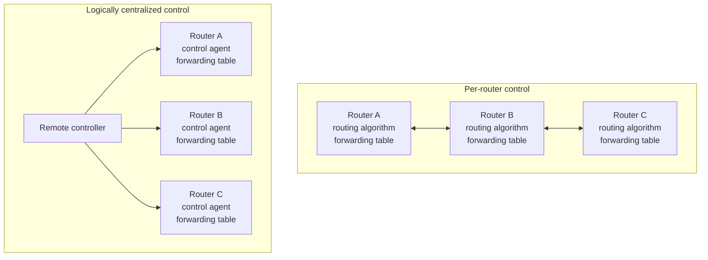
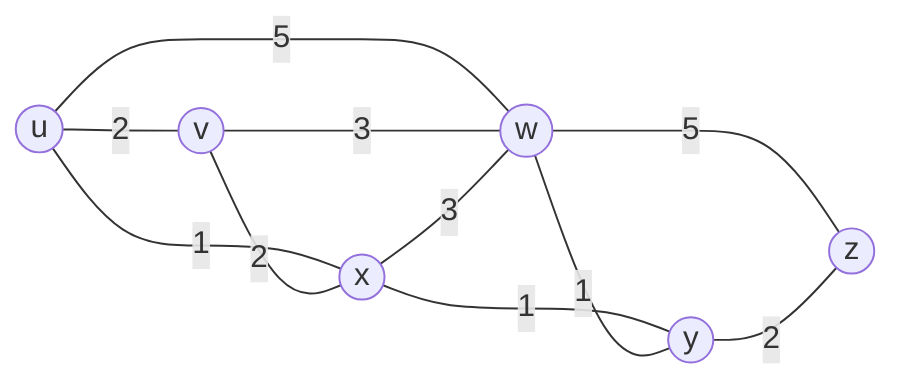
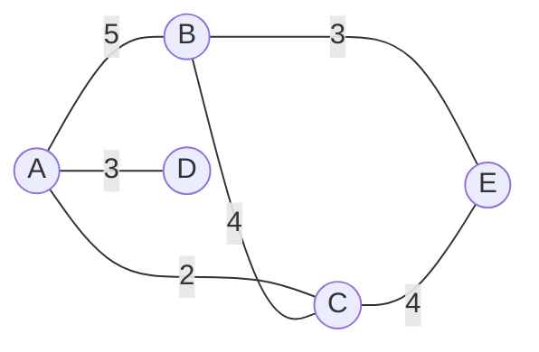
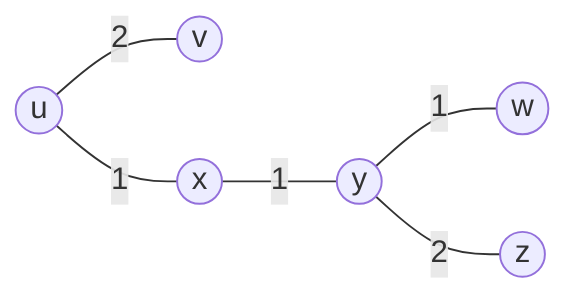
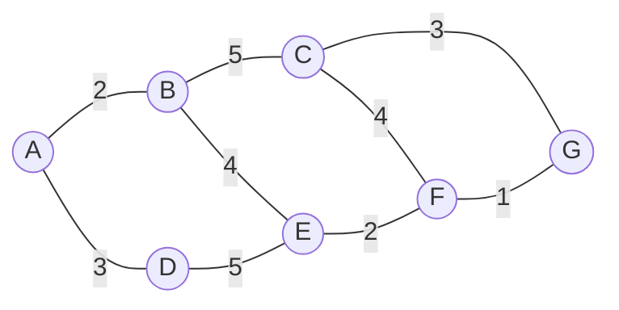
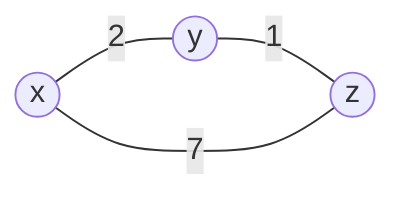
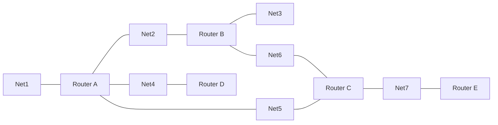
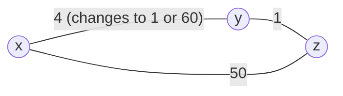
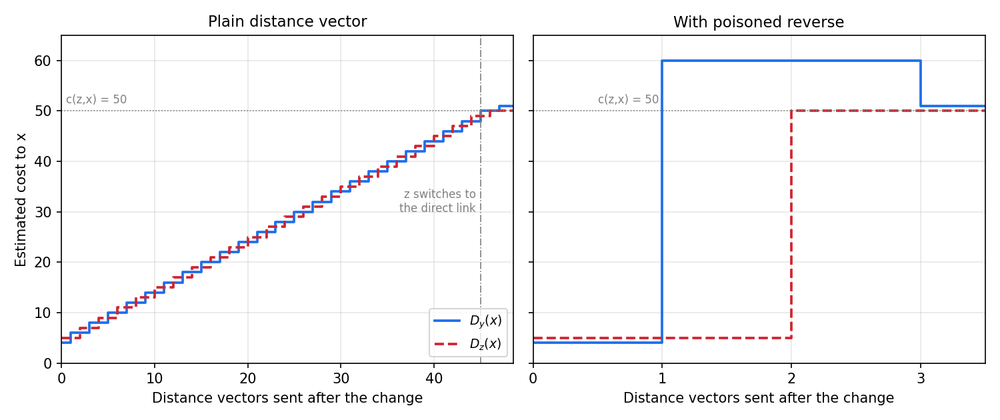
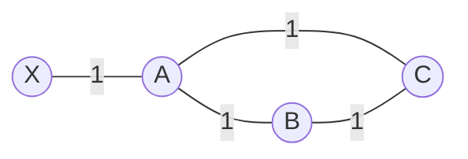

# Chapter 14 — Routing Algorithms

[Repository Guide](../../README.md) | [English](Concepts_Lecture.md) | [한국어](Concepts_Lecture.ko.md)

> **Last Updated:** 2026-11-18
>
> Computer Networking: A Top-Down Approach, Kurose and Ross, Ch 5; TCP/IP Protocol Suite, Forouzan, Ch 11

> **Learning Objectives:**
> 1. Formulate the routing problem as a least-cost path problem on a weighted graph
> 2. Classify routing algorithms as global or decentralized, static or dynamic, and load-sensitive or load-insensitive
> 3. Run Dijkstra's algorithm step by step to obtain a least-cost path tree and a forwarding table
> 4. Update distance vectors with the Bellman-Ford equation and trace their convergence
> 5. Explain the cause of the count-to-infinity problem and the effect and limits of split horizon and poisoned reverse
> 6. Compare link-state and distance-vector algorithms in message complexity, speed of convergence, and robustness

---

## Table of Contents

- [1. The Control Plane and Routing](#1-the-control-plane-and-routing)
  - [1.1 Two Ways to Build Forwarding Tables](#11-two-ways-to-build-forwarding-tables)
  - [1.2 Cost and Metric](#12-cost-and-metric)
  - [1.3 Static Tables, Dynamic Tables, and Routing Protocols](#13-static-tables-dynamic-tables-and-routing-protocols)
- [2. The Graph Model of Routing](#2-the-graph-model-of-routing)
  - [2.1 Graphs and Link Costs](#21-graphs-and-link-costs)
  - [2.2 Least-Cost Paths](#22-least-cost-paths)
  - [2.3 Classification of Routing Algorithms](#23-classification-of-routing-algorithms)
- [3. Link-State Routing](#3-link-state-routing)
  - [3.1 Every Node Has the Same Map](#31-every-node-has-the-same-map)
  - [3.2 Link State Packets and Flooding](#32-link-state-packets-and-flooding)
  - [3.3 Dijkstra's Algorithm](#33-dijkstras-algorithm)
  - [3.4 Step-by-Step Trace](#34-step-by-step-trace)
  - [3.5 The Shortest Path Tree and the Forwarding Table](#35-the-shortest-path-tree-and-the-forwarding-table)
  - [3.6 A Seven-Node Example](#36-a-seven-node-example)
  - [3.7 Computational Complexity](#37-computational-complexity)
  - [3.8 Congestion-Sensitive Costs and Route Oscillation](#38-congestion-sensitive-costs-and-route-oscillation)
- [4. Distance-Vector Routing](#4-distance-vector-routing)
  - [4.1 The Bellman-Ford Equation](#41-the-bellman-ford-equation)
  - [4.2 The Distance-Vector Algorithm](#42-the-distance-vector-algorithm)
  - [4.3 A Three-Node Example](#43-a-three-node-example)
  - [4.4 Distance-Vector Routing with Networks as Destinations](#44-distance-vector-routing-with-networks-as-destinations)
  - [4.5 Decreasing Link Costs: Good News Travels Fast](#45-decreasing-link-costs-good-news-travels-fast)
  - [4.6 Increasing Link Costs: Bad News and Count to Infinity](#46-increasing-link-costs-bad-news-and-count-to-infinity)
  - [4.7 The Two-Node Loop and Redefining Infinity](#47-the-two-node-loop-and-redefining-infinity)
  - [4.8 Split Horizon and Poisoned Reverse](#48-split-horizon-and-poisoned-reverse)
  - [4.9 Three-Node Instability](#49-three-node-instability)
- [5. Comparison of Link-State and Distance-Vector Algorithms](#5-comparison-of-link-state-and-distance-vector-algorithms)
  - [5.1 Message Complexity](#51-message-complexity)
  - [5.2 Speed of Convergence](#52-speed-of-convergence)
  - [5.3 Robustness](#53-robustness)
- [Concept Applications](#concept-applications)
- [Summary](#summary)
- [Self-Check Questions](#self-check-questions)

---

<br>

## 1. The Control Plane and Routing

### 1.1 Two Ways to Build Forwarding Tables

A router looks at the header of an arriving packet, looks up its forwarding table, and sends the packet to the appropriate output link. This action is the job of the **data plane**, which takes place inside a single router on a nanosecond timescale and was covered in Chapters 10 and 13. This chapter and Chapter 15 deal with where the contents of that forwarding table come from, that is, the network-wide logic of the **control plane**.

There are two broad ways to organize the control plane.

- **Per-router control:** A routing algorithm runs inside every router. The routing component of each router exchanges messages with the routing components of other routers and computes the values of its own forwarding table. The Internet has used this approach for decades, and the OSPF and BGP protocols of Chapter 15 belong to it.
- **Logically centralized control:** A separate controller computes the forwarding tables of all routers and distributes them. Each router has a **control agent (CA)** that only communicates with the controller and carries out its commands; the control agents neither exchange messages with each other directly nor take part in computing the tables.



*Figure 1. Per-router control and logically centralized control*

"Logically" centralized means that routers and applications use the control service as if it were a single central point. The actual controller is often implemented on several servers for fault tolerance and performance scalability. This approach underlies **software-defined networking (SDN)**, which Chapter 15 covers in detail.

> **Key Point:** Whichever approach is used, a packet must travel along a well-defined sequence of routers from the source host to the destination host. Computing that sequence, the path, is the job of a routing algorithm, and the algorithms of this chapter are used in both approaches.

### 1.2 Cost and Metric

A router is usually attached to several networks, so each time it receives a packet it must decide where to pass it. This decision is an optimization problem. To define what optimal means, a **cost** is assigned to passing through a link or a network; this cost is also called a **metric**. A high cost marks a bad route and a low cost a good one.

> **Definition:** A **metric** is the cost assigned to passing through a link or a network, and it is the criterion by which a routing algorithm compares how good routes are.

The metric is chosen according to the goal. To maximize throughput, low cost is given to high-throughput links and high cost to low-throughput links. To minimize delay, links with small delay get low cost. The physical length of a link (a transoceanic link costs more than a short terrestrial link), the link speed, and the monetary cost of using a link can also serve as the cost. If every link has cost 1, the cost becomes the number of links a path crosses, that is, the **hop count**.

### 1.3 Static Tables, Dynamic Tables, and Routing Protocols

A routing table can be static or dynamic. A **static** table is one whose entries are entered manually by an administrator, and a **dynamic** table is one that is updated automatically when something changes somewhere in the internet. Today's Internet needs dynamic tables, because the tables must change at once whenever a link goes down or a better route appears.

> **Definition:** A **routing protocol** is a set of rules and procedures by which routers inform each other of changes in the internet and combine the received information to update their routing tables.

Thanks to routing protocols, a router in one city can learn about the failure of a network in a distant region. Routing protocols are further divided into **interior** protocols, which handle routing within a single administrative domain, and **exterior** protocols, which handle routing between domains; this distinction and the actual protocols (RIP, OSPF, BGP) are covered in Chapter 15. This chapter focuses on the two algorithms underlying those protocols, the link-state algorithm and the distance-vector algorithm.

> **Note:** **Routing tables and forwarding tables.** In this chapter, the table that a routing algorithm computes (destination, cost, next hop) is called the routing table, and the table that the data plane actually looks up, obtained by extracting only the next hop (output link) for each destination from that result, is called the forwarding table. Section 3.5 illustrates the relationship between the two.

---

<br>

## 2. The Graph Model of Routing

### 2.1 Graphs and Link Costs

The routing problem is formulated with a graph. A **graph** $`G = (N, E)`$ consists of a set $`N`$ of nodes and a collection $`E`$ of edges, where each edge is a pair of nodes from $`N`$. In network-layer routing, the nodes represent routers, where packet-forwarding decisions are made, and the edges represent the physical links between routers.



*Figure 2. Graph model of a network of six routers*

Each edge carries a value representing the cost of the link. The cost of edge $`(x, y)`$ is written $`c(x, y)`$, and if there is no edge between the two nodes, $`c(x, y) = \infty`$. This chapter considers only undirected graphs, whose edges have no direction, so $`c(x, y) = c(y, x)`$. Extending the algorithms to links with a different cost in each direction is straightforward. If $`(x, y)`$ belongs to $`E`$, node $`y`$ is called a **neighbor** of node $`x`$.

> **[Data Structures]** Inside a router a graph is usually stored as an adjacency list or an adjacency matrix. An adjacency list keeps, for each node, a list of its neighbors and link costs, which saves memory in networks with few edges; an adjacency matrix yields $`c(x, y)`$ in a single access but uses space proportional to the square of the number of nodes.

### 2.2 Least-Cost Paths

A **path** in a graph $`G = (N, E)`$ is a sequence of nodes $`(x_1, x_2, \ldots, x_p)`$ such that every consecutive pair $`(x_1, x_2), (x_2, x_3), \ldots, (x_{p-1}, x_p)`$ is an edge in $`E`$. The cost of a path is the sum of the costs of its edges.

```math
c(x_1, x_2) + c(x_2, x_3) + \cdots + c(x_{p-1}, x_p)
```

> **Definition:** A **least-cost path** is the path with the smallest path cost among all paths that connect two nodes.

In Figure 2, the least-cost path between source u and destination w is (u, x, y, w) with cost 3. It is worth noting that the path through three links is cheaper than the direct link (u, w) with cost 5. If all links have the same cost, the least-cost path coincides with the **shortest path**, the path with the fewest links.

When people look for the least-cost path from u to z in Figure 2 by eye, most of them trace a few paths and convince themselves that one of them is the cheapest. Yet there are 17 simple paths (paths that do not visit any node twice) from u to z. Because the computation ran in one place, the human brain, with complete information about the network, this process is an example of a centralized routing algorithm.

### 2.3 Classification of Routing Algorithms

Routing algorithms are classified by three criteria.

The first criterion is the scope of the information the algorithm uses.

> **Definition:** A **global routing algorithm** takes the connectivity between all nodes and all link costs as input and computes least-cost paths with complete knowledge of the whole network.

A global algorithm, which Kurose and Ross call a centralized routing algorithm, must somehow gather the complete information before the computation. The computation itself can run at one site (the remote controller of Figure 1) or be replicated in the routing component of every router. In either case the key point is that the algorithm knows the state of every link, so global algorithms are often called **link-state (LS) algorithms**.

> **Definition:** A **decentralized routing algorithm** computes least-cost paths gradually, with no node knowing all link costs, as each node starts from the costs of its directly attached links and repeatedly exchanges its results with its neighbors.

The **distance-vector (DV) algorithm** of Section 4 is the representative decentralized algorithm. Because it relies on message exchange between neighbors, it fits naturally with per-router control, where routers interact directly with each other.

The second criterion is how often routes change. In a **static routing algorithm**, routes change very slowly, often only when a person edits a link cost by hand. A **dynamic routing algorithm** changes routes when traffic loads or the topology change, and it runs either periodically or in direct response to changes. Dynamic algorithms respond to changes more quickly but are more susceptible to problems such as routing loops and route oscillation.

The third criterion is whether link costs reflect congestion. In a **load-sensitive algorithm**, link costs change with the current level of congestion on the link, so routes that avoid congested links tend to be chosen. The early ARPAnet routing algorithms were load-sensitive but ran into a number of difficulties. Today's Internet routing protocols (RIP, OSPF, BGP) are **load-insensitive**: a link's cost does not explicitly reflect its current or recent congestion.

| Criterion | One side | Other side |
|:-----|:-----|:-----|
| Scope of information | Global (link state): computes knowing all link costs | Decentralized (distance vector): computes through repeated exchange with neighbors |
| How often routes change | Static: changes slowly through human intervention | Dynamic: changes with load or topology |
| Reflection of congestion | Load-sensitive: link costs reflect congestion | Load-insensitive: link costs are independent of congestion |

*Table 1. Three criteria for classifying routing algorithms*

---

<br>

## 3. Link-State Routing

### 3.1 Every Node Has the Same Map

The idea of link-state routing is simple. If every node in a domain knows the entire topology, that is, the list of nodes and links, how they are connected, and the type, cost, and condition (up or down) of each link, then each node can run Dijkstra's algorithm on that map to build its own routing table. Just as two people with the same map who start in different cities choose different roads, all nodes use the same topology, but each starts the computation from itself, so every node ends up with a different routing table.

No node knows the entire topology at the start. However, each node has partial knowledge, namely the state (type, condition, and cost) of its own links, and putting all of this partial knowledge together yields the whole topology.



*Figure 3. Topology of a domain with five nodes*

In Figure 3, A knows that it is connected to B with cost 5, to C with cost 2, and to D with cost 3. C knows that it is connected to A with cost 2, to B with cost 4, and to E with cost 4, and D knows that it is connected only to A with cost 3. Both end nodes of a link know about that link, so the knowledge overlaps, but precisely this overlap lets the knowledge gathered by each node form a common picture of the whole domain.

### 3.2 Link State Packets and Flooding

Four steps are needed before each node arrives at its routing table.

1. Each node creates a **link state packet (LSP)** describing the state of its links.
2. The LSPs are disseminated to every other router in an efficient and reliable way. This process is called **flooding**.
3. Each node builds a shortest path tree with itself as the root.
4. Each node computes its routing table from the shortest path tree.

An LSP carries at least the node identity, the list of links, a sequence number, and an age. The first two are needed to build the topology. The **sequence number** helps flooding and distinguishes new LSPs from old ones, and the **age** prevents old LSPs from remaining in the domain for a long time.

LSPs are generated on two occasions.

- When the topology of the domain changes. Disseminating an LSP as soon as a change occurs is the main way of quickly informing every node of a topology change.
- Periodically. This period is much longer than in distance-vector routing, usually 60 minutes to 2 hours depending on the implementation. Periodic LSPs are not meant to report changes but to remove old information from the domain, and the long period keeps the traffic created by flooding small.

> **Definition:** **Flooding** is a method of delivering an LSP created by a node not only to its neighbors but to all other nodes in the domain, in which a node that receives a new LSP sends it out of every interface except the one on which it arrived.

Flooding follows these rules.

1. The node that created an LSP sends a copy out of every interface.
2. A node that receives an LSP compares its sequence number with the copy it already has. If the newly arrived LSP is older, the node discards it. If it is newer, the node discards the old LSP, keeps the new one, and sends a copy out of every interface except the one on which the LSP arrived.

Thanks to rule 2, flooding stops at nodes with only one interface, and the same LSP does not circulate in the domain forever. When flooding is complete, every node has an identical and complete map of the network. The Internet's OSPF (Chapter 15) is a protocol that actually implements such a link-state broadcast.

### 3.3 Dijkstra's Algorithm

> **Definition:** A **link-state algorithm** is a routing algorithm in which each node, given the topology and link costs of the whole network gathered by flooding, computes by itself the least-cost paths to all destinations.

The computation used by the link-state algorithm is Dijkstra's algorithm, named after its inventor.

> **Definition:** **Dijkstra's algorithm** finds the least-cost paths from a source node to all other nodes by repeatedly fixing the unfixed node with the smallest current cost and updating the costs of that node's neighbors.

Dijkstra's algorithm is iterative and has the property that after the $`k`$-th iteration the least-cost paths to $`k`$ destination nodes are known, and these $`k`$ paths have the $`k`$ smallest costs among the least-cost paths to all destinations. Let the source node be u and use the following notation.

- $`D(v)`$: the cost of the least-cost path from the source to destination $`v`$ as of the current iteration
- $`p(v)`$: the previous node (a neighbor of $`v`$) on the current least-cost path from the source to $`v`$
- $`N'`$: the set of nodes whose least-cost path from the source is definitively known

The algorithm consists of an initialization step followed by a loop. The loop runs as many times as there are nodes in the network, and when it ends, the least-cost paths from the source to every other node have been computed.

```text
Link-State (LS) Algorithm for Source Node u

 1  Initialization:
 2    N' = {u}
 3    for all nodes v
 4      if v is a neighbor of u
 5        then D(v) = c(u, v)
 6      else D(v) = ∞
 7
 8  Loop
 9    find w not in N' such that D(w) is a minimum
10    add w to N'
11    update D(v) for each neighbor v of w and not in N':
12      D(v) = min(D(v), D(w) + c(w, v))
13    /* new cost to v is either old cost to v or known
14       least path cost to w plus cost from w to v */
15  until N' = N
```

Line 12 is the heart of the algorithm. The new cost to $`v`$ is the smaller of the cost known so far, $`D(v)`$, and the cost to the just-fixed node $`w`$ plus the cost of the link from $`w`$ to $`v`$. If this update lowers the cost, $`p(v)`$ is also changed to $`w`$.

> **[Algorithms]** Dijkstra's algorithm is a greedy algorithm. Under the condition that link costs are nonnegative, the node with the smallest cost outside the fixed set cannot be reached more cheaply through any other unfixed node, so its cost can be fixed. If link costs could be negative, this argument breaks down and an algorithm of the Bellman-Ford family must be used. Routing link costs are nonnegative, so they satisfy the condition.

### 3.4 Step-by-Step Trace

Let us run the algorithm on the network of Figure 2 with u as the source. Each row of Table 2 gives the values of the variables at the end of that step. A blank cell marks a node that has already joined $`N'`$ and whose cost is fixed.

| Step | N' | D(v), p(v) | D(w), p(w) | D(x), p(x) | D(y), p(y) | D(z), p(z) |
|:-----|:-----|:-----|:-----|:-----|:-----|:-----|
| 0 | u | 2, u | 5, u | 1, u | ∞ | ∞ |
| 1 | ux | 2, u | 4, x | | 2, x | ∞ |
| 2 | uxy | 2, u | 3, y | | | 4, y |
| 3 | uxyv | | 3, y | | | 4, y |
| 4 | uxyvw | | | | | 4, y |
| 5 | uxyvwz | | | | | |

*Table 2. Dijkstra's algorithm run from source u on the network of Figure 2*

- **Initialization (step 0):** The costs to u's neighbors v, x, and w are set to the direct link costs 2, 1, and 5. A cheaper path to w will turn out to exist, but for now the cost 5 of the one-hop direct link is used. The costs to y and z, which are not neighbors, are infinite.
- **Step 1:** Among the nodes not in $`N'`$, the node with the smallest cost is x with cost 1, so x is added to $`N'`$. Line 12 is then applied to x's neighbors. For v, 1 + 2 = 3 is larger than the existing value 2, so it stays. For w, the path through x costs 1 + 3 = 4, smaller than the existing 5, so $`D(w) = 4`$ and $`p(w) = x`$. For y, 1 + 1 = 2 is smaller than infinity, so $`D(y) = 2`$ and $`p(y) = x`$.
- **Step 2:** Among the remaining nodes, v and y both have the smallest cost 2. The tie may be broken arbitrarily; here y is added. Through y, w costs 2 + 1 = 3, smaller than 4, so $`D(w) = 3`$ and $`p(w) = y`$; z costs 2 + 2 = 4, so $`D(z) = 4`$ and $`p(z) = y`$.
- **Step 3:** v, with cost 2, is added. The cost to w through v, 2 + 3 = 5, is larger than 3, so nothing changes.
- **Step 4:** w, with cost 3, is added. The cost to z through w, 3 + 5 = 8, is larger than 4, so it stays.
- **Step 5:** Adding the last remaining node z makes $`N' = N`$, and the algorithm ends.

> **Caution:** Breaking ties differently can change the order in which nodes are added in steps 2 and 3. However, the final costs $`D(\cdot)`$ are the same however ties are broken. If several least-cost paths have the same cost, $`p(\cdot)`$, that is, the chosen path, may differ.

### 3.5 The Shortest Path Tree and the Forwarding Table

When the algorithm ends, each node has its predecessor $`p(v)`$ on the least-cost path. Following predecessor after predecessor reconstructs the entire path from the source to every destination. Collecting these paths gives a tree rooted at the source node.

> **Definition:** A **shortest path tree** is a tree of graph edges rooted at one node, chosen so that the path from the root to every other node is a least-cost path.

In a tree there is only one path from the root to any other node. Drawing u's shortest path tree from the $`p(\cdot)`$ values of Table 2 gives Figure 4.



*Figure 4. Shortest path tree rooted at u*

u's forwarding table needs to store only the **first hop** of the least-cost path to each destination. For example, the path to z is u, x, y, z, so packets for z are sent to x.

| Destination | Cost | Least-cost path | Link (next hop) |
|:-----|:-----|:-----|:-----|
| v | 2 | u, v | (u, v) |
| w | 3 | u, x, y, w | (u, x) |
| x | 1 | u, x | (u, x) |
| y | 2 | u, x, y | (u, x) |
| z | 4 | u, x, y, z | (u, x) |

*Table 3. Least-cost paths and forwarding table of u*

### 3.6 A Seven-Node Example

Let us run Dijkstra's algorithm once more on a slightly larger graph. Figure 5 is a topology of seven nodes.



*Figure 5. Topology of seven nodes*

With A as the root, an initialization step and six iterations are needed. Table 4 shows the node added to the path (the fixed set) in each iteration and the estimated shortest distance to each node at the end of the iteration.

| Iteration | Node added | B | C | D | E | F | G |
|:-----|:-----|:-----|:-----|:-----|:-----|:-----|:-----|
| Initialization | A | 2 | ∞ | 3 | ∞ | ∞ | ∞ |
| 1 | B | 2 | 7 | 3 | 6 | ∞ | ∞ |
| 2 | D | 2 | 7 | 3 | 6 | ∞ | ∞ |
| 3 | E | 2 | 7 | 3 | 6 | 8 | ∞ |
| 4 | C | 2 | 7 | 3 | 6 | 8 | 10 |
| 5 | F | 2 | 7 | 3 | 6 | 8 | 9 |
| 6 | G | 2 | 7 | 3 | 6 | 8 | 9 |

*Table 4. Dijkstra's algorithm run from root A on Figure 5*

In iteration 1, B is the closest node, so B is added and the distances to C (2 + 5 = 7) and E (2 + 4 = 6) are lowered with respect to B. The distances to the other nodes stay the same. When C is added in iteration 4, the distance to G is set through C to 7 + 3 = 10, but when F is added in iteration 5, the path through F, 8 + 1 = 9, is smaller, so the path to G changes from going through C to going through F. As this shows, the path to a node that is not yet fixed can change any number of times during the iterations.

Table 5 is A's routing table built from this shortest path tree. Rows with a blank next-router cell are nodes directly connected to A.

| Destination | Cost | Next router |
|:-----|:-----|:-----|
| A | 0 | |
| B | 2 | |
| C | 7 | B |
| D | 3 | |
| E | 6 | B |
| F | 8 | B |
| G | 9 | B |

*Table 5. Routing table of A*

The same topology yields a different tree for a different root. With C as the root, the costs are A 7, B 5, D 10, E 6, F 4, and G 3. For example, from C to D the path C, B, A, D (5 + 2 + 3 = 10) is cheaper than C, F, E, D (4 + 2 + 5 = 11).

### 3.7 Computational Complexity

Let us count the computation needed in the worst case when there are $`n`$ nodes besides the source. The first iteration must examine all $`n`$ nodes not in $`N'`$ to find the one with the minimum cost, the second iteration examines $`n - 1`$ nodes, the third $`n - 2`$, and so on. The total number of nodes examined over all iterations is therefore as follows.

```math
n + (n - 1) + \cdots + 1 = \frac{n(n+1)}{2}
```

Hence the implementation above has worst-case complexity $`O(n^2)`$.

> **[Data Structures]** If the minimum in line 9 is found with a heap (priority queue), the minimum can be extracted in logarithmic rather than linear time, which reduces the complexity. A heap also updates the key of a node whose cost has decreased in logarithmic time.

### 3.8 Congestion-Sensitive Costs and Route Oscillation

Problems can arise when link costs change with the amount of traffic a link carries. In the ring network of Figure 6, suppose the cost of a link equals the load it carries. The cost may then differ in the two directions. z and x each send 1 unit of traffic to w, and y sends $`e`$ units.

```text
              w
            /   \
          z       x
            \   /
              y

 Clockwise paths:        y → z → w,   x → y → z → w
 Counterclockwise paths: y → x → w,   z → y → x → w
```

*Figure 6. Ring network of four routers*

| Link (direction) | (a) Initial routing | (b) After switching clockwise | (c) After switching counterclockwise |
|:-----|:-----|:-----|:-----|
| z → w | 1 | 2 + e | 0 |
| x → w | 1 + e | 0 | 2 + e |
| y → x | e | 0 | 1 + e |
| y → z | 0 | 1 + e | 0 |
| x → y | 0 | 1 | 0 |
| z → y | 0 | 0 | 1 |

*Table 6. Link costs that change with load, and route oscillation*

- **(a) Initial routing:** z sends directly to w, x also sends directly to w, and y sends through x.
- **(b):** When the algorithm runs next, y judges from the costs of (a) that the clockwise path through z (cost 1) is cheaper than the counterclockwise path it has been using. x likewise judges that the clockwise path through y and z is cheaper. As a result, all traffic flows clockwise.
- **(c):** When the algorithm runs again, x, y, and z all see a zero-cost path in the counterclockwise direction and route all their traffic counterclockwise.
- The next run sends everything clockwise again, and this oscillation continues.

Such oscillations are not peculiar to link-state algorithms; they can occur in any algorithm that uses congestion or delay as the link cost. Two remedies come to mind.

- Make link costs independent of the amount of traffic. This is hard to accept, because one goal of routing is to avoid highly congested (high-delay) links.
- Ensure that not all routers run the algorithm at the same time. This is more realistic, since even if routers run the algorithm with the same period, one can hope that the execution instants differ from router to router. However, it has been observed that routers in the Internet can gradually self-synchronize, so that algorithms first run at different instants end up running at the same instant. To avoid this, each router randomizes the time at which it sends out a link advertisement.

---

<br>

## 4. Distance-Vector Routing

### 4.1 The Bellman-Ford Equation

Whereas the link-state algorithm uses global information, the **distance-vector algorithm** is iterative, asynchronous, and distributed.

- **Distributed:** Each node receives information from its directly attached neighbors, performs a calculation, and distributes the result back to its neighbors.
- **Iterative:** This process repeats until no more information is exchanged between neighbors. It is self-terminating in that it stops by itself, with no separate signal telling the computation to stop.
- **Asynchronous:** It does not require all nodes to operate in lockstep with each other.

The distance-vector algorithm rests on a relationship that holds among least costs. Let $`d_x(y)`$ be the cost of the least-cost path from node $`x`$ to node $`y`$. Then the following holds.

```math
d_x(y) = \min_{v} \lbrace c(x, v) + d_v(y) \rbrace
```

Here the minimum is taken over all neighbors $`v`$ of $`x`$.

> **Definition:** The **Bellman-Ford equation** states that the least cost from node $`x`$ to $`y`$ equals the smallest, over the neighbors $`v`$ of $`x`$, of the link cost from $`x`$ to $`v`$ plus the least cost from $`v`$ to $`y`$.

The equation is intuitive. To go from $`x`$ to $`y`$, one must first go to some neighbor $`v`$, and after arriving at $`v`$, it is best to follow the least-cost path from $`v`$ to $`y`$. The cost is therefore $`c(x, v) + d_v(y)`$ depending on which first neighbor is chosen, and the minimum of these is $`d_x(y)`$.

Let us check the equation with source u and destination z in Figure 2. The neighbors of u are v, x, and w, and in the graph $`d_v(z) = 5`$, $`d_x(z) = 3`$, and $`d_w(z) = 3`$. Plugging these into the equation together with the link costs $`c(u, v) = 2`$, $`c(u, x) = 1`$, and $`c(u, w) = 5`$ gives the following, which equals the value obtained with Dijkstra's algorithm (Table 2).

```math
d_u(z) = \min \lbrace 2 + 5,\ 5 + 3,\ 1 + 3 \rbrace = 4
```

The Bellman-Ford equation has two practical meanings. First, the neighbor $`v^*`$ that achieves the minimum is the next hop toward $`y`$. If $`x`$ is to send a packet to $`y`$ along a least-cost path, it must first send it to $`v^*`$, so $`x`$'s forwarding table holds $`v^*`$ as the next hop for destination $`y`$. Second, since each node can compute its own value as long as it knows its neighbors' $`d_v(y)`$, the equation shows what neighbors must exchange in the distance-vector algorithm.

> **Note:** **The synchronous Bellman-Ford algorithm.** When the information about all nodes can be gathered in one place, as with a road map between cities, the Bellman-Ford equation can be applied repeatedly all at once. Initialize the distance and cost from each node to itself to 0, the distance to other nodes to infinity, and the cost to neighbors to the link cost, and then repeat $`D_{ij} \leftarrow \min_k \lbrace c_{ik} + D_{kj} \rbrace`$ for every node pair $`(i, j)`$ until the distance vectors stop changing. This approach produces the result synchronously, in one place. For routers to build their own tables, the computation must be split up and performed asynchronously, as in the next section.

### 4.2 The Distance-Vector Algorithm

Each node $`x`$ starts with $`D_x(y)`$, an estimate of the cost of the least-cost path from itself to node $`y`$, for every node $`y`$. The vector of these estimates, $`\mathbf{D}_x = [D_x(y) : y \in N]`$, is called $`x`$'s distance vector.

> **Definition:** A **distance-vector algorithm** is a decentralized routing algorithm in which each node exchanges with its neighbors a distance vector of cost estimates to all destinations and recomputes its own distance vector with the Bellman-Ford equation whenever it receives a neighbor's distance vector.

In the distance-vector algorithm, each node $`x`$ maintains the following information.

- The link cost $`c(x, v)`$ to each directly attached neighbor $`v`$
- Its own distance vector $`\mathbf{D}_x = [D_x(y) : y \in N]`$
- The most recent distance vector $`\mathbf{D}_v = [D_v(y) : y \in N]`$ received from each neighbor $`v`$

From time to time each node sends a copy of its distance vector to all of its neighbors. When node $`x`$ receives a new distance vector from neighbor $`w`$, it saves that vector and updates its own distance vector with the Bellman-Ford equation.

```math
D_x(y) = \min_{v} \lbrace c(x, v) + D_v(y) \rbrace \quad \text{for each node } y \in N
```

If the update has changed its distance vector, the node sends the changed vector to all neighbors, which in turn update their own distance vectors. As long as all nodes keep exchanging distance vectors asynchronously, each estimate $`D_x(y)`$ converges to the actual least cost $`d_x(y)`$.

```text
Distance-Vector (DV) Algorithm

At each node, x:

 1  Initialization:
 2    for all destinations y in N:
 3      Dx(y) = c(x, y)   /* if y is not a neighbor then c(x, y) = ∞ */
 4    for each neighbor w
 5      Dw(y) = ? for all destinations y in N
 6    for each neighbor w
 7      send distance vector Dx = [Dx(y): y in N] to w
 8
 9  loop
10    wait (until I see a link cost change to some neighbor w or
11          until I receive a distance vector from some neighbor w)
12
13    for each y in N:
14      Dx(y) = min_v {c(x, v) + Dv(y)}
15
16    if Dx(y) changed for any destination y
17      send distance vector Dx = [Dx(y): y in N] to all neighbors
18
19  forever
```

A node recomputes its distance vector (line 14) when the cost of a directly attached link changes (line 10) or when it receives a distance vector from a neighbor (line 11). What it actually needs to update its forwarding table is not the distance itself but the next hop $`v^*(y)`$, which is the neighbor $`v`$ that achieves the minimum in line 14. If several neighbors achieve the minimum, any of them may be chosen. Thus in lines 13 and 14, the node also determines $`v^*(y)`$ for each destination $`y`$ and updates its forwarding table.

Whereas the link-state algorithm must gather a map of the whole network before computing, a node in the distance-vector algorithm knows only the costs of its directly attached links and the information it receives from its neighbors. The Internet's RIP and BGP (Chapter 15), as well as the original ARPAnet and several other real routing protocols, use algorithms similar to distance vector.

### 4.3 A Three-Node Example

Let us trace how the algorithm operates on the three-node network of Figure 7. For clarity, the operation is shown in a synchronous manner, in which all nodes receive their neighbors' distance vectors at the same time, compute new distance vectors at the same time, and inform their neighbors at the same time if anything changed. The real algorithm also works correctly in an asynchronous manner, with computation and message exchange occurring at any time.



*Figure 7. Network of three nodes*

Each node's routing table holds one row for its own distance vector and one row for each neighbor's distance vector. Each vector in the tables lists the costs [to x, to y, to z]. Right after initialization nothing has been received from the neighbors, so the neighbors' rows are all infinity.

| Node | Own distance vector | Distance vector of first neighbor | Distance vector of second neighbor |
|:-----|:-----|:-----|:-----|
| x | Dx = [0, 2, 7] | Dy = [∞, ∞, ∞] | Dz = [∞, ∞, ∞] |
| y | Dy = [2, 0, 1] | Dx = [∞, ∞, ∞] | Dz = [∞, ∞, ∞] |
| z | Dz = [7, 1, 0] | Dx = [∞, ∞, ∞] | Dy = [∞, ∞, ∞] |

*Table 7. Routing tables right after initialization*

After initialization each node sends its distance vector to its two neighbors. For example, x sends $`\mathbf{D}_x = [0, 2, 7]`$ to y and z. Each node that receives the updates recomputes its distance vector; x computes as follows.

```math
\begin{aligned}
D_x(x) &= 0 \\
D_x(y) &= \min \lbrace c(x, y) + D_y(y),\ c(x, z) + D_z(y) \rbrace = \min \lbrace 2 + 0,\ 7 + 1 \rbrace = 2 \\
D_x(z) &= \min \lbrace c(x, y) + D_y(z),\ c(x, z) + D_z(z) \rbrace = \min \lbrace 2 + 1,\ 7 + 0 \rbrace = 3
\end{aligned}
```

| Node | Own distance vector | Distance vector of first neighbor | Distance vector of second neighbor |
|:-----|:-----|:-----|:-----|
| x | Dx = [0, 2, 3] | Dy = [2, 0, 1] | Dz = [7, 1, 0] |
| y | Dy = [2, 0, 1] | Dx = [0, 2, 7] | Dz = [7, 1, 0] |
| z | Dz = [3, 1, 0] | Dx = [0, 2, 7] | Dy = [2, 0, 1] |

*Table 8. Routing tables after the first exchange*

x's estimate of the cost to z, $`D_x(z)`$, has changed from 7 to 3. At this point the neighbor that achieves the minimum at x for both y and z is y, so x's next hops are $`v^*(y) = y`$ and $`v^*(z) = y`$. z has likewise lowered $`D_z(x)`$ from 7 to 3. In contrast, y's distance vector has not changed.

Now only x and z, whose distance vectors changed, send their new vectors to their neighbors. y's distance vector did not change, so y sends nothing. Table 9 shows the result after the receiving nodes recompute.

| Node | Own distance vector | Distance vector of first neighbor | Distance vector of second neighbor |
|:-----|:-----|:-----|:-----|
| x | Dx = [0, 2, 3] | Dy = [2, 0, 1] | Dz = [3, 1, 0] |
| y | Dy = [2, 0, 1] | Dx = [0, 2, 3] | Dz = [3, 1, 0] |
| z | Dz = [3, 1, 0] | Dx = [0, 2, 3] | Dy = [2, 0, 1] |

*Table 9. Routing tables after the second exchange*

This time no node's distance vector changes, so no more update messages are sent. No further computation then takes place, and all nodes enter a **quiescent state**, waiting in lines 10-11 of the algorithm. This state lasts until a link cost changes.

### 4.4 Distance-Vector Routing with Networks as Destinations

To apply the Bellman-Ford algorithm to routers inside an autonomous system, a few changes are needed.

1. The cost is usually the hop count, that is, the number of networks passed before reaching the destination. The cost between neighbors is therefore 1.
2. Each router updates its table asynchronously whenever it receives information from a neighbor. Each router executes only part of the whole Bellman-Ford algorithm, so the processing is distributed.
3. A router that has updated its table sends the result to its neighbors so that they can update theirs.
4. For each route, at least three pieces of information are kept: the destination network, the cost, and the next hop.
5. Each piece of route information (a record) received from a neighbor carries only two items, the destination and the cost. The next hop is not included, because it is the address of the router that sent the record.

At startup a router builds a preliminary table holding only the networks attached directly to its interfaces. A directly attached network has cost 1 and no next hop (the router's own network). For each entry, the router then sends its neighbors a record containing only the destination and the cost. When a record arrives from a neighbor, the router looks up the destination in its table and updates it with the following rules.

1. If the destination is in the table, two cases are checked.
   - If the record's cost plus 1 is smaller than the cost in the table, the neighbor has found a better route to that destination, so the cost and next hop are replaced.
   - If the neighbor that sent the record is the current next hop for that destination, the new value is accepted even if the cost has grown. For example, if a neighbor earlier advertised a destination with cost 3 and the path from that neighbor to the destination disappears, it now advertises cost infinity. The receiving router must not ignore this value even though its old entry is smaller, because the old route no longer exists.
   - If neither case applies, the record is discarded.
2. If the destination is not in the table, it is inserted as a new row with the cost plus 1, and its next hop is set to the router that sent the record.



*Figure 8. Autonomous system of five routers and seven networks*

In the autonomous system of Figure 8, each router builds its table when it boots. A's initial table holds Net1, Net2, Net4, and Net5 with cost 1, and B's initial table holds Net2, Net3, and Net6 with cost 1. When A sends four records (Net1, 1), (Net2, 1), (Net4, 1), and (Net5, 1) to its neighbors B, C, and D, B's table changes as follows.

- **On receiving (Net1, 1):** Net1 is not in the table, so it is inserted with cost 1 + 1 = 2 and next hop A.
- **On receiving (Net2, 1):** Net2 is in the table, but 1 + 1 = 2 is larger than the existing cost 1 and the next hop is not A, so the record is discarded.
- **On receiving (Net4, 1):** Net4 is not present, so it is inserted with cost 2 and next hop A.
- **On receiving (Net5, 1):** Net5 is not present, so it is inserted with cost 2 and next hop A.

| Destination | Cost | Next hop |
|:-----|:-----|:-----|
| Net1 | 2 | A |
| Net2 | 1 | |
| Net3 | 1 | |
| Net4 | 2 | A |
| Net5 | 2 | A |
| Net6 | 1 | |

*Table 10. B's routing table after receiving A's four records*

B now knows more, but its knowledge is not yet complete; for example, B does not even know that Net7 exists. After further updates, the tables of all routers stabilize as in Table 11. If two or more routes have the same cost (A reaches Net6 with cost 2 through either B or C), one of them is chosen.

| Destination | A | B | C | D | E |
|:-----|:-----|:-----|:-----|:-----|:-----|
| Net1 | 1, - | 2, A | 2, A | 2, A | 3, C |
| Net2 | 1, - | 1, - | 2, A | 2, A | 3, C |
| Net3 | 2, B | 1, - | 2, B | 3, A | 3, C |
| Net4 | 1, - | 2, A | 2, A | 1, - | 3, C |
| Net5 | 1, - | 2, A | 1, - | 2, A | 2, C |
| Net6 | 2, C | 1, - | 1, - | 3, A | 2, C |
| Net7 | 2, C | 2, C | 1, - | 3, A | 1, - |

*Table 11. Routing tables of all routers after stabilization (cost, next hop)*

### 4.5 Decreasing Link Costs: Good News Travels Fast

When a node running the distance-vector algorithm detects a change in the cost of the link to a neighbor (lines 10-11), it updates its distance vector (lines 13-14) and, if a least cost has changed, informs its neighbors of the new distance vector (lines 16-17).



*Figure 9. Three-node network whose link cost changes*

In Figure 9, consider the case in which the cost of the link between y and x decreases from 4 to 1. Looking only at y's and z's entries for destination x, the events occur in the following order.

- **Time t0:** y detects the link-cost change (from 4 to 1) and updates its distance vector. Because the distance vector has changed, it informs its neighbors.
- **Time t1:** z receives y's update and updates its table. Its new least cost to x has decreased from 5 to 2, so z also sends its new distance vector to its neighbors.
- **Time t2:** y receives z's update and updates its table. y's least costs do not change, so y sends no message to z, and the algorithm reaches a quiescent state.

The quiescent state was reached in only two iterations. The good news that a cost has decreased travels quickly through the network.

### 4.6 Increasing Link Costs: Bad News and Count to Infinity

Now consider the case in Figure 9 in which the cost of the link between x and y increases from 4 to 60.

1. Before the cost changes, $`D_y(x) = 4`$, $`D_y(z) = 1`$, $`D_z(y) = 1`$, and $`D_z(x) = 5`$. At time t0, y detects the change and computes its new least cost to x.

   ```math
   D_y(x) = \min \lbrace c(y, x) + D_x(x),\ c(y, z) + D_z(x) \rbrace = \min \lbrace 60 + 0,\ 1 + 5 \rbrace = 6
   ```

   With a global view of the network, one can see that this cost through z is wrong. But all y knows is that its direct cost to x is 60 and that z last told it that z could reach x with cost 5. So y tries to reach x through z, expecting z to get to x with cost 5. Yet z's path of cost 5 is the very path through y. Now, to reach x, y routes through z and z routes through y, forming a **routing loop**. A loop is like a black hole: a packet for x that arrives at y or z at this point bounces between the two nodes forever, or until the forwarding tables change.
2. Since y has computed a new least cost, it informs z of its new distance vector at t1.
3. Some time after t1, z receives y's distance vector saying that y's least cost is 6. z can reach y with cost 1, so it computes the new least cost to x as $`D_z(x) = \min \lbrace 50 + 0,\ 1 + 6 \rbrace = 7`$. Since its least cost has increased, it informs y of its new distance vector at t2.
4. In the same way, y computes $`D_y(x) = 8`$ and sends it to z, z computes $`D_z(x) = 9`$ and sends it to y, and so on.

y's estimate climbs 6, 8, 10, ..., 50 and z's estimate climbs 7, 9, ..., 49, each in steps of 2. When y advertises 50, z obtains $`\min \lbrace 50,\ 1 + 50 \rbrace = 50`$, finally chooses its direct link to x, and the loop is broken. y then sets its cost to x to $`1 + 50 = 51`$ through z. Each advertisement raises the advertised cost by 1, so after y's first advertisement of 6 another $`50 - 6 = 44`$ message exchanges take place before y advertises 50; this matches the statement by Kurose and Ross that the loop persists for 44 iterations (message exchanges between y and z). Counting y's first advertisement as well, 45 distance vectors (23 from y and 22 from z) are sent while the loop exists, and two more (z's 50 and y's 51) follow before the network becomes quiescent, 47 in all. The dash-dotted line in Figure 10 marks the moment z switches to its direct link.



*Figure 10. Evolution of the estimated cost to x after the link cost increases from 4 to 60*

The bad news that a cost has increased thus travels slowly. Had $`c(y, x)`$ changed from 4 to 10,000 with $`c(z, x)`$ equal to 9,999, the loop would have lasted far longer. If the link fails, so that its cost becomes infinite, and no other path exists, the estimates of the two nodes climb forever.

> **Definition:** The **count-to-infinity problem** is a problem in distance-vector routing in which, after a link cost increases or a link fails, stale route information previously advertised by neighbors makes the nodes' cost estimates rise only gradually, so that wrong routes and routing loops persist for a long time.

### 4.7 The Two-Node Loop and Redefining Infinity

Consider the case in which a link fails and its cost becomes infinite. Ideally, every other router should learn of a link failure immediately, but in distance-vector routing several updates are needed before every router records the cost to that destination as infinity.

```text
                         A's entry       B's entry
                         (cost to X, next hop)
 Before failure          X 1  -          X 2  A
 Right after X-A fails   X ∞  -          X 2  A
 A receives B's update   X 3  B          X 2  A
 B receives A's update   X 3  B          X 4  A
 ...                     (cost keeps rising)
 Finally                 X ∞  -          X ∞  -
```

*Figure 11. Two-node instability*

In Figure 11, both A and B can reach X at the beginning: A is directly connected to X (cost 1), and B goes through A (cost 2). Suddenly the link between A and X fails, and A changes its cost to X to infinity. If A could send this table to B immediately, all would be well. However, the system becomes unstable if B sends its table to A before receiving A's table. A assumes that B has found a way to reach X and changes its cost to X to 2 + 1 = 3 with next hop B. When A sends this update to B, B assumes that something has changed around A and changes its cost to 4. The cost rises gradually in this way until it reaches infinity, and only then do A and B know that X cannot be reached.

Meanwhile, A believes that the route to X goes through B, and B believes that it goes through A. A packet for X that arrives at A goes to B and comes back to A, and one that arrives at B goes to A and comes back to B. This is called the **two-node loop** problem.

The first remedy is to redefine infinity as a small number such as 16. The system then stabilizes in fewer updates, because a destination is judged unreachable as soon as its cost reaches 16. In fact, most implementations of distance-vector protocols define 16 as infinity. The price is that distance-vector routing cannot be used in large systems: the size of the network, in each direction, cannot exceed 15 hops. RIP in Chapter 15 uses this definition.

### 4.8 Split Horizon and Poisoned Reverse

> **Definition:** **Split horizon** is a strategy in which a node does not advertise route information for a destination to the neighbor that is the next hop of that route.

With split horizon, instead of sending its whole table through every interface, each node sends only part of its table through each interface. In Figure 11, B knows that the optimum route to X goes through A. This information originally came from A, so A already knows it and there is no need to tell A again. The confusion arises from taking information from A, modifying it, and sending it back to A. So B leaves out the row for X when it sends its table to A. A then keeps its distance to X at infinity, and when A later sends its table to B, B also corrects its table. After the first update, both A and B know that X is unreachable, and the system is stable.

Split horizon has one drawback. Distance-vector protocols normally use a timer and delete a route from the table if there is no news about it for a while. When B leaves the row for X out of its advertisement to A, A cannot tell whether this is due to split horizon (the source of the information was A) or because B has not received any news about X recently. Split horizon is therefore combined with poisoned reverse.

> **Definition:** **Poisoned reverse** is a strategy in which a node advertises to the neighbor that is the next hop of its route to a destination an infinite distance to that destination instead of the actual value.

B still advertises its value for X to A, but if the source of the information is A, it replaces the distance with infinity as a warning: "Do not use this value; what I know about this route comes from you."

Let us apply poisoned reverse to the loop of Figure 9. While z routes to x through y, z advertises $`D_z(x) = \infty`$ to y (even though it knows that in truth $`D_z(x) = 5`$). z keeps telling this little white lie as long as it routes to x through y, so y believes that z has no path to x and never tries to route to x through z.

1. When the link cost $`c(x, y)`$ changes from 4 to 60 at t0, y's table holds $`D_z(x) = \infty`$, so y keeps routing directly to x, albeit at the higher cost of 60, and informs z of its new cost $`D_y(x) = 60`$.
2. On receiving the update at t1, z immediately shifts its route to x to the direct link (z, x) with cost 50. This is a new least-cost path and no longer passes through y, so z informs y at t2 that $`D_z(x) = 50`$.
3. On receiving z's update, y updates to $`D_y(x) = 51`$. Since z is now on y's least-cost path, y poisons the reverse path by telling z at t3 that $`D_y(x) = \infty`$ (even though it knows that in truth the value is 51).

With poisoned reverse, only three distance vectors are exchanged and no loop forms (the right side of Figure 10).

### 4.9 Three-Node Instability

Poisoned reverse does not solve the count-to-infinity problem in general. It prevents loops between two immediately neighboring nodes, but it does not detect loops that involve three or more nodes.



*Figure 12. Topology in which three-node instability can occur*

In Figure 12, A initially reaches X directly (cost 1), and B and C reach it through A (cost 2).

1. When the link to X fails, A tells B and C that X is unreachable. B updates its table immediately, but the packet to C is lost in the network and never reaches C.
2. C still believes that it can reach X through A with cost 2. After a while, C sends its table to B. The next hop of this route is A, not B, so split horizon and poisoned reverse do not stop C from advertising the value to B.
3. B is completely fooled. Having received route information for X from C, it follows the algorithm and changes its route to X to go through C with cost 3. This information came from C, not from A, so after a while B may advertise the route to A.
4. Now A is fooled and updates its table to reach X through B with cost 4. A advertises the increased cost to C (but not to B), C advertises an increased cost to B, B does the same to A, and so on.

The loop does not stop until the cost at each node reaches infinity. In the end, poisoned reverse prevents two-node loops, but preventing loops of three or more nodes has to rely on defining infinity as a small number.

---

<br>

## 5. Comparison of Link-State and Distance-Vector Algorithms

The two algorithms take complementary approaches to computing routes. In the distance-vector algorithm each node talks only to its directly connected neighbors, but it tells them its least-cost estimates to all the nodes it knows about. The link-state algorithm requires global information, so when it runs in every router, each node must talk to all other nodes by broadcast, but it tells them only the costs of its directly connected links. Let $`N`$ be the set of nodes (routers) and $`E`$ the set of edges (links), and compare the two in three respects.

### 5.1 Message Complexity

In the link-state algorithm each node must know the cost of every link in the network, which requires $`O(\lvert N \rvert \lvert E \rvert)`$ messages. Moreover, whenever one link cost changes, the new cost must be sent to all nodes. The distance-vector algorithm exchanges messages only between directly connected neighbors in each iteration. When a link cost changes, it propagates the change only if the new cost changes the least-cost path of one of the nodes attached to that link.

### 5.2 Speed of Convergence

The link-state implementation above is an algorithm that needs $`O(\lvert N \rvert^2)`$ computation and $`O(\lvert N \rvert \lvert E \rvert)`$ messages. The distance-vector algorithm can converge slowly, can have routing loops while it converges, and also suffers from the count-to-infinity problem.

### 5.3 Robustness

Consider what can happen if a router fails, misbehaves, or is sabotaged. In the link-state algorithm a router can broadcast an incorrect cost for one of its attached links, and it can also corrupt or drop packets it receives during flooding. However, each node computes only its own forwarding table and other nodes perform the same computation for themselves, so route calculations are somewhat separated from node to node, which provides a degree of robustness.

In the distance-vector algorithm a node can advertise incorrect least-cost paths to any destination, or even to all destinations. The textbook mentions a 1997 incident in which a malfunctioning router in a small ISP sent erroneous routing information to national backbone routers, which caused other routers to flood the malfunctioning router with traffic and left large portions of the Internet disconnected for up to several hours. In general, a node's calculation in distance vector is passed to its neighbor in the next iteration and to the neighbor's neighbor in the iteration after that, so an incorrect calculation at one node can spread through the entire network.

| Aspect | Link state (LS) | Distance vector (DV) |
|:-----|:-----|:-----|
| Who a node talks to | All other nodes (flooding) | Directly connected neighbors |
| What it tells | Costs of its directly connected links | Cost estimates to all destinations |
| Number of messages | $`O(\lvert N \rvert \lvert E \rvert)`$; a cost change goes to all nodes | Exchanged only between neighbors; propagated only when a least cost changes |
| Computation and convergence | Result right after an $`O(\lvert N \rvert^2)`$ computation | May converge slowly, with loops and count to infinity |
| Effect of incorrect information | Can misreport only its own link costs; computation separated per node | Can misreport costs to all destinations; errors spread network-wide |
| Example in the Internet | OSPF (Chapter 15) | RIP, BGP (Chapter 15) |

*Table 12. Comparison of link-state and distance-vector algorithms*

> **Key Point:** Neither algorithm is an obvious winner over the other, and both are used in the Internet.

---

<br>

## Concept Applications

**True/False Check:**

| Statement | Judgment and Reason |
|:-----|:-----|
| If all links have the same cost, the least-cost path is the same as the path with the fewest links. | **T.** The path cost is proportional to the number of links, so both criteria choose the same path. |
| In Dijkstra's algorithm, the cost of a node in $`N'`$ can decrease in later iterations. | **F.** Since link costs are nonnegative, a node's least cost is fixed the moment it joins $`N'`$; only nodes outside $`N'`$ change later. |
| In link-state routing, all nodes have the same topology and therefore build the same routing table. | **F.** The topology is the same, but each node computes with itself as the root, so the routing tables differ from node to node. |
| In the distance-vector algorithm, a node informs its neighbors only when its distance vector has changed. | **T.** As in lines 16-17 of the algorithm, it sends only when there is a change and otherwise enters the quiescent state. |
| News of a decreased link cost and news of an increased link cost travel at the same speed in the distance-vector algorithm. | **F.** Good news spreads in a few iterations, but bad news spreads slowly because the neighbors' stale information causes the count-to-infinity problem. |
| Poisoned reverse also prevents loops that involve three or more nodes. | **F.** Poisoned reverse advertises infinity only to the neighbor that is the next hop, so it prevents only loops between two immediately neighboring nodes. |
| A distance-vector protocol that defines infinity as 16 cannot be used in a network whose diameter exceeds 15 hops. | **T.** A cost of 16 means unreachable, so destinations farther than 15 hops cannot be represented. |
| Oscillation in routing that uses congestion as the link cost occurs only in link-state algorithms. | **F.** It can occur in any algorithm that uses congestion or delay as the link cost. |

---

<br>

## Summary

| Concept | Key Summary |
|:-----|:-----|
| Control plane | Forwarding tables are computed by per-router control or logically centralized control, and both approaches use routing algorithms. |
| Graph model | Routers are nodes and links are edges with costs, and routing is the problem of finding the least-cost path between a source and a destination. |
| Classification | Routing algorithms are global or decentralized, static or dynamic, and load-sensitive or load-insensitive; today's Internet protocols are load-insensitive. |
| Link-state routing | Each node floods its LSP so that all nodes share the same topology, and then each builds a shortest path tree with Dijkstra's algorithm. |
| Dijkstra's algorithm | It repeatedly fixes the unfixed node with the smallest cost and updates its neighbors' costs; the simple implementation has complexity $`O(n^2)`$. |
| Forwarding table | The forwarding table is built by taking only the first hop of the path to each destination from the shortest path tree. |
| Route oscillation | Routes can oscillate when link costs reflect load, and randomizing the timing of link-state advertisements avoids synchronization. |
| Bellman-Ford equation | The least cost is the minimum over neighbors of the link cost to the neighbor plus the neighbor's least cost, and the minimizing neighbor is the next hop. |
| Distance-vector algorithm | Each node asynchronously exchanges distance vectors with its neighbors, updates with the Bellman-Ford equation, and becomes quiescent when nothing changes. |
| Count-to-infinity problem | When a link cost increases, stale information from neighbors makes estimates rise only gradually, and routing loops persist for a long time. |
| Mitigation techniques | Defining infinity as 16, split horizon, and poisoned reverse prevent two-node loops but not loops of three or more nodes. |
| LS versus DV | LS sends more messages but converges quickly with localized errors; DV talks only to neighbors but may converge slowly and spread errors. |

---

<br>

## Self-Check Questions

1. **Running Dijkstra's algorithm:** Run Dijkstra's algorithm with x as the source on the network made of the following links. Tabulate the node added to $`N'`$ at each step and each node's $`D(\cdot)`$ and $`p(\cdot)`$, and find x's forwarding table (destination and next hop).
   Links: (x, v) 2, (x, w) 7, (x, y) 4, (v, w) 3, (v, u) 6, (w, u) 1, (w, y) 2, (w, z) 6, (y, z) 7, (u, z) 3

   <details>
   <summary>Answer</summary>

   | Step | N' | D(u), p(u) | D(v), p(v) | D(w), p(w) | D(y), p(y) | D(z), p(z) |
   |:-----|:-----|:-----|:-----|:-----|:-----|:-----|
   | 0 | x | ∞ | 2, x | 7, x | 4, x | ∞ |
   | 1 | xv | 8, v | | 5, v | 4, x | ∞ |
   | 2 | xvy | 8, v | | 5, v | | 11, y |
   | 3 | xvyw | 6, w | | | | 11, y |
   | 4 | xvywu | | | | | 9, u |
   | 5 | xvywuz | | | | | |

   In step 2, the cost to w through y is 4 + 2 = 6, larger than 5, so it does not change. In step 3, the cost to z through w, 5 + 6 = 11, equals the existing value, so the predecessor is not changed. The least-cost paths are u: x, v, w, u (6), v: x, v (2), w: x, v, w (5), y: x, y (4), and z: x, v, w, u, z (9). The next hop in the forwarding table is therefore v for u, v, w, and z, and y only for y.

   </details>

2. **One distance-vector exchange:** In a three-node network with link costs c(x, y) = 3, c(y, z) = 2, and c(x, z) = 6, each node sent its distance vector right after initialization to its neighbors once. Give the distance vectors of x, y, and z after the exchange and the nodes that send distance vectors next.

   <details>
   <summary>Answer</summary>

   The initial distance vectors are Dx = [0, 3, 6], Dy = [3, 0, 2], and Dz = [6, 2, 0]. After the exchange, x obtains $`D_x(z) = \min \lbrace 3 + 2,\ 6 + 0 \rbrace = 5`$, so Dx = [0, 3, 5], and z likewise becomes Dz = [5, 2, 0]. y obtains $`D_y(x) = \min \lbrace 3,\ 2 + 6 \rbrace = 3`$ and $`D_y(z) = \min \lbrace 2,\ 3 + 6 \rbrace = 2`$, so it does not change. Only x and z, whose distance vectors changed, send new vectors next, and after that exchange no vector changes and the network becomes quiescent.

   </details>

3. **Propagation of bad news:** A network shaped like Figure 9 but with c(x, y) = 2, c(y, z) = 1, and c(x, z) = 10 is in a stable state when c(x, y) increases to 20. (a) Without poisoned reverse and (b) with poisoned reverse, find the number of distance vectors y and z exchange until the network is quiescent again, and the final $`D_y(x)`$ and $`D_z(x)`$. Consider only the entries for destination x, and assume the two nodes update alternately.

   <details>
   <summary>Answer</summary>

   Before the change, $`D_y(x) = 2`$, and z goes through y with $`D_z(x) = 3`$. (a) y trusts the 3 that z advertised and computes $`\min \lbrace 20,\ 1 + 3 \rbrace = 4`$; after that y rises 4, 6, 8, 10 and z rises 5, 7, 9, in steps of 2. When y advertises 10, z chooses the direct link with $`\min \lbrace 10,\ 11 \rbrace = 10`$, and y settles on 11. y sends five distance vectors (4, 6, 8, 10, 11) and z sends four (5, 7, 9, 10), nine in all, and the final values are $`D_y(x) = 11`$ and $`D_z(x) = 10`$. (b) Because z was advertising infinity to y, y advertises the 20 of its direct link, z immediately switches to its direct link of 10 and advertises it, and y changes to 11 and advertises infinity to z. Three distance vectors are exchanged, and the final values are the same.

   </details>

4. **Limits of poisoned reverse:** Using the situation of Figure 12, explain why poisoned reverse prevents two-node loops but not three-node loops.

   <details>
   <summary>Answer</summary>

   Poisoned reverse advertises infinity only to the neighbor that is the next hop of the route to a destination. In Figure 12, the next hop of C's route to X is A, so C advertises its actual cost 2 to B unchanged. If B accepts this stale value from C, which never learned of A's failure, B's route goes through C, and B advertises cost 3 to A, which is not the next hop of that route. A in turn accepts the route through B and advertises it to C. Since each node advertises infinity only to its own next hop, the ring formed by the three nodes through nodes that are not next hops is not broken.

   </details>

5. **Comparing robustness:** A router malfunctions and advertises costs far smaller than the real ones. Compare the reach of this error in link-state routing and in distance-vector routing.

   <details>
   <summary>Answer</summary>

   In link-state routing, all this router can misreport is the cost of its own attached links, and each node computes its own paths separately from the link costs it received, so the effect is confined to paths that cross those links. In distance-vector routing, the router can advertise small costs to any destination, or even to all destinations, and its neighbors compute their distance vectors from those values and pass them on to their neighbors, so the error spreads through the whole network with each iteration. As a result, much traffic may be drawn to the malfunctioning router.

   </details>

6. **Updating a network-based distance vector:** The router B of Table 10 receives the records (Net5, 1), (Net6, 1), and (Net7, 1) from C, in that order. Describe what B does for each record and give the table after the updates.

   <details>
   <summary>Answer</summary>

   For (Net5, 1), 1 + 1 = 2 is not smaller than the existing cost 2, and the existing next hop is A, not C, so the record is discarded. For (Net6, 1), 1 + 1 = 2 is larger than the existing cost 1 (directly attached), so the record is discarded. For (Net7, 1), Net7 is not in the table, so it is inserted with cost 2 and next hop C. After the updates B's table is Net1 2 A, Net2 1, Net3 1, Net4 2 A, Net5 2 A, Net6 1, Net7 2 C, which is the same as B in Table 11.

   </details>

7. **Split horizon and timers:** Explain the problem that arises when only split horizon is used, and how combining it with poisoned reverse solves the problem.

   <details>
   <summary>Answer</summary>

   Distance-vector protocols delete, by timer, a route about which there has been no news for a while. With split horizon alone, B does not advertise to A at all the route to X that it learned from A, so A cannot tell whether B is not sending a row for X because the source of the information is A or because B has not received any news about X recently. When poisoned reverse is added, B keeps sending the row for X but marks the distance as infinity, so A clearly receives the warning that the route goes through itself and never tries to reach X through B.

   </details>
