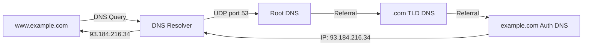

# 14장 — 사용자 데이터그램 프로토콜 (UDP)

[레포지토리 안내](../../README.ko.md) | [English](Concepts_Lecture.md) | [한국어](Concepts_Lecture.ko.md)

> **최종 수정일:** 2026-10-26
>
> TCP/IP Protocol Suite, Forouzan, Ch 14

> **학습 목표:**
> 1. UDP 헤더 형식과 체크섬 계산을 분석할 수 있다
> 2. UDP와 TCP 특성을 비교할 수 있다
> 3. UDP의 적절한 사용 사례를 식별할 수 있다

---

## 목차

- [1. 개요](#1-개요)
- [2. 사용자 데이터그램](#2-사용자-데이터그램)
  - [2.1 UDP 헤더 형식](#21-udp-헤더-형식)
  - [2.2 헤더 필드](#22-헤더-필드)
- [3. UDP 서비스](#3-udp-서비스)
  - [3.1 프로세스 간 통신](#31-프로세스-간-통신)
  - [3.2 비연결형 서비스](#32-비연결형-서비스)
  - [3.3 흐름 제어](#33-흐름-제어)
  - [3.4 오류 제어](#34-오류-제어)
  - [3.5 혼잡 제어](#35-혼잡-제어)
  - [3.6 캡슐화와 역캡슐화](#36-캡슐화와-역캡슐화)
  - [3.7 다중화와 역다중화](#37-다중화와-역다중화)
- [4. 체크섬 계산](#4-체크섬-계산)
  - [4.1 의사 헤더](#41-의사-헤더)
  - [4.2 계산 예제](#42-계산-예제)
- [5. UDP 응용](#5-udp-응용)
  - [5.1 DNS](#51-dns)
- [6. 부록](#6-부록)
  - [6.1 UDP vs. TCP 비교](#61-udp-vs-tcp-비교)
  - [6.2 UDP를 사용해야 하는 경우](#62-udp를-사용해야-하는-경우)
  - [6.3 UDP 기반 프로토콜](#63-udp-기반-프로토콜)
- [요약](#요약)
- [점검 문제](#점검-문제)

---

<br>

## 1. 개요

**UDP (User Datagram Protocol)** 는 응용 계층과 IP 계층 사이에 위치하며 응용 프로그램과 네트워크 작업 사이의 중개자 역할을 한다.

주요 특성:
- **프로세스 간** 통신을 제공하며, 프로세스는 포트 번호로 식별한다.
- **비연결형**: 연결 설정이나 해제 과정이 없다.
- **비신뢰적**: 오류 검사가 체크섬 하나로 매우 제한적이다.
- **단순**: 오버헤드가 최소이고 효율이 높다.
- 프로세스가 **작은 메시지**를 보내려 하고 **신뢰성이 크게 중요하지 않은** 경우 UDP를 사용할 수 있다.

```text
+-------------------+
| Application Layer |  SMTP, FTP, DNS, SNMP, DHCP
+-------------------+
| Transport Layer   |  SCTP | TCP | UDP
+---+-------+-------+
|IGMP|ICMP |   IP   |  ARP
+---+-------+-------+
| Data Link Layer   |
+-------------------+
| Physical Layer    |
+-------------------+
```

*그림 1. TCP/IP 프로토콜 스위트에서 UDP의 위치*

> **핵심:** UDP는 한 프로세스에서 다른 프로세스로 데이터를 전달하는 데 필요한 최소한의 전송 서비스와, 체크섬을 이용한 제한적인 오류 검출만 제공한다. 신뢰성을 포기하는 대신 속도와 단순성을 얻는다.

---

<br>

## 2. 사용자 데이터그램

### 2.1 UDP 헤더 형식

UDP 사용자 데이터그램은 고정 **8바이트 헤더**와 가변 길이 데이터로 구성된다:

```text
+------ 8 to 65,535 bytes total ------+
| Header (8 bytes) |      Data        |
+------------------+------------------+

 0                   1                   2                   3
 0 1 2 3 4 5 6 7 8 9 0 1 2 3 4 5 6 7 8 9 0 1 2 3 4 5 6 7 8 9 0 1
+-+-+-+-+-+-+-+-+-+-+-+-+-+-+-+-+-+-+-+-+-+-+-+-+-+-+-+-+-+-+-+-+
|       Source Port Number      |    Destination Port Number    |
+-+-+-+-+-+-+-+-+-+-+-+-+-+-+-+-+-+-+-+-+-+-+-+-+-+-+-+-+-+-+-+-+
|          Total Length         |           Checksum            |
+-+-+-+-+-+-+-+-+-+-+-+-+-+-+-+-+-+-+-+-+-+-+-+-+-+-+-+-+-+-+-+-+
```

*그림 2. UDP 사용자 데이터그램과 헤더 형식*

### 2.2 헤더 필드

| 필드 | 크기 | 설명 |
|-------|------|-------------|
| Source Port Number | 16비트 | 출발지 호스트의 프로세스가 사용하는 포트 |
| Destination Port Number | 16비트 | 목적지 호스트의 프로세스가 사용하는 포트 |
| Total Length | 16비트 | 사용자 데이터그램(헤더 + 데이터)의 전체 길이(바이트) |
| Checksum | 16비트 | 오류 검출 (IPv4에서는 선택 사항, IPv6에서는 필수) |

*표 1. UDP 헤더 필드*

- **최소 길이**: 헤더만 있고 데이터가 없는 8바이트이다.
- **최대 길이**: 16비트 길이 필드로 나타낼 수 있는 65,535바이트이다.
- IPv4에서는 IP 데이터그램 전체도 65,535바이트를 넘을 수 없으므로, 옵션이 없는 IP 헤더를 가정하면 데이터는 최대 65,535 - 20 (IP 헤더) - 8 (UDP 헤더) = 65,507바이트이다.

---

<br>

## 3. UDP 서비스

### 3.1 프로세스 간 통신

UDP는 송수신 프로세스를 식별하기 위해 포트 번호를 사용한다:
- IP 주소는 **컴퓨터**(호스트)를 선택한다.
- 포트 번호는 해당 컴퓨터의 **프로세스**를 선택한다.

```text
+-----------+                         +-----------+
| Process A |                         | Process B |
| Port 52000|                         | Port 53   |
+-----------+                         +-----------+
     |                                     |
+----+----+                           +----+----+
|   UDP   |                           |   UDP   |
+---------+                           +---------+
     |          (Internet)                 |
+----+----+ ---- routers ---- +------+----+
|   IP    |                   |    IP     |
+---------+                   +-----------+
```

*그림 3. 포트 번호를 이용한 프로세스 간 통신*

**UDP에서 사용하는 Well-known 포트:**

| 포트 | 프로토콜 | 설명 |
|------|----------|-------------|
| 7 | Echo | 수신된 데이터그램을 에코 |
| 9 | Discard | 수신된 모든 데이터그램을 폐기 |
| 13 | Daytime | 날짜와 시간을 반환 |
| 17 | Quote | 오늘의 명언을 반환 |
| 53 | Domain | 도메인 네임 시스템 (DNS) |
| 67 | BOOTP Server | 부트스트랩 프로토콜 서버 |
| 68 | BOOTP Client | 부트스트랩 프로토콜 클라이언트 |
| 69 | TFTP | 간이 파일 전송 프로토콜 |
| 111 | RPC | 원격 프로시저 호출 |
| 123 | NTP | 네트워크 시간 프로토콜 |
| 161 | SNMP | 간이 네트워크 관리 프로토콜 |
| 162 | SNMP (trap) | SNMP 트랩 메시지 |

*표 2. UDP에서 사용하는 Well-known 포트*

### 3.2 비연결형 서비스

- UDP는 **비연결형 서비스**를 제공한다.
- UDP가 보내는 각 사용자 데이터그램은 **독립적인 데이터그램**이다.
- 각 사용자 데이터그램은 **서로 다른 경로**로 이동할 수 있다.
- 데이터그램은 순서가 바뀌거나, 중복되거나, 아예 도착하지 않을 수 있다.
- 같은 출발지에서 보낸 연속된 데이터그램 사이에도 아무 관계가 없다.

### 3.3 흐름 제어

- UDP에는 **흐름 제어가 없으며** 따라서 **윈도우 메커니즘도 없다**.
- 들어오는 메시지가 많으면 수신자는 **오버플로**될 수 있다.
- 수신자는 넘치는 데이터그램을 조용히 폐기할 수 있다.

### 3.4 오류 제어

- 체크섬을 제외하면 **오류 제어 메커니즘이 없다**.
- 수신자가 체크섬으로 오류를 검출하면 사용자 데이터그램은 **조용히 폐기**된다.
- 재전송, 확인 응답, 순서 지정이 없다.
- 응용 프로그램에 오류 제어가 필요하면 응용 계층에서 구현해야 한다.

### 3.5 혼잡 제어

- UDP는 비연결형 프로토콜이다.
- 따라서 **혼잡 제어를 제공하지 않는다**.
- UDP 응용 프로그램은 속도를 조절하는 메커니즘 없이 네트워크를 범람시킬 수 있다.
- 그래서 비디오 스트리밍이나 게임처럼 데이터를 많이 보내는 UDP 기반 응용은 자체적으로 속도 제어를 구현해야 한다.

### 3.6 캡슐화와 역캡슐화

**캡슐화** (송신측):
1. 응용 프로그램이 데이터와 소켓 주소를 UDP에 전달한다.
2. UDP가 헤더(출발지 포트, 목적지 포트, 길이, 체크섬)를 붙인다.
3. UDP가 데이터그램을 IP 계층에 전달한다.

**역캡슐화** (수신측):
1. IP가 데이터그램을 UDP에 전달한다(프로토콜 번호 17로 식별).
2. UDP가 체크섬을 검증한다.
3. UDP가 목적지 포트를 사용하여 올바른 프로세스에 데이터를 전달한다.

### 3.7 다중화와 역다중화

```text
Sender side (Multiplexing):        Receiver side (Demultiplexing):
  App1  App2  App3                   App1  App2  App3
   \    |    /                        /    |    \
    \   |   /                        /     |     \
   +----------+                   +----------+
   |   UDP    |                   |   UDP    |
   |  MUX     |                   |  DEMUX   |
   +----------+                   +----------+
       |                               |
   datagram datagram datagram     datagram datagram datagram
```

*그림 4. UDP의 다중화와 역다중화*

- **다중화**: 여러 응용 프로세스가 하나의 UDP를 공유한다.
- **역다중화**: UDP가 목적지 포트 번호를 사용하여 올바른 프로세스에 전달한다.

---

<br>

## 4. 체크섬 계산

### 4.1 의사 헤더

UDP 체크섬 계산에는 계산할 때만 앞에 덧붙이는 **의사 헤더(Pseudoheader)** 가 포함된다(의사 헤더는 전송되지 않는다):

```text
+-+-+-+-+-+-+-+-+-+-+-+-+-+-+-+-+-+-+-+-+-+-+-+-+-+-+-+-+-+-+-+-+
|                 32-bit Source IP Address                       |  Pseudo-
+-+-+-+-+-+-+-+-+-+-+-+-+-+-+-+-+-+-+-+-+-+-+-+-+-+-+-+-+-+-+-+-+  header
|              32-bit Destination IP Address                     |
+-+-+-+-+-+-+-+-+-+-+-+-+-+-+-+-+-+-+-+-+-+-+-+-+-+-+-+-+-+-+-+-+
|   All 0s    | 8-bit Protocol |    16-bit UDP Total Length     |
+-+-+-+-+-+-+-+-+-+-+-+-+-+-+-+-+-+-+-+-+-+-+-+-+-+-+-+-+-+-+-+-+
|       Source Port Address     |   Destination Port Address    |  UDP
+-+-+-+-+-+-+-+-+-+-+-+-+-+-+-+-+-+-+-+-+-+-+-+-+-+-+-+-+-+-+-+-+  Header
|       UDP Total Length        |          Checksum             |
+-+-+-+-+-+-+-+-+-+-+-+-+-+-+-+-+-+-+-+-+-+-+-+-+-+-+-+-+-+-+-+-+
|                         Data                                  |
|            (Padding added to make multiple of 16 bits)        |
+-+-+-+-+-+-+-+-+-+-+-+-+-+-+-+-+-+-+-+-+-+-+-+-+-+-+-+-+-+-+-+-+
```

*그림 5. 체크섬 계산에 쓰는 의사 헤더와 UDP 사용자 데이터그램*

의사 헤더는 데이터그램이 올바른 목적지에 도달했는지 확인하는 데 쓰인다(IP 주소와 프로토콜 검증).

### 4.2 계산 예제

출발지 IP 주소 153.18.8.105, 목적지 IP 주소 171.2.14.10, 프로토콜 17, 출발지 포트 1087, 목적지 포트 13, 데이터 `TESTING`(7바이트)인 사용자 데이터그램의 체크섬을 계산한다. 전체 길이는 8 + 7 = 15바이트이고, 데이터가 홀수 바이트이므로 0으로 채운 바이트 하나를 덧붙여 마지막 16비트 워드를 맞춘다.

```text
Pseudoheader:
  153.18  = 10011001 00010010
  8.105   = 00001000 01101001
  171.2   = 10101011 00000010
  14.10   = 00001110 00001010
  0 + 17  = 00000000 00010001
  0 + 15  = 00000000 00001111

UDP Header:
  1087    = 00000100 00111111
  13      = 00000000 00001101
  15      = 00000000 00001111
  0 (chk) = 00000000 00000000

Data:
  T,E     = 01010100 01000101
  S,T     = 01010011 01010100
  I,N     = 01001001 01001110
  G,0(pad)= 01000111 00000000

Sum      = 10010110 11101011
Checksum = 01101001 00010100 (one's complement)
```

합은 16비트 워드들을 1의 보수 덧셈으로 더한 값으로, 16비트를 넘는 자리올림은 맨 아래 비트에 다시 더한다. 체크섬은 이 합의 모든 비트를 뒤집은 값이다. 수신자는 체크섬까지 포함하여 같은 방식으로 더하며, 결과가 모두 1(`11111111 11111111`)이면 오류가 없다고 판단한다.

---

<br>

## 5. UDP 응용

### 5.1 DNS

**도메인 네임 시스템(DNS)** 은 UDP를 사용하는 가장 중요한 응용 중 하나이다.

DNS는 사람이 읽을 수 있는 도메인 이름을 IP 주소로 변환한다:



*그림 6. DNS 이름 해석 과정*

**DNS 계층 구조:**

```text
            . (root)
           / | \
        .com .org .kr
        /       \
   google.com   example.com
   /    \
  www  mail
```

*그림 7. DNS 이름 공간의 계층 구조*

**DNS가 UDP를 사용하는 이유:**
- DNS 질의와 응답은 일반적으로 작다(512바이트 미만).
- UDP는 연결 설정 오버헤드가 없어 더 빠르다.
- 간헐적인 패킷 손실은 클라이언트가 질의를 다시 보내 해결할 수 있다.
- 존 전송과 512바이트를 넘는 큰 응답에는 DNS가 TCP를 사용한다.

**DNS 레코드 유형:**

| 유형 | 설명 | 예시 |
|------|-------------|---------|
| A | IPv4 주소 | www.example.com -> 93.184.216.34 |
| AAAA | IPv6 주소 | www.example.com -> 2606:2800:220:1:... |
| CNAME | 정식 이름 (별칭) | www -> web-server.example.com |
| MX | 메일 교환기 | example.com -> mail.example.com |
| NS | 네임 서버 | example.com -> ns1.example.com |
| PTR | 역방향 조회 | 34.216.184.93.in-addr.arpa -> www.example.com |
| SOA | 권한 시작 | 존 설정 |
| TXT | 텍스트 레코드 | 이메일 검증을 위한 SPF, DKIM |

*표 3. DNS 레코드 유형*

---

<br>

## 6. 부록

### 6.1 UDP vs. TCP 비교

| 특징 | UDP | TCP |
|---------|-----|-----|
| 연결 | 비연결형 | 연결 지향형 |
| 신뢰성 | 비신뢰적 | 신뢰적 |
| 순서 | 비순서 | 순서 보장 |
| 속도 | 빠름 | 느림 |
| 헤더 크기 | 8바이트 | 20~60바이트 |
| 흐름 제어 | 없음 | 슬라이딩 윈도우 |
| 혼잡 제어 | 없음 | 슬로우 스타트, 혼잡 회피 |
| 오버헤드 | 최소 | 높음 |
| 사용 사례 | DNS, 스트리밍, 게임, VoIP | HTTP, FTP, SMTP, SSH |

*표 4. UDP와 TCP의 비교*

### 6.2 UDP를 사용해야 하는 경우

- 비디오와 오디오 스트리밍, VoIP 같은 실시간 응용에 사용한다.
- DNS, SNMP처럼 단순한 질의-응답 프로토콜에 사용한다.
- 브로드캐스팅과 멀티캐스팅에 사용한다.
- 응용 계층에서 자체적으로 신뢰성을 구현하는 응용에 사용한다.
- 신뢰성보다 속도가 중요한 상황에 사용한다.
- 자원이 제한된 IoT 센서에 사용한다.

### 6.3 UDP 기반 프로토콜

| 프로토콜 | 포트 | 목적 |
|----------|------|---------|
| DNS | 53 | 도메인 이름 해석 |
| DHCP | 67/68 | IP 주소 할당 |
| TFTP | 69 | 간이 파일 전송 |
| SNMP | 161/162 | 네트워크 관리 |
| NTP | 123 | 시간 동기화 |
| RIP | 520 | 라우팅 (거리 벡터) |
| QUIC | 443 | 최신 HTTP/3 전송 (UDP 기반) |

*표 5. UDP 기반 프로토콜과 포트*

---

<br>

## 요약

| 개념 | 핵심 요약 |
|---------|-----------|
| UDP | UDP는 비연결형이고 비신뢰적이며 오버헤드가 최소인 전송 프로토콜이다. |
| 헤더 | 헤더는 출발지 포트, 목적지 포트, 길이, 체크섬으로 이루어진 8바이트이다. |
| 흐름 제어 없음 | 윈도우 메커니즘이 없으므로 수신자가 오버플로될 수 있다. |
| 오류 제어 없음 | 오류 제어는 체크섬뿐이며, 손상된 데이터그램은 조용히 폐기된다. |
| 혼잡 제어 없음 | 응용 프로그램이 스스로 전송 속도를 조절해야 한다. |
| 체크섬 | 체크섬은 IP 주소, 프로토콜, 길이를 담은 의사 헤더까지 포함하여 계산한다. |
| 다중화 | 포트 번호를 사용하여 여러 프로세스가 하나의 UDP를 공유한다. |
| DNS | DNS는 대표적인 UDP 응용이며 도메인 이름을 IP 주소로 변환한다. |

---

<br>

## 점검 문제

1. **헤더 해석:** UDP 헤더를 16진수로 나타낸 값이 `CB84000D001C001C`이다. 출발지 포트, 목적지 포트, 사용자 데이터그램의 전체 길이, 데이터 길이를 구하고, 이 데이터그램이 클라이언트에서 서버로 가는지 그 반대인지 판단하라.

   <details>
   <summary>정답</summary>

   헤더는 16비트 필드 네 개로 나뉜다. 출발지 포트는 `0xCB84` = 52100, 목적지 포트는 `0x000D` = 13, 전체 길이는 `0x001C` = 28바이트이고, 마지막 `0x001C`는 체크섬이다. 헤더가 8바이트이므로 데이터는 28 - 8 = 20바이트이다. 목적지 포트 13은 Daytime 서비스의 well-known 포트이고 출발지 포트 52100은 임시 포트이므로, 클라이언트가 서버로 보낸 데이터그램이다.

   </details>

2. **체크섬 계산:** 체크섬 계산에 들어가는 16비트 워드가 `0xF0F0`, `0x1234`, `0x8001` 세 개뿐이라고 가정한다. 1의 보수 합과 체크섬을 구하라.

   <details>
   <summary>정답</summary>

   `0xF0F0` + `0x1234` = `0x10324`이다. 16비트를 넘는 자리올림 1을 맨 아래 비트에 다시 더하면 `0x0324` + 1 = `0x0325`이다. 여기에 `0x8001`을 더하면 `0x8326`이고 자리올림은 없다. 체크섬은 합의 모든 비트를 뒤집은 `0x7CD9`이다. 검산하면 `0x8326` + `0x7CD9` = `0xFFFF`로 모든 비트가 1이다.

   </details>

3. **의사 헤더의 역할:** IP 헤더의 목적지 주소가 손상되었는데 IP 계층에서 걸러지지 않아 데이터그램이 다른 호스트에 전달되었다고 가정한다. 체크섬 계산에 의사 헤더를 넣지 않는다면 그 호스트의 UDP가 이 오류를 검출할 수 있는지, 의사 헤더를 넣으면 무엇이 달라지는지 설명하라.

   <details>
   <summary>정답</summary>

   의사 헤더가 없으면 체크섬은 UDP 헤더와 데이터만 보호한다. 이 부분은 손상되지 않았으므로 체크섬 검사를 통과하고, 잘못 도착한 데이터그램이 같은 포트를 쓰는 프로세스에 전달될 수 있다. 의사 헤더를 넣으면 수신 호스트는 자신의 IP 주소로 의사 헤더를 만들어 합을 다시 계산한다. 이 주소는 송신자가 계산에 쓴 목적지 주소와 다르므로 합이 모두 1이 되지 않고, UDP는 오류를 검출하여 데이터그램을 폐기한다.

   </details>

4. **DNS와 전송 프로토콜:** 클라이언트와 DNS 서버 사이의 왕복 시간(RTT)이 40 ms이고, 질의와 응답은 각각 패킷 하나에 들어간다. 처리 시간과 전송 시간을 무시할 때, 클라이언트가 질의를 보내기로 한 시점부터 응답을 받을 때까지 걸리는 최소 시간을 UDP와 TCP 각각에 대해 구하라.

   <details>
   <summary>정답</summary>

   UDP는 연결 설정 없이 바로 질의를 보내므로 1 RTT = 40 ms가 걸린다. TCP는 질의 전에 연결을 설정해야 하며(15장의 3-way handshake), SYN과 SYN+ACK가 오가는 데 1 RTT가 걸린다. 클라이언트는 세 번째 세그먼트인 ACK와 함께 질의를 보낼 수 있으므로 질의와 응답에 1 RTT가 더 걸려 최소 2 RTT = 80 ms가 필요하다. 그 뒤 연결 종료를 위한 세그먼트 교환도 추가로 일어난다. 작은 질의와 응답에 DNS가 UDP를 쓰는 이유가 여기에 있다.

   </details>
