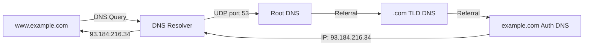

# Chapter 14 — User Datagram Protocol (UDP)

[Repository Guide](../../README.md) | [English](Concepts_Lecture.md) | [한국어](Concepts_Lecture.ko.md)

> **Last Updated:** 2026-10-17
>
> TCP/IP Protocol Suite, Forouzan, Ch 14

> **Learning Objectives:**
> 1. Analyze UDP header format and checksum calculation
> 2. Compare UDP with TCP characteristics
> 3. Identify appropriate use cases for UDP

---

## Table of Contents

- [1. Introduction](#1-introduction)
- [2. User Datagram](#2-user-datagram)
  - [2.1 UDP Header Format](#21-udp-header-format)
  - [2.2 Header Fields](#22-header-fields)
- [3. UDP Services](#3-udp-services)
  - [3.1 Process-to-Process Communication](#31-process-to-process-communication)
  - [3.2 Connectionless Service](#32-connectionless-service)
  - [3.3 Flow Control](#33-flow-control)
  - [3.4 Error Control](#34-error-control)
  - [3.5 Congestion Control](#35-congestion-control)
  - [3.6 Encapsulation and Decapsulation](#36-encapsulation-and-decapsulation)
  - [3.7 Multiplexing and Demultiplexing](#37-multiplexing-and-demultiplexing)
- [4. Checksum Calculation](#4-checksum-calculation)
  - [4.1 Pseudoheader](#41-pseudoheader)
  - [4.2 Calculation Example](#42-calculation-example)
- [5. UDP Applications](#5-udp-applications)
  - [5.1 DNS](#51-dns)
- [6. Appendix](#6-appendix)
  - [6.1 UDP vs. TCP Comparison](#61-udp-vs-tcp-comparison)
  - [6.2 When to Use UDP](#62-when-to-use-udp)
  - [6.3 UDP-Based Protocols](#63-udp-based-protocols)
- [Summary](#summary)
- [Self-Check Questions](#self-check-questions)

---

<br>

## 1. Introduction

**UDP (User Datagram Protocol)** lies between the application layer and the IP layer and serves as the intermediary between the application programs and the network operations.

Key characteristics:
- It provides **process-to-process** communication, identifying processes by port numbers.
- **Connectionless**: There is no connection setup or teardown.
- **Unreliable**: Error checking is very limited (checksum only).
- **Simple**: Overhead is minimal and efficiency is high.
- If a process wants to send a **small message** and **does not care much about reliability**, it can use UDP.

```text
+-------------------+
| Application Layer |  SMTP, FTP, DNS, SNMP, DHCP
+-------------------+
| Transport Layer   |  SCTP | TCP | UDP
+---+-------+-------+
|IGMP|ICMP |   IP   |  ARP
+---+-------+-------+
| Data Link Layer   |
+-------------------+
| Physical Layer    |
+-------------------+
```

*Figure 1. Position of UDP in the TCP/IP protocol suite*

> **Key Point:** UDP provides only the minimal transport service needed to deliver data from one process to another, plus limited error detection with a checksum. It trades reliability for speed and simplicity.

---

<br>

## 2. User Datagram

### 2.1 UDP Header Format

A UDP user datagram has a fixed **8-byte header** plus variable-length data:

```text
+------ 8 to 65,535 bytes total ------+
| Header (8 bytes) |      Data        |
+------------------+------------------+

 0                   1                   2                   3
 0 1 2 3 4 5 6 7 8 9 0 1 2 3 4 5 6 7 8 9 0 1 2 3 4 5 6 7 8 9 0 1
+-+-+-+-+-+-+-+-+-+-+-+-+-+-+-+-+-+-+-+-+-+-+-+-+-+-+-+-+-+-+-+-+
|       Source Port Number      |    Destination Port Number    |
+-+-+-+-+-+-+-+-+-+-+-+-+-+-+-+-+-+-+-+-+-+-+-+-+-+-+-+-+-+-+-+-+
|          Total Length         |           Checksum            |
+-+-+-+-+-+-+-+-+-+-+-+-+-+-+-+-+-+-+-+-+-+-+-+-+-+-+-+-+-+-+-+-+
```

*Figure 2. UDP user datagram and header format*

### 2.2 Header Fields

| Field | Size | Description |
|-------|------|-------------|
| Source Port Number | 16 bits | Port used by the process on the source host |
| Destination Port Number | 16 bits | Port used by the process on the destination host |
| Total Length | 16 bits | Total length of user datagram (header + data) in bytes |
| Checksum | 16 bits | Error detection (optional in IPv4, mandatory in IPv6) |

*Table 1. UDP header fields*

- **Minimum length**: 8 bytes, a header with no data.
- **Maximum length**: 65,535 bytes, the largest value of the 16-bit length field.
- In IPv4, the whole IP datagram also cannot exceed 65,535 bytes, so assuming an IP header without options, the data is limited to 65,535 - 20 (IP header) - 8 (UDP header) = 65,507 bytes.

---

<br>

## 3. UDP Services

### 3.1 Process-to-Process Communication

UDP uses port numbers to identify sending and receiving processes:
- The IP address selects the **computer** (host).
- The port number selects the **process** on that computer.

```text
+-----------+                         +-----------+
| Process A |                         | Process B |
| Port 52000|                         | Port 53   |
+-----------+                         +-----------+
     |                                     |
+----+----+                           +----+----+
|   UDP   |                           |   UDP   |
+---------+                           +---------+
     |          (Internet)                 |
+----+----+ ---- routers ---- +------+----+
|   IP    |                   |    IP     |
+---------+                   +-----------+
```

*Figure 3. Process-to-process communication using port numbers*

**Well-known ports used with UDP:**

| Port | Protocol | Description |
|------|----------|-------------|
| 7 | Echo | Echoes received datagram |
| 9 | Discard | Discards any received datagram |
| 13 | Daytime | Returns date and time |
| 17 | Quote | Returns a quote of the day |
| 53 | Domain | Domain Name System (DNS) |
| 67 | BOOTP Server | Bootstrap Protocol server |
| 68 | BOOTP Client | Bootstrap Protocol client |
| 69 | TFTP | Trivial File Transfer Protocol |
| 111 | RPC | Remote Procedure Call |
| 123 | NTP | Network Time Protocol |
| 161 | SNMP | Simple Network Management Protocol |
| 162 | SNMP (trap) | SNMP trap messages |

*Table 2. Well-known ports used with UDP*

### 3.2 Connectionless Service

- UDP provides a **connectionless service**.
- Each user datagram sent by UDP is an **independent datagram**.
- Each user datagram can travel on a **different path**.
- Datagrams may arrive out of order, duplicated, or not at all.
- There is no relationship between successive datagrams from the same source.

### 3.3 Flow Control

- UDP has **no flow control** and hence **no window mechanism**.
- The receiver may **overflow** with incoming messages.
- The receiver can silently discard excess datagrams.

### 3.4 Error Control

- There is **no error control mechanism** in UDP except for the checksum.
- When the receiver detects an error through the checksum, the user datagram is **silently discarded**.
- There is no retransmission, no acknowledgment, and no sequencing.
- If the application needs error control, it must implement it at the application layer.

### 3.5 Congestion Control

- UDP is a connectionless protocol.
- Therefore, it **does not provide congestion control**.
- UDP applications can flood the network without any throttling mechanism.
- This is why UDP-based applications that send a lot of data, such as video streaming and gaming, must implement their own rate control.

### 3.6 Encapsulation and Decapsulation

**Encapsulation** at the sender:
1. The application passes data and socket addresses to UDP.
2. UDP adds a header (source port, destination port, length, checksum).
3. UDP passes the datagram to the IP layer.

**Decapsulation** at the receiver:
1. IP passes the datagram to UDP (identified by protocol number 17).
2. UDP verifies the checksum.
3. UDP uses the destination port to deliver data to the correct process.

### 3.7 Multiplexing and Demultiplexing

```text
Sender side (Multiplexing):        Receiver side (Demultiplexing):
  App1  App2  App3                   App1  App2  App3
   \    |    /                        /    |    \
    \   |   /                        /     |     \
   +----------+                   +----------+
   |   UDP    |                   |   UDP    |
   |  MUX     |                   |  DEMUX   |
   +----------+                   +----------+
       |                               |
   datagram datagram datagram     datagram datagram datagram
```

*Figure 4. Multiplexing and demultiplexing in UDP*

- **Multiplexing**: Multiple application processes share a single UDP.
- **Demultiplexing**: UDP uses the destination port number to deliver to the correct process.

---

<br>

## 4. Checksum Calculation

### 4.1 Pseudoheader

UDP checksum calculation includes a **pseudoheader** that is prepended for calculation purposes only (the pseudoheader is not transmitted):

```text
+-+-+-+-+-+-+-+-+-+-+-+-+-+-+-+-+-+-+-+-+-+-+-+-+-+-+-+-+-+-+-+-+
|                 32-bit Source IP Address                       |  Pseudo-
+-+-+-+-+-+-+-+-+-+-+-+-+-+-+-+-+-+-+-+-+-+-+-+-+-+-+-+-+-+-+-+-+  header
|              32-bit Destination IP Address                     |
+-+-+-+-+-+-+-+-+-+-+-+-+-+-+-+-+-+-+-+-+-+-+-+-+-+-+-+-+-+-+-+-+
|   All 0s    | 8-bit Protocol |    16-bit UDP Total Length     |
+-+-+-+-+-+-+-+-+-+-+-+-+-+-+-+-+-+-+-+-+-+-+-+-+-+-+-+-+-+-+-+-+
|       Source Port Address     |   Destination Port Address    |  UDP
+-+-+-+-+-+-+-+-+-+-+-+-+-+-+-+-+-+-+-+-+-+-+-+-+-+-+-+-+-+-+-+-+  Header
|       UDP Total Length        |          Checksum             |
+-+-+-+-+-+-+-+-+-+-+-+-+-+-+-+-+-+-+-+-+-+-+-+-+-+-+-+-+-+-+-+-+
|                         Data                                  |
|            (Padding added to make multiple of 16 bits)        |
+-+-+-+-+-+-+-+-+-+-+-+-+-+-+-+-+-+-+-+-+-+-+-+-+-+-+-+-+-+-+-+-+
```

*Figure 5. Pseudoheader and UDP user datagram used for checksum calculation*

The pseudoheader is used to ensure that the datagram has reached the correct destination (IP address and protocol verification).

### 4.2 Calculation Example

Compute the checksum of a user datagram with source IP address 153.18.8.105, destination IP address 171.2.14.10, protocol 17, source port 1087, destination port 13, and data `TESTING` (7 bytes). The total length is 8 + 7 = 15 bytes, and because the data has an odd number of bytes, one byte of 0s is padded to complete the last 16-bit word.

```text
Pseudoheader:
  153.18  = 10011001 00010010
  8.105   = 00001000 01101001
  171.2   = 10101011 00000010
  14.10   = 00001110 00001010
  0 + 17  = 00000000 00010001
  0 + 15  = 00000000 00001111

UDP Header:
  1087    = 00000100 00111111
  13      = 00000000 00001101
  15      = 00000000 00001111
  0 (chk) = 00000000 00000000

Data:
  T,E     = 01010100 01000101
  S,T     = 01010011 01010100
  I,N     = 01001001 01001110
  G,0(pad)= 01000111 00000000

Sum      = 10010110 11101011
Checksum = 01101001 00010100 (one's complement)
```

The sum is the one's complement sum of the 16-bit words, in which any carry beyond 16 bits is added back to the lowest bit. The checksum is obtained by inverting every bit of this sum. The receiver adds all words, including the checksum, in the same way and concludes that there is no error if the result is all 1s (`11111111 11111111`).

---

<br>

## 5. UDP Applications

### 5.1 DNS

**Domain Name System (DNS)** is one of the most important applications using UDP.

DNS translates human-readable domain names to IP addresses:



*Figure 6. DNS name resolution process*

**DNS Hierarchy:**

```text
            . (root)
           / | \
        .com .org .kr
        /       \
   google.com   example.com
   /    \
  www  mail
```

*Figure 7. Hierarchy of the DNS name space*

**Why DNS uses UDP:**
- DNS queries and responses are typically small (less than 512 bytes).
- UDP is faster because there is no connection setup overhead.
- Occasional packet loss can be handled by the client resending the query.
- For zone transfers and large responses (more than 512 bytes), DNS uses TCP.

**DNS Record Types:**

| Type | Description | Example |
|------|-------------|---------|
| A | IPv4 address | www.example.com -> 93.184.216.34 |
| AAAA | IPv6 address | www.example.com -> 2606:2800:220:1:... |
| CNAME | Canonical name (alias) | www -> web-server.example.com |
| MX | Mail exchanger | example.com -> mail.example.com |
| NS | Name server | example.com -> ns1.example.com |
| PTR | Reverse lookup | 34.216.184.93.in-addr.arpa -> www.example.com |
| SOA | Start of authority | Zone configuration |
| TXT | Text record | SPF, DKIM for email verification |

*Table 3. DNS record types*

---

<br>

## 6. Appendix

### 6.1 UDP vs. TCP Comparison

| Feature | UDP | TCP |
|---------|-----|-----|
| Connection | Connectionless | Connection-oriented |
| Reliability | Unreliable | Reliable |
| Ordering | Unordered | Ordered |
| Speed | Faster | Slower |
| Header Size | 8 bytes | 20-60 bytes |
| Flow Control | None | Sliding window |
| Congestion Control | None | Slow start, congestion avoidance |
| Overhead | Minimal | Higher |
| Use Cases | DNS, streaming, gaming, VoIP | HTTP, FTP, SMTP, SSH |

*Table 4. Comparison of UDP and TCP*

### 6.2 When to Use UDP

- UDP suits real-time applications such as video and audio streaming and VoIP.
- UDP suits simple query-response protocols such as DNS and SNMP.
- UDP is used for broadcasting and multicasting.
- UDP suits applications that implement their own reliability at the application layer.
- UDP suits situations where speed is more important than reliability.
- UDP suits IoT sensors with constrained resources.

### 6.3 UDP-Based Protocols

| Protocol | Port | Purpose |
|----------|------|---------|
| DNS | 53 | Domain name resolution |
| DHCP | 67/68 | IP address assignment |
| TFTP | 69 | Simple file transfer |
| SNMP | 161/162 | Network management |
| NTP | 123 | Time synchronization |
| RIP | 520 | Routing (distance-vector) |
| QUIC | 443 | Modern HTTP/3 transport (UDP-based) |

*Table 5. UDP-based protocols and their ports*

---

<br>

## Summary

| Concept | Key Summary |
|---------|-----------|
| UDP | UDP is a connectionless, unreliable transport protocol with minimal overhead. |
| Header | The header is 8 bytes long and consists of the source port, destination port, length, and checksum. |
| No Flow Control | There is no window mechanism, so the receiver may overflow. |
| No Error Control | The only error control is the checksum, and corrupted datagrams are silently discarded. |
| No Congestion Control | Applications must regulate their own sending rate. |
| Checksum | The checksum is computed over a pseudoheader carrying the IP addresses, protocol, and length as well. |
| Multiplexing | Port numbers allow multiple processes to share a single UDP. |
| DNS | DNS is a primary UDP application that translates domain names to IP addresses. |

---

<br>

## Self-Check Questions

1. **Header parsing:** The UDP header in hexadecimal is `CB84000D001C001C`. Find the source port, destination port, total length of the user datagram, and data length, and decide whether the datagram travels from a client to a server or the reverse.

   <details>
   <summary>Answer</summary>

   The header splits into four 16-bit fields. The source port is `0xCB84` = 52100, the destination port is `0x000D` = 13, the total length is `0x001C` = 28 bytes, and the last `0x001C` is the checksum. Since the header is 8 bytes, the data is 28 - 8 = 20 bytes. The destination port 13 is the well-known port of the Daytime service and the source port 52100 is an ephemeral port, so the datagram goes from a client to a server.

   </details>

2. **Checksum calculation:** Suppose the only 16-bit words in a checksum calculation are `0xF0F0`, `0x1234`, and `0x8001`. Find the one's complement sum and the checksum.

   <details>
   <summary>Answer</summary>

   `0xF0F0` + `0x1234` = `0x10324`. Adding the carry 1 beyond 16 bits back to the lowest bit gives `0x0324` + 1 = `0x0325`. Adding `0x8001` gives `0x8326` with no carry. The checksum is `0x7CD9`, obtained by inverting every bit of the sum. As a check, `0x8326` + `0x7CD9` = `0xFFFF`, so every bit is 1.

   </details>

3. **Role of the pseudoheader:** Suppose the destination address in the IP header is corrupted, the IP layer does not catch it, and the datagram is delivered to a different host. Explain whether the UDP on that host can detect the error if the pseudoheader is not included in the checksum calculation, and what changes when it is included.

   <details>
   <summary>Answer</summary>

   Without the pseudoheader, the checksum protects only the UDP header and data. Those parts are not corrupted, so the checksum test passes and the misdelivered datagram may be delivered to a process using the same port. With the pseudoheader, the receiving host builds the pseudoheader from its own IP address and recomputes the sum. This address differs from the destination address the sender used, so the sum is not all 1s, and UDP detects the error and discards the datagram.

   </details>

4. **DNS and the transport protocol:** The round-trip time (RTT) between a client and a DNS server is 40 ms, and the query and the response each fit in one packet. Ignoring processing and transmission time, find the minimum time from when the client decides to send the query until it receives the response, for UDP and for TCP.

   <details>
   <summary>Answer</summary>

   UDP sends the query immediately without connection setup, so it takes 1 RTT = 40 ms. TCP must establish a connection before the query (the three-way handshake of Chapter 15), and the exchange of SYN and SYN+ACK takes 1 RTT. The client can send the query together with the third segment, the ACK, so the query and response take one more RTT, for a minimum of 2 RTT = 80 ms. Segments for connection termination are also exchanged afterward. This is why DNS uses UDP for small queries and responses.

   </details>
