# 15장 — 인터넷 라우팅 프로토콜

[레포지토리 안내](../../README.ko.md) | [English](Concepts_Lecture.md) | [한국어](Concepts_Lecture.ko.md)

> **최종 수정일:** 2026-11-26
>
> Computer Networking: A Top-Down Approach, Kurose and Ross, Ch 5; TCP/IP Protocol Suite, Forouzan, Ch 11

> **학습 목표:**
> 1. 규모와 관리 자율성의 관점에서 자율 시스템으로 라우팅을 나누는 이유를 설명하고, AS 내부 라우팅과 AS 간 라우팅을 구별할 수 있다
> 2. RIP의 메트릭, 메시지, 타이머와 RIP 버전 2의 개선점을 설명할 수 있다
> 3. OSPF의 영역 구조, 링크의 종류, 패킷과 링크 상태 광고의 종류를 설명할 수 있다
> 4. 경로 벡터 라우팅의 원리와 BGP의 경로 광고, 경로 속성, 경로 선택 알고리즘을 적용할 수 있다
> 5. BGP의 광고 정책으로 고객과 제공자 관계를 구현하는 방법을 설명할 수 있다
> 6. SDN 제어 평면의 구성 요소와 OpenFlow 메시지의 역할을 설명할 수 있다

---

## 목차

- [1. 자율 시스템과 계층적 라우팅](#1-자율-시스템과-계층적-라우팅)
  - [1.1 하나의 라우팅 알고리즘으로 부족한 이유](#11-하나의-라우팅-알고리즘으로-부족한-이유)
  - [1.2 자율 시스템](#12-자율-시스템)
  - [1.3 AS 내부 라우팅과 AS 간 라우팅](#13-as-내부-라우팅과-as-간-라우팅)
- [2. RIP](#2-rip)
  - [2.1 RIP의 특징](#21-rip의-특징)
  - [2.2 RIP 영역의 예](#22-rip-영역의-예)
  - [2.3 RIP 메시지 형식](#23-rip-메시지-형식)
  - [2.4 요청과 응답](#24-요청과-응답)
  - [2.5 RIP의 타이머](#25-rip의-타이머)
  - [2.6 RIP 버전 2](#26-rip-버전-2)
  - [2.7 캡슐화](#27-캡슐화)
- [3. OSPF](#3-ospf)
  - [3.1 OSPF의 개요](#31-ospf의-개요)
  - [3.2 OSPF의 장점](#32-ospf의-장점)
  - [3.3 영역](#33-영역)
  - [3.4 메트릭](#34-메트릭)
  - [3.5 링크의 종류](#35-링크의-종류)
  - [3.6 OSPF 패킷과 공통 헤더](#36-ospf-패킷과-공통-헤더)
  - [3.7 링크 상태 갱신 패킷과 링크 상태 광고](#37-링크-상태-갱신-패킷과-링크-상태-광고)
  - [3.8 그 밖의 패킷](#38-그-밖의-패킷)
  - [3.9 캡슐화](#39-캡슐화)
- [4. 경로 벡터 라우팅](#4-경로-벡터-라우팅)
  - [4.1 경로 벡터 라우팅이 필요한 이유](#41-경로-벡터-라우팅이-필요한-이유)
  - [4.2 도달 가능성](#42-도달-가능성)
  - [4.3 경로 벡터 라우팅 테이블](#43-경로-벡터-라우팅-테이블)
  - [4.4 루프 방지, 집약, 정책 라우팅](#44-루프-방지-집약-정책-라우팅)
- [5. BGP](#5-bgp)
  - [5.1 BGP의 역할](#51-bgp의-역할)
  - [5.2 BGP 경로 정보의 광고](#52-bgp-경로-정보의-광고)
  - [5.3 경로 속성: AS-PATH와 NEXT-HOP](#53-경로-속성-as-path와-next-hop)
  - [5.4 핫 포테이토 라우팅](#54-핫-포테이토-라우팅)
  - [5.5 경로 선택 알고리즘](#55-경로-선택-알고리즘)
  - [5.6 IP 애니캐스트](#56-ip-애니캐스트)
  - [5.7 라우팅 정책](#57-라우팅-정책)
  - [5.8 BGP 메시지](#58-bgp-메시지)
  - [5.9 인터넷에 자리 잡기](#59-인터넷에-자리-잡기)
  - [5.10 AS 내부와 AS 간에 다른 프로토콜을 쓰는 이유](#510-as-내부와-as-간에-다른-프로토콜을-쓰는-이유)
- [6. SDN 제어 평면](#6-sdn-제어-평면)
  - [6.1 SDN 구조의 네 가지 특징](#61-sdn-구조의-네-가지-특징)
  - [6.2 SDN 제어기와 네트워크 제어 응용](#62-sdn-제어기와-네트워크-제어-응용)
  - [6.3 OpenFlow 프로토콜](#63-openflow-프로토콜)
  - [6.4 데이터 평면과 제어 평면의 상호작용: 링크 장애의 예](#64-데이터-평면과-제어-평면의-상호작용-링크-장애의-예)
  - [6.5 SDN의 과거, 현재, 미래](#65-sdn의-과거-현재-미래)
- [개념 적용](#개념-적용)
- [요약](#요약)
- [점검 문제](#점검-문제)

---

<br>

## 1. 자율 시스템과 계층적 라우팅

### 1.1 하나의 라우팅 알고리즘으로 부족한 이유

14장에서는 네트워크를 서로 연결된 라우터의 모음으로만 보았다. 모든 라우터는 같은 라우팅 알고리즘을 실행하여 네트워크 전체에 걸친 경로를 계산하므로, 한 라우터와 다른 라우터를 구별할 이유가 없었다. 그러나 모든 라우터가 같은 알고리즘을 실행하는 동질적인 라우터 집합이라는 모델은 실제 인터넷에 비해 지나치게 단순하며, 그 이유는 두 가지이다.

- **규모(scale):** 라우터의 수가 커지면 라우팅 정보를 주고받고, 계산하고, 저장하는 부담이 감당할 수 없을 만큼 커진다. 오늘날의 인터넷은 수억 개의 라우터로 이루어져 있다. 모든 라우터가 가능한 모든 목적지의 라우팅 정보를 저장하려면 막대한 메모리가 필요하고, 모든 라우터 사이에 연결 관계와 링크 비용의 갱신을 브로드캐스트하는 부담도 엄청나다. 이렇게 많은 라우터 사이에서 반복하는 거리 벡터 알고리즘은 결코 수렴하지 못할 것이다.
- **관리 자율성(administrative autonomy):** 1장에서 보았듯이 인터넷은 ISP의 네트워크이고, 각 ISP는 자기 라우터들로 이루어진 네트워크를 가진다. ISP는 대개 자기 네트워크를 원하는 대로 운영하고(예를 들어 내부에서 원하는 라우팅 알고리즘을 쓰고), 네트워크 내부 구성의 일부를 외부에 숨기고 싶어 한다. 조직은 자기 네트워크를 원하는 대로 운영하면서도 외부 네트워크와 연결될 수 있어야 한다.

### 1.2 자율 시스템

두 문제는 라우터를 **자율 시스템(autonomous system, AS)** 으로 묶어 해결한다.

> **용어 정의:** **자율 시스템(autonomous system, AS)** 은 하나의 관리 주체 아래에 있는 네트워크와 라우터의 모임으로, 그 안의 라우터들은 같은 라우팅 알고리즘을 실행하고 서로에 관한 정보를 가진다.

흔히 한 ISP의 라우터들과 그것들을 잇는 링크가 하나의 AS를 이룬다. 그러나 자기 네트워크를 여러 AS로 나누는 ISP도 있다. 어떤 1계층 ISP는 네트워크 전체를 하나의 거대한 AS로 운영하고, 다른 ISP는 수십 개의 서로 연결된 AS로 나눈다. 대기업도 자기 네트워크를 하나의 AS로 운영할 수 있다. AS는 전역적으로 유일한 **자율 시스템 번호(autonomous system number, ASN)** 로 식별하며, ASN은 IP 주소처럼 ICANN의 지역 등록 기관이 할당한다.

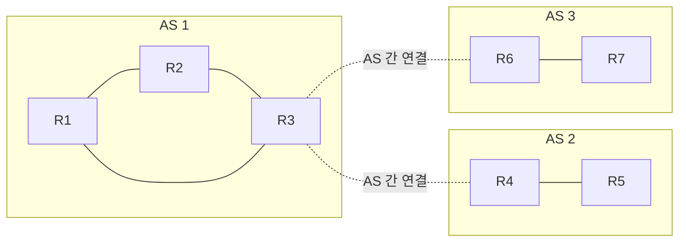

*그림 1. 자율 시스템으로 나뉜 인터넷*

### 1.3 AS 내부 라우팅과 AS 간 라우팅

> **용어 정의:** **AS 내부 라우팅(intra-AS routing)** 은 하나의 자율 시스템 안에서 라우터 사이의 경로를 정하는 라우팅으로, 이를 수행하는 프로토콜을 AS 내부 라우팅 프로토콜 또는 내부 게이트웨이 프로토콜이라 한다.

> **용어 정의:** **AS 간 라우팅(inter-AS routing)** 은 서로 다른 자율 시스템 사이의 경로를 정하는 라우팅으로, 여러 AS가 협력해야 하므로 통신하는 AS들은 같은 AS 간 라우팅 프로토콜을 실행해야 한다.

각 AS는 내부 라우팅을 위해 하나 이상의 AS 내부 프로토콜을 고를 수 있다. 그러나 AS 사이의 라우팅은 하나의 AS 간 프로토콜이 담당하며, 인터넷의 모든 AS는 BGP를 쓴다. 이 장에서는 AS 내부 프로토콜로 거리 벡터를 구현한 RIP와 링크 상태를 구현한 OSPF를, AS 간 프로토콜로 경로 벡터를 구현한 BGP를 다룬다. RIP와 OSPF는 **내부(interior) 라우팅 프로토콜**, BGP는 **외부(exterior) 라우팅 프로토콜**이다.

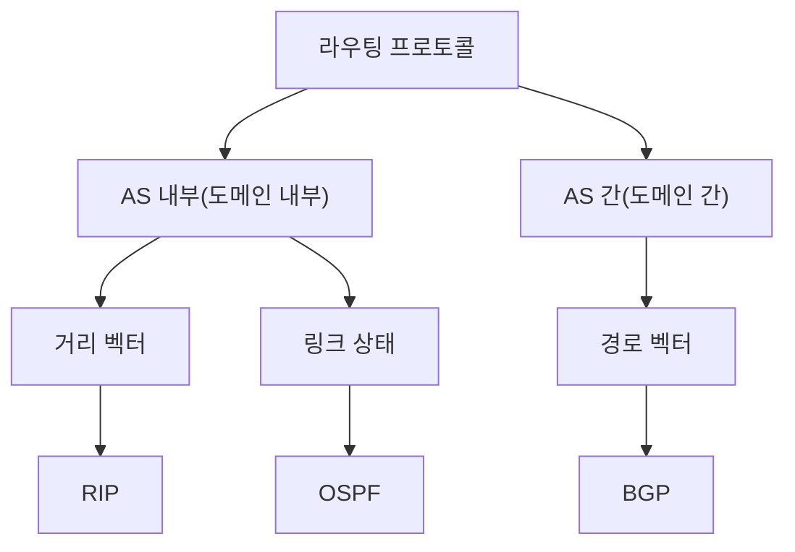

*그림 2. 대표적인 라우팅 프로토콜의 분류*

---

<br>

## 2. RIP

### 2.1 RIP의 특징

> **용어 정의:** **RIP(Routing Information Protocol)** 는 거리 벡터 라우팅을 바탕으로 하며 홉 수를 메트릭으로 쓰는 단순한 AS 내부 라우팅 프로토콜이다.

RIP는 14장의 거리 벡터 라우팅을 직접 구현하되 다음을 고려한다.

1. 자율 시스템에서 다루는 대상은 라우터와 네트워크(링크)이다.
2. 라우팅 테이블의 목적지는 네트워크이므로 첫째 열은 네트워크 주소이다.
3. 메트릭이 매우 단순하다. 거리는 목적지에 이르기까지 지나야 하는 링크(네트워크)의 수로 정의하며, 그래서 RIP의 메트릭을 **홉 수**라 한다. 라우터에 직접 연결된 네트워크까지의 홉 수는 1이다.
4. 무한대를 16으로 정의한다. 따라서 RIP를 쓰는 자율 시스템 안의 어떤 경로도 15홉을 넘을 수 없다.
5. 다음 노드 열은 목적지에 이르기 위해 패킷을 보내야 하는 라우터의 주소이다.

### 2.2 RIP 영역의 예

그림 3은 일곱 네트워크와 네 라우터로 이루어진 자율 시스템이다. 각 링크 옆의 주소는 그 네트워크에 연결된 라우터 인터페이스의 IP 주소이다.

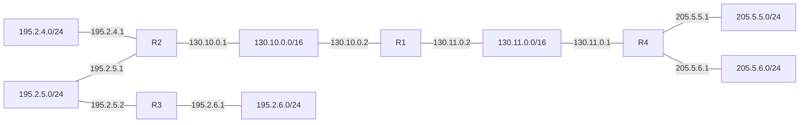

*그림 3. RIP를 쓰는 자율 시스템의 예*

R1의 라우팅 테이블을 본다. 테이블에는 자율 시스템의 일곱 네트워크에 이르는 방법을 담은 일곱 항목이 있다. R1은 130.10.0.0과 130.11.0.0에 직접 연결되어 있으므로 이 두 네트워크에는 다음 홉이 없다. 왼쪽의 세 네트워크로 패킷을 보내려면 R2에 넘겨야 하므로, 이 세 네트워크의 다음 홉은 R2의 인터페이스 주소 130.10.0.1이다. 오른쪽의 두 네트워크로 보내려면 R4의 인터페이스 주소 130.11.0.1로 넘긴다.

| 목적지 | R1 | R2 | R3 | R4 |
|:-----|:-----|:-----|:-----|:-----|
| 130.10.0.0/16 | 1 | 1 | 2, 195.2.5.1 | 2, 130.11.0.2 |
| 130.11.0.0/16 | 1 | 2, 130.10.0.2 | 3, 195.2.5.1 | 1 |
| 195.2.4.0/24 | 2, 130.10.0.1 | 1 | 2, 195.2.5.1 | 3, 130.11.0.2 |
| 195.2.5.0/24 | 2, 130.10.0.1 | 1 | 1 | 3, 130.11.0.2 |
| 195.2.6.0/24 | 3, 130.10.0.1 | 2, 195.2.5.2 | 1 | 4, 130.11.0.2 |
| 205.5.5.0/24 | 2, 130.11.0.1 | 3, 130.10.0.2 | 4, 195.2.5.1 | 1 |
| 205.5.6.0/24 | 2, 130.11.0.1 | 3, 130.10.0.2 | 4, 195.2.5.1 | 1 |

*표 1. 그림 3의 각 라우터의 RIP 라우팅 테이블 (홉 수, 다음 홉)*

### 2.3 RIP 메시지 형식

```text
 0               8               16                              31
+---------------+---------------+-------------------------------+
|    Command    |    Version    |           Reserved            |
+---------------+---------------+-------------------------------+
|            Family             |            All 0s             |  ┐
+-------------------------------+-------------------------------+  │
|                        Network address                        |  │
+---------------------------------------------------------------+  │ 목적지마다
|                            All 0s                             |  │ 반복
+---------------------------------------------------------------+  │
|                            All 0s                             |  │
+---------------------------------------------------------------+  │
|                           Distance                            |  ┘
+---------------------------------------------------------------+
```

*그림 4. RIP 메시지 형식*

- **Command(8비트):** 메시지의 종류로, 요청은 1, 응답은 2이다.
- **Version(8비트):** 버전이다. 여기서는 버전 1을 기준으로 하고 2.6절에서 버전 2의 새 기능을 다룬다.
- **Family(16비트):** 사용하는 프로토콜 계열로, TCP/IP는 2이다.
- **Network address:** 목적지 네트워크의 주소이다. 어떤 프로토콜에도 쓸 수 있도록 14바이트를 할당했지만 IP는 4바이트만 쓰고 나머지는 0으로 채운다.
- **Distance(32비트):** 광고하는 라우터에서 목적지 네트워크까지의 홉 수(비용)이다.

메시지의 아래쪽은 목적지 네트워크마다 반복되며, 반복되는 이 부분을 **항목(entry)** 이라 한다.

### 2.4 요청과 응답

RIP의 메시지에는 요청과 응답 두 종류가 있다.

- **요청(request):** 막 켜진 라우터나 시간이 만료된 항목이 있는 라우터가 보낸다. 요청은 특정 항목만 물을 수도 있고(목적지 네트워크 주소를 채운다), 모든 항목을 물을 수도 있다(주소 필드를 모두 0으로 둔다).
- **응답(response):** 요청에 대한 답으로 보내는 **요청된 응답(solicited response)** 과, 30초마다 또는 라우팅 테이블이 바뀔 때 보내는 **요청되지 않은 응답(unsolicited response)** 이 있다. 응답은 해당 목적지에 관한 정보를 담으며, **갱신 패킷(update packet)** 이라고도 한다.

그림 3에서 R1이 인터페이스 130.10.0.2로 R2에게 보내는 갱신 메시지를 만든다고 하자. R1은 스플릿 호라이즌과 포이즌 리버스(14장)를 함께 적용한다. R1은 195.2.4.0, 195.2.5.0, 195.2.6.0에 관한 정보를 R2에게서 얻었으므로, R2에게 보내는 메시지에서는 이 세 네트워크의 홉 수를 실제 값 대신 16(무한대)으로 바꾸어 R2의 혼란을 막는다.

| 메시지 속 목적지 | 메시지 속 홉 수 | R2가 계산한 홉 수 |
|:-----|:-----|:-----|
| 130.10.0.0 | 1 | 2 |
| 130.11.0.0 | 1 | 2 |
| 195.2.4.0 | 16 | 16 (도달 불가) |
| 195.2.5.0 | 16 | 16 (도달 불가) |
| 195.2.6.0 | 16 | 16 (도달 불가) |
| 205.5.5.0 | 2 | 3 |
| 205.5.6.0 | 2 | 3 |

*표 2. R1이 R2에게 보내는 RIP 갱신 메시지*

R2는 RIP 메시지를 담은 IP 데이터그램의 출발지 주소(130.10.0.2)를 다음 홉 주소로 쓴다. 또 메시지의 값은 R2가 아니라 R1을 기준으로 한 것이므로 각 홉 수에 1을 더한다. 16은 1을 더해도 무한대이다. R2는 이 값을 14장의 갱신 규칙에 따라 자기 테이블과 비교한다. 예를 들어 130.11.0.0은 비용 2, 다음 홉 130.10.0.2로 계산되고, 130.10.0.0은 이미 직접 연결(비용 1)되어 있으므로 바뀌지 않는다.

### 2.5 RIP의 타이머

RIP는 세 개의 타이머로 동작을 뒷받침한다.

| 타이머 | 값 | 역할 |
|:-----|:-----|:-----|
| 주기 타이머(periodic timer) | 25\~35초 사이의 무작위 값 | 정기 갱신 메시지를 보내는 시점을 정한다. |
| 만료 타이머(expiration timer) | 180초 | 경로의 유효성을 관리한다. |
| 가비지 수집 타이머(garbage collection timer) | 120초 | 무효가 된 경로를 테이블에서 지우기 전에 이웃에게 알릴 시간을 준다. |

*표 3. RIP의 세 가지 타이머*

- **주기 타이머:** 규격은 30초로 정하지만, 실제 동작 모델은 25초와 35초 사이의 무작위 값을 쓴다. 모든 라우터가 동시에 갱신을 보내 인터넷에 부하가 몰리는 동기화를 막기 위해서이다. 라우터마다 주기 타이머가 하나 있으며, 0까지 세어 내려가면 갱신 메시지를 보내고 다시 무작위 값으로 설정한다.
- **만료 타이머:** 어떤 경로의 갱신 정보를 받으면 그 경로의 만료 타이머를 180초로 설정하고, 새 갱신을 받을 때마다 다시 설정한다. 정상이라면 30초마다 다시 설정된다. 그러나 문제가 생겨 180초 안에 갱신을 받지 못하면 그 경로는 만료된 것으로 보고 홉 수를 16으로 바꾸어 목적지에 도달할 수 없음을 표시한다. 경로마다 자기 만료 타이머가 있다.
- **가비지 수집 타이머:** 경로가 무효가 되어도 라우터는 그 경로를 바로 지우지 않고 메트릭 16으로 계속 광고하며, 동시에 그 경로의 가비지 수집 타이머를 120초로 설정한다. 이 타이머가 0이 되면 경로를 테이블에서 지운다. 이 시간 동안 이웃은 경로가 무효가 되었음을 알게 된다.

예를 들어 항목이 20개인 라우팅 테이블에서 다섯 경로에 관한 정보를 200초 동안 받지 못했다면, 그 시점에 돌아가는 타이머는 모두 21개이다. 주기 타이머가 1개, 아직 유효한 15개 경로의 만료 타이머가 15개, 180초를 넘겨 무효가 된 다섯 경로의 가비지 수집 타이머가 5개이다.

### 2.6 RIP 버전 2

RIP 버전 2는 버전 1의 몇 가지 약점을 보완하기 위해 설계되었다. 항목당 메시지 길이를 늘리지 않고, 버전 1에서 TCP/IP를 위해 0으로 채우던 필드를 새 필드로 바꾸었다.

```text
+---------------+---------------+-------------------------------+
|    Command    |    Version    |           Reserved            |
+---------------+---------------+-------------------------------+
|            Family             |           Route tag           |  ┐
+-------------------------------+-------------------------------+  │
|                        Network address                        |  │
+---------------------------------------------------------------+  │ 목적지마다
|                          Subnet mask                          |  │ 반복
+---------------------------------------------------------------+  │
|                       Next-hop address                        |  │
+---------------------------------------------------------------+  │
|                           Distance                            |  ┘
+---------------------------------------------------------------+
```

*그림 5. RIP 버전 2의 메시지 형식*

- **Route tag:** 자율 시스템 번호 같은 정보를 담는다. RIP가 도메인 간 라우팅 프로토콜에서 정보를 받아들일 때 쓴다.
- **Subnet mask:** 서브넷 마스크(접두사)를 담는 4바이트 필드이다. 이 필드 덕분에 RIP 버전 2는 클래스 없는 주소 지정과 CIDR을 지원한다.
- **Next-hop address:** 다음 홉의 주소이다. 두 자율 시스템이 하나의 네트워크(예를 들어 백본)를 공유할 때, 패킷이 다음에 가야 할 라우터를 같은 AS의 라우터든 다른 AS의 라우터든 지정할 수 있다.

두 버전의 가장 중요한 차이는 클래스 기반 주소와 클래스 없는 주소의 차이이다. 버전 1은 기본 마스크를 전제로 네트워크 주소만 담으므로 클래스 기반 주소만 쓸 수 있다. 버전 2는 서브넷 마스크 필드로 접두사 길이를 나타내므로, 여러 네트워크를 하나의 접두사로 묶어 함께 광고할 수 있다(12장, 13장).

**인증:** 허가받지 않은 광고로부터 메시지를 보호하기 위해 인증이 추가되었다. 새 필드를 더하는 대신 메시지의 첫 항목을 인증 정보에 쓴다. 이 항목이 라우팅 정보가 아니라 인증 정보임을 나타내기 위해 Family 필드에 0xFFFF를 넣고, 다음 필드에 인증 방식(authentication type)을, 나머지 16바이트에 실제 인증 데이터를 넣는다.

**멀티캐스팅:** 버전 1은 브로드캐스트로 RIP 메시지를 보내므로 네트워크의 모든 라우터뿐 아니라 호스트까지 메시지를 받는다. 버전 2는 RIP 라우터를 위한 멀티캐스트 주소(16장의 표에 있는 224.0.0.9)로 보내므로 네트워크의 RIP 라우터만 메시지를 받는다.

### 2.7 캡슐화

RIP 메시지는 UDP 사용자 데이터그램에 캡슐화된다. RIP 메시지에는 메시지 길이를 나타내는 필드가 없으며, 길이는 UDP 패킷에서 알아낸다. RIP에 할당된 UDP의 잘 알려진 포트는 520이다.

> **참고:** RIP는 라우팅 정보를 응용 계층 메시지처럼 UDP에 실어 보내지만, 그 결과로 바뀌는 것은 네트워크 계층의 라우팅 테이블이다. 라우팅 프로토콜을 어느 계층에 두느냐와 그것이 어느 계층의 서비스를 이용하느냐는 다른 문제이며, OSPF는 IP에 직접, BGP는 TCP에 실린다.

---

<br>

## 3. OSPF

### 3.1 OSPF의 개요

> **용어 정의:** **OSPF(Open Shortest Path First)** 는 링크 상태 정보를 플러딩하고 Dijkstra 알고리즘으로 최소 비용 경로를 계산하는, 공개 규격의 AS 내부 라우팅 프로토콜이다.

OSPF와 그 가까운 친척인 IS-IS는 인터넷의 AS 내부 라우팅에 널리 쓰인다. OSPF의 Open은 프로토콜 규격이 공개되어 있다는 뜻이며, 교재에 따르면 현재 버전은 2이다.

OSPF는 링크 상태 정보의 플러딩과 Dijkstra의 최소 비용 경로 알고리즘을 쓰는 링크 상태 프로토콜이다. 각 라우터는 자율 시스템 전체의 완전한 토폴로지 지도(그래프)를 만들고, 자신을 뿌리로 하여 모든 서브넷까지의 최단 경로 트리를 Dijkstra 알고리즘으로 각자 계산한다. 개별 링크의 비용은 네트워크 관리자가 정한다. 관리자는 모든 링크의 비용을 1로 두어 최소 홉 라우팅을 할 수도 있고, 링크 용량에 반비례하게 비용을 정해 대역폭이 작은 링크로 트래픽이 가지 않게 할 수도 있다. OSPF는 링크 비용을 정하는 정책을 강제하지 않으며, 주어진 링크 비용에 대해 최소 비용 경로를 정하는 메커니즘(프로토콜)을 제공한다.

> **참고:** **OSPF 링크 가중치의 설정.** 지금까지는 링크 가중치가 먼저 정해지고, 그 결과로 Dijkstra 알고리즘이 전체 비용을 최소로 하는 경로를 만든다고 보았다. 예를 들어 가중치를 링크 용량에 반비례하게 두면 용량이 큰 링크가 라우팅에서 더 매력적이 된다. 실제로는 이 인과 관계가 거꾸로일 수 있다. 운영자가 각 진입점에서 들어와 각 출구로 나가는 트래픽의 양을 추정하고, 모든 링크의 최대 이용률을 최소로 하는 특정한 흐름 배치를 원한다고 하자. OSPF에서 운영자가 경로를 조정할 수 있는 주된 수단은 링크 가중치이므로, 원하는 흐름 배치가 먼저 정해지고 OSPF가 그 배치를 만들어 내도록 하는 가중치를 찾아야 한다. 이를 트래픽 엔지니어링이라 한다.

OSPF에서 라우터는 이웃 라우터뿐 아니라 자율 시스템의 다른 모든 라우터에 라우팅 정보를 브로드캐스트한다. 라우터는 링크의 상태(비용이나 사용 가능 여부)가 바뀔 때마다 링크 상태 정보를 브로드캐스트하며, 상태가 바뀌지 않아도 적어도 30분마다 한 번씩 주기적으로 브로드캐스트한다. 주기적 갱신은 링크 상태 알고리즘에 견고성을 더한다. OSPF 광고는 OSPF 메시지에 담겨 상위 계층 프로토콜 번호 89로 IP에 직접 실린다. 따라서 신뢰적 메시지 전송과 링크 상태 브로드캐스트 같은 기능을 OSPF가 스스로 구현해야 한다. OSPF는 이웃에게 HELLO 메시지를 보내 링크가 동작하는지 확인하고, 이웃 라우터가 가진 네트워크 전체의 링크 상태 데이터베이스를 얻을 수 있게 한다.

### 3.2 OSPF의 장점

- **보안:** OSPF 라우터 사이의 교환(예를 들어 링크 상태 갱신)은 인증할 수 있다. 인증을 쓰면 신뢰할 수 있는 라우터만 AS 안의 OSPF에 참여할 수 있으므로, 악의적인 침입자가 라우터 테이블에 잘못된 정보를 넣는 것을 막는다. 기본 설정에서는 라우터 사이의 OSPF 패킷이 인증되지 않아 위조될 수 있다. 설정할 수 있는 인증은 두 가지이다.
  - **단순 인증:** 모든 라우터에 같은 암호를 설정하고, OSPF 패킷에 그 암호를 평문으로 넣는다. 안전하지 않다.
  - **MD5 인증:** 모든 라우터에 공유 비밀 키를 설정한다. 라우터는 보내는 OSPF 패킷마다 패킷 내용에 비밀 키를 덧붙인 것의 MD5 해시를 계산하여 패킷에 넣는다. 받는 라우터는 미리 설정된 키로 해시를 다시 계산하여 패킷의 해시와 비교함으로써 패킷이 위조되지 않았는지 확인한다. 재전송 공격을 막기 위해 순서 번호도 함께 쓴다. 메시지 인증 코드는 26장에서 다룬다.
- **비용이 같은 여러 경로:** 목적지까지 비용이 같은 경로가 여럿 있으면 OSPF는 그 경로들을 모두 쓸 수 있다. 모든 트래픽을 하나의 경로로만 보낼 필요가 없다.
- **유니캐스트와 멀티캐스트 라우팅의 통합 지원:** 멀티캐스트 OSPF(MOSPF)는 OSPF를 간단히 확장하여 멀티캐스트 라우팅을 제공한다. 기존 OSPF의 링크 데이터베이스를 그대로 쓰고, 기존 링크 상태 브로드캐스트 메커니즘에 새로운 종류의 링크 상태 광고를 더한다.
- **하나의 AS 안의 계층 구조:** OSPF 자율 시스템은 영역으로 나누어 계층적으로 구성할 수 있다. 3.3절에서 자세히 다룬다.

### 3.3 영역

> **용어 정의:** **OSPF 영역(OSPF area)** 은 하나의 자율 시스템 안에 있는 네트워크, 호스트, 라우터의 모임으로, 영역마다 자기 링크 상태 라우팅을 따로 실행하여 링크 상태 정보가 영역 안에서만 플러딩된다.

라우팅을 효율적이고 빠르게 처리하기 위해 OSPF는 자율 시스템을 여러 영역으로 나눈다. 한 영역 안의 네트워크는 모두 연결되어 있어야 한다. 영역 안의 라우터는 영역 전체에 라우팅 정보를 플러딩한다. 영역의 경계에는 **영역 경계 라우터(area border router)** 가 있어, 그 영역에 관한 정보를 요약하여 다른 영역에 보내고, 영역 밖으로 나가는 패킷의 라우팅을 맡는다.

자율 시스템의 영역 가운데 정확히 하나는 **백본(backbone)** 이라는 특별한 영역으로 설정한다. 다른 모든 영역은 백본에 연결되어야 한다. 즉 백본이 주 영역이고 다른 영역은 부 영역이다. 이것이 영역 안의 라우터끼리 서로 연결될 수 없다는 뜻은 아니다. 백본의 주된 역할은 AS 안의 다른 영역 사이에 트래픽을 라우팅하는 것이다. 백본은 AS의 모든 영역 경계 라우터를 항상 포함하며, 경계 라우터가 아닌 라우터도 포함할 수 있다. 백본 안의 라우터를 **백본 라우터**라 하며, 백본 라우터가 영역 경계 라우터를 겸할 수도 있다. 각 영역에는 영역 식별자가 있으며 백본의 영역 식별자는 0이다. 어떤 문제로 백본과 어떤 영역 사이의 연결이 끊기면 관리자가 라우터 사이에 **가상 링크(virtual link)** 를 만들어 백본이 주 영역으로서의 기능을 계속하게 한다.

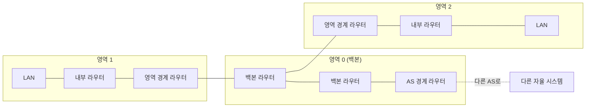

*그림 6. 영역으로 나뉜 OSPF 자율 시스템*

영역 사이의 라우팅은 세 단계로 이루어진다. 패킷은 먼저 영역 안의 라우팅으로 영역 경계 라우터까지 간 뒤, 백본을 거쳐 목적지 영역의 영역 경계 라우터로 가고, 마지막으로 그 영역 안에서 최종 목적지로 간다. 자율 시스템 밖과 연결되는 라우터는 **AS 경계 라우터(AS boundary router)** 라 한다.

### 3.4 메트릭

OSPF에서 관리자는 각 경로에 메트릭이라는 비용을 매긴다. 메트릭은 최소 지연, 최대 처리량 같은 서비스 유형(type of service)에 따라 정할 수 있으며, 실제로 라우터는 서비스 유형마다 하나씩 여러 라우팅 테이블을 가질 수 있다.

### 3.5 링크의 종류

OSPF에서는 연결을 **링크**라 하며, 네 가지 종류가 있다.

- **점대점 링크(point-to-point link):** 두 라우터를 다른 호스트나 라우터 없이 직접 잇는 링크이다. 전화선이나 T 회선으로 연결된 두 라우터가 그 예이다. 이 링크에는 네트워크 주소를 할당할 필요가 없다. 그래프에서는 두 라우터를 노드로, 링크를 양방향 간선으로 나타내며, 보통 같은 값인 메트릭을 방향마다 하나씩 양 끝에 적는다. 각 라우터는 링크 반대편에 이웃을 하나만 가진다.
- **경유 링크(transient link):** 여러 라우터가 붙은 네트워크로, 데이터가 어느 라우터로든 들어와 어느 라우터로든 나갈 수 있다. 모든 LAN과 두 개 이상의 라우터가 붙은 일부 WAN이 여기에 속한다.
- **스텁 링크(stub link):** 라우터 하나에만 연결된 네트워크이다. 데이터는 이 라우터 하나를 통해 들어오고 같은 라우터를 통해 나간다. 경유 네트워크의 특수한 경우이며, 라우터를 노드로, 네트워크를 지정 라우터로 나타내되 링크는 라우터에서 네트워크로 가는 한 방향뿐이다.
- **가상 링크(virtual link):** 두 라우터 사이의 링크가 끊겼을 때 관리자가 여러 라우터를 거치는 더 긴 경로로 만드는 링크이다.

경유 링크의 표현에는 주의가 필요하다. 다섯 라우터 A, B, C, D, E가 하나의 이더넷에 붙어 있으면 A의 이웃은 B, C, D, E이고 B의 이웃은 A, C, D, E이다. 이웃 관계를 그대로 모든 쌍 사이의 간선으로 그리면 각 라우터가 네 라우터에게 이웃 관계를 광고해야 하므로 모두 20번의 광고가 필요하여 효율적이지 않다. 또 실제로는 각 쌍 사이에 별도의 네트워크가 있는 것이 아니라 하나의 네트워크가 다섯 라우터의 교차로 역할을 하므로 현실적이지도 않다.

그래서 네트워크 자체를 하나의 노드로 나타낸다. 그러나 네트워크는 기계가 아니므로 라우터 역할을 할 수 없다. 그 네트워크의 라우터 가운데 하나가 이 역할을 맡아, 실제 라우터이면서 **지정 라우터(designated router)** 라는 두 가지 역할을 한다.

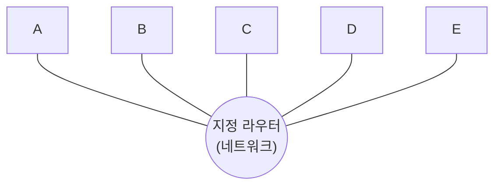

*그림 7. 지정 라우터로 나타낸 경유 링크*

이제 각 라우터의 이웃은 지정 라우터(네트워크) 하나뿐이고, 지정 라우터의 이웃은 다섯이므로 이웃 광고는 20번에서 10번으로 줄어든다. 링크는 여전히 양방향 간선이지만, 각 노드에서 지정 라우터로 가는 방향에만 메트릭이 있고 지정 라우터에서 노드로 가는 방향에는 메트릭이 없다. 지정 라우터가 네트워크를 대표하기 때문이다. 비용은 패킷이 네트워크에 들어갈 때 한 번만 매기며, 네트워크를 떠나 라우터로 갈 때 다시 매기지 않는다.

이제 자율 시스템 전체를 그래프로 나타내는 방법을 살펴본다. 그림 8은 네트워크 일곱 개와 라우터 여섯 대(A\~F)로 이루어진 작은 AS를 OSPF가 보는 모습으로 그린 것이다. 네트워크 가운데 두 개는 A와 D 사이의 T-1 회선과 B와 E 사이의 T-3 회선인 점대점 링크로, 식별자가 필요 없고 두 라우터 사이의 간선으로만 나타난다. 나머지 다섯 네트워크 N1\~N5는 각각 지정 라우터가 대표하는 노드로 그린다. N1과 N3은 라우터 세 대가 붙은 경유 네트워크이고, N2, N4, N5는 라우터 한 대에만 붙은 스텁 네트워크이다. OSPF는 라우터와 네트워크를 모두 그래프의 노드로 다루며, 앞에서 설명한 대로 네트워크 노드에는 라우터에서 그 네트워크로 가는 간선에만 메트릭이 있다.

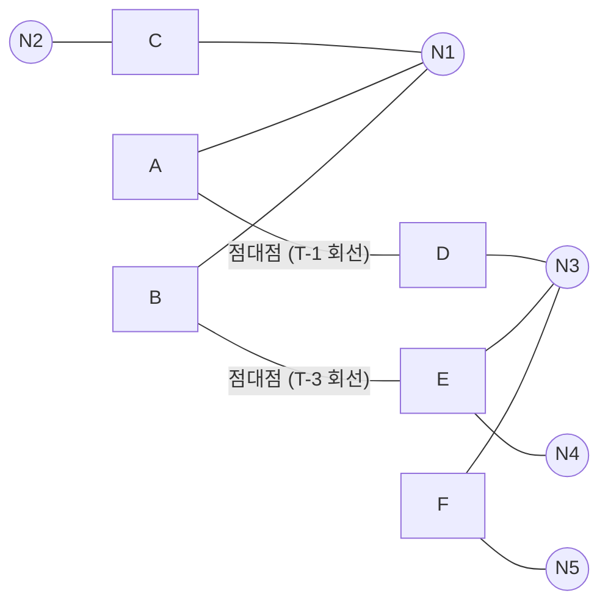

*그림 8. OSPF가 나타낸, 네트워크 일곱 개와 라우터 여섯 대로 이루어진 자율 시스템*

### 3.6 OSPF 패킷과 공통 헤더

OSPF는 다섯 종류의 패킷을 쓴다.

| Type | 패킷 | 역할 |
|:-----|:-----|:-----|
| 1 | Hello | 이웃 관계를 맺고 이웃이 살아 있는지 확인한다. |
| 2 | Database description (DBD) | 링크 상태 데이터베이스의 개요(각 항목의 제목)를 알린다. |
| 3 | Link state request (LSR) | 특정 링크에 관한 전체 정보를 요청한다. |
| 4 | Link state update (LSU) | 링크 상태 광고를 실어 링크의 상태를 알린다. |
| 5 | Link state acknowledgment (LSAck) | 링크 상태 갱신 패킷을 받았음을 확인한다. |

*표 4. OSPF 패킷의 종류*

모든 OSPF 패킷은 같은 공통 헤더로 시작한다.

```text
 0              7 8            15 16                             31
+----------------+----------------+-------------------------------+
|    Version     |      Type      |        Message length         |
+----------------+----------------+-------------------------------+
|                   Source router IP address                     |
+----------------------------------------------------------------+
|                      Area identification                       |
+--------------------------------+-------------------------------+
|            Checksum            |      Authentication type      |
+--------------------------------+-------------------------------+
|                    Authentication (64 bits)                    |
|                                                                |
+----------------------------------------------------------------+
```

*그림 9. OSPF 공통 헤더*

- **Version(8비트):** OSPF의 버전으로, 현재 2이다.
- **Type(8비트):** 패킷의 종류로, 표 4의 1\~5 가운데 하나이다.
- **Message length(16비트):** 헤더를 포함한 전체 메시지의 길이이다.
- **Source router IP address(32비트):** 패킷을 보낸 라우터의 IP 주소이다.
- **Area identification(32비트):** 라우팅이 이루어지는 영역이다.
- **Checksum:** 인증 방식과 인증 데이터 필드를 뺀 패킷 전체에 대한 오류 검출용이다.
- **Authentication type(16비트):** 그 영역에서 쓰는 인증 프로토콜로, 0은 인증 없음, 1은 암호이다.
- **Authentication(64비트):** 실제 인증 데이터이다. 인증 방식이 0이면 0으로 채우고, 1이면 8글자 암호를 담는다.

### 3.7 링크 상태 갱신 패킷과 링크 상태 광고

**링크 상태 갱신(link state update) 패킷**은 OSPF 동작의 핵심이며, 라우터가 자기 링크의 상태를 광고하는 데 쓴다. 이 패킷은 공통 헤더 뒤에 광고의 수를 적고, 여러 개의 **링크 상태 광고(link state advertisement, LSA)** 를 싣는다.

> **용어 정의:** **링크 상태 광고(link state advertisement, LSA)** 는 OSPF 라우터가 링크 상태 갱신 패킷에 실어 플러딩하는 정보 단위로, 라우터의 링크, 네트워크에 붙은 라우터, 영역 밖의 네트워크 등에 관한 상태를 알린다.

다섯 종류의 LSA는 모두 같은 일반 헤더를 가진다.

```text
+-------------------------------+---------------+---------------+
|        Link state age         | Reserved|E|T |Link state type|
+-------------------------------+---------------+---------------+
|                         Link state ID                         |
+---------------------------------------------------------------+
|                       Advertising router                      |
+---------------------------------------------------------------+
|                   Link state sequence number                  |
+-------------------------------+-------------------------------+
|      Link state checksum      |            Length             |
+-------------------------------+-------------------------------+
```

*그림 10. LSA의 일반 헤더*

- **Link state age:** 메시지가 처음 만들어진 뒤 지난 초를 나타낸다. 이 메시지는 플러딩으로 라우터에서 라우터로 전달되는데, 만든 라우터는 값을 0으로 두고 전달하는 라우터마다 통과 시간을 추정해 더한다.
- **E 플래그:** 1이면 그 영역이 스텁 영역, 즉 하나의 경로로만 백본에 연결된 영역이다.
- **T 플래그:** 1이면 라우터가 여러 서비스 유형을 처리할 수 있다.
- **Link state type:** LSA의 종류로, 다섯 가지가 있다(표 5).
- **Link state ID:** 링크의 종류에 따라 값이 다르다(표 5).
- **Advertising router:** 이 메시지를 광고하는 라우터의 IP 주소이다.
- **Link state sequence number:** 각 링크 상태 갱신 메시지에 매긴 순서 번호이다.
- **Link state checksum:** 일반적인 체크섬이 아니라, age 필드를 뺀 패킷 전체에 대해 Fletcher 체크섬으로 계산한 값이다.
- **Length:** 패킷 전체의 바이트 길이이다.

| Type | LSA | 광고 주체 | 내용 | Link state ID |
|:-----|:-----|:-----|:-----|:-----|
| 1 | 라우터 링크(router link) | 모든 라우터 | 자신의 모든 링크와 그 반대편(이웃) | 라우터의 IP 주소 |
| 2 | 네트워크 링크(network link) | 경유 네트워크의 지정 라우터 | 네트워크에 붙은 모든 라우터 | 지정 라우터의 IP 주소 |
| 3 | 네트워크로의 요약 링크 | 영역 경계 라우터 | 영역 밖 네트워크까지의 비용 | 네트워크의 주소 |
| 4 | AS 경계 라우터로의 요약 링크 | 영역 경계 라우터 | AS 경계 라우터까지의 경로 | AS 경계 라우터의 IP 주소 |
| 5 | 외부 링크(external link) | AS 경계 라우터 | 자율 시스템 밖 네트워크까지의 비용 | 외부 네트워크의 주소 |

*표 5. 다섯 종류의 링크 상태 광고*

**라우터 링크 LSA:** 실제 라우터가 자기의 모든 링크와 그 반대편에 무엇이 있는지를 알린다. 링크마다 Link ID, Link data, 링크 종류, 서비스 유형(TOS)의 수, 기본 서비스 유형(TOS 0)의 메트릭을 담고, 서비스 유형마다 메트릭을 덧붙일 수 있다. Link ID와 Link data의 값은 링크 종류에 따라 다르다.

| 링크 종류 | Link ID | Link data |
|:-----|:-----|:-----|
| 1: 점대점 | 이웃 라우터의 주소 | 인터페이스 번호 |
| 2: 경유 | 지정 라우터의 주소 | 라우터 주소 |
| 3: 스텁 | 네트워크 주소 | 네트워크 마스크 |
| 4: 가상 | 이웃 라우터의 주소 | 라우터 주소 |

*표 6. 라우터 링크 LSA의 링크 종류별 Link ID와 Link data*

예를 들어 라우터 10.24.7.9가 이웃 라우터 10.24.8.10과 메트릭 4의 점대점 링크로, 이웃 라우터 10.24.9.11과 메트릭 6의 점대점 링크로 연결되어 있고, 스텁 네트워크 10.24.7.0/24에 메트릭 2로 붙어 있다고 하자. 이 라우터의 라우터 링크 LSA는 세 개의 링크 항목을 담는다. 두 점대점 링크는 종류 1로, Link ID에 이웃 라우터의 주소 10.24.8.10과 10.24.9.11을, Link data에 해당 인터페이스 번호(1과 2)를 넣고, 메트릭은 4와 6이다. 스텁 네트워크는 종류 3으로, Link ID에 네트워크 주소 10.24.7.0을, Link data에 마스크 255.255.255.0을 넣고, 메트릭은 2이다. 이 광고는 링크 상태 갱신 패킷(종류 4)에 실리며, LSA 일반 헤더의 종류는 1이고 라우터 링크의 수는 3이다.

**네트워크 링크 LSA:** 경유 네트워크를 대신하여 지정 라우터가 보낸다. 네트워크 마스크와, 네트워크에 붙은 모든 라우터의 IP 주소를 담아 그 라우터들이 이 네트워크에 연결되어 있음을 알린다. 라우터 하나만 붙은 네트워크에서는 그 라우터가 곧 지정 라우터이므로 그 라우터가 광고한다.

**네트워크로의 요약 링크 LSA:** 라우터 링크와 네트워크 링크 광고는 영역 안의 라우터와 네트워크에 관한 정보를 영역 전체에 플러딩한다. 그러나 라우터는 자기 영역 밖의 네트워크도 알아야 한다. 영역 경계 라우터는 여러 영역에서 활동하면서 각 영역의 라우터 링크와 네트워크 링크 광고를 받고, 영역마다 라우팅 테이블을 만든다. 그리고 한 영역에 다른 영역의 네트워크에 이르는 방법을 플러딩한다. 이 광고는 네트워크 마스크와 서비스 유형별 메트릭만 담으며, 한 광고는 한 네트워크만 알린다. 네트워크 주소 자체는 광고 헤더의 Link state ID에서 알 수 있다.

**AS 경계 라우터로의 요약 링크 LSA:** 영역 안의 라우터가 자율 시스템 밖으로 패킷을 보내려면 먼저 AS 경계 라우터로 가는 경로를 알아야 한다. 영역 경계 라우터는 이 정보를 자기 영역에 플러딩한다.

**외부 링크 LSA:** AS 경계 라우터로 가는 경로만으로는 자율 시스템 밖에 어떤 네트워크가 있는지 알 수 없다. AS 경계 라우터는 도메인 간 라우팅 프로토콜로 만든 라우팅 테이블을 바탕으로 자율 시스템 밖의 각 네트워크까지의 비용을 자율 시스템 전체에 플러딩한다. 한 광고는 한 네트워크를 알린다. 형식은 앞의 요약 링크와 비슷하며, 목적지까지 더 좋은 경로를 제공하는 전달 라우터의 주소(forwarding address)와, OSPF가 아닌 다른 프로토콜이 쓰는 외부 경로 태그(external route tag)를 더한다.

### 3.8 그 밖의 패킷

나머지 네 종류의 패킷은 LSA로 쓰이지는 않지만 OSPF의 동작에 반드시 필요하다.

**Hello 패킷:** OSPF는 Hello 메시지로 이웃 관계를 만들고 이웃에 도달할 수 있는지 시험한다. 이것이 링크 상태 라우팅의 첫 단계이다. 라우터는 다른 모든 라우터에 이웃에 관한 정보를 플러딩하기 전에 먼저 이웃에게 인사하여 이웃이 살아 있는지, 도달할 수 있는지 알아야 한다. Hello 패킷의 필드는 다음과 같다.

- **Network mask:** Hello 메시지를 보내는 네트워크의 마스크이다.
- **Hello interval:** Hello 메시지 사이의 초이다.
- **E 플래그와 T 플래그:** LSA 헤더와 같은 뜻이다(스텁 영역, 여러 메트릭 지원).
- **Priority:** 라우터의 우선순위이다. 모든 이웃이 우선순위를 알린 뒤 우선순위가 가장 높은 라우터가 지정 라우터로, 둘째로 높은 라우터가 백업 지정 라우터로 뽑힌다. 값이 0이면 지정 라우터나 백업 지정 라우터가 되기를 원하지 않는다는 뜻이다.
- **Dead interval:** 이웃이 죽었다고 판단하기까지 지나야 하는 초이다.
- **Designated router IP address, backup designated router IP address:** 메시지를 보내는 네트워크의 지정 라우터와 백업 지정 라우터의 IP 주소이다.
- **Neighbor IP address:** 보내는 라우터가 Hello 메시지를 받은 이웃, 곧 이웃이 되기로 동의한 라우터들의 현재 목록이다.

**데이터베이스 기술(database description) 패킷:** 라우터가 처음 시스템에 연결되거나 장애에서 회복되면 링크 상태 데이터베이스 전체가 곧바로 필요하다. 다른 모든 라우터의 링크 상태 갱신 패킷이 올 때까지 기다릴 수 없기 때문이다. 그래서 새로 연결된 라우터가 Hello 패킷으로 이웃에게 인사하면, 처음 소식을 들은 이웃은 데이터베이스 기술 메시지를 보낸다. 이 메시지는 데이터베이스의 전체 내용이 아니라 각 항목의 제목, 곧 개요만 담는다. 두 라우터가 데이터베이스 기술 패킷을 교환할 때는 한쪽이 마스터, 다른 쪽이 슬레이브 역할을 하며, 내용이 길면 여러 메시지로 나누어 보낸다. 이 패킷은 공통 헤더 뒤에 E 플래그(광고 라우터가 AS 경계 라우터이면 1), B 플래그(영역 경계 라우터이면 1), I 플래그(초기화, 첫 메시지이면 1), M 플래그(more, 마지막 메시지가 아니면 1), M/S 플래그(마스터이면 1, 슬레이브이면 0), 요청과 응답을 짝짓는 메시지 순서 번호, 그리고 데이터베이스의 링크마다 그 링크의 세부 내용 없이 개요만 주는 20바이트 LSA 헤더를 담는다.

**링크 상태 요청(link state request) 패킷:** 새로 연결된 라우터는 개요를 살펴보고 자기에게 없는 항목을 찾은 뒤, 그 링크에 관한 전체 정보를 얻기 위해 하나 이상의 링크 상태 요청 패킷을 보낸다. 각 요청은 링크 상태 종류, 링크 상태 ID, 광고 라우터로 원하는 LSA를 지정한다.

**링크 상태 확인 응답(link state acknowledgment) 패킷:** OSPF는 모든 라우터가 받은 링크 상태 갱신 패킷마다 확인 응답을 보내게 하여 라우팅을 더 신뢰성 있게 만든다. 이 패킷은 공통 헤더와 LSA 일반 헤더만으로 이루어지며, 이 두 부분으로 어떤 패킷을 확인하는지 충분히 나타낼 수 있다.

### 3.9 캡슐화

OSPF 패킷은 IP 데이터그램에 직접 캡슐화되며, IP 헤더의 프로토콜 필드 값은 89이다. OSPF 패킷에는 흐름 제어와 오류 제어를 위한 확인 응답 메커니즘이 들어 있으므로 이 서비스를 위해 전송 계층 프로토콜을 쓸 필요가 없다.

---

<br>

## 4. 경로 벡터 라우팅

### 4.1 경로 벡터 라우팅이 필요한 이유

거리 벡터 라우팅과 링크 상태 라우팅은 모두 내부 라우팅 프로토콜이다. 자율 시스템 안에서는 쓸 수 있지만 자율 시스템 사이에서는 쓸 수 없다. 운영 범위가 커지면 두 방식 모두 다루기 어려워지기 때문이다. 거리 벡터 라우팅은 운영 범위의 홉 수가 조금만 커도 불안정해지고, 링크 상태 라우팅은 라우팅 테이블을 계산하는 데 막대한 자원이 필요하며 플러딩 때문에 트래픽도 많아진다. 그래서 세 번째 방식인 경로 벡터 라우팅이 필요하다.

> **용어 정의:** **경로 벡터 라우팅(path-vector routing)** 은 각 라우터가 도달할 수 있는 네트워크마다 그 네트워크에 이르기 위해 지나야 하는 자율 시스템의 목록, 곧 경로를 유지하고 이웃과 교환하는 AS 간 라우팅 방식이다.

거리 벡터 라우팅의 라우터는 같은 AS 안에서 도달할 수 있는 네트워크의 목록과 그 비용(홉 수)을 가진다. 경로 벡터 라우팅의 라우터는 도달할 수 있는 네트워크의 목록과 각 네트워크에 이르는 경로(지나야 할 AS의 목록)를 가진다. 거리 벡터 라우팅의 운영 범위는 하나의 AS이고, 경로 벡터 라우팅의 운영 범위는 인터넷 전체이다. 거리 벡터 라우팅은 각 네트워크까지의 거리를 알려 주고, 경로 벡터 라우팅은 경로를 알려 준다. 이 차이는 국내 지도와 세계 지도의 차이에 비유할 수 있다. 국내 지도는 각 도시로 가는 도로와 그 경로를 택했을 때의 거리를 알려 주고, 세계 지도는 어느 나라에 어떤 도시가 있으며 그 도시에 이르기 전에 어느 나라들을 지나야 하는지를 알려 준다.

### 4.2 도달 가능성

다른 AS에 정보를 제공하려면 각 AS에는 그 AS의 각 네트워크에 관한 도달 가능성 정보를 모으는 경로 벡터 라우터가 적어도 하나 있어야 한다. 이때 모으는 정보는 네트워크 주소(CIDR 접두사)로 식별되는 어떤 네트워크가 이 AS 안에 존재하여 도달할 수 있다는 사실뿐이다. 즉 AS는 자기 영역 안에 있는 네트워크의 목록을 가져야 한다.

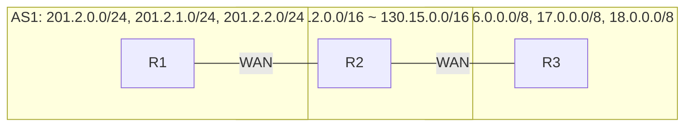

*그림 11. 세 자율 시스템과 각 AS의 도달 가능성 목록*

### 4.3 경로 벡터 라우팅 테이블

AS들이 도달 가능성 목록을 서로 나누면 각 라우터의 경로 벡터 라우팅 테이블을 만들 수 있다. 그림 11에서 AS1의 R1은 자기 도달 가능성 목록을 R2에게 보낼 수 있다. R2는 이를 자기 목록과 합친 결과를 R1과 R3에게 보낸다. R3도 자기 목록을 R2에게 보내 R2의 테이블을 보강하고, 이 과정이 이어진다.

| 네트워크 | R1의 경로 | R2의 경로 | R3의 경로 |
|:-----|:-----|:-----|:-----|
| 201.2.0.0/24 | AS1 (자신) | AS2, AS1 | AS3, AS2, AS1 |
| 201.2.1.0/24 | AS1 (자신) | AS2, AS1 | AS3, AS2, AS1 |
| 201.2.2.0/24 | AS1 (자신) | AS2, AS1 | AS3, AS2, AS1 |
| 130.12.0.0/16 | AS1, AS2 | AS2 (자신) | AS3, AS2 |
| 130.13.0.0/16 | AS1, AS2 | AS2 (자신) | AS3, AS2 |
| 130.14.0.0/16 | AS1, AS2 | AS2 (자신) | AS3, AS2 |
| 130.15.0.0/16 | AS1, AS2 | AS2 (자신) | AS3, AS2 |
| 16.0.0.0/8 | AS1, AS2, AS3 | AS2, AS3 | AS3 (자신) |
| 17.0.0.0/8 | AS1, AS2, AS3 | AS2, AS3 | AS3 (자신) |
| 18.0.0.0/8 | AS1, AS2, AS3 | AS2, AS3 | AS3 (자신) |

*표 7. 안정된 뒤 세 라우터의 경로 벡터 라우팅 테이블*

R1은 201.2.2.0/24행 패킷이 오면 그 네트워크가 AS1 안(자신)에 있음을 알고, 130.14.0.0/16행 패킷이 오면 AS1에서 AS2로 가야 목적지에 이른다는 것을 안다. 16.0.0.0/8행 패킷을 받은 R2는 AS2에서 AS3으로 가야 한다는 것을 안다.

### 4.4 루프 방지, 집약, 정책 라우팅

**루프 방지:** 경로 벡터 라우팅에서는 거리 벡터 라우팅의 불안정과 루프를 피할 수 있다. 라우터는 도달 가능성 정보를 받으면 어떤 목적지로의 경로 목록에 자기 AS가 들어 있는지 검사하고, 들어 있으면 루프가 생긴 것이므로 그 네트워크와 경로의 쌍을 버린다.

**집약:** 경로 벡터 라우팅 프로토콜은 보통 CIDR 표기와 주소 집약을 지원한다. 집약을 쓰면 라우팅 테이블이 단순해지고 라우터 사이의 교환이 빨라진다. 표 7의 테이블은 다음처럼 줄일 수 있다.

| 집약한 네트워크 | 포함하는 네트워크 | R1의 경로 | R2의 경로 | R3의 경로 |
|:-----|:-----|:-----|:-----|:-----|
| 201.2.0.0/22 | 201.2.0.0/24 ~ 201.2.2.0/24 | AS1 (자신) | AS2, AS1 | AS3, AS2, AS1 |
| 130.12.0.0/14 | 130.12.0.0/16 ~ 130.15.0.0/16 | AS1, AS2 | AS2 (자신) | AS3, AS2 |
| 16.0.0.0/6 | 16.0.0.0/8 ~ 18.0.0.0/8 | AS1, AS2, AS3 | AS2, AS3 | AS3 (자신) |

*표 8. 주소 집약 뒤의 경로 벡터 라우팅 테이블*

집약한 범위에는 그 AS에 없는 블록이 들어갈 수도 있다. 예를 들어 201.2.0.0/22는 AS1의 어느 네트워크 주소도 아닌 201.2.3.0/24도 포함하고, 16.0.0.0/6은 AS3에 없는 19.0.0.0/8도 포함한다. 그러나 그런 네트워크가 다른 AS에 있다면 결국 라우팅 테이블에 별도의 항목으로 들어온다. 13장의 최장 접두사 일치에 따라 더 긴 접두사인 그 항목이 먼저 일치하므로 라우팅은 올바르게 이루어진다.

**정책 라우팅:** 경로 벡터 라우팅에서는 정책 라우팅을 쉽게 구현할 수 있다. 라우터는 메시지를 받으면 경로를 검사하여, 경로에 들어 있는 AS 가운데 하나라도 자기 정책에 맞지 않으면 그 경로와 목적지를 무시한다. 라우팅 테이블을 이 경로로 갱신하지 않으며, 이 메시지를 이웃에게 전하지도 않는다.

---

<br>

## 5. BGP

### 5.1 BGP의 역할

> **용어 정의:** **BGP(Border Gateway Protocol)** 는 인터넷의 모든 자율 시스템이 실행하는 AS 간 라우팅 프로토콜로, 경로 벡터 방식으로 CIDR 접두사의 도달 가능성 정보를 교환하고 정책에 따라 최선의 경로를 고른다.

한 AS 안에서 출발지와 목적지가 모두 있으면 패킷의 경로는 AS 내부 라우팅 프로토콜이 전적으로 정한다. 그러나 예를 들어 어느 먼 도시의 스마트폰에서 다른 대륙의 데이터 센터에 있는 서버까지 여러 AS를 거쳐 패킷을 보내려면 AS 간 라우팅 프로토콜이 필요하다. BGP는 인터넷의 수천 개 ISP를 하나로 묶는 접착제이므로, IP와 함께 인터넷에서 가장 중요한 프로토콜이라 할 수 있다. BGP는 14장의 거리 벡터 라우팅과 같은 계열의 분산적이고 비동기적인 프로토콜이며, 1989년에 처음 등장한 뒤 네 번의 버전을 거쳤다.

라우터의 포워딩 테이블에서 같은 AS 안의 목적지에 대한 항목은 AS 내부 라우팅 프로토콜이 정한다. AS 밖의 목적지에 대한 항목은 BGP가 정한다. BGP에서 패킷은 특정 목적지 주소가 아니라 CIDR 접두사로 라우팅되며, 각 접두사는 하나의 서브넷이나 서브넷의 모임을 나타낸다. 예를 들어 138.16.68.0/22라는 목적지는 1,024개의 IP 주소를 포함한다. 따라서 라우터의 포워딩 테이블에는 (x, I) 꼴의 항목이 들어가며, x는 접두사, I는 라우터의 인터페이스 번호이다.

AS 간 라우팅 프로토콜로서 BGP는 각 라우터에 두 가지 수단을 제공한다.

1. **이웃 AS에게서 접두사의 도달 가능성 정보를 얻는다.** BGP는 각 서브넷이 인터넷의 나머지에 자기 존재를 광고할 수 있게 한다. 서브넷이 "나 여기 있다"고 외치면 BGP는 인터넷의 모든 라우터가 그 서브넷을 알게 한다. BGP가 없다면 각 서브넷은 인터넷의 나머지가 알 수 없고 도달할 수도 없는 고립된 섬이 될 것이다.
2. **접두사로 가는 최선의 경로를 정한다.** 라우터는 한 접두사로 가는 서로 다른 경로를 둘 이상 알게 될 수 있다. 최선의 경로를 정하기 위해 라우터는 이웃 라우터에게서 얻은 도달 가능성 정보로 BGP 경로 선택 절차를 실행한다. 최선의 경로는 도달 가능성 정보뿐 아니라 정책에 따라서도 정해진다.

### 5.2 BGP 경로 정보의 광고

그림 12의 네트워크는 세 자율 시스템 AS1, AS2, AS3으로 이루어지며, AS3에는 접두사가 x인 서브넷이 있다. 각 AS의 라우터는 게이트웨이 라우터이거나 내부 라우터이다. **게이트웨이 라우터(gateway router)** 는 AS의 가장자리에서 다른 AS의 라우터와 직접 연결되는 라우터이고, **내부 라우터(internal router)** 는 자기 AS 안의 호스트와 라우터에만 연결되는 라우터이다. AS1에서 1c는 게이트웨이 라우터이고 1a, 1b, 1d는 내부 라우터이다(1d와 3d를 잇는 링크는 5.3절에서 더한다).

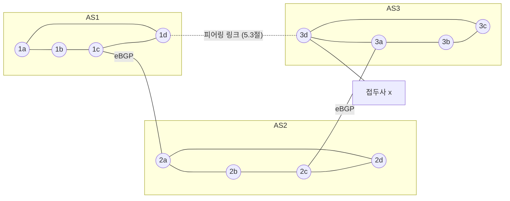

*그림 12. 세 자율 시스템으로 이루어진 네트워크*

높은 수준에서 보면 x의 도달 가능성 정보를 광고하는 일은 간단하다. 먼저 AS3이 AS2에게 x가 존재하며 AS3 안에 있다는 BGP 메시지를 보낸다. 이 메시지를 "AS3 x"로 적는다. 다음에 AS2가 AS1에게 x가 존재하고, AS2를 거친 뒤 AS3으로 가면 x에 이를 수 있다는 메시지 "AS2 AS3 x"를 보낸다. 이렇게 하여 각 AS는 x의 존재뿐 아니라 x에 이르는 AS의 경로도 알게 된다.

실제로 메시지를 주고받는 것은 AS가 아니라 라우터이다. BGP에서 라우터 쌍은 포트 179를 쓰는 반영구적인 TCP 연결로 라우팅 정보를 교환한다. 이 TCP 연결과 그 위로 오가는 모든 BGP 메시지를 **BGP 연결(BGP connection)** 이라 한다.

> **용어 정의:** **eBGP(external BGP)** 연결은 서로 다른 두 AS에 속한 라우터 사이의 BGP 연결로, 보통 서로 다른 AS의 게이트웨이 라우터를 직접 잇는 링크마다 하나씩 있다.

> **용어 정의:** **iBGP(internal BGP)** 연결은 같은 AS 안의 라우터 사이의 BGP 연결로, 흔히 AS 안의 모든 라우터 쌍마다 하나씩 두어 TCP 연결의 그물을 이루며 물리 링크와 반드시 대응하지는 않는다.

그림 12에는 게이트웨이 라우터 1c와 2a 사이, 2c와 3a 사이에 eBGP 연결이 있다. 도달 가능성 정보를 퍼뜨리는 데는 iBGP와 eBGP가 모두 쓰인다.

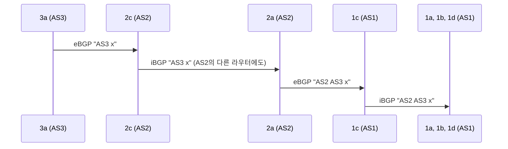

*그림 13. eBGP와 iBGP로 접두사 x의 도달 가능성을 퍼뜨리는 과정*

이 과정이 끝나면 AS1과 AS2의 모든 라우터는 x의 존재와 x에 이르는 AS 경로를 안다.

> **참고:** Forouzan은 BGP 연결을 세션(session)이라 부른다. BGP 세션은 라우팅 정보를 교환하기 위해서만 맺는 연결이며, BGP는 응용 프로그램으로서 TCP 연결 위에서 세션을 맺는다. 다른 응용의 TCP 연결과 달리 BGP의 TCP 연결은 특별한 일이 생길 때까지 오래 유지되므로 반영구적 연결이라고도 한다.

### 5.3 경로 속성: AS-PATH와 NEXT-HOP

실제 네트워크에서는 한 라우터에서 한 목적지로 가는 경로가 여럿이고, 경로마다 거치는 AS의 순서가 다르다. 그림 12에 라우터 1d와 3d를 잇는 물리 링크를 더하면 AS1에서 x로 가는 경로는 라우터 1c를 거치는 "AS2 AS3 x"와 라우터 1d를 거치는 "AS3 x" 두 가지가 된다.

라우터는 BGP 연결로 접두사를 광고할 때 몇 가지 **BGP 속성(BGP attribute)** 을 함께 보낸다. BGP 용어로 접두사와 그 속성을 합쳐 **경로(route)** 라 한다. 가장 중요한 속성은 AS-PATH와 NEXT-HOP이다.

> **용어 정의:** **AS-PATH** 속성은 광고가 거쳐 온 AS의 목록으로, 접두사가 어떤 AS에 전달될 때 그 AS가 자기 ASN을 목록에 더한다.

그림 12에 1d와 3d 사이의 링크를 더하면 AS1에서 x로 가는 경로는 AS-PATH가 "AS2 AS3"인 것과 "AS3"인 것 두 가지이다. BGP 라우터는 AS-PATH로 광고의 루프를 감지하고 막기도 한다. 라우터는 경로 목록에 자기 AS가 들어 있으면 그 광고를 거부한다.

> **용어 정의:** **NEXT-HOP** 속성은 AS-PATH를 시작하는 라우터 인터페이스의 IP 주소로, AS 간 라우팅과 AS 내부 라우팅을 잇는 역할을 한다.

AS2를 거쳐 AS1에서 x로 가는 경로 "AS2 AS3 x"의 NEXT-HOP은 라우터 2a의 왼쪽(AS1 쪽) 인터페이스의 IP 주소이다. AS2를 거치지 않는 경로 "AS3 x"의 NEXT-HOP은 라우터 3d의 가장 왼쪽(AS1 쪽) 인터페이스의 IP 주소이다. 정리하면 AS1의 각 라우터는 x로 가는 다음 두 BGP 경로를 안다. 각 경로는 NEXT-HOP, AS-PATH, 목적지 접두사의 세 요소로 적었다.

- 라우터 2a의 가장 왼쪽 인터페이스의 IP 주소; AS2 AS3; x
- 라우터 3d의 가장 왼쪽 인터페이스의 IP 주소; AS3; x

NEXT-HOP 속성은 AS1에 속하지 않는 라우터의 IP 주소이지만, 그 IP 주소를 포함하는 서브넷은 AS1에 직접 붙어 있다.

> **참고:** **속성의 분류.** BGP의 경로 속성은 모든 BGP 라우터가 인식해야 하는 **잘 알려진(well-known) 속성**과 모든 라우터가 인식할 필요는 없는 **선택(optional) 속성**으로 나뉜다. 잘 알려진 속성은 다시 경로 설명에 반드시 나타나야 하는 **필수(mandatory)** 속성과, 모든 라우터가 인식해야 하지만 모든 갱신 메시지에 넣을 필요는 없는 **임의(discretionary)** 속성으로 나뉜다. 라우팅 정보의 출처(RIP, OSPF 등)를 나타내는 ORIGIN, 목적지에 이르는 AS 목록인 AS_PATH, 다음 라우터를 나타내는 NEXT-HOP이 잘 알려진 필수 속성이다. 선택 속성은 그 속성을 구현하지 않은 라우터도 다음 라우터에 그대로 넘겨야 하는 **전이(transitive)** 속성과, 구현하지 않은 라우터가 버려야 하는 **비전이(nontransitive)** 속성으로 나뉜다.

### 5.4 핫 포테이토 라우팅

> **용어 정의:** **핫 포테이토 라우팅(hot potato routing)** 은 가능한 모든 BGP 경로 가운데, 경로를 시작하는 NEXT-HOP 라우터까지의 AS 내부 비용이 가장 작은 경로를 고르는 라우팅 방식이다.

그림 12에 1d와 3d 사이의 링크를 더한 네트워크에서 라우터 1b를 본다. 1b는 x로 가는 두 BGP 경로를 안다. 핫 포테이토 라우팅에서 1b는 AS 내부 라우팅 정보로 NEXT-HOP 라우터 2a까지의 최소 비용 경로와 3d까지의 최소 비용 경로를 구하고, 그 비용이 더 작은 경로를 고른다. 비용을 지나는 링크 수로 정의하면 1b에서 2a까지의 최소 비용은 2(1b, 1c, 2a)이고 3d까지의 최소 비용은 3(1b, 1a, 1d, 3d)이므로 2a로 가는 경로를 고른다. 그런 다음 1b는 AS 내부 알고리즘이 만든 포워딩 테이블에서 2a로 가는 최소 비용 경로에 있는 인터페이스 I를 찾아 (x, I)를 포워딩 테이블에 더한다.


*그림 14. 핫 포테이토 라우팅으로 AS 밖 목적지를 포워딩 테이블에 넣는 단계*

AS 밖의 접두사를 포워딩 테이블에 넣을 때 AS 간 라우팅 프로토콜(BGP)과 AS 내부 라우팅 프로토콜(예를 들어 OSPF)이 함께 쓰인다는 점이 중요하다. 핫 포테이토 라우팅의 발상은 목적지까지의 경로 가운데 AS 밖 부분의 비용은 신경 쓰지 않고, 패킷을 가능한 한 적은 비용으로 빨리 자기 AS 밖으로 내보내는 것이다. 손에 든 뜨거운 감자를 빨리 다른 사람(다른 AS)에게 넘기려는 것과 같다고 해서 이런 이름이 붙었다. 따라서 핫 포테이토 라우팅은 자기 AS 안의 비용만 줄이고 종단 간 비용의 나머지는 무시하는 이기적인 알고리즘이다. 같은 AS의 두 라우터가 같은 접두사로 서로 다른 AS 경로를 고를 수도 있다. 1b는 AS2를 거쳐 x로 보내지만, 1d는 AS2를 거치지 않고 AS3으로 바로 보낸다.

### 5.5 경로 선택 알고리즘

실제 BGP는 핫 포테이토 라우팅을 포함하되 그보다 복잡한 알고리즘을 쓴다. 한 목적지 접두사에 대해 BGP 경로 선택 알고리즘의 입력은 라우터가 배우고 받아들인 그 접두사로의 모든 경로이다. 경로가 하나뿐이면 그 경로를 고른다. 같은 접두사로의 경로가 둘 이상이면 하나가 남을 때까지 다음 제거 규칙을 차례로 적용한다.

1. **지역 선호도(local preference):** 경로에는 AS-PATH, NEXT-HOP과 함께 지역 선호도 값이 속성으로 붙는다. 이 값은 라우터가 정했거나 같은 AS의 다른 라우터에게서 배운 것이며, 전적으로 AS의 네트워크 관리자가 정하는 정책 결정이다. 지역 선호도 값이 가장 큰 경로를 고른다.
2. **가장 짧은 AS-PATH:** 남은 경로(모두 지역 선호도가 가장 큰 경로) 가운데 AS-PATH가 가장 짧은 경로를 고른다. 이 규칙만 쓴다면 BGP는 라우터 홉 수 대신 AS 홉 수를 거리로 쓰는 거리 벡터 알고리즘이 된다.
3. **가장 가까운 NEXT-HOP:** 남은 경로(지역 선호도와 AS-PATH 길이가 모두 같은 경로) 가운데 핫 포테이토 라우팅으로, NEXT-HOP 라우터가 가장 가까운 경로를 고른다.
4. **BGP 식별자:** 그래도 경로가 둘 이상 남으면 BGP 식별자로 고른다.

다시 1d와 3d 사이의 링크를 더한 그림 12의 라우터 1b를 본다. x로 가는 BGP 경로는 AS2를 거치는 것과 거치지 않는 것 두 가지이다. 핫 포테이토 라우팅만 쓰면 1b는 AS2를 거치는 경로를 골랐다. 그러나 경로 선택 알고리즘에서는 규칙 2가 규칙 3보다 먼저 적용되므로, AS-PATH가 더 짧은 경로, 곧 AS2를 거치지 않는 경로를 고른다. 이처럼 경로 선택 알고리즘에서 BGP는 더 이상 이기적이지 않으며, 먼저 AS 경로가 짧은 경로를 찾아 종단 간 지연을 줄이려 한다. BGP 라우팅 테이블에는 흔히 50만 개가 넘는 경로(접두사와 그 속성)가 들어 있다.

### 5.6 IP 애니캐스트

BGP는 AS 간 라우팅 프로토콜일 뿐 아니라, DNS에서 흔히 쓰는 IP 애니캐스트 서비스를 구현하는 데도 쓰인다.

> **용어 정의:** **IP 애니캐스트(IP anycast)** 는 지리적으로 흩어진 여러 서버에 같은 IP 주소를 주고 각 위치에서 BGP로 그 주소를 광고하여, 사용자의 요청이 BGP 경로 선택 기준으로 가장 가까운 서버로 가게 하는 서비스이다.

많은 응용에서는 (1) 같은 콘텐츠를 지리적으로 흩어진 여러 서버에 복제하고, (2) 각 사용자가 가장 가까운 서버의 콘텐츠에 접근하게 하고 싶다. 예를 들어 CDN은 동영상을 여러 나라의 서버에 복제하고, DNS는 DNS 레코드를 전 세계의 DNS 서버에 복제한다. CDN이 IP 애니캐스트를 쓰는 방법을 예로 든다.

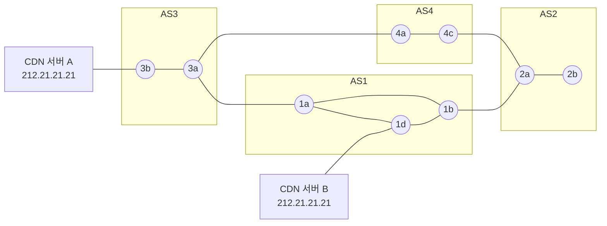

*그림 15. IP 애니캐스트로 사용자를 가장 가까운 CDN 서버로 보내는 구성*

- **구성 단계:** CDN 회사는 모든 서버에 같은 IP 주소(그림 15의 212.21.21.21)를 주고, 각 서버의 위치에서 표준 BGP로 이 주소를 광고한다. BGP 라우터는 이 주소에 대한 여러 경로 광고를 받으면 같은 물리적 위치로 가는 서로 다른 경로로 취급한다(실제로는 서로 다른 위치로 가는 경로이다). 각 라우터는 BGP 경로 선택 알고리즘으로 그 주소로 가는 최선의 경로(예를 들어 AS 홉 수로 따진 가장 가까운 경로)를 고른다. 그림 15에서 AS2의 2b는 AS1과 AS4에게서 모두 광고를 받지만, AS1을 거치는 경로가 더 가까우므로 서버 B 쪽으로 보낸다.
- **배포 단계:** 클라이언트가 동영상을 요청하면 CDN은 클라이언트의 위치와 관계없이 흩어진 서버들이 함께 쓰는 IP 주소를 돌려준다. 클라이언트가 그 주소로 요청을 보내면 인터넷의 라우터들은 BGP 경로 선택 기준으로 가장 가까운 서버로 요청 패킷을 보낸다.

실제로 CDN은 IP 애니캐스트를 잘 쓰지 않는다. BGP 경로가 바뀌면 같은 TCP 연결의 패킷이 서로 다른 웹 서버 인스턴스에 도착할 수 있기 때문이다. 반면 DNS 시스템은 DNS 질의를 가장 가까운 루트 DNS 서버로 보내는 데 IP 애니캐스트를 널리 쓴다. 루트 DNS 서버(5장)의 IP 주소는 13개이지만, 각 주소에 대응하는 루트 서버는 여럿이며 어떤 주소는 100개가 넘는 서버가 전 세계에 흩어져 있다. 13개 주소 가운데 하나로 DNS 질의를 보내면 IP 애니캐스트가 그 주소를 맡은 루트 서버 가운데 가장 가까운 곳으로 질의를 보낸다.

### 5.7 라우팅 정책

라우터가 목적지로의 경로를 고를 때 AS의 라우팅 정책은 가장 짧은 AS 경로나 핫 포테이토 라우팅 같은 다른 모든 고려보다 우선할 수 있다. 실제로 경로 선택 알고리즘은 먼저 지역 AS의 정책이 정하는 지역 선호도 속성으로 경로를 고른다.

AS는 트래픽의 관점에서 세 종류로 나눌 수 있다.

- **스텁 AS(stub AS):** 다른 AS와의 연결이 하나뿐이다. 스텁 AS의 호스트는 다른 AS로 데이터를 보내고 받을 수 있지만, 데이터 트래픽이 스텁 AS를 지나갈 수는 없다. 즉 스텁 AS는 트래픽의 출발지이거나 도착지일 뿐이다. 작은 기업이나 작은 지역 ISP가 그 예이다.
- **다중 홈 AS(multihomed AS):** 다른 AS와의 연결이 둘 이상이지만 여전히 트래픽의 출발지이거나 도착지일 뿐이다. 여러 AS와 데이터를 주고받을 수 있지만, 한 AS에서 와서 다른 AS로 가는 경유 트래픽은 통과시키지 않는다. 경유 트래픽을 허용하지 않는 여러 지역 또는 국가 AS에 연결된 대기업이 그 예이다.
- **경유 AS(transit AS):** 경유 트래픽도 허용하는 다중 홈 AS이다. 국가나 국제 ISP(인터넷 백본)가 그 예이다.

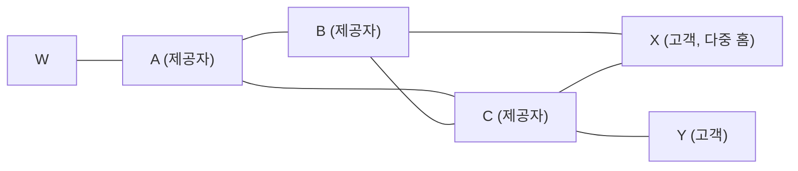

*그림 16. 간단한 BGP 정책 시나리오*

그림 16의 A, B, C, W, X, Y는 라우터가 아니라 자율 시스템이다. W, X, Y는 접속 ISP이고 A, B, C는 백본 제공자 네트워크라 하자. A, B, C는 서로 직접 트래픽을 보내며, 고객 네트워크에 전체 BGP 정보를 제공한다. 접속 ISP 네트워크로 들어오는 모든 트래픽은 그 네트워크가 목적지여야 하고, 나가는 모든 트래픽은 그 네트워크에서 출발한 것이어야 한다.

**고객의 광고 정책:** X는 두 제공자에 연결된 **다중 홈 접속 ISP(multi-homed access ISP)** 이다. 그러나 W, Y와 마찬가지로 X를 드나드는 모든 트래픽은 X가 출발지나 목적지여야 한다. X가 B와 C 사이의 트래픽을 전달하지 않게 하려면 BGP 경로를 광고하는 방식을 통제하면 된다. X가 이웃 B와 C에게 자기 자신 말고는 어떤 목적지로 가는 경로도 없다고 광고하면 X는 접속 ISP로만 동작한다. X가 Y에 이르는 경로 XCY를 알고 있더라도 이 경로를 B에게 광고하지 않는다. X가 Y로 가는 경로를 가진다는 사실을 모르는 B는 Y(또는 C)행 트래픽을 X로 보내지 않는다. 이처럼 선택적인 경로 광고 정책으로 고객과 제공자의 라우팅 관계를 구현할 수 있다.

**제공자의 광고 정책:** 제공자 네트워크 B를 본다. B가 A에게서 W로 가는 경로 AW를 배웠다고 하자. B는 이 경로를 자기 라우팅 정보에 넣고, 고객 X가 B를 거쳐 W로 갈 수 있도록 경로 BAW를 X에게 광고하려 할 것이다. 그러면 B는 BAW를 C에게도 광고해야 하는가? 그렇게 하면 C는 BAW를 거쳐 W로 트래픽을 보낼 수 있다. A, B, C가 모두 백본 제공자라면 B는 A와 C 사이의 경유 트래픽을 나르는 부담(과 비용)을 질 필요가 없다고 여길 것이다. C가 A의 고객과 주고받는 트래픽은 A와 C 사이의 직접 연결로 처리하는 것이 A와 C의 몫이라고 보는 것이다. 백본 ISP 사이의 라우팅을 규정하는 공식 표준은 없지만, 상업 ISP가 따르는 경험칙은 ISP의 백본을 지나는 모든 트래픽의 출발지나 목적지(또는 둘 다)가 그 ISP의 고객 네트워크여야 한다는 것이다. 그렇지 않으면 그 트래픽은 ISP의 네트워크를 대가 없이 이용하게 되기 때문이다. 개별 피어링 협정은 보통 ISP 쌍 사이에서 협상하며 비공개인 경우가 많다.

### 5.8 BGP 메시지

BGP는 네 종류의 메시지를 쓴다. 모든 BGP 메시지는 같은 공통 헤더를 가진다.

```text
+---------------------------------------------------------------+
|                                                               |
|                      Marker (16 bytes)                        |
|                                                               |
|                                                               |
+-------------------------------+---------------+---------------+
|         Length (16 bits)      | Type (8 bits) |
+-------------------------------+---------------+
```

*그림 17. BGP 메시지의 공통 헤더*

- **Marker(16바이트):** 인증을 위해 예약된 필드이다.
- **Length(2바이트):** 헤더를 포함한 전체 메시지의 길이이다.
- **Type(1바이트):** 메시지의 종류로, 1\~4가 네 종류를 나타낸다.

| Type | 메시지 | 역할 |
|:-----|:-----|:-----|
| 1 | Open | 이웃과 관계를 맺기 위해 TCP 연결을 연 뒤 보낸다. |
| 2 | Update | 이전에 광고한 목적지를 철회하거나, 새 목적지로의 경로를 알리거나, 둘 다 한다. |
| 3 | Keepalive | 보유 시간이 끝나기 전에 주기적으로 보내 살아 있음을 알린다. |
| 4 | Notification | 오류를 감지했거나 연결을 닫으려 할 때 보낸다. |

*표 9. BGP 메시지의 종류*

**Open 메시지:** BGP를 실행하는 라우터는 이웃과 TCP 연결을 열고 Open 메시지를 보낸다. 이웃이 이웃 관계를 받아들이면 Keepalive 메시지로 응답하며, 이로써 두 라우터 사이에 관계가 맺어진다. Open 메시지의 필드는 다음과 같다.

- **Version(1바이트):** BGP의 버전으로, 현재 4이다.
- **My autonomous system(2바이트):** 자율 시스템 번호이다.
- **Hold time(2바이트):** 한쪽이 상대에게서 Keepalive나 Update 메시지를 받기까지 지날 수 있는 최대 초이다. 이 시간 안에 받지 못하면 상대가 죽었다고 판단한다.
- **BGP identifier(4바이트):** Open 메시지를 보내는 라우터를 나타낸다. 보통 유일한 값인 자기 IP 주소 가운데 하나를 쓴다.
- **Option length, option parameters:** 선택 매개변수의 전체 길이와 매개변수이다. 지금까지 정의된 유일한 선택 매개변수는 인증이다.

**Update 메시지:** BGP의 핵심이다. 라우터는 이 메시지로 이전에 광고한 목적지를 철회하거나, 새 목적지로의 경로를 알리거나, 둘 다 한다. 한 Update 메시지로 이전에 광고한 여러 목적지를 철회할 수 있지만, 새 목적지는 하나만 광고할 수 있다.

- **Unfeasible routes length, withdrawn routes:** 철회할 경로 목록의 길이와, 이전에 광고한 목록에서 지워야 할 경로들이다.
- **Path attributes length, path attributes:** 경로 속성의 길이와, 이 메시지가 도달 가능성을 알리는 네트워크로의 경로(route)의 속성이다.
- **Network layer reachability information(NLRI):** 이 메시지가 실제로 광고하는 네트워크이다. 접두사의 비트 수를 나타내는 길이 필드와 IP 주소 접두사로 이루어진다. 예를 들어 네트워크가 153.18.7.0/24이면 접두사 길이는 24이고 접두사는 153.18.7이다. BGP 버전 4는 클래스 없는 주소 지정과 CIDR을 지원한다.

**Keepalive 메시지:** BGP를 실행하는 라우터(BGP에서는 피어라 한다)는 보유 시간이 끝나기 전에 정기적으로 Keepalive 메시지를 주고받아 서로 살아 있음을 알린다. Keepalive 메시지는 공통 헤더만으로 이루어진다.

**Notification 메시지:** 라우터가 오류 상황을 감지했거나 연결을 닫으려 할 때 보낸다. 오류의 범주를 나타내는 오류 코드(1바이트), 범주 안의 오류 종류를 나타내는 오류 하위 코드(1바이트), 진단 정보를 담는 오류 데이터로 이루어진다.

| 오류 코드 | 설명 | 하위 코드 |
|:-----|:-----|:-----|
| 1 | 메시지 헤더 오류 | 동기화 문제(1), 잘못된 메시지 길이(2), 잘못된 메시지 종류(3) |
| 2 | Open 메시지 오류 | 지원하지 않는 버전(1), 잘못된 피어 AS(2), 잘못된 BGP 식별자(3), 지원하지 않는 선택 매개변수(4), 인증 실패(5), 받아들일 수 없는 보유 시간(6) |
| 3 | Update 메시지 오류 | 잘못된 형식의 속성 목록(1), 인식하지 못한 잘 알려진 속성(2), 빠진 잘 알려진 속성(3), 속성 플래그 오류(4), 속성 길이 오류(5), 잘못된 ORIGIN 속성(6), AS 라우팅 루프(7), 잘못된 NEXT-HOP 속성(8), 선택 속성 오류(9), 잘못된 네트워크 필드(10), 잘못된 형식의 AS_PATH(11) |
| 4 | 보유 타이머 만료 | 없음 |
| 5 | 유한 상태 기계 오류(절차 오류) | 없음 |
| 6 | 중지(cease) | 없음 |

*표 10. BGP Notification 메시지의 오류 코드*

**캡슐화:** BGP 메시지는 잘 알려진 포트 179를 쓰는 TCP 세그먼트에 캡슐화된다. 따라서 BGP 자체에는 오류 제어와 흐름 제어가 필요 없다. TCP 연결이 열리면 중지(cease) 종류의 Notification 메시지를 보낼 때까지 Update, Keepalive, Notification 메시지를 계속 주고받는다.

### 5.9 인터넷에 자리 잡기

BGP만의 내용은 아니지만, IP 주소 지정, DNS, BGP를 하나로 묶어 보기 위해 작은 회사가 인터넷에 자리 잡는 과정을 따라간다. 회사는 제품과 서비스를 설명하는 공개 웹 서버, 직원이 메일을 받는 메일 서버, DNS 서버를 가지고 있으며, 전 세계 누구나 웹 사이트를 방문하고 직원이 전 세계와 메일을 주고받기를 원한다.

1. **인터넷 연결:** 지역 ISP와 계약하여 연결한다. 회사의 게이트웨이 라우터는 지역 ISP의 라우터에 DSL, 전용선, 그 밖의 접속 방식(1장)으로 연결된다. 지역 ISP는 예를 들어 256개 주소로 이루어진 /24 같은 IP 주소 범위를 회사에 준다. 회사는 이 범위의 주소를 웹 서버, 메일 서버, DNS 서버, 게이트웨이 라우터와 그 밖의 장치에 하나씩 할당한다.
2. **도메인 이름과 DNS 등록:** 인터넷 등록 기관과 계약하여 회사의 도메인 이름(예를 들어 xanadu.com)을 얻는다(5장). 외부에서 회사의 DNS 서버에 연락하여 회사 서버들의 IP 주소를 얻을 수 있도록, 등록 기관에 DNS 서버의 IP 주소도 알린다. 등록 기관은 회사 DNS 서버의 도메인 이름과 IP 주소를 .com TLD 서버에 넣는다. 그러면 도메인 이름을 아는 사용자는 누구나 DNS 시스템으로 회사 DNS 서버의 IP 주소를 얻을 수 있다.
3. **서버 항목:** 회사의 DNS 서버에는 웹 서버의 호스트 이름(예를 들어 www.xanadu.com)을 IP 주소로 대응시키는 항목과, 메일 서버를 비롯한 다른 공개 서버의 항목을 넣는다. Alice가 웹 서버를 방문하려 하면 DNS 시스템이 회사의 DNS 서버에 연락하여 웹 서버의 IP 주소를 Alice에게 준다.
4. **접두사의 광고:** 아직 남은 결정적인 단계가 있다. Alice가 웹 서버의 IP 주소로 IP 데이터그램(예를 들어 TCP SYN 세그먼트)을 보내면, 이 데이터그램은 여러 AS의 라우터를 거쳐 웹 서버로 가야 한다. 각 라우터는 데이터그램을 받으면 포워딩 테이블에서 출력 포트를 찾으므로, 모든 라우터가 회사의 /24 접두사(또는 그것을 포함하는 집약 항목)를 알아야 한다. 라우터들은 BGP로 이를 안다. 회사가 지역 ISP와 계약하여 접두사를 할당받으면, 지역 ISP는 BGP로 그 접두사를 연결된 ISP들에게 광고하고, 그 ISP들이 다시 BGP로 광고를 퍼뜨린다. 결국 인터넷의 모든 라우터가 회사의 접두사나 그것을 포함하는 집약 항목을 알게 되어, 웹 서버와 메일 서버로 가는 데이터그램을 올바르게 전달할 수 있다.

### 5.10 AS 내부와 AS 간에 다른 프로토콜을 쓰는 이유

이 질문의 답은 AS 안의 라우팅과 AS 사이의 라우팅이 추구하는 목표의 차이에 있다.

- **정책:** AS 사이에서는 정책 문제가 지배적이다. 어떤 AS에서 출발한 트래픽이 특정 AS를 지나가지 못하게 하는 것이 중요할 수 있고, 어떤 AS는 다른 AS 사이의 경유 트래픽을 무엇까지 나를지 통제하고 싶을 수 있다. BGP는 경로 속성을 싣고 라우팅 정보의 배포를 통제하여 정책 기반 결정을 가능하게 한다. AS 안에서는 모든 것이 원칙적으로 같은 관리 주체 아래에 있으므로 정책이 경로 선택에서 훨씬 덜 중요하다.
- **규모:** 라우팅 알고리즘과 그 자료 구조가 수많은 네트워크로의, 또는 수많은 네트워크 사이의 라우팅을 감당하는 능력은 AS 간 라우팅에서 결정적인 문제이다. AS 안에서는 규모가 덜 문제가 된다. 한 ISP가 너무 커지면 언제든 두 AS로 나누고 그 사이에 AS 간 라우팅을 하면 되며, OSPF는 AS를 영역으로 나누어 이런 계층을 만들 수 있게 한다.
- **성능:** AS 간 라우팅은 정책 지향적이므로 사용하는 경로의 질(예를 들어 성능)은 부차적인 문제인 경우가 많다. 정책 조건을 만족하는 더 길거나 비싼 경로가, 더 짧지만 조건을 만족하지 않는 경로보다 선택될 수 있다. 실제로 AS 사이에는 AS 홉 수 말고는 경로에 붙는 비용 개념조차 없다. 반면 하나의 AS 안에서는 정책이 덜 중요하므로 라우팅이 경로의 성능에 더 집중할 수 있다.

---

<br>

## 6. SDN 제어 평면

### 6.1 SDN 구조의 네 가지 특징

이 절은 14장에서 본 논리적으로 중앙 집중된 제어를 실제로 구현하는 **SDN 제어 평면**, 곧 SDN 장비들 사이의 패킷 포워딩과 이들 장비와 서비스의 구성과 관리를 통제하는 네트워크 전체의 논리를 다룬다. SDN 문헌을 따라 네트워크의 포워딩 장비를 **패킷 스위치**(또는 간단히 스위치)라 부른다. 포워딩 결정이 네트워크 계층 주소뿐 아니라 링크 계층 주소와 전송, 네트워크, 링크 계층 헤더의 여러 값으로도 이루어지기 때문이다. 24장의 일반화된 포워딩(일치 동작 규칙과 흐름 테이블)이 이 절의 바탕이다.

SDN 구조의 네 가지 핵심 특징은 다음과 같다.

- **흐름 기반 포워딩(flow-based forwarding):** SDN이 제어하는 스위치는 전송 계층, 네트워크 계층, 링크 계층 헤더의 여러 필드 값을 기준으로 패킷을 포워딩할 수 있다. OpenFlow 1.0 추상화는 11개의 헤더 필드 값으로 포워딩할 수 있게 한다(24장). 이는 목적지 IP 주소만으로 IP 데이터그램을 포워딩하는 전통적 방식과 크게 다르다. 포워딩 규칙은 스위치의 흐름 테이블에 들어 있으며, 네트워크의 모든 스위치에 흐름 테이블 항목을 계산하고, 관리하고, 설치하는 것이 SDN 제어 평면의 일이다.
- **데이터 평면과 제어 평면의 분리:** 데이터 평면은 흐름 테이블의 일치 동작 규칙을 실행하는, 비교적 단순하지만 빠른 스위치들로 이루어진다. 제어 평면은 스위치의 흐름 테이블을 정하고 관리하는 서버와 소프트웨어로 이루어진다.
- **데이터 평면 스위치 밖의 네트워크 제어 기능:** SDN의 S가 소프트웨어를 뜻하는 만큼 SDN 제어 평면은 소프트웨어로 구현된다. 그러나 전통적 라우터와 달리 이 소프트웨어는 스위치와 분리된 원격 서버에서 실행된다. 제어 평면은 SDN 제어기(네트워크 운영체제라고도 한다)와 네트워크 제어 응용의 두 구성 요소로 이루어진다.
- **프로그래밍할 수 있는 네트워크:** 네트워크는 제어 평면에서 실행되는 네트워크 제어 응용으로 프로그래밍된다. 이 응용들이 SDN 제어 평면의 두뇌이며, SDN 제어기가 제공하는 API로 네트워크 장비의 데이터 평면을 지정하고 통제한다. 예를 들어 라우팅 응용은 제어기가 유지하는 노드와 링크의 상태로 Dijkstra 알고리즘을 실행하여 종단 간 경로를 정할 수 있고, 접근 제어 응용은 스위치에서 막을 패킷을 정할 수 있으며, 부하 분산 응용은 서버의 부하를 나누도록 패킷을 포워딩할 수 있다.

> **용어 정의:** **SDN 제어기(SDN controller)** 는 네트워크의 호스트, 링크, 스위치의 상태 정보를 유지하여 네트워크 제어 응용에 제공하고, 응용이 그 아래의 네트워크 장비를 감시하고 프로그래밍하고 통제할 수단을 제공하는 논리적으로 중앙 집중된 소프트웨어이다.

SDN은 네트워크 기능의 상당한 **분리(unbundling)** 를 뜻한다. 데이터 평면 스위치, SDN 제어기, 네트워크 제어 응용은 서로 다른 업체나 조직이 제공할 수 있는 별개의 실체이다. 이는 스위치나 라우터가 그 안에 내장된 제어 평면 소프트웨어와 프로토콜 구현까지 한 업체에서 수직으로 통합되어 팔리던 SDN 이전의 모델과 대조된다. 이 변화는 하드웨어, 시스템 소프트웨어, 응용을 한 업체가 모두 제공하던 메인프레임에서, 하드웨어, 운영체제, 응용이 분리된 개인용 컴퓨터로의 진화에 비유되곤 한다. 컴퓨팅의 분리가 세 영역 모두에서 혁신이 일어나는 풍부하고 열린 생태계를 이끌었듯이, SDN도 그런 혁신을 이끌기를 기대한다.

### 6.2 SDN 제어기와 네트워크 제어 응용

SDN 제어기의 기능은 크게 세 계층으로 나뉜다. 아래 계층부터 본다.

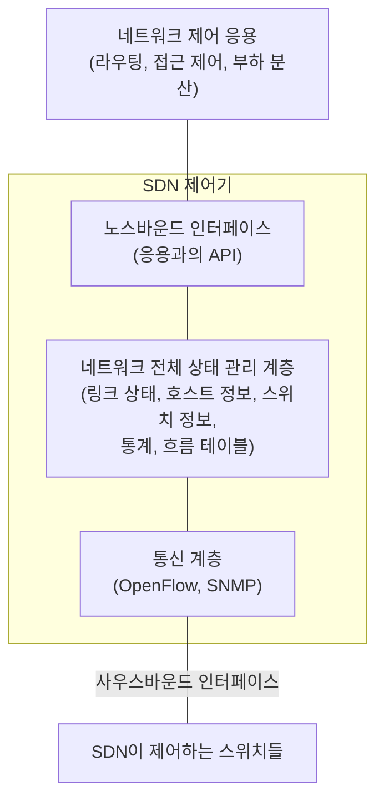

*그림 18. SDN 제어기의 구성 요소*

- **통신 계층:** SDN 제어기와 제어되는 네트워크 장비 사이의 통신을 맡는다. 제어기가 원격 스위치나 호스트를 제어하려면 정보를 주고받을 프로토콜이 필요하다. 또 장비는 국지적으로 관찰한 사건(링크가 올라가거나 내려감, 장비가 막 네트워크에 들어옴, 장비가 동작 중임을 알리는 heartbeat)을 제어기에 알릴 수 있어야 하며, 이 사건들이 제어기에 네트워크 상태의 최신 모습을 준다. 제어기와 장비 사이의 이 통신은 제어기의 **사우스바운드(southbound) 인터페이스**를 지난다. 6.3절의 OpenFlow가 이 기능을 제공하는 대표적 프로토콜이다.
- **네트워크 전체 상태 관리 계층:** 원하는 종단 간 포워딩, 부하 분산, 특정한 방화벽 기능을 이루기 위해 모든 스위치의 흐름 테이블을 구성하는 것 같은 제어 결정에는 네트워크의 호스트, 링크, 스위치를 비롯한 SDN 장비의 최신 상태 정보가 필요하다. 스위치의 흐름 테이블에 있는 카운터 값도 네트워크 제어 응용이 유용하게 쓸 수 있다. 제어 평면의 최종 목표가 장비의 흐름 테이블을 정하는 것이므로 제어기는 이 테이블의 사본도 유지할 수 있다. 이 정보들이 모두 SDN 제어기가 유지하는 네트워크 전체의 상태이다.
- **네트워크 제어 응용 계층과의 인터페이스:** 제어기는 **노스바운드(northbound) 인터페이스**로 네트워크 제어 응용과 상호작용한다. 이 API로 응용은 상태 관리 계층의 네트워크 상태와 흐름 테이블을 읽고 쓸 수 있다. 응용은 상태 변화 사건이 일어날 때 통지를 받도록 등록하여, SDN 장비가 보낸 사건 통지에 대응할 수 있다. 여러 종류의 API를 제공할 수 있으며, 대표적인 두 SDN 제어기는 REST 요청 응답 인터페이스로 응용과 통신한다.

SDN 제어기는 외부(SDN 장비와 외부 네트워크 제어 응용)에서 보면 하나의 단일한 서비스로 볼 수 있다는 의미에서 논리적으로 중앙 집중되어 있다. 그러나 이 서비스와 상태 정보를 담는 데이터베이스는 장애 허용, 높은 가용성, 성능을 위해 실제로는 여러 서버에 분산되어 구현된다. 제어기 기능을 여러 서버로 구현하면 제어기 내부 동작의 의미(사건의 논리적 시간 순서, 일관성, 합의 등)를 고려해야 한다.

> **[분산시스템]** 논리적으로 중앙 집중되었지만 물리적으로 분산된 제어기는 분산 시스템의 고전적 문제를 그대로 안는다. 여러 서버가 같은 네트워크 상태를 복제하여 가질 때 사건의 순서를 맞추고, 복제본 사이의 일관성을 유지하고, 일부 서버가 고장 나도 하나의 결정에 합의하는 문제이며, Paxos 같은 합의 알고리즘이 이를 다룬다.

### 6.3 OpenFlow 프로토콜

OpenFlow 프로토콜은 SDN 제어기와, SDN이 제어하는 스위치나 OpenFlow API(24장)를 구현한 장비 사이에서 동작한다. OpenFlow는 TCP 위에서 동작하며 기본 포트 번호는 6653이다.

| 방향 | 메시지 | 역할 |
|:-----|:-----|:-----|
| 제어기 → 스위치 | Configuration | 제어기가 스위치의 구성 매개변수를 질의하고 설정한다. |
| 제어기 → 스위치 | Modify-State | 스위치의 흐름 테이블 항목을 추가, 삭제, 수정하고 포트 속성을 설정한다. |
| 제어기 → 스위치 | Read-State | 스위치의 흐름 테이블과 포트에서 통계와 카운터 값을 모은다. |
| 제어기 → 스위치 | Send-Packet | 스위치의 지정한 포트로 특정 패킷을 내보낸다. 보낼 패킷은 메시지의 페이로드에 담긴다. |
| 스위치 → 제어기 | Flow-Removed | 시간 초과나 Modify-State 메시지 때문에 흐름 테이블 항목이 삭제되었음을 알린다. |
| 스위치 → 제어기 | Port-status | 포트 상태의 변화를 알린다. |
| 스위치 → 제어기 | Packet-in | 어떤 흐름 테이블 항목과도 일치하지 않은 패킷을 추가 처리를 위해 제어기로 보낸다. 일치한 패킷도 그 일치의 동작으로 제어기에 보낼 수 있다. |

*표 11. 주요 OpenFlow 메시지*

### 6.4 데이터 평면과 제어 평면의 상호작용: 링크 장애의 예

SDN이 제어하는 스위치와 SDN 제어기가 어떻게 상호작용하는지 예로 본다. 최단 경로를 정하는 데 Dijkstra 알고리즘을 쓰지만, 모든 라우터에서 Dijkstra 알고리즘을 실행하고 링크 상태 갱신을 모든 라우터에 플러딩하던 14장과 OSPF의 라우터별 제어와는 두 가지가 다르다.

- Dijkstra 알고리즘은 패킷 스위치 밖에서 별도의 응용으로 실행된다.
- 패킷 스위치는 링크 갱신을 서로에게가 아니라 SDN 제어기에 보낸다.

스위치 s1, s2, s3, s4가 서로 연결된 네트워크에서 s1과 s2 사이의 링크가 끊겼다고 하자. 최단 경로 라우팅을 쓰므로 s1, s3, s4의 들어오고 나가는 흐름 포워딩 규칙은 영향을 받지만 s2의 동작은 바뀌지 않는다고 하자. 통신 계층 프로토콜로 OpenFlow를 쓰고, 제어 평면은 링크 상태 라우팅 말고는 다른 기능을 하지 않는다고 가정한다.

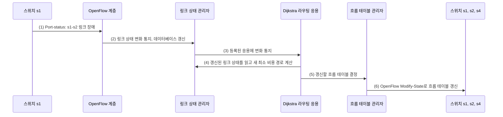

*그림 19. SDN 제어기의 링크 상태 변화 처리*

1. s1과 s2 사이의 링크 장애를 겪은 스위치 s1이 OpenFlow의 Port-status 메시지로 SDN 제어기에 링크 상태 변화를 알린다.
2. 링크 상태 변화를 알리는 OpenFlow 메시지를 받은 SDN 제어기는 링크 상태 관리자에게 알리고, 링크 상태 관리자는 링크 상태 데이터베이스를 갱신한다.
3. Dijkstra 링크 상태 라우팅을 구현한 네트워크 제어 응용은 미리 링크 상태가 바뀔 때 통지를 받도록 등록해 두었으므로 링크 상태 변화 통지를 받는다.
4. 링크 상태 라우팅 응용은 링크 상태 관리자와 상호작용하여 갱신된 링크 상태를 얻는다. 상태 관리 계층의 다른 구성 요소도 참고할 수 있다. 그런 다음 새 최소 비용 경로를 계산한다.
5. 링크 상태 라우팅 응용은 흐름 테이블 관리자와 상호작용하고, 흐름 테이블 관리자는 갱신할 흐름 테이블을 정한다.
6. 흐름 테이블 관리자는 OpenFlow 프로토콜로 영향을 받는 스위치의 흐름 테이블 항목을 갱신한다. s1은 이제 s2행 패킷을 s4를 거쳐 보내고, s2는 이제 중간 스위치 s4를 거쳐 s1의 패킷을 받기 시작하며, s4는 s1에서 s2로 가는 패킷을 전달해야 한다.

> **참고:** Kurose와 Ross는 이 예의 상황을 설정할 때 규칙이 영향을 받는 스위치를 s1, s3, s4로, 동작이 바뀌지 않는 스위치를 s2로 들지만, 마지막 단계에서는 s1, s2, s4를 갱신한다. 어느 스위치의 규칙이 바뀌는지는 두 저자가 제시하지 않은 토폴로지와 링크 비용에 달려 있으며, 위의 6단계와 그림 19는 그 마지막 단계를 따른다.

이 예는 단순하지만, 예전에는 모든 라우터의 라우터별 제어로 구현하던 제어 평면 서비스(여기서는 네트워크 계층 라우팅)를 SDN 제어 평면이 어떻게 제공하는지 보여 준다. 제어기는 흐름 테이블을 원하는 대로 정할 수 있으므로, 응용 제어 소프트웨어만 바꾸면 최소 비용 경로 라우팅에서 손으로 맞춘 다른 라우팅 방식으로 쉽게 바꿀 수 있다. 반면 전통적인 라우터별 제어 평면에서는 여러 업체가 공급했을 수 있는 모든 라우터의 소프트웨어를 바꾸어야 한다.

### 6.5 SDN의 과거, 현재, 미래

SDN에 대한 높은 관심은 비교적 최근의 일이지만, 데이터 평면과 제어 평면의 분리라는 기술적 뿌리는 훨씬 오래되었다. 2004년에 이미 여러 연구가 네트워크의 데이터 평면과 제어 평면을 분리하자고 주장했고, 그보다 앞서 여러 제어기가 각각 여러 ATM 스위치를 제어하는 제어 프레임워크도 제안되었다. Ethane 프로젝트는 일치 동작 흐름 테이블을 가진 단순한 흐름 기반 이더넷 스위치들, 흐름의 허용과 라우팅을 관리하는 중앙 제어기, 일치하지 않는 패킷을 스위치에서 제어기로 보내는 방식을 처음 선보였으며, 2007년에 300개가 넘는 Ethane 스위치로 이루어진 네트워크가 운영되었다. Ethane은 곧 OpenFlow 프로젝트로 발전했다.

초기에는 SDN 프로토콜이 OpenFlow 하나, SDN 제어기가 NOX 하나뿐이었지만, 이후 SDN 제어기의 수가 크게 늘었다. OpenDaylight와 ONOS가 대표적인 오픈 소스 제어기이다.

- **OpenDaylight(ODL):** 주요 구성 요소가 그림 18의 일반적 제어기와 거의 대응한다. 외부 응용은 HTTP 위의 REST API로 제어기 모듈과 통신하고, 내부 응용은 **서비스 추상화 계층(Service Abstraction Layer, SAL)** 으로 서로 통신한다. SAL은 제어기 구성 요소와 응용이 서로의 서비스를 호출하고 사건을 구독하게 하는 제어기의 신경 중추이며, 통신 계층의 OpenFlow, SNMP(17장) 같은 하부 프로토콜에 대한 균일한 추상 인터페이스도 제공한다.
- **ONOS:** 세 계층으로 구성된다. 노스바운드 추상화는 응용이 서비스의 세부를 몰라도 호스트 A와 B 사이에 연결을 만들라는 식의 고수준 서비스를 요청할 수 있는 **인텐트(intent) 프레임워크**가 특징이다. 분산 코어는 링크, 호스트, 장비의 상태를 유지하며, 똑같은 ONOS 소프트웨어를 실행하는 서로 연결된 서버 집합에 서비스로 배치되어 서버를 늘리면 서비스 용량도 늘어난다. 사우스바운드 추상화는 하부의 호스트, 링크, 스위치, 프로토콜의 이질성을 감추어 분산 코어가 장비와 프로토콜에 무관하게 동작하게 한다.

> **참고:** **Google의 B4.** 교재는 SDN이 실제 운영 네트워크에 들어간 사례로 Google이 데이터 센터를 잇는 광역 네트워크 B4를 든다. B4는 OpenFlow 위에 Google이 설계한 SDN 제어 평면을 쓰며, 장기적으로 WAN 링크를 70%에 가까운 이용률로 운영하고, 응용의 우선순위와 흐름 수요에 따라 응용 흐름을 여러 경로로 나눈다. Google이 네트워크의 모든 장비를 통제하고, 대역폭을 가장 많이 쓰는 응용이 우선순위가 높은 대화형 응용에 양보할 수 있는 대규모 데이터 복사이며, 연결하는 데이터 센터가 수십 개 정도라 중앙 제어가 가능하다는 점에서 SDN에 잘 맞는다.

연구는 SDN의 개념을 더 넓히는 방향으로 이어진다. SDN을 일반화한 **네트워크 기능 가상화(network functions virtualization, NFV)** 는 전용 하드웨어와 독점 소프트웨어로 된 정교한 미들박스를 범용 서버, 스위칭, 저장 장치로 대체하려 하며, 또 다른 연구는 SDN의 개념을 AS 내부에서 AS 간으로 넓히려 한다.

---

<br>

## 개념 적용

**T/F 점검:**

| 문장 | 판단과 근거 |
|:-----|:-----|
| 하나의 자율 시스템 안의 라우터들은 같은 AS 내부 라우팅 알고리즘을 실행한다. | **T.** AS는 같은 관리 주체 아래의 라우터 모임이며, 그 안의 라우터들은 같은 라우팅 알고리즘을 실행하고 서로에 관한 정보를 가진다. |
| RIP에서 라우터에 직접 연결된 네트워크까지의 홉 수는 0이다. | **F.** RIP는 지나야 하는 네트워크의 수를 세므로 직접 연결된 네트워크까지의 홉 수는 1이다. |
| RIP의 만료 타이머가 끝난 경로는 곧바로 테이블에서 지워진다. | **F.** 홉 수를 16으로 바꾸어 계속 광고하고, 120초의 가비지 수집 타이머가 끝난 뒤에 지운다. |
| OSPF는 신뢰적 전송을 TCP에 맡긴다. | **F.** OSPF는 프로토콜 번호 89로 IP에 직접 실리므로 확인 응답 같은 신뢰적 전송 기능을 스스로 구현한다. |
| OSPF의 경유 네트워크에서는 지정 라우터가 네트워크를 대표하여 네트워크 링크 LSA를 광고한다. | **T.** 지정 라우터가 네트워크에 붙은 모든 라우터의 주소를 담은 네트워크 링크 LSA를 보낸다. |
| BGP의 경로 선택에서는 핫 포테이토 규칙이 AS-PATH 길이보다 먼저 적용된다. | **F.** 지역 선호도, 가장 짧은 AS-PATH, 가장 가까운 NEXT-HOP(핫 포테이토), BGP 식별자 순으로 적용한다. |
| 다중 홈 고객 AS는 두 제공자 사이의 경유 트래픽을 나르지 않으려면 자기 말고 다른 목적지로의 경로를 광고하지 않으면 된다. | **T.** 이웃이 그 AS를 거치는 경로를 모르면 그 AS를 거쳐 트래픽을 보내지 않는다. |
| SDN에서 제어 에이전트는 다른 스위치의 제어 에이전트와 링크 상태를 직접 교환한다. | **F.** 스위치는 링크 갱신을 서로에게가 아니라 SDN 제어기에 보내며, 경로 계산은 제어기 위의 응용이 한다. |

---

<br>

## 요약

| 개념 | 핵심 요약 |
|:-----|:-----|
| 자율 시스템 | 규모와 관리 자율성 때문에 라우터를 같은 관리 주체 아래의 AS로 묶으며, AS는 ASN으로 식별한다. |
| AS 내부와 AS 간 라우팅 | AS 안은 RIP나 OSPF 같은 내부 프로토콜이, AS 사이는 모든 AS가 실행하는 BGP가 담당한다. |
| RIP | 홉 수를 메트릭으로 쓰고 무한대를 16으로 정의한 거리 벡터 프로토콜이며, UDP 포트 520으로 30초마다 갱신을 보낸다. |
| RIP 타이머 | 25\~35초의 주기 타이머, 180초의 만료 타이머, 120초의 가비지 수집 타이머로 갱신과 경로의 유효성을 관리한다. |
| RIP 버전 2 | 서브넷 마스크, 다음 홉, 경로 태그 필드를 더해 CIDR을 지원하고, 인증과 멀티캐스트 전송을 쓴다. |
| OSPF | 링크 상태를 플러딩하고 Dijkstra 알고리즘으로 최단 경로 트리를 만들며, IP 프로토콜 번호 89로 직접 실린다. |
| OSPF 영역 | AS를 영역으로 나누어 플러딩을 영역 안으로 한정하고, 영역 사이의 트래픽은 영역 0인 백본을 거친다. |
| OSPF 링크와 LSA | 점대점, 경유, 스텁, 가상 링크가 있고, 경유 네트워크는 지정 라우터로 나타내며, LSA는 라우터, 네트워크, 두 종류의 요약, 외부 링크의 다섯 종류이다. |
| 경로 벡터 라우팅 | 네트워크마다 지나야 할 AS의 목록을 교환하며, 자기 AS가 들어 있는 경로를 버려 루프를 막고 정책을 적용한다. |
| BGP 광고 | 라우터는 TCP 포트 179의 eBGP와 iBGP 연결로 접두사와 AS-PATH, NEXT-HOP 같은 속성을 광고한다. |
| BGP 경로 선택 | 지역 선호도, 가장 짧은 AS-PATH, 가장 가까운 NEXT-HOP(핫 포테이토), BGP 식별자의 순서로 경로를 고른다. |
| IP 애니캐스트 | 여러 서버에 같은 주소를 주고 BGP로 광고하여 요청을 가장 가까운 서버로 보내며, DNS 루트 서버가 이를 쓴다. |
| 라우팅 정책 | 고객 AS는 자기 말고 다른 경로를 광고하지 않고, 제공자는 고객이 관련되지 않은 경유 경로를 다른 제공자에게 광고하지 않는다. |
| SDN 제어 평면 | 흐름 기반 포워딩, 평면의 분리, 스위치 밖의 제어 기능, 프로그래밍할 수 있는 네트워크가 특징이며, 제어기는 통신, 상태 관리, 노스바운드 인터페이스의 세 계층으로 이루어진다. |
| OpenFlow | TCP 포트 6653으로 제어기와 스위치가 Modify-State, Read-State, Port-status, Packet-in 같은 메시지를 주고받는다. |

---

<br>

## 점검 문제

1. **RIP 경로의 수명:** RIP 라우터가 어떤 경로의 갱신을 마지막으로 받은 뒤 아무 소식이 없다. 그 경로가 언제 도달 불가로 표시되고, 언제 테이블에서 지워지는가? 그 사이에 라우터가 하는 일은 무엇인가?

   <details>
   <summary>정답</summary>

   마지막 갱신 때 그 경로의 만료 타이머가 180초로 설정되므로, 180초 동안 새 갱신이 없으면 경로가 만료되어 홉 수가 16(도달 불가)으로 바뀐다. 이때 가비지 수집 타이머가 120초로 설정되며, 그동안 라우터는 이 경로를 메트릭 16으로 계속 광고하여 이웃이 경로가 무효임을 알게 한다. 가비지 수집 타이머가 끝나는 시점, 곧 마지막 갱신으로부터 300초 뒤에 경로를 테이블에서 지운다.

   </details>

2. **OSPF 영역:** OSPF가 자율 시스템을 영역으로 나누면 플러딩의 부담이 왜 줄어드는가? 다른 영역의 네트워크로 가는 패킷은 어떤 경로를 거치는가?

   <details>
   <summary>정답</summary>

   영역 안의 라우터는 링크 상태 정보를 자기 영역 안에만 플러딩하므로, 한 링크의 변화가 자율 시스템 전체가 아니라 그 영역의 라우터에만 퍼진다. 다른 영역에 관해서는 영역 경계 라우터가 요약한 정보(네트워크로의 요약 링크 LSA)만 받으므로 각 라우터가 저장하고 계산할 토폴로지도 작아진다. 다른 영역의 네트워크로 가는 패킷은 먼저 영역 안의 라우팅으로 영역 경계 라우터까지 가고, 백본(영역 0)을 거쳐 목적지 영역의 영역 경계 라우터로 간 뒤, 그 영역 안에서 목적지로 간다.

   </details>

3. **BGP 경로 선택:** 한 라우터가 같은 접두사로 가는 세 경로를 배웠다. 경로 A는 지역 선호도 100, AS-PATH 길이 3, NEXT-HOP까지의 AS 내부 비용 2이고, 경로 B는 지역 선호도 100, AS-PATH 길이 2, 비용 5이며, 경로 C는 지역 선호도 80, AS-PATH 길이 1, 비용 1이다. BGP 경로 선택 알고리즘은 어느 경로를 고르는가? 핫 포테이토 라우팅만 쓰면 어느 경로를 고르는가?

   <details>
   <summary>정답</summary>

   규칙 1에서 지역 선호도가 가장 큰 경로 A와 B가 남고 C는 AS-PATH가 가장 짧은데도 제외된다. 규칙 2에서 AS-PATH가 더 짧은 B가 남으므로 B를 고른다. 핫 포테이토 라우팅만 쓰면 NEXT-HOP까지의 AS 내부 비용이 가장 작은 C(비용 1)를 고른다. 정책(지역 선호도)이 경로 길이와 AS 내부 비용보다 먼저 적용된다는 점이 핵심이다.

   </details>

4. **다중 홈 고객의 광고:** 그림 16에서 고객 X는 C를 거쳐 Y로 가는 경로 XCY를 안다. X는 B에게 무엇을 광고해야 하며, 그 이유는 무엇인가? 제공자 B가 A에게서 배운 경로 BAW를 C에게 광고하지 않는 이유도 설명하라.

   <details>
   <summary>정답</summary>

   X는 B와 C에게 자기 자신(X의 접두사)으로 가는 경로만 광고하고 XCY 같은 다른 목적지로의 경로는 광고하지 않는다. B가 X를 거쳐 Y나 C로 갈 수 있다는 사실을 모르면 B는 그런 트래픽을 X로 보내지 않으므로, X는 B와 C 사이의 경유 트래픽을 나르지 않는 접속 ISP로만 동작한다. B는 BAW를 고객 X에게는 광고하지만 다른 제공자 C에게는 광고하지 않는다. 광고하면 C에서 W로 가는 트래픽이 B를 지나게 되는데, 그 트래픽의 출발지도 목적지도 B의 고객이 아니므로 B의 네트워크를 대가 없이 이용하게 되기 때문이다.

   </details>

5. **SDN의 링크 장애 처리:** SDN에서 스위치 s1과 s2 사이의 링크가 끊겼을 때 흐름 테이블이 갱신되기까지 오가는 메시지와 동작을 순서대로 쓰라. 라우터별 제어의 OSPF와 비교하여 무엇이 다른가?

   <details>
   <summary>정답</summary>

   (1) s1이 OpenFlow Port-status 메시지로 제어기에 링크 장애를 알린다. (2) 제어기가 링크 상태 관리자에게 알려 링크 상태 데이터베이스를 갱신한다. (3) 통지를 받도록 등록한 Dijkstra 라우팅 응용이 변화 통지를 받는다. (4) 응용이 갱신된 링크 상태를 읽어 새 최소 비용 경로를 계산한다. (5) 응용이 흐름 테이블 관리자와 함께 갱신할 흐름 테이블을 정한다. (6) 흐름 테이블 관리자가 OpenFlow Modify-State 메시지로 s1, s2, s4의 흐름 테이블을 갱신한다. OSPF에서는 각 라우터가 링크 상태를 다른 모든 라우터에 플러딩하고 각자 Dijkstra 알고리즘을 실행하지만, SDN에서는 스위치가 제어기에만 알리고 경로 계산은 스위치 밖의 응용 하나가 한다.

   </details>

6. **RIP와 포이즌 리버스:** 그림 3에서 R4가 R1에게 보내는 갱신 메시지를 스플릿 호라이즌과 포이즌 리버스를 적용하여 쓰라.

   <details>
   <summary>정답</summary>

   R4의 테이블에서 R1(130.11.0.2)을 다음 홉으로 하는 경로는 130.10.0.0/16, 195.2.4.0/24, 195.2.5.0/24, 195.2.6.0/24이므로 이 네 경로의 홉 수는 16으로 바꾸어 보낸다. 나머지는 실제 값이다. 따라서 메시지는 130.10.0.0 16, 130.11.0.0 1, 195.2.4.0 16, 195.2.5.0 16, 195.2.6.0 16, 205.5.5.0 1, 205.5.6.0 1이다. R1은 각 값에 1을 더해 205.5.5.0과 205.5.6.0은 비용 2, 다음 홉 130.11.0.1로 계산하고, 16인 항목으로는 R4를 거치는 경로를 받아들이지 않는다.

   </details>

7. **경로 벡터의 루프 방지와 집약:** AS2의 라우터가 AS1에게서 "201.2.0.0/22, 경로 AS1, AS2, AS3"이라는 광고를 받았다. AS2의 라우터는 이 광고를 어떻게 처리하는가? 또 표 8의 집약 항목 201.2.0.0/22가 AS1에 없는 201.2.3.0/24를 포함해도 라우팅이 올바른 이유를 설명하라.

   <details>
   <summary>정답</summary>

   경로 목록에 자기 AS인 AS2가 들어 있으므로 루프가 생긴 것으로 보고 그 네트워크와 경로의 쌍을 버린다. 201.2.3.0/24가 다른 AS에 실제로 있다면 그 네트워크는 결국 별도의 항목으로 라우팅 테이블에 들어온다. 포워딩은 최장 접두사 일치를 따르므로 201.2.3.0/24 안의 주소에는 /22보다 긴 /24 항목이 먼저 일치하여 그 AS로 보내진다.

   </details>
