# Chapter 15 — Internet Routing Protocols

[Repository Guide](../../README.md) | [English](Concepts_Lecture.md) | [한국어](Concepts_Lecture.ko.md)

> **Last Updated:** 2026-11-18
>
> Computer Networking: A Top-Down Approach, Kurose and Ross, Ch 5; TCP/IP Protocol Suite, Forouzan, Ch 11

> **Learning Objectives:**
> 1. Explain, in terms of scale and administrative autonomy, why routing is divided into autonomous systems, and distinguish intra-AS routing from inter-AS routing
> 2. Explain the metric, messages, and timers of RIP and the improvements of RIP version 2
> 3. Explain the area structure of OSPF, its link types, and its packet and link state advertisement types
> 4. Apply the principle of path-vector routing and BGP's route advertisement, path attributes, and route-selection algorithm
> 5. Explain how BGP advertisement policies implement customer and provider relationships
> 6. Explain the components of the SDN control plane and the roles of OpenFlow messages

---

## Table of Contents

- [1. Autonomous Systems and Hierarchical Routing](#1-autonomous-systems-and-hierarchical-routing)
  - [1.1 Why One Routing Algorithm Is Not Enough](#11-why-one-routing-algorithm-is-not-enough)
  - [1.2 Autonomous Systems](#12-autonomous-systems)
  - [1.3 Intra-AS Routing and Inter-AS Routing](#13-intra-as-routing-and-inter-as-routing)
- [2. RIP](#2-rip)
  - [2.1 Characteristics of RIP](#21-characteristics-of-rip)
  - [2.2 An Example RIP Domain](#22-an-example-rip-domain)
  - [2.3 RIP Message Format](#23-rip-message-format)
  - [2.4 Requests and Responses](#24-requests-and-responses)
  - [2.5 RIP Timers](#25-rip-timers)
  - [2.6 RIP Version 2](#26-rip-version-2)
  - [2.7 Encapsulation](#27-encapsulation)
- [3. OSPF](#3-ospf)
  - [3.1 Overview of OSPF](#31-overview-of-ospf)
  - [3.2 Advantages of OSPF](#32-advantages-of-ospf)
  - [3.3 Areas](#33-areas)
  - [3.4 Metric](#34-metric)
  - [3.5 Types of Links](#35-types-of-links)
  - [3.6 OSPF Packets and the Common Header](#36-ospf-packets-and-the-common-header)
  - [3.7 Link State Update Packets and Link State Advertisements](#37-link-state-update-packets-and-link-state-advertisements)
  - [3.8 Other Packets](#38-other-packets)
  - [3.9 Encapsulation](#39-encapsulation)
- [4. Path-Vector Routing](#4-path-vector-routing)
  - [4.1 Why Path-Vector Routing Is Needed](#41-why-path-vector-routing-is-needed)
  - [4.2 Reachability](#42-reachability)
  - [4.3 Path-Vector Routing Tables](#43-path-vector-routing-tables)
  - [4.4 Loop Prevention, Aggregation, and Policy Routing](#44-loop-prevention-aggregation-and-policy-routing)
- [5. BGP](#5-bgp)
  - [5.1 The Role of BGP](#51-the-role-of-bgp)
  - [5.2 Advertising BGP Route Information](#52-advertising-bgp-route-information)
  - [5.3 Path Attributes: AS-PATH and NEXT-HOP](#53-path-attributes-as-path-and-next-hop)
  - [5.4 Hot Potato Routing](#54-hot-potato-routing)
  - [5.5 The Route-Selection Algorithm](#55-the-route-selection-algorithm)
  - [5.6 IP Anycast](#56-ip-anycast)
  - [5.7 Routing Policy](#57-routing-policy)
  - [5.8 BGP Messages](#58-bgp-messages)
  - [5.9 Obtaining Internet Presence](#59-obtaining-internet-presence)
  - [5.10 Why Intra-AS and Inter-AS Routing Use Different Protocols](#510-why-intra-as-and-inter-as-routing-use-different-protocols)
- [6. The SDN Control Plane](#6-the-sdn-control-plane)
  - [6.1 Four Characteristics of the SDN Architecture](#61-four-characteristics-of-the-sdn-architecture)
  - [6.2 The SDN Controller and Network-Control Applications](#62-the-sdn-controller-and-network-control-applications)
  - [6.3 The OpenFlow Protocol](#63-the-openflow-protocol)
  - [6.4 Data-Plane and Control-Plane Interaction: A Link Failure Example](#64-data-plane-and-control-plane-interaction-a-link-failure-example)
  - [6.5 SDN: Past, Present, and Future](#65-sdn-past-present-and-future)
- [Concept Applications](#concept-applications)
- [Summary](#summary)
- [Self-Check Questions](#self-check-questions)

---

<br>

## 1. Autonomous Systems and Hierarchical Routing

### 1.1 Why One Routing Algorithm Is Not Enough

Chapter 14 viewed the network simply as a collection of interconnected routers. All routers ran the same routing algorithm to compute paths through the entire network, so there was no reason to distinguish one router from another. However, the model of a homogeneous set of routers all running the same algorithm is too simple for the real Internet, for two reasons.

- **Scale:** As the number of routers grows, the overhead of exchanging, computing, and storing routing information becomes prohibitive. Today's Internet consists of hundreds of millions of routers. Storing routing information for every possible destination at each router would require enormous memory, and the overhead of broadcasting connectivity and link-cost updates among all routers would be huge. A distance-vector algorithm iterating among so many routers would never converge.
- **Administrative autonomy:** As seen in Chapter 1, the Internet is a network of ISPs, and each ISP has its own network of routers. An ISP generally wants to operate its network as it pleases (for example, to run whatever routing algorithm it chooses inside) and to hide aspects of its internal organization from the outside. An organization should be able to operate its network as it wishes while still connecting to outside networks.

### 1.2 Autonomous Systems

Both problems are solved by grouping routers into **autonomous systems (ASs)**.

> **Definition:** An **autonomous system (AS)** is a group of networks and routers under the authority of a single administration, whose routers all run the same routing algorithm and have information about each other.

Often the routers of one ISP and the links that interconnect them form a single AS. Some ISPs, however, split their network into several ASs: some tier-1 ISPs run their entire network as one gigantic AS, whereas others break it into tens of interconnected ASs. A large corporation can also operate its network as one AS. An AS is identified by its globally unique **autonomous system number (ASN)**, which, like IP addresses, is assigned by ICANN's regional registries.

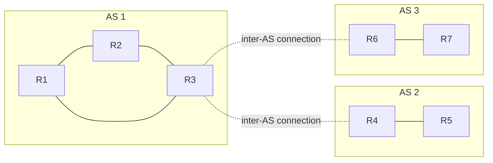

*Figure 1. The Internet divided into autonomous systems*

### 1.3 Intra-AS Routing and Inter-AS Routing

> **Definition:** **Intra-AS routing** is routing that determines paths between routers within one autonomous system, and a protocol that performs it is called an intra-AS routing protocol or interior gateway protocol.

> **Definition:** **Inter-AS routing** is routing that determines paths between different autonomous systems; because it requires the cooperation of several ASs, communicating ASs must run the same inter-AS routing protocol.

Each AS may choose one or more intra-AS protocols for routing inside itself. Routing between ASs, however, is handled by a single inter-AS protocol, and every AS in the Internet uses BGP. This chapter covers RIP, which implements distance vector, and OSPF, which implements link state, as intra-AS protocols, and BGP, which implements path vector, as the inter-AS protocol. RIP and OSPF are **interior routing protocols**, and BGP is an **exterior routing protocol**.

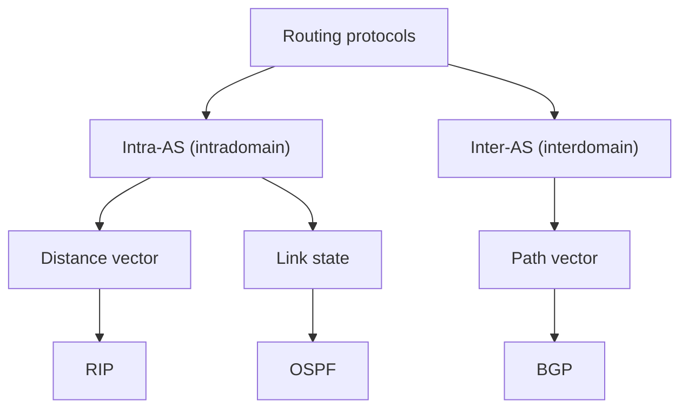

*Figure 2. Classification of the main routing protocols*

---

<br>

## 2. RIP

### 2.1 Characteristics of RIP

> **Definition:** **RIP (Routing Information Protocol)** is a simple intra-AS routing protocol based on distance-vector routing that uses hop count as its metric.

RIP implements the distance-vector routing of Chapter 14 directly, with the following considerations.

1. In an autonomous system, the objects involved are routers and networks (links).
2. The destination in a routing table is a network, so the first column holds network addresses.
3. The metric is very simple. Distance is defined as the number of links (networks) that must be passed to reach the destination, which is why the RIP metric is called the **hop count**. The hop count to a network directly attached to a router is 1.
4. Infinity is defined as 16, so no route in an autonomous system using RIP can have more than 15 hops.
5. The next-node column holds the address of the router to which a packet must be sent to reach its destination.

### 2.2 An Example RIP Domain

Figure 3 is an autonomous system with seven networks and four routers. The address beside each link is the IP address of the router interface attached to that network.

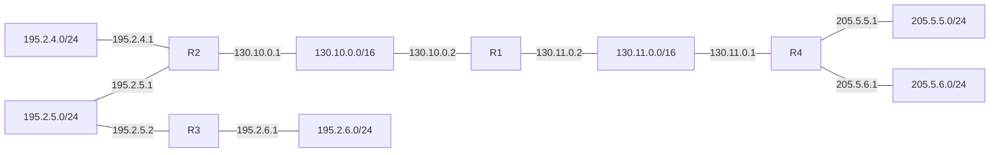

*Figure 3. An example autonomous system using RIP*

Look at the routing table of R1. It has seven entries describing how to reach the seven networks of the autonomous system. R1 is directly connected to 130.10.0.0 and 130.11.0.0, so these two networks have no next hop. To send a packet to one of the three networks on the left, R1 must hand it to R2, so the next hop for these three networks is R2's interface address 130.10.0.1. To send to the two networks on the right, R1 hands the packet to R4's interface address 130.11.0.1.

| Destination | R1 | R2 | R3 | R4 |
|:-----|:-----|:-----|:-----|:-----|
| 130.10.0.0/16 | 1 | 1 | 2, 195.2.5.1 | 2, 130.11.0.2 |
| 130.11.0.0/16 | 1 | 2, 130.10.0.2 | 3, 195.2.5.1 | 1 |
| 195.2.4.0/24 | 2, 130.10.0.1 | 1 | 2, 195.2.5.1 | 3, 130.11.0.2 |
| 195.2.5.0/24 | 2, 130.10.0.1 | 1 | 1 | 3, 130.11.0.2 |
| 195.2.6.0/24 | 3, 130.10.0.1 | 2, 195.2.5.2 | 1 | 4, 130.11.0.2 |
| 205.5.5.0/24 | 2, 130.11.0.1 | 3, 130.10.0.2 | 4, 195.2.5.1 | 1 |
| 205.5.6.0/24 | 2, 130.11.0.1 | 3, 130.10.0.2 | 4, 195.2.5.1 | 1 |

*Table 1. RIP routing tables of the routers in Figure 3 (hop count, next hop)*

### 2.3 RIP Message Format

```text
 0               8               16                              31
+---------------+---------------+-------------------------------+
|    Command    |    Version    |           Reserved            |
+---------------+---------------+-------------------------------+
|            Family             |            All 0s             |  ┐
+-------------------------------+-------------------------------+  │
|                        Network address                        |  │
+---------------------------------------------------------------+  │ repeated
|                            All 0s                             |  │ for each
+---------------------------------------------------------------+  │ destination
|                            All 0s                             |  │
+---------------------------------------------------------------+  │
|                           Distance                            |  ┘
+---------------------------------------------------------------+
```

*Figure 4. RIP message format*

- **Command (8 bits):** The message type: 1 for request and 2 for response.
- **Version (8 bits):** The version. Version 1 is assumed here, and Section 2.6 covers the new features of version 2.
- **Family (16 bits):** The protocol family used; for TCP/IP the value is 2.
- **Network address:** The address of the destination network. RIP allocates 14 bytes so that it can be used with any protocol, but IP uses only 4 bytes and fills the rest with 0s.
- **Distance (32 bits):** The hop count (cost) from the advertising router to the destination network.

The lower part of the message is repeated for each destination network, and this repeated part is called an **entry**.

### 2.4 Requests and Responses

RIP has two types of messages: request and response.

- **Request:** Sent by a router that has just come up or by a router that has timed-out entries. A request can ask about specific entries (with the destination network addresses filled in) or about all entries (with the address fields all 0s).
- **Response:** Either a **solicited response**, sent in answer to a request, or an **unsolicited response**, sent every 30 seconds or when the routing table changes. A response carries information about the destinations concerned and is also called an **update packet**.

Suppose that in Figure 3 R1 prepares the update message it sends to R2 out of interface 130.10.0.2. R1 applies split horizon combined with poisoned reverse (Chapter 14). R1 obtained its information about 195.2.4.0, 195.2.5.0, and 195.2.6.0 from R2, so in the message to R2 it replaces the hop counts of these three networks with 16 (infinity) instead of their actual values, to prevent any confusion at R2.

| Destination in the message | Hop count in the message | Hop count computed by R2 |
|:-----|:-----|:-----|
| 130.10.0.0 | 1 | 2 |
| 130.11.0.0 | 1 | 2 |
| 195.2.4.0 | 16 | 16 (unreachable) |
| 195.2.5.0 | 16 | 16 (unreachable) |
| 195.2.6.0 | 16 | 16 (unreachable) |
| 205.5.5.0 | 2 | 3 |
| 205.5.6.0 | 2 | 3 |

*Table 2. RIP update message from R1 to R2*

R2 uses the source address of the IP datagram carrying the RIP message (130.10.0.2) as the next-hop address. Because the values in the message are relative to R1, not R2, R2 also adds 1 to each hop count; 16 plus 1 is still infinity. R2 then compares these values with its own table according to the update rules of Chapter 14. For example, 130.11.0.0 is computed with cost 2 and next hop 130.10.0.2, and 130.10.0.0 does not change because R2 is already directly connected to it (cost 1).

### 2.5 RIP Timers

RIP uses three timers to support its operation.

| Timer | Value | Role |
|:-----|:-----|:-----|
| Periodic timer | A random value between 25 and 35 seconds | Controls when regular update messages are sent. |
| Expiration timer | 180 seconds | Governs the validity of a route. |
| Garbage collection timer | 120 seconds | Gives neighbors time to learn that a route is invalid before it is purged from the table. |

*Table 3. The three RIP timers*

- **Periodic timer:** The specification sets it to 30 seconds, but the working model uses a random value between 25 and 35 seconds. This prevents synchronization, which would overload the internet if all routers sent their updates simultaneously. Each router has one periodic timer; it counts down, sends the update message when it reaches zero, and is set to a random value again.
- **Expiration timer:** When a router receives update information for a route, it sets the expiration timer of that route to 180 seconds, and it resets the timer each time a new update arrives. In normal operation this happens every 30 seconds. If a problem prevents any update from arriving within 180 seconds, however, the route is considered expired and its hop count is set to 16, meaning the destination is unreachable. Every route has its own expiration timer.
- **Garbage collection timer:** When a route becomes invalid, the router does not purge it at once; it keeps advertising the route with metric 16 and at the same time sets the route's garbage collection timer to 120 seconds. When this timer reaches zero, the route is purged from the table. During this time neighbors learn that the route is invalid.

For example, if a routing table has 20 entries and receives no information about five routes for 200 seconds, 21 timers are running at that moment: 1 periodic timer, 15 expiration timers for the 15 routes that are still valid, and 5 garbage collection timers for the five routes that became invalid after 180 seconds.

### 2.6 RIP Version 2

RIP version 2 was designed to overcome some shortcomings of version 1. Without lengthening the message for each entry, it replaced the fields that version 1 filled with 0s for TCP/IP with new fields.

```text
+---------------+---------------+-------------------------------+
|    Command    |    Version    |           Reserved            |
+---------------+---------------+-------------------------------+
|            Family             |           Route tag           |  ┐
+-------------------------------+-------------------------------+  │
|                        Network address                        |  │
+---------------------------------------------------------------+  │ repeated
|                          Subnet mask                          |  │ for each
+---------------------------------------------------------------+  │ destination
|                       Next-hop address                        |  │
+---------------------------------------------------------------+  │
|                           Distance                            |  ┘
+---------------------------------------------------------------+
```

*Figure 5. RIP version 2 message format*

- **Route tag:** Carries information such as the autonomous system number. It is used when RIP takes in information from an interdomain routing protocol.
- **Subnet mask:** A 4-byte field carrying the subnet mask (prefix). Thanks to this field, RIP version 2 supports classless addressing and CIDR.
- **Next-hop address:** The address of the next hop. When two autonomous systems share a network (a backbone, for example), the message can specify the router to which a packet goes next, whether in the same autonomous system or in the other one.

The most important difference between the two versions is classful versus classless addressing. Version 1 carries only the network address, assuming the default mask, so it can use only classful addresses. Version 2 expresses the prefix length with the subnet mask field, so several networks can be combined into one prefix and advertised together (Chapters 12 and 13).

**Authentication:** Authentication was added to protect messages against unauthorized advertisements. Instead of adding new fields, the first entry of the message is set aside for authentication information. To show that this entry carries authentication information rather than routing information, 0xFFFF is placed in the Family field, the next field holds the authentication type, and the remaining 16 bytes hold the actual authentication data.

**Multicasting:** Version 1 sends RIP messages by broadcasting, so all routers on the network, and the hosts as well, receive them. Version 2 sends them to the multicast address for RIP routers (224.0.0.9, in the table of Chapter 16), so only the RIP routers on the network receive them.

### 2.7 Encapsulation

RIP messages are encapsulated in UDP user datagrams. A RIP message has no field for its length; the length is determined from the UDP packet. The well-known UDP port assigned to RIP is 520.

> **Note:** RIP carries routing information over UDP like an application-layer message, but what it changes as a result is the network-layer routing table. Which layer a routing protocol belongs to and which layer's services it uses are separate questions; OSPF is carried directly in IP, and BGP in TCP.

---

<br>

## 3. OSPF

### 3.1 Overview of OSPF

> **Definition:** **OSPF (Open Shortest Path First)** is an openly specified intra-AS routing protocol that floods link-state information and computes least-cost paths with Dijkstra's algorithm.

OSPF and its close cousin IS-IS are widely used for intra-AS routing in the Internet. The Open in OSPF means that the protocol specification is publicly available, and according to the textbook the current version is 2.

OSPF is a link-state protocol that uses flooding of link-state information and Dijkstra's least-cost path algorithm. Each router builds a complete topological map (a graph) of the entire autonomous system and runs Dijkstra's algorithm locally to compute a shortest path tree to all subnets, with itself as the root. Individual link costs are set by the network administrator. The administrator may set all link costs to 1, achieving minimum-hop routing, or set them inversely proportional to link capacity to discourage traffic from using low-bandwidth links. OSPF does not mandate a policy for setting link costs; it provides the mechanism (protocol) for determining least-cost routes for a given set of link costs.

> **Note:** **Setting OSPF link weights.** So far, link weights have been seen as given first, with Dijkstra's algorithm then producing routes that minimize the overall cost. For example, setting weights inversely proportional to link capacity makes high-capacity links more attractive for routing. In practice this cause-and-effect relationship can be reversed. Suppose an operator estimates the traffic entering at each ingress point and leaving at each egress point and wants a specific placement of flows that minimizes the maximum utilization over all links. With OSPF, the operator's main knobs for adjusting routes are the link weights, so the desired flow placement comes first and the operator must find weights that make OSPF produce it. This is called traffic engineering.

With OSPF, a router broadcasts routing information to all other routers in the autonomous system, not just to its neighbors. A router broadcasts link-state information whenever the state of a link (its cost or up/down status) changes, and it also broadcasts periodically, at least once every 30 minutes, even if the state has not changed. The periodic updates add robustness to the link-state algorithm. OSPF advertisements are contained in OSPF messages that are carried directly by IP with upper-layer protocol number 89. OSPF must therefore implement functions such as reliable message transfer and link-state broadcast itself. OSPF checks that links are operational by sending HELLO messages to attached neighbors and allows a router to obtain a neighboring router's database of network-wide link state.

### 3.2 Advantages of OSPF

- **Security:** Exchanges between OSPF routers (link-state updates, for example) can be authenticated. With authentication, only trusted routers can take part in OSPF within an AS, which prevents malicious intruders from injecting incorrect information into router tables. By default, OSPF packets between routers are not authenticated and could be forged. Two types of authentication can be configured.
  - **Simple authentication:** The same password is configured on every router and included in OSPF packets in plaintext. It is not secure.
  - **MD5 authentication:** A shared secret key is configured on all routers. For each OSPF packet it sends, a router computes the MD5 hash of the packet contents appended with the secret key and includes the hash in the packet. The receiving router recomputes the hash with its preconfigured key and compares it with the hash in the packet to verify that the packet has not been forged. Sequence numbers are also used to protect against replay attacks. Message authentication codes are covered in Chapter 26.
- **Multiple same-cost paths:** When several paths to a destination have the same cost, OSPF allows all of them to be used. A single path need not carry all the traffic.
- **Integrated support for unicast and multicast routing:** Multicast OSPF (MOSPF) extends OSPF simply to provide multicast routing. It uses the existing OSPF link database and adds a new type of link-state advertisement to the existing link-state broadcast mechanism.
- **Hierarchy within a single AS:** An OSPF autonomous system can be configured hierarchically into areas, as detailed in Section 3.3.

### 3.3 Areas

> **Definition:** An **OSPF area** is a collection of networks, hosts, and routers within one autonomous system that runs its own link-state routing, so that link-state information is flooded only within the area.

To handle routing efficiently and in a timely manner, OSPF divides an autonomous system into areas. All networks inside an area must be connected. Routers inside an area flood the area with routing information. At the border of an area, **area border routers** summarize the information about the area, send it to other areas, and are responsible for routing packets outside the area.

Exactly one area of the autonomous system is configured as a special area called the **backbone**. All other areas must be connected to the backbone; the backbone is the primary area and the others are secondary areas. This does not mean that routers within areas cannot be connected to each other. The primary role of the backbone is to route traffic between the other areas of the AS. The backbone always contains all area border routers of the AS and may contain non-border routers as well. Routers inside the backbone are called **backbone routers**, and a backbone router can also be an area border router. Each area has an area identification, and the identification of the backbone is 0. If, because of some problem, the connectivity between the backbone and an area is broken, the administrator creates a **virtual link** between routers so that the backbone can continue to function as the primary area.

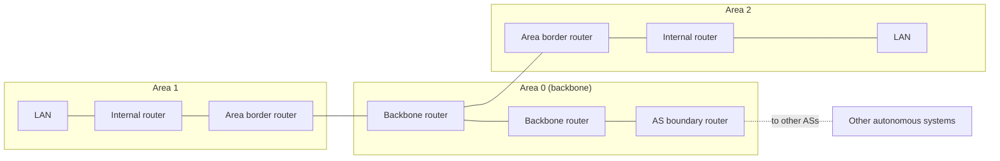

*Figure 6. An OSPF autonomous system divided into areas*

Inter-area routing takes three stages. A packet is first routed within its area to an area border router, then through the backbone to the area border router of the destination area, and finally within that area to the final destination. A router that connects to the outside of the autonomous system is called an **AS boundary router**.

### 3.4 Metric

In OSPF the administrator assigns a cost, called the metric, to each route. The metric can be based on a type of service, such as minimum delay or maximum throughput, and in fact a router can have several routing tables, one for each type of service.

### 3.5 Types of Links

In OSPF a connection is called a **link**, and there are four types.

- **Point-to-point link:** Connects two routers directly, with no other host or router in between. Two routers connected by a telephone line or a T-line are an example. No network address needs to be assigned to this link. In the graph, the two routers are nodes and the link is a bidirectional edge, with the metrics, which are usually the same, shown at the two ends, one for each direction. Each router has only one neighbor at the other side of the link.
- **Transient link:** A network with several routers attached, through which data can enter via any router and leave via any router. All LANs and some WANs with two or more routers are of this type.
- **Stub link:** A network connected to only one router. Data enters the network through this single router and leaves through the same router. It is a special case of the transient network, represented with the router as a node and the network as a designated router, but the link goes in only one direction, from the router to the network.
- **Virtual link:** A link that the administrator creates over a longer path through several routers when the link between two routers is broken.

The representation of a transient link needs care. If five routers A, B, C, D, and E are attached to one Ethernet, A's neighbors are B, C, D, and E, and B's neighbors are A, C, D, and E. Drawing the neighbor relationships as edges between every pair would require each router to advertise its neighborhood to four other routers, 20 advertisements in all, which is not efficient. Nor is it realistic, since there is not a separate network between each pair but a single network serving as a crossroads for all five routers.

The network itself is therefore represented by a node. A network is not a machine, however, and cannot act as a router. One of the routers on the network takes this responsibility and plays a dual role: it is a true router and also the **designated router**.

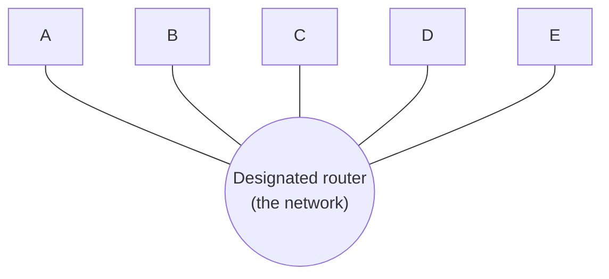

*Figure 7. A transient link represented by a designated router*

Now each router has only one neighbor, the designated router (the network), and the designated router has five neighbors, so the neighbor advertisements drop from 20 to 10. The link is still a bidirectional edge, but there is a metric only from each node to the designated router and none from the designated router to a node, because the designated router represents the network. A cost is charged only once, when a packet enters the network, and not again when it leaves the network for a router.

Let us now see how a whole autonomous system is represented as a graph. Figure 8 shows, as OSPF sees it, a small AS with seven networks and six routers, A to F. Two of the networks are point-to-point links, a T-1 line between A and D and a T-3 line between B and E; they need no identity and appear only as edges between two routers. The other five networks, N1 to N5, are drawn as nodes, each represented by its designated router. N1 and N3 are transient networks with three routers attached, and N2, N4, and N5 are stub networks attached to a single router. OSPF treats routers and networks alike as nodes of the graph, and, as described above, a network node has a metric only on the edges from the routers toward it.

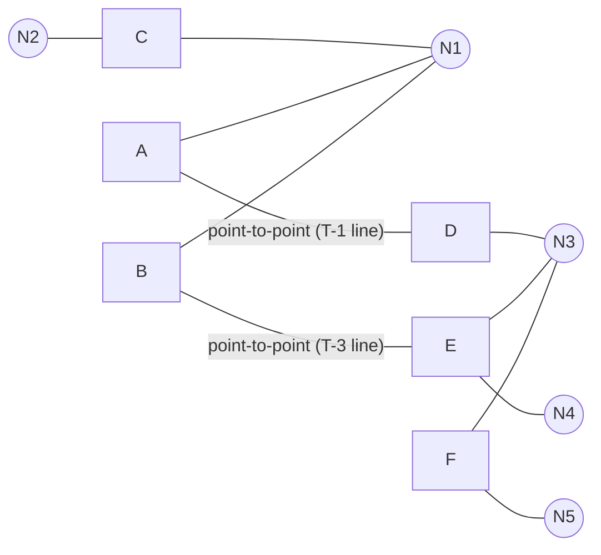

*Figure 8. An autonomous system of seven networks and six routers as represented by OSPF*

### 3.6 OSPF Packets and the Common Header

OSPF uses five types of packets.

| Type | Packet | Role |
|:-----|:-----|:-----|
| 1 | Hello | Creates neighbor relationships and checks that neighbors are alive. |
| 2 | Database description (DBD) | Gives an outline (the title of each entry) of the link-state database. |
| 3 | Link state request (LSR) | Requests full information about specific links. |
| 4 | Link state update (LSU) | Advertises the states of links by carrying link state advertisements. |
| 5 | Link state acknowledgment (LSAck) | Acknowledges receipt of a link state update packet. |

*Table 4. Types of OSPF packets*

All OSPF packets begin with the same common header.

```text
 0              7 8            15 16                             31
+----------------+----------------+-------------------------------+
|    Version     |      Type      |        Message length         |
+----------------+----------------+-------------------------------+
|                   Source router IP address                     |
+----------------------------------------------------------------+
|                      Area identification                       |
+--------------------------------+-------------------------------+
|            Checksum            |      Authentication type      |
+--------------------------------+-------------------------------+
|                    Authentication (64 bits)                    |
|                                                                |
+----------------------------------------------------------------+
```

*Figure 9. OSPF common header*

- **Version (8 bits):** The version of OSPF, currently 2.
- **Type (8 bits):** The packet type, one of 1-5 in Table 4.
- **Message length (16 bits):** The length of the whole message including the header.
- **Source router IP address (32 bits):** The IP address of the router that sent the packet.
- **Area identification (32 bits):** The area within which the routing takes place.
- **Checksum:** For error detection over the whole packet excluding the authentication type and authentication data fields.
- **Authentication type (16 bits):** The authentication protocol used in the area: 0 for none and 1 for password.
- **Authentication (64 bits):** The actual authentication data. If the authentication type is 0, the field is filled with 0s; if it is 1, it carries an eight-character password.

### 3.7 Link State Update Packets and Link State Advertisements

The **link state update packet** is the heart of OSPF operation; a router uses it to advertise the states of its links. After the common header, the packet gives the number of advertisements and carries several **link state advertisements (LSAs)**.

> **Definition:** A **link state advertisement (LSA)** is the unit of information that an OSPF router floods in link state update packets, announcing the state of a router's links, of the routers attached to a network, of networks outside the area, and so on.

All five kinds of LSA share the same general header.

```text
+-------------------------------+---------------+---------------+
|        Link state age         | Reserved|E|T |Link state type|
+-------------------------------+---------------+---------------+
|                         Link state ID                         |
+---------------------------------------------------------------+
|                       Advertising router                      |
+---------------------------------------------------------------+
|                   Link state sequence number                  |
+-------------------------------+-------------------------------+
|      Link state checksum      |            Length             |
+-------------------------------+-------------------------------+
```

*Figure 10. General header of an LSA*

- **Link state age:** The number of seconds elapsed since the message was first generated. The message travels from router to router by flooding; the creating router sets the value to 0, and each forwarding router estimates the transit time and adds it.
- **E flag:** If 1, the area is a stub area, that is, an area connected to the backbone by only one path.
- **T flag:** If 1, the router can handle multiple types of service.
- **Link state type:** The kind of LSA; there are five (Table 5).
- **Link state ID:** Its value depends on the type of link (Table 5).
- **Advertising router:** The IP address of the router advertising the message.
- **Link state sequence number:** The sequence number assigned to each link state update message.
- **Link state checksum:** Not the usual checksum, but a value computed with Fletcher's checksum over the whole packet except the age field.
- **Length:** The length of the whole packet in bytes.

| Type | LSA | Who advertises it | Content | Link state ID |
|:-----|:-----|:-----|:-----|:-----|
| 1 | Router link | Every router | All its links and what is at the other side (neighbors) | IP address of the router |
| 2 | Network link | Designated router of a transient network | All routers attached to the network | IP address of the designated router |
| 3 | Summary link to network | Area border router | Cost to networks outside the area | Address of the network |
| 4 | Summary link to AS boundary router | Area border router | Route to an AS boundary router | IP address of the AS boundary router |
| 5 | External link | AS boundary router | Cost to networks outside the autonomous system | Address of the external network |

*Table 5. The five kinds of link state advertisement*

**Router link LSA:** A true router announces all its links and what is at the other side of each. For each link it carries a Link ID, Link data, the link type, the number of types of service (TOS), and the metric for the default type of service (TOS 0), and it may append a metric for each type of service. The values of Link ID and Link data depend on the link type.

| Link type | Link ID | Link data |
|:-----|:-----|:-----|
| 1: Point-to-point | Address of the neighbor router | Interface number |
| 2: Transient | Address of the designated router | Router address |
| 3: Stub | Network address | Network mask |
| 4: Virtual | Address of the neighbor router | Router address |

*Table 6. Link ID and Link data of a router link LSA by link type*

For example, suppose router 10.24.7.9 is connected to neighbor router 10.24.8.10 by a point-to-point link with metric 4 and to neighbor router 10.24.9.11 by a point-to-point link with metric 6, and is attached to the stub network 10.24.7.0/24 with metric 2. This router's router link LSA carries three link entries. The two point-to-point links are type 1, with the neighbor router addresses 10.24.8.10 and 10.24.9.11 as Link ID, the corresponding interface numbers (1 and 2) as Link data, and the metrics 4 and 6. The stub network is type 3, with the network address 10.24.7.0 as Link ID, the mask 255.255.255.0 as Link data, and the metric 2. The advertisement is carried in a link state update packet (type 4) whose LSA general header has type 1, and the number of router links is 3.

**Network link LSA:** Sent by the designated router on behalf of a transient network. It carries the network mask and the IP addresses of all routers attached to the network, announcing that those routers are connected to it. On a network with only one router, that router is the designated router and makes the advertisement.

**Summary link to network LSA:** Router link and network link advertisements flood an area with information about the routers and networks inside it. But a router must also know about networks outside its area. An area border router is active in more than one area, receives the router link and network link advertisements of each area, and builds a routing table for each area. It then floods one area with information about how to reach networks in another area. This advertisement carries only the network mask and the metric for each type of service, and each advertisement announces a single network. The network address itself can be found from the Link state ID in the advertisement header.

**Summary link to AS boundary router LSA:** For a router inside an area to send a packet outside the autonomous system, it must first know the route to an AS boundary router. Area border routers flood their areas with this information.

**External link LSA:** Knowing the route to an AS boundary router is not enough to know which networks exist outside the autonomous system. The AS boundary router floods the whole autonomous system with the cost of each network outside it, based on the routing table built by an interdomain routing protocol. Each advertisement announces one network. The format is similar to the previous summary link, with the addition of a forwarding address, the address of a router that can provide a better route to the destination, and an external route tag used by protocols other than OSPF.

### 3.8 Other Packets

The remaining four packet types are not used as LSAs but are essential to the operation of OSPF.

**Hello packet:** OSPF uses Hello messages to create neighbor relationships and to test the reachability of neighbors. This is the first step of link-state routing. Before a router can flood all other routers with information about its neighbors, it must first greet its neighbors to learn whether they are alive and reachable. The fields of a Hello packet are as follows.

- **Network mask:** The mask of the network over which the Hello message is sent.
- **Hello interval:** The number of seconds between Hello messages.
- **E flag and T flag:** The same meanings as in the LSA header (stub area, support for multiple metrics).
- **Priority:** The priority of the router. After all neighbors declare their priorities, the router with the highest priority is chosen as the designated router and the one with the second highest as the backup designated router. A value of 0 means the router never wants to be a designated or backup designated router.
- **Dead interval:** The number of seconds that must pass before a router assumes that a neighbor is dead.
- **Designated router IP address, backup designated router IP address:** The IP addresses of the designated router and the backup designated router of the network over which the message is sent.
- **Neighbor IP address:** The current list of neighbors from which the sending router has received Hello messages, that is, the routers that have agreed to be its neighbors.

**Database description packet:** When a router is connected to the system for the first time or recovers from a failure, it needs the complete link-state database at once. It cannot wait for the link state update packets of every other router to arrive. So when the newly connected router greets its neighbors with Hello packets, a neighbor hearing from it for the first time sends a database description message. This message carries not the full contents of the database but an outline, the title of each entry. When two routers exchange database description packets, one takes the role of master and the other of slave, and long contents are split over several messages. Besides the common header, the packet carries an E flag (set if the advertising router is an AS boundary router), a B flag (set if it is an area border router), an I flag (initialization, set on the first message), an M flag (more, set if this is not the last message), an M/S flag (1 for master, 0 for slave), a message sequence number used to match a request with its response, and a 20-byte LSA header for each link in the database, which gives the outline of that link without its details.

**Link state request packet:** The newly connected router examines the outline, finds the entries it does not have, and sends one or more link state request packets to get full information about those links. Each request specifies the desired LSA by link state type, link state ID, and advertising router.

**Link state acknowledgment packet:** OSPF makes routing more reliable by forcing every router to acknowledge every link state update packet it receives. This packet consists only of the common header and the general LSA header, which are enough to identify the packet being acknowledged.

### 3.9 Encapsulation

OSPF packets are encapsulated directly in IP datagrams, with the value 89 in the protocol field of the IP header. OSPF packets contain an acknowledgment mechanism for flow and error control, so no transport-layer protocol is needed to provide these services.

---

<br>

## 4. Path-Vector Routing

### 4.1 Why Path-Vector Routing Is Needed

Distance-vector routing and link-state routing are both interior routing protocols. They can be used inside an autonomous system but not between autonomous systems, because both become intractable when the domain of operation grows large. Distance-vector routing becomes unstable when the domain spans more than a few hops, and link-state routing needs enormous resources to compute routing tables and creates heavy traffic through flooding. A third approach, path-vector routing, is therefore needed.

> **Definition:** **Path-vector routing** is an inter-AS routing method in which each router keeps, for each reachable network, the list of autonomous systems that must be passed to reach it, that is, the path, and exchanges it with its neighbors.

In distance-vector routing, a router has a list of networks reachable in the same AS together with their costs (hop counts). In path-vector routing, a router has a list of reachable networks together with the path (the list of ASs to pass) to each one. The domain of operation of distance-vector routing is a single AS, while that of path-vector routing is the whole Internet. Distance-vector routing tells the distance to each network, and path-vector routing tells the path. The difference can be compared to that between a national map and an international map. A national map shows the road to each city and the distance traveled on a chosen route, while an international map shows which cities exist in each country and which countries must be passed before reaching a city.

### 4.2 Reachability

To provide information to other ASs, each AS must have at least one path-vector router that collects reachability information about each network in that AS. The information collected here is only the fact that a network, identified by its network address (CIDR prefix), exists and can be reached in this AS. In other words, the AS needs a list of the networks in its territory.

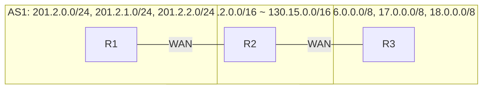

*Figure 11. Three autonomous systems and the reachability list of each*

### 4.3 Path-Vector Routing Tables

If the ASs share their reachability lists with each other, a path-vector routing table can be built for each router. In Figure 11, R1 in AS1 can send its reachability list to R2. R2 combines it with its own list and sends the result to both R1 and R3. R3 likewise sends its list to R2, which improves R2's table, and so on.

| Network | Path at R1 | Path at R2 | Path at R3 |
|:-----|:-----|:-----|:-----|
| 201.2.0.0/24 | AS1 (this AS) | AS2, AS1 | AS3, AS2, AS1 |
| 201.2.1.0/24 | AS1 (this AS) | AS2, AS1 | AS3, AS2, AS1 |
| 201.2.2.0/24 | AS1 (this AS) | AS2, AS1 | AS3, AS2, AS1 |
| 130.12.0.0/16 | AS1, AS2 | AS2 (this AS) | AS3, AS2 |
| 130.13.0.0/16 | AS1, AS2 | AS2 (this AS) | AS3, AS2 |
| 130.14.0.0/16 | AS1, AS2 | AS2 (this AS) | AS3, AS2 |
| 130.15.0.0/16 | AS1, AS2 | AS2 (this AS) | AS3, AS2 |
| 16.0.0.0/8 | AS1, AS2, AS3 | AS2, AS3 | AS3 (this AS) |
| 17.0.0.0/8 | AS1, AS2, AS3 | AS2, AS3 | AS3 (this AS) |
| 18.0.0.0/8 | AS1, AS2, AS3 | AS2, AS3 | AS3 (this AS) |

*Table 7. Path-vector routing tables of the three routers after stabilization*

When a packet for 201.2.2.0/24 arrives, R1 knows that the network is inside AS1 (at home), and when a packet for 130.14.0.0/16 arrives, it knows that the packet must travel from AS1 to AS2 to reach its destination. When R2 receives a packet for 16.0.0.0/8, it knows that the packet must go from AS2 to AS3.

### 4.4 Loop Prevention, Aggregation, and Policy Routing

**Loop prevention:** Path-vector routing avoids the instability and loops of distance-vector routing. When a router receives reachability information, it checks whether its own autonomous system is in the path list to any destination; if it is, a loop is involved, and that network-path pair is discarded.

**Aggregation:** Path-vector routing protocols normally support CIDR notation and address aggregation. Aggregation makes routing tables simpler and exchanges between routers faster. The table of Table 7 can be reduced as follows.

| Aggregated network | Networks included | Path at R1 | Path at R2 | Path at R3 |
|:-----|:-----|:-----|:-----|:-----|
| 201.2.0.0/22 | 201.2.0.0/24 ~ 201.2.2.0/24 | AS1 (this AS) | AS2, AS1 | AS3, AS2, AS1 |
| 130.12.0.0/14 | 130.12.0.0/16 ~ 130.15.0.0/16 | AS1, AS2 | AS2 (this AS) | AS3, AS2 |
| 16.0.0.0/6 | 16.0.0.0/8 ~ 18.0.0.0/8 | AS1, AS2, AS3 | AS2, AS3 | AS3 (this AS) |

*Table 8. Path-vector routing tables after address aggregation*

An aggregated range may include blocks that are not in the AS. For example, 201.2.0.0/22 also includes 201.2.3.0/24, which is not the address of any network in AS1, and 16.0.0.0/6 also includes 19.0.0.0/8, which is not in AS3. However, if such a network exists in some other AS, it eventually enters the routing table as a separate entry. By the longest prefix matching of Chapter 13, that entry, having the longer prefix, is matched first, so routing remains correct.

**Policy routing:** Policy routing is easy to implement with path-vector routing. When a router receives a message, it checks the path; if any autonomous system listed in the path is against its policy, it ignores that path and that destination. It does not update its routing table with this path, and it does not pass the message on to its neighbors.

---

<br>

## 5. BGP

### 5.1 The Role of BGP

> **Definition:** **BGP (Border Gateway Protocol)** is the inter-AS routing protocol run by every autonomous system in the Internet; it exchanges reachability information for CIDR prefixes in a path-vector manner and chooses the best routes according to policy.

When both the source and the destination are within one AS, the route a packet follows is determined entirely by the intra-AS routing protocol. But to send a packet across several ASs, say from a smartphone in a distant city to a server in a data center on another continent, an inter-AS routing protocol is needed. BGP is the glue that holds the thousands of ISPs of the Internet together, so it can be called, together with IP, the most important protocol of the Internet. BGP is a decentralized and asynchronous protocol in the vein of the distance-vector routing of Chapter 14, and it first appeared in 1989 and has gone through four versions.

In a router's forwarding table, the entries for destinations within the same AS are set by the intra-AS routing protocol. The entries for destinations outside the AS are set by BGP. In BGP, packets are routed not to specific destination addresses but to CIDR prefixes, each representing a subnet or a collection of subnets. For example, the destination 138.16.68.0/22 includes 1,024 IP addresses. A router's forwarding table therefore has entries of the form (x, I), where x is a prefix and I is an interface number of the router.

As an inter-AS routing protocol, BGP provides each router with a means to do two things.

1. **Obtain prefix reachability information from neighboring ASs.** BGP allows each subnet to advertise its existence to the rest of the Internet. A subnet shouts "I exist and I am here," and BGP makes sure that all routers in the Internet know about it. Without BGP, each subnet would be an isolated island, unknown to and unreachable from the rest of the Internet.
2. **Determine the best routes to the prefixes.** A router may learn about two or more different routes to a prefix. To determine the best route, the router runs a BGP route-selection procedure using the reachability information obtained through neighboring routers. The best route is determined by policy as well as by reachability information.

### 5.2 Advertising BGP Route Information

The network of Figure 12 consists of three autonomous systems, AS1, AS2, and AS3, and AS3 includes a subnet with prefix x. Each router in an AS is either a gateway router or an internal router. A **gateway router** is a router on the edge of an AS that connects directly to routers in other ASs, and an **internal router** connects only to hosts and routers within its own AS. In AS1, router 1c is a gateway router, and 1a, 1b, and 1d are internal routers (the link between 1d and 3d is added in Section 5.3).

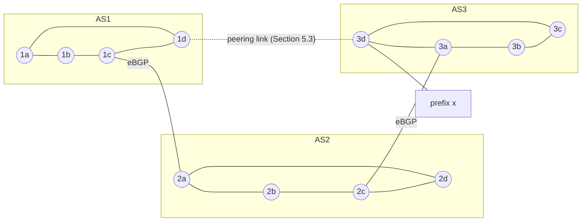

*Figure 12. A network of three autonomous systems*

At a high level, advertising reachability information for x is straightforward. First, AS3 sends AS2 a BGP message saying that x exists and is in AS3; this message is written "AS3 x". Then AS2 sends AS1 the message "AS2 AS3 x", saying that x exists and can be reached by first passing through AS2 and then going to AS3. In this way, each AS learns not only that x exists but also a path of ASs that leads to x.

In reality, it is routers, not ASs, that exchange messages. In BGP, pairs of routers exchange routing information over semi-permanent TCP connections using port 179. Such a TCP connection, together with all the BGP messages sent over it, is called a **BGP connection**.

> **Definition:** An **eBGP (external BGP)** connection is a BGP connection between routers in two different ASs; there is typically one for each link that directly connects gateway routers in different ASs.

> **Definition:** An **iBGP (internal BGP)** connection is a BGP connection between routers in the same AS; often there is one for each pair of routers in the AS, forming a mesh of TCP connections that need not correspond to physical links.

In Figure 12 there are eBGP connections between gateway routers 1c and 2a and between 2c and 3a. Both iBGP and eBGP are used to propagate reachability information.

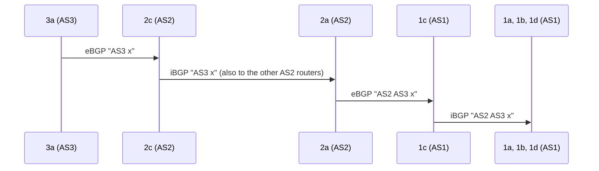

*Figure 13. Propagating the reachability of prefix x with eBGP and iBGP*

When this process is complete, every router in AS1 and AS2 knows that x exists and knows an AS path that leads to x.

> **Note:** Forouzan calls a BGP connection a session. A BGP session is a connection established only for exchanging routing information, and BGP, as an application program, establishes its sessions over TCP connections. Unlike the TCP connections of other applications, BGP's TCP connections last a long time, until something unusual happens, which is why they are also called semipermanent connections.

### 5.3 Path Attributes: AS-PATH and NEXT-HOP

In a real network there are many paths from a router to a destination, each through a different sequence of ASs. Adding a physical link between routers 1d and 3d to Figure 12 gives two paths from AS1 to x: "AS2 AS3 x" through router 1c and "AS3 x" through router 1d.

When a router advertises a prefix over a BGP connection, it includes several **BGP attributes** with it. In BGP jargon, a prefix together with its attributes is called a **route**. The two most important attributes are AS-PATH and NEXT-HOP.

> **Definition:** The **AS-PATH** attribute is the list of ASs through which an advertisement has passed; when a prefix is passed to an AS, that AS adds its ASN to the list.

With the link between 1d and 3d added to Figure 12, there are two routes from AS1 to x, one with AS-PATH "AS2 AS3" and one with AS-PATH "AS3". BGP routers also use AS-PATH to detect and prevent looping advertisements: a router rejects an advertisement if its own AS is contained in the path list.

> **Definition:** The **NEXT-HOP** attribute is the IP address of the router interface that begins the AS-PATH, and it links inter-AS routing with intra-AS routing.

The NEXT-HOP of the route "AS2 AS3 x" from AS1 to x through AS2 is the IP address of the left (AS1-side) interface of router 2a. The NEXT-HOP of the route "AS3 x", which bypasses AS2, is the IP address of the leftmost (AS1-side) interface of router 3d. In summary, each router in AS1 knows the following two BGP routes to x, each written with three components: NEXT-HOP; AS-PATH; destination prefix.

- IP address of the leftmost interface of router 2a; AS2 AS3; x
- IP address of the leftmost interface of router 3d; AS3; x

The NEXT-HOP attribute is the IP address of a router that does not belong to AS1, but the subnet containing that IP address attaches directly to AS1.

> **Note:** **Classification of attributes.** BGP path attributes are divided into **well-known attributes**, which every BGP router must recognize, and **optional attributes**, which need not be recognized by every router. Well-known attributes are further divided into **mandatory** ones, which must appear in the description of a route, and **discretionary** ones, which every router must recognize but which need not be included in every update message. ORIGIN, which gives the source of the routing information (RIP, OSPF, and so on), AS_PATH, the list of ASs through which the destination can be reached, and NEXT-HOP, which gives the next router, are well-known mandatory attributes. Optional attributes are divided into **transitive** ones, which a router that does not implement them must still pass on to the next router, and **nontransitive** ones, which such a router must discard.

### 5.4 Hot Potato Routing

> **Definition:** **Hot potato routing** chooses, among all possible BGP routes, the route with the least intra-AS cost to the NEXT-HOP router that begins the route.

Consider router 1b in Figure 12 with the link between 1d and 3d added. Router 1b knows two BGP routes to x. In hot potato routing, 1b uses its intra-AS routing information to find the least-cost path to NEXT-HOP router 2a and the least-cost path to 3d, and selects the route whose cost is smaller. If cost is defined as the number of links traversed, the least cost from 1b to 2a is 2 (1b, 1c, 2a) and the least cost to 3d is 3 (1b, 1a, 1d, 3d), so the route through 2a is selected. Router 1b then finds, in the forwarding table built by its intra-AS algorithm, the interface I on the least-cost path to 2a and adds (x, I) to its forwarding table.

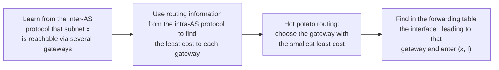

*Figure 14. Steps in adding an outside-AS destination to a forwarding table with hot potato routing*

It is important to note that when an outside-AS prefix is added to a forwarding table, both the inter-AS routing protocol (BGP) and the intra-AS routing protocol (for example, OSPF) are used. The idea behind hot potato routing is to get packets out of one's own AS as quickly as possible, at the least possible cost, without worrying about the cost of the rest of the path outside the AS. The name comes from passing a burning hot potato in one's hands to another person (another AS) as quickly as possible. Hot potato routing is thus a selfish algorithm that reduces the cost within its own AS while ignoring the rest of the end-to-end cost. Two routers in the same AS may even choose different AS paths to the same prefix: 1b sends packets to x through AS2, whereas 1d bypasses AS2 and sends them directly to AS3.

### 5.5 The Route-Selection Algorithm

In practice BGP uses an algorithm that is more complicated than hot potato routing but incorporates it. For a given destination prefix, the input to BGP's route-selection algorithm is the set of all routes to that prefix that the router has learned and accepted. If there is only one such route, it is selected. If there are two or more routes to the same prefix, the following elimination rules are applied in order until one route remains.

1. **Local preference:** A route carries a local preference value as an attribute, in addition to AS-PATH and NEXT-HOP. The value was set by the router or learned from another router in the same AS, and it is a policy decision left entirely to the AS's network administrator. The routes with the highest local preference values are selected.
2. **Shortest AS-PATH:** From the remaining routes (all with the highest local preference), the route with the shortest AS-PATH is selected. If this were the only rule, BGP would be a distance-vector algorithm that uses the number of AS hops rather than router hops as its distance.
3. **Closest NEXT-HOP:** From the remaining routes (all with the same highest local preference and the same AS-PATH length), hot potato routing is used, that is, the route with the closest NEXT-HOP router is selected.
4. **BGP identifiers:** If more than one route still remains, BGP identifiers are used to select the route.

Consider again router 1b in Figure 12 with the link between 1d and 3d added. There are two BGP routes to x, one through AS2 and one bypassing AS2. With hot potato routing alone, 1b chose the route through AS2. In the route-selection algorithm, however, rule 2 is applied before rule 3, so 1b selects the route with the shorter AS-PATH, the one that bypasses AS2. With the route-selection algorithm, BGP is thus no longer selfish: it first looks for routes with short AS paths, thereby likely reducing end-to-end delay. BGP routing tables often contain over half a million routes (prefixes with their attributes).

### 5.6 IP Anycast

Besides being the Internet's inter-AS routing protocol, BGP is also used to implement the IP anycast service, which is commonly used in DNS.

> **Definition:** **IP anycast** is a service in which several geographically dispersed servers are given the same IP address, which is advertised with BGP from each location, so that a user's request goes to the server that is closest according to BGP's route selection.

Many applications want (1) to replicate the same content on servers in many dispersed geographical locations and (2) to have each user access the content from the closest server. For example, a CDN replicates videos on servers in different countries, and DNS replicates DNS records on DNS servers around the world. As an example, consider how a CDN might use IP anycast.

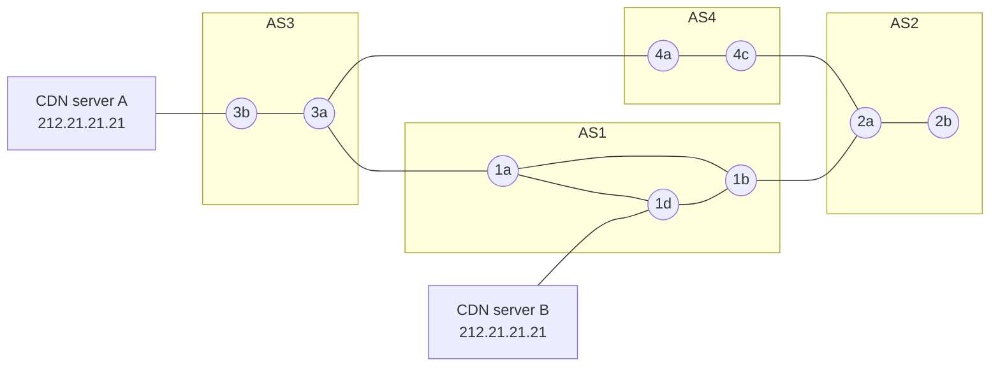

*Figure 15. Using IP anycast to bring users to the closest CDN server*

- **Configuration stage:** The CDN company assigns the same IP address (212.21.21.21 in Figure 15) to all its servers and advertises this address with standard BGP from each server's location. When a BGP router receives several route advertisements for this address, it treats them as different paths to the same physical location (when in fact they lead to different locations). Each router uses the BGP route-selection algorithm to pick the best route to the address (for example, the closest as measured by AS-hop count). In Figure 15, router 2b in AS2 receives advertisements from both AS1 and AS4, but the route through AS1 is closer, so it forwards toward server B.
- **Distribution stage:** When a client requests a video, the CDN returns the common IP address used by the dispersed servers, wherever the client is. When the client sends a request to that address, the Internet's routers forward the request packet to the closest server according to BGP's route selection.

In practice CDNs generally choose not to use IP anycast, because BGP routing changes can cause packets of the same TCP connection to arrive at different instances of the web server. The DNS system, on the other hand, uses IP anycast extensively to direct DNS queries to the closest root DNS server. The root DNS servers (Chapter 5) have 13 IP addresses, but each address corresponds to several root servers, and some addresses have over 100 servers scattered around the world. When a DNS query is sent to one of the 13 addresses, IP anycast routes it to the nearest of the root servers responsible for that address.

### 5.7 Routing Policy

When a router selects a route to a destination, the AS's routing policy can trump all other considerations, such as the shortest AS path or hot potato routing. Indeed, the route-selection algorithm first selects routes by the local preference attribute, whose value is fixed by the policy of the local AS.

From the viewpoint of traffic, ASs can be divided into three kinds.

- **Stub AS:** Has only one connection to another AS. Hosts in a stub AS can send data to and receive data from other ASs, but data traffic cannot pass through a stub AS; a stub AS is only a source or a sink of traffic. A small corporation or a small local ISP is an example.
- **Multihomed AS:** Has more than one connection to other ASs but is still only a source or a sink of traffic. It can exchange data with several ASs but does not let transit traffic coming from one AS and going to another pass through. A large corporation connected to several regional or national ASs that does not allow transit traffic is an example.
- **Transit AS:** A multihomed AS that also allows transit traffic. National and international ISPs (Internet backbones) are examples.

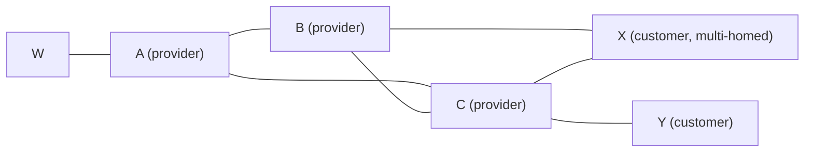

*Figure 16. A simple BGP policy scenario*

A, B, C, W, X, and Y in Figure 16 are autonomous systems, not routers. Suppose W, X, and Y are access ISPs and A, B, and C are backbone provider networks. A, B, and C send traffic directly to each other and provide full BGP information to their customer networks. All traffic entering an access ISP network must be destined for that network, and all traffic leaving it must have originated in that network.

**A customer's advertisement policy:** X is a **multi-homed access ISP** connected to two providers. Like W and Y, however, X must itself be the source or destination of all traffic leaving or entering it. To keep X from forwarding traffic between B and C, it suffices to control how BGP routes are advertised. X functions only as an access ISP if it advertises to its neighbors B and C that it has no paths to any destination except itself. Even though X knows the path XCY to Y, it does not advertise this path to B. Unaware that X has a path to Y, B never forwards traffic destined for Y (or C) via X. A selective route advertisement policy like this implements customer and provider routing relationships.

**A provider's advertisement policy:** Consider provider network B. Suppose B has learned from A that A has a path AW to W. B installs the route in its routing information and wants to advertise the path BAW to its customer X so that X can reach W via B. Should B also advertise BAW to C? If it does, C could route traffic to W via BAW. If A, B, and C are all backbone providers, B may rightly feel that it should not bear the burden (and cost) of carrying transit traffic between A and C; it may consider it A's and C's job to handle traffic between C and A's customers over a direct connection between A and C. There are no official standards governing how backbone ISPs route among themselves, but a rule of thumb followed by commercial ISPs is that any traffic crossing an ISP's backbone must have a source or a destination (or both) in a network that is a customer of that ISP. Otherwise the traffic would be using the ISP's network without paying for it. Individual peering agreements are typically negotiated between pairs of ISPs and are often confidential.

### 5.8 BGP Messages

BGP uses four types of messages. All BGP messages share the same common header.

```text
+---------------------------------------------------------------+
|                                                               |
|                      Marker (16 bytes)                        |
|                                                               |
|                                                               |
+-------------------------------+---------------+---------------+
|         Length (16 bits)      | Type (8 bits) |
+-------------------------------+---------------+
```

*Figure 17. Common header of BGP messages*

- **Marker (16 bytes):** A field reserved for authentication.
- **Length (2 bytes):** The length of the whole message including the header.
- **Type (1 byte):** The message type; the values 1-4 identify the four types.

| Type | Message | Role |
|:-----|:-----|:-----|
| 1 | Open | Sent after opening a TCP connection, to establish a relationship with a neighbor. |
| 2 | Update | Withdraws previously advertised destinations, announces a route to a new destination, or both. |
| 3 | Keepalive | Sent regularly before the hold time expires, to announce that the sender is alive. |
| 4 | Notification | Sent when an error is detected or when the sender wants to close the connection. |

*Table 9. Types of BGP messages*

**Open message:** A router running BGP opens a TCP connection with a neighbor and sends an Open message. If the neighbor accepts the neighbor relationship, it responds with a Keepalive message, and a relationship is established between the two routers. The fields of the Open message are as follows.

- **Version (1 byte):** The version of BGP, currently 4.
- **My autonomous system (2 bytes):** The autonomous system number.
- **Hold time (2 bytes):** The maximum number of seconds that can elapse until one party receives a Keepalive or Update message from the other. If none is received during this time, the other party is considered dead.
- **BGP identifier (4 bytes):** Identifies the router sending the Open message. The router usually uses one of its IP addresses, which is unique.
- **Option length, option parameters:** The total length of the optional parameters and the parameters themselves. The only optional parameter defined so far is authentication.

**Update message:** The heart of BGP. A router uses it to withdraw previously advertised destinations, to announce a route to a new destination, or both. One Update message can withdraw several previously advertised destinations, but it can announce only one new destination.

- **Unfeasible routes length, withdrawn routes:** The length of the list of routes to withdraw, and the routes that must be deleted from the previously advertised list.
- **Path attributes length, path attributes:** The length of the path attributes, and the attributes of the path (route) to the network whose reachability this message announces.
- **Network layer reachability information (NLRI):** The network actually advertised by the message. It consists of a length field giving the number of bits in the prefix and an IP address prefix. For example, if the network is 153.18.7.0/24, the prefix length is 24 and the prefix is 153.18.7. BGP version 4 supports classless addressing and CIDR.

**Keepalive message:** Routers running BGP (called peers in BGP) exchange Keepalive messages regularly, before their hold time expires, to tell each other that they are alive. A Keepalive message consists of the common header only.

**Notification message:** Sent by a router when it detects an error condition or wants to close the connection. It consists of an error code (1 byte) giving the category of the error, an error subcode (1 byte) giving the type of error within the category, and error data carrying diagnostic information.

| Error code | Description | Subcodes |
|:-----|:-----|:-----|
| 1 | Message header error | Synchronization problem (1), bad message length (2), bad message type (3) |
| 2 | Open message error | Unsupported version number (1), bad peer AS (2), bad BGP identifier (3), unsupported optional parameter (4), authentication failure (5), unacceptable hold time (6) |
| 3 | Update message error | Malformed attribute list (1), unrecognized well-known attribute (2), missing well-known attribute (3), attribute flag error (4), attribute length error (5), invalid ORIGIN attribute (6), AS routing loop (7), invalid NEXT-HOP attribute (8), optional attribute error (9), invalid network field (10), malformed AS_PATH (11) |
| 4 | Hold timer expired | None |
| 5 | Finite state machine error (procedural error) | None |
| 6 | Cease | None |

*Table 10. Error codes of the BGP Notification message*

**Encapsulation:** BGP messages are encapsulated in TCP segments using the well-known port 179. BGP itself therefore needs no error control or flow control. Once a TCP connection is opened, Update, Keepalive, and Notification messages continue to be exchanged until a Notification message of type cease is sent.

### 5.9 Obtaining Internet Presence

Although not specific to BGP, let us follow how a small company establishes its presence on the Internet, which brings together IP addressing, DNS, and BGP. The company has a public web server describing its products and services, a mail server from which its employees obtain their e-mail, and a DNS server, and it wants anyone in the world to be able to visit its web site and its employees to exchange e-mail with the world.

1. **Internet connectivity:** The company contracts with and connects to a local ISP. Its gateway router is connected to a router of the local ISP by DSL, a leased line, or another access method (Chapter 1). The local ISP gives the company an IP address range, for example a /24 consisting of 256 addresses. The company assigns addresses from this range, one each, to its web server, mail server, DNS server, gateway router, and other devices.
2. **Domain name and DNS registration:** The company contracts with an Internet registrar to obtain a domain name (for example, xanadu.com) (Chapter 5). So that outsiders can contact the company's DNS server to obtain the IP addresses of its servers, it also gives the registrar the IP address of its DNS server. The registrar puts the domain name and IP address of the company's DNS server into the .com TLD servers. Any user who knows the domain name can then obtain the IP address of the company's DNS server through the DNS system.
3. **Server entries:** The company's DNS server holds an entry mapping the host name of the web server (for example, www.xanadu.com) to its IP address, and entries for the mail server and the other public servers. When Alice wants to browse the web server, the DNS system contacts the company's DNS server and gives Alice the IP address of the web server.
4. **Advertising the prefix:** One crucial step remains. When Alice sends an IP datagram (for example, a TCP SYN segment) to the web server's IP address, the datagram must travel through routers in many ASs to reach the web server. Each router looks up an outgoing port in its forwarding table when it receives the datagram, so every router must know about the company's /24 prefix (or some aggregate entry containing it). The routers learn it through BGP. When the company contracts with the local ISP and is assigned a prefix, the local ISP uses BGP to advertise the prefix to the ISPs it connects to, and those ISPs in turn propagate the advertisement with BGP. Eventually all Internet routers know about the company's prefix or an aggregate containing it and can correctly forward datagrams destined for the web and mail servers.

### 5.10 Why Intra-AS and Inter-AS Routing Use Different Protocols

The answer to this question lies in the difference between the goals of routing within an AS and among ASs.

- **Policy:** Among ASs, policy issues dominate. It may be important that traffic originating in a given AS not be able to pass through a specific AS, and an AS may want to control what transit traffic it carries between other ASs. BGP carries path attributes and controls the distribution of routing information so that policy-based decisions can be made. Within an AS, everything is nominally under the same administrative control, so policy plays a much less important role in choosing routes.
- **Scale:** The ability of a routing algorithm and its data structures to handle routing to and among large numbers of networks is a critical issue in inter-AS routing. Within an AS, scalability is less of a concern: if one ISP becomes too large, it can always be divided into two ASs with inter-AS routing between them, and OSPF allows such a hierarchy to be built by splitting an AS into areas.
- **Performance:** Because inter-AS routing is so policy oriented, the quality (for example, performance) of the routes used is often of secondary concern. A longer or more costly route that satisfies policy criteria may well be taken over a shorter route that does not. Indeed, among ASs there is not even a notion of cost attached to routes other than the AS hop count. Within a single AS, by contrast, policy matters less, so routing can focus more on the performance of a route.

---

<br>

## 6. The SDN Control Plane

### 6.1 Four Characteristics of the SDN Architecture

This section covers the **SDN control plane**, which actually implements the logically centralized control seen in Chapter 14: the network-wide logic that controls packet forwarding among SDN devices and the configuration and management of those devices and their services. Following the SDN literature, the network's forwarding devices are called **packet switches** (or simply switches), because forwarding decisions can be based not only on network-layer addresses but also on link-layer addresses and many values in transport-, network-, and link-layer headers. The generalized forwarding of Chapter 24 (match-plus-action rules and flow tables) underlies this section.

The four key characteristics of an SDN architecture are as follows.

- **Flow-based forwarding:** A switch controlled by SDN can forward packets based on the values of many fields in the transport-layer, network-layer, or link-layer header. The OpenFlow 1.0 abstraction allows forwarding based on eleven header field values (Chapter 24). This contrasts sharply with the traditional approach of forwarding IP datagrams based solely on the destination IP address. Forwarding rules are held in a switch's flow table, and computing, managing, and installing flow table entries in all switches of the network is the job of the SDN control plane.
- **Separation of data plane and control plane:** The data plane consists of the network's switches, relatively simple but fast devices that execute the match-plus-action rules in their flow tables. The control plane consists of servers and software that determine and manage the switches' flow tables.
- **Network control functions external to the data-plane switches:** As the S in SDN stands for software, the SDN control plane is implemented in software. Unlike in traditional routers, however, this software runs on servers that are separate from and remote to the switches. The control plane consists of two components: the SDN controller (also called a network operating system) and network-control applications.
- **A programmable network:** The network is programmed through network-control applications running in the control plane. These applications are the brains of the SDN control plane, using the APIs provided by the SDN controller to specify and control the data plane of the network devices. For example, a routing application can determine end-to-end paths by running Dijkstra's algorithm on the node and link state maintained by the controller, an access-control application can decide which packets are to be blocked at a switch, and a load-balancing application can forward packets so as to share load among servers.

> **Definition:** An **SDN controller** is logically centralized software that maintains state information about the network's hosts, links, and switches, provides it to network-control applications, and gives those applications the means to monitor, program, and control the underlying network devices.

SDN represents a significant **unbundling** of network functionality. Data-plane switches, SDN controllers, and network-control applications are separate entities that may each be provided by different vendors and organizations. This contrasts with the pre-SDN model, in which a switch or router, together with its embedded control-plane software and protocol implementations, was vertically integrated and sold by a single vendor. The change is often likened to the evolution from mainframe computers, whose hardware, system software, and applications came from a single vendor, to personal computers with separate hardware, operating systems, and applications. Just as the unbundling of computing led to a rich, open ecosystem driven by innovation in all three areas, SDN is hoped to lead to such innovation.

### 6.2 The SDN Controller and Network-Control Applications

The functionality of an SDN controller is broadly organized into three layers. Let us consider them from the bottom up.

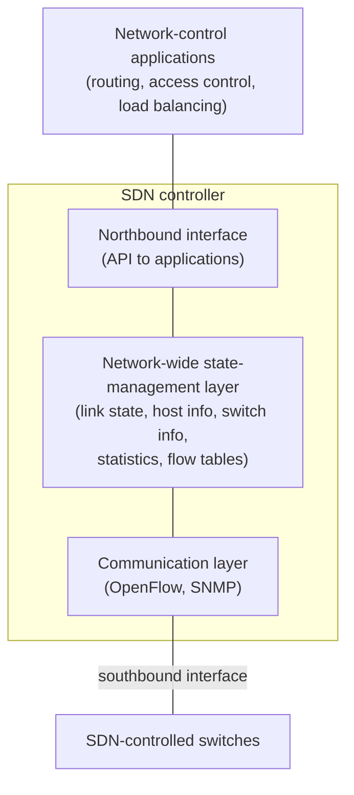

*Figure 18. Components of an SDN controller*

- **Communication layer:** Handles communication between the SDN controller and the controlled network devices. For a controller to control a remote switch or host, a protocol is needed to transfer information between them. Devices must also be able to report locally observed events to the controller (a link going up or down, a device that has just joined the network, a heartbeat indicating that a device is up), and these events give the controller an up-to-date view of the network's state. This communication between the controller and the devices crosses the controller's **southbound interface**. OpenFlow, in Section 6.3, is the representative protocol providing this function.
- **Network-wide state-management layer:** Control decisions such as configuring the flow tables of all switches to achieve the desired end-to-end forwarding, load balancing, or a particular firewalling capability require up-to-date state information about the network's hosts, links, switches, and other SDN devices. Counter values in switches' flow tables can also be useful to network-control applications. Since the ultimate aim of the control plane is to determine the devices' flow tables, the controller may also keep a copy of these tables. All of this information constitutes the network-wide state maintained by the SDN controller.
- **Interface to the network-control application layer:** The controller interacts with network-control applications through its **northbound interface**. This API lets applications read and write network state and flow tables in the state-management layer. Applications can register to be notified when state-change events occur, so that they can respond to event notifications sent from SDN devices. Different types of APIs may be provided; two representative SDN controllers communicate with their applications through a REST request-response interface.

An SDN controller is logically centralized in the sense that it can be viewed from outside (by SDN devices and external network-control applications) as a single service. In practice, however, the service and the databases holding its state are implemented on a distributed set of servers for fault tolerance, high availability, and performance. When controller functions are implemented on several servers, the semantics of the controller's internal operations (logical time ordering of events, consistency, consensus, and so on) must be considered.

> **[Distributed Systems]** A controller that is logically centralized but physically distributed inherits the classic problems of distributed systems: ordering events, keeping replicas consistent, and agreeing on a single decision even when some servers fail, all while several servers replicate the same network state. Consensus algorithms such as Paxos address these problems.

### 6.3 The OpenFlow Protocol

The OpenFlow protocol operates between an SDN controller and an SDN-controlled switch or other device implementing the OpenFlow API (Chapter 24). OpenFlow runs over TCP, with a default port number of 6653.

| Direction | Message | Role |
|:-----|:-----|:-----|
| Controller → switch | Configuration | Lets the controller query and set a switch's configuration parameters. |
| Controller → switch | Modify-State | Adds, deletes, or modifies entries in a switch's flow table and sets port properties. |
| Controller → switch | Read-State | Collects statistics and counter values from a switch's flow table and ports. |
| Controller → switch | Send-Packet | Sends a specific packet out of a specified port of the switch; the packet to be sent is carried in the message payload. |
| Switch → controller | Flow-Removed | Informs the controller that a flow table entry has been removed, for example by a timeout or a Modify-State message. |
| Switch → controller | Port-status | Informs the controller of a change in port status. |
| Switch → controller | Packet-in | Sends to the controller, for further processing, a packet that did not match any flow table entry; a matched packet can also be sent to the controller as the action of its match. |

*Table 11. Main OpenFlow messages*

### 6.4 Data-Plane and Control-Plane Interaction: A Link Failure Example

Let us look at an example of how SDN-controlled switches and the SDN controller interact. Dijkstra's algorithm is used to determine shortest paths, but there are two differences from the per-router control of Chapter 14 and OSPF, where Dijkstra's algorithm ran in every router and link-state updates were flooded to all routers.

- Dijkstra's algorithm runs as a separate application, outside the packet switches.
- Packet switches send link updates to the SDN controller, not to each other.

In a network of interconnected switches s1, s2, s3, and s4, suppose the link between s1 and s2 goes down. Since shortest-path routing is used, suppose the incoming and outgoing flow forwarding rules at s1, s3, and s4 are affected but s2's operation is unchanged. Assume that OpenFlow is the communication-layer protocol and that the control plane performs no function other than link-state routing.

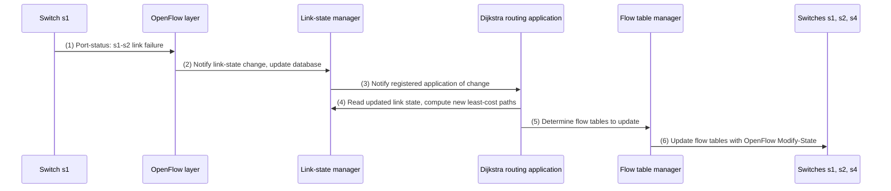

*Figure 19. Handling of a link-state change by the SDN controller*

1. Switch s1, experiencing a link failure between itself and s2, notifies the SDN controller of the link-state change with an OpenFlow Port-status message.
2. The SDN controller receives the OpenFlow message indicating the link-state change and notifies the link-state manager, which updates a link-state database.
3. The network-control application implementing Dijkstra's link-state routing has previously registered to be notified when link state changes, so it receives the notification of the link-state change.
4. The link-state routing application interacts with the link-state manager to get the updated link state; it may also consult other components of the state-management layer. It then computes the new least-cost paths.
5. The link-state routing application interacts with the flow table manager, which determines the flow tables to be updated.
6. The flow table manager uses the OpenFlow protocol to update the flow table entries at the affected switches: s1, which will now route packets destined for s2 via s4; s2, which will now begin receiving packets from s1 via the intermediate switch s4; and s4, which must now forward packets from s1 destined for s2.

> **Note:** In setting up this example, Kurose and Ross name s1, s3, and s4 as the switches whose rules are affected and say that s2 is unchanged, but their final step updates s1, s2, and s4. Which switches need new rules depends on the topology and link costs, which they do not give; step 6 and Figure 19 follow their final step.

This example is simple, but it shows how the SDN control plane provides a control-plane service (here, network-layer routing) that was previously implemented with per-router control in every router. Since the controller can tailor the flow tables as it pleases, changing only the application-control software makes it easy to switch from least-cost path routing to a more hand-tailored form of routing. In a traditional per-router control plane, by contrast, the software in all routers, which may have been supplied by several vendors, must be changed.

### 6.5 SDN: Past, Present, and Future

Although the intense interest in SDN is relatively recent, its technical roots, the separation of data and control planes in particular, go back considerably further. As early as 2004, several studies argued for separating the network's data and control planes, and even earlier a control framework had been proposed in which several controllers each controlled a number of ATM switches. The Ethane project pioneered a network of simple flow-based Ethernet switches with match-plus-action flow tables, a centralized controller that managed flow admission and routing, and the forwarding of unmatched packets from the switch to the controller; a network of more than 300 Ethane switches was operational in 2007. Ethane quickly evolved into the OpenFlow project.

In the earliest days there was a single SDN protocol, OpenFlow, and a single SDN controller, NOX, but the number of SDN controllers has since grown greatly. OpenDaylight and ONOS are representative open-source controllers.

- **OpenDaylight (ODL):** Its main components correspond closely to the generic controller of Figure 18. External applications communicate with controller modules through a REST API over HTTP, and internal applications communicate with each other through the **Service Abstraction Layer (SAL)**. The SAL is the controller's nerve center, allowing controller components and applications to invoke each other's services and subscribe to the events they generate; it also provides a uniform abstract interface to the underlying protocols of the communication layer, such as OpenFlow and SNMP (Chapter 17).
- **ONOS:** Organized in three layers. Its northbound abstractions feature an **intent framework**, which lets an application request a high-level service, such as setting up a connection between hosts A and B, without knowing the details of how the service is performed. The distributed core maintains the state of links, hosts, and devices; it is deployed as a service on a set of interconnected servers running identical copies of the ONOS software, so adding servers increases the service capacity. The southbound abstractions mask the heterogeneity of the underlying hosts, links, switches, and protocols, allowing the distributed core to be device and protocol agnostic.

> **Note:** **Google's B4.** The textbook cites Google's B4, the wide-area network interconnecting its data centers, as a case of SDN in an operational network. B4 uses a Google-designed SDN control plane built on OpenFlow, drives its WAN links at near 70% utilization over the long run, and splits application flows among multiple paths according to application priority and flow demands. It is well suited to SDN because Google controls all the devices in the network, the most bandwidth-intensive applications are large-scale data copies that can defer to higher-priority interactive applications, and, with only a few dozen data centers connected, centralized control is feasible.

Research continues to broaden the SDN concept. **Network functions virtualization (NFV)**, a generalization of SDN, aims to replace sophisticated middleboxes built on dedicated hardware and proprietary software with commodity servers, switching, and storage, and another line of research seeks to extend SDN concepts from the intra-AS setting to the inter-AS setting.

---

<br>

## Concept Applications

**True/False Check:**

| Statement | Judgment and Reason |
|:-----|:-----|
| The routers within one autonomous system run the same intra-AS routing algorithm. | **T.** An AS is a group of routers under the same administration whose routers run the same routing algorithm and have information about each other. |
| In RIP, the hop count to a network directly attached to a router is 0. | **F.** RIP counts the networks to be passed, so the hop count to a directly attached network is 1. |
| A route whose RIP expiration timer has run out is removed from the table at once. | **F.** Its hop count is set to 16 and it keeps being advertised; it is removed after the 120-second garbage collection timer runs out. |
| OSPF leaves reliable transfer to TCP. | **F.** OSPF is carried directly in IP with protocol number 89, so it implements reliable-transfer functions such as acknowledgments itself. |
| On an OSPF transient network, the designated router advertises the network link LSA on behalf of the network. | **T.** The designated router sends a network link LSA listing the addresses of all routers attached to the network. |
| In BGP route selection, the hot potato rule is applied before the AS-PATH length. | **F.** The order is local preference, shortest AS-PATH, closest NEXT-HOP (hot potato), and BGP identifier. |
| A multi-homed customer AS can avoid carrying transit traffic between its two providers by not advertising routes to any destination other than itself. | **T.** If its neighbors do not know of routes through that AS, they do not send traffic through it. |
| In SDN, the control agents of switches exchange link state directly with each other. | **F.** Switches send link updates to the SDN controller rather than to each other, and an application on the controller computes the routes. |

---

<br>

## Summary

| Concept | Key Summary |
|:-----|:-----|
| Autonomous system | Because of scale and administrative autonomy, routers are grouped into ASs under one administration, each identified by an ASN. |
| Intra-AS and inter-AS routing | Interior protocols such as RIP and OSPF route within an AS, and BGP, which every AS runs, routes between ASs. |
| RIP | A distance-vector protocol that uses hop count as its metric and defines infinity as 16, sending updates every 30 seconds over UDP port 520. |
| RIP timers | A 25-35 second periodic timer, a 180-second expiration timer, and a 120-second garbage collection timer manage updates and route validity. |
| RIP version 2 | Adds subnet mask, next-hop, and route tag fields to support CIDR, and uses authentication and multicast delivery. |
| OSPF | Floods link state and builds a shortest path tree with Dijkstra's algorithm, carried directly in IP with protocol number 89. |
| OSPF areas | An AS is divided into areas so that flooding stays within an area, and traffic between areas goes through the backbone, area 0. |
| OSPF links and LSAs | Links are point-to-point, transient, stub, or virtual; a transient network is represented by a designated router; LSAs are router, network, two kinds of summary, and external links. |
| Path-vector routing | Lists of ASs to pass are exchanged for each network, and paths containing one's own AS are discarded to prevent loops and apply policy. |
| BGP advertisement | Routers advertise prefixes with attributes such as AS-PATH and NEXT-HOP over eBGP and iBGP connections on TCP port 179. |
| BGP route selection | Routes are chosen in the order of local preference, shortest AS-PATH, closest NEXT-HOP (hot potato), and BGP identifier. |
| IP anycast | Several servers are given the same address, advertised with BGP, so that requests go to the closest server; DNS root servers use it. |
| Routing policy | A customer AS advertises no routes other than to itself, and a provider does not advertise to other providers transit routes that involve none of its customers. |
| SDN control plane | Characterized by flow-based forwarding, separated planes, control functions outside switches, and a programmable network, with a controller of three layers: communication, state management, and the northbound interface. |
| OpenFlow | The controller and switches exchange messages such as Modify-State, Read-State, Port-status, and Packet-in over TCP port 6653. |

---

<br>

## Self-Check Questions

1. **Lifetime of a RIP route:** A RIP router hears nothing more about a route after its last update. When is the route marked unreachable, and when is it deleted from the table? What does the router do in between?

   <details>
   <summary>Answer</summary>

   At the last update, the route's expiration timer is set to 180 seconds, so if no new update arrives within 180 seconds the route expires and its hop count becomes 16 (unreachable). At that point the garbage collection timer is set to 120 seconds, during which the router keeps advertising the route with metric 16 so that its neighbors learn that the route is invalid. The route is deleted from the table when the garbage collection timer expires, that is, 300 seconds after the last update.

   </details>

2. **OSPF areas:** Why does dividing an autonomous system into areas reduce the burden of flooding in OSPF? What path does a packet take to a network in another area?

   <details>
   <summary>Answer</summary>

   Routers inside an area flood link-state information only within their own area, so a change in one link spreads only to the routers of that area rather than to the whole autonomous system. About other areas, each router receives only the information summarized by area border routers (summary link to network LSAs), so the topology each router stores and computes over is also smaller. A packet to a network in another area is first routed within its area to an area border router, goes through the backbone (area 0) to the area border router of the destination area, and then goes within that area to the destination.

   </details>

3. **BGP route selection:** A router has learned three routes to the same prefix. Route A has local preference 100, AS-PATH length 3, and intra-AS cost 2 to its NEXT-HOP; route B has local preference 100, AS-PATH length 2, and cost 5; route C has local preference 80, AS-PATH length 1, and cost 1. Which route does the BGP route-selection algorithm choose? Which route would hot potato routing alone choose?

   <details>
   <summary>Answer</summary>

   Rule 1 keeps routes A and B, which have the highest local preference, and excludes C even though its AS-PATH is the shortest. Rule 2 keeps B, whose AS-PATH is shorter, so B is chosen. Hot potato routing alone would choose C, whose intra-AS cost to the NEXT-HOP is the smallest (1). The key point is that policy (local preference) is applied before path length and intra-AS cost.

   </details>

4. **Advertisements of a multi-homed customer:** In Figure 16, customer X knows the path XCY to Y through C. What should X advertise to B, and why? Also explain why provider B does not advertise to C the route BAW it learned from A.

   <details>
   <summary>Answer</summary>

   X advertises to B and C only the route to itself (X's prefix) and not routes to other destinations such as XCY. If B does not know that it can reach Y or C through X, B never sends such traffic to X, so X functions only as an access ISP that does not carry transit traffic between B and C. B advertises BAW to its customer X but not to the other provider C. If it did, traffic from C to W would pass through B even though neither its source nor its destination is a customer of B, so the traffic would be using B's network without paying for it.

   </details>

5. **Link failure handling in SDN:** List, in order, the messages and actions exchanged in SDN from the failure of the link between switches s1 and s2 until the flow tables are updated. How does this differ from OSPF with per-router control?

   <details>
   <summary>Answer</summary>

   (1) s1 reports the link failure to the controller with an OpenFlow Port-status message. (2) The controller notifies the link-state manager, which updates the link-state database. (3) The Dijkstra routing application, registered for notifications, receives the change notification. (4) The application reads the updated link state and computes new least-cost paths. (5) The application, with the flow table manager, determines which flow tables to update. (6) The flow table manager updates the flow tables of s1, s2, and s4 with OpenFlow Modify-State messages. In OSPF, each router floods link state to all other routers and each runs Dijkstra's algorithm itself, whereas in SDN the switches report only to the controller and a single application outside the switches computes the routes.

   </details>

6. **RIP and poisoned reverse:** In Figure 3, write the update message R4 sends to R1 with split horizon and poisoned reverse applied.

   <details>
   <summary>Answer</summary>

   In R4's table, the routes whose next hop is R1 (130.11.0.2) are 130.10.0.0/16, 195.2.4.0/24, 195.2.5.0/24, and 195.2.6.0/24, so the hop counts of these four routes are sent as 16. The others carry their actual values. The message is therefore 130.10.0.0 16, 130.11.0.0 1, 195.2.4.0 16, 195.2.5.0 16, 195.2.6.0 16, 205.5.5.0 1, 205.5.6.0 1. R1 adds 1 to each value, computing cost 2 with next hop 130.11.0.1 for 205.5.5.0 and 205.5.6.0, and does not accept routes through R4 from the entries with 16.

   </details>

7. **Loop prevention and aggregation in path vector:** A router in AS2 receives from AS1 the advertisement "201.2.0.0/22, path AS1, AS2, AS3". How does the AS2 router handle it? Also explain why routing remains correct even though the aggregated entry 201.2.0.0/22 of Table 8 includes 201.2.3.0/24, which is not in AS1.

   <details>
   <summary>Answer</summary>

   Its own AS, AS2, is in the path list, so the router regards it as a loop and discards that network-path pair. If 201.2.3.0/24 actually exists in another AS, that network eventually enters the routing table as a separate entry. Forwarding follows longest prefix matching, so for addresses in 201.2.3.0/24 the /24 entry, longer than /22, matches first and the packets are sent to that AS.

   </details>
