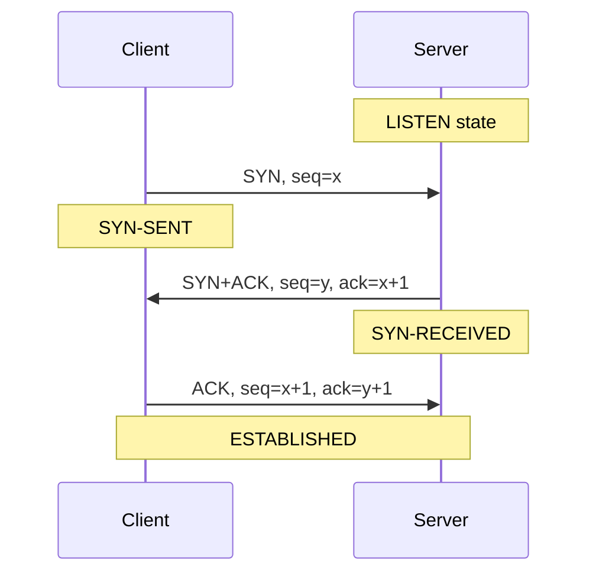
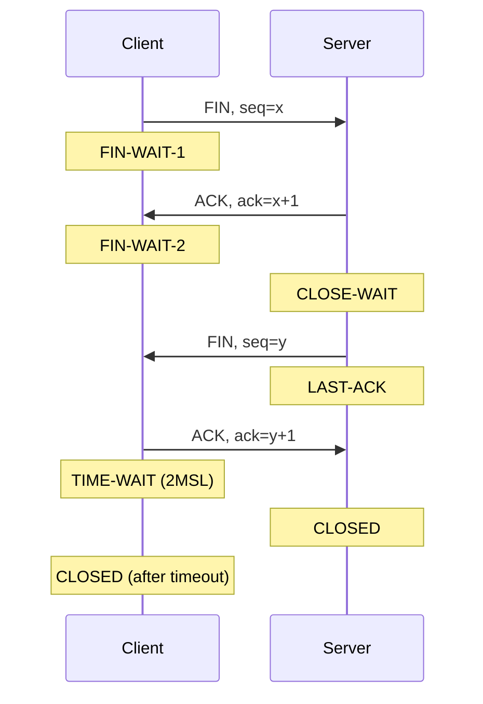
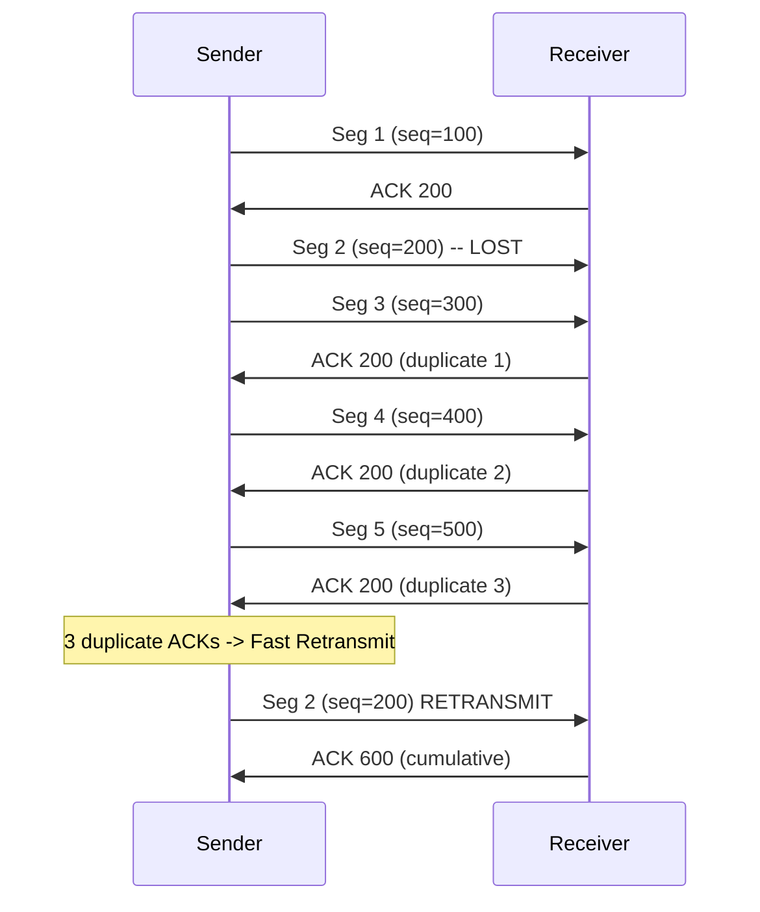
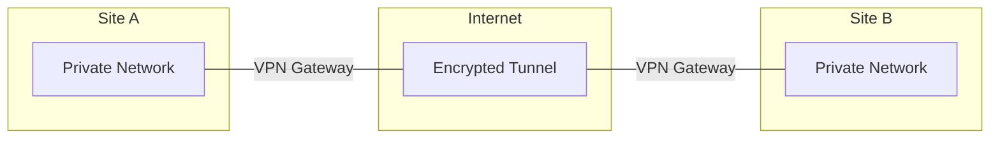

# 15장 — 전송 제어 프로토콜 (TCP)

[레포지토리 안내](../../README.ko.md) | [English](Concepts_Lecture.md) | [한국어](Concepts_Lecture.ko.md)

> **최종 수정일:** 2026-10-26
>
> TCP/IP Protocol Suite, Forouzan, Ch 15

> **학습 목표:**
> 1. TCP 연결 설정(3-way handshake)과 종료를 설명할 수 있다
> 2. TCP 흐름 제어와 슬라이딩 윈도우 메커니즘을 설명할 수 있다
> 3. TCP 혼잡 제어 알고리즘을 분석할 수 있다

---

## 목차

- [1. TCP 서비스](#1-tcp-서비스)
  - [1.1 스트림 전달](#11-스트림-전달)
  - [1.2 송신 및 수신 버퍼](#12-송신-및-수신-버퍼)
  - [1.3 세그먼트](#13-세그먼트)
  - [1.4 전이중 서비스](#14-전이중-서비스)
  - [1.5 연결 지향형 서비스](#15-연결-지향형-서비스)
  - [1.6 신뢰적 서비스](#16-신뢰적-서비스)
- [2. TCP 세그먼트 형식](#2-tcp-세그먼트-형식)
  - [2.1 헤더 필드](#21-헤더-필드)
  - [2.2 제어 플래그](#22-제어-플래그)
- [3. TCP 번호 체계](#3-tcp-번호-체계)
  - [3.1 바이트 번호](#31-바이트-번호)
  - [3.2 순서 번호](#32-순서-번호)
  - [3.3 확인 응답 번호](#33-확인-응답-번호)
- [4. TCP 연결 관리](#4-tcp-연결-관리)
  - [4.1 3-Way Handshake (연결 설정)](#41-3-way-handshake-연결-설정)
  - [4.2 데이터 전송](#42-데이터-전송)
  - [4.3 4-Way Handshake (연결 종료)](#43-4-way-handshake-연결-종료)
  - [4.4 반 닫기(Half-Close)](#44-반-닫기half-close)
- [5. TCP 흐름 제어](#5-tcp-흐름-제어)
  - [5.1 TCP에서의 슬라이딩 윈도우](#51-tcp에서의-슬라이딩-윈도우)
  - [5.2 윈도우 크기 조정](#52-윈도우-크기-조정)
- [6. TCP 오류 제어](#6-tcp-오류-제어)
  - [6.1 재전송](#61-재전송)
  - [6.2 빠른 재전송](#62-빠른-재전송)
- [7. TCP 혼잡 제어](#7-tcp-혼잡-제어)
  - [7.1 슬로우 스타트](#71-슬로우-스타트)
  - [7.2 혼잡 회피](#72-혼잡-회피)
  - [7.3 빠른 회복](#73-빠른-회복)
- [8. TCP vs. UDP 통신](#8-tcp-vs-udp-통신)
- [9. VPN과 터널링](#9-vpn과-터널링)
  - [9.1 VPN 개요](#91-vpn-개요)
  - [9.2 터널링](#92-터널링)
  - [9.3 VPN 프로토콜](#93-vpn-프로토콜)
- [10. 부록](#10-부록)
  - [10.1 TCP 상태 다이어그램 (간략화)](#101-tcp-상태-다이어그램-간략화)
  - [10.2 최대 세그먼트 크기 (MSS)](#102-최대-세그먼트-크기-mss)
  - [10.3 TCP 옵션](#103-tcp-옵션)
- [요약](#요약)
- [점검 문제](#점검-문제)

---

<br>

## 1. TCP 서비스

**TCP (Transmission Control Protocol)** 는 응용 계층과 네트워크 계층 사이에 위치하며, 응용 프로그램과 네트워크 작업 사이의 중개자 역할을 한다.

### 1.1 스트림 전달

TCP는 **스트림 지향 프로토콜**이다:
- 송신 프로세스는 데이터를 **바이트 스트림**으로 전달할 수 있다.
- 수신 프로세스는 데이터를 **바이트 스트림**으로 받을 수 있다.
- TCP는 송신자와 수신자 사이에 연속적인 스트림이 있는 것처럼 보이게 한다.

```text
Sending              Stream of bytes              Receiving
process  -------> [==================] -------> process
  |                                                |
  TCP                                            TCP
```

*그림 1. TCP의 바이트 스트림 전달*

### 1.2 송신 및 수신 버퍼

송신 프로세스와 수신 프로세스가 **서로 다른 속도**로 데이터를 생산하고 소비할 수 있으므로 TCP는 저장을 위한 **버퍼**가 필요하다:

**송신 버퍼:**
- 응용 프로세스로부터 데이터를 바이트 스트림으로 받는다.
- 데이터를 적절한 **세그먼트**로 만들어 네트워크에 전송한다.

**수신 버퍼:**
- 네트워크로부터 세그먼트를 받는다.
- 세그먼트를 데이터로 재조립하여 응용 프로세스에 바이트 스트림으로 전달한다.

```text
Sending process                              Receiving process
      |                                            |
  +---v--------+                          +--------v---+
  |   Buffer   |                          |   Buffer   |
  |  [Sent|    |  Segment   Segment       |   [Not |   |
  |      Not   |  [H|||||]  [H|||||] -->  |    read|   |
  |      sent] |                          |        ]   |
  +---+--------+                          +--------+---+
  Next byte    Next byte              Next byte    Next byte
  to send      to write               to receive   to read
```

*그림 2. TCP의 송신 버퍼와 수신 버퍼*

### 1.3 세그먼트

IP 계층은 바이트 스트림이 아닌 **패킷** 단위로 데이터를 전송해야 한다. 전송 계층에서 TCP는 여러 바이트를 묶어 **세그먼트**라는 패킷으로 구성한다.

- 각 세그먼트는 헤더(20~60바이트)와 데이터로 이루어진다.
- 세그먼트는 전송을 위해 IP 데이터그램에 캡슐화된다.

### 1.4 전이중 서비스

TCP는 **전이중(Full-Duplex)** 통신을 제공한다:
- 데이터가 양방향으로 동시에 흐를 수 있다.
- 각 방향은 고유한 순서 번호와 확인 응답을 가진다.
- **피기배킹(Piggybacking)**: ACK 정보를 반대 방향으로 가는 데이터 세그먼트에 실어 보낸다.

### 1.5 연결 지향형 서비스

TCP는 **연결 지향형** 프로토콜이다:
- 데이터 전송 전에 **가상 연결**(물리적 연결이 아님)을 설정해야 한다.
- 연결 설정, 데이터 전송, 연결 종료의 세 단계를 거친다.
- 양쪽 끝점이 연결에 동의해야 한다.

### 1.6 신뢰적 서비스

TCP는 **신뢰적** 전달을 제공한다:
- 수신을 확인하기 위해 **확인 응답 패킷(ACK)** 을 사용한다.
- 손실되거나 손상된 세그먼트를 재전송한다.
- 데이터가 순서대로 전달되도록 보장한다.

---

<br>

## 2. TCP 세그먼트 형식

### 2.1 헤더 필드

```text
 0                   1                   2                   3
 0 1 2 3 4 5 6 7 8 9 0 1 2 3 4 5 6 7 8 9 0 1 2 3 4 5 6 7 8 9 0 1
+-+-+-+-+-+-+-+-+-+-+-+-+-+-+-+-+-+-+-+-+-+-+-+-+-+-+-+-+-+-+-+-+
|          Source Port          |       Destination Port        |
+-+-+-+-+-+-+-+-+-+-+-+-+-+-+-+-+-+-+-+-+-+-+-+-+-+-+-+-+-+-+-+-+
|                        Sequence Number                        |
+-+-+-+-+-+-+-+-+-+-+-+-+-+-+-+-+-+-+-+-+-+-+-+-+-+-+-+-+-+-+-+-+
|                    Acknowledgment Number                      |
+-+-+-+-+-+-+-+-+-+-+-+-+-+-+-+-+-+-+-+-+-+-+-+-+-+-+-+-+-+-+-+-+
| Offset| Rsrvd |U|A|P|R|S|F|           Window Size            |
+-+-+-+-+-+-+-+-+-+-+-+-+-+-+-+-+-+-+-+-+-+-+-+-+-+-+-+-+-+-+-+-+
|           Checksum            |        Urgent Pointer         |
+-+-+-+-+-+-+-+-+-+-+-+-+-+-+-+-+-+-+-+-+-+-+-+-+-+-+-+-+-+-+-+-+
|                    Options + Padding (0-40 bytes)             |
+-+-+-+-+-+-+-+-+-+-+-+-+-+-+-+-+-+-+-+-+-+-+-+-+-+-+-+-+-+-+-+-+
```

*그림 3. TCP 세그먼트 헤더 형식*

| 필드 | 크기 | 설명 |
|-------|------|-------------|
| Source Port | 16비트 | 송신 프로세스의 포트 번호 |
| Destination Port | 16비트 | 수신 프로세스의 포트 번호 |
| Sequence Number | 32비트 | 세그먼트의 첫 번째 데이터 바이트의 바이트 번호 |
| Acknowledgment Number | 32비트 | 상대방으로부터 기대하는 다음 바이트 번호 |
| Data Offset (HLEN) | 4비트 | 4바이트 워드 단위의 헤더 길이 |
| Reserved | 6비트 | 향후 사용을 위해 예약 |
| Control Flags | 6비트 | URG, ACK, PSH, RST, SYN, FIN |
| Window Size | 16비트 | 수신자의 사용 가능한 버퍼 공간 (바이트) |
| Checksum | 16비트 | 오류 검출 (필수, 의사 헤더 포함) |
| Urgent Pointer | 16비트 | 긴급 데이터의 끝을 가리킴 (URG=1일 때 유효) |

*표 1. TCP 헤더 필드*

### 2.2 제어 플래그

| 플래그 | 이름 | 설명 |
|------|------|-------------|
| URG | Urgent | 긴급 포인터 필드가 유효함 |
| ACK | Acknowledgment | 확인 응답 번호 필드가 유효함 |
| PSH | Push | 응용에 즉시 전달 요청 |
| RST | Reset | 연결 리셋 |
| SYN | Synchronize | 연결 시작 (순서 번호 동기화) |
| FIN | Finish | 송신자의 데이터 전송 완료 (연결 종료) |

*표 2. TCP 제어 플래그*

---

<br>

## 3. TCP 번호 체계

TCP 헤더에는 세그먼트 번호 필드가 없다. TCP는 대신 **순서 번호**와 **확인 응답 번호**로 세그먼트를 추적하며, 두 번호는 데이터 링크 계층의 프레임 번호와 달리 세그먼트가 아니라 **바이트**를 가리킨다.

### 3.1 바이트 번호

TCP가 프로세스로부터 데이터의 바이트를 받으면 송신 버퍼에 저장하고 **번호를 매긴다**:
- 번호는 **무작위로 생성한** 수(0~$2^{32} - 1$)로 시작한다.
- 이 무작위 초기 순서 번호(ISN)는 순서 번호를 예측하는 공격을 어렵게 하고, 이전 연결의 세그먼트와 혼동될 가능성을 줄인다.

### 3.2 순서 번호

세그먼트의 **순서 번호 필드** 값은 해당 세그먼트에 포함된 **첫 번째 데이터 바이트**에 할당된 번호를 정의한다.

예시:
- 첫 데이터 바이트의 번호가 1000이고, 각 세그먼트는 100바이트를 운반한다.
- 세그먼트 1: seq = 1000 (바이트 1000~1099)
- 세그먼트 2: seq = 1100 (바이트 1100~1199)
- 세그먼트 3: seq = 1200 (바이트 1200~1299)

### 3.3 확인 응답 번호

세그먼트의 **확인 응답 필드** 값은 상대방이 **받기를 기대하는 다음 바이트의 번호**를 정의한다.

> **핵심:** 확인 응답 번호는 **누적적**이다. ACK = 1200은 수신자가 1199번 바이트까지 모두 받았으며 다음으로 1200번 바이트를 기대한다는 뜻이다.

---

<br>

## 4. TCP 연결 관리

### 4.1 3-Way Handshake (연결 설정)



*그림 4. 3-way handshake를 이용한 연결 설정*

1. **SYN**: 클라이언트가 초기 순서 번호 x를 담은 SYN 세그먼트를 보낸다.
2. **SYN+ACK**: 서버가 자신의 초기 순서 번호 y를 담은 SYN+ACK 세그먼트로 응답하며, ack = x+1로 클라이언트의 SYN을 확인한다.
3. **ACK**: 클라이언트가 ack = y+1로 서버의 SYN을 확인한다.

SYN 플래그는 데이터를 운반하지 않더라도 하나의 순서 번호를 소비하므로 ACK는 x+1과 y+1이 된다.

### 4.2 데이터 전송

연결 설정 후 데이터가 양방향으로 흐른다:
- 각 세그먼트는 순서 번호와 (보통) 확인 응답 번호를 운반한다.
- 피기배킹을 통해 데이터 세그먼트에 ACK를 함께 실을 수 있다.
- 윈도우 크기 필드가 흐름 제어 정보를 제공한다.

### 4.3 4-Way Handshake (연결 종료)



*그림 5. 4-way handshake를 이용한 연결 종료*

1. **FIN**: 클라이언트가 더 보낼 데이터가 없으면 FIN 세그먼트를 보낸다.
2. **ACK**: 서버가 FIN을 확인한다.
3. **FIN**: 서버도 전송을 마치면 자신의 FIN을 보낸다.
4. **ACK**: 클라이언트가 서버의 FIN을 확인하고 TIME-WAIT 상태에 들어간다.

**TIME-WAIT 상태**: 먼저 연결을 닫은 쪽(이 예에서는 클라이언트)은 닫기 전에 MSL(Maximum Segment Lifetime)의 2배인 2MSL 동안 기다린다. 이 대기는 다음을 위한 것이다:
- 최종 ACK가 손실되어 서버가 FIN을 다시 보내면 ACK를 다시 보낼 수 있다.
- 이 연결의 오래된 세그먼트가 새 연결이 동일한 포트를 사용하기 전에 만료된다.

### 4.4 반 닫기(Half-Close)

TCP는 한쪽이 전송을 중지하면서도 여전히 수신할 수 있는 **반 닫기**를 지원한다:
- FIN을 보낸 호스트도 여전히 데이터를 받을 수 있다.
- 클라이언트가 데이터를 모두 보냈지만 결과를 받아야 할 때 유용하다.

---

<br>

## 5. TCP 흐름 제어

### 5.1 TCP에서의 슬라이딩 윈도우

TCP는 흐름 제어를 위해 **슬라이딩 윈도우** 프로토콜을 사용한다:

- 흐름 제어 윈도우의 크기는 **수신자의 사용 가능한 버퍼 공간**(rwnd, 수신 윈도우)으로 결정된다.
- 수신자는 보내는 모든 ACK 세그먼트에 윈도우 크기를 광고한다.
- 혼잡 윈도우 cwnd(7절)까지 고려하면, 송신자는 확인 응답을 받지 않은 데이터를 최대 `min(cwnd, rwnd)` 바이트까지 보낼 수 있다.

```text
     Sent and ACKed | Sent, not ACKed | Can send | Cannot send
     [=============] [===============] [========] [............]
                     |<-------- Window -------->|
```

*그림 6. TCP 송신 윈도우와 바이트 구간*

### 5.2 윈도우 크기 조정

- 수신자는 버퍼가 차면 광고하는 윈도우 크기를 줄일 수 있으며, 0까지 줄일 수도 있다.
- **제로 윈도우**: 수신자가 윈도우 크기를 0으로 광고하여 송신자를 멈춘다.
- **윈도우 프로브**: 송신자는 윈도우가 다시 열렸는지 확인하기 위해 주기적으로 1바이트 프로브를 보낸다.
- **어리석은 윈도우 증후군(Silly Window Syndrome)**: 매우 작은 세그먼트가 전송되는 문제이다. 송신자 쪽은 Nagle 알고리즘으로, 수신자 쪽은 Clark의 해결책으로 해결한다.

---

<br>

## 6. TCP 오류 제어

### 6.1 재전송

TCP는 다음 두 경우에 세그먼트를 재전송한다:
- **재전송 타이머 만료**: 타임아웃 값인 **RTO (Retransmission Timeout)** 안에 ACK를 받지 못한 경우이다. RTO는 RTT 측정값을 바탕으로 동적으로 계산한다.
- **중복 ACK 3개 수신**: 타이머 만료를 기다리지 않고 재전송한다(6.2절의 빠른 재전송).

RTO 계산:
```text
SRTT = (1 - alpha) * SRTT + alpha * RTT_sample     (Smoothed RTT)
RTTVAR = (1 - beta) * RTTVAR + beta * |SRTT - RTT_sample|
RTO = SRTT + 4 * RTTVAR
```

### 6.2 빠른 재전송

타이머 만료를 기다리는 대신:
- 송신자가 **세 개의 중복 ACK**(같은 확인 응답 번호를 가진 ACK 총 4개)를 받으면 손실된 세그먼트를 즉시 재전송한다.
- RTO 타임아웃을 기다리는 것보다 빠르다.



*그림 7. 중복 ACK 3개에 의한 빠른 재전송*

---

<br>

## 7. TCP 혼잡 제어

### 7.1 슬로우 스타트

연결이 시작되거나 타임아웃이 발생한 뒤:
1. **cwnd = 1 MSS** (Maximum Segment Size)로 설정한다.
2. ACK를 하나 받을 때마다 cwnd를 1 MSS씩 늘린다.
3. 그 결과 cwnd는 왕복 시간마다 두 배가 되어 **지수적으로** 증가한다(1, 2, 4, 8, 16, ...).
4. cwnd가 **ssthresh** (슬로우 스타트 임계값)에 도달할 때까지 계속한다.

### 7.2 혼잡 회피

cwnd >= ssthresh가 된 뒤:
1. 왕복 시간마다 cwnd를 1 MSS씩 늘린다.
2. cwnd가 **선형적으로** 증가한다(가법적 증가).
3. 타임아웃으로 패킷 손실이 감지되면 다음을 수행한다:
   - ssthresh = cwnd / 2로 설정한다.
   - cwnd = 1 MSS로 설정한다.
   - 슬로우 스타트로 돌아간다.

### 7.3 빠른 회복

타임아웃이 아니라 **3개의 중복 ACK**로 손실이 감지된 경우:
1. ssthresh = cwnd / 2로 설정한다.
2. cwnd = ssthresh + 3 MSS로 설정한다. 중복 ACK 3개는 세그먼트 3개가 네트워크를 떠났음을 뜻하기 때문이다.
3. 이후 중복 ACK가 올 때마다 cwnd를 1 MSS씩 늘리고, 새 데이터를 확인하는 ACK가 오면 cwnd = ssthresh로 줄인 뒤 혼잡 회피로 들어간다(슬로우 스타트를 거치지 않는다).

```text
cwnd
 ^
 |              /\
 |             /  \     /------
 |            /    \   /
 |           /      \ / congestion
 |          /        |  avoidance
 |         / slow    |
 |        /  start   | fast
 |       /           | recovery
 |      /            |
 |     /             |
 |    /              |
 |   /               |
 +--/----------------+-------> Time
    ssthresh    loss detected
```

*그림 8. 혼잡 제어 단계에 따른 cwnd 변화의 개략도*

> **핵심:** TCP 혼잡 제어는 AIMD (Additive Increase, Multiplicative Decrease)를 사용하여 사용 가능한 대역폭을 탐색하면서 혼잡 시 빠르게 후퇴한다.

---

<br>

## 8. TCP vs. UDP 통신

| 특징 | TCP | UDP |
|---------|-----|-----|
| 데이터 단위 | 세그먼트 | 데이터그램 |
| 연결 | 연결 지향형 | 비연결형 |
| 신뢰성 | 신뢰적 (ACK, 재전송) | 비신뢰적 |
| 순서 | 순서 보장 전달 | 순서 보장 없음 |
| 흐름 제어 | 슬라이딩 윈도우 | 없음 |
| 혼잡 제어 | 슬로우 스타트, AIMD | 없음 |
| 속도 | 느림 (오버헤드) | 빠름 |
| 헤더 | 20~60바이트 | 8바이트 |
| 전달 방식 | 스트림 기반 | 메시지 기반 |

*표 3. TCP와 UDP의 비교*

---

<br>

## 9. VPN과 터널링

### 9.1 VPN 개요

**가상 사설 네트워크(VPN)** 는 공용 네트워크(인터넷 등)를 통해 안전하고 암호화된 연결을 제공한다:



*그림 9. VPN 게이트웨이 사이의 암호화 터널*

**VPN의 이점:**
- **기밀성**: 암호화로 데이터를 도청으로부터 보호한다.
- **인증**: 통신 당사자의 신원을 검증한다.
- **무결성**: 전송 중 데이터가 수정되지 않았음을 보장한다.
- **비용 절감**: 전용 사설 회선 대신 공용 인터넷을 사용한다.

### 9.2 터널링

**터널링**은 한 프로토콜의 패킷을 다른 프로토콜 내에 캡슐화한다:

```text
Original packet: [IP Header | TCP | Data]
                           |
                   Encapsulation
                           |
Tunneled packet:  [New IP Hdr | Tunnel Hdr | IP Header | TCP | Data]
                  |<---- Outer ---->|<------- Inner (original) ------>|
```

*그림 10. 터널링에 의한 패킷 캡슐화*

**터널링의 종류:**
- **IP-in-IP**: IP 패킷을 IP 패킷 안에 단순히 캡슐화한다(RFC 2003).
- **GRE (Generic Routing Encapsulation)**: 모든 프로토콜의 패킷을 IP에 넣어 터널링한다.
- **L2TP (Layer 2 Tunneling Protocol)**: 계층 2 프레임을 IP를 통해 터널링한다.
- **IPsec Tunnel Mode**: 인증을 포함한 암호화 터널을 제공한다.

### 9.3 VPN 프로토콜

| 프로토콜 | 계층 | 암호화 | 인증 |
|----------|-------|-----------|----------------|
| PPTP | 데이터 링크 | MPPE | MS-CHAPv2 |
| L2TP/IPsec | 데이터 링크 + 네트워크 | AES, 3DES | 인증서, PSK |
| IPsec | 네트워크 | AES, 3DES | IKE, 인증서 |
| SSL/TLS VPN | 전송 | AES, ChaCha20 | 인증서 |
| WireGuard | 네트워크 | ChaCha20-Poly1305 | Curve25519 키 |
| OpenVPN | 응용 | AES, Blowfish | 인증서, PSK |

*표 4. VPN 프로토콜 비교*

**IPsec 모드:**
- **전송 모드(Transport Mode)**: 페이로드만 암호화하며, 원본 IP 헤더는 그대로 보인다.
- **터널 모드(Tunnel Mode)**: 원본 패킷 전체를 암호화하여 새 IP 패킷에 캡슐화한다.

> **[정보보호]** VPN의 기밀성, 무결성, 인증은 정보보호에서 배우는 암호 기법으로 구현된다. 표 4의 AES나 ChaCha20 같은 대칭 키 암호와 메시지 인증 코드가 터널을 지나는 데이터를 암호화하고 변조를 검출하며, 인증서나 사전 공유 키(PSK)를 이용한 인증과 IKE 같은 키 교환 프로토콜이 양쪽 끝의 신원을 확인하고 이 암호화에 쓸 키를 정한다.

---

<br>

## 10. 부록

### 10.1 TCP 상태 다이어그램 (간략화)

```text
CLOSED ---(active open, send SYN)---> SYN-SENT
SYN-SENT ---(receive SYN+ACK, send ACK)---> ESTABLISHED
ESTABLISHED ---(send FIN)---> FIN-WAIT-1
FIN-WAIT-1 ---(receive ACK)---> FIN-WAIT-2
FIN-WAIT-2 ---(receive FIN, send ACK)---> TIME-WAIT
TIME-WAIT ---(2MSL timeout)---> CLOSED

CLOSED ---(passive open)---> LISTEN
LISTEN ---(receive SYN, send SYN+ACK)---> SYN-RECEIVED
SYN-RECEIVED ---(receive ACK)---> ESTABLISHED
ESTABLISHED ---(receive FIN, send ACK)---> CLOSE-WAIT
CLOSE-WAIT ---(send FIN)---> LAST-ACK
LAST-ACK ---(receive ACK)---> CLOSED
```

*그림 11. 간략화한 TCP 상태 전이*

### 10.2 최대 세그먼트 크기 (MSS)

- MSS는 3-way handshake 중 TCP 옵션을 통해 협상된다.
- MSS를 지정하지 않으면 기본값은 536바이트이다.
- 일반적인 Ethernet의 MSS는 옵션이 없는 IPv4 기준으로 1460바이트이다(1500 MTU - 20 IP 헤더 - 20 TCP 헤더).
- MSS는 TCP 헤더와 IP 헤더를 포함하지 않는다.

### 10.3 TCP 옵션

| 옵션 | Kind | 설명 |
|--------|------|-------------|
| MSS | 2 | 최대 세그먼트 크기 |
| Window Scale | 3 | 65,535바이트보다 큰 윈도우를 허용 |
| SACK Permitted | 4 | 선택적 확인 응답 허용 |
| SACK | 5 | 선택적 확인 응답 블록 |
| Timestamps | 8 | RTT 측정 및 PAWS |

*표 5. 주요 TCP 옵션*

---

<br>

## 요약

| 개념 | 핵심 요약 |
|---------|-----------|
| TCP | TCP는 연결 지향형이고 신뢰적이며 스트림 지향인 전송 프로토콜이다. |
| 스트림 전달 | TCP는 데이터를 개별 메시지가 아닌 연속적인 바이트 스트림으로 다룬다. |
| 버퍼 | 송신 버퍼와 수신 버퍼가 송수신 프로세스의 속도 차이를 흡수한다. |
| 세그먼트 | TCP는 전송을 위해 여러 바이트를 세그먼트로 묶는다. |
| 3-Way Handshake | SYN, SYN+ACK, ACK의 세 세그먼트로 연결을 설정한다. |
| 4-Way Handshake | FIN, ACK, FIN, ACK의 네 세그먼트로 연결을 종료한다. |
| 순서/ACK 번호 | 순서 번호와 확인 응답 번호는 데이터를 바이트 단위로 추적하며, 확인 응답은 누적적이다. |
| 슬라이딩 윈도우 | 수신자가 광고하는 윈도우 크기로 송신량을 제어하는 흐름 제어 방식이다. |
| 혼잡 제어 | 슬로우 스타트, 혼잡 회피, 빠른 재전송, 빠른 회복으로 네트워크 혼잡에 대응한다. |
| VPN | VPN은 공용 네트워크 위에 암호화 터널을 만들어 안전한 통신을 제공한다. |

---

<br>

## 점검 문제

1. **순서 번호 계산:** TCP 연결로 5,000바이트 파일을 보낸다. 첫 바이트의 번호는 10,001이고, 데이터를 1,000바이트씩 다섯 세그먼트로 나누어 보낸다. 각 세그먼트의 순서 번호와 운반하는 바이트 범위를 구하라.

   <details>
   <summary>정답</summary>

   순서 번호는 세그먼트가 운반하는 첫 바이트의 번호이므로 다음과 같다.

   - 세그먼트 1: seq = 10,001 (바이트 10,001~11,000)
   - 세그먼트 2: seq = 11,001 (바이트 11,001~12,000)
   - 세그먼트 3: seq = 12,001 (바이트 12,001~13,000)
   - 세그먼트 4: seq = 13,001 (바이트 13,001~14,000)
   - 세그먼트 5: seq = 14,001 (바이트 14,001~15,000)

   </details>

2. **핸드셰이크와 확인 응답 번호:** 클라이언트의 ISN은 5,000이고 서버의 ISN은 9,000이다. 3-way handshake를 마친 뒤 클라이언트가 200바이트 데이터를 담은 세그먼트 하나를 보내고 서버가 이를 확인한다. (a) SYN+ACK 세그먼트의 ack 값, (b) handshake의 세 번째 세그먼트(ACK)의 seq와 ack 값, (c) 클라이언트 데이터 세그먼트의 seq 값, (d) 서버가 보내는 확인 응답의 ack 값을 구하라.

   <details>
   <summary>정답</summary>

   (a) SYN은 순서 번호 하나를 소비하므로 ack = 5,001이다. (b) seq = 5,001, ack = 9,001이다. (c) 데이터를 운반하지 않는 ACK 세그먼트는 순서 번호를 소비하지 않으므로 첫 데이터 세그먼트도 seq = 5,001이다. (d) 서버는 바이트 5,001~5,200을 받았으므로 ack = 5,201이다.

   </details>

3. **RTO 계산:** α = 1/8, β = 1/4이고 현재 SRTT = 100 ms, RTTVAR = 20 ms이다. 새로 측정한 RTT가 140 ms일 때 6.1절의 식을 위에서부터 차례로 적용하여 SRTT, RTTVAR, RTO를 구하라.

   <details>
   <summary>정답</summary>

   SRTT = 7/8 × 100 + 1/8 × 140 = 87.5 + 17.5 = 105 ms이다. 새 SRTT를 써서 RTTVAR = 3/4 × 20 + 1/4 × |105 - 140| = 15 + 8.75 = 23.75 ms이다. 따라서 RTO = 105 + 4 × 23.75 = 105 + 95 = 200 ms이다.

   </details>

4. **혼잡 윈도우 추적:** 연결이 cwnd = 1 MSS, ssthresh = 8 MSS로 시작하고, 손실 없이 RTT마다 윈도우 전체에 대한 ACK가 도착한다. (a) cwnd가 12 MSS가 될 때까지 각 RTT가 끝날 때의 cwnd를 구하라. (b) cwnd = 12 MSS에서 중복 ACK 3개로 손실을 감지하면 ssthresh와 cwnd는 어떻게 되는가? (c) 같은 시점에 타임아웃이 발생했다면 어떻게 되는가?

   <details>
   <summary>정답</summary>

   (a) 슬로우 스타트에서는 RTT마다 두 배가 되어 2, 4, 8 MSS가 된다. cwnd가 ssthresh = 8 MSS에 도달하면 혼잡 회피로 바뀌어 RTT마다 1 MSS씩 늘어 9, 10, 11, 12 MSS가 되므로, 시작 후 7 RTT 만에 12 MSS가 된다. (b) ssthresh = 12 / 2 = 6 MSS, cwnd = 6 + 3 = 9 MSS가 되고 빠른 회복에 들어간다. 새 데이터를 확인하는 ACK가 오면 cwnd를 6 MSS로 줄이고 혼잡 회피를 계속한다. (c) ssthresh = 6 MSS, cwnd = 1 MSS가 되고 슬로우 스타트부터 다시 시작한다.

   </details>

5. **송신 가능한 데이터 양:** 수신 버퍼가 4,000바이트이고, 수신자가 받았지만 응용이 아직 읽지 않은 데이터가 1,000바이트 있다. 송신자의 cwnd가 2,000바이트일 때 수신자가 광고하는 rwnd와, 송신자가 확인 응답을 받지 않은 상태로 보낼 수 있는 최대 데이터 양을 구하라.

   <details>
   <summary>정답</summary>

   rwnd는 수신 버퍼의 빈 공간이므로 4,000 - 1,000 = 3,000바이트이다. 송신자는 min(cwnd, rwnd) = min(2,000, 3,000) = 2,000바이트까지 보낼 수 있다. 이 경우 송신량을 제한하는 것은 수신자의 버퍼가 아니라 혼잡 윈도우이다.

   </details>
