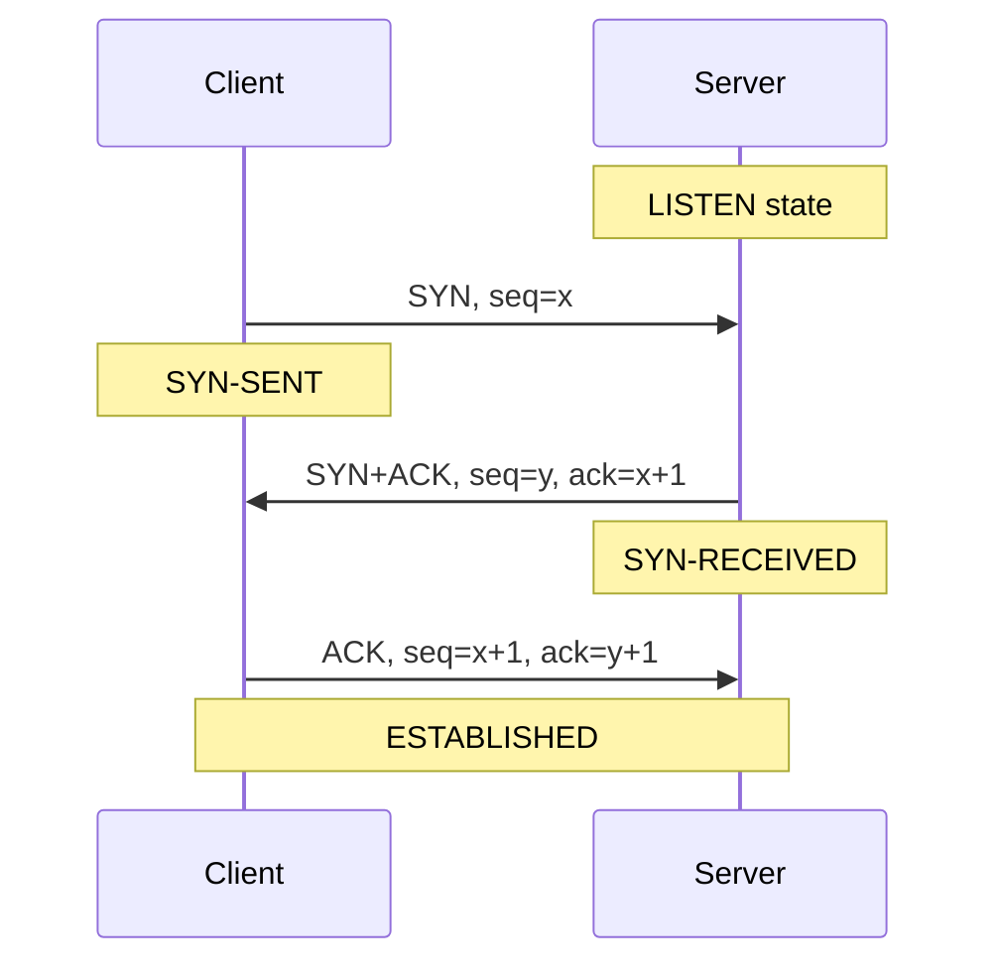
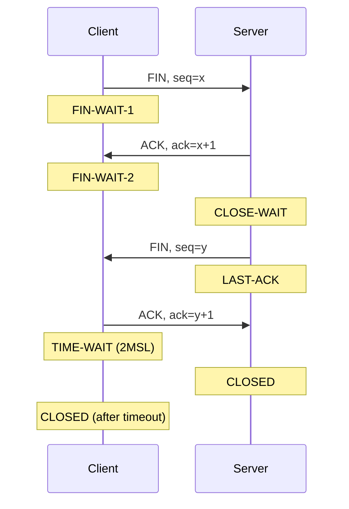
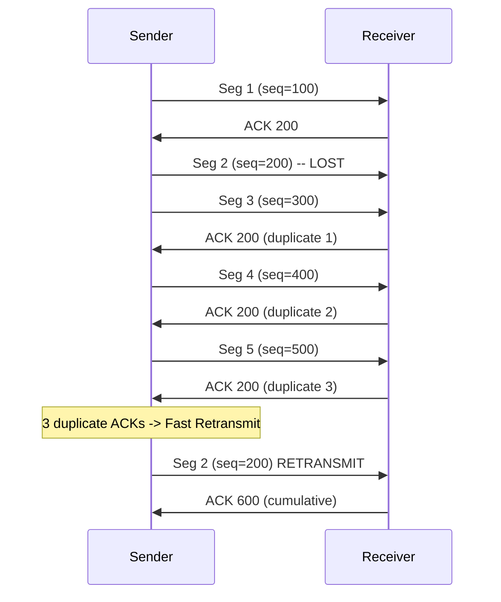
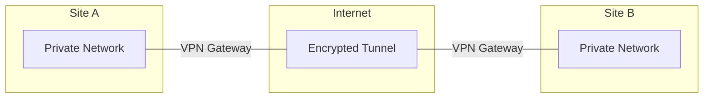

# Chapter 15 — Transmission Control Protocol (TCP)

[Repository Guide](../../README.md) | [English](Concepts_Lecture.md) | [한국어](Concepts_Lecture.ko.md)

> **Last Updated:** 2026-10-26
>
> TCP/IP Protocol Suite, Forouzan, Ch 15

> **Learning Objectives:**
> 1. Explain TCP connection establishment (three-way handshake) and termination
> 2. Describe TCP flow control and sliding window mechanism
> 3. Analyze TCP congestion control algorithms

---

## Table of Contents

- [1. TCP Services](#1-tcp-services)
  - [1.1 Stream Delivery](#11-stream-delivery)
  - [1.2 Sending and Receiving Buffers](#12-sending-and-receiving-buffers)
  - [1.3 Segments](#13-segments)
  - [1.4 Full-Duplex Service](#14-full-duplex-service)
  - [1.5 Connection-Oriented Service](#15-connection-oriented-service)
  - [1.6 Reliable Service](#16-reliable-service)
- [2. TCP Segment Format](#2-tcp-segment-format)
  - [2.1 Header Fields](#21-header-fields)
  - [2.2 Control Flags](#22-control-flags)
- [3. TCP Numbering System](#3-tcp-numbering-system)
  - [3.1 Byte Numbers](#31-byte-numbers)
  - [3.2 Sequence Number](#32-sequence-number)
  - [3.3 Acknowledgment Number](#33-acknowledgment-number)
- [4. TCP Connection Management](#4-tcp-connection-management)
  - [4.1 Three-Way Handshake (Connection Establishment)](#41-three-way-handshake-connection-establishment)
  - [4.2 Data Transfer](#42-data-transfer)
  - [4.3 Four-Way Handshake (Connection Termination)](#43-four-way-handshake-connection-termination)
  - [4.4 Half-Close](#44-half-close)
- [5. TCP Flow Control](#5-tcp-flow-control)
  - [5.1 Sliding Window in TCP](#51-sliding-window-in-tcp)
  - [5.2 Window Size Adjustment](#52-window-size-adjustment)
- [6. TCP Error Control](#6-tcp-error-control)
  - [6.1 Retransmission](#61-retransmission)
  - [6.2 Fast Retransmit](#62-fast-retransmit)
- [7. TCP Congestion Control](#7-tcp-congestion-control)
  - [7.1 Slow Start](#71-slow-start)
  - [7.2 Congestion Avoidance](#72-congestion-avoidance)
  - [7.3 Fast Recovery](#73-fast-recovery)
- [8. TCP vs. UDP Communication](#8-tcp-vs-udp-communication)
- [9. VPN and Tunneling](#9-vpn-and-tunneling)
  - [9.1 VPN Overview](#91-vpn-overview)
  - [9.2 Tunneling](#92-tunneling)
  - [9.3 VPN Protocols](#93-vpn-protocols)
- [10. Appendix](#10-appendix)
  - [10.1 TCP State Diagram (Simplified)](#101-tcp-state-diagram-simplified)
  - [10.2 Maximum Segment Size (MSS)](#102-maximum-segment-size-mss)
  - [10.3 TCP Options](#103-tcp-options)
- [Summary](#summary)
- [Self-Check Questions](#self-check-questions)

---

<br>

## 1. TCP Services

**TCP (Transmission Control Protocol)** lies between the application layer and the network layer, and serves as the intermediary between the application programs and the network operations.

### 1.1 Stream Delivery

TCP is a **stream-oriented protocol**:
- It allows the sending process to deliver data as a **stream of bytes**.
- It allows the receiving process to obtain data as a **stream of bytes**.
- TCP creates an illusion of a continuous stream between sender and receiver.

```text
Sending              Stream of bytes              Receiving
process  -------> [==================] -------> process
  |                                                |
  TCP                                            TCP
```

*Figure 1. Byte stream delivery in TCP*

### 1.2 Sending and Receiving Buffers

Since the sending and receiving processes may produce and consume data at **different speeds**, TCP needs **buffers** for storage:

**Sending Buffer:**
- It receives data as a stream of bytes from the application process.
- It makes data into appropriate **segments** and transfers them to the network.

**Receiving Buffer:**
- It receives segments from the network.
- It reassembles segments into data and delivers the data as a stream of bytes to the application process.

```text
Sending process                              Receiving process
      |                                            |
  +---v--------+                          +--------v---+
  |   Buffer   |                          |   Buffer   |
  |  [Sent|    |  Segment   Segment       |   [Not |   |
  |      Not   |  [H|||||]  [H|||||] -->  |    read|   |
  |      sent] |                          |        ]   |
  +---+--------+                          +--------+---+
  Next byte    Next byte              Next byte    Next byte
  to send      to write               to receive   to read
```

*Figure 2. Sending and receiving buffers in TCP*

### 1.3 Segments

The IP layer needs to send data in **packets**, not as a stream of bytes. At the transport layer, TCP groups a number of bytes together into a packet called a **segment**.

- Each segment consists of a header (20-60 bytes) and data.
- Segments are encapsulated in IP datagrams for transmission.

### 1.4 Full-Duplex Service

TCP provides **full-duplex** communication:
- Data can flow in both directions simultaneously.
- Each direction has its own sequence numbers and acknowledgments.
- **Piggybacking**: ACK information is attached to data segments traveling in the opposite direction.

### 1.5 Connection-Oriented Service

TCP is a **connection-oriented** protocol:
- A **virtual connection** (not physical) must be established before data transfer.
- There are three phases: connection establishment, data transfer, and connection termination.
- Both endpoints must agree to the connection.

### 1.6 Reliable Service

TCP provides **reliable** delivery:
- It uses **acknowledgment packets** (ACK) to confirm receipt.
- It retransmits lost or corrupted segments.
- It guarantees in-order delivery.

---

<br>

## 2. TCP Segment Format

### 2.1 Header Fields

```text
 0                   1                   2                   3
 0 1 2 3 4 5 6 7 8 9 0 1 2 3 4 5 6 7 8 9 0 1 2 3 4 5 6 7 8 9 0 1
+-+-+-+-+-+-+-+-+-+-+-+-+-+-+-+-+-+-+-+-+-+-+-+-+-+-+-+-+-+-+-+-+
|          Source Port          |       Destination Port        |
+-+-+-+-+-+-+-+-+-+-+-+-+-+-+-+-+-+-+-+-+-+-+-+-+-+-+-+-+-+-+-+-+
|                        Sequence Number                        |
+-+-+-+-+-+-+-+-+-+-+-+-+-+-+-+-+-+-+-+-+-+-+-+-+-+-+-+-+-+-+-+-+
|                    Acknowledgment Number                      |
+-+-+-+-+-+-+-+-+-+-+-+-+-+-+-+-+-+-+-+-+-+-+-+-+-+-+-+-+-+-+-+-+
| Offset| Rsrvd |U|A|P|R|S|F|           Window Size            |
+-+-+-+-+-+-+-+-+-+-+-+-+-+-+-+-+-+-+-+-+-+-+-+-+-+-+-+-+-+-+-+-+
|           Checksum            |        Urgent Pointer         |
+-+-+-+-+-+-+-+-+-+-+-+-+-+-+-+-+-+-+-+-+-+-+-+-+-+-+-+-+-+-+-+-+
|                    Options + Padding (0-40 bytes)             |
+-+-+-+-+-+-+-+-+-+-+-+-+-+-+-+-+-+-+-+-+-+-+-+-+-+-+-+-+-+-+-+-+
```

*Figure 3. TCP segment header format*

| Field | Size | Description |
|-------|------|-------------|
| Source Port | 16 bits | Sending process port number |
| Destination Port | 16 bits | Receiving process port number |
| Sequence Number | 32 bits | Byte number of first data byte in segment |
| Acknowledgment Number | 32 bits | Next byte number expected from other side |
| Data Offset (HLEN) | 4 bits | Header length in 4-byte words |
| Reserved | 6 bits | Reserved for future use |
| Control Flags | 6 bits | URG, ACK, PSH, RST, SYN, FIN |
| Window Size | 16 bits | Receiver's available buffer space (in bytes) |
| Checksum | 16 bits | Error detection (mandatory, includes pseudoheader) |
| Urgent Pointer | 16 bits | Points to urgent data end (valid when URG=1) |

*Table 1. TCP header fields*

### 2.2 Control Flags

| Flag | Name | Description |
|------|------|-------------|
| URG | Urgent | Urgent pointer field is valid |
| ACK | Acknowledgment | Acknowledgment number field is valid |
| PSH | Push | Request immediate delivery to application |
| RST | Reset | Reset the connection |
| SYN | Synchronize | Initiate connection (synchronize sequence numbers) |
| FIN | Finish | No more data from sender (close connection) |

*Table 2. TCP control flags*

---

<br>

## 3. TCP Numbering System

The TCP header has no segment number field. Instead, TCP keeps track of segments using **sequence numbers** and **acknowledgment numbers**, which, unlike frame numbers in the data link layer, refer to **bytes** rather than segments.

### 3.1 Byte Numbers

When TCP receives bytes of data from the process, it stores them in the sending buffer and **numbers them**:
- Numbering starts with a **randomly generated** number (0 to $2^{32} - 1$).
- This random initial sequence number (ISN) makes sequence number prediction attacks harder and reduces the chance of confusion with segments from old connections.

### 3.2 Sequence Number

The value in the **sequence number field** of a segment defines the number assigned **to the first data byte** contained in that segment.

Example:
- The first data byte is numbered 1000, and each segment carries 100 bytes.
- Segment 1: seq = 1000 (bytes 1000-1099)
- Segment 2: seq = 1100 (bytes 1100-1199)
- Segment 3: seq = 1200 (bytes 1200-1299)

### 3.3 Acknowledgment Number

The value of the **acknowledgment field** in a segment defines the **number of the next byte a party expects to receive**.

> **Key Point:** The acknowledgment number is **cumulative**. ACK = 1200 means that the receiver has received all bytes up to byte 1199 and expects byte 1200 next.

---

<br>

## 4. TCP Connection Management

### 4.1 Three-Way Handshake (Connection Establishment)



*Figure 4. Connection establishment using the three-way handshake*

1. **SYN**: The client sends a SYN segment with initial sequence number x.
2. **SYN+ACK**: The server responds with a SYN+ACK segment carrying its own initial sequence number y and acknowledges the client's SYN with ack = x+1.
3. **ACK**: The client acknowledges the server's SYN with ack = y+1.

The SYN flag consumes one sequence number (even though it carries no data), so the ACK is x+1 and y+1.

### 4.2 Data Transfer

After connection establishment, data flows in both directions:
- Each segment carries a sequence number and (usually) an acknowledgment number.
- Piggybacking allows an ACK to be included in data segments.
- The window size field provides flow control information.

### 4.3 Four-Way Handshake (Connection Termination)



*Figure 5. Connection termination using the four-way handshake*

1. **FIN**: The client sends a FIN segment when it has no more data to send.
2. **ACK**: The server acknowledges the FIN.
3. **FIN**: The server sends its own FIN when it is done sending.
4. **ACK**: The client acknowledges the server's FIN and enters the TIME-WAIT state.

**TIME-WAIT state**: The side that closes first (the client in this example) waits for 2MSL, twice the MSL (Maximum Segment Lifetime), before closing. This wait serves the following purposes:
- If the final ACK is lost and the server retransmits its FIN, the ACK can be sent again.
- Old segments from this connection expire before a new connection uses the same ports.

### 4.4 Half-Close

TCP supports **half-close**, where one side can stop sending while still receiving:
- After sending FIN, a host can still receive data.
- This is useful when a client has finished sending all data but needs to receive results.

---

<br>

## 5. TCP Flow Control

### 5.1 Sliding Window in TCP

TCP uses a **sliding window** protocol for flow control:

- The flow control window size is determined by the **receiver's available buffer space** (rwnd, the receive window).
- The receiver advertises its window size in every ACK segment it sends.
- Taking the congestion window cwnd (Section 7) into account, the sender can send up to `min(cwnd, rwnd)` bytes of unacknowledged data.

```text
     Sent and ACKed | Sent, not ACKed | Can send | Cannot send
     [=============] [===============] [========] [............]
                     |<-------- Window -------->|
```

*Figure 6. TCP send window and byte regions*

### 5.2 Window Size Adjustment

- The receiver can reduce the advertised window size when its buffer fills up, even down to 0.
- **Zero window**: The receiver advertises a window size of 0, stopping the sender.
- **Window probe**: The sender periodically sends 1-byte probes to check whether the window has reopened.
- **Silly window syndrome**: A problem in which very small segments are sent. It is solved by Nagle's algorithm on the sender side and Clark's solution on the receiver side.

---

<br>

## 6. TCP Error Control

### 6.1 Retransmission

TCP retransmits a segment in the following two cases:
- **Retransmission timer expiry**: No ACK is received within the timeout value, the **RTO (Retransmission Timeout)**. The RTO is calculated dynamically from RTT measurements.
- **Three duplicate ACKs**: The segment is retransmitted without waiting for the timer to expire (fast retransmit, Section 6.2).

RTO calculation:
```text
SRTT = (1 - alpha) * SRTT + alpha * RTT_sample     (Smoothed RTT)
RTTVAR = (1 - beta) * RTTVAR + beta * |SRTT - RTT_sample|
RTO = SRTT + 4 * RTTVAR
```

### 6.2 Fast Retransmit

Instead of waiting for the timer to expire:
- If the sender receives **three duplicate ACKs** (4 ACKs total with the same acknowledgment number), it retransmits the lost segment immediately.
- This is faster than waiting for the RTO timeout.



*Figure 7. Fast retransmit triggered by three duplicate ACKs*

---

<br>

## 7. TCP Congestion Control

### 7.1 Slow Start

When a connection begins or after a timeout:
1. Set **cwnd = 1 MSS** (Maximum Segment Size).
2. For each ACK received, increase cwnd by 1 MSS.
3. As a result, cwnd doubles every round-trip time and grows **exponentially** (1, 2, 4, 8, 16, ...).
4. Continue until cwnd reaches **ssthresh** (slow start threshold).

### 7.2 Congestion Avoidance

After cwnd >= ssthresh:
1. For each round-trip time, increase cwnd by 1 MSS.
2. cwnd grows **linearly** (additive increase).
3. If packet loss is detected by a timeout:
   - Set ssthresh = cwnd / 2.
   - Set cwnd = 1 MSS.
   - Return to slow start.

### 7.3 Fast Recovery

When loss is detected by **3 duplicate ACKs** rather than by a timeout:
1. Set ssthresh = cwnd / 2.
2. Set cwnd = ssthresh + 3 MSS, because the three duplicate ACKs mean that three segments have left the network.
3. For each further duplicate ACK, increase cwnd by 1 MSS; when an ACK for new data arrives, set cwnd = ssthresh and enter congestion avoidance (slow start is skipped).

```text
cwnd
 ^
 |              /\
 |             /  \     /------
 |            /    \   /
 |           /      \ / congestion
 |          /        |  avoidance
 |         / slow    |
 |        /  start   | fast
 |       /           | recovery
 |      /            |
 |     /             |
 |    /              |
 |   /               |
 +--/----------------+-------> Time
    ssthresh    loss detected
```

*Figure 8. Rough sketch of cwnd across congestion control phases*

> **Key Point:** TCP congestion control uses AIMD (Additive Increase, Multiplicative Decrease) to probe for available bandwidth while quickly backing off during congestion.

---

<br>

## 8. TCP vs. UDP Communication

| Feature | TCP | UDP |
|---------|-----|-----|
| Data unit | Segment | Datagram |
| Connection | Connection-oriented | Connectionless |
| Reliability | Reliable (ACK, retransmit) | Unreliable |
| Ordering | In-order delivery | No ordering |
| Flow control | Sliding window | None |
| Congestion control | Slow start, AIMD | None |
| Speed | Slower (overhead) | Faster |
| Header | 20-60 bytes | 8 bytes |
| Delivery model | Stream-based | Message-based |

*Table 3. Comparison of TCP and UDP*

---

<br>

## 9. VPN and Tunneling

### 9.1 VPN Overview

A **Virtual Private Network (VPN)** provides a secure, encrypted connection over a public network (like the Internet):



*Figure 9. Encrypted tunnel between VPN gateways*

**VPN Benefits:**
- **Confidentiality**: Encryption protects data from eavesdropping.
- **Authentication**: It verifies the identity of communicating parties.
- **Integrity**: It ensures that data has not been modified in transit.
- **Cost savings**: It uses the public Internet instead of dedicated private lines.

### 9.2 Tunneling

**Tunneling** encapsulates one protocol's packets inside another protocol:

```text
Original packet: [IP Header | TCP | Data]
                           |
                   Encapsulation
                           |
Tunneled packet:  [New IP Hdr | Tunnel Hdr | IP Header | TCP | Data]
                  |<---- Outer ---->|<------- Inner (original) ------>|
```

*Figure 10. Packet encapsulation in tunneling*

**Types of tunneling:**
- **IP-in-IP**: It simply encapsulates an IP packet within an IP packet (RFC 2003).
- **GRE (Generic Routing Encapsulation)**: It tunnels packets of any protocol in IP.
- **L2TP (Layer 2 Tunneling Protocol)**: It tunnels Layer 2 frames over IP.
- **IPsec Tunnel Mode**: It provides an encrypted tunnel with authentication.

### 9.3 VPN Protocols

| Protocol | Layer | Encryption | Authentication |
|----------|-------|-----------|----------------|
| PPTP | Data Link | MPPE | MS-CHAPv2 |
| L2TP/IPsec | Data Link + Network | AES, 3DES | Certificate, PSK |
| IPsec | Network | AES, 3DES | IKE, Certificate |
| SSL/TLS VPN | Transport | AES, ChaCha20 | Certificate |
| WireGuard | Network | ChaCha20-Poly1305 | Curve25519 keys |
| OpenVPN | Application | AES, Blowfish | Certificate, PSK |

*Table 4. Comparison of VPN protocols*

**IPsec modes:**
- **Transport Mode**: Only the payload is encrypted, and the original IP header remains visible.
- **Tunnel Mode**: The entire original packet is encrypted and encapsulated in a new IP packet.

> **[Information Security]** The confidentiality, integrity, and authentication of a VPN are implemented with the cryptographic techniques studied in Information Security. Symmetric-key ciphers such as AES and ChaCha20 in Table 4, together with message authentication codes, encrypt the data passing through the tunnel and detect modification, while authentication with certificates or pre-shared keys (PSK) and key exchange protocols such as IKE verify the identities of both ends and establish the keys used for this encryption.

---

<br>

## 10. Appendix

### 10.1 TCP State Diagram (Simplified)

```text
CLOSED ---(active open, send SYN)---> SYN-SENT
SYN-SENT ---(receive SYN+ACK, send ACK)---> ESTABLISHED
ESTABLISHED ---(send FIN)---> FIN-WAIT-1
FIN-WAIT-1 ---(receive ACK)---> FIN-WAIT-2
FIN-WAIT-2 ---(receive FIN, send ACK)---> TIME-WAIT
TIME-WAIT ---(2MSL timeout)---> CLOSED

CLOSED ---(passive open)---> LISTEN
LISTEN ---(receive SYN, send SYN+ACK)---> SYN-RECEIVED
SYN-RECEIVED ---(receive ACK)---> ESTABLISHED
ESTABLISHED ---(receive FIN, send ACK)---> CLOSE-WAIT
CLOSE-WAIT ---(send FIN)---> LAST-ACK
LAST-ACK ---(receive ACK)---> CLOSED
```

*Figure 11. Simplified TCP state transitions*

### 10.2 Maximum Segment Size (MSS)

- MSS is negotiated during the three-way handshake via TCP options.
- If MSS is not specified, the default is 536 bytes.
- The typical Ethernet MSS is 1460 bytes for IPv4 without options (1500 MTU - 20 IP header - 20 TCP header).
- MSS does not include the TCP and IP headers.

### 10.3 TCP Options

| Option | Kind | Description |
|--------|------|-------------|
| MSS | 2 | Maximum Segment Size |
| Window Scale | 3 | Allows window > 65,535 bytes |
| SACK Permitted | 4 | Selective Acknowledgment allowed |
| SACK | 5 | Selective Acknowledgment blocks |
| Timestamps | 8 | RTT measurement and PAWS |

*Table 5. Common TCP options*

---

<br>

## Summary

| Concept | Key Summary |
|---------|-----------|
| TCP | TCP is a connection-oriented, reliable, stream-oriented transport protocol. |
| Stream Delivery | TCP treats data as a continuous stream of bytes, not as individual messages. |
| Buffers | Sending and receiving buffers absorb speed mismatches between the processes. |
| Segments | TCP groups bytes into segments for transmission. |
| Three-Way Handshake | A connection is established with three segments: SYN, SYN+ACK, and ACK. |
| Four-Way Handshake | A connection is terminated with four segments: FIN, ACK, FIN, and ACK. |
| Sequence/ACK Numbers | Sequence and acknowledgment numbers track data at the byte level, and acknowledgments are cumulative. |
| Sliding Window | Flow control is achieved by the receiver advertising its window size to limit what the sender may send. |
| Congestion Control | TCP responds to network congestion with slow start, congestion avoidance, fast retransmit, and fast recovery. |
| VPN | A VPN builds an encrypted tunnel over a public network to provide secure communication. |

---

<br>

## Self-Check Questions

1. **Sequence number calculation:** A 5,000-byte file is sent over a TCP connection. The first byte is numbered 10,001, and the data is sent in five segments of 1,000 bytes each. Find the sequence number of each segment and the range of bytes it carries.

   <details>
   <summary>Answer</summary>

   The sequence number is the number of the first byte carried by the segment, so the values are as follows.

   - Segment 1: seq = 10,001 (bytes 10,001-11,000)
   - Segment 2: seq = 11,001 (bytes 11,001-12,000)
   - Segment 3: seq = 12,001 (bytes 12,001-13,000)
   - Segment 4: seq = 13,001 (bytes 13,001-14,000)
   - Segment 5: seq = 14,001 (bytes 14,001-15,000)

   </details>

2. **Handshake and acknowledgment numbers:** The client's ISN is 5,000 and the server's ISN is 9,000. After the three-way handshake, the client sends one segment carrying 200 bytes of data, and the server acknowledges it. Find (a) the ack value of the SYN+ACK segment, (b) the seq and ack values of the third segment (ACK) of the handshake, (c) the seq value of the client's data segment, and (d) the ack value of the server's acknowledgment.

   <details>
   <summary>Answer</summary>

   (a) The SYN consumes one sequence number, so ack = 5,001. (b) seq = 5,001 and ack = 9,001. (c) An ACK segment carrying no data consumes no sequence number, so the first data segment also has seq = 5,001. (d) The server has received bytes 5,001-5,200, so ack = 5,201.

   </details>

3. **RTO calculation:** Let α = 1/8 and β = 1/4, with current SRTT = 100 ms and RTTVAR = 20 ms. When a new RTT measurement is 140 ms, apply the formulas of Section 6.1 in order from top to bottom and find SRTT, RTTVAR, and RTO.

   <details>
   <summary>Answer</summary>

   SRTT = 7/8 × 100 + 1/8 × 140 = 87.5 + 17.5 = 105 ms. Using the new SRTT, RTTVAR = 3/4 × 20 + 1/4 × |105 - 140| = 15 + 8.75 = 23.75 ms. Therefore, RTO = 105 + 4 × 23.75 = 105 + 95 = 200 ms.

   </details>

4. **Congestion window trace:** A connection starts with cwnd = 1 MSS and ssthresh = 8 MSS, and ACKs for the whole window arrive every RTT without loss. (a) Find cwnd at the end of each RTT until cwnd reaches 12 MSS. (b) If loss is detected by three duplicate ACKs at cwnd = 12 MSS, what happens to ssthresh and cwnd? (c) What happens if a timeout occurs at the same point instead?

   <details>
   <summary>Answer</summary>

   (a) In slow start, cwnd doubles every RTT and becomes 2, 4, and 8 MSS. When cwnd reaches ssthresh = 8 MSS, TCP switches to congestion avoidance and cwnd grows by 1 MSS per RTT to 9, 10, 11, and 12 MSS, so cwnd reaches 12 MSS after 7 RTTs. (b) ssthresh = 12 / 2 = 6 MSS and cwnd = 6 + 3 = 9 MSS, and TCP enters fast recovery. When an ACK for new data arrives, cwnd is reduced to 6 MSS and congestion avoidance continues. (c) ssthresh = 6 MSS and cwnd = 1 MSS, and TCP starts again from slow start.

   </details>

5. **Amount of data that can be sent:** The receive buffer is 4,000 bytes, and 1,000 bytes have been received but not yet read by the application. When the sender's cwnd is 2,000 bytes, find the rwnd advertised by the receiver and the maximum amount of data the sender can have outstanding without acknowledgment.

   <details>
   <summary>Answer</summary>

   rwnd is the free space in the receive buffer, so it is 4,000 - 1,000 = 3,000 bytes. The sender can send up to min(cwnd, rwnd) = min(2,000, 3,000) = 2,000 bytes. In this case, the amount sent is limited by the congestion window rather than by the receiver's buffer.

   </details>
