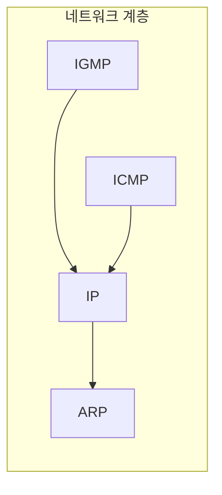
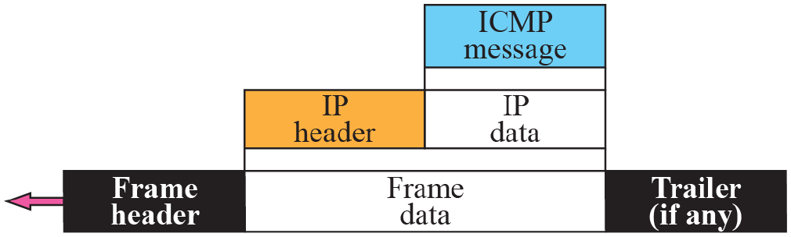
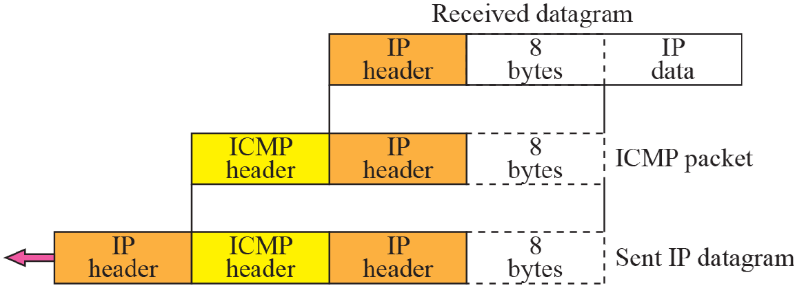
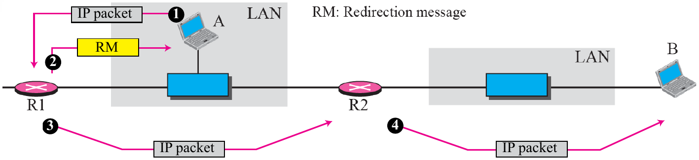
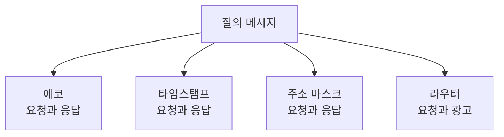
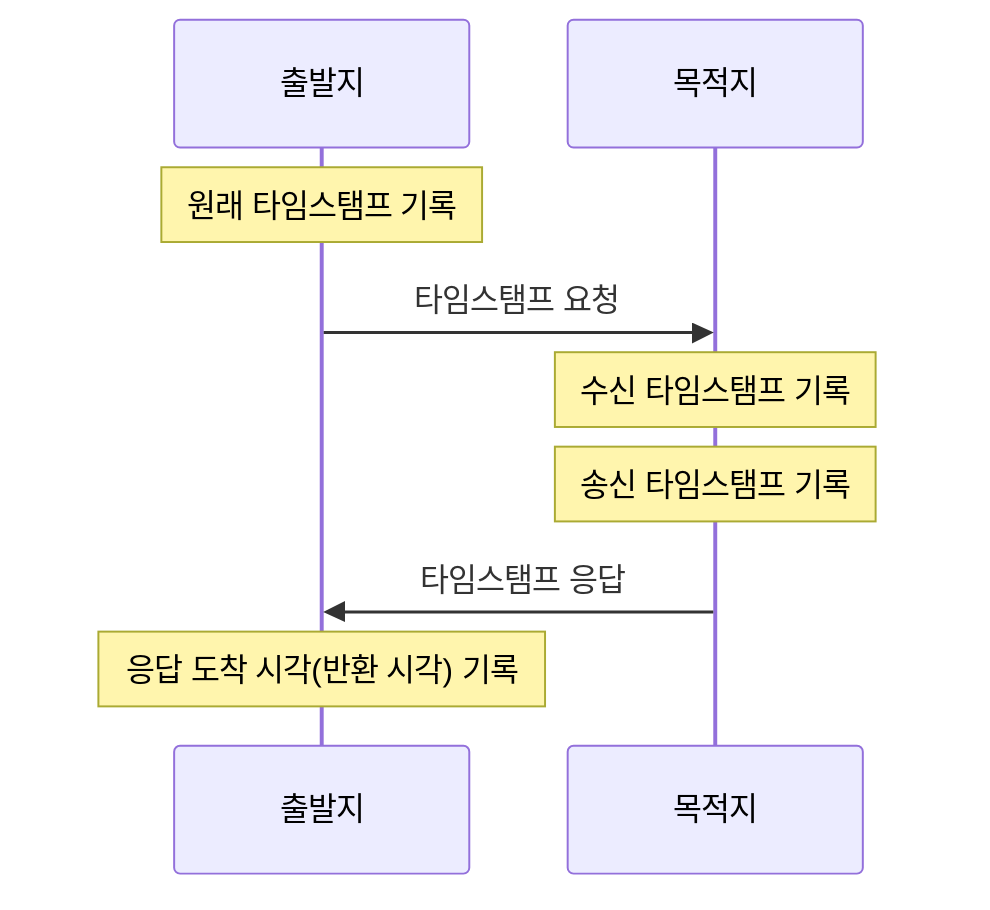
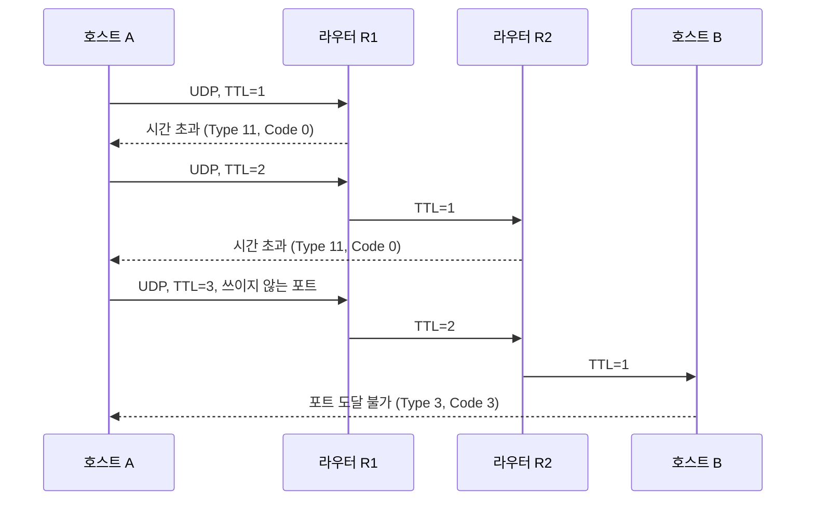
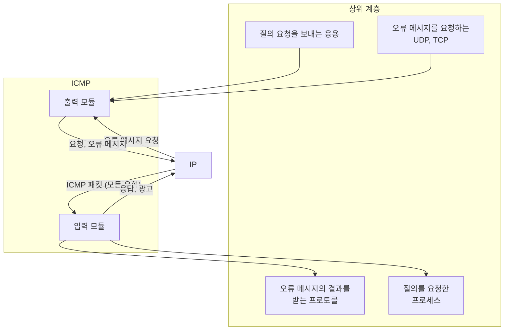
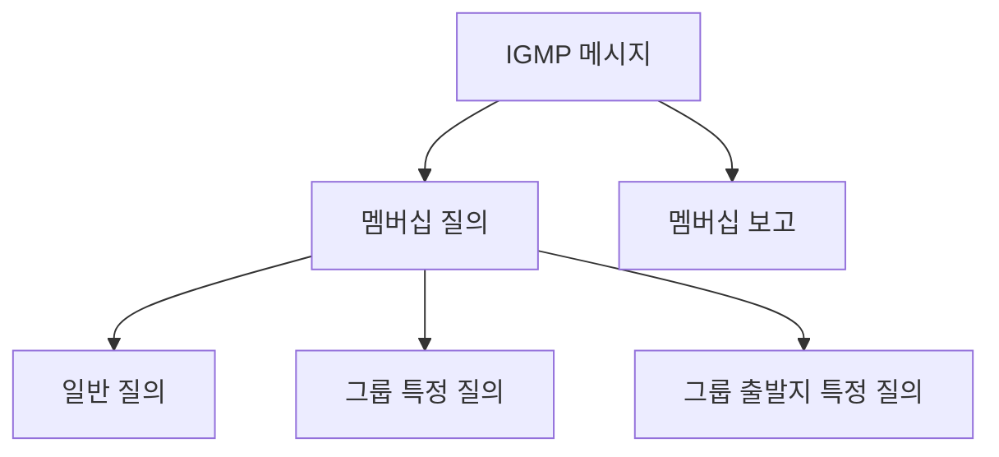

# 16장 — ICMPv4와 IGMP

[레포지토리 안내](../../README.ko.md) | [English](Concepts_Lecture.md) | [한국어](Concepts_Lecture.ko.md)

> **최종 수정일:** 2026-11-27
>
> Computer Networking: A Top-Down Approach, Kurose and Ross, Ch 5; TCP/IP Protocol Suite, Forouzan, Ch 9, 12

> **학습 목표:**
> 1. IP에 없는 오류 보고와 질의 기능을 ICMP가 어떻게 보완하는지, ICMP 메시지가 어떻게 캡슐화되는지 설명할 수 있다
> 2. ICMP 메시지를 오류 보고 메시지와 질의 메시지로 분류하고 각 메시지의 형식과 코드를 해석할 수 있다
> 3. 오류 메시지를 만들지 않는 경우와 오류 메시지의 데이터 필드 구성을 설명할 수 있다
> 4. 타임스탬프 메시지로 왕복 시간과 시계 차이를 구하고 ICMP 체크섬을 계산할 수 있다
> 5. ping과 traceroute가 ICMP를 이용하는 방식을 설명하고 그 출력을 해석할 수 있다
> 6. IPv4 멀티캐스트 주소의 구조와 IGMP의 메시지와 동작을 설명할 수 있다

---

## 목차

- [1. ICMP가 필요한 이유](#1-icmp가-필요한-이유)
  - [1.1 IP의 두 가지 결함](#11-ip의-두-가지-결함)
  - [1.2 네트워크 계층에서 ICMP의 위치](#12-네트워크-계층에서-icmp의-위치)
  - [1.3 ICMP의 캡슐화](#13-icmp의-캡슐화)
- [2. ICMP 메시지의 형식과 종류](#2-icmp-메시지의-형식과-종류)
  - [2.1 두 가지 범주](#21-두-가지-범주)
  - [2.2 메시지의 일반 형식](#22-메시지의-일반-형식)
  - [2.3 Type과 Code의 정리](#23-type과-code의-정리)
- [3. 오류 보고 메시지](#3-오류-보고-메시지)
  - [3.1 오류 보고의 원칙](#31-오류-보고의-원칙)
  - [3.2 오류 메시지를 만들지 않는 경우](#32-오류-메시지를-만들지-않는-경우)
  - [3.3 오류 메시지의 데이터 필드](#33-오류-메시지의-데이터-필드)
  - [3.4 목적지 도달 불가](#34-목적지-도달-불가)
  - [3.5 출발지 억제](#35-출발지-억제)
  - [3.6 시간 초과](#36-시간-초과)
  - [3.7 매개변수 문제](#37-매개변수-문제)
  - [3.8 재지정](#38-재지정)
- [4. 질의 메시지](#4-질의-메시지)
  - [4.1 질의 메시지의 종류](#41-질의-메시지의-종류)
  - [4.2 에코 요청과 응답](#42-에코-요청과-응답)
  - [4.3 타임스탬프 요청과 응답](#43-타임스탬프-요청과-응답)
  - [4.4 사용이 중단된 질의 메시지](#44-사용이-중단된-질의-메시지)
- [5. ICMP 체크섬](#5-icmp-체크섬)
- [6. 디버깅 도구](#6-디버깅-도구)
  - [6.1 ping](#61-ping)
  - [6.2 traceroute](#62-traceroute)
- [7. ICMP 패키지](#7-icmp-패키지)
- [8. ICMP와 보안](#8-icmp와-보안)
- [9. 멀티캐스팅과 멀티캐스트 주소](#9-멀티캐스팅과-멀티캐스트-주소)
  - [9.1 유니캐스팅, 멀티캐스팅, 브로드캐스팅](#91-유니캐스팅-멀티캐스팅-브로드캐스팅)
  - [9.2 IPv4 멀티캐스트 주소](#92-ipv4-멀티캐스트-주소)
  - [9.3 데이터 링크 계층에서의 멀티캐스트 전달](#93-데이터-링크-계층에서의-멀티캐스트-전달)
- [10. IGMP](#10-igmp)
  - [10.1 그룹 관리](#101-그룹-관리)
  - [10.2 IGMP 메시지](#102-igmp-메시지)
  - [10.3 호스트에서의 동작](#103-호스트에서의-동작)
  - [10.4 라우터에서의 동작](#104-라우터에서의-동작)
  - [10.5 변수와 타이머](#105-변수와-타이머)
  - [10.6 캡슐화와 이전 버전과의 호환](#106-캡슐화와-이전-버전과의-호환)
- [개념 적용](#개념-적용)
- [요약](#요약)
- [점검 문제](#점검-문제)
- [참고 문헌](#참고-문헌)

---

<br>

## 1. ICMP가 필요한 이유

### 1.1 IP의 두 가지 결함

IP는 신뢰성이 없고 연결이 없는 데이터그램 전달 프로토콜이며, 오류 제어가 없는 최선형 전달 서비스를 제공한다(11장). 이 성질 때문에 IP에는 두 가지 결함이 있다.

첫째, IP에는 **오류 보고와 오류 수정 메커니즘이 없다.** 무언가 잘못되면 어떻게 되는가? 라우터가 최종 목적지로 가는 경로를 찾지 못하거나 생존 시간(TTL) 필드가 0이 되어 데이터그램을 버려야 할 수 있다. 최종 목적지 호스트가 정해진 시간 안에 데이터그램의 단편을 모두 받지 못해 받은 단편을 모두 버려야 할 수도 있다. 이런 상황에서 오류가 생겼다는 사실을 원래 호스트에 알리는 내장 메커니즘이 IP에는 없다.

둘째, IP에는 **호스트와 관리를 위한 질의 메커니즘이 없다.** 호스트는 때로 라우터나 다른 호스트가 살아 있는지 알아야 하고, 네트워크 관리자는 다른 호스트나 라우터에게서 정보를 얻어야 한다.

> **용어 정의:** **ICMP(Internet Control Message Protocol)** 는 호스트와 라우터가 서로 네트워크 계층의 정보, 특히 오류 보고와 질의를 주고받는 데 쓰는 프로토콜로, IP의 두 결함을 보완하는 IP의 동반 프로토콜이다.

ICMP는 오류를 수정하지 않고 보고만 한다. 오류 수정은 상위 계층 프로토콜에 맡긴다. HTTP 세션을 쓰다가 "Destination network unreachable" 같은 오류 메시지를 본 적이 있다면, 그 메시지는 ICMP에서 왔다. 어느 IP 라우터가 HTTP 요청에 지정된 호스트로 가는 경로를 찾지 못해, 그 오류를 알리는 ICMP 메시지를 만들어 보낸 것이다. 이 장에서 ICMP라 하면 IPv4용인 ICMPv4를 가리킨다. IPv6를 위해 정의된 새 버전인 ICMPv6은 기존의 유형과 코드를 재정리하고 "Packet Too Big" 유형처럼 IPv6의 새 기능에 필요한 유형과 코드를 더했으며, 24장에서 다룬다.

### 1.2 네트워크 계층에서 ICMP의 위치



*그림 1. 네트워크 계층에서 ICMP의 위치*

ICMP는 그 자체로 네트워크 계층 프로토콜이다. 그러나 ICMP 메시지는 예상과 달리 데이터 링크 계층으로 바로 넘어가지 않고, 먼저 IP 데이터그램 안에 캡슐화된 뒤 아래 계층으로 간다. Kurose와 Ross는 이 점을 들어, ICMP를 흔히 IP의 일부로 보지만 구조상으로는 IP 바로 위에 있다고 설명한다. TCP나 UDP 세그먼트가 IP 페이로드로 운반되듯이 ICMP 메시지도 IP 페이로드로 운반되기 때문이다.

### 1.3 ICMP의 캡슐화



*그림 2. IP 데이터그램과 프레임에 캡슐화된 ICMP 메시지*

IP 데이터그램의 프로토콜(protocol) 필드 값은 IP 데이터가 ICMP 메시지임을 나타내는 **1**이다. 호스트는 상위 계층 프로토콜 번호가 1인 IP 데이터그램을 받으면, TCP나 UDP로 역다중화하듯이 데이터그램의 내용을 ICMP로 역다중화한다.

> **핵심:** ICMP는 IP 데이터그램에 실려(프로토콜 번호 1) 전달되지만 전송 계층 프로토콜이 아니라 IP와 함께 동작하는 네트워크 계층 프로토콜이다. ICMP는 IP를 신뢰적으로 만들지 않으며, 문제를 알리는 피드백만 제공한다.

---

<br>

## 2. ICMP 메시지의 형식과 종류

### 2.1 두 가지 범주

ICMP 메시지는 크게 **오류 보고 메시지**와 **질의 메시지**로 나뉜다.

> **용어 정의:** **오류 보고 메시지(error-reporting message)** 는 라우터나 목적지 호스트가 IP 패킷을 처리하다가 만난 문제를 원래 출발지에 알리는 ICMP 메시지이다.

> **용어 정의:** **질의 메시지(query message)** 는 요청과 응답의 쌍으로 이루어져, 호스트나 네트워크 관리자가 라우터나 다른 호스트에게서 특정 정보를 얻게 하는 ICMP 메시지이다.

질의 메시지로 노드는 이웃을 알아낼 수 있고, 호스트는 자기 네트워크의 라우터를 발견하고 알 수 있으며, 라우터는 노드가 메시지를 다른 쪽으로 보내도록 도울 수 있다.

| 범주 | Type | 메시지 |
|:-----|:-----|:-----|
| 오류 보고 | 3 | 목적지 도달 불가(destination unreachable) |
| 오류 보고 | 4 | 출발지 억제(source quench) |
| 오류 보고 | 11 | 시간 초과(time exceeded) |
| 오류 보고 | 12 | 매개변수 문제(parameter problem) |
| 오류 보고 | 5 | 재지정(redirection) |
| 질의 | 8 또는 0 | 에코 요청 또는 응답(echo request or reply) |
| 질의 | 13 또는 14 | 타임스탬프 요청 또는 응답(timestamp request or reply) |

*표 1. 범주별 ICMP 메시지*

### 2.2 메시지의 일반 형식

ICMP 메시지는 8바이트 헤더와 가변 길이의 데이터 부분으로 이루어진다. 헤더의 일반 형식은 메시지 유형마다 다르지만, 처음 4바이트는 모든 메시지에 공통이다.

```text
 0               8               16                              31
+---------------+---------------+-------------------------------+
|     Type      |     Code      |           Checksum            |
+---------------+---------------+-------------------------------+
|                      Rest of the header                       |
+---------------------------------------------------------------+
|                         Data section                          |
|                                                               |
+---------------------------------------------------------------+
```

*그림 3. ICMP 메시지의 일반 형식*

- **Type(8비트):** 메시지의 유형이다.
- **Code(8비트):** 그 유형의 메시지를 보내는 구체적인 이유이다.
- **Checksum(16비트):** 메시지 전체에 대한 체크섬이다(5절).
- **헤더의 나머지 4바이트:** 메시지 유형마다 다르다.

오류 메시지의 데이터 부분은 오류를 일으킨 원래 패킷을 찾기 위한 정보를 담고, 질의 메시지의 데이터 부분은 질의의 종류에 따른 추가 정보를 담는다.

### 2.3 Type과 Code의 정리

| Type | Code | 메시지 | 범주 |
|:-----|:-----|:-----|:-----|
| 0 | 0 | 에코 응답 | 질의 |
| 3 | 0\~15 | 목적지 도달 불가 | 오류 보고 |
| 4 | 0 | 출발지 억제 | 오류 보고 |
| 5 | 0\~3 | 재지정 | 오류 보고 |
| 8 | 0 | 에코 요청 | 질의 |
| 9 | 0 | 라우터 광고 | 질의 |
| 10 | 0 | 라우터 요청 | 질의 |
| 11 | 0\~1 | 시간 초과 | 오류 보고 |
| 12 | 0\~1 | 매개변수 문제 | 오류 보고 |
| 13 | 0 | 타임스탬프 요청 | 질의 |
| 14 | 0 | 타임스탬프 응답 | 질의 |
| 17 | 0 | 주소 마스크 요청 | 질의 |
| 18 | 0 | 주소 마스크 응답 | 질의 |

*표 2. ICMP 메시지의 Type과 Code*

Kurose와 Ross는 같은 메시지를 표 3처럼 유형과 코드의 쌍으로 정리한다. 목적지 도달 불가 메시지를 코드마다 따로 적고, 라우터 요청을 "router discovery"로, Type 11 Code 0을 TTL 만료로, Type 12 Code 0을 잘못된 IP 헤더로 적는다는 점만 다르다.

| ICMP Type | Code | 설명 |
|:-----|:-----|:-----|
| 0 | 0 | 에코 응답 (ping에 대한) |
| 3 | 0 | 목적지 네트워크 도달 불가 |
| 3 | 1 | 목적지 호스트 도달 불가 |
| 3 | 2 | 목적지 프로토콜 도달 불가 |
| 3 | 3 | 목적지 포트 도달 불가 |
| 3 | 6 | 목적지 네트워크를 모름 |
| 3 | 7 | 목적지 호스트를 모름 |
| 4 | 0 | 출발지 억제 (혼잡 제어) |
| 8 | 0 | 에코 요청 |
| 9 | 0 | 라우터 광고 |
| 10 | 0 | 라우터 발견 |
| 11 | 0 | TTL 만료 |
| 12 | 0 | 잘못된 IP 헤더 |

*표 3. Kurose와 Ross가 정리한 주요 ICMP 메시지 유형*

---

<br>

## 3. 오류 보고 메시지

### 3.1 오류 보고의 원칙

ICMP의 주된 임무 가운데 하나는 오류를 보고하는 것이다. 전송 매체가 점점 신뢰성이 높아져도 오류는 여전히 생기며 처리해야 한다. IP는 신뢰성이 없는 프로토콜이므로 오류 검사와 오류 제어에 관여하지 않으며, ICMP는 부분적으로 이 약점을 보완하기 위해 설계되었다. ICMP가 다루는 오류는 목적지 도달 불가, 출발지 억제, 시간 초과, 매개변수 문제, 재지정의 다섯 가지이다.

ICMP는 오류 메시지를 항상 **원래 출발지**에 보낸다. 데이터그램 안에 있는 경로 정보는 출발지 IP 주소와 목적지 IP 주소뿐이므로, ICMP는 출발지 IP 주소를 써서 데이터그램을 만든 출발지에 오류 메시지를 보낸다. 데이터그램이 거쳐 온 중간 라우터에는 알릴 방법이 없다.

### 3.2 오류 메시지를 만들지 않는 경우

다음 경우에는 ICMP 오류 메시지를 만들지 않는다.

1. **ICMP 오류 메시지를 운반하는 데이터그램:** 오류 메시지에 대해 다시 오류 메시지를 만들면 오류 메시지가 끝없이 이어질 수 있기 때문이다.
2. **첫 번째 단편이 아닌 단편:** 단편화된 데이터그램은 첫 번째 단편에 대해서만 오류 메시지를 만든다. 한 데이터그램의 단편마다 오류 메시지를 보내면 같은 문제를 여러 번 알리게 되며, 상위 계층의 포트 번호가 들어 있는 첫 8바이트는 첫 번째 단편에만 있다.
3. **멀티캐스트 주소를 가진 데이터그램:** 데이터그램 하나가 여러 수신자에게 전달되므로, 수신자마다 오류 메시지를 보내면 출발지에 오류 메시지가 한꺼번에 몰릴 수 있다.
4. **127.0.0.0이나 0.0.0.0 같은 특수 주소를 가진 데이터그램:** 12장에서 보듯이 0.0.0.0은 아직 주소를 갖지 못한 호스트 자신을, 127.0.0.0 블록은 루프백을 가리키므로, 이런 주소로는 오류 메시지를 원래 출발지에 돌려보낼 수 없다.

> **주의:** ICMP 오류 메시지를 운반하는 데이터그램에는 오류 메시지를 만들지 않지만, 에코 요청 같은 질의 메시지를 운반하는 데이터그램에는 오류 메시지를 만든다. 질의 메시지는 오류 보고 메시지가 아니기 때문이다.

### 3.3 오류 메시지의 데이터 필드

모든 오류 메시지의 데이터 부분에는 원래 데이터그램의 **IP 헤더**와 그 데이터그램 데이터의 **처음 8바이트**가 들어간다.



*그림 4. 오류 메시지의 데이터 필드 구성*

원래 데이터그램의 헤더는 오류 메시지를 받은 원래 출발지에 그 데이터그램 자체에 관한 정보를 주기 위해 넣는다. 처음 8바이트를 넣는 이유는 6장과 8장에서 보듯이 UDP와 TCP 헤더의 처음 8바이트에 포트 번호(UDP와 TCP)와 순서 번호(TCP)가 들어 있기 때문이다. 출발지는 이 정보로 어느 프로토콜(TCP나 UDP)의 어느 프로세스에 오류를 알려야 하는지 판단한다. ICMP는 이렇게 오류 패킷을 만든 뒤 IP 데이터그램에 캡슐화한다. 원래 IP 헤더가 옵션 없이 20바이트이면 ICMP 오류 메시지는 8바이트 헤더와 28바이트 데이터로 36바이트가 되고, 새 IP 헤더 20바이트를 더해 56바이트의 IP 데이터그램으로 나간다.

### 3.4 목적지 도달 불가

> **용어 정의:** **목적지 도달 불가 메시지(destination-unreachable message)** 는 라우터가 데이터그램을 라우팅할 수 없거나 호스트가 데이터그램을 전달할 수 없어 데이터그램을 버렸을 때, 그 라우터나 호스트가 원래 출발지에 보내는 Type 3의 ICMP 메시지이다.

```text
+---------------+---------------+-------------------------------+
|    Type: 3    | Code: 0 to 15 |           Checksum            |
+---------------+---------------+-------------------------------+
|                        Unused (All 0s)                        |
+---------------------------------------------------------------+
|       Part of the received IP datagram including IP header    |
|            plus the first 8 bytes of datagram data            |
+---------------------------------------------------------------+
```

*그림 5. 목적지 도달 불가 메시지의 형식*

Code 필드가 데이터그램을 버린 이유를 나타낸다.

| Code | 의미 |
|:-----|:-----|
| 0 | 네트워크에 도달할 수 없다. 하드웨어 고장 때문일 수 있다. |
| 1 | 호스트에 도달할 수 없다. 이것도 하드웨어 고장 때문일 수 있다. |
| 2 | 프로토콜에 도달할 수 없다. 예를 들어 TCP로 전달해야 할 데이터그램을 받았는데 그 순간 TCP가 실행 중이 아닌 경우이다. |
| 3 | 포트에 도달할 수 없다. 데이터그램이 향하는 응용 프로그램(프로세스)이 그 순간 실행 중이 아니다. |
| 4 | 단편화가 필요하지만 데이터그램의 DF(do not fragment) 필드가 설정되어 있다. 단편화 없이는 라우팅할 수 없다. |
| 5 | 출발지 라우팅을 수행할 수 없다. 출발지 라우팅 옵션에 지정된 라우터 가운데 하나 이상을 방문할 수 없다. |
| 6 | 목적지 네트워크를 모른다. Code 0은 목적지 네트워크가 있지만 지금 도달할 수 없다는 뜻이고, Code 6은 라우터가 그 네트워크에 관한 정보를 전혀 갖고 있지 않다는 뜻이다. |
| 7 | 목적지 호스트를 모른다. Code 1과 달리 라우터가 목적지 호스트의 존재를 모른다. |
| 8 | 출발지 호스트가 고립되었다. |
| 9 | 목적지 네트워크와의 통신이 관리상 금지되어 있다. |
| 10 | 목적지 호스트와의 통신이 관리상 금지되어 있다. |
| 11 | 지정한 서비스 유형으로는 네트워크에 도달할 수 없다. 출발지가 가능한 서비스 유형을 요청했다면 라우팅할 수 있다. |
| 12 | 지정한 서비스 유형으로는 호스트에 도달할 수 없다. |
| 13 | 관리자가 필터를 걸어 호스트에 도달할 수 없다. |
| 14 | 호스트 우선순위 위반으로 도달할 수 없다. 요청한 우선순위가 그 목적지에 허용되지 않음을 라우터가 알린다. |
| 15 | 우선순위 차단(cutoff)으로 도달할 수 없다. 네트워크 운영자가 정한 최소 우선순위보다 낮은 우선순위로 데이터그램을 보낸 경우이다. |

*표 4. 목적지 도달 불가 메시지의 코드*

목적지 도달 불가 메시지는 라우터나 목적지 호스트가 만들 수 있다. **Code 2와 3은 목적지 호스트만** 만들 수 있고, 나머지 코드는 라우터만 만들 수 있다. 프로토콜과 포트는 목적지 호스트에 도착해서야 확인할 수 있기 때문이다.

Code 4는 11장의 경로 MTU 발견에서 쓰인다. 송신자가 DF 비트를 설정한 데이터그램을 보냈는데 경로 위의 어느 링크의 MTU가 더 작으면, 그 앞의 라우터는 데이터그램을 단편화할 수 없으므로 버리고 Code 4 메시지를 돌려보낸다. 송신자는 이 메시지로 경로의 MTU가 더 작다는 사실을 안다[1].

> **주의:** 라우터가 목적지 도달 불가 메시지를 보내지 않았다고 해서 데이터그램이 전달되었다는 뜻은 아니다. 예를 들어 데이터그램이 이더넷을 지나가면, 이더넷에는 확인 응답 메커니즘이 없으므로 라우터는 데이터그램이 목적지 호스트나 다음 라우터에 전달되었는지 알 수 없다. 라우터는 패킷의 전달을 막는 모든 문제를 감지할 수는 없다.

### 3.5 출발지 억제

IP는 비연결형 프로토콜이므로 데이터그램을 만드는 출발지 호스트, 데이터그램을 전달하는 라우터, 데이터그램을 처리하는 목적지 호스트 사이에 아무런 통신이 없다. 그 결과 IP에는 흐름 제어와 혼잡 제어가 없다. ICMP의 출발지 억제 메시지는 IP에 일종의 흐름 제어와 혼잡 제어를 더하기 위해 설계되었다.

```text
+---------------+---------------+-------------------------------+
|    Type: 4    |    Code: 0    |           Checksum            |
+---------------+---------------+-------------------------------+
|                        Unused (All 0s)                        |
+---------------------------------------------------------------+
|       Part of the received IP datagram including IP header    |
|            plus the first 8 bytes of datagram data            |
+---------------------------------------------------------------+
```

*그림 6. 출발지 억제 메시지의 형식*

라우터나 호스트가 혼잡 때문에 데이터그램을 버리면 그 데이터그램의 송신자에게 출발지 억제 메시지를 보낸다. 이 메시지에는 두 가지 목적이 있다. 첫째, 데이터그램이 버려졌음을 출발지에 알린다. 둘째, 경로의 어딘가에 혼잡이 있으므로 출발지가 송신 속도를 늦추어야(억제해야) 한다고 경고한다. 출발지는 혼잡이 풀릴 때까지 데이터그램 송신을 늦추어야 한다. 몇 가지를 더 짚어 둘 필요가 있다.

- 혼잡을 겪은 라우터나 목적지 호스트는 혼잡 때문에 버린 **데이터그램마다 하나씩** 출발지 억제 메시지를 보낸다.
- 혼잡이 풀려 출발지가 이전 속도로 다시 보내도 된다고 알리는 메커니즘은 없다. 출발지는 더 이상 출발지 억제 메시지가 오지 않을 때까지 속도를 계속 낮춘다.
- 혼잡은 일대일 통신에서도, 다대일 통신에서도 생길 수 있다. 일대일 통신에서 하나의 빠른 호스트가 라우터나 목적지 호스트가 처리할 수 있는 것보다 빨리 데이터그램을 만들면 출발지 억제 메시지가 도움이 된다. 그러나 다대일 통신에서는 여러 출발지가 서로 다른 속도로 데이터그램을 보내므로, 라우터나 목적지 호스트는 어느 출발지가 혼잡의 원인인지 알 수 없다. 혼잡을 실제로 일으킨 출발지가 아니라 매우 느린 출발지의 데이터그램을 버릴 수도 있으므로 출발지 억제 메시지가 그리 쓸모 있지 않다.

Kurose와 Ross는 출발지 억제 메시지가 실제로는 거의 쓰이지 않는다고 지적한다. TCP는 출발지 억제 메시지 같은 네트워크 계층의 피드백 없이 전송 계층에서 동작하는 자체 혼잡 제어 메커니즘을 가지고 있기 때문이다(9장). 이후 출발지 억제 메시지는 공식적으로 사용이 중단되었다[2].

### 3.6 시간 초과

> **용어 정의:** **시간 초과 메시지(time-exceeded message)** 는 라우터가 TTL을 0으로 감소시켜 데이터그램을 버렸거나 목적지 호스트가 정해진 시간 안에 모든 단편을 받지 못했을 때 원래 출발지에 보내는 Type 11의 ICMP 메시지이다.

시간 초과 메시지가 만들어지는 경우는 두 가지이다.

- **Code 0, TTL 만료:** 라우터는 라우팅 테이블로 패킷을 받을 다음 홉(다음 라우터)을 찾는다(13장). 하나 이상의 라우팅 테이블에 오류가 있으면 패킷이 고리를 돌며 라우터 사이를 끝없이 오갈 수 있다. 11장에서 보았듯이 각 데이터그램에는 이 상황을 막는 생존 시간 필드가 있어 라우터를 지날 때마다 1씩 줄어든다. 줄인 결과가 0이 되면 라우터는 데이터그램을 버리고 원래 출발지에 시간 초과 메시지를 보낸다. Code 0은 **라우터만** 쓴다.
- **Code 1, 단편 재조립 시간 초과:** 메시지를 이루는 단편이 정해진 시간 안에 목적지 호스트에 모두 도착하지 않을 때도 시간 초과 메시지가 만들어진다. 목적지 호스트는 첫 단편이 도착하면 타이머를 시작하고, 시간이 다 되었는데도 단편이 모두 오지 않았으면 받은 단편을 모두 버리고 원래 송신자에게 시간 초과 메시지를 보낸다. Code 1은 **목적지 호스트만** 쓴다.

```text
+---------------+---------------+-------------------------------+
|   Type: 11    | Code: 0 or 1  |           Checksum            |
+---------------+---------------+-------------------------------+
|                        Unused (All 0s)                        |
+---------------------------------------------------------------+
|       Part of the received IP datagram including IP header    |
|            plus the first 8 bytes of datagram data            |
+---------------------------------------------------------------+
```

*그림 7. 시간 초과 메시지의 형식*

### 3.7 매개변수 문제

데이터그램 헤더 부분의 모호함은 데이터그램이 인터넷을 지나는 동안 심각한 문제를 일으킬 수 있다. 라우터나 목적지 호스트가 데이터그램의 어떤 필드에서 모호하거나 빠진 값을 발견하면 데이터그램을 버리고 출발지에 매개변수 문제 메시지(Type 12)를 보낸다. 매개변수 문제 메시지는 라우터와 목적지 호스트가 모두 만들 수 있다.

```text
+---------------+---------------+-------------------------------+
|   Type: 12    | Code: 0 or 1  |           Checksum            |
+---------------+---------------+-------------------------------+
|    Pointer    |                Unused (All 0s)                |
+---------------+-----------------------------------------------+
|       Part of the received IP datagram including IP header    |
|            plus the first 8 bytes of datagram data            |
+---------------------------------------------------------------+
```

*그림 8. 매개변수 문제 메시지의 형식*

- **Code 0:** 헤더 필드 가운데 하나에 오류나 모호함이 있다. 이때 Pointer 필드의 값은 문제가 있는 바이트를 가리킨다. 예를 들어 값이 0이면 첫 바이트가 올바른 필드가 아니라는 뜻이다.
- **Code 1:** 옵션의 필수 부분이 빠졌다. 이때는 포인터를 쓰지 않는다.

### 3.8 재지정

라우터가 다른 네트워크로 가는 패킷을 보내려면 알맞은 다음 라우터의 IP 주소를 알아야 하며, 송신자가 호스트인 경우도 마찬가지이다. 그래서 라우터와 호스트 모두 라우터나 다음 라우터의 주소를 찾는 라우팅 테이블을 가진다. 라우터는 14장과 15장의 라우팅 갱신 과정에 참여하여 테이블을 계속 갱신하므로 라우팅이 동적이다.

그러나 인터넷에는 라우터보다 호스트가 훨씬 많으므로, 호스트의 라우팅 테이블까지 동적으로 갱신하면 감당할 수 없는 트래픽이 생긴다. 그래서 효율을 위해 호스트는 라우팅 갱신 과정에 참여하지 않고 보통 정적 라우팅을 쓴다. 호스트가 켜질 때 라우팅 테이블의 항목은 몇 개뿐이며, 보통 기본 라우터 하나의 IP 주소만 안다. 그 때문에 호스트가 다른 네트워크로 가는 데이터그램을 잘못된 라우터에 보낼 수 있다. 이때 데이터그램을 받은 라우터는 데이터그램을 올바른 라우터로 전달하는 한편, 호스트의 라우팅 테이블을 고치도록 호스트에 재지정 메시지를 보낸다.

> **용어 정의:** **재지정 메시지(redirection message)** 는 호스트가 다른 네트워크로 가는 데이터그램을 더 나은 라우터가 있는데도 자신에게 보냈을 때, 라우터가 같은 근거리 네트워크의 그 호스트에게 더 적절한 라우터의 주소를 알려 주는 Type 5의 ICMP 메시지이다.



*그림 9. 재지정의 개념*

그림 9에서 호스트 A는 호스트 B에게 데이터그램을 보내려 한다. 가장 효율적인 선택은 라우터 R2이지만 A는 R2를 고르지 않았고, 데이터그램은 R1으로 간다(1). R1은 자기 테이블을 보고 패킷이 R2로 갔어야 했음을 안다. R1은 A에게 재지정 메시지(RM)를 보내고(2), 패킷은 R2로 보낸다(3). R2는 패킷을 B 쪽으로 전달한다(4). 이제 A는 라우팅 테이블을 고칠 수 있다. 호스트는 보통 작은 라우팅 테이블로 시작하여 점차 늘리고 고쳐 나가는데, 재지정 메시지가 이를 이루는 도구 가운데 하나이다.

```text
+---------------+---------------+-------------------------------+
|    Type: 5    | Code: 0 to 3  |           Checksum            |
+---------------+---------------+-------------------------------+
|                 IP address of the target router               |
+---------------------------------------------------------------+
|       Part of the received IP datagram including IP header    |
|            plus the first 8 bytes of datagram data            |
+---------------------------------------------------------------+
```

*그림 10. 재지정 메시지의 형식*

헤더의 둘째 줄에 알맞은 목표 라우터의 IP 주소가 들어간다. 재지정 메시지는 오류 보고 메시지로 분류되지만 다른 오류 메시지와 다르다. 라우터가 데이터그램을 버리지 않고 알맞은 라우터로 보내기 때문이다. 재지정 메시지는 **라우터가 같은 근거리 네트워크의 호스트에게** 보낸다. Code 필드는 재지정의 범위를 좁힌다.

| Code | 의미 |
|:-----|:-----|
| 0 | 네트워크 특정 경로에 대한 재지정 |
| 1 | 호스트 특정 경로에 대한 재지정 |
| 2 | 지정한 서비스 유형에 따른 네트워크 특정 경로에 대한 재지정 |
| 3 | 지정한 서비스 유형에 따른 호스트 특정 경로에 대한 재지정 |

*표 5. 재지정 메시지의 코드*

---

<br>

## 4. 질의 메시지

### 4.1 질의 메시지의 종류

ICMP는 오류 보고 말고도 몇 가지 네트워크 문제를 진단할 수 있으며, 이 일을 질의 메시지로 한다. 질의 메시지에서는 한 노드가 메시지를 보내면 목적지 노드가 정해진 형식으로 답한다. 이 목적으로 설계된 질의 메시지의 쌍에는 에코 요청과 응답, 타임스탬프 요청과 응답, 주소 마스크 요청과 응답, 라우터 요청과 광고가 있다.



*그림 11. ICMP 질의 메시지의 종류*

### 4.2 에코 요청과 응답

에코 요청(Type 8)과 에코 응답(Type 0) 메시지는 진단을 위해 설계되었다. 네트워크 관리자와 사용자는 이 메시지 쌍으로 네트워크 문제를 찾는다. 두 메시지를 함께 쓰면 두 시스템(호스트나 라우터)이 서로 통신할 수 있는지 알 수 있다.

> **용어 정의:** **에코 요청(echo request)** 은 호스트나 라우터가 다른 호스트나 라우터에게 보내 그대로 되돌려 달라고 요청하는 Type 8의 ICMP 질의 메시지이며, 받은 쪽은 Type 0의 에코 응답으로 답한다.

```text
+---------------+---------------+-------------------------------+
|  Type: 8 or 0 |    Code: 0    |           Checksum            |
+---------------+---------------+-------------------------------+
|          Identifier           |        Sequence number        |
+-------------------------------+-------------------------------+
|                         Optional data                         |
|      Sent by the request message; repeated by the reply       |
+---------------------------------------------------------------+
```

*그림 12. 에코 요청과 에코 응답 메시지의 형식*

- 에코 요청은 호스트나 라우터가 보낼 수 있고, 에코 응답은 에코 요청을 받은 호스트나 라우터가 보낸다.
- 선택적 데이터 필드에는 응답하는 노드가 에코 응답에 **정확히 그대로** 되풀이해야 하는 메시지가 들어간다.
- Identifier와 Sequence number 필드는 프로토콜이 형식적으로 정의하지 않으므로 송신자가 마음대로 쓸 수 있다. Identifier는 흔히 프로세스 ID와 같은 값이다.

에코 요청과 응답 메시지로 IP 수준의 통신이 이루어지는지 알 수 있다. ICMP 메시지는 IP 데이터그램에 캡슐화되므로, 에코 요청을 보낸 기계가 에코 응답을 받았다는 것은 송신자와 수신자의 IP가 IP 데이터그램으로 서로 통신하고 있다는 증거이다. 또 중간 라우터들이 IP 데이터그램을 받고, 처리하고, 전달하고 있다는 증거이기도 하다. 그래서 네트워크 관리자는 이 메시지로 IP 프로토콜의 동작을 점검한다. 또 호스트는 이 메시지로 다른 호스트에 도달할 수 있는지 시험할 수 있으며, 사용자 수준에서는 보통 ping 명령으로 이를 한다(6.1절).

Kurose와 Ross에 따르면 대부분의 TCP/IP 구현은 ping 서버를 운영체제 안에서 직접 지원한다. 즉 에코 요청에 응답하는 쪽은 별도의 프로세스가 아니다. 반면 ping 클라이언트 프로그램은 운영체제에 Type 8 Code 0의 ICMP 메시지를 만들라고 지시할 수 있어야 한다.

### 4.3 타임스탬프 요청과 응답

> **용어 정의:** **타임스탬프 요청(timestamp request)** 은 두 기계 사이의 왕복 시간을 구하거나 두 기계의 시계를 맞추기 위해 보내는 Type 13의 ICMP 질의 메시지이며, 받은 쪽은 수신 시각과 송신 시각을 채운 Type 14의 타임스탬프 응답으로 답한다.

```text
+---------------+---------------+-------------------------------+
| Type: 13 or 14|    Code: 0    |           Checksum            |
+---------------+---------------+-------------------------------+
|          Identifier           |        Sequence number        |
+-------------------------------+-------------------------------+
|                      Original timestamp                       |
+---------------------------------------------------------------+
|                       Receive timestamp                       |
+---------------------------------------------------------------+
|                      Transmit timestamp                       |
+---------------------------------------------------------------+
```

*그림 13. 타임스탬프 요청과 응답 메시지의 형식*

세 타임스탬프 필드는 각각 32비트이며, 세계시(Universal Time, 예전의 그리니치 표준시)의 자정부터 지난 시간을 밀리초 단위로 나타낸다. 32비트는 0부터 4,294,967,295까지 나타낼 수 있지만, 이 타임스탬프는 하루의 밀리초 수인 86,400,000(= 24 × 60 × 60 × 1000)을 넘을 수 없다.

1. 출발지는 타임스탬프 요청 메시지를 만든다. 출발 시각에 자기 시계가 가리키는 세계시를 **원래(original) 타임스탬프** 필드에 넣고, 나머지 두 필드는 0으로 채운다.
2. 목적지는 타임스탬프 응답 메시지를 만든다. 요청 메시지의 원래 타임스탬프 값을 응답의 같은 필드에 그대로 옮긴다.
3. 요청을 받은 시각에 자기 시계가 가리키는 세계시를 **수신(receive) 타임스탬프** 필드에 넣는다.
4. 응답이 떠나는 시각에 자기 시계가 가리키는 세계시를 **송신(transmit) 타임스탬프** 필드에 넣는다.



*그림 14. 타임스탬프 요청과 응답으로 왕복 시간을 구하는 과정*

이 메시지로 데이터그램이 출발지에서 목적지로 갔다가 돌아오는 데 걸리는 편도 시간이나 왕복 시간을 계산할 수 있다.

```math
\begin{aligned}
\text{sending time} &= \text{receive timestamp} - \text{original timestamp} \\
\text{receiving time} &= \text{returned time} - \text{transmit timestamp} \\
\text{round-trip time} &= \text{sending time} + \text{receiving time}
\end{aligned}
```

보내는 시간과 받는 시간의 계산은 출발지와 목적지의 두 시계가 동기화되어 있을 때만 정확하다. 그러나 **왕복 시간의 계산은 두 시계가 동기화되어 있지 않아도 정확하다.** 각 시계가 왕복 시간 계산에 두 번씩, 한 번은 더하고 한 번은 빼는 방향으로 기여하므로 동기화의 차이가 상쇄되기 때문이다. 예를 들어 목적지의 시계가 출발지보다 $`\delta`$ 만큼 빠르면 보내는 시간은 $`\delta`$ 만큼 크게, 받는 시간은 $`\delta`$ 만큼 작게 계산되어 합에서 $`\delta`$ 가 사라진다.

다음 값이 주어졌다고 하자.

| 항목 | 값 (ms) |
|:-----|:-----|
| 원래 타임스탬프 | 46 |
| 수신 타임스탬프 | 59 |
| 송신 타임스탬프 | 60 |
| 응답 도착 시각 | 67 |

*표 6. 타임스탬프 요청과 응답의 예*

```math
\begin{aligned}
\text{sending time} &= 59 - 46 = 13 \text{ ms} \\
\text{receiving time} &= 67 - 60 = 7 \text{ ms} \\
\text{round-trip time} &= 13 + 7 = 20 \text{ ms}
\end{aligned}
```

실제 편도 시간을 알면 이 메시지로 두 기계의 시계를 맞출 수도 있다.

```math
\text{time difference} = \text{receive timestamp} - (\text{original timestamp} + \text{one-way time duration})
```

편도 시간은 보내는 시간과 받는 시간이 같다고 확신할 수 있으면 왕복 시간을 2로 나누어 얻거나 다른 방법으로 얻는다. 앞의 예에서 편도 시간을 20 / 2 = 10 ms로 보면 시간 차이는 59 - (46 + 10) = 3 ms이므로, 두 시계는 3 ms 어긋나 있으며 목적지의 시계가 출발지보다 3 ms 빠르다.

> **핵심:** 타임스탬프 요청과 응답 메시지는 두 시계가 동기화되어 있지 않아도 출발지와 목적지 사이의 왕복 시간을 계산할 수 있고, 정확한 편도 시간을 알면 두 기계의 시계를 맞출 수 있다.

### 4.4 사용이 중단된 질의 메시지

질의 메시지로는 다섯 쌍이 설계되었지만, 그 가운데 세 쌍은 IETF가 폐기하여 오늘날 쓰이지 않고 에코와 타임스탬프의 두 쌍만 쓰인다.

- **정보 요청과 응답:** 그 일을 ARP 계열의 주소 결정 프로토콜(19장)이 맡는다.
- **주소 마스크 요청과 응답(Type 17, 18):** 호스트가 자기 네트워크의 마스크를 알아내던 메시지로, 그 일을 DHCP(12장)가 맡는다.
- **라우터 요청과 광고(Type 10, 9):** 호스트가 자기 네트워크의 라우터를 찾고 라우터가 자기 존재를 알리던 메시지로, 그 일도 DHCP가 맡는다.

---

<br>

## 5. ICMP 체크섬

11장에서 IP 헤더 체크섬의 개념을 다루었다. ICMP에서는 체크섬을 헤더뿐 아니라 **메시지 전체(헤더와 데이터)** 에 대해 계산한다.

송신자는 1의 보수 연산으로 다음 단계를 수행한다.

1. 체크섬 필드를 0으로 둔다.
2. 헤더와 데이터의 모든 16비트 워드의 합을 구한다.
3. 합의 보수를 취해 체크섬을 얻는다.
4. 체크섬을 체크섬 필드에 넣는다.

수신자는 1의 보수 연산으로 다음 단계를 수행한다.

1. 헤더와 데이터의 모든 워드의 합을 구한다.
2. 합의 보수를 취한다.
3. 2단계의 결과가 16개의 0이면 메시지를 받아들이고, 그렇지 않으면 버린다.

> **[논리설계]** 1의 보수 덧셈에서는 최상위 비트에서 나온 자리올림을 버리지 않고 결과의 최하위 비트에 다시 더한다(end-around carry). 따라서 16비트 워드를 몇 개 더하든 결과는 16비트로 유지되며, 0과 같은 값으로 0000과 FFFF의 두 표현이 있다.

간단한 에코 요청 메시지(그림 12)의 체크섬을 계산한다. Identifier는 1, Sequence number는 9로 정하고, 선택적 데이터로 "TEST"를 넣는다. 메시지를 16비트(2바이트) 워드로 나누어 더한 뒤 합의 보수를 취하면 체크섬이 된다. 체크섬 필드는 계산하는 동안 0이다.

```text
 8 & 0         00001000 00000000    (Type 8, Code 0)
 0             00000000 00000000    (Checksum field set to 0)
 1             00000000 00000001    (Identifier)
 9             00000000 00001001    (Sequence number)
 T & E         01010100 01000101
 S & T         01010011 01010100
 ---------------------------------
 Sum           10101111 10100011
 Checksum      01010000 01011100    (= 0x505C)
```

*그림 15. 에코 요청 메시지의 체크섬 계산*

송신자는 이 값을 체크섬 필드에 넣는다. 수신자가 체크섬 필드를 포함한 모든 워드를 더하면 1111111111111111이 되고, 그 보수가 16개의 0이므로 메시지를 받아들인다.

---

<br>

## 6. 디버깅 도구

인터넷에서는 호스트나 라우터가 살아서 동작하는지, 패킷이 어떤 경로로 가는지를 여러 도구로 확인할 수 있다. 여기서는 ICMP를 이용하는 두 도구 ping과 traceroute를 다룬다.

### 6.1 ping

> **용어 정의:** **ping** 은 지정한 호스트에 ICMP 에코 요청 메시지를 보내고 에코 응답을 받아, 그 호스트에 도달할 수 있는지와 왕복 시간을 알아내는 프로그램이다.

출발지 호스트는 ICMP 에코 요청 메시지(Type 8, Code 0)를 보내고, 목적지가 살아 있으면 ICMP 에코 응답 메시지(Type 0, Code 0)로 답한다. ping 프로그램은 에코 요청과 응답 메시지의 Identifier 필드를 정하고, Sequence number를 0부터 시작하여 새 메시지를 보낼 때마다 1씩 늘린다. ping은 왕복 시간도 계산할 수 있다. 메시지의 데이터 부분에 보낸 시각을 넣어 두었다가 응답이 도착하면 도착 시각에서 보낸 시각을 빼서 왕복 시간(RTT)을 얻는다.

다음은 ping 프로그램으로 서버 fhda.edu를 시험한 결과이다.

```text
$ ping fhda.edu
PING fhda.edu (153.18.8.1) 56 (84) bytes of data.
64 bytes from tiptoe.fhda.edu (153.18.8.1): icmp_seq=0 ttl=62 time=1.91 ms
64 bytes from tiptoe.fhda.edu (153.18.8.1): icmp_seq=1 ttl=62 time=2.04 ms
64 bytes from tiptoe.fhda.edu (153.18.8.1): icmp_seq=2 ttl=62 time=1.90 ms
64 bytes from tiptoe.fhda.edu (153.18.8.1): icmp_seq=3 ttl=62 time=1.97 ms
64 bytes from tiptoe.fhda.edu (153.18.8.1): icmp_seq=4 ttl=62 time=1.93 ms
64 bytes from tiptoe.fhda.edu (153.18.8.1): icmp_seq=5 ttl=62 time=2.00 ms
64 bytes from tiptoe.fhda.edu (153.18.8.1): icmp_seq=6 ttl=62 time=1.94 ms
64 bytes from tiptoe.fhda.edu (153.18.8.1): icmp_seq=7 ttl=62 time=1.94 ms
64 bytes from tiptoe.fhda.edu (153.18.8.1): icmp_seq=8 ttl=62 time=1.97 ms
64 bytes from tiptoe.fhda.edu (153.18.8.1): icmp_seq=9 ttl=62 time=1.89 ms
64 bytes from tiptoe.fhda.edu (153.18.8.1): icmp_seq=10 ttl=62 time=1.98 ms

--- fhda.edu ping statistics ---
11 packets transmitted, 11 received, 0% packet loss, time 10103 ms
rtt min/avg/max = 1.899/1.955/2.041 ms
```

- ping은 순서 번호가 0부터 시작하는 메시지를 보내며, 각 탐색 패킷마다 왕복 시간을 보여 준다.
- 응답을 담은 IP 데이터그램의 TTL 필드는 62로, 이 패킷이 앞으로 62홉을 넘게 이동할 수 없다는 뜻이다.
- 첫 줄의 56은 데이터 바이트 수이고 84는 전체 바이트 수이다. 56에 ICMP 헤더 8바이트와 IP 헤더 20바이트를 더하면 84가 된다.
- 각 응답 줄의 64는 ICMP 패킷 전체의 바이트 수(56 + 8)이다.
- ping은 인터럽트 키(예를 들어 ctrl + c)로 멈출 때까지 메시지를 계속 보낸다. 멈추면 보낸 패킷 수, 받은 패킷 수, 전체 시간, 왕복 시간의 최솟값, 평균, 최댓값 같은 통계를 출력한다. 시스템에 따라 더 많은 정보를 출력하기도 한다.

같은 방식으로 어느 메일 서버를 시험하여 패킷 14개를 보내고 13개만 돌려받으면 통계 줄은 "14 packets transmitted, 13 received, 7% packet loss"가 된다. 마지막 패킷(순서 번호 13)이 돌아오기 전에 프로그램을 멈추었을 수도 있으므로, 손실률은 응답이 오지 않은 요청의 비율일 뿐 반드시 네트워크에서 손실된 비율은 아니다.

### 6.2 traceroute

> **용어 정의:** **traceroute** 는 TTL 값을 1부터 하나씩 늘린 탐색 패킷을 보내고 돌아오는 ICMP 시간 초과 메시지와 목적지 도달 불가 메시지로, 출발지에서 목적지까지의 경로에 있는 라우터의 주소와 각 라우터까지의 왕복 시간을 알아내는 프로그램이다.

UNIX의 traceroute나 Windows의 tracert는 패킷이 출발지에서 목적지까지 가는 경로를 추적하는 데 쓴다. 호스트 A에서 호스트 B로 가는 패킷이 라우터 R1과 R2를 거친다고 하자. 대부분의 경우 이 토폴로지를 미리 알지 못하며, A에서 B로 가는 경로도 여럿일 수 있다. traceroute는 ICMP 메시지와 IP 패킷의 TTL 필드를 써서 경로를 찾는다. traceroute는 UDP의 서비스를 쓰는 응용 수준의 프로그램이다.



*그림 16. TTL을 늘려 가며 경로를 찾는 traceroute의 동작*

1. **R1의 주소와 왕복 시간:** traceroute는 다음 a\~c 단계를 세 번 반복하여 더 나은 평균 왕복 시간을 얻는다. 첫 번째 왕복 시간은 둘째나 셋째보다 훨씬 길 수 있다. ARP 프로그램이 R1의 물리 주소를 찾는 데 시간이 걸리기 때문이며, 둘째와 셋째에는 ARP 캐시에 주소가 있다(19장).
   - a. 호스트 A의 traceroute 응용은 UDP로 목적지 B에 패킷을 보내며, 이 메시지는 TTL 값이 1인 IP 패킷에 캡슐화된다. 프로그램은 패킷을 보낸 시각을 적어 둔다.
   - b. 라우터 R1은 패킷을 받아 TTL을 0으로 줄이고 패킷을 버린다. 그리고 TTL이 0이 되어 패킷을 버렸음을 알리는 시간 초과 ICMP 메시지(Type 11, Code 0)를 보낸다.
   - c. traceroute 프로그램은 ICMP 메시지를 받고, ICMP를 담은 IP 패킷의 출발지 주소로 R1의 IP 주소를 알아낸다. 도착 시각과 a 단계의 시각의 차이가 왕복 시간이다.
2. **R2의 주소와 왕복 시간:** 이번에는 TTL을 2로 둔다. R1은 메시지를 전달하고, R2가 패킷을 버리며 시간 초과 ICMP 메시지를 보낸다.
3. **B의 주소와 왕복 시간:** TTL을 3으로 두면 호스트 B는 패킷을 받아 TTL을 줄이지만, 최종 목적지에 도착했으므로 메시지를 버리지 않는다. 그러면 어떻게 ICMP 메시지가 A로 돌아오는가? traceroute는 UDP 패킷의 목적지 포트를 UDP가 지원하지 않는 포트로 정한다. 호스트 B는 그 패킷을 받을 응용 프로그램을 찾지 못하므로 패킷을 버리고 ICMP 목적지 도달 불가 메시지(Type 3, Code 3)를 A에게 보낸다. 라우터는 UDP 헤더를 검사하지 않으므로 R1이나 R2에서는 이런 일이 일어나지 않는다. traceroute 프로그램은 도착한 IP 데이터그램의 출발지 주소를 기록하고 왕복 시간을 적는다. Code 3의 목적지 도달 불가 메시지를 받았다는 것은 경로 전체를 찾았으므로 패킷을 더 보낼 필요가 없다는 뜻이다.

Kurose와 Ross는 traceroute 클라이언트 프로그램이 운영체제에 특정 TTL 값을 가진 UDP 데이터그램을 만들라고 지시할 수 있어야 하고, ICMP 메시지가 도착하면 운영체제에게서 통지를 받을 수 있어야 한다고 덧붙인다. 표준 traceroute 프로그램은 같은 TTL로 패킷을 세 개씩 보내므로, 출력에는 TTL마다 세 개의 결과가 나온다.

다음은 voyager.deanza.edu에서 서버 fhda.edu까지의 경로를 traceroute로 찾은 결과이다.

```text
$ traceroute fhda.edu
traceroute to fhda.edu (153.18.8.1), 30 hops max, 38 byte packets
 1  Dcore.fhda.edu      (153.18.31.254)   0.995 ms   0.899 ms   0.878 ms
 2  Dbackup.fhda.edu    (153.18.251.4)    1.039 ms   1.064 ms   1.083 ms
 3  tiptoe.fhda.edu     (153.18.8.1)      1.797 ms   1.642 ms   1.757 ms
```

- 명령 다음의 번호 없는 줄은 목적지가 153.18.8.1이고 최대 홉 수가 30임을 보인다. 패킷은 38바이트로, IP 헤더 20바이트, UDP 헤더 8바이트, traceroute가 패킷을 추적하는 데 쓰는 응용 데이터 10바이트로 이루어진다.
- 첫 줄은 처음 방문한 라우터 Dcore.fhda.edu(153.18.31.254)와 세 번의 왕복 시간이다.
- 둘째 줄은 둘째 라우터 Dbackup.fhda.edu(153.18.251.4)와 세 번의 왕복 시간이다.
- 셋째 줄은 목적지 호스트이다. 더 이상 줄이 없으므로 이것이 목적지임을 안다. 목적지 서버 fhda.edu의 이름은 tiptoe.fhda.edu이고 IP 주소는 153.18.8.1이다.

더 먼 목적지로 가는 경로를 추적하면 줄이 더 많아진다. 같은 출발지에서 xerox.com까지 추적하면 18줄이 출력되어, 출발지와 목적지 사이에 17홉이 있음을 보인다. 이때 일부 왕복 시간은 이상해 보일 수 있는데, 라우터가 너무 바빠서 패킷을 바로 처리하지 못했기 때문일 수 있다. 호스트는 자기 자신을 목적지로 지정하여 traceroute 패킷을 보낼 수도 있으며, 이 패킷은 예상대로 루프백 주소(127.0.0.1)로 간다. 또 traceroute는 5초 안에 응답을 받지 못하면 문제가 있음을 나타내는 별표(*)를 출력하고 다음 홉으로 넘어가므로, 경로의 일부 라우터가 응답하지 않으면 경로 전체를 찾지 못할 수 있다.

> **주의:** traceroute의 구현에 따라 탐색 패킷의 종류가 다르다. 이 절의 설명은 UDP 데이터그램을 보내는 UNIX의 traceroute를 기준으로 하며, 이 방식에서 목적지는 포트 도달 불가 메시지로 응답한다.

---

<br>

## 7. ICMP 패키지

ICMP가 메시지를 보내고 받는 방식을 보이기 위해, 입력 모듈과 출력 모듈의 두 모듈로 이루어진 ICMP 패키지를 생각한다.



*그림 17. ICMP 패키지의 구성*

**입력 모듈**은 받은 모든 ICMP 메시지를 처리하며, IP 계층이 ICMP 패킷을 넘겨줄 때 호출된다.

```text
ICMP_Input_module (ICMP_Packet)
{
    If (the type is a request)
    {
        Create a reply
        Send the reply
    }
    If (the type defines a redirection)
    {
        Modify the routing table
    }
    If (the type defines other error messages)
    {
        Inform the appropriate source protocol
    }
    Return
}
```

- 받은 패킷이 요청이면 응답을 만들어 보낸다.
- 받은 패킷이 재지정 메시지이면 그 정보로 라우팅 테이블을 고친다.
- 받은 패킷이 그 밖의 오류 메시지이면 오류를 일으킨 상황을 해당 프로토콜에 알린다.

**출력 모듈**은 상위 계층이나 IP가 요구한 요청, 요청(solicitation), 오류 메시지를 만든다. IP, UDP, TCP는 ICMP 오류 메시지 가운데 하나를 보내라고 요구할 수 있다. 요구가 IP에서 왔으면 출력 모듈은 먼저 그 요구가 허용되는지 검사해야 한다. ICMP 오류 메시지를 운반하는 IP 패킷, 단편화된 IP 패킷(첫 번째 단편이 아닌 것), 멀티캐스트 IP 패킷, 0.0.0.0이나 127.X.Y.Z 주소를 가진 IP 패킷의 네 경우에는 오류 메시지를 만들 수 없기 때문이다(3.2절). 허용된 요구이면 오류 메시지를 만든다. 출력 모듈은 응용 프로그램에서 ICMP 요청 메시지 가운데 하나를 보내라는 요구도 받을 수 있으며, 이때는 요청 메시지를 만든다. 만든 메시지는 IP에 넘겨 보낸다.

---

<br>

## 8. ICMP와 보안

ICMP는 네트워크 진단에 필수적인 도구이지만, 공격에 악용될 수도 있으므로 조직의 방화벽(26장)은 ICMP 메시지를 선택적으로 걸러 낸다.

- **범람에 의한 서비스 거부:** 1장의 대역폭 범람(bandwidth flooding) 공격에서는 공격자가 대상 호스트에 패킷을 대량으로 보내 대상의 접속 링크를 막는다. 응답을 이끌어 내는 에코 요청 같은 ICMP 메시지도 이런 범람에 쓰일 수 있다.
- **smurf 공격에의 악용 방지:** Kurose와 Ross는 조직의 네트워크가 smurf 서비스 거부 공격에 이용되지 않도록, 브로드캐스트 주소(예를 들어 130.207.255.255)로 가는 ICMP ping 패킷을 모두 버리는 필터 규칙을 예로 든다. 12장의 직접 브로드캐스트 주소로 가는 에코 요청 하나는 그 네트워크의 모든 호스트에게서 에코 응답을 이끌어 낼 수 있으므로, 이를 악용하면 적은 요청으로 많은 트래픽을 만들어 낼 수 있다.
- **네트워크 지도 작성 방지:** 외부인이 traceroute로 조직의 내부 네트워크 구조를 알아내지 못하게 하려면, 조직의 네트워크에서 나가는 ICMP TTL 만료(시간 초과) 메시지를 모두 버린다. 6.2절에서 보았듯이 traceroute는 이 메시지로 경로의 라우터를 알아내기 때문이다.

> **주의:** ICMP를 모두 차단하면 진단 도구뿐 아니라 ICMP에 기대는 프로토콜 기능까지 망가진다. 예를 들어 경로 MTU 발견은 DF 비트가 설정된 데이터그램에 대한 목적지 도달 불가 메시지(Code 4)를 받아야 경로의 MTU를 알 수 있다[1]. 그래서 ICMP 필터링은 메시지의 유형과 방향을 구별하여 정한다.

---

<br>

## 9. 멀티캐스팅과 멀티캐스트 주소

### 9.1 유니캐스팅, 멀티캐스팅, 브로드캐스팅

라우터의 포워딩은 보통 데이터그램의 목적지 주소의 접두사, 곧 목적지 호스트가 연결된 네트워크를 기준으로 한다. 이 원리를 바탕으로 유니캐스팅, 멀티캐스팅, 브로드캐스팅을 정의한다.

- **유니캐스팅(unicasting):** 출발지 하나와 목적지 네트워크 하나가 일대일 관계이다. 경로 위의 각 라우터는 패킷을 자기 인터페이스 가운데 오직 하나로 내보낸다. 라우팅 테이블은 각 데이터그램의 유일한 출력 포트를 최적 경로에 따라 정한다(15장).
- **멀티캐스팅(multicasting):** 출발지 하나와 목적지 그룹이 일대다 관계이다. 출발지 주소는 유니캐스트 주소이지만, 목적지 주소는 그룹 주소, 곧 그 멀티캐스트 데이터그램을 받기를 원하는 그룹 구성원이 적어도 하나 있는 하나 이상의 목적지 네트워크의 그룹이다. 멀티캐스트 라우터는 같은 데이터그램의 사본을 둘 이상의 인터페이스로 내보내야 할 수 있으며, 어떤 인터페이스 쪽에 그 그룹의 구성원이 없다고 알면 그 인터페이스로는 보내지 않는다.
- **브로드캐스팅(broadcasting):** 출발지와 목적지가 일대전체 관계이다. 출발지는 하나이고 다른 모든 호스트가 목적지이다. 인터넷 전체에 메시지를 보내면 엄청난 트래픽과 대역폭이 필요하므로, 인터넷은 브로드캐스팅을 명시적으로 지원하지 않는다.

멀티캐스팅과 **다중 유니캐스팅(multiple unicasting)** 은 구별해야 한다. 멀티캐스팅은 출발지에서 패킷 하나로 시작하여 라우터가 이를 복제한다. 모든 복제본의 목적지 주소는 같고, 두 라우터 사이에는 패킷의 사본이 하나만 지나간다. 다중 유니캐스팅에서는 출발지가 여러 패킷을 보낸다. 목적지가 넷이면 출발지는 서로 다른 유니캐스트 목적지 주소를 가진 패킷 넷을 보내며, 두 라우터 사이에 여러 사본이 지나갈 수 있다. 여러 사람에게 전자 메일을 보낼 때 메일 소프트웨어가 수신자마다 목적지 주소가 다른 사본을 만들어 하나씩 보내는 것이 다중 유니캐스팅이다.

멀티캐스팅을 다중 유니캐스팅으로 흉내 낼 수 있는데도 별도의 메커니즘을 두는 데는 두 가지 분명한 이유가 있다.

1. 멀티캐스팅이 더 효율적이다. 다중 유니캐스팅에서는 일부 링크가 여러 사본을 날라야 하므로 더 많은 대역폭이 든다.
2. 다중 유니캐스팅에서는 출발지가 패킷을 차례로 만들므로 패킷 사이에 지연이 생긴다. 목적지가 1,000개이면 첫 패킷과 마지막 패킷 사이의 지연을 받아들일 수 없을 만큼 길 수 있다. 멀티캐스팅에서는 출발지가 패킷 하나만 만들므로 이런 지연이 없다.

멀티캐스팅은 분산 데이터베이스에 대한 접근(요청을 모든 저장 위치에 멀티캐스트하고 정보를 가진 곳이 응답), 같은 정보를 여러 고객에게 보내는 정보 배포(예를 들어 특정 소프트웨어 구매자 모두에게 보내는 업데이트), 뉴스 배포, 원격 회의, 원격 교육 같은 응용에 쓰인다.

### 9.2 IPv4 멀티캐스트 주소

> **용어 정의:** **멀티캐스트 주소(multicast address)** 는 멀티캐스트 그룹에 가입한 호스트들의 그룹을 가리키는 목적지 주소로, 이 주소로 보낸 패킷은 수신자의 필터링 제한이 없는 한 그룹의 모든 구성원에게 도달한다.

클래스 기반 주소 지정에서 멀티캐스트 주소는 클래스 D의 블록 하나를 차지했으며, 클래스 없는 주소 지정에서도 같은 블록 224.0.0.0/4를 멀티캐스트에 쓴다(12장). 이 블록에는 $`2^{28}`$ = 268,435,456개의 주소(224.0.0.0\~239.255.255.255)가 있다. 이 큰 블록은 표 7처럼 더 작은 범위로 나뉜다. 이 범위들은 12장의 블록 할당 규칙에 따라 나눈 것이 아니어서, 모든 범위를 CIDR 표기로 나타낼 수는 없다.

| CIDR | 범위 | 용도 |
|:-----|:-----|:-----|
| 224.0.0.0/24 | 224.0.0.0 → 224.0.0.255 | 지역 네트워크 제어 블록 |
| 224.0.1.0/24 | 224.0.1.0 → 224.0.1.255 | 인터네트워크 제어 블록 |
| | 224.0.2.0 → 224.0.255.255 | AD-HOC 블록 |
| 224.1.0.0/16 | 224.1.0.0 → 224.1.255.255 | 스트림(ST) 멀티캐스트 그룹 블록 |
| 224.2.0.0/16 | 224.2.0.0 → 224.2.255.255 | SDP/SAP 블록 |
| | 224.3.0.0 → 231.255.255.255 | 예약 |
| 232.0.0.0/8 | 232.0.0.0 → 232.255.255.255 | 출발지 특정 멀티캐스트(SSM) 블록 |
| 233.0.0.0/8 | 233.0.0.0 → 233.255.255.255 | GLOP 블록 |
| | 234.0.0.0 → 238.255.255.255 | 예약 |
| 239.0.0.0/8 | 239.0.0.0 → 239.255.255.255 | 관리 범위 블록 |

*표 7. IPv4 멀티캐스트 주소의 범위*

- **지역 네트워크 제어 블록(224.0.0.0/24):** 프로토콜의 제어 트래픽에 쓰며 일반 멀티캐스트 통신에는 쓰지 않는다. 목적지 주소가 이 범위인 IP 패킷은 TTL을 1로 두어야 하므로 라우터가 전달하지 않고, 패킷은 그 네트워크 안에만 머문다. 그래서 둘 이상의 네트워크가 같은 주소를 동시에 쓸 수 있다.
- **인터네트워크 제어 블록(224.0.1.0/24):** 이것도 프로토콜 제어 트래픽에 쓰지만, 이 범위의 주소를 목적지로 한 IP 패킷은 라우터가 인터넷 전체로 전달할 수 있다. 예를 들어 224.0.1.1은 NTP 프로토콜이 쓴다.
- **AD-HOC 블록:** 앞의 두 블록에 맞지 않는 응용에 전통적으로 할당했다.
- **스트림 멀티캐스트 그룹 블록(224.1.0.0/16):** 스트림 멀티미디어에 할당했다.
- **SAP/SDP 블록(224.2.0.0/16):** 세션 알림 프로토콜(SAP)과 세션 디렉터리 프로토콜(SDP)에 쓴다.
- **SSM 블록(232.0.0.0/8):** 출발지 특정 멀티캐스팅에 쓴다(10절의 IGMPv3).
- **GLOP 블록(233.0.0.0/8):** 자율 시스템 안에서 쓸 수 있는 전역 할당 주소의 범위이다. 각 자율 시스템에는 16비트 번호가 할당되므로(15장), AS 번호를 가운데 두 옥텟에 넣어 256개의 멀티캐스트 주소 범위(233.x.y.0\~233.x.y.255, x.y는 AS 번호)를 만들 수 있다. 예를 들어 AS 번호가 23452이면 23452 = 91 × 256 + 156이므로 범위는 233.91.156.0\~233.91.156.255이다.
- **관리 범위 블록(239.0.0.0/8):** 인터넷의 특정 영역 안에서만 쓰며, 이 범위를 목적지로 한 패킷은 그 영역을 벗어나지 않아야 한다. 곧 이 블록의 주소는 한 조직 안으로 제한된다.

| 주소 | 용도 |
|:-----|:-----|
| 224.0.0.0 | 기본 주소(예약) |
| 224.0.0.1 | 이 네트워크의 모든 시스템(호스트와 라우터) |
| 224.0.0.2 | 이 네트워크의 모든 라우터 |
| 224.0.0.5 | OSPF 라우터 |
| 224.0.0.9 | RIP2 라우터 |
| 224.0.0.12 | DHCP 서버 |
| 224.0.0.13 | PIM 라우터 |
| 224.0.0.22 | IGMPv3 |

*표 8. 지역 네트워크 제어 블록의 주요 주소*

멀티캐스트 주소의 선택은 응용에 따라 다르다. 한 자율 시스템 안으로 제한된 그룹은 관리 범위 블록이나 그 AS의 GLOP 범위에서 다른 그룹이 쓰지 않는 주소를 고른다. 그룹이 AS 밖으로 퍼져 있으면 SSM 블록(232.0.0.0/8)의 주소를 쓴다. 출발지 특정 멀티캐스팅의 패킷은 그룹 주소와 출발지 주소를 함께 보고 라우팅되므로 그 쌍이 유일하여, 이 블록의 주소를 쓰는 데 허가가 필요 없다.

### 9.3 데이터 링크 계층에서의 멀티캐스트 전달

IP 패킷의 목적지가 멀티캐스트 IP 주소이면 ARP는 그에 대응하는 MAC 주소를 찾을 수 없다. 다음에 일어나는 일은 아래의 데이터 링크 계층이 물리 멀티캐스트 주소를 지원하는지에 따라 다르다.

**멀티캐스트를 지원하는 네트워크:** 이더넷을 비롯한 대부분의 LAN은 물리 멀티캐스트 주소를 지원한다. 이더넷의 MAC 주소는 6옥텟(48비트)이며, 처음 25비트가 00000001 00000000 01011110 0이면 TCP/IP를 위한 물리 멀티캐스트 주소이다. 나머지 23비트로 그룹을 나타낸다. 멀티캐스트 라우터는 멀티캐스트 IP 주소의 하위 23비트를 뽑아 이더넷 멀티캐스트 주소에 넣어 변환한다. 따라서 이더넷 멀티캐스트 물리 주소의 범위는 01:00:5E:00:00:00\~01:00:5E:7F:FF:FF이다.

```text
 32-bit IPv4 multicast address
 ┌──────┬─────────┬─────────────────────────────┐
 │ 1110 │ 5 bits  │ 23 bits of multicast address│
 └──────┴─────────┴───────────────┬─────────────┘
          (unused)                │ copied as is
                                  ▼
 ┌───────────────────────────┬─────────────────────────────┐
 │ 0000000100000000010111100 │  23 bits of physical address│
 └───────────────────────────┴─────────────────────────────┘
 48-bit Ethernet address (starting with 01:00:5E)
```

*그림 18. IPv4 멀티캐스트 주소를 이더넷 주소로 대응시키는 방법*

IPv4 멀티캐스트 블록의 그룹 식별자는 28비트인데 이 가운데 23비트만 옮기므로 5비트가 쓰이지 않는다. 즉 IP 수준의 멀티캐스트 주소 $`2^5`$ = 32개가 하나의 이더넷 멀티캐스트 주소에 대응하며, 대응이 일대일이 아니라 다대일이다. 그룹 식별자의 왼쪽 5비트가 모두 0이 아니면 호스트는 자기가 속하지 않은 그룹의 패킷을 받을 수 있으므로, 호스트는 IP 주소를 확인하여 자기 것이 아닌 패킷을 버려야 한다.

멀티캐스트 IP 주소 232.43.14.7을 이더넷 멀티캐스트 주소로 바꾸면 다음과 같다.

1. IP 주소의 오른쪽 23비트를 16진수로 쓴다. 오른쪽 3바이트를 16진수로 바꾸면 2B:0E:07이고, 가장 왼쪽 자릿수가 8 이상이면 8을 빼서 24번째 비트를 지운다. 여기서는 2이므로 그대로 2B:0E:07이다.
2. 이 결과를 이더넷 멀티캐스트 시작 주소 01:00:5E:00:00:00에 더하면 01:00:5E:2B:0E:07이다.

238.212.24.9의 경우 오른쪽 3바이트는 D4:18:09이고, 가장 왼쪽 자릿수 D(13)에서 8을 빼면 5이므로 54:18:09가 된다. 따라서 이더넷 멀티캐스트 주소는 01:00:5E:54:18:09이다.

**멀티캐스트를 지원하지 않는 네트워크:** 대부분의 WAN은 물리 멀티캐스트 주소를 지원하지 않는다. 이런 네트워크로 멀티캐스트 패킷을 보낼 때는 **터널링(tunneling)** 을 쓴다. 멀티캐스트 패킷을 유니캐스트 패킷에 캡슐화하여 네트워크를 지나게 하고, 반대편에서 다시 멀티캐스트 패킷으로 꺼낸다.

---

<br>

## 10. IGMP

### 10.1 그룹 관리

멀티캐스트 통신에서 송신자는 메시지 사본 하나를 보내고, 라우터가 이를 복제하여 전달한다. 그러려면 각 멀티캐스트 라우터는 자기의 각 인터페이스 쪽에 구성원이 적어도 하나 있는 그룹의 목록을 알아야 한다. 이 정보는 두 수준에서 모은다. 네트워크에 연결된 멀티캐스트 라우터가 그 네트워크의 구성원 정보를 지역적으로 모으고, 모은 정보를 다른 멀티캐스트 라우터에 전역적으로 퍼뜨린다. 앞의 일은 IGMP가, 뒤의 일은 멀티캐스트 라우팅 프로토콜이 한다.

> **용어 정의:** **IGMP(Internet Group Management Protocol)** 는 멀티캐스트 라우터가 자기 네트워크에 연결된 호스트들의 그룹 구성원 상태를 알아내어, 인터페이스마다 구성원이 있는 그룹의 목록을 만들고 갱신하게 하는 네트워크 계층의 그룹 관리 프로토콜이다.

IGMP는 멀티캐스트 라우팅 프로토콜이 아니라 그룹 구성원을 관리하는 프로토콜이다(그림 1에서 ICMP와 나란히 IP 위에 있다). 멀티캐스트 라우터는 하루에 여러 그룹의 멀티캐스트 패킷을 수천 개씩 받을 수 있다. 호스트의 구성원 상태를 모르면 이 패킷을 모두 전달해야 하므로 트래픽이 많아지고 대역폭이 낭비된다. 구성원이 적어도 하나 있는 그룹의 목록을 유지하는 편이 낫고, IGMP는 라우터가 이 목록을 만들고 갱신하도록 돕는다.

IGMP는 세 번의 버전을 거쳤다. 버전 1과 2는 그룹 구성원이 출발지에 관계없이 멀티캐스트 메시지를 받는 **임의 출발지 멀티캐스트(any-source multicast, ASM)** 를 제공한다. 버전 3은 수신자가 미리 정한 출발지 목록에서 오는 멀티캐스트 메시지만 받도록 고를 수 있는 **출발지 특정 멀티캐스트(source-specific multicast, SSM)** 를 제공한다. 이 절은 IGMPv3를 다룬다.

### 10.2 IGMP 메시지

IGMPv3의 메시지는 **멤버십 질의(membership query)** 와 **멤버십 보고(membership report)** 의 두 종류이며, 멤버십 질의는 다시 세 가지 형식으로 쓰인다.



*그림 19. IGMPv3 메시지의 종류*

> **용어 정의:** **멤버십 질의(membership query)** 는 멀티캐스트 라우터가 네트워크에 있는 활성 그룹 구성원을 찾기 위해 보내는 Type 0x11의 IGMP 메시지이다.

```text
 0               8               16                              31
+---------------+---------------+-------------------------------+
|  Type: 0x11   | Max Resp Code |           Checksum            |
+---------------+---------------+-------------------------------+
|                         Group address                         |
+-------+-+-----+---------------+-------------------------------+
| Resv  |S| QRV |     QQIC      |     Number of sources (N)     |
+-------+-+-----+---------------+-------------------------------+
|                      Source address (1)                       |
+---------------------------------------------------------------+
|                              ...                              |
+---------------------------------------------------------------+
|                      Source address (N)                       |
+---------------------------------------------------------------+
```

*그림 20. 멤버십 질의 메시지의 형식*

- **Type(8비트):** 멤버십 질의는 0x11이다.
- **Max Resp Code(8비트):** 질의를 받은 쪽의 응답 시간을 정한다(10.5절).
- **Checksum(16비트):** IGMP 메시지 전체에 대해 계산한다.
- **Group address(32비트):** 일반 질의에서는 0이고, 그룹 특정 질의와 그룹 출발지 특정 질의에서는 질의하는 IP 멀티캐스트 주소이다.
- **Resv(4비트):** 예약되어 쓰지 않는다.
- **S(1비트):** 억제(suppress) 플래그이다. 1이면 질의를 받은 쪽은 일반적인 타이머 갱신을 억제해야 한다.
- **QRV(3비트):** 질의자의 견고성 변수(querier's robustness variable)로, 네트워크의 견고성을 살피는 데 쓴다(10.5절).
- **QQIC(8비트):** 질의자의 질의 간격 코드(querier's query interval code)로, 질의자의 질의 간격(QQI)을 계산하는 데 쓴다.
- **Number of sources(16비트):** 질의에 붙은 32비트 유니캐스트 출발지 주소의 수이다. 일반 질의와 그룹 특정 질의에서는 0이고, 그룹 출발지 특정 질의에서는 0이 아니다.
- **Source addresses:** 멀티캐스트 메시지의 출처인 N개의 출발지 주소이다.

| 형식 | Group address | 출발지 수 | 질의하는 내용 |
|:-----|:-----|:-----|:-----|
| 일반 질의 | 모두 0 | 0 | 이웃이 관심 있는 모든 멀티캐스트 그룹의 목록 |
| 그룹 특정 질의 | x.y.z.t | 0 | 이웃이 그룹 x.y.z.t에 아직 관심이 있는지 |
| 그룹 출발지 특정 질의 | x.y.z.t | N | 이웃이 N개의 출발지 가운데 어느 곳에서 오는 그룹 x.y.z.t에 아직 관심이 있는지 |

*표 9. 멤버십 질의의 세 가지 형식*

> **용어 정의:** **멤버십 보고(membership report)** 는 호스트가 멀티캐스트 그룹에 대한 자기 구성원 상태를 그룹 레코드로 담아 보내는 Type 0x22의 IGMP 메시지이다.

```text
 0               8               16                              31
+---------------+---------------+-------------------------------+
|  Type: 0x22   |   Reserved    |           Checksum            |
+---------------+---------------+-------------------------------+
|           Reserved            |  Number of group records (M)  |
+-------------------------------+-------------------------------+
|                       Group record (1)                        |
+---------------------------------------------------------------+
|                              ...                              |
+---------------------------------------------------------------+
|                       Group record (M)                        |
+---------------------------------------------------------------+

 Each group record:
+---------------+---------------+-------------------------------+
|  Record type  | Aux Data Len  |     Number of sources (N)     |
+---------------+---------------+-------------------------------+
|                       Multicast address                       |
+---------------------------------------------------------------+
|                Source address (1) ... (N)                     |
+---------------------------------------------------------------+
|                        Auxiliary data                         |
+---------------------------------------------------------------+
```

*그림 21. 멤버십 보고 메시지의 형식*

보고 메시지는 Type 0x22, 체크섬, 그룹 레코드의 수(M)와 M개의 가변 길이 그룹 레코드로 이루어진다. 각 그룹 레코드는 하나의 멀티캐스트 그룹에 대한 응답자의 구성원 정보를 담는다. Aux Data Len은 보조 데이터의 길이(32비트 워드 단위, 0이면 없음)이고, Number of sources는 레코드에 붙은 출발지 주소의 수이다. IGMP는 아직 보조 데이터를 정의하지 않았다. 레코드 유형은 표 10의 여섯 가지이다.

| 범주 | 레코드 유형 | 값 |
|:-----|:-----|:-----|
| 현재 상태 레코드 | Mode_Is_Include | 1 |
| 현재 상태 레코드 | Mode_Is_Exclude | 2 |
| 필터 모드 변경 레코드 | Change_To_Include_Mode | 3 |
| 필터 모드 변경 레코드 | Change_To_Exclude_Mode | 4 |
| 출발지 목록 변경 레코드 | Allow_New_Sources | 5 |
| 출발지 목록 변경 레코드 | Block_Old_Sources | 6 |

*표 10. 그룹 레코드의 유형*

### 10.3 호스트에서의 동작

**소켓 상태:** 그룹 관리는 인터페이스에 연결된 호스트의 프로세스에서 시작한다. 소켓과 연결된 각 프로세스는 멀티캐스트 메시지를 받고 싶은 그룹마다 레코드를 하나씩 가진다. 레코드는 **포함(include)** 모드와 **제외(exclude)** 모드 가운데 하나이다. 포함 모드의 레코드는 그 그룹의 메시지를 받아들일 유니캐스트 출발지 주소를 나열하고, 제외 모드의 레코드는 메시지를 받지 않을 출발지 주소를 나열한다. 포함 모드는 "오직 이것만", 제외 모드는 "이것 빼고 모두"라는 뜻이다.

| 소켓 | 멀티캐스트 그룹 | 필터 | 출발지 주소 |
|:-----|:-----|:-----|:-----|
| S1 | 226.14.5.2 | 포함 | a, b, d, e |
| S2 | 226.14.5.2 | 제외 | a, b, c |
| S2 | 228.24.21.4 | 포함 | b, c, f |
| S3 | 226.14.5.2 | 제외 | b, c, g |
| S3 | 228.24.21.4 | 포함 | d, e, f |

*표 11. 세 프로세스를 가진 호스트의 소켓 상태*

**인터페이스 상태:** 표 11처럼 소켓 레코드끼리 정보가 겹칠 수 있다. 효율을 위해 호스트를 네트워크에 잇는 인터페이스는 멀티캐스트 그룹마다 레코드를 하나만 갖는 **인터페이스 상태**를 유지한다. 인터페이스 상태는 처음에 비어 있다가 소켓 레코드가 바뀔 때마다(생성도 변경으로 본다) 바뀐다. 인터페이스 상태는 상태 전체를 위한 인터페이스 타이머 하나와 레코드마다 그룹 타이머 하나를 가진다. 같은 그룹의 레코드들을 합칠 때 출발지 목록은 다음 규칙으로 정한다.

1. 합칠 레코드 가운데 하나라도 제외 모드이면 결과도 제외 모드이며, 출발지 목록은 (a) 제외 모드 목록들의 교집합을 구한 뒤 (b) 그 결과에서 포함 모드 목록들을 뺀 차집합이다.
2. 합칠 레코드가 모두 포함 모드이면 결과도 포함 모드이며, 출발지 목록은 모든 목록의 합집합이다.

표 11의 호스트에서 226.14.5.2는 제외 목록 둘과 포함 목록 하나를 가지므로 결과는 제외 모드이고, 출발지 목록은 ({a, b, c} ∩ {b, c, g}) − {a, b, d, e} = {b, c} − {a, b, d, e} = {c}이다. 228.24.21.4는 포함 목록 둘을 가지므로 결과는 포함 모드이고, 출발지 목록은 {b, c, f} ∪ {d, e, f} = {b, c, d, e, f}이다. 소켓 레코드는 다섯 개이지만 인터페이스 상태는 그룹 수만큼 두 개면 된다.

| 멀티캐스트 그룹 | 필터 | 출발지 주소 |
|:-----|:-----|:-----|
| 226.14.5.2 | 제외 | c |
| 228.24.21.4 | 포함 | b, c, d, e, f |

*표 12. 표 11의 호스트의 인터페이스 상태*

**상태 변경 보고:** 인터페이스 상태가 바뀌면 호스트는 그 그룹에 대한 멤버십 보고 메시지를 알맞은 그룹 레코드와 함께 즉시 보낸다. 옛 상태의 출발지 목록을 A, 새 상태의 목록을 B라 하면 네 경우가 있다.

| 옛 필터 | 새 필터 | 보내는 그룹 레코드 |
|:-----|:-----|:-----|
| 포함 | 포함 | Allow_New_Sources(5) {B − A}, Block_Old_Sources(6) {A − B} |
| 제외 | 제외 | Allow_New_Sources(5) {A − B}, Block_Old_Sources(6) {B − A} |
| 포함 | 제외 | Change_To_Exclude_Mode(4) {B} |
| 제외 | 포함 | Change_To_Include_Mode(3) {B} |

*표 13. 인터페이스 상태가 바뀔 때 보내는 그룹 레코드*

**질의를 받을 때:** 호스트는 질의를 받으면 곧바로 응답하지 않고, Max Resp Code 필드 값으로 계산한 무작위 시간만큼 응답을 늦춘다. 동작은 질의의 종류에 따라 다르다.

1. 일반 질의이면 인터페이스 타이머를 계산한 지연 값으로 다시 설정한다. 이전에 지연된 응답이 있었으면 취소된다.
2. 그룹 특정 질의이면 해당 그룹 타이머를 남은 시간과 계산한 지연 가운데 짧은 값으로 다시 설정한다. 타이머가 돌고 있지 않으면 남은 시간을 무한대로 본다.
3. 그룹 출발지 특정 질의이면 2와 같이 하고, 지연된 응답을 위해 출발지 목록도 기록해 둔다.

**타이머가 끝날 때:** 호스트는 타이머가 끝나면 멤버십 보고를 보내며, 담는 그룹 레코드의 종류와 수는 어느 타이머인지에 따라 다르다.

1. 일반 질의 뒤에 설정한 인터페이스 타이머가 끝나면, 인터페이스 상태의 그룹마다 현재 상태 레코드를 하나씩 담은 보고를 보낸다. 레코드 유형은 그룹의 필터 모드에 따라 Mode_Is_Include(1)나 Mode_Is_Exclude(2)이다. 레코드가 한 보고에 다 들어가지 않으면 여러 보고로 나눈다.
2. 그룹 특정 질의 뒤에 설정한 그룹 타이머가 끝나면, 그 그룹이 아직 활성일 때만 그 그룹의 현재 상태 레코드 하나를 담은 보고를 보낸다.
3. 그룹 출발지 특정 질의 뒤에 설정한 그룹 타이머가 끝나면, 그 그룹이 아직 활성일 때만 현재 상태 레코드 하나를 보낸다. 그룹의 출발지 목록을 A, 질의에서 받은 목록을 B라 하면, 그룹이 포함 모드이면 레코드는 Mode_Is_Include(1)이고 출발지 목록은 A ∩ B이다. 제외 모드이면 레코드는 역시 Mode_Is_Include(1)이고, 출발지 목록은 질의한 출발지 가운데 인터페이스가 제외하지 않는 B − A이다[3]. 결과 출발지 목록이 비어 있으면 보고를 보내지 않는다[3].

> **참고:** 제외 모드의 경우에 Forouzan은 레코드 종류를 Mode_Is_Exclude(2)로 제시한다. IGMPv3 명세는 B − A를 담은 Mode_Is_Include를 보내는데, 질의자가 B의 출발지에 관해 물었으므로 레코드는 그 가운데 호스트가 여전히 받기를 원하는 출발지를 밝혀야 하기 때문이다[3].

**보고 억제의 제거:** 이전 버전의 IGMP에서는 다른 호스트가 보낸 보고를 받은 호스트가 인터페이스 상태의 해당 타이머를 취소하여 자기의 보고를 억제했다. IGMPv3에서는 실무적인 이유로 이 메커니즘을 없앴다.

### 10.4 라우터에서의 동작

IGMPv3에서 **질의자(querier)** 라 부르는 멀티캐스트 라우터의 일은 이전 버전보다 훨씬 복잡하다. 질의자는 멤버십 보고에 담긴 여섯 종류의 그룹 레코드를 처리해야 한다.

**질의자의 상태:** 멀티캐스트 라우터는 네트워크 인터페이스마다, 멀티캐스트 그룹마다 상태 정보를 유지한다. 인터페이스의 상태 정보는 그룹마다 한 행인 표이며, 각 행은 멀티캐스트 주소, 그룹 타이머, 필터 모드, 출발지 레코드로 이루어진다. 각 출발지 레코드는 출발지의 주소와 그에 대응하는 타이머를 담는다.

라우터는 질의를 보내고 보고를 받는다. 일반 질의에 대한 보고는 보통 현재 상태 레코드(유형 1, 2)를 담고, 그룹 특정 질의나 그룹 출발지 특정 질의에 대한 보고는 보통 필터 모드 변경 레코드(유형 3, 4)나 출발지 목록 변경 레코드(유형 5, 6)를 담는다. 라우터는 받은 레코드에 따라 같은 그룹 주소의 레코드의 필터 모드와 출발지 목록을 바꾸고, 그룹 타이머나 출발지 타이머를 다시 설정하거나, 출발지를 지우거나, 확인을 위해 그룹 특정 질의나 그룹 출발지 특정 질의를 보낸다. 이 변화는 현재 상태와 도착한 레코드의 유형으로 다음 상태가 정해지는 상태 전이로 정리할 수 있다.

**전달에서 IGMP의 역할:** IGMP는 관리 프로토콜이다. IGMP는 네트워크에 붙은 라우터가 특정 출발지에서 와서 멀티캐스트 그룹으로 가는 패킷을 전달할지 말지 결정하도록 정보를 모을 뿐이다. 이전 버전에서는 패킷의 목적지 멀티캐스트 주소만으로 전달을 권고했지만, IGMPv3에서는 목적지 주소와 출발지 주소를 함께 본다. 멀티캐스트 목적지 주소가 라우터의 상태에 없으면 패킷을 전달하지 말라고 권고한다. 목적지 주소가 상태에 있으면 필터 모드와 출발지 주소에 따라 표 14처럼 권고한다.

| 필터 모드 | 출발지 주소 | 출발지 타이머 값 | 권고 |
|:-----|:-----|:-----|:-----|
| 포함 | 목록에 있음 | 0보다 큼 | 전달 |
| 포함 | 목록에 있음 | 0 | 전달하지 않음 |
| 포함 | 목록에 없음 | | 전달하지 않음 |
| 제외 | 목록에 있음 | 0보다 큼 | 전달 |
| 제외 | 목록에 있음 | 0 | 전달하지 않음 |
| 제외 | 목록에 없음 | | 전달 |

*표 14. IGMPv3의 전달 권고*

전달을 권고하는 경우는 세 가지이다. 첫째 행은 분명하다. 출발지가 포함 목록에 있으므로 네트워크의 호스트 가운데 적어도 하나가 이 출발지의 패킷을 원한다. 여섯째 행도 분명하다. 제외 모드이고 출발지가 제외되지 않았으므로 적어도 하나의 호스트가 이 출발지의 그룹 메시지를 받기를 원한다. 넷째 행은 덜 분명하다. 제외 모드이고 출발지가 목록에 있으므로 원래는 이 출발지를 제외해야 하지만, 이 출발지의 타이머가 아직 끝나지 않았으므로 전달한다. 출발지는 타이머가 끝날 때 제외된다.

### 10.5 변수와 타이머

**최대 응답 시간:** 질의에 대한 보고를 보내기 전까지 허용되는 최대 시간으로, 질의의 8비트 Max Resp Code 필드로 정한다. 값이 128보다 작으면(가장 왼쪽 비트가 0) 정수 값이고, 128 이상이면(가장 왼쪽 비트가 1) 3비트 지수(exponent)와 4비트 가수(mantissa)로 나타낸 부동 소수점 값이다. 두 경우 모두 최대 응답 시간은 계산한 값의 1/10초이다.

```math
\text{MRT} =
\begin{cases}
\dfrac{\text{code}}{10} \text{ s} & \text{if code} < 128 \\[2ex]
\dfrac{(\text{mantissa} \mid \text{0x10}) \ll (\text{exponent} + 3)}{10} \text{ s} & \text{if code} \ge 128
\end{cases}
```

여기서 $`\mid`$ 는 비트 단위 OR, $`\ll`$ 는 왼쪽 시프트이다.

**질의자의 견고성 변수(QRV):** 견고성 변수는 네트워크에서 예상되는 패킷 손실에 맞추어 IGMP를 조정하는 값이다. 손실이 많을 것으로 예상되는 네트워크에서는 이 값을 키우며, IGMP는 QRV − 1개의 패킷 손실을 견딘다[3]. 예를 들어 호스트는 멀티캐스트 라우터가 상태 변경 보고를 놓칠 가능성에 대비하여, 처음 보낸 뒤 무작위 간격으로 QRV − 1번 더 보고를 재전송한다[3]. 기본값은 2로 재전송이 한 번이라는 뜻이며, 값은 0이어서는 안 되며 1로 두지 않는 것이 좋다[3]. 질의자는 질의의 QRV 필드에 자기 값을 싣고, 라우터는 가장 최근 질의의 QRV를 자기 값으로 삼는다. 질의자의 값이 3비트 필드의 최댓값인 7을 넘으면 필드를 0으로 두며, 0을 받은 라우터는 기본값이나 설정된 값을 쓴다[3]. Forouzan은 QRV − 1을 호스트가 질의에 응답을 보내는 횟수로 설명하여, QRV가 5이면 응답을 네 번 보낸다고 한다.

**질의자의 질의 간격:** 일반 질의 사이의 간격으로, 기본값은 125초이다[3]. 관리자는 네트워크의 트래픽을 조절하기 위해 이 기본값을 바꿀 수 있다.

### 10.6 캡슐화와 이전 버전과의 호환

IGMP 메시지는 프로토콜 필드 값이 **2**이고 TTL 필드 값이 **1**인 IP 데이터그램에 캡슐화된다. TTL이 1이므로 IGMP 메시지는 그 네트워크를 벗어나지 않는다. 데이터그램의 목적지 IP 주소는 메시지 종류에 따라 다르다.

| 메시지 종류 | 목적지 IP 주소 |
|:-----|:-----|
| 일반 질의 | 224.0.0.1 (이 네트워크의 모든 시스템) |
| 그 밖의 질의 | 그룹 주소 |
| 보고 | 224.0.0.22 (IGMPv3) |

*표 15. IGMP 메시지의 목적지 IP 주소*

IGMPv3 소프트웨어는 버전 1과 2와 호환되도록 두 버전의 메시지도 받아들인다.

| 버전 | Type 값 | 메시지 |
|:-----|:-----|:-----|
| 1 | 0x11 | 질의 |
| 1 | 0x12 | 멤버십 보고 |
| 2 | 0x11 | 질의 |
| 2 | 0x16 | 멤버십 보고 |
| 2 | 0x17 | 그룹 탈퇴(leave group) |

*표 16. IGMP 버전 1과 2의 메시지*

---

<br>

## 개념 적용

**T/F 점검:**

| 문장 | 판단과 근거 |
|:-----|:-----|
| ICMP는 오류를 감지하면 출발지에 알리고 그 오류를 수정한다. | **F.** ICMP는 오류를 보고만 하며 수정은 상위 계층 프로토콜에 맡긴다. |
| 라우터는 TTL이 만료된 데이터그램에 대한 시간 초과 메시지를 데이터그램이 거쳐 온 직전 라우터에 보낸다. | **F.** 데이터그램에는 출발지와 목적지 주소만 있으므로 ICMP 오류 메시지는 항상 원래 출발지에 보낸다. |
| 목적지 도달 불가 메시지의 Code 3(포트 도달 불가)은 라우터도 만들 수 있다. | **F.** Code 2와 3은 목적지 호스트만 만들 수 있다. 라우터는 UDP나 TCP 헤더를 검사하지 않는다. |
| 재지정 메시지를 보낸 라우터는 원래 데이터그램을 버린다. | **F.** 다른 오류 메시지와 달리 라우터는 데이터그램을 알맞은 라우터로 전달하고, 호스트에 재지정 메시지를 보낸다. |
| 타임스탬프 메시지로 구한 왕복 시간은 두 시계가 동기화되어 있지 않아도 정확하다. | **T.** 각 시계가 계산에 한 번은 더하고 한 번은 빼는 방향으로 들어가므로 시계의 차이가 상쇄된다. |
| ICMP 체크섬은 IP 헤더 체크섬처럼 헤더에 대해서만 계산한다. | **F.** ICMP 체크섬은 헤더와 데이터를 포함한 메시지 전체에 대해 계산한다. |
| 서로 다른 두 IPv4 멀티캐스트 주소가 같은 이더넷 멀티캐스트 주소로 대응할 수 있다. | **T.** 28비트 그룹 식별자 가운데 하위 23비트만 옮기므로 32개의 IP 멀티캐스트 주소가 하나의 이더넷 주소에 대응한다. |
| IGMP는 멀티캐스트 패킷의 경로를 계산하는 멀티캐스트 라우팅 프로토콜이다. | **F.** IGMP는 네트워크의 그룹 구성원 정보를 모으는 그룹 관리 프로토콜이며, 정보를 다른 라우터에 퍼뜨리는 일은 멀티캐스트 라우팅 프로토콜이 한다. |

---

<br>

## 요약

| 개념 | 핵심 요약 |
|:-----|:-----|
| ICMP의 목적 | ICMP는 IP에 없는 오류 보고와 호스트, 관리 질의 기능을 보완하며, 오류를 수정하지 않고 보고만 한다. |
| 캡슐화 | ICMP 메시지는 프로토콜 필드 값이 1인 IP 데이터그램에 실리며, 구조상 IP 바로 위에 있는 네트워크 계층 프로토콜이다. |
| 메시지 형식 | 8바이트 헤더(Type, Code, Checksum과 유형별 4바이트)와 가변 길이 데이터로 이루어진다. |
| 오류 보고 메시지 | 목적지 도달 불가, 출발지 억제, 시간 초과, 매개변수 문제, 재지정의 다섯 가지이며 항상 원래 출발지에 보낸다. |
| 오류 메시지의 예외 | ICMP 오류 메시지, 첫 단편이 아닌 단편, 멀티캐스트 주소, 127.0.0.0이나 0.0.0.0 같은 특수 주소의 데이터그램에는 오류 메시지를 만들지 않는다. |
| 오류 메시지의 데이터 | 원래 IP 헤더와 데이터의 처음 8바이트를 담아 출발지가 포트 번호와 TCP 순서 번호로 해당 프로세스를 찾게 한다. |
| 목적지 도달 불가 | Code 0\~15로 이유를 나타내며, Code 2와 3은 목적지 호스트만, 나머지는 라우터만 만든다. |
| 시간 초과 | Code 0은 라우터가 TTL 만료를, Code 1은 목적지 호스트가 단편 재조립 시간 초과를 알린다. |
| 재지정 | 라우터가 같은 LAN의 호스트에게 더 나은 라우터를 알리며, 데이터그램은 버리지 않고 전달한다. |
| 질의 메시지 | 에코 요청과 응답, 타임스탬프 요청과 응답만 쓰이며, 주소 마스크와 라우터 요청 광고 등은 폐기되었다. |
| 타임스탬프 | 보내는 시간과 받는 시간의 합으로 왕복 시간을 구하며, 이 값은 시계가 동기화되지 않아도 정확하다. |
| ICMP 체크섬 | 헤더와 데이터를 포함한 메시지 전체에 대해 1의 보수 합의 보수로 계산한다. |
| ping과 traceroute | ping은 에코 요청과 응답으로 도달 가능성과 왕복 시간을, traceroute는 TTL을 늘린 UDP 탐색 패킷과 시간 초과, 포트 도달 불가 메시지로 경로를 알아낸다. |
| ICMP와 보안 | 범람 공격과 smurf 공격에 쓰일 수 있고 traceroute로 내부 구조가 드러날 수 있으므로 유형과 방향별로 걸러 내되, 경로 MTU 발견에 필요한 메시지는 막지 않아야 한다. |
| 멀티캐스트 주소 | IPv4 멀티캐스트 블록은 224.0.0.0/4이며, 하위 23비트를 01:00:5E로 시작하는 이더넷 멀티캐스트 주소에 대응시킨다. |
| IGMP | 멀티캐스트 라우터가 멤버십 질의와 보고로 인터페이스마다 구성원이 있는 그룹과 출발지를 알아내며, 프로토콜 번호 2와 TTL 1로 캡슐화된다. |

---

<br>

## 점검 문제

1. **traceroute의 응답 수:** 출발지와 목적지 사이에 라우터가 3개 있다. UDP를 쓰는 traceroute가 TTL 값마다 탐색 패킷을 3개씩 보낸다면, 목적지에 도달할 때까지 출발지가 받는 ICMP 시간 초과 메시지와 포트 도달 불가 메시지는 각각 몇 개인가? 패킷은 손실되지 않는다고 가정한다.

   <details>
   <summary>정답</summary>

   TTL이 1, 2, 3인 탐색 패킷은 각각 첫째, 둘째, 셋째 라우터에서 TTL이 0이 되므로, 라우터마다 시간 초과 메시지를 3개씩 보내 모두 3 × 3 = 9개를 받는다. TTL이 4인 탐색 패킷 3개는 목적지에 도달하고, 목적지는 쓰이지 않는 포트로 온 데이터그램마다 포트 도달 불가 메시지를 보내므로 3개를 받는다. 출발지가 보낸 탐색 패킷은 모두 12개이다.

   </details>

2. **ICMP 오류 메시지의 크기:** 라우터가 TTL이 만료된 UDP 데이터그램을 버리고 시간 초과 메시지를 보낸다. 원래 데이터그램의 IP 헤더는 옵션 없이 20바이트이다. ICMP 메시지와 이를 운반하는 IP 데이터그램(헤더 20바이트)의 크기를 구하라. 원래 출발지는 이 메시지에서 어떤 포트 정보를 얻는가?

   <details>
   <summary>정답</summary>

   데이터 부분은 원래 IP 헤더 20바이트와 원래 데이터의 처음 8바이트로 28바이트이다. ICMP 메시지는 8 + 28 = 36바이트이고, 이를 운반하는 IP 데이터그램은 20 + 36 = 56바이트이다. UDP 헤더는 정확히 8바이트이므로 처음 8바이트에 UDP 헤더 전체가 들어가, 출발지는 출발지 포트와 목적지 포트를 모두 알 수 있다. 이 정보로 어느 프로세스의 데이터그램이 버려졌는지 판단한다.

   </details>

3. **오류 메시지 생성 여부:** 다음 각 경우에 ICMP 오류 메시지를 만드는지 판단하고 이유를 쓰라.
   (a) 라우터가 ICMP 목적지 도달 불가 메시지를 운반하는 데이터그램의 TTL을 0으로 줄였다.
   (b) 라우터가 목적지 주소가 멀티캐스트 주소인 데이터그램을 전달할 수 없다.
   (c) 라우터가 단편화된 데이터그램의 셋째 단편의 TTL을 0으로 줄였다.
   (d) 라우터가 ICMP 에코 요청을 운반하는 데이터그램의 TTL을 0으로 줄였다.

   <details>
   <summary>정답</summary>

   (a)는 만들지 않는다. ICMP 오류 메시지에 대해 다시 오류 메시지를 만들지 않기 때문이다. (b)도 만들지 않는다. 멀티캐스트 주소를 가진 데이터그램은 예외이기 때문이다. (c)도 만들지 않는다. 단편화된 데이터그램은 첫 번째 단편에 대해서만 오류 메시지를 만들기 때문이다. (d)는 시간 초과 메시지를 만든다. 에코 요청은 오류 보고 메시지가 아니라 질의 메시지이므로 예외에 해당하지 않는다.

   </details>

4. **ping 출력의 해석:** 6.1절의 출력에서 첫 줄은 "56 (84) bytes of data"이고 응답 줄은 "64 bytes"이다. 세 수 56, 84, 64는 각각 무엇이며, 응답 줄의 ttl=62와 icmp_seq는 무엇을 나타내는가?

   <details>
   <summary>정답</summary>

   56은 ICMP 메시지의 데이터 부분의 바이트 수이고, 64는 여기에 Type, Code, Checksum, Identifier, Sequence number로 이루어진 8바이트 ICMP 헤더를 더한 ICMP 메시지 전체(56 + 8 = 64)이다. 84는 다시 20바이트 IP 헤더를 더한 IP 데이터그램 전체(64 + 20)이다. ttl=62는 응답을 담은 IP 데이터그램의 TTL 필드 값으로 이 패킷이 앞으로 62홉을 넘게 이동할 수 없다는 뜻이고, icmp_seq는 에코 요청과 응답의 Sequence number 필드 값으로 0부터 1씩 늘어난다.

   </details>

5. **타임스탬프 계산:** 타임스탬프 요청과 응답에서 원래 타임스탬프가 100, 수신 타임스탬프가 125, 송신 타임스탬프가 127이고, 응답이 출발지에 시각 140에 도착했다(단위 ms). 보내는 시간, 받는 시간, 왕복 시간을 구하라. 편도 시간이 왕복 시간의 절반이라 하면 두 시계의 차이는 얼마인가?

   <details>
   <summary>정답</summary>

   보내는 시간은 125 - 100 = 25 ms, 받는 시간은 140 - 127 = 13 ms이므로 왕복 시간은 25 + 13 = 38 ms이다. 편도 시간은 38 / 2 = 19 ms이므로 시간 차이는 125 - (100 + 19) = 6 ms이며, 목적지의 시계가 출발지보다 6 ms 빠르다. 보내는 시간 25와 받는 시간 13이 다른 것도 이 6 ms의 어긋남 때문이며, 시계를 맞추면 두 값이 모두 19가 된다.

   </details>

6. **ICMP 체크섬:** Identifier가 1, Sequence number가 10이고 선택적 데이터가 "TEST"인 에코 요청 메시지의 체크섬을 16비트 이진수와 16진수로 구하라.

   <details>
   <summary>정답</summary>

   워드는 0x0800, 0x0000(체크섬), 0x0001, 0x000A, 0x5445("TE"), 0x5354("ST")이다. 그림 15와 비교하면 Sequence number가 9에서 10으로 1 커졌으므로 합도 1 커져 10101111 10100100(0xAFA4)이 되고, 자리올림은 생기지 않는다. 체크섬은 그 보수인 01010000 01011011, 곧 0x505B이다. 수신자가 체크섬을 포함해 모든 워드를 더하면 0xFFFF가 되어 보수가 0이므로 메시지를 받아들인다.

   </details>

7. **멀티캐스트 주소의 대응:** 멀티캐스트 IP 주소 239.130.5.20을 이더넷 멀티캐스트 주소로 바꾸라. 같은 이더넷 주소에 대응하는 다른 IP 멀티캐스트 주소를 하나 들고, 호스트가 이 때문에 해야 하는 일을 설명하라.

   <details>
   <summary>정답</summary>

   오른쪽 3바이트 130.5.20은 16진수로 82:05:14이고, 가장 왼쪽 자릿수 8에서 8을 빼면 0이므로 02:05:14가 된다. 따라서 이더넷 주소는 01:00:5E:02:05:14이다. 224.2.5.20도 하위 23비트가 같으므로 같은 이더넷 주소에 대응한다. 호스트는 239.130.5.20 그룹에만 가입했더라도 224.2.5.20행 프레임까지 받을 수 있으므로, IP 주소를 확인하여 자기 그룹이 아닌 패킷을 버려야 한다.

   </details>

8. **IGMP 인터페이스 상태:** 한 호스트의 세 소켓이 그룹 225.1.1.1에 대해 각각 포함 {a, b}, 제외 {b, c}, 제외 {c, d}의 레코드를 가진다. 인터페이스 상태의 필터 모드와 출발지 목록을 구하고 그 의미를 설명하라.

   <details>
   <summary>정답</summary>

   제외 모드의 레코드가 있으므로 결과는 제외 모드이다. 제외 목록들의 교집합은 {b, c} ∩ {c, d} = {c}이고, 여기서 포함 목록 {a, b}를 빼면 {c}이다. 따라서 인터페이스 상태는 제외 {c}이며, 이 인터페이스는 c를 뺀 모든 출발지에서 오는 225.1.1.1 그룹의 메시지를 원한다는 뜻이다. b는 둘째 소켓이 제외했지만 셋째 소켓은 받기를 원하므로 인터페이스 수준에서는 제외되지 않는다.

   </details>

---

<br>

## 참고 문헌

1. J. Mogul and S. Deering, "Path MTU Discovery," RFC 1191, Nov. 1990. [Online]. Available: https://www.rfc-editor.org/rfc/rfc1191
2. F. Gont, "Deprecation of ICMP Source Quench Messages," RFC 6633, May 2012. [Online]. Available: https://www.rfc-editor.org/rfc/rfc6633
3. B. Cain, S. Deering, I. Kouvelas, B. Fenner, and A. Thyagarajan, "Internet Group Management Protocol, Version 3," RFC 3376, Oct. 2002. [Online]. Available: https://www.rfc-editor.org/rfc/rfc3376
