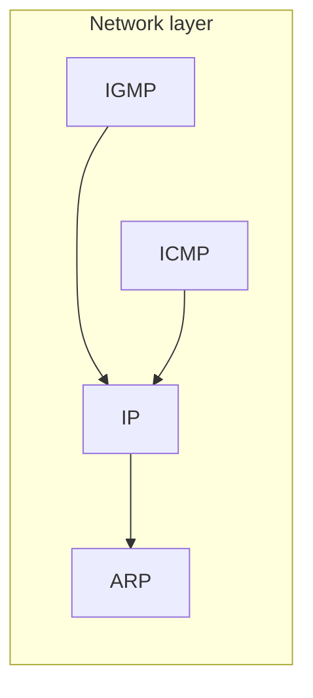
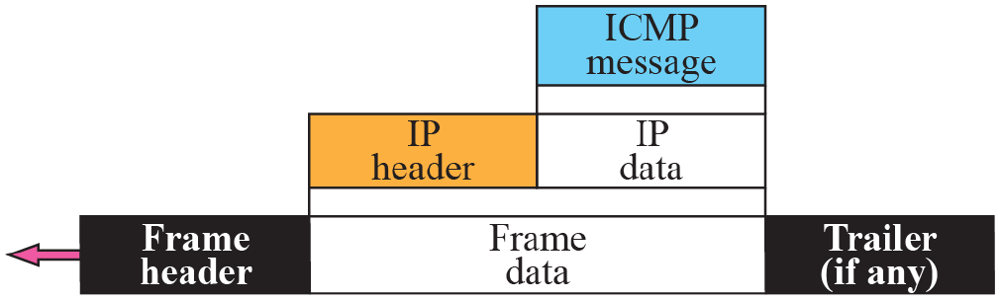
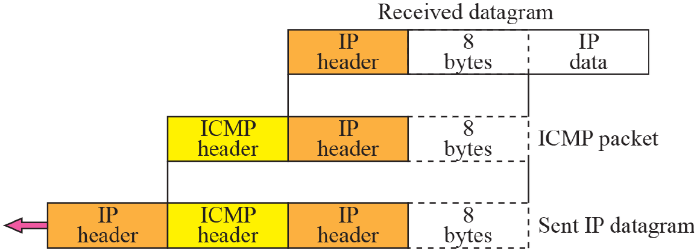
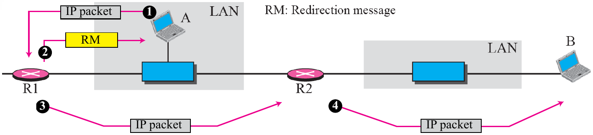
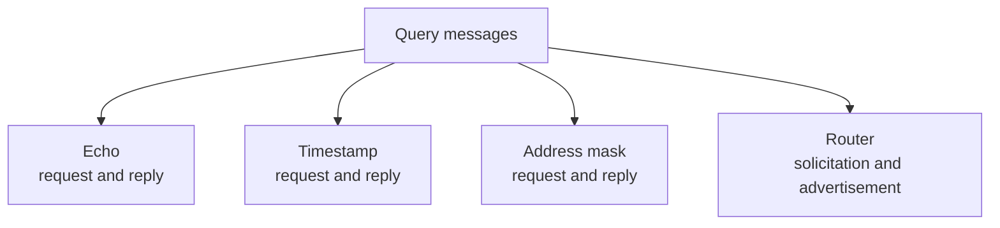
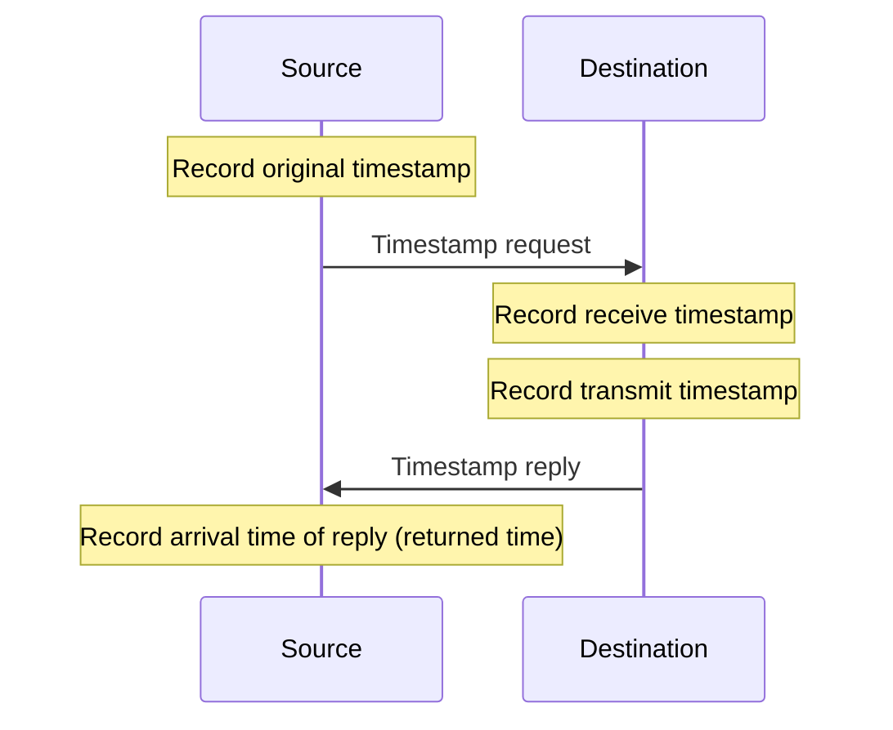
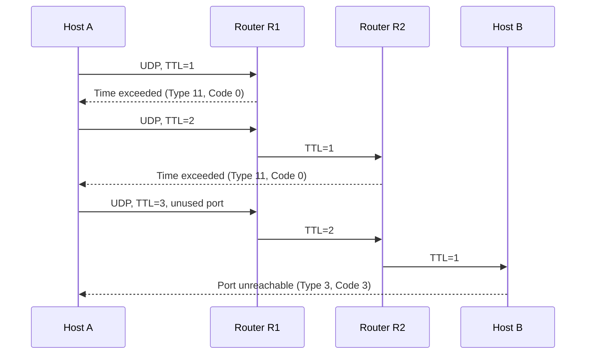
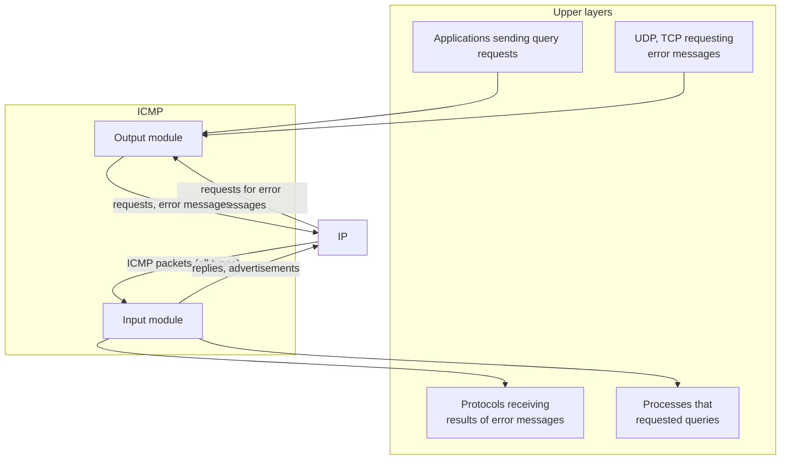
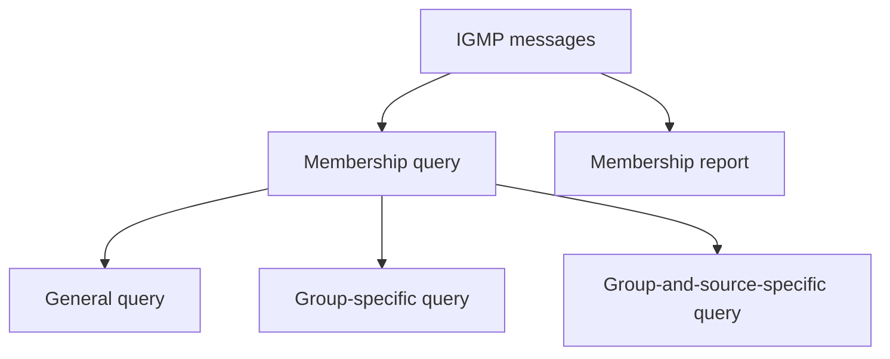

# Chapter 16 — ICMPv4 and IGMP

[Repository Guide](../../README.md) | [English](Concepts_Lecture.md) | [한국어](Concepts_Lecture.ko.md)

> **Last Updated:** 2026-11-18
>
> Computer Networking: A Top-Down Approach, Kurose and Ross, Ch 5; TCP/IP Protocol Suite, Forouzan, Ch 9, 12

> **Learning Objectives:**
> 1. Explain how ICMP compensates for the error-reporting and query functions that IP lacks, and how ICMP messages are encapsulated
> 2. Classify ICMP messages into error-reporting and query messages and interpret the format and codes of each message
> 3. Explain the cases in which no error message is generated and the composition of the data field of error messages
> 4. Compute round-trip times and clock differences with timestamp messages, and compute the ICMP checksum
> 5. Explain how ping and traceroute use ICMP and interpret their output
> 6. Explain the structure of IPv4 multicast addresses and the messages and operation of IGMP

---

## Table of Contents

- [1. Why ICMP Is Needed](#1-why-icmp-is-needed)
  - [1.1 Two Deficiencies of IP](#11-two-deficiencies-of-ip)
  - [1.2 Position of ICMP in the Network Layer](#12-position-of-icmp-in-the-network-layer)
  - [1.3 Encapsulation of ICMP](#13-encapsulation-of-icmp)
- [2. Format and Types of ICMP Messages](#2-format-and-types-of-icmp-messages)
  - [2.1 Two Categories](#21-two-categories)
  - [2.2 General Message Format](#22-general-message-format)
  - [2.3 Summary of Types and Codes](#23-summary-of-types-and-codes)
- [3. Error-Reporting Messages](#3-error-reporting-messages)
  - [3.1 Principles of Error Reporting](#31-principles-of-error-reporting)
  - [3.2 Cases in Which No Error Message Is Generated](#32-cases-in-which-no-error-message-is-generated)
  - [3.3 The Data Field of Error Messages](#33-the-data-field-of-error-messages)
  - [3.4 Destination Unreachable](#34-destination-unreachable)
  - [3.5 Source Quench](#35-source-quench)
  - [3.6 Time Exceeded](#36-time-exceeded)
  - [3.7 Parameter Problem](#37-parameter-problem)
  - [3.8 Redirection](#38-redirection)
- [4. Query Messages](#4-query-messages)
  - [4.1 Kinds of Query Messages](#41-kinds-of-query-messages)
  - [4.2 Echo Request and Reply](#42-echo-request-and-reply)
  - [4.3 Timestamp Request and Reply](#43-timestamp-request-and-reply)
  - [4.4 Deprecated Query Messages](#44-deprecated-query-messages)
- [5. The ICMP Checksum](#5-the-icmp-checksum)
- [6. Debugging Tools](#6-debugging-tools)
  - [6.1 ping](#61-ping)
  - [6.2 traceroute](#62-traceroute)
- [7. The ICMP Package](#7-the-icmp-package)
- [8. ICMP and Security](#8-icmp-and-security)
- [9. Multicasting and Multicast Addresses](#9-multicasting-and-multicast-addresses)
  - [9.1 Unicasting, Multicasting, and Broadcasting](#91-unicasting-multicasting-and-broadcasting)
  - [9.2 IPv4 Multicast Addresses](#92-ipv4-multicast-addresses)
  - [9.3 Delivery of Multicast Packets at the Data Link Layer](#93-delivery-of-multicast-packets-at-the-data-link-layer)
- [10. IGMP](#10-igmp)
  - [10.1 Group Management](#101-group-management)
  - [10.2 IGMP Messages](#102-igmp-messages)
  - [10.3 Operation at the Host](#103-operation-at-the-host)
  - [10.4 Operation at the Router](#104-operation-at-the-router)
  - [10.5 Variables and Timers](#105-variables-and-timers)
  - [10.6 Encapsulation and Compatibility with Older Versions](#106-encapsulation-and-compatibility-with-older-versions)
- [Concept Applications](#concept-applications)
- [Summary](#summary)
- [Self-Check Questions](#self-check-questions)
- [References](#references)

---

<br>

## 1. Why ICMP Is Needed

### 1.1 Two Deficiencies of IP

IP is an unreliable and connectionless datagram delivery protocol that provides a best-effort delivery service without error control (Chapter 11). Because of this nature, IP has two deficiencies.

First, IP has **no error-reporting or error-correcting mechanism.** What happens if something goes wrong? A router may have to discard a datagram because it cannot find a route to the final destination or because the time-to-live (TTL) field has reached zero. The final destination host may have to discard all fragments of a datagram because it has not received all of them within a set time limit. In such situations, IP has no built-in mechanism to notify the original host that an error has occurred.

Second, IP has **no mechanism for host and management queries.** A host sometimes needs to determine whether a router or another host is alive, and a network manager sometimes needs information from another host or router.

> **Definition:** **ICMP (Internet Control Message Protocol)** is the protocol that hosts and routers use to communicate network-layer information to each other, especially error reports and queries; it is a companion protocol of IP that compensates for IP's two deficiencies.

ICMP does not correct errors; it only reports them. Error correction is left to the higher-level protocols. If you have seen an error message such as "Destination network unreachable" while running an HTTP session, that message originated in ICMP. Some IP router was unable to find a path to the host specified in the HTTP request and created and sent an ICMP message reporting the error. In this chapter, ICMP refers to ICMPv4, the version for IPv4. ICMPv6, the new version defined for IPv6, reorganizes the existing types and codes and adds the types and codes required by new IPv6 functions, such as the "Packet Too Big" type; it is covered in Chapter 24.

### 1.2 Position of ICMP in the Network Layer



*Figure 1. Position of ICMP in the network layer*

ICMP itself is a network-layer protocol. However, its messages are not passed directly to the data link layer as might be expected; they are first encapsulated inside IP datagrams before going to the lower layer. Kurose and Ross point out that, although ICMP is often considered part of IP, architecturally it lies just above IP, since ICMP messages are carried as IP payload just as TCP or UDP segments are.

### 1.3 Encapsulation of ICMP



*Figure 2. ICMP message encapsulated in an IP datagram and a frame*

The value of the protocol field in the IP datagram is **1**, indicating that the IP data is an ICMP message. When a host receives an IP datagram with upper-layer protocol number 1, it demultiplexes the datagram's contents to ICMP, just as it would demultiplex them to TCP or UDP.

> **Key Point:** ICMP is carried in IP datagrams (protocol number 1), but it is not a transport-layer protocol; it is a network-layer protocol that works together with IP. ICMP does not make IP reliable; it only provides feedback that reports problems.

---

<br>

## 2. Format and Types of ICMP Messages

### 2.1 Two Categories

ICMP messages are divided into two broad categories: **error-reporting messages** and **query messages**.

> **Definition:** An **error-reporting message** is an ICMP message that reports to the original source a problem that a router or the destination host encountered while processing an IP packet.

> **Definition:** A **query message** is an ICMP message, occurring as a request and reply pair, that helps a host or network manager get specific information from a router or another host.

With query messages, nodes can discover their neighbors, hosts can discover and learn about the routers on their network, and routers can help a node redirect its messages.

| Category | Type | Message |
|:-----|:-----|:-----|
| Error reporting | 3 | Destination unreachable |
| Error reporting | 4 | Source quench |
| Error reporting | 11 | Time exceeded |
| Error reporting | 12 | Parameter problem |
| Error reporting | 5 | Redirection |
| Query | 8 or 0 | Echo request or reply |
| Query | 13 or 14 | Timestamp request or reply |

*Table 1. ICMP messages by category*

### 2.2 General Message Format

An ICMP message has an 8-byte header and a variable-size data section. Although the general format of the header differs for each message type, the first 4 bytes are common to all.

```text
 0               8               16                              31
+---------------+---------------+-------------------------------+
|     Type      |     Code      |           Checksum            |
+---------------+---------------+-------------------------------+
|                      Rest of the header                       |
+---------------------------------------------------------------+
|                         Data section                          |
|                                                               |
+---------------------------------------------------------------+
```

*Figure 3. General format of ICMP messages*

- **Type (8 bits):** The type of the message.
- **Code (8 bits):** The specific reason for the message of that type.
- **Checksum (16 bits):** The checksum over the entire message (Section 5).
- **Remaining 4 bytes of the header:** Specific to each message type.

The data section of error messages carries information for finding the original packet that had the error, and the data section of query messages carries extra information based on the type of query.

### 2.3 Summary of Types and Codes

| Type | Code | Message | Category |
|:-----|:-----|:-----|:-----|
| 0 | 0 | Echo reply | Query |
| 3 | 0-15 | Destination unreachable | Error reporting |
| 4 | 0 | Source quench | Error reporting |
| 5 | 0-3 | Redirection | Error reporting |
| 8 | 0 | Echo request | Query |
| 9 | 0 | Router advertisement | Query |
| 10 | 0 | Router solicitation | Query |
| 11 | 0-1 | Time exceeded | Error reporting |
| 12 | 0-1 | Parameter problem | Error reporting |
| 13 | 0 | Timestamp request | Query |
| 14 | 0 | Timestamp reply | Query |
| 17 | 0 | Address mask request | Query |
| 18 | 0 | Address mask reply | Query |

*Table 2. Types and codes of ICMP messages*

Kurose and Ross summarize the same messages as type and code pairs, as in Table 3. The only differences are that they list the destination-unreachable message separately for each code and call router solicitation "router discovery," Type 11 Code 0 TTL expired, and Type 12 Code 0 IP header bad.

| ICMP Type | Code | Description |
|:-----|:-----|:-----|
| 0 | 0 | Echo reply (to ping) |
| 3 | 0 | Destination network unreachable |
| 3 | 1 | Destination host unreachable |
| 3 | 2 | Destination protocol unreachable |
| 3 | 3 | Destination port unreachable |
| 3 | 6 | Destination network unknown |
| 3 | 7 | Destination host unknown |
| 4 | 0 | Source quench (congestion control) |
| 8 | 0 | Echo request |
| 9 | 0 | Router advertisement |
| 10 | 0 | Router discovery |
| 11 | 0 | TTL expired |
| 12 | 0 | IP header bad |

*Table 3. Main ICMP message types as summarized by Kurose and Ross*

---

<br>

## 3. Error-Reporting Messages

### 3.1 Principles of Error Reporting

One of the main responsibilities of ICMP is to report errors. Although transmission media have become increasingly reliable, errors still occur and must be handled. IP is an unreliable protocol that is not concerned with error checking and error control, and ICMP was designed in part to compensate for this shortcoming. ICMP handles five types of errors: destination unreachable, source quench, time exceeded, parameter problems, and redirection.

ICMP always sends error messages to the **original source**. The only route information available in a datagram is the source and destination IP addresses, so ICMP uses the source IP address to send the error message to the source that created the datagram. There is no way to notify the intermediate routers the datagram has passed through.

### 3.2 Cases in Which No Error Message Is Generated

No ICMP error message is generated in the following cases.

1. **A datagram carrying an ICMP error message:** Generating an error message about an error message could lead to an endless chain of error messages.
2. **A fragment that is not the first fragment:** For a fragmented datagram, an error message is generated only for the first fragment. Sending an error message for every fragment of a datagram would report the same problem many times, and the first 8 bytes holding the upper-layer port numbers are present only in the first fragment.
3. **A datagram having a multicast address:** One datagram is delivered to many receivers, so if each receiver sent an error message, error messages could flood the source all at once.
4. **A datagram having a special address such as 127.0.0.0 or 0.0.0.0:** As Chapter 12 shows, 0.0.0.0 refers to a host itself that does not yet have an address and the 127.0.0.0 block refers to loopback, so an error message cannot be returned to the original source with such addresses.

> **Caution:** No error message is generated for a datagram carrying an ICMP error message, but one is generated for a datagram carrying a query message such as an echo request, because a query message is not an error-reporting message.

### 3.3 The Data Field of Error Messages

The data section of every error message contains the **IP header** of the original datagram plus the **first 8 bytes** of that datagram's data.



*Figure 4. Contents of the data field of error messages*

The header of the original datagram is included to give the original source, which receives the error message, information about the datagram itself. The first 8 bytes are included because, as Chapters 6 and 8 show, the first 8 bytes of the UDP and TCP headers contain the port numbers (UDP and TCP) and the sequence number (TCP). The source uses this information to determine which protocol (TCP or UDP) and which process to inform of the error. ICMP builds the error packet in this way and then encapsulates it in an IP datagram. If the original IP header is 20 bytes with no options, the ICMP error message is 36 bytes, an 8-byte header plus 28 bytes of data, and it leaves as a 56-byte IP datagram after a new 20-byte IP header is added.

### 3.4 Destination Unreachable

> **Definition:** A **destination-unreachable message** is a Type 3 ICMP message that a router or host sends to the original source after discarding a datagram because the router cannot route it or the host cannot deliver it.

```text
+---------------+---------------+-------------------------------+
|    Type: 3    | Code: 0 to 15 |           Checksum            |
+---------------+---------------+-------------------------------+
|                        Unused (All 0s)                        |
+---------------------------------------------------------------+
|       Part of the received IP datagram including IP header    |
|            plus the first 8 bytes of datagram data            |
+---------------------------------------------------------------+
```

*Figure 5. Format of the destination-unreachable message*

The Code field gives the reason for discarding the datagram.

| Code | Meaning |
|:-----|:-----|
| 0 | The network is unreachable, possibly due to hardware failure. |
| 1 | The host is unreachable; this can also be due to hardware failure. |
| 2 | The protocol is unreachable; for example, a datagram must be delivered to TCP but TCP is not running at the moment. |
| 3 | The port is unreachable; the application program (process) the datagram is destined for is not running at the moment. |
| 4 | Fragmentation is required, but the DF (do not fragment) field of the datagram is set; routing is impossible without fragmentation. |
| 5 | Source routing cannot be accomplished; one or more routers defined in the source routing option cannot be visited. |
| 6 | The destination network is unknown. Code 0 means the destination network exists but is unreachable at the moment, whereas code 6 means the router has no information about the network at all. |
| 7 | The destination host is unknown; unlike code 1, the router is unaware of the existence of the destination host. |
| 8 | The source host is isolated. |
| 9 | Communication with the destination network is administratively prohibited. |
| 10 | Communication with the destination host is administratively prohibited. |
| 11 | The network is unreachable for the specified type of service; it could be routed if the source had requested an available type of service. |
| 12 | The host is unreachable for the specified type of service. |
| 13 | The host is unreachable because the administrator has put a filter on it. |
| 14 | The host is unreachable because of a host precedence violation; the router reports that the requested precedence is not permitted for the destination. |
| 15 | The host is unreachable because of precedence cutoff; the datagram was sent with a precedence below the minimum level set by the network operators. |

*Table 4. Codes of the destination-unreachable message*

Destination-unreachable messages can be created by a router or by the destination host. **Codes 2 and 3 can be created only by the destination host**, and the remaining codes only by routers, because the protocol and the port can be checked only when the datagram reaches the destination host.

Code 4 is used by the path MTU discovery of Chapter 11. If a sender sends a datagram with the DF bit set and some link on the path has a smaller MTU, the router before that link cannot fragment the datagram, so it discards it and returns a code 4 message. The sender thereby learns that the path MTU is smaller[1].

> **Caution:** That a router has not sent a destination-unreachable message does not mean that the datagram has been delivered. For example, if a datagram travels through an Ethernet, which has no acknowledgment mechanism, the router cannot know whether the datagram was delivered to the destination host or the next router. A router cannot detect every problem that prevents the delivery of a packet.

### 3.5 Source Quench

IP is a connectionless protocol, so there is no communication between the source host that produces a datagram, the routers that forward it, and the destination host that processes it. As a result, IP has no flow control or congestion control. The ICMP source-quench message was designed to add a kind of flow control and congestion control to IP.

```text
+---------------+---------------+-------------------------------+
|    Type: 4    |    Code: 0    |           Checksum            |
+---------------+---------------+-------------------------------+
|                        Unused (All 0s)                        |
+---------------------------------------------------------------+
|       Part of the received IP datagram including IP header    |
|            plus the first 8 bytes of datagram data            |
+---------------------------------------------------------------+
```

*Figure 6. Format of the source-quench message*

When a router or host discards a datagram because of congestion, it sends a source-quench message to the sender of the datagram. This message has two purposes. First, it informs the source that the datagram has been discarded. Second, it warns the source that there is congestion somewhere on the path and that the source should slow down (quench) its sending. The source must slow down the sending of datagrams until the congestion is relieved. A few points deserve more explanation.

- The router or destination host that has experienced the congestion sends **one source-quench message for each datagram** discarded because of congestion.
- There is no mechanism to tell the source that the congestion has been relieved and that it can resume sending at its previous rate. The source keeps lowering its rate until no more source-quench messages arrive.
- Congestion can be created by one-to-one or by many-to-one communication. In one-to-one communication, if a single high-speed host creates datagrams faster than a router or the destination host can handle, source-quench messages help. In many-to-one communication, however, many sources send datagrams at different speeds, so the router or destination host has no clue which source is responsible for the congestion. It may drop a datagram from a very slow source rather than from the source that actually created the congestion, so the source-quench message may not be very useful.

Kurose and Ross point out that the source-quench message is seldom used in practice, because TCP has its own congestion-control mechanism that operates at the transport layer without network-layer feedback such as source-quench messages (Chapter 9). The source-quench message was later formally deprecated[2].

### 3.6 Time Exceeded

> **Definition:** A **time-exceeded message** is a Type 11 ICMP message sent to the original source when a router discards a datagram after decrementing its TTL to zero or when the destination host has not received all fragments within a set time.

The time-exceeded message is generated in two cases.

- **Code 0, TTL expired:** Routers use routing tables to find the next hop (next router) that must receive a packet (Chapter 13). If there are errors in one or more routing tables, a packet can travel in a loop, going from router to router endlessly. As Chapter 11 showed, each datagram contains a time-to-live field that controls this situation and is decremented by 1 at each router. When the decremented value reaches 0, the router discards the datagram and sends a time-exceeded message to the original source. Code 0 is used **only by routers**.
- **Code 1, fragment reassembly time exceeded:** A time-exceeded message is also generated when not all fragments that make up a message arrive at the destination host within a certain time limit. When the first fragment arrives, the destination host starts a timer; if all fragments have not arrived when the time expires, it discards all received fragments and sends a time-exceeded message to the original sender. Code 1 is used **only by the destination host**.

```text
+---------------+---------------+-------------------------------+
|   Type: 11    | Code: 0 or 1  |           Checksum            |
+---------------+---------------+-------------------------------+
|                        Unused (All 0s)                        |
+---------------------------------------------------------------+
|       Part of the received IP datagram including IP header    |
|            plus the first 8 bytes of datagram data            |
+---------------------------------------------------------------+
```

*Figure 7. Format of the time-exceeded message*

### 3.7 Parameter Problem

Any ambiguity in the header part of a datagram can create serious problems as the datagram travels through the Internet. If a router or the destination host discovers an ambiguous or missing value in any field of the datagram, it discards the datagram and sends a parameter-problem message (Type 12) back to the source. A parameter-problem message can be created by a router or by the destination host.

```text
+---------------+---------------+-------------------------------+
|   Type: 12    | Code: 0 or 1  |           Checksum            |
+---------------+---------------+-------------------------------+
|    Pointer    |                Unused (All 0s)                |
+---------------+-----------------------------------------------+
|       Part of the received IP datagram including IP header    |
|            plus the first 8 bytes of datagram data            |
+---------------------------------------------------------------+
```

*Figure 8. Format of the parameter-problem message*

- **Code 0:** There is an error or ambiguity in one of the header fields. The value of the Pointer field points to the byte with the problem; for example, a value of 0 means that the first byte is not a valid field.
- **Code 1:** The required part of an option is missing. The pointer is not used in this case.

### 3.8 Redirection

When a router needs to send a packet destined for another network, it must know the IP address of the next appropriate router, and the same is true if the sender is a host. Both routers and hosts therefore have routing tables to find the address of the router or the next router. Routers take part in the routing update process of Chapters 14 and 15 and are updated constantly, so routing is dynamic.

There are many more hosts than routers in an internet, however, and updating the routing tables of hosts dynamically would produce unacceptable traffic. For efficiency, hosts do not take part in the routing update process and usually use static routing. When a host comes up, its routing table has a limited number of entries, and it usually knows only the IP address of one router, the default router. For this reason, the host may send a datagram destined for another network to the wrong router. In this case, the router that receives the datagram forwards it to the correct router and, to update the host's routing table, sends a redirection message to the host.

> **Definition:** A **redirection message** is a Type 5 ICMP message by which a router tells a host on the same local network the address of a more appropriate router, when the host has sent it a datagram for another network although a better router exists.



*Figure 9. Redirection concept*

In Figure 9, host A wants to send a datagram to host B. Router R2 is obviously the most efficient routing choice, but host A did not choose R2, and the datagram goes to R1 instead (1). R1, after consulting its table, finds that the packet should have gone to R2. R1 sends a redirection message (RM) to A (2) and sends the packet to R2 (3), which forwards it toward B (4). A's routing table can now be updated. A host usually starts with a small routing table that is gradually augmented and updated, and the redirection message is one of the tools that accomplish this.

```text
+---------------+---------------+-------------------------------+
|    Type: 5    | Code: 0 to 3  |           Checksum            |
+---------------+---------------+-------------------------------+
|                 IP address of the target router               |
+---------------------------------------------------------------+
|       Part of the received IP datagram including IP header    |
|            plus the first 8 bytes of datagram data            |
+---------------------------------------------------------------+
```

*Figure 10. Format of the redirection message*

The IP address of the appropriate target router is given in the second row of the header. Although the redirection message is classified as an error-reporting message, it differs from the other error messages: the router does not discard the datagram but sends it to the appropriate router. A redirection message is sent **from a router to a host on the same local network**. The Code field narrows down the redirection.

| Code | Meaning |
|:-----|:-----|
| 0 | Redirection for a network-specific route |
| 1 | Redirection for a host-specific route |
| 2 | Redirection for a network-specific route based on a specified type of service |
| 3 | Redirection for a host-specific route based on a specified type of service |

*Table 5. Codes of the redirection message*

---

<br>

## 4. Query Messages

### 4.1 Kinds of Query Messages

In addition to error reporting, ICMP can diagnose some network problems, which it does through query messages. In a query, a node sends a message that the destination node answers in a specific format. The pairs of query messages designed for this purpose are echo request and reply, timestamp request and reply, address mask request and reply, and router solicitation and advertisement.



*Figure 11. Kinds of ICMP query messages*

### 4.2 Echo Request and Reply

The echo-request (Type 8) and echo-reply (Type 0) messages are designed for diagnostic purposes. Network managers and users use this pair of messages to identify network problems. Together, the two messages determine whether two systems (hosts or routers) can communicate with each other.

> **Definition:** An **echo request** is a Type 8 ICMP query message that a host or router sends to another host or router asking for it to be echoed back; the receiver answers with a Type 0 echo reply.

```text
+---------------+---------------+-------------------------------+
|  Type: 8 or 0 |    Code: 0    |           Checksum            |
+---------------+---------------+-------------------------------+
|          Identifier           |        Sequence number        |
+-------------------------------+-------------------------------+
|                         Optional data                         |
|      Sent by the request message; repeated by the reply       |
+---------------------------------------------------------------+
```

*Figure 12. Format of echo-request and echo-reply messages*

- An echo-request message can be sent by a host or router, and an echo-reply message is sent by the host or router that receives an echo request.
- The optional data field contains a message that the responding node must repeat **exactly** in its echo reply.
- The Identifier and Sequence number fields are not formally defined by the protocol and can be used arbitrarily by the sender. The identifier is often the same as the process ID.

Echo request and reply messages show whether there is communication at the IP level. Because ICMP messages are encapsulated in IP datagrams, the receipt of an echo reply by the machine that sent the echo request is proof that the IP protocols in the sender and receiver are communicating using IP datagrams. It is also proof that the intermediate routers are receiving, processing, and forwarding IP datagrams. Network managers therefore use these messages to check the operation of IP. A host can also use them to test whether another host is reachable, which at the user level is usually done with the ping command (Section 6.1).

According to Kurose and Ross, most TCP/IP implementations support the ping server directly in the operating system; that is, the side answering echo requests is not a separate process. The ping client program, on the other hand, must be able to instruct the operating system to generate an ICMP message of Type 8 Code 0.

### 4.3 Timestamp Request and Reply

> **Definition:** A **timestamp request** is a Type 13 ICMP query message sent to compute the round-trip time between two machines or to synchronize their clocks; the receiver answers with a Type 14 timestamp reply that fills in its receive and transmit times.

```text
+---------------+---------------+-------------------------------+
| Type: 13 or 14|    Code: 0    |           Checksum            |
+---------------+---------------+-------------------------------+
|          Identifier           |        Sequence number        |
+-------------------------------+-------------------------------+
|                      Original timestamp                       |
+---------------------------------------------------------------+
|                       Receive timestamp                       |
+---------------------------------------------------------------+
|                      Transmit timestamp                       |
+---------------------------------------------------------------+
```

*Figure 13. Format of timestamp-request and timestamp-reply messages*

Each of the three timestamp fields is 32 bits long and holds the time in milliseconds since midnight in Universal Time (formerly Greenwich Mean Time). Thirty-two bits can represent numbers from 0 to 4,294,967,295, but these timestamps cannot exceed 86,400,000 (= 24 × 60 × 60 × 1000), the number of milliseconds in a day.

1. The source creates a timestamp-request message. It fills the **original timestamp** field with the Universal Time shown by its clock at departure and fills the other two fields with zeros.
2. The destination creates the timestamp-reply message. It copies the original timestamp value of the request into the same field of its reply.
3. It fills the **receive timestamp** field with the Universal Time shown by its clock when the request was received.
4. It fills the **transmit timestamp** field with the Universal Time shown by its clock when the reply departs.



*Figure 14. Computing the round-trip time with timestamp request and reply*

These messages can be used to compute the one-way or round-trip time required for a datagram to go from a source to a destination and back again.

```math
\begin{aligned}
\text{sending time} &= \text{receive timestamp} - \text{original timestamp} \\
\text{receiving time} &= \text{returned time} - \text{transmit timestamp} \\
\text{round-trip time} &= \text{sending time} + \text{receiving time}
\end{aligned}
```

The sending and receiving times are accurate only if the two clocks of the source and destination are synchronized. However, **the round-trip time is correct even if the two clocks are not synchronized**, because each clock contributes twice to the round-trip calculation, once added and once subtracted, so any difference in synchronization cancels out. For example, if the destination's clock is $`\delta`$ ahead of the source's, the sending time comes out $`\delta`$ too large and the receiving time $`\delta`$ too small, and $`\delta`$ vanishes from the sum.

Suppose the following values are given.

| Item | Value (ms) |
|:-----|:-----|
| Original timestamp | 46 |
| Receive timestamp | 59 |
| Transmit timestamp | 60 |
| Arrival time of the reply | 67 |

*Table 6. An example of timestamp request and reply*

```math
\begin{aligned}
\text{sending time} &= 59 - 46 = 13 \text{ ms} \\
\text{receiving time} &= 67 - 60 = 7 \text{ ms} \\
\text{round-trip time} &= 13 + 7 = 20 \text{ ms}
\end{aligned}
```

Given the actual one-way time, these messages can also be used to synchronize the clocks of the two machines.

```math
\text{time difference} = \text{receive timestamp} - (\text{original timestamp} + \text{one-way time duration})
```

The one-way time is obtained by dividing the round-trip time by two, if one is sure that the sending time equals the receiving time, or by other means. Taking the one-way time in the example above as 20 / 2 = 10 ms, the time difference is 59 - (46 + 10) = 3 ms, so the two clocks are 3 ms out of synchronization, with the destination's clock 3 ms ahead of the source's.

> **Key Point:** Timestamp-request and timestamp-reply messages can compute the round-trip time between a source and a destination even if their clocks are not synchronized, and they can synchronize the clocks of two machines if the exact one-way time is known.

### 4.4 Deprecated Query Messages

Five pairs of query messages were designed, but three pairs have been declared obsolete by the IETF and are not used today; only the echo and timestamp pairs are used.

- **Information request and reply:** Their duties are done by ARP, the address resolution protocol family (Chapter 19).
- **Address mask request and reply (Types 17, 18):** Used by a host to learn the mask of its network; their duties are done by DHCP (Chapter 12).
- **Router solicitation and advertisement (Types 10, 9):** Used by a host to find the routers on its network and by routers to announce their presence; their duties are also done by DHCP.

---

<br>

## 5. The ICMP Checksum

Chapter 11 covered the concept of the IP header checksum. In ICMP, the checksum is calculated not only over the header but over the **entire message (header and data)**.

The sender follows these steps using one's complement arithmetic.

1. The checksum field is set to zero.
2. The sum of all the 16-bit words (header and data) is calculated.
3. The sum is complemented to get the checksum.
4. The checksum is stored in the checksum field.

The receiver follows these steps using one's complement arithmetic.

1. The sum of all words (header and data) is calculated.
2. The sum is complemented.
3. If the result of step 2 is sixteen 0s, the message is accepted; otherwise, it is rejected.

> **[Digital Logic Design]** In one's complement addition, a carry out of the most significant bit is not discarded but added back to the least significant bit of the result (end-around carry). The result therefore stays 16 bits however many 16-bit words are added, and zero has two representations, 0000 and FFFF.

Let us compute the checksum of a simple echo-request message (Figure 12). The identifier is chosen as 1, the sequence number as 9, and "TEST" is placed in the optional data. The message is divided into 16-bit (2-byte) words, the words are added, and the sum is complemented to give the checksum. The checksum field is 0 during the computation.

```text
 8 & 0         00001000 00000000    (Type 8, Code 0)
 0             00000000 00000000    (Checksum field set to 0)
 1             00000000 00000001    (Identifier)
 9             00000000 00001001    (Sequence number)
 T & E         01010100 01000101
 S & T         01010011 01010100
 ---------------------------------
 Sum           10101111 10100011
 Checksum      01010000 01011100    (= 0x505C)
```

*Figure 15. Checksum calculation for an echo-request message*

The sender places this value in the checksum field. When the receiver adds all words, including the checksum field, it gets 1111111111111111, whose complement is sixteen 0s, so the message is accepted.

---

<br>

## 6. Debugging Tools

In the Internet, several tools can determine whether a host or router is alive and running and which route a packet takes. This section covers two tools that use ICMP: ping and traceroute.

### 6.1 ping

> **Definition:** **ping** is a program that sends ICMP echo-request messages to a specified host and receives echo replies to determine whether the host is reachable and what the round-trip time is.

The source host sends ICMP echo-request messages (Type 8, Code 0), and the destination, if alive, responds with ICMP echo-reply messages (Type 0, Code 0). The ping program sets the Identifier field of the echo-request and echo-reply messages and starts the sequence number from 0, incrementing it by one each time a new message is sent. ping can also calculate the round-trip time. It inserts the sending time in the data section of the message, and when the reply arrives it subtracts the sending time from the arrival time to get the round-trip time (RTT).

The following is the result of testing the server fhda.edu with the ping program.

```text
$ ping fhda.edu
PING fhda.edu (153.18.8.1) 56 (84) bytes of data.
64 bytes from tiptoe.fhda.edu (153.18.8.1): icmp_seq=0 ttl=62 time=1.91 ms
64 bytes from tiptoe.fhda.edu (153.18.8.1): icmp_seq=1 ttl=62 time=2.04 ms
64 bytes from tiptoe.fhda.edu (153.18.8.1): icmp_seq=2 ttl=62 time=1.90 ms
64 bytes from tiptoe.fhda.edu (153.18.8.1): icmp_seq=3 ttl=62 time=1.97 ms
64 bytes from tiptoe.fhda.edu (153.18.8.1): icmp_seq=4 ttl=62 time=1.93 ms
64 bytes from tiptoe.fhda.edu (153.18.8.1): icmp_seq=5 ttl=62 time=2.00 ms
64 bytes from tiptoe.fhda.edu (153.18.8.1): icmp_seq=6 ttl=62 time=1.94 ms
64 bytes from tiptoe.fhda.edu (153.18.8.1): icmp_seq=7 ttl=62 time=1.94 ms
64 bytes from tiptoe.fhda.edu (153.18.8.1): icmp_seq=8 ttl=62 time=1.97 ms
64 bytes from tiptoe.fhda.edu (153.18.8.1): icmp_seq=9 ttl=62 time=1.89 ms
64 bytes from tiptoe.fhda.edu (153.18.8.1): icmp_seq=10 ttl=62 time=1.98 ms

--- fhda.edu ping statistics ---
11 packets transmitted, 11 received, 0% packet loss, time 10103 ms
rtt min/avg/max = 1.899/1.955/2.041 ms
```

- ping sends messages with sequence numbers starting from 0 and gives the round-trip time for each probe.
- The TTL field of the IP datagram carrying the reply is 62, which means that the packet cannot travel more than 62 more hops.
- In the first line, 56 is the number of data bytes and 84 is the total number of bytes; adding 8 bytes of ICMP header and 20 bytes of IP header to 56 gives 84.
- The 64 in each reply line is the total number of bytes in the ICMP packet (56 + 8).
- ping keeps sending messages until it is stopped with the interrupt key (ctrl + c, for example). When interrupted, it prints statistics such as the number of packets sent, the number received, the total time, and the minimum, average, and maximum round-trip times. Some systems print more information.

If a mail server is tested in the same way and 14 packets are sent but only 13 come back, the statistics line reads "14 packets transmitted, 13 received, 7% packet loss". The program may have been stopped before the last packet (sequence number 13) returned, so the loss rate is only the fraction of requests that received no reply, not necessarily the fraction lost in the network.

### 6.2 traceroute

> **Definition:** **traceroute** is a program that sends probe packets with TTL values increasing from 1 and uses the returning ICMP time-exceeded and destination-unreachable messages to find the addresses of the routers on the path from source to destination and the round-trip time to each.

The traceroute program in UNIX or tracert in Windows is used to trace the route of a packet from the source to the destination. Suppose a packet from host A to host B passes through routers R1 and R2. Most of the time this topology is not known in advance, and there may be several routes from A to B. traceroute uses ICMP messages and the TTL field of the IP packet to find the route. It is an application-level program that uses the services of UDP.



*Figure 16. Operation of traceroute, finding the route by increasing the TTL*

1. **Address of R1 and the round-trip time:** traceroute repeats steps a-c below three times to get a better average round-trip time. The first trip time may be much longer than the second or third, because it takes time for the ARP program to find the physical address of R1; for the second and third trips, ARP has the address in its cache (Chapter 19).
   - a. The traceroute application at host A sends a packet to destination B using UDP; the message is encapsulated in an IP packet with a TTL value of 1. The program notes the time the packet is sent.
   - b. Router R1 receives the packet, decrements the TTL to 0, and discards the packet. It then sends a time-exceeded ICMP message (Type 11, Code 0) to show that the TTL reached 0 and the packet was discarded.
   - c. The traceroute program receives the ICMP message and uses the source address of the IP packet carrying it to find the IP address of R1. The difference between the arrival time and the time of step a is the round-trip time.
2. **Address of R2 and the round-trip time:** This time the TTL is set to 2. R1 forwards the message, while R2 discards it and sends a time-exceeded ICMP message.
3. **Address of B and the round-trip time:** With TTL 3, host B receives the packet and decrements the TTL, but it does not discard the message, since it has reached its final destination. How then can an ICMP message get back to A? traceroute sets the destination port of the UDP packet to one that UDP does not support. Host B finds no application program to accept the packet, so it discards the packet and sends an ICMP destination-unreachable message (Type 3, Code 3) to A. This does not happen at R1 or R2, because a router does not check the UDP header. The traceroute program records the source address of the arriving IP datagram and notes the round-trip time. Receiving a destination-unreachable message with code 3 indicates that the whole route has been found and no more packets need to be sent.

Kurose and Ross add that the traceroute client program must be able to instruct the operating system to generate UDP datagrams with specific TTL values and must be notified by the operating system when ICMP messages arrive. The standard traceroute program sends three packets with the same TTL, so its output gives three results for each TTL.

The following is the result of using traceroute to find the route from voyager.deanza.edu to the server fhda.edu.

```text
$ traceroute fhda.edu
traceroute to fhda.edu (153.18.8.1), 30 hops max, 38 byte packets
 1  Dcore.fhda.edu      (153.18.31.254)   0.995 ms   0.899 ms   0.878 ms
 2  Dbackup.fhda.edu    (153.18.251.4)    1.039 ms   1.064 ms   1.083 ms
 3  tiptoe.fhda.edu     (153.18.8.1)      1.797 ms   1.642 ms   1.757 ms
```

- The unnumbered line after the command shows that the destination is 153.18.8.1 and the maximum hop count is 30. The packet is 38 bytes: 20 bytes of IP header, 8 bytes of UDP header, and 10 bytes of application data that traceroute uses to keep track of its packets.
- The first line shows the first router visited, Dcore.fhda.edu (153.18.31.254), and three round-trip times.
- The second line shows the second router, Dbackup.fhda.edu (153.18.251.4), and three round-trip times.
- The third line shows the destination host; it is known to be the destination because there are no more lines. The destination server fhda.edu is named tiptoe.fhda.edu, with IP address 153.18.8.1.

Tracing the route to a more distant destination gives more lines. Tracing from the same source to xerox.com prints 18 lines, showing 17 hops between source and destination; some round-trip times may then look unusual, possibly because a router was too busy to process the packet immediately. A host can also send a traceroute packet to itself by specifying itself as the destination, and the packet goes to the loopback address (127.0.0.1) as expected. In addition, when traceroute receives no response within 5 seconds it prints an asterisk (*) to signify a problem and tries the next hop, so if some routers on the path do not respond, the whole route may not be found.

> **Caution:** The kind of probe packet depends on the traceroute implementation. The description in this section follows the UNIX traceroute, which sends UDP datagrams; with this approach the destination responds with a port-unreachable message.

---

<br>

## 7. The ICMP Package

To show how ICMP sends and receives messages, consider an ICMP package made of two modules: an input module and an output module.



*Figure 17. Organization of the ICMP package*

The **input module** handles all received ICMP messages and is invoked when the IP layer delivers an ICMP packet to it.

```text
ICMP_Input_module (ICMP_Packet)
{
    If (the type is a request)
    {
        Create a reply
        Send the reply
    }
    If (the type defines a redirection)
    {
        Modify the routing table
    }
    If (the type defines other error messages)
    {
        Inform the appropriate source protocol
    }
    Return
}
```

- If the received packet is a request, the module creates a reply and sends it out.
- If the received packet is a redirection message, the module uses the information to update the routing table.
- If the received packet is another error message, the module informs the protocol concerned about the situation that caused the error.

The **output module** creates the request, solicitation, or error messages demanded by a higher level or by IP. IP, UDP, or TCP can demand that one of the ICMP error messages be sent. If the demand comes from IP, the output module must first check that the demand is allowed, because no error message may be created in four situations: an IP packet carrying an ICMP error message, a fragmented IP packet (other than the first fragment), a multicast IP packet, or an IP packet having address 0.0.0.0 or 127.X.Y.Z (Section 3.2). If the demand is allowed, the module creates the error message. The output module may also receive a demand from an application program to send one of the ICMP request messages, in which case it creates the request message. The message created is handed to IP to be sent.

---

<br>

## 8. ICMP and Security

ICMP is an essential tool for network diagnosis, but it can also be abused in attacks, so an organization's firewall (Chapter 26) filters ICMP messages selectively.

- **Denial of service by flooding:** In the bandwidth-flooding attack of Chapter 1, the attacker sends a deluge of packets to the target host to clog its access link. ICMP messages that elicit replies, such as echo requests, can also be used for such flooding.
- **Preventing abuse for a smurf attack:** Kurose and Ross give as an example a filtering rule that drops all ICMP ping packets going to a broadcast address (for example, 130.207.255.255) so that an organization's network is not used for a smurf denial-of-service attack. A single echo request to the directed broadcast address of Chapter 12 can elicit echo replies from every host on that network, so abusing it can create much traffic from few requests.
- **Preventing network mapping:** To keep outsiders from learning the structure of the internal network with traceroute, the organization drops all ICMP TTL-expired (time-exceeded) messages leaving its network, because, as Section 6.2 showed, traceroute uses these messages to learn the routers on a path.

> **Caution:** Blocking ICMP entirely breaks not only diagnostic tools but also protocol functions that rely on ICMP. For example, path MTU discovery learns the path MTU only by receiving destination-unreachable messages (code 4) for datagrams with the DF bit set[1]. ICMP filtering is therefore decided by distinguishing the type and direction of messages.

---

<br>

## 9. Multicasting and Multicast Addresses

### 9.1 Unicasting, Multicasting, and Broadcasting

Forwarding by a router is normally based on the prefix of the destination address of a datagram, that is, on the network to which the destination host is connected. Based on this principle, unicasting, multicasting, and broadcasting are defined.

- **Unicasting:** One source and one destination network, in a one-to-one relationship. Each router on the path forwards the packet through only one of its interfaces. The routing table determines the single output port for each datagram based on the optimum path (Chapter 15).
- **Multicasting:** One source and a group of destinations, in a one-to-many relationship. The source address is a unicast address, but the destination address is a group address, a group of one or more destination networks in which there is at least one member interested in receiving the multicast datagram. A multicast router may have to send copies of the same datagram out of more than one interface, and it does not send through an interface if it knows that there is no member of the group in that direction.
- **Broadcasting:** One source and all destinations, in a one-to-all relationship. There is only one source, and all other hosts are destinations. Because sending a message to the whole Internet would require a huge amount of traffic and bandwidth, the Internet does not explicitly support broadcasting.

Multicasting must be distinguished from **multiple unicasting**. Multicasting starts with a single packet from the source that is duplicated by the routers; the destination address is the same in all duplicates, and only one copy of the packet travels between any two routers. In multiple unicasting, the source sends several packets. With four destinations, the source sends four packets, each with a different unicast destination address, and several copies may travel between two routers. When e-mail software sends a message to a group of people by creating copies with different destination addresses and sending them one by one, that is multiple unicasting.

There are two obvious reasons for having a separate mechanism for multicasting even though it can be emulated with multiple unicasting.

1. Multicasting is more efficient. In multiple unicasting, some links must carry several copies, which requires more bandwidth.
2. In multiple unicasting, the source creates the packets one after another, so there is a delay between packets. With 1,000 destinations, the delay between the first and the last packet may be unacceptable. In multicasting there is no such delay, because the source creates only one packet.

Multicasting is used in applications such as access to distributed databases (a request is multicast to all storage locations, and the location holding the information responds), information dissemination that sends the same information to many customers (for example, an update sent to all purchasers of a software package), dissemination of news, teleconferencing, and distance learning.

### 9.2 IPv4 Multicast Addresses

> **Definition:** A **multicast address** is a destination address for a group of hosts that have joined a multicast group; a packet sent to it reaches all members of the group unless the receiver applies some filtering restriction.

In classful addressing, multicast addresses occupied the single block of class D, and in classless addressing the same block, 224.0.0.0/4, is used for multicasting (Chapter 12). The block has $`2^{28}`$ = 268,435,456 addresses (224.0.0.0-239.255.255.255). This large block is divided into smaller ranges as in Table 7. The ranges were not divided according to the block allocation rules of Chapter 12, so not every range can be written in CIDR notation.

| CIDR | Range | Assignment |
|:-----|:-----|:-----|
| 224.0.0.0/24 | 224.0.0.0 → 224.0.0.255 | Local network control block |
| 224.0.1.0/24 | 224.0.1.0 → 224.0.1.255 | Internetwork control block |
| | 224.0.2.0 → 224.0.255.255 | AD-HOC block |
| 224.1.0.0/16 | 224.1.0.0 → 224.1.255.255 | Stream (ST) multicast group block |
| 224.2.0.0/16 | 224.2.0.0 → 224.2.255.255 | SDP/SAP block |
| | 224.3.0.0 → 231.255.255.255 | Reserved |
| 232.0.0.0/8 | 232.0.0.0 → 232.255.255.255 | Source-specific multicast (SSM) block |
| 233.0.0.0/8 | 233.0.0.0 → 233.255.255.255 | GLOP block |
| | 234.0.0.0 → 238.255.255.255 | Reserved |
| 239.0.0.0/8 | 239.0.0.0 → 239.255.255.255 | Administratively scoped block |

*Table 7. Ranges of IPv4 multicast addresses*

- **Local network control block (224.0.0.0/24):** Used for protocol control traffic, not for general multicast communication. An IP packet with a destination in this range must have its TTL set to 1, so routers do not forward it and the packet stays within the network. Two or more networks can therefore use the same address at the same time.
- **Internetwork control block (224.0.1.0/24):** Also used for protocol control traffic, but IP packets with these addresses as destination can be forwarded by routers throughout the Internet. For example, 224.0.1.1 is used by the NTP protocol.
- **AD-HOC block:** Traditionally assigned to applications that do not fit in the first two blocks.
- **Stream multicast group block (224.1.0.0/16):** Allocated for stream multimedia.
- **SAP/SDP block (224.2.0.0/16):** Used by the Session Announcement Protocol (SAP) and the Session Directory Protocol (SDP).
- **SSM block (232.0.0.0/8):** Used for source-specific multicasting (IGMPv3, Section 10).
- **GLOP block (233.0.0.0/8):** A range of globally assigned addresses that can be used inside an autonomous system. Since each autonomous system is assigned a 16-bit number (Chapter 15), inserting the AS number into the two middle octets creates a range of 256 multicast addresses (233.x.y.0-233.x.y.255, where x.y is the AS number). For example, for AS number 23452, 23452 = 91 × 256 + 156, so the range is 233.91.156.0-233.91.156.255.
- **Administratively scoped block (239.0.0.0/8):** Used only within a particular area of the Internet; a packet with a destination in this range is not supposed to leave the area. In other words, an address in this block is restricted to an organization.

| Address | Assignment |
|:-----|:-----|
| 224.0.0.0 | Base address (reserved) |
| 224.0.0.1 | All systems (hosts and routers) on this network |
| 224.0.0.2 | All routers on this network |
| 224.0.0.5 | OSPF routers |
| 224.0.0.9 | RIP2 routers |
| 224.0.0.12 | DHCP servers |
| 224.0.0.13 | PIM routers |
| 224.0.0.22 | IGMPv3 |

*Table 8. Main addresses in the local network control block*

The selection of a multicast address depends on the application. A group restricted to one autonomous system chooses an address not used by any other group from the administratively scoped block or from the GLOP range of its AS. If the group spreads beyond the AS, it uses an address from the SSM block (232.0.0.0/8). Packets in source-specific multicasting are routed based on the group and the source address together, so the pair is unique and no permission is needed to use an address in this block.

### 9.3 Delivery of Multicast Packets at the Data Link Layer

If an IP packet has a multicast IP destination address, ARP cannot find a corresponding MAC address. What happens next depends on whether the underlying data link layer supports physical multicast addresses.

**Networks with multicast support:** Most LANs, Ethernet among them, support physical multicast addressing. An Ethernet MAC address is six octets (48 bits) long, and if its first 25 bits are 00000001 00000000 01011110 0, it is a physical multicast address for TCP/IP. The remaining 23 bits define a group. A multicast router converts an address by extracting the low-order 23 bits of the multicast IP address and inserting them into an Ethernet multicast address. The range of Ethernet multicast physical addresses is therefore 01:00:5E:00:00:00-01:00:5E:7F:FF:FF.

```text
 32-bit IPv4 multicast address
 ┌──────┬─────────┬─────────────────────────────┐
 │ 1110 │ 5 bits  │  23 bits of multicast address│
 └──────┴─────────┴──────────────┬──────────────┘
          (unused)                │ copied as is
                                  ▼
 ┌───────────────────────────┬─────────────────────────────┐
 │ 0000000100000000010111100 │  23 bits of physical address│
 └───────────────────────────┴─────────────────────────────┘
 48-bit Ethernet address (starting with 01:00:5E)
```

*Figure 18. Mapping an IPv4 multicast address to an Ethernet address*

The group identifier of the IPv4 multicast block is 28 bits long, but only 23 bits are copied, so 5 bits are unused. This means that $`2^5`$ = 32 multicast addresses at the IP level map to a single Ethernet multicast address; the mapping is many-to-one rather than one-to-one. If the 5 leftmost bits of the group identifier are not all zeros, a host may receive packets of groups it does not belong to, so the host must check the IP address and discard any packets that are not its own.

Converting the multicast IP address 232.43.14.7 to an Ethernet multicast address takes two steps.

1. Write the rightmost 23 bits of the IP address in hexadecimal. Converting the rightmost 3 bytes to hexadecimal gives 2B:0E:07; if the leftmost digit is 8 or greater, subtract 8 to clear the 24th bit. Here it is 2, so the result stays 2B:0E:07.
2. Add the result to the starting Ethernet multicast address 01:00:5E:00:00:00, which gives 01:00:5E:2B:0E:07.

For 238.212.24.9, the rightmost 3 bytes are D4:18:09; subtracting 8 from the leftmost digit D (13) gives 5, so the result is 54:18:09. The Ethernet multicast address is therefore 01:00:5E:54:18:09.

**Networks with no multicast support:** Most WANs do not support physical multicast addressing. To send a multicast packet through such networks, **tunneling** is used: the multicast packet is encapsulated in a unicast packet and sent through the network, emerging from the other side as a multicast packet.

---

<br>

## 10. IGMP

### 10.1 Group Management

In multicast communication, a sender sends a single copy of a message, which routers copy and forward. For this, each multicast router needs to know the list of groups that have at least one member in the direction of each of its interfaces. This information is collected at two levels: a multicast router connected to a network collects membership information about that network locally, and the collected information is propagated globally to other multicast routers. The first task is done by IGMP and the second by multicast routing protocols.

> **Definition:** **IGMP**, the Internet Group Management Protocol, is a network-layer group management protocol by which a multicast router learns the group membership status of the hosts connected to its network, so that it can create and update, for each interface, the list of groups that have members.

IGMP is not a multicast routing protocol but a protocol that manages group membership (it sits above IP next to ICMP in Figure 1). A multicast router may receive thousands of multicast packets every day for different groups. Without knowledge of the hosts' membership status, it would have to forward all of them, creating much traffic and wasting bandwidth. A better solution is to keep a list of groups that have at least one member, and IGMP helps the router create and update this list.

IGMP has gone through three versions. Versions 1 and 2 provide **any-source multicast (ASM)**, in which group members receive a multicast message no matter where it comes from. Version 3 provides **source-specific multicast (SSM)**, in which a receiver can choose to receive multicast messages only from a list of predefined sources. This section covers IGMPv3.

### 10.2 IGMP Messages

IGMPv3 has two types of messages, the **membership query** and the **membership report**, and the membership query is used in three formats.



*Figure 19. Kinds of IGMPv3 messages*

> **Definition:** A **membership query** is a Type 0x11 IGMP message that a multicast router sends to find active group members on the network.

```text
 0               8               16                              31
+---------------+---------------+-------------------------------+
|  Type: 0x11   | Max Resp Code |           Checksum            |
+---------------+---------------+-------------------------------+
|                         Group address                         |
+-------+-+-----+---------------+-------------------------------+
| Resv  |S| QRV |     QQIC      |     Number of sources (N)     |
+-------+-+-----+---------------+-------------------------------+
|                      Source address (1)                       |
+---------------------------------------------------------------+
|                              ...                              |
+---------------------------------------------------------------+
|                      Source address (N)                       |
+---------------------------------------------------------------+
```

*Figure 20. Format of the membership query message*

- **Type (8 bits):** 0x11 for a membership query.
- **Max Resp Code (8 bits):** Defines the response time of a recipient of the query (Section 10.5).
- **Checksum (16 bits):** Calculated over the whole IGMP message.
- **Group address (32 bits):** 0 in a general query; the IP multicast address being queried in a group-specific or group-and-source-specific query.
- **Resv (4 bits):** Reserved and not used.
- **S (1 bit):** The suppress flag. If it is 1, the receivers of the query should suppress the normal timer updates.
- **QRV (3 bits):** The querier's robustness variable, used to monitor the robustness of the network (Section 10.5).
- **QQIC (8 bits):** The querier's query interval code, used to calculate the querier's query interval (QQI).
- **Number of sources (16 bits):** The number of 32-bit unicast source addresses attached to the query; 0 in the general and group-specific queries and nonzero in the group-and-source-specific query.
- **Source addresses:** The N source addresses, the origins of the multicast messages.

| Format | Group address | Number of sources | What is queried |
|:-----|:-----|:-----|:-----|
| General query | All 0s | 0 | The whole list of multicast groups each neighbor is interested in |
| Group-specific query | x.y.z.t | 0 | Whether each neighbor is still interested in group x.y.z.t |
| Group-and-source-specific query | x.y.z.t | N | Whether each neighbor is still interested in group x.y.z.t coming from any of the N sources |

*Table 9. The three formats of the membership query*

> **Definition:** A **membership report** is a Type 0x22 IGMP message in which a host sends its membership status for multicast groups as group records.

```text
 0               8               16                              31
+---------------+---------------+-------------------------------+
|  Type: 0x22   |   Reserved    |           Checksum            |
+---------------+---------------+-------------------------------+
|           Reserved            |  Number of group records (M)  |
+-------------------------------+-------------------------------+
|                       Group record (1)                        |
+---------------------------------------------------------------+
|                              ...                              |
+---------------------------------------------------------------+
|                       Group record (M)                        |
+---------------------------------------------------------------+

 Each group record:
+---------------+---------------+-------------------------------+
|  Record type  | Aux Data Len  |     Number of sources (N)     |
+---------------+---------------+-------------------------------+
|                       Multicast address                       |
+---------------------------------------------------------------+
|                Source address (1) ... (N)                     |
+---------------------------------------------------------------+
|                        Auxiliary data                         |
+---------------------------------------------------------------+
```

*Figure 21. Format of the membership report message*

A report message consists of Type 0x22, a checksum, the number of group records (M), and M group records of variable length. Each group record carries the responder's membership information for a single multicast group. Aux Data Len is the length of the auxiliary data (in 32-bit words; 0 means none), and Number of sources is the number of source addresses attached to the record. IGMP has not yet defined any auxiliary data. There are six record types, as in Table 10.

| Category | Record type | Value |
|:-----|:-----|:-----|
| Current-state record | Mode_Is_Include | 1 |
| Current-state record | Mode_Is_Exclude | 2 |
| Filter-mode-change record | Change_To_Include_Mode | 3 |
| Filter-mode-change record | Change_To_Exclude_Mode | 4 |
| Source-list-change record | Allow_New_Sources | 5 |
| Source-list-change record | Block_Old_Sources | 6 |

*Table 10. Types of group records*

### 10.3 Operation at the Host

**Socket state:** Group management starts with the processes on a host connected to an interface. Each process, associated with a socket, has a record for each group from which it wishes to receive multicast messages. A record is in one of two modes: **include** or **exclude**. A record in include mode lists the unicast source addresses from which the group's messages are accepted, and a record in exclude mode lists the source addresses from which messages are not accepted. Include mode means "only these," and exclude mode means "all but these."

| Socket | Multicast group | Filter | Source addresses |
|:-----|:-----|:-----|:-----|
| S1 | 226.14.5.2 | Include | a, b, d, e |
| S2 | 226.14.5.2 | Exclude | a, b, c |
| S2 | 228.24.21.4 | Include | b, c, f |
| S3 | 226.14.5.2 | Exclude | b, c, g |
| S3 | 228.24.21.4 | Include | d, e, f |

*Table 11. Socket state of a host with three processes*

**Interface state:** As Table 11 shows, socket records can overlap. For efficiency, the interface connecting the host to the network keeps an **interface state** with only one record per multicast group. The interface state is empty at first and changes whenever a socket record changes (creation also counts as a change). It keeps one interface timer for the whole state and one group timer for each record. When records of the same group are combined, the source list is determined by the following rules.

1. If any of the records to be combined is in exclude mode, the result is in exclude mode, and the source list is obtained by (a) taking the intersection of the exclude-mode lists and (b) subtracting the include-mode lists from that result.
2. If all records to be combined are in include mode, the result is in include mode, and the source list is the union of all the lists.

For the host of Table 11, group 226.14.5.2 has two exclude lists and one include list, so the result is in exclude mode with source list ({a, b, c} ∩ {b, c, g}) − {a, b, d, e} = {b, c} − {a, b, d, e} = {c}. Group 228.24.21.4 has two include lists, so the result is in include mode with source list {b, c, f} ∪ {d, e, f} = {b, c, d, e, f}. There are five socket records, but the interface state needs only two, one per group.

| Multicast group | Filter | Source addresses |
|:-----|:-----|:-----|
| 226.14.5.2 | Exclude | c |
| 228.24.21.4 | Include | b, c, d, e, f |

*Table 12. Interface state of the host of Table 11*

**Change-state reports:** When the interface state changes, the host immediately sends a membership report for that group with the appropriate group records. Let A be the source list of the old state and B that of the new state; there are four cases.

| Old filter | New filter | Group records sent |
|:-----|:-----|:-----|
| Include | Include | Allow_New_Sources (5) {B − A}, Block_Old_Sources (6) {A − B} |
| Exclude | Exclude | Allow_New_Sources (5) {A − B}, Block_Old_Sources (6) {B − A} |
| Include | Exclude | Change_To_Exclude_Mode (4) {B} |
| Exclude | Include | Change_To_Include_Mode (3) {B} |

*Table 13. Group records sent when the interface state changes*

**Receiving queries:** When a host receives a query, it does not respond immediately; it delays the response by a random amount of time calculated from the Max Resp Code field. The action depends on the type of query.

1. For a general query, the host resets the interface timer to the calculated delay; any previously delayed response is cancelled.
2. For a group-specific query, the corresponding group timer is reset to the shorter of its remaining time and the calculated delay. If the timer is not running, its remaining time is considered infinite.
3. For a group-and-source-specific query, the action is the same as in case 2, and the list of sources is also recorded for the delayed response.

**Timer expiration:** A host sends membership reports when a timer expires, and the kind and number of group records it contains depend on the timer.

1. If the interface timer set after a general query expires, the host sends a report containing one current-state record for each group in the interface state. The record type is Mode_Is_Include (1) or Mode_Is_Exclude (2), depending on the group's filter mode. If the records do not fit in one report, they are split over several reports.
2. If a group timer set after a group-specific query expires, the host sends a report containing a single current-state record for that group, if and only if the group is still active.
3. If a group timer set after a group-and-source-specific query expires, the host sends a single current-state record, if and only if the group is still active. Let A be the group's source list and B the list received in the query: if the group is in include mode, the record is Mode_Is_Include (1) with A ∩ B; if it is in exclude mode, the record is also Mode_Is_Include (1), with B − A, the queried sources that the interface does not exclude[3]. If the resulting source list is empty, no report is sent[3].

> **Note:** For the exclude-mode case, Forouzan gives the record type as Mode_Is_Exclude (2). The IGMPv3 specification sends Mode_Is_Include with B − A, because the querier asked about the sources in B and the record must state which of them the host still wants to receive[3].

**Removal of report suppression:** In earlier versions of IGMP, a host that received a report sent by another host cancelled the corresponding timer in its interface state, suppressing its own report. IGMPv3 removed this mechanism for practical reasons.

### 10.4 Operation at the Router

The duty of a multicast router, called a **querier** in IGMPv3, is much more complex than in earlier versions. A querier must handle the six types of group records contained in membership reports.

**Querier's state:** A multicast router maintains state information for each multicast group on each network interface. The state of an interface is a table with one row per group, each row consisting of the multicast address, a group timer, a filter mode, and source records. Each source record holds the address of a source and a corresponding timer.

A router sends queries and receives reports. Reports in response to general queries normally contain current-state records (types 1 and 2), and reports in response to group-specific or group-and-source-specific queries normally contain filter-mode-change records (types 3 and 4) or source-list-change records (types 5 and 6). According to the records received, the router changes the filter mode and source list of the record with the same group address, resets group timers or source timers, deletes sources, or sends group-specific or group-and-source-specific queries for confirmation. These changes can be summarized as state transitions in which the next state is determined by the current state and the type of the arriving record.

**Role of IGMP in forwarding:** IGMP is a management protocol. It only collects information to help the router attached to the network decide whether to forward a packet coming from a specific source and destined for a multicast group. In earlier versions, the forwarding recommendation was based only on the destination multicast address of a packet; in IGMPv3, it is based on both the destination and the source addresses. If the multicast destination address does not exist in the router's state, the recommendation is not to forward the packet. If it does exist, the recommendation depends on the filter mode and the source address, as in Table 14.

| Filter mode | Source address | Source timer value | Recommendation |
|:-----|:-----|:-----|:-----|
| Include | In the list | Greater than zero | Forward |
| Include | In the list | Zero | Do not forward |
| Include | Not in the list | | Do not forward |
| Exclude | In the list | Greater than zero | Forward |
| Exclude | In the list | Zero | Do not forward |
| Exclude | Not in the list | | Forward |

*Table 14. Forwarding recommendations of IGMPv3*

Forwarding is recommended in three cases. The first row is obvious: the source is in the include list, so at least one host on the network wants packets from this source. The sixth row is also clear: the mode is exclude and the source is not excluded, so at least one host wants to receive group messages from this source. The fourth row is less clear. The mode is exclude and the source is in the list, so the source should normally be excluded, but the packet is forwarded because the timer for this source has not yet expired. The source is excluded when its timer expires.

### 10.5 Variables and Timers

**Maximum response time:** The maximum time allowed before sending a report in response to a query, determined by the 8-bit Max Resp Code field of the query. If the value is less than 128 (leftmost bit 0), it is an integer value; if it is 128 or more (leftmost bit 1), it is a floating-point value expressed with a 3-bit exponent and a 4-bit mantissa. In both cases the maximum response time is one tenth of a second times the computed value.

```math
\text{MRT} =
\begin{cases}
\dfrac{\text{code}}{10} \text{ s} & \text{if code} < 128 \\[2ex]
\dfrac{(\text{mantissa} \mid \text{0x10}) \ll (\text{exponent} + 3)}{10} \text{ s} & \text{if code} \ge 128
\end{cases}
```

Here $`\mid`$ is a bitwise OR and $`\ll`$ is a left shift.

**Querier's robustness variable (QRV):** The robustness variable tunes IGMP for the expected packet loss on a network. If the network is expected to be lossy, the value is increased, and IGMP is robust to QRV − 1 packet losses[3]. For example, to cover the possibility that a multicast router misses a state-change report, a host retransmits the report QRV − 1 more times after the first, at random intervals[3]. The default value is 2, which means one retransmission; the value must not be 0 and should not be 1[3]. The querier carries its value in the QRV field of its queries, and routers adopt the QRV of the most recent query as their own value. If the querier's value exceeds 7, the maximum of the 3-bit field, the field is set to 0, and a router that receives 0 uses the default or a configured value[3]. Forouzan describes QRV − 1 as the number of times a host sends a response to a query, so that a QRV of 5 means four responses.

**Querier's query interval:** The interval between general queries, with a default value of 125 seconds[3]. An administrator can change this default to control the traffic on the network.

### 10.6 Encapsulation and Compatibility with Older Versions

An IGMP message is encapsulated in an IP datagram with protocol field value **2** and TTL field value **1**. Because the TTL is 1, IGMP messages do not leave the network. The destination IP address of the datagram depends on the type of message.

| Message type | Destination IP address |
|:-----|:-----|
| General query | 224.0.0.1 (all systems on this network) |
| Other queries | The group address |
| Report | 224.0.0.22 (IGMPv3) |

*Table 15. Destination IP addresses of IGMP messages*

To be compatible with versions 1 and 2, IGMPv3 software also accepts the messages of those versions.

| Version | Type value | Message |
|:-----|:-----|:-----|
| 1 | 0x11 | Query |
| 1 | 0x12 | Membership report |
| 2 | 0x11 | Query |
| 2 | 0x16 | Membership report |
| 2 | 0x17 | Leave group |

*Table 16. Messages of IGMP versions 1 and 2*

---

<br>

## Concept Applications

**True/False Check:**

| Statement | Judgment and Reason |
|:-----|:-----|
| When ICMP detects an error, it informs the source and corrects the error. | **F.** ICMP only reports errors and leaves correction to the higher-level protocols. |
| A router sends the time-exceeded message for a datagram whose TTL expired to the previous router the datagram passed through. | **F.** A datagram carries only source and destination addresses, so ICMP error messages are always sent to the original source. |
| Code 3 (port unreachable) of the destination-unreachable message can also be created by a router. | **F.** Codes 2 and 3 can be created only by the destination host; routers do not check UDP or TCP headers. |
| A router that sends a redirection message discards the original datagram. | **F.** Unlike other error messages, the router forwards the datagram to the appropriate router and sends a redirection message to the host. |
| The round-trip time computed with timestamp messages is correct even if the two clocks are not synchronized. | **T.** Each clock enters the calculation once added and once subtracted, so the clock difference cancels out. |
| The ICMP checksum, like the IP header checksum, is computed only over the header. | **F.** The ICMP checksum is computed over the entire message, header and data. |
| Two different IPv4 multicast addresses can map to the same Ethernet multicast address. | **T.** Only the low-order 23 bits of the 28-bit group identifier are copied, so 32 IP multicast addresses map to one Ethernet address. |
| IGMP is a multicast routing protocol that computes the routes of multicast packets. | **F.** IGMP is a group management protocol that collects group membership information on a network; propagating it to other routers is the job of multicast routing protocols. |

---

<br>

## Summary

| Concept | Key Summary |
|:-----|:-----|
| Purpose of ICMP | ICMP compensates for IP's lack of error reporting and of host and management queries, and it only reports errors without correcting them. |
| Encapsulation | ICMP messages are carried in IP datagrams with protocol field value 1, and architecturally ICMP is a network-layer protocol lying just above IP. |
| Message format | A message consists of an 8-byte header (Type, Code, Checksum, and 4 type-specific bytes) and variable-length data. |
| Error-reporting messages | There are five: destination unreachable, source quench, time exceeded, parameter problem, and redirection, always sent to the original source. |
| Exceptions for error messages | No error message is generated for ICMP error messages, non-first fragments, multicast addresses, or special addresses such as 127.0.0.0 or 0.0.0.0. |
| Data of error messages | The original IP header and first 8 bytes of data let the source find the process concerned from port numbers and the TCP sequence number. |
| Destination unreachable | Codes 0-15 give the reason; codes 2 and 3 are created only by the destination host and the rest only by routers. |
| Time exceeded | Code 0 reports TTL expiry by a router, and code 1 reports fragment reassembly timeout by the destination host. |
| Redirection | A router tells a host on the same LAN about a better router and forwards the datagram instead of discarding it. |
| Query messages | Only echo request and reply and timestamp request and reply are used; address mask and router solicitation and advertisement, among others, are deprecated. |
| Timestamp | The round-trip time is the sum of the sending and receiving times and is correct even if the clocks are not synchronized. |
| ICMP checksum | Computed as the complement of the one's complement sum over the entire message, header and data. |
| ping and traceroute | ping uses echo request and reply to find reachability and round-trip time; traceroute uses UDP probes with increasing TTL and time-exceeded and port-unreachable messages to find the route. |
| ICMP and security | ICMP can be used for flooding and smurf attacks and traceroute can reveal internal structure, so ICMP is filtered by type and direction while messages needed for path MTU discovery stay unblocked. |
| Multicast addresses | The IPv4 multicast block is 224.0.0.0/4, and its low-order 23 bits are mapped to Ethernet multicast addresses beginning with 01:00:5E. |
| IGMP | A multicast router learns, with membership queries and reports, which groups and sources have members on each interface; IGMP is encapsulated with protocol number 2 and TTL 1. |

---

<br>

## Self-Check Questions

1. **Number of traceroute responses:** There are three routers between a source and a destination. If a traceroute using UDP sends three probes for each TTL value, how many ICMP time-exceeded messages and how many port-unreachable messages does the source receive until it reaches the destination? Assume no packets are lost.

   <details>
   <summary>Answer</summary>

   The probes with TTL 1, 2, and 3 reach TTL 0 at the first, second, and third routers, respectively, so each router sends three time-exceeded messages, 3 × 3 = 9 in all. The three probes with TTL 4 reach the destination, which sends a port-unreachable message for each datagram arriving at an unused port, so 3 are received. The source sends 12 probes in all.

   </details>

2. **Size of an ICMP error message:** A router discards a UDP datagram whose TTL expired and sends a time-exceeded message. The IP header of the original datagram is 20 bytes with no options. Find the size of the ICMP message and of the IP datagram carrying it (20-byte header). What port information does the original source obtain from this message?

   <details>
   <summary>Answer</summary>

   The data section consists of the original 20-byte IP header and the first 8 bytes of the original data, 28 bytes. The ICMP message is 8 + 28 = 36 bytes, and the IP datagram carrying it is 20 + 36 = 56 bytes. The UDP header is exactly 8 bytes, so the first 8 bytes contain the entire UDP header and the source learns both the source port and the destination port. From this it determines which process's datagram was discarded.

   </details>

3. **Whether an error message is generated:** For each case below, decide whether an ICMP error message is generated and explain why.
   (a) A router decrements to 0 the TTL of a datagram carrying an ICMP destination-unreachable message.
   (b) A router cannot forward a datagram whose destination address is a multicast address.
   (c) A router decrements to 0 the TTL of the third fragment of a fragmented datagram.
   (d) A router decrements to 0 the TTL of a datagram carrying an ICMP echo request.

   <details>
   <summary>Answer</summary>

   (a) No, because no error message is generated about an ICMP error message. (b) No, because datagrams with multicast addresses are an exception. (c) No, because for a fragmented datagram an error message is generated only for the first fragment. (d) A time-exceeded message is generated, because an echo request is a query message, not an error-reporting message, so it is not an exception.

   </details>

4. **Interpreting ping output:** In the output of Section 6.1, the first line reads "56 (84) bytes of data" and the reply lines read "64 bytes". What are the three numbers 56, 84, and 64, and what do ttl=62 and icmp_seq in the reply lines represent?

   <details>
   <summary>Answer</summary>

   56 is the number of bytes in the data section of the ICMP message, and 64 is the whole ICMP message, which adds the 8-byte ICMP header made of Type, Code, Checksum, Identifier, and Sequence number (56 + 8 = 64). 84 is the whole IP datagram, which adds the 20-byte IP header (64 + 20). ttl=62 is the TTL field value of the IP datagram carrying the reply, meaning that the packet cannot travel more than 62 more hops, and icmp_seq is the Sequence number field of the echo request and reply, which starts from 0 and increases by 1.

   </details>

5. **Timestamp calculation:** In a timestamp request and reply, the original timestamp is 100, the receive timestamp 125, and the transmit timestamp 127, and the reply arrives at the source at time 140 (in ms). Find the sending time, receiving time, and round-trip time. If the one-way time is half the round-trip time, what is the difference between the two clocks?

   <details>
   <summary>Answer</summary>

   The sending time is 125 - 100 = 25 ms and the receiving time is 140 - 127 = 13 ms, so the round-trip time is 25 + 13 = 38 ms. The one-way time is 38 / 2 = 19 ms, so the time difference is 125 - (100 + 19) = 6 ms, with the destination's clock 6 ms ahead of the source's. The sending time 25 and the receiving time 13 differ because of this 6 ms offset; with synchronized clocks both would be 19.

   </details>

6. **ICMP checksum:** Find, in 16-bit binary and in hexadecimal, the checksum of an echo-request message with Identifier 1, Sequence number 10, and optional data "TEST".

   <details>
   <summary>Answer</summary>

   The words are 0x0800, 0x0000 (checksum), 0x0001, 0x000A, 0x5445 ("TE"), and 0x5354 ("ST"). Compared with Figure 15, the sequence number has grown by 1 from 9 to 10, so the sum also grows by 1 to 10101111 10100100 (0xAFA4), with no carry. The checksum is its complement, 01010000 01011011, that is, 0x505B. When the receiver adds all words including the checksum, it gets 0xFFFF, whose complement is 0, so the message is accepted.

   </details>

7. **Mapping a multicast address:** Convert the multicast IP address 239.130.5.20 to an Ethernet multicast address. Give another IP multicast address that maps to the same Ethernet address, and explain what a host must do because of this.

   <details>
   <summary>Answer</summary>

   The rightmost 3 bytes, 130.5.20, are 82:05:14 in hexadecimal; subtracting 8 from the leftmost digit 8 gives 0, so the result is 02:05:14. The Ethernet address is therefore 01:00:5E:02:05:14. 224.2.5.20 has the same low-order 23 bits, so it maps to the same Ethernet address. Even if a host has joined only group 239.130.5.20, it may receive frames for 224.2.5.20, so it must check the IP address and discard packets that are not for its group.

   </details>

8. **IGMP interface state:** Three sockets of a host have the records include {a, b}, exclude {b, c}, and exclude {c, d} for group 225.1.1.1. Find the filter mode and source list of the interface state and explain its meaning.

   <details>
   <summary>Answer</summary>

   Since there are exclude-mode records, the result is in exclude mode. The intersection of the exclude lists is {b, c} ∩ {c, d} = {c}, and subtracting the include list {a, b} leaves {c}. The interface state is therefore exclude {c}, meaning that the interface wants messages of group 225.1.1.1 from every source except c. Source b is excluded by the second socket, but the third socket wants it, so it is not excluded at the interface level.

   </details>

---

<br>

## References

1. J. Mogul and S. Deering, "Path MTU Discovery," RFC 1191, Nov. 1990. [Online]. Available: https://www.rfc-editor.org/rfc/rfc1191
2. F. Gont, "Deprecation of ICMP Source Quench Messages," RFC 6633, May 2012. [Online]. Available: https://www.rfc-editor.org/rfc/rfc6633
3. B. Cain, S. Deering, I. Kouvelas, B. Fenner, and A. Thyagarajan, "Internet Group Management Protocol, Version 3," RFC 3376, Oct. 2002. [Online]. Available: https://www.rfc-editor.org/rfc/rfc3376
