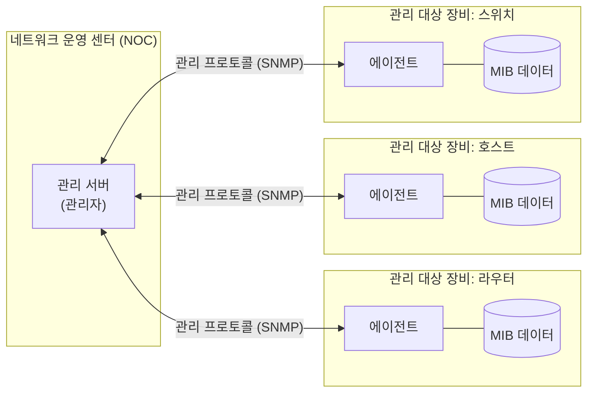
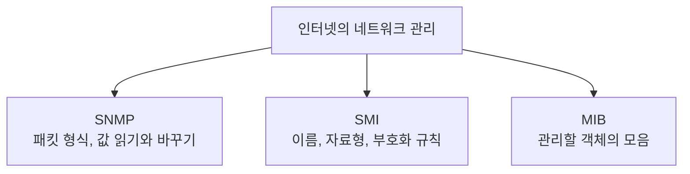
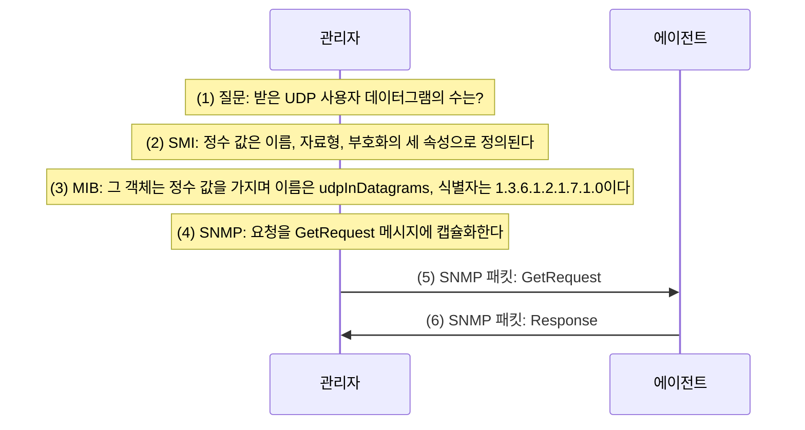
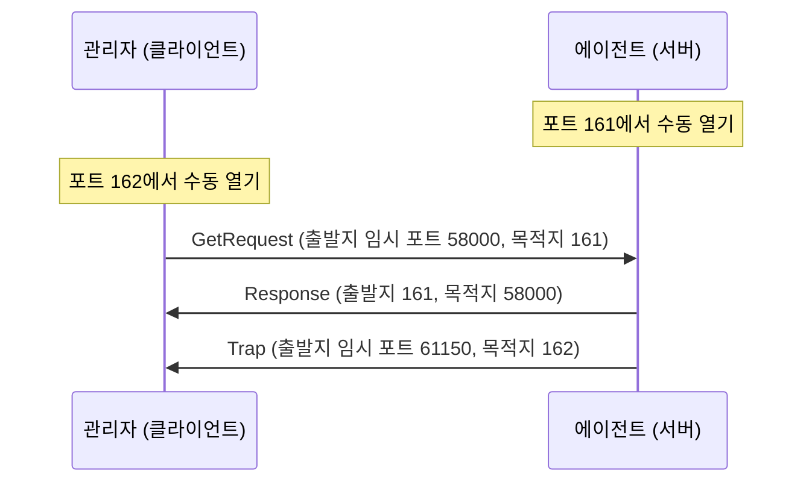

# 17장 — 네트워크 관리와 SNMP

[레포지토리 안내](../../README.ko.md) | [English](Concepts_Lecture.md) | [한국어](Concepts_Lecture.ko.md)

> **최종 수정일:** 2026-11-18
>
> Computer Networking: A Top-Down Approach, Kurose and Ross, Ch 5; TCP/IP Protocol Suite, Forouzan, Ch 24

> **학습 목표:**
> 1. 네트워크 관리의 뜻과 관리 서버, 관리 대상 장비, MIB, 에이전트, 관리 프로토콜의 역할을 설명할 수 있다
> 2. 인터넷 네트워크 관리에서 SNMP, SMI, MIB가 나누어 맡는 일을 구별할 수 있다
> 3. 객체 식별자 트리로 MIB 객체와 그 인스턴스의 이름을 쓰고 사전식 순서를 적용할 수 있다
> 4. BER의 태그, 길이, 값 형식으로 간단한 데이터를 부호화할 수 있다
> 5. SNMP PDU의 종류와 형식, UDP 포트의 쓰임, SNMPv3의 보안 기능을 설명할 수 있다

---

## 목차

- [1. 네트워크 관리의 개요](#1-네트워크-관리의-개요)
  - [1.1 네트워크 관리의 필요성](#11-네트워크-관리의-필요성)
  - [1.2 네트워크 관리의 구성 요소](#12-네트워크-관리의-구성-요소)
  - [1.3 관리자와 에이전트](#13-관리자와-에이전트)
- [2. 인터넷 네트워크 관리의 세 구성 요소](#2-인터넷-네트워크-관리의-세-구성-요소)
  - [2.1 SNMP, SMI, MIB의 역할](#21-snmp-smi-mib의-역할)
  - [2.2 프로그래밍 언어에 비유하기](#22-프로그래밍-언어에-비유하기)
  - [2.3 전체 흐름의 예](#23-전체-흐름의-예)
- [3. SMI](#3-smi)
  - [3.1 이름: 객체 식별자](#31-이름-객체-식별자)
  - [3.2 자료형](#32-자료형)
  - [3.3 부호화: BER](#33-부호화-ber)
- [4. MIB](#4-mib)
  - [4.1 MIB-2의 그룹](#41-mib-2의-그룹)
  - [4.2 단순 변수에 접근하기](#42-단순-변수에-접근하기)
  - [4.3 테이블에 접근하기](#43-테이블에-접근하기)
  - [4.4 사전식 순서](#44-사전식-순서)
- [5. SNMP](#5-snmp)
  - [5.1 SNMP의 동작 방식](#51-snmp의-동작-방식)
  - [5.2 PDU의 종류](#52-pdu의-종류)
  - [5.3 PDU 형식](#53-pdu-형식)
  - [5.4 SNMP 메시지](#54-snmp-메시지)
  - [5.5 UDP 포트](#55-udp-포트)
  - [5.6 보안](#56-보안)
- [개념 적용](#개념-적용)
- [요약](#요약)
- [점검 문제](#점검-문제)
- [참고 문헌](#참고-문헌)

---

<br>

## 1. 네트워크 관리의 개요

### 1.1 네트워크 관리의 필요성

네트워크는 서로 상호작용하는 복잡한 하드웨어와 소프트웨어로 이루어진다. 네트워크의 물리적 구성 요소인 링크, 스위치, 라우터, 호스트를 비롯한 장비가 있고, 이 장비들을 제어하고 조정하는 수많은 프로토콜이 있다. 한 조직이 이런 구성 요소를 수백, 수천 개 모아 네트워크를 이루면, 네트워크가 제대로 돌아가게 유지하는 네트워크 관리자의 일은 결코 쉽지 않다. 15장에서 본 SDN의 논리적으로 중앙 집중된 제어기도 이 일을 도울 수 있지만, 네트워크 관리라는 과제는 SDN보다 훨씬 오래되었으며, 관리자가 네트워크를 감시하고 관리하고 제어하는 것을 돕는 여러 도구와 방법이 있다.

> **용어 정의:** **네트워크 관리(network management)** 는 네트워크와 그 구성 요소의 자원을 감시하고, 시험하고, 폴링하고, 구성하고, 분석하고, 평가하고, 제어하여 실시간 운영 성능과 서비스 품질 요구를 합리적인 비용으로 만족시키기 위해, 하드웨어와 소프트웨어와 사람을 배치하고 통합하고 조정하는 일이다.

이 정의는 Kurose와 Ross가 인용하는 한 문장짜리 정의를 옮긴 것이다. 이 장은 이 넓은 정의 가운데 관리자가 일하는 데 쓰는 구조, 프로토콜, 정보 기반의 기초만 다루며, 장애 식별이나 이상 탐지 같은 관리자의 의사 결정 과정은 다루지 않는다.

### 1.2 네트워크 관리의 구성 요소



*그림 1. 네트워크 관리의 구성 요소*

- **관리 서버(managing server):** 보통 사람이 개입하는 응용 프로그램으로, 네트워크 운영 센터(network operations center, NOC)의 중앙 관리 스테이션에서 실행된다. 관리 서버는 네트워크 관리 활동의 중심이다. 관리 정보의 수집, 처리, 분석, 표시를 통제하고, 네트워크의 동작을 제어하는 행동을 시작하며, 사람인 네트워크 관리자가 네트워크의 장비와 상호작용하는 곳이다.
- **관리 대상 장비(managed device):** 관리되는 네트워크에 있는 네트워크 장비(그 소프트웨어 포함)이다. 호스트, 라우터, 스위치, 미들박스, 모뎀, 온도계 같은 네트워크에 연결된 장비가 될 수 있다. 관리 대상 장비 안에는 여러 **관리 객체(managed object)** 가 있을 수 있다. 관리 객체는 장비 안의 실제 하드웨어(예를 들어 호스트나 라우터의 네트워크 인터페이스 카드)와 하드웨어 및 소프트웨어 구성 요소의 구성 매개변수(예를 들어 OSPF 같은 AS 내부 라우팅 프로토콜의 설정)이다.
- **MIB(Management Information Base):** 관리 대상 장비 안의 각 관리 객체에 관한 정보를 모은 것이다. 관리 서버는 이 정보의 값을 읽을 수 있고, 많은 경우 설정할 수도 있다.
- **네트워크 관리 에이전트(network management agent):** 관리 대상 장비에서 실행되는 프로세스로, 관리 서버와 통신하며 관리 서버의 명령과 통제에 따라 장비에서 국지적인 행동을 취한다. 14장에서 본 제어 에이전트와 비슷하다.
- **네트워크 관리 프로토콜(network management protocol):** 관리 서버와 관리 대상 장비 사이에서 동작하여, 관리 서버가 장비의 상태를 질의하고 에이전트를 통해 간접적으로 장비에서 행동을 취하게 한다. 에이전트는 이 프로토콜로 구성 요소의 고장이나 성능 임계값 위반 같은 예외적 사건을 관리 서버에 알릴 수 있다.

MIB 객체는 라우터에서 IP 데이터그램 헤더의 오류 때문에 버린 데이터그램의 수나 호스트가 받은 UDP 세그먼트의 수 같은 **카운터**, DNS 서버에서 실행 중인 소프트웨어의 버전 같은 **설명 정보**, 장비가 제대로 동작하는지 같은 **상태 정보**, 목적지로 가는 라우팅 경로 같은 **프로토콜별 정보**일 수 있다. MIB 객체는 SMI(Structure of Management Information)라는 자료 기술 언어로 정의하며, 형식 언어를 써서 관리 데이터의 문법과 의미가 잘 정의되고 모호하지 않게 한다. 관련된 MIB 객체는 MIB 모듈로 모은다. 교재에 따르면 2015년 중반 기준으로 RFC로 정의된 MIB 모듈이 400개 가까이 있었고, 업체별(사설) MIB 모듈은 훨씬 더 많았다.

> **핵심:** 네트워크 관리 프로토콜 자체가 네트워크를 관리하는 것은 아니다. 관리 프로토콜은 네트워크 관리자가 네트워크를 관리하는 데 쓸 수 있는 수단을 제공할 뿐이다. 미묘하지만 중요한 구별이다.

### 1.3 관리자와 에이전트

인터넷의 관리 프로토콜인 **SNMP(Simple Network Management Protocol)** 는 관리자와 에이전트라는 개념을 쓴다. 보통 호스트인 관리자가 보통 라우터나 서버인 에이전트 집합을 통제하고 감시한다.

> **용어 정의:** **SNMP(Simple Network Management Protocol)** 는 관리자가 에이전트가 가진 객체의 값을 읽고 바꾸며, 에이전트가 이상한 사건을 관리자에게 알리는 인터넷의 응용 계층 네트워크 관리 프로토콜이다.

> **용어 정의:** **관리자(manager)** 는 SNMP 클라이언트 프로그램을 실행하는 관리 스테이션으로, 에이전트에게 정보를 요청하고 에이전트의 값을 바꾸어 관리 대상 장비를 감시하고 통제한다.

> **용어 정의:** **에이전트(agent)** 는 SNMP 서버 프로그램을 실행하는 관리 대상 스테이션(라우터나 호스트)으로, 성능 정보를 데이터베이스에 유지하고 관리자의 요청에 응답하며 이상 상황을 관리자에게 알린다.

SNMP는 응용 계층 프로토콜이며, 몇 개의 관리 스테이션이 에이전트 집합을 통제한다. 응용 수준에서 설계되었으므로 서로 다른 제조사가 만들고 서로 다른 물리 네트워크에 설치된 장비를 감시할 수 있다. 즉 SNMP는 관리 작업을 관리 대상 장비의 물리적 특성과 그 아래의 네트워크 기술 양쪽에서 자유롭게 하며, 서로 다른 제조사의 라우터로 연결된 여러 LAN과 WAN으로 이루어진 이질적인 인터넷에서 쓸 수 있다.

관리는 관리자와 에이전트 사이의 단순한 상호작용으로 이루어진다. 에이전트는 성능 정보를 데이터베이스에 유지하고, 관리자는 데이터베이스의 값에 접근한다. 예를 들어 라우터는 받은 패킷 수와 전달한 패킷 수를 알맞은 변수에 저장할 수 있고, 관리자는 두 변수의 값을 가져와 비교하여 라우터가 혼잡한지 알 수 있다. 관리자는 라우터가 어떤 행동을 하게 만들 수도 있다. 예를 들어 라우터가 재부팅 카운터의 값을 주기적으로 검사하여 그 값이 0이면 스스로 재부팅한다면, 관리자는 그 카운터에 0을 넣는 패킷을 보내 원하는 때에 에이전트를 원격으로 재부팅할 수 있다. 에이전트도 관리 과정에 참여한다. 에이전트에서 실행되는 서버 프로그램은 환경을 검사하다가 이상한 것을 발견하면 관리자에게 경고 메시지인 **트랩(trap)** 을 보낼 수 있다.

SNMP를 이용한 관리는 다음 세 가지 기본 생각에 바탕을 둔다.

1. 관리자는 에이전트의 동작을 반영하는 정보를 요청하여 에이전트를 점검한다.
2. 관리자는 에이전트 데이터베이스의 값을 다시 설정하여 에이전트가 어떤 작업을 하게 한다.
3. 에이전트는 이상 상황을 관리자에게 경고하여 관리 과정에 참여한다.

---

<br>

## 2. 인터넷 네트워크 관리의 세 구성 요소

### 2.1 SNMP, SMI, MIB의 역할

인터넷의 관리 작업은 SNMP와 함께 두 프로토콜 **SMI(Structure of Management Information)** 와 **MIB(Management Information Base)** 를 쓴다. 즉 인터넷의 관리는 세 프로토콜의 협력으로 이루어진다.



*그림 2. 인터넷 네트워크 관리의 구성 요소*

- **SNMP의 역할:** 관리자가 에이전트에게, 또 에이전트가 관리자에게 보내는 패킷의 형식을 정의한다. 결과를 해석하고 (다른 관리 소프트웨어의 도움으로) 통계를 만든다. 주고받는 패킷은 객체(변수)의 이름과 그 상태(값)를 담으며, SNMP는 이 값을 읽고 바꾸는 일을 맡는다.
- **SMI의 역할:** SNMP를 쓰려면 규칙이 필요하다. 객체에 이름을 붙이는 규칙이 필요하며, SNMP의 객체는 계층 구조를 이루므로(객체에는 부모 객체와 자식 객체가 있을 수 있고 이름의 일부를 부모에게서 물려받을 수 있다) 특히 중요하다. 객체의 자료형을 정의하는 규칙도 필요하다. SNMP가 다루는 객체는 단순형인가 구조형인가, 단순형은 몇 가지이며 크기와 범위는 얼마인가, 각 자료형은 어떻게 부호화하는가를 정해야 한다. SMI는 객체의 이름을 붙이고, 범위와 길이를 포함한 객체의 자료형을 정의하고, 객체와 값을 부호화하는 일반 규칙을 정의한다. 값을 보내고 받고 저장하는 컴퓨터의 구조를 알 수 없으므로 이런 보편적 규칙이 필요하다. 송신자는 정수를 8바이트로 저장하는 강력한 컴퓨터이고 수신자는 정수를 4바이트로 저장하는 작은 컴퓨터일 수 있다. 그러나 SMI는 규칙만 정할 뿐, 한 개체에서 몇 개의 객체를 관리하는지, 어느 객체가 어느 자료형을 쓰는지는 정하지 않는다.
- **MIB의 역할:** 관리할 각 개체에 대해 객체의 수를 정하고, SMI의 규칙에 따라 이름을 붙이고, 이름 붙은 각 객체에 자료형을 연결하는 프로토콜이 따로 필요하며, 그것이 MIB이다. MIB는 관리할 각 개체에 대해 데이터베이스와 비슷한 객체 집합(대부분 값이 아니라 이름과 자료형 같은 메타데이터)을 만든다.

> **용어 정의:** **SMI(Structure of Management Information)** 는 관리 객체의 이름을 짓고, 자료형을 정의하고, 값을 부호화하는 일반 규칙을 정하는 인터넷 네트워크 관리의 구성 요소이다.

> **용어 정의:** **MIB(Management Information Base)** 는 관리 대상 장비의 관리 객체를 모은 것으로, 각 객체는 SMI의 규칙에 따라 이름이 붙고 자료형과 연결되며, 관리자는 그 값을 읽고 많은 경우 바꿀 수 있다.

### 2.2 프로그래밍 언어에 비유하기

세 구성 요소는 프로그래밍 언어로 문제를 푸는 프로그램을 쓸 때 필요한 것과 비슷하다.

| 컴퓨터 프로그래밍 | 네트워크 관리 | 하는 일 |
|:-----|:-----|:-----|
| 언어의 문법 | SMI | 변수의 구조와 이름 붙이는 규칙, 쓸 수 있는 자료형을 미리 정한다. |
| 객체의 선언과 정의 | MIB | 미리 정의된 자료형으로 객체를 만들고 이름과 자료형을 정한다. |
| 프로그램 코드 | SNMP | 선언된 객체에 값을 저장하고, 바꾸고, 해석한다. |

*표 1. 컴퓨터 프로그래밍과 네트워크 관리의 비교*

- **문법과 SMI:** 프로그램을 쓰기 전에 C나 Java 같은 언어의 문법이 미리 정해져 있어야 한다. 언어는 변수의 구조(단순, 구조체, 포인터 등)와 변수 이름을 붙이는 규칙(예를 들어 이름은 1\~n글자이고 문자로 시작하며 그 뒤에 영숫자가 온다), 쓸 수 있는 자료형(정수, 실수, 문자 등)을 정한다. 프로그래밍에서는 언어의 문법이 규칙을 정하고, 네트워크 관리에서는 SMI가 규칙을 정한다.
- **선언, 정의와 MIB:** 대부분의 언어는 프로그램에서 객체를 선언하고 정의하도록 요구한다. 선언과 정의는 미리 정의된 자료형으로 객체를 만들고 메모리 위치를 할당한다. 예를 들어 정수 counter와 char 배열 grades가 필요하면 프로그램 앞에서 `int counter;`, `char grades[40];`처럼 선언한다. 네트워크 관리에서는 MIB가 이 일을 하여 각 객체에 이름을 붙이고 자료형을 정한다. 자료형은 SMI가 정의하므로 SNMP는 그 범위와 크기를 안다.
- **프로그램 코드와 SNMP:** 선언 뒤에 프로그램은 변수에 값을 저장하고 필요하면 바꾸는 문장을 써야 한다. 네트워크 관리에서는 SNMP가 이 일을 하여, MIB가 이미 선언한 객체의 값을 SMI가 정한 규칙에 따라 저장하고, 바꾸고, 해석한다.

> **[컴퓨터프로그래밍]** 이 비유에서 SMI는 언어의 타입 시스템과 문법, MIB는 헤더 파일의 변수 선언, SNMP는 그 변수를 읽고 쓰는 실행 코드에 해당한다. 선언만 있는 헤더 파일이 값을 담지 않듯이, MIB도 객체의 이름과 자료형만 정하고 값은 에이전트가 실행 중에 유지한다.

### 2.3 전체 흐름의 예

세 구성 요소가 함께 일하는 간단한 시나리오를 본다. 관리 스테이션(SNMP 클라이언트)이 에이전트 스테이션(SNMP 서버)이 받은 UDP 사용자 데이터그램의 수를 알고 싶어 메시지를 보낸다.



*그림 3. 관리 요청의 전체 흐름*

MIB는 받은 UDP 사용자 데이터그램의 수를 담는 객체를 찾는 일을 맡는다. SMI는 또 다른 내장 프로토콜의 도움으로 객체의 이름을 부호화하는 일을 맡는다. SNMP는 GetRequest라는 메시지를 만들고 부호화한 메시지를 캡슐화하는 일을 맡는다. 실제로는 이보다 복잡하지만, 각 프로토콜을 자세히 보기 전에 큰 흐름을 잡아 둘 필요가 있다.

---

<br>

## 3. SMI

SMI 버전 2(SMIv2)는 네트워크 관리의 구성 요소로서 다음 세 가지 기능을 한다.

1. 객체에 이름을 붙인다.
2. 객체에 저장할 수 있는 자료의 형을 정의한다.
3. 네트워크로 전송할 자료를 부호화하는 방법을 보인다.

즉 SMI는 객체를 다루는 세 속성, 이름, 자료형, 부호화 방법을 강조하는 SNMP의 지침이다.

### 3.1 이름: 객체 식별자

SMI는 관리되는 각 객체(라우터, 라우터 안의 변수, 값 등)가 유일한 이름을 갖도록 요구한다. 객체에 전역적으로 이름을 붙이기 위해 SMI는 트리 구조에 바탕을 둔 계층적 식별자인 객체 식별자를 쓴다.

> **용어 정의:** **객체 식별자(object identifier)** 는 이름 없는 뿌리에서 시작하는 트리에서 객체에 이르는 경로를 점으로 구분한 정수의 열(또는 이름의 열)로 나타낸, 전역적으로 유일한 객체의 이름이다.

```text
                       (root)
          ┌──────────────┼──────────────┐
        itu-t           iso         iso-itu-t
          0              1              2
                         │
                        org
                         3
                         │
                        dod
                         6
                         │
                     internet       1.3.6.1 (iso.org.dod.internet)
                         1
                         │
                       mgmt
                         2
                         │
                       mib-2        1.3.6.1.2.1 (iso.org.dod.internet.mgmt.mib-2)
                         1
```

*그림 4. 객체 식별자 트리*

트리 구조는 이름 없는 뿌리에서 시작한다. 각 객체는 점으로 구분한 정수의 열로 나타낼 수 있고, 점으로 구분한 이름의 열로도 나타낼 수 있다. SNMP는 정수와 점의 표현을 쓰고, 사람은 이름과 점의 표현을 쓴다. 예를 들어 다음 두 표기는 같은 객체를 가리킨다.

```text
iso.org.dod.internet.mgmt.mib-2  ↔  1.3.6.1.2.1
```

SNMP가 쓰는 객체는 mib-2 객체 아래에 있으므로, SNMP가 관리하는 모든 객체의 식별자는 항상 1.3.6.1.2.1로 시작한다.

### 3.2 자료형

객체의 둘째 속성은 그 객체에 저장하는 자료의 형이다. SMI는 자료형을 정의하기 위해 기본적인 **ASN.1(Abstract Syntax Notation One)** 정의를 쓰고 새 정의를 몇 가지 더한다. 즉 SMI는 ASN.1의 부분 집합이면서 상위 집합이다. SMI의 자료형은 크게 단순형과 구조형으로 나뉜다.

**단순형(simple type)** 은 원자적인 자료형이다. 일부는 ASN.1에서 그대로 가져왔고 일부는 SMI가 더했다. 표 2의 처음 다섯은 ASN.1에서, 나머지 일곱은 SMI에서 정의한다.

| 자료형 | 크기 | 설명 |
|:-----|:-----|:-----|
| INTEGER | 4바이트 | $`-2^{31}`$ 부터 $`2^{31}-1`$ 까지의 정수 |
| Integer32 | 4바이트 | INTEGER와 같음 |
| Unsigned32 | 4바이트 | 0부터 $`2^{32}-1`$ 까지의 부호 없는 정수 |
| OCTET STRING | 가변 | 65,535바이트까지의 바이트 문자열 |
| OBJECT IDENTIFIER | 가변 | 객체 식별자 |
| IPAddress | 4바이트 | 정수 넷으로 이루어진 IP 주소 |
| Counter32 | 4바이트 | 0부터 증가하는 정수로, 최댓값에 이르면 다시 0으로 돌아감 |
| Counter64 | 8바이트 | 64비트 카운터 |
| Gauge32 | 4바이트 | Counter32와 같지만 최댓값에 이르면 0으로 돌아가지 않고 재설정될 때까지 머무름 |
| TimeTicks | 4바이트 | 시간을 1/100초 단위로 기록하는 계수 값 |
| BITS | | 비트의 문자열 |
| Opaque | 가변 | 해석하지 않는 문자열 |

*표 2. SMI의 단순 자료형*

**구조형(structured type)** 은 단순형과 구조형을 조합하여 만든다. SMI는 두 가지 구조형을 정의한다.

- **sequence:** 서로 같은 형일 필요가 없는 단순형들의 조합이다. C 같은 프로그래밍 언어의 struct나 레코드에 해당한다.
- **sequence of:** 모두 같은 형인 단순형들의 조합이거나, 모두 같은 형인 sequence들의 조합이다. C의 배열에 해당한다.

### 3.3 부호화: BER

SMI는 네트워크로 전송할 자료를 부호화하기 위해 또 다른 표준인 BER를 쓴다.

> **용어 정의:** **BER(Basic Encoding Rules)** 는 전송할 각 자료를 태그(tag), 길이(length), 값(value)의 세 부분으로 부호화하도록 정한 부호화 규칙이다.

```text
+---------+-------------------+-----------------+
|   Tag   |      Length       |      Value      |
| 1 byte  | 1 or more bytes   |  Variable size  |
+---------+-------------------+-----------------+
```

*그림 5. BER의 부호화 형식*

- **태그(1바이트):** 자료형을 정의한다. 표 3은 이 장에서 쓰는 자료형과 그 태그이다.
- **길이(1바이트 이상):** 1바이트이면 최상위 비트가 0이어야 하며, 나머지 7비트가 자료의 길이이다. 1바이트보다 길면 첫 바이트의 최상위 비트가 1이어야 하며, 첫 바이트의 나머지 7비트는 길이를 나타내는 데 필요한 바이트 수이다. 예를 들어 길이가 2이면 00000010 한 바이트로 쓰고, 길이가 260이면 10000010 00000001 00000100으로 쓴다. 첫 바이트의 나머지 7비트(0000010)가 뒤의 두 바이트로 길이를 나타낸다는 뜻이고, 그 두 바이트 00000001 00000100이 260이다.
- **값:** BER가 정한 규칙에 따라 자료의 값을 부호화한다.

| 자료형 | 태그 (2진수) | 태그 (16진수) |
|:-----|:-----|:-----|
| INTEGER | 00000010 | 02 |
| OCTET STRING | 00000100 | 04 |
| OBJECT IDENTIFIER | 00000110 | 06 |
| NULL | 00000101 | 05 |
| Sequence, sequence of | 00110000 | 30 |
| IPAddress | 01000000 | 40 |
| Counter | 01000001 | 41 |
| Gauge | 01000010 | 42 |
| TimeTicks | 01000011 | 43 |
| Opaque | 01000100 | 44 |

*표 3. 자료형의 태그*

다음은 교재가 보이는 부호화의 예이다. 교재는 정수의 길이를 표 2의 크기(4바이트)로 둔다.

```text
INTEGER 14
  02          04          00 00 00 0E
  Tag         Length      Value (14)
  (integer)   (4 bytes)

OCTET STRING "HI"
  04          02          48          49
  Tag         Length      Value (H)   Value (I)
  (string)    (2 bytes)

ObjectIdentifier 1.3.6.1 (iso.org.dod.internet)
  06          04          01  03  06  01
  Tag         Length      Value (1, 3, 6, 1)
  (ObjectId)  (4 bytes)

IPAddress 131.21.14.8
  40          04          83  15  0E  08
  Tag         Length      Value (131, 21, 14, 8)
  (IPAddress) (4 bytes)
```

*그림 6. BER 부호화의 예*

> **참고:** Forouzan은 TLV 구조를 단순하게 보이려고 모든 INTEGER에 4바이트 값을 주고 OID의 각 성분을 1바이트로 쓴다. BER 표준은 두 가지 세부 규칙에서 이와 다르다. INTEGER는 가능한 가장 적은 바이트로 부호화하므로 INTEGER 14는 02 01 0E이다[1]. OID의 처음 두 성분 X와 Y는 값이 40X + Y인 하위 식별자 하나로 합치므로, 40 × 1 + 3 = 43 = 0x2B에 따라 1.3.6.1은 06 03 2B 06 01이다[1]. 실제 장비가 부호화한 메시지는 이 규칙을 따르므로 여기와 5.4절에 실린 Forouzan의 예와 바이트가 다르다. 예를 들어 그림 9의 변수 1.3.6.1.2.1.7.1.0은 06 08 2B 06 01 02 01 07 01 00으로 부호화한다.

---

<br>

## 4. MIB

### 4.1 MIB-2의 그룹

MIB 버전 2(MIB2)는 네트워크 관리에 쓰는 둘째 구성 요소이다. 각 에이전트는 관리자가 관리할 수 있는 모든 객체의 모음인 자기 MIB2를 가진다. MIB2의 객체는 객체 식별자 트리의 mib-2 객체 아래에서 열 개의 그룹으로 나뉘며, 각 그룹에는 변수나 테이블, 또는 둘 다가 정의되어 있다.

| 그룹 | 번호 | 정의하는 정보 |
|:-----|:-----|:-----|
| sys (system) | 1 | 노드(시스템)의 이름, 위치, 동작 시간 같은 일반 정보 |
| if (interface) | 2 | 인터페이스 번호, 물리 주소, IP 주소 같은 노드의 모든 인터페이스 정보 |
| at (address translation) | 3 | ARP 테이블 정보 |
| ip | 4 | 라우팅 테이블, IP 주소 같은 IP 관련 정보 |
| icmp | 5 | 보내고 받은 패킷의 수, 만든 오류의 총수 같은 ICMP 관련 정보 |
| tcp | 6 | 연결 테이블, 타임아웃 값, 포트 수, 보내고 받은 패킷 수 같은 TCP 관련 정보 |
| udp | 7 | 포트 수, 보내고 받은 패킷 수 같은 UDP 관련 정보 |
| egp | 8 | EGP 관련 정보 |
| trans (transmission) | 10 | 전송 관련 정보 |
| snmp | 11 | SNMP 자신에 관한 일반 정보 |

*표 4. MIB-2의 그룹 (식별자 1.3.6.1.2.1 아래)*

번호 9는 이 그룹들 가운데 어느 것에도 쓰이지 않으므로, transmission 그룹과 snmp 그룹의 번호는 10과 11이다[2].

### 4.2 단순 변수에 접근하기

여러 변수에 접근하는 방법을 udp 그룹을 예로 본다. udp 그룹에는 단순 변수 넷과 레코드의 테이블(sequence of) 하나가 있다.

```text
udp (1.3.6.1.2.1.7)
 ├── 1  udpInDatagrams
 ├── 2  udpNoPorts
 ├── 3  udpInErrors
 ├── 4  udpOutDatagrams
 └── 5  udpTable
         └── 1  udpEntry
                 ├── 1  udpLocalAddress
                 └── 2  udpLocalPort
```

*그림 7. MIB의 udp 그룹*

단순 변수에 접근하려면 그룹의 식별자(1.3.6.1.2.1.7) 뒤에 변수의 식별자를 붙인다.

```text
udpInDatagrams   →  1.3.6.1.2.1.7.1
udpNoPorts       →  1.3.6.1.2.1.7.2
udpInErrors      →  1.3.6.1.2.1.7.3
udpOutDatagrams  →  1.3.6.1.2.1.7.4
```

그러나 이 객체 식별자는 변수를 정의할 뿐 인스턴스(내용)를 가리키지는 않는다. 각 변수의 인스턴스, 곧 내용을 가리키려면 인스턴스 접미사를 붙여야 하며, 단순 변수의 인스턴스 접미사는 0이다.

```text
udpInDatagrams.0   →  1.3.6.1.2.1.7.1.0
udpNoPorts.0       →  1.3.6.1.2.1.7.2.0
udpInErrors.0      →  1.3.6.1.2.1.7.3.0
udpOutDatagrams.0  →  1.3.6.1.2.1.7.4.0
```

### 4.3 테이블에 접근하기

테이블을 가리키려면 먼저 테이블의 식별자를 쓴다. udp 그룹에는 식별자가 5인 테이블 하나만 있으므로 udpTable은 1.3.6.1.2.1.7.5이다. 그러나 테이블은 트리의 잎이 아니므로 테이블 자체에는 접근할 수 없다. 테이블 안의 항목(sequence)을 정의해야 하며, 그 식별자는 1이다(udpEntry → 1.3.6.1.2.1.7.5.1). 이 항목도 잎이 아니어서 접근할 수 없으며, 항목 안의 각 필드를 정의해야 한다.

```text
udpLocalAddress  →  1.3.6.1.2.1.7.5.1.1
udpLocalPort     →  1.3.6.1.2.1.7.5.1.2
```

이 두 변수는 트리의 잎이다. 그 인스턴스에 접근할 수 있지만 어느 인스턴스인지 정해야 한다. 어느 순간에든 테이블에는 지역 주소와 지역 포트의 쌍마다 여러 값이 있을 수 있다. 테이블의 특정 인스턴스(행)에 접근하려면 위의 식별자에 인덱스를 붙인다. MIB에서 배열의 인덱스는 대부분의 프로그래밍 언어처럼 정수가 아니라, 항목의 한두 필드의 값에 바탕을 둔다. udpTable은 지역 주소와 지역 포트 번호를 함께 인덱스로 쓴다.

| udpLocalAddress | udpLocalPort | udpLocalAddress 인스턴스의 식별자 |
|:-----|:-----|:-----|
| 181.23.45.14 | 23 | 1.3.6.1.2.1.7.5.1.1.181.23.45.14.23 |
| 192.13.5.10 | 161 | 1.3.6.1.2.1.7.5.1.1.192.13.5.10.161 |
| 227.2.45.18 | 180 | 1.3.6.1.2.1.7.5.1.1.227.2.45.18.180 |
| 230.20.5.24 | 212 | 1.3.6.1.2.1.7.5.1.1.230.20.5.24.212 |

*표 5. udpTable의 행과 인덱스*

예를 들어 첫 행의 지역 주소 인스턴스에 접근하려면 인스턴스 인덱스를 붙인 다음 식별자를 쓴다. 같은 행의 지역 포트 인스턴스는 열 번호 1 대신 2를 쓴 1.3.6.1.2.1.7.5.1.2.181.23.45.14.23이다.

```text
udpLocalAddress.181.23.45.14.23  →  1.3.6.1.2.1.7.5.1.1.181.23.45.14.23
```

모든 테이블이 같은 방식으로 인덱스를 매기지는 않는다. 어떤 테이블은 필드 하나의 값으로, 어떤 테이블은 필드 둘의 값으로 인덱스를 매긴다.

### 4.4 사전식 순서

> **용어 정의:** **사전식 순서(lexicographic ordering)** 는 MIB 변수의 객체 식별자(인스턴스 식별자 포함)를 앞 자리부터 비교하여 정한 순서로, 테이블에서는 열을 먼저 따라가고 각 열 안에서 위에서 아래로 가는 순서가 된다.

MIB 변수의 흥미로운 점은 객체 식별자가 사전식 순서를 따른다는 것이다. 테이블은 열과 행의 규칙에 따라 정렬되므로 열 단위로 따라가야 하고, 각 열 안에서는 위에서 아래로 간다. 표 5의 udpTable에서는 udpLocalAddress 열의 네 인스턴스가 위에서 아래로 먼저 오고, 그다음에 udpLocalPort 열의 네 인스턴스가 같은 순서로 온다. 사전식 순서 덕분에 관리자는 첫 변수만 지정하여 변수들에 차례로 접근할 수 있으며, 5.2절의 GetNextRequest가 이 성질을 이용한다.

---

<br>

## 5. SNMP

### 5.1 SNMP의 동작 방식

SNMP는 인터넷 네트워크 관리에서 SMI와 MIB를 함께 쓰는 응용 프로그램이며, 다음 일을 가능하게 한다.

1. 관리자가 에이전트에 정의된 객체의 값을 가져온다.
2. 관리자가 에이전트에 정의된 객체에 값을 저장한다.
3. 에이전트가 이상 상황에 관한 경고 메시지를 관리자에게 보낸다.

Kurose와 Ross는 SNMP 버전 2(SNMPv2)를 관리 서버와 그 서버를 대신하여 실행되는 에이전트 사이에서 네트워크 관리 제어 메시지와 정보 메시지를 전달하는 응용 계층 프로토콜로 소개한다. SNMP의 가장 흔한 쓰임은 **요청 응답 방식**이다. SNMP 관리 서버가 에이전트에 요청을 보내면, 에이전트는 요청을 받아 어떤 행동을 하고 응답을 보낸다. 요청은 보통 관리 대상 장비의 MIB 객체 값을 질의(가져오기)하거나 수정(설정)하는 데 쓴다. 둘째로 흔한 쓰임은 에이전트가 요청받지 않은 메시지인 **트랩 메시지**를 관리 서버에 보내는 것이다. 트랩 메시지는 MIB 객체 값을 바꾼 예외적 상황(예를 들어 링크 인터페이스가 올라가거나 내려감)을 관리 서버에 알린다.

> **용어 정의:** **트랩(trap)** 은 에이전트가 관리자의 요청 없이 예외적인 사건을 알리려고 관리 서버에 보내는 메시지로, 관리자는 이에 응답하지 않아도 된다.

### 5.2 PDU의 종류

SNMP의 메시지를 일반적으로 **PDU(protocol data unit)** 라 한다. SNMPv2는 일곱 종류의 PDU를 정의하고, Forouzan이 다루는 SNMPv3는 Report를 더해 여덟 종류를 정의한다.

| PDU | 송신자와 수신자 | 설명 |
|:-----|:-----|:-----|
| GetRequest | 관리자 → 에이전트 | 하나 이상의 MIB 객체 인스턴스의 값을 가져온다. |
| GetNextRequest | 관리자 → 에이전트 | 목록이나 테이블에서 다음 MIB 객체 인스턴스의 값을 가져온다. |
| GetBulkRequest | 관리자 → 에이전트 | 큰 테이블의 값처럼 많은 자료를 한 번에 가져온다. |
| InformRequest | 관리자 → 관리자 | 원격 관리 개체에 그 개체가 직접 접근할 수 없는 MIB 값을 알린다. |
| SetRequest | 관리자 → 에이전트 | 하나 이상의 MIB 객체 인스턴스의 값을 설정한다. |
| Response | 에이전트 → 관리자, 관리자 → 관리자 | GetRequest, GetNextRequest, GetBulkRequest, SetRequest, InformRequest에 대한 응답으로 만든다. |
| SNMPv2-Trap | 에이전트 → 관리자 | 예외적 사건을 관리자에게 알린다. |
| Report | 관리자 사이 | 관리자 사이의 어떤 종류의 오류를 알리도록 설계되었지만 아직 쓰이지 않는다. |

*표 6. SNMP PDU의 종류*

- **GetRequest, GetNextRequest, GetBulkRequest:** 모두 관리자가 에이전트에게 보내, 에이전트의 관리 대상 장비에 있는 하나 이상의 MIB 객체 값을 요청한다. 값을 요청하는 MIB 객체는 PDU의 변수 바인딩 부분에 지정한다. 세 PDU는 요청의 단위가 다르다. GetRequest는 임의의 MIB 값 집합을 요청할 수 있다. GetNextRequest는 지정한 객체 식별자 다음에 오는 객체의 값을 돌려받으므로, 여러 번 써서 목록이나 테이블의 MIB 객체를 차례로 훑을 수 있다. 특히 관리자가 테이블 항목의 인덱스를 모를 때 테이블의 객체 식별자를 지정하면, 첫 항목의 객체 식별자가 테이블의 식별자 바로 다음에 오므로 첫 항목의 값을 돌려받고, 그 식별자로 다음 값을 받는 식으로 이어 갈 수 있다. GetBulkRequest는 큰 덩어리의 자료를 돌려받을 수 있게 하여, GetRequest나 GetNextRequest를 여러 번 보내는 부담을 피한다. 세 경우 모두 에이전트는 객체 식별자와 그 값을 담은 Response PDU로 응답한다.
- **SetRequest:** 관리자가 관리 대상 장비의 MIB 객체 하나 이상의 값을 설정할 때 쓴다. 에이전트는 오류 상태가 noError인 Response PDU로 값을 실제로 설정했음을 확인한다.
- **InformRequest:** 한 관리자가 다른 원격 관리자에게, 그 관리자가 통제하는 에이전트의 변수 값을 알리거나 얻는 데 쓴다. 원격 관리자는 Response PDU로 응답한다.
- **Response:** 보통 관리 대상 장비가 관리 서버의 요청 메시지에 대한 응답으로 요청한 정보를 돌려줄 때 보낸다.
- **Trap:** 비동기적으로 만들어진다. 받은 요청에 대한 응답이 아니라 관리 서버가 알아야 하는 사건에 대한 반응으로 만든다. 장비의 콜드 스타트나 웜 스타트, 링크가 올라가거나 내려감, 이웃의 상실, 인증 실패 같은 사건이 정의되어 있다. 예를 들어 에이전트가 재부팅되면 관리자에게 알리고 재부팅 시각을 보고한다. 관리 서버는 받은 트랩에 응답할 필요가 없다. SNMPv1의 Trap과 구별하기 위해 SNMPv2 Trap이라고도 한다.

### 5.3 PDU 형식

```text
+------+---------+--------+--------+----------+-------+----------+-------+-----
| PDU  | Request | Error  | Error  | Variable | Value | Variable | Value | ...
| type |   ID    | status | index  |          |       |          |       |
+------+---------+--------+--------+----------+-------+----------+-------+-----
                                   |<-------------- VarBind list ------------->|
```

*그림 8. SNMP PDU의 형식*

- **PDU type:** PDU의 종류이다(표 7).
- **Request ID:** 관리자가 요청 PDU에 쓰고 에이전트가 응답에 그대로 되풀이하는 순서 번호이다. 요청과 응답을 짝짓는 데 쓴다.
- **Error status:** 응답 PDU에서만 쓰며, 에이전트가 보고하는 오류의 종류를 나타내는 정수이다(표 8). 요청 PDU에서는 값이 0이다.
- **Error index:** 어느 변수가 오류를 일으켰는지 관리자에게 알려 주는 오프셋이다.
- **VarBind list:** 관리자가 가져오거나 설정하려는 변수와 그에 대응하는 값의 집합이다. GetRequest와 GetNextRequest에서는 값이 null이다. Trap PDU에서는 그 사건에 관련된 변수와 값을 나타낸다.

GetBulkRequest는 두 필드가 다르다. 요청 PDU에서는 비어 있는 error status 필드 자리에 **non-repeaters** 필드를, error index 필드 자리에 **max-repetitions** 필드를 둔다. 따라서 GetBulkRequest를 뺀 모든 요청 메시지에서 error status와 error index의 값은 0이다.

| 종류 | 태그 (2진수) | 태그 (16진수) |
|:-----|:-----|:-----|
| GetRequest | 10100000 | A0 |
| GetNextRequest | 10100001 | A1 |
| Response | 10100010 | A2 |
| SetRequest | 10100011 | A3 |
| GetBulkRequest | 10100101 | A5 |
| InformRequest | 10100110 | A6 |
| Trap (SNMPv2) | 10100111 | A7 |
| Report | 10101000 | A8 |

*표 7. PDU의 종류와 태그*

| 상태 | 이름 | 뜻 |
|:-----|:-----|:-----|
| 0 | noError | 오류 없음 |
| 1 | tooBig | 응답이 너무 커서 한 메시지에 들어가지 않음 |
| 2 | noSuchName | 변수가 존재하지 않음 |
| 3 | badValue | 저장할 값이 올바르지 않음 |
| 4 | readOnly | 값을 수정할 수 없음 |
| 5 | genErr | 그 밖의 오류 |

*표 8. 오류 상태의 종류*

> **참고:** Kurose와 Ross의 PDU 형식 그림은 Get과 Set 계열 PDU(PDU type 0\~3)의 헤더를 요청 ID, 오류 상태(0\~5), 오류 인덱스로 보이고, 트랩 PDU(PDU type 4)의 헤더를 기업(enterprise), 에이전트 주소, 트랩 유형(0\~7), 특정 코드, 타임스탬프로 따로 보인다. 그 뒤에 이름과 값의 쌍이 이어지는 구조는 같다. 이 트랩 형식은 SNMPv1의 Trap에 해당하며, SNMPv2 Trap은 그림 8과 같은 형식을 쓴다.

### 5.4 SNMP 메시지

SNMP는 PDU만 보내지 않고 PDU를 메시지에 담아 보낸다. SNMPv3의 메시지는 Version, GlobalData, SecurityParameters, ScopePDU(부호화한 PDU를 포함)의 네 요소로 이루어진 sequence이다. 첫째와 셋째 요소는 단순형이고 둘째와 넷째 요소는 sequence이다.

- **Version:** 버전을 정의하는 INTEGER 자료이다. 현재 버전은 3이다.
- **GlobalData:** ID, MaxSize, Flags, SecurityModel의 네 단순형 요소로 이루어진 sequence이다.
- **SecurityParameters:** 버전 3에서 쓰는 보안 방식에 따라 매우 복잡할 수 있는 sequence이다.
- **ScopePDU:** 두 단순형(contextEngine, contextName)과 실제 PDU를 담는다. PDU 안의 VarBindList는 하나 이상의 VarBind sequence로 이루어지며, 각 VarBind는 Variable과 Value의 두 단순형 요소로 이루어진다.

관리 스테이션(SNMP 클라이언트)이 GetRequest PDU를 담은 메시지로 라우터가 받은 UDP 데이터그램의 수를 가져오는 예를 본다. 해당 MIB 변수는 객체 식별자가 1.3.6.1.2.1.7.1.0인 udpInDatagrams이다. 관리자는 값을 저장하려는 것이 아니라 가져오려는 것이므로 값은 null로 둔다. 다음은 메시지 전체를 16진수로 나타낸 것이며, 들여쓰기는 sequence 안에 무엇이 들어 있는지 보이고, 각 sequence 옆의 수는 그 내용의 길이이다.

```text
Message                   30 6D                    Sequence (109 bytes)
  Version                 02 01 03
  GlobalData              30 0D                    Sequence (13 bytes)
    ID                    02 01 40
    MaxSize               02 02 04 00
    Flags                 04 01 04
    SecurityModel         02 01 03
  SecurityParameters      30 28                    Sequence (40 bytes)
    (40 bytes of parameters)
  ScopePDU                30 2F                    Sequence (47 bytes)
    contextEngine         04 0C 00 00 00 61 02 00 00 B2 C1 41 82 20
    contextName           04 00
    PDU (GetRequest)      A0 1D                    PDU (29 bytes)
      request-id          02 04 00 01 06 11
      error-status        02 01 00
      error-index         02 01 00
      VarBindList         30 0F                    Sequence (15 bytes)
        VarBind           30 0D                    Sequence (13 bytes)
          Variable        06 09 01 03 06 01 02 01 07 01 00
          Value           05 00
```

*그림 9. 받은 UDP 데이터그램 수를 묻는 GetRequest PDU를 담은 SNMPv3 메시지의 부호화*

VarBind 목록에는 VarBind가 하나만 있다. 변수는 형 06, 길이 09이고 값은 형 05(NULL), 길이 00이다. VarBind 전체는 길이 0D(13)의 sequence이고, VarBind 목록도 길이 0F(15)의 sequence이다. GetRequest PDU의 길이는 1D(29)이다. PDU 자체도 sequence와 같은 구조이지만 태그는 16진수 A0이다. 이 PDU는 47바이트 길이의 ScopePDU sequence(30 2F)에 들어가며, ScopePDU에는 14바이트의 contextEngine과 2바이트의 contextName이 PDU 앞에 온다. 보안 매개변수가 40바이트라 하면, 메시지 sequence는 Version(3바이트), GlobalData sequence(15바이트), SecurityParameters sequence(42바이트), ScopePDU sequence(49바이트)를 담아 내용이 109바이트(6D)이고, 메시지 전체는 태그와 길이를 더해 111바이트이다.

### 5.5 UDP 포트

SNMP 메시지는 여러 전송 프로토콜로 운반될 수 있지만, 보통 UDP 데이터그램의 페이로드로 운반된다. Kurose와 Ross에 따르면 SNMP의 규격도 UDP를 "the preferred transport mapping"이라 부른다. SNMP는 두 개의 잘 알려진 UDP 포트 161과 162를 쓴다.

- **포트 161:** 서버(에이전트)가 쓴다. 에이전트는 포트 161에서 수동 열기(passive open)를 하고 관리자를 기다린다. 관리자(클라이언트)는 임시 포트로 능동 열기(active open)를 한다. 요청 메시지는 임시 포트를 출발지 포트로, 161을 목적지 포트로 하여 클라이언트에서 서버로 가고, 응답 메시지는 161을 출발지 포트로, 임시 포트를 목적지 포트로 하여 서버에서 클라이언트로 간다.
- **포트 162:** 클라이언트(관리자)가 쓴다. 관리자는 포트 162에서 수동 열기를 하고 에이전트를 기다린다. 에이전트(서버)는 보낼 Trap 메시지가 있을 때마다 임시 포트로 능동 열기를 한다. 이 연결은 서버에서 클라이언트로 가는 한 방향뿐이다.



*그림 10. SNMP의 포트 번호*

SNMP의 클라이언트 서버 메커니즘은 다른 프로토콜과 다르다. 클라이언트와 서버가 모두 잘 알려진 포트를 쓰고, 둘 다 끝없이 실행된다. 요청 메시지는 관리자(클라이언트)가 시작하지만 Trap 메시지는 에이전트(서버)가 시작하기 때문이다.

UDP는 신뢰성이 없는 전송 프로토콜이므로 요청이나 그 응답이 목적지에 도착한다는 보장이 없다. 관리 서버는 PDU의 Request ID 필드로 에이전트에 보내는 요청에 번호를 매기고, 에이전트의 응답은 받은 요청의 Request ID를 그대로 쓴다. 따라서 관리 서버는 Request ID로 잃어버린 요청이나 응답을 감지할 수 있다. 일정 시간 안에 응답이 오지 않을 때 요청을 다시 보낼지는 관리 서버가 정한다. SNMP 표준은 특정한 재전송 절차를 강제하지 않으며, 재전송을 해야 하는지조차 정하지 않는다. 다만 관리 서버가 재전송의 빈도와 기간에 관해 책임감 있게 행동해야 한다고만 요구한다.

### 5.6 보안

SNMP는 세 번의 버전을 거쳤다. SNMPv3의 설계자들은 SNMPv3를 보안과 관리 기능을 더한 SNMPv2로 볼 수 있다고 말한다. SNMPv3는 이전 버전에 두 가지 새 기능을 더했다.

- **보안:** SNMPv3에서 관리자는 에이전트에 접근할 때 하나 이상의 보안 수준을 고를 수 있다. 메시지 인증, 기밀성, 무결성 같은 보안의 여러 측면을 관리자가 설정할 수 있다(26장).
- **원격 관리:** 관리자가 장비가 있는 곳에 직접 가지 않고도 보안 측면의 구성을 원격으로 바꿀 수 있다.

Kurose와 Ross는 보안의 중요성이 특히 컸던 이유를 지적한다. 적절한 보안이 없었기 때문에 SNMP는 주로 제어보다 감시에 쓰였으며, 예를 들어 SNMPv1에서는 SetRequest가 거의 쓰이지 않았다. 보안이 결정적으로 중요하지만 그 중요성을 다소 늦게 깨달아 나중에 덧붙인 사례라는 것이다.

---

<br>

## 개념 적용

**T/F 점검:**

| 문장 | 판단과 근거 |
|:-----|:-----|
| 네트워크 관리 프로토콜은 스스로 네트워크를 관리한다. | **F.** 관리 프로토콜은 관리자가 네트워크를 관리하는 데 쓸 수단을 제공할 뿐이다. |
| SMI는 관리할 객체의 수와 각 객체의 자료형을 정한다. | **F.** SMI는 이름, 자료형, 부호화의 일반 규칙만 정하며, 객체의 수와 객체와 자료형의 연결은 MIB가 정한다. |
| SNMP가 관리하는 모든 객체의 식별자는 1.3.6.1.2.1로 시작한다. | **T.** SNMP가 쓰는 객체는 모두 iso.org.dod.internet.mgmt.mib-2 아래에 있다. |
| 단순 변수 udpInDatagrams의 값을 가져오려면 식별자 1.3.6.1.2.1.7.1을 쓰면 된다. | **F.** 그 식별자는 변수를 정의할 뿐이며, 인스턴스를 가리키려면 접미사 0을 붙인 1.3.6.1.2.1.7.1.0을 써야 한다. |
| BER에서 길이 필드의 첫 바이트의 최상위 비트가 1이면 나머지 7비트가 자료의 길이이다. | **F.** 최상위 비트가 1이면 나머지 7비트는 길이를 나타내는 데 쓰는 바이트 수이고, 길이 자체는 그 뒤의 바이트에 있다. |
| 관리자는 테이블의 인덱스를 몰라도 GetNextRequest로 테이블의 값을 차례로 가져올 수 있다. | **T.** 객체 식별자가 사전식 순서를 따르므로 테이블의 식별자부터 시작하여 다음 객체를 차례로 요청하면 된다. |
| SNMP의 Trap 메시지는 관리자가 에이전트에게 보내며 에이전트는 Response로 답해야 한다. | **F.** Trap은 에이전트가 비동기적으로 관리자에게 보내며, 관리자는 응답할 필요가 없다. |
| SNMP에서는 에이전트와 관리자가 모두 잘 알려진 포트를 쓴다. | **T.** 에이전트는 요청을 받는 포트 161을, 관리자는 Trap을 받는 포트 162를 쓴다. |

---

<br>

## 요약

| 개념 | 핵심 요약 |
|:-----|:-----|
| 네트워크 관리 | 하드웨어, 소프트웨어, 사람을 조합하여 네트워크 자원을 감시하고 제어해 성능과 서비스 품질 요구를 합리적 비용으로 만족시키는 일이다. |
| 관리 구성 요소 | 관리 서버, 관리 대상 장비와 그 관리 객체, MIB, 에이전트, 네트워크 관리 프로토콜로 이루어진다. |
| 관리자와 에이전트 | 관리자는 SNMP 클라이언트로 에이전트의 값을 읽고 설정하며, 에이전트는 SNMP 서버로 값을 유지하고 이상 상황에 트랩을 보낸다. |
| SNMP, SMI, MIB | SMI는 규칙(언어의 문법), MIB는 객체의 선언, SNMP는 값을 읽고 바꾸는 프로그램 코드에 해당한다. |
| 객체 식별자 | 트리의 경로를 점으로 구분한 정수열로 나타낸 유일한 이름이며, SNMP의 객체는 1.3.6.1.2.1 아래에 있다. |
| SMI 자료형 | ASN.1에 바탕을 둔 단순형(INTEGER, OCTET STRING, Counter32 등)과 구조형(sequence, sequence of)이 있다. |
| BER | 자료를 태그, 길이, 값으로 부호화하며, 길이가 127을 넘으면 첫 바이트로 길이 바이트 수를 나타낸다. |
| MIB-2 | sys, if, at, ip, icmp, tcp, udp, egp, trans, snmp의 그룹으로 이루어지며, 단순 변수의 인스턴스에는 접미사 0을 붙인다. |
| 테이블과 사전식 순서 | 테이블의 행은 필드 값으로 인덱스를 매기고, 객체는 열 단위로 위에서 아래로 사전식 순서를 따른다. |
| SNMP PDU | GetRequest, GetNextRequest, GetBulkRequest, SetRequest, Response, Trap, InformRequest, Report가 있으며, Request ID로 요청과 응답을 짝짓는다. |
| UDP 포트 | 에이전트는 UDP 포트 161에서 요청을, 관리자는 포트 162에서 트랩을 받으며, 재전송 여부는 관리자가 정한다. |
| SNMPv3 | SNMPv2에 메시지 인증, 기밀성, 무결성 같은 보안 수준과 원격 관리 기능을 더했다. |

---

<br>

## 점검 문제

1. **객체 식별자:** MIB의 udp 그룹에서 udpInDatagrams 변수의 객체 식별자와, 그 값을 GetRequest로 가져올 때 쓰는 인스턴스 식별자를 이름 표기와 숫자 표기로 쓰라.

   <details>
   <summary>정답</summary>

   udp 그룹은 iso.org.dod.internet.mgmt.mib-2.udp, 곧 1.3.6.1.2.1.7이고 udpInDatagrams는 그 첫 변수이므로 객체 식별자는 1.3.6.1.2.1.7.1이다. 단순 변수의 인스턴스를 가리키려면 접미사 0을 붙여야 하므로 GetRequest에는 udpInDatagrams.0, 곧 1.3.6.1.2.1.7.1.0을 쓴다.

   </details>

2. **GetNextRequest로 테이블 훑기:** 관리자가 표 5의 udpTable에서 인덱스를 모른 채 udpTable의 객체 식별자 1.3.6.1.2.1.7.5로 GetNextRequest를 시작하여 응답으로 받은 식별자로 계속 요청한다. 처음 다섯 응답의 객체 식별자를 순서대로 쓰라.

   <details>
   <summary>정답</summary>

   사전식 순서는 열 단위로 위에서 아래로 가므로 udpLocalAddress 열의 네 인스턴스가 먼저 오고, 그다음에 udpLocalPort 열이 온다. 처음 다섯 응답은 1.3.6.1.2.1.7.5.1.1.181.23.45.14.23, 1.3.6.1.2.1.7.5.1.1.192.13.5.10.161, 1.3.6.1.2.1.7.5.1.1.227.2.45.18.180, 1.3.6.1.2.1.7.5.1.1.230.20.5.24.212, 1.3.6.1.2.1.7.5.1.2.181.23.45.14.23이다.

   </details>

3. **BER 부호화:** 교재의 규칙(정수는 4바이트 길이)에 따라 INTEGER 1456과 OCTET STRING "Hello World"를 16진수로 부호화하라.

   <details>
   <summary>정답</summary>

   1456은 16진수로 0x5B0이므로 INTEGER 1456은 태그 02, 길이 04, 값 00 00 05 B0으로 02 04 00 00 05 B0이다. "Hello World"는 공백을 포함해 11글자이므로 길이는 0B이고, ASCII 값을 이어 쓰면 04 0B 48 65 6C 6C 6F 20 57 6F 72 6C 64이다.

   </details>

4. **긴 길이 필드:** BER로 300바이트 길이의 값을 부호화할 때 길이 필드를 쓰라. 길이가 100바이트일 때와 무엇이 다른가?

   <details>
   <summary>정답</summary>

   300은 127보다 크므로 긴 형식을 쓴다. 300은 0x012C로 두 바이트가 필요하므로 첫 바이트는 최상위 비트 1과 바이트 수 2를 합친 10000010(0x82)이고, 그 뒤에 01 2C가 온다. 따라서 길이 필드는 82 01 2C이다. 100은 127 이하이므로 최상위 비트가 0인 한 바이트 0x64로 쓴다.

   </details>

5. **포트 번호의 쓰임:** SNMP 요청은 UDP 포트 161로, 트랩은 162로 가는 이유를 클라이언트와 서버의 역할로 설명하라.

   <details>
   <summary>정답</summary>

   요청은 관리자(클라이언트)가 시작하므로, 서버인 에이전트가 포트 161에서 수동 열기를 하고 기다리며 관리자는 임시 포트로 요청을 보낸다. 반면 트랩은 에이전트가 비동기적으로 시작하므로, 관리자가 포트 162에서 수동 열기를 하고 기다리며 에이전트는 임시 포트로 트랩을 보낸다. 두 방향의 통신을 모두 상대가 시작할 수 있어야 하므로 클라이언트와 서버가 모두 잘 알려진 포트를 쓰고 끝없이 실행된다.

   </details>

6. **잃어버린 요청:** 관리자가 GetRequest를 보냈지만 일정 시간이 지나도 Response가 오지 않았다. 관리자는 이 상황을 어떻게 알아차리며, 다시 보낼지는 누가 어떻게 정하는가?

   <details>
   <summary>정답</summary>

   SNMP는 신뢰성이 없는 UDP로 운반되므로 요청이나 응답이 사라질 수 있다. 관리자는 요청마다 Request ID를 매기고 에이전트는 응답에 같은 Request ID를 쓰므로, 관리자는 어떤 Request ID의 응답이 오지 않았음을 보고 요청이나 응답을 잃어버렸음을 안다. SNMP 표준은 재전송 절차를 강제하지 않으므로 다시 보낼지와 언제 보낼지는 관리자가 정하며, 재전송의 빈도와 기간에 관해 책임감 있게 행동해야 한다.

   </details>

---

<br>

## 참고 문헌

1. ITU-T, "Information technology - ASN.1 encoding rules: Specification of Basic Encoding Rules (BER), Canonical Encoding Rules (CER) and Distinguished Encoding Rules (DER)," Recommendation X.690, Jul. 2002. [Online]. Available: https://www.itu.int/ITU-T/studygroups/com17/languages/X.690-0207.pdf
2. K. McCloghrie and M. Rose, Eds., "Management Information Base for Network Management of TCP/IP-based internets: MIB-II," RFC 1213, Mar. 1991. [Online]. Available: https://www.rfc-editor.org/rfc/rfc1213
