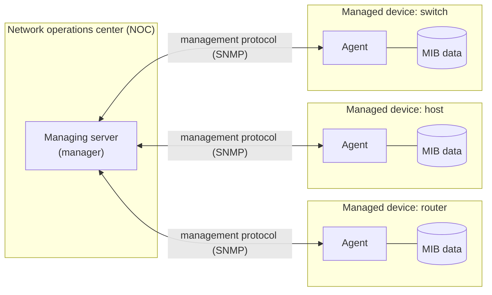
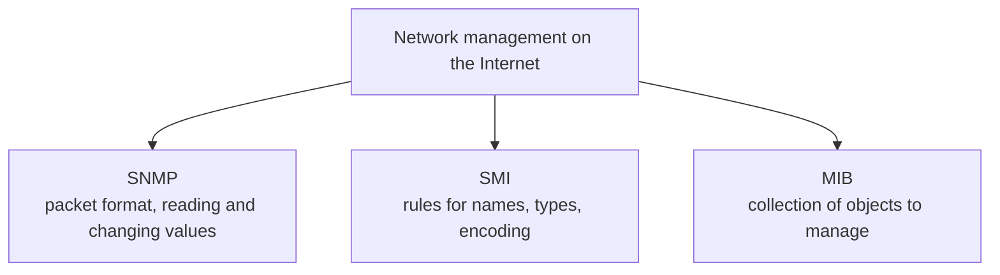
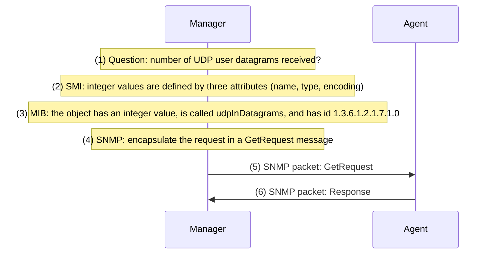
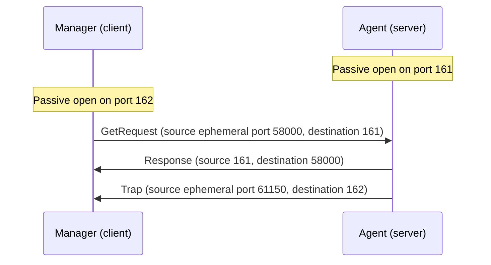

# Chapter 17 — Network Management and SNMP

[Repository Guide](../../README.md) | [English](Concepts_Lecture.md) | [한국어](Concepts_Lecture.ko.md)

> **Last Updated:** 2026-11-18
>
> Computer Networking: A Top-Down Approach, Kurose and Ross, Ch 5; TCP/IP Protocol Suite, Forouzan, Ch 24

> **Learning Objectives:**
> 1. Explain what network management is and the roles of the managing server, managed devices, the MIB, agents, and the management protocol
> 2. Distinguish the tasks that SNMP, SMI, and MIB divide among themselves in Internet network management
> 3. Write the names of MIB objects and their instances with the object identifier tree and apply lexicographic ordering
> 4. Encode simple data in the tag, length, and value format of BER
> 5. Explain the types and format of SNMP PDUs, the use of UDP ports, and the security features of SNMPv3

---

## Table of Contents

- [1. Overview of Network Management](#1-overview-of-network-management)
  - [1.1 The Need for Network Management](#11-the-need-for-network-management)
  - [1.2 Components of Network Management](#12-components-of-network-management)
  - [1.3 Managers and Agents](#13-managers-and-agents)
- [2. Three Components of Internet Network Management](#2-three-components-of-internet-network-management)
  - [2.1 Roles of SNMP, SMI, and MIB](#21-roles-of-snmp-smi-and-mib)
  - [2.2 An Analogy with Programming Languages](#22-an-analogy-with-programming-languages)
  - [2.3 An Overall Example](#23-an-overall-example)
- [3. SMI](#3-smi)
  - [3.1 Names: Object Identifiers](#31-names-object-identifiers)
  - [3.2 Data Types](#32-data-types)
  - [3.3 Encoding: BER](#33-encoding-ber)
- [4. MIB](#4-mib)
  - [4.1 Groups of MIB-2](#41-groups-of-mib-2)
  - [4.2 Accessing Simple Variables](#42-accessing-simple-variables)
  - [4.3 Accessing Tables](#43-accessing-tables)
  - [4.4 Lexicographic Ordering](#44-lexicographic-ordering)
- [5. SNMP](#5-snmp)
  - [5.1 How SNMP Works](#51-how-snmp-works)
  - [5.2 Types of PDUs](#52-types-of-pdus)
  - [5.3 PDU Format](#53-pdu-format)
  - [5.4 SNMP Messages](#54-snmp-messages)
  - [5.5 UDP Ports](#55-udp-ports)
  - [5.6 Security](#56-security)
- [Concept Applications](#concept-applications)
- [Summary](#summary)
- [Self-Check Questions](#self-check-questions)
- [References](#references)

---

<br>

## 1. Overview of Network Management

### 1.1 The Need for Network Management

A network consists of many complex, interacting pieces of hardware and software. There are the physical components of the network, such as links, switches, routers, and hosts, and the many protocols that control and coordinate them. When an organization brings together hundreds or thousands of such components to form a network, the network administrator's job of keeping it up and running is far from easy. The logically centralized SDN controller of Chapter 15 can help with this job, but the challenge of network management is much older than SDN, and there are many tools and approaches that help administrators monitor, manage, and control a network.

> **Definition:** **Network management** is the deployment, integration, and coordination of hardware, software, and human elements to monitor, test, poll, configure, analyze, evaluate, and control network and element resources so as to meet real-time, operational performance, and quality-of-service requirements at a reasonable cost.

This definition restates the one-sentence definition that Kurose and Ross quote. Of this broad definition, this chapter covers only the rudiments, the architecture, protocols, and information base that administrators use in their work, and does not cover the administrator's decision-making processes such as fault identification or anomaly detection.

### 1.2 Components of Network Management



*Figure 1. Components of network management*

- **Managing server:** An application, typically with a human in the loop, running in a centralized network management station in the network operations center (NOC). The managing server is the locus of network management activity. It controls the collection, processing, analysis, and display of management information, initiates actions that control network behavior, and is where the human network administrator interacts with the network's devices.
- **Managed device:** A piece of network equipment (including its software) on the managed network. It may be a host, router, switch, middlebox, modem, thermometer, or other network-connected device. A managed device may contain several **managed objects**: the actual pieces of hardware within the device (for example, the network interface card of a host or router) and configuration parameters of hardware and software components (for example, the settings of an intra-AS routing protocol such as OSPF).
- **MIB (Management Information Base):** The collection of information about each managed object in a managed device. The managing server can read the values of this information and, in many cases, set them.
- **Network management agent:** A process running in the managed device that communicates with the managing server and takes local actions at the device under the command and control of the managing server. It is similar to the control agent seen in Chapter 14.
- **Network management protocol:** Runs between the managing server and the managed devices, allowing the managing server to query the status of devices and indirectly take actions at them through their agents. Agents can use the protocol to inform the managing server of exceptional events such as component failures or violations of performance thresholds.

A MIB object may be a **counter**, such as the number of IP datagrams a router has discarded because of errors in their headers or the number of UDP segments a host has received; **descriptive information**, such as the version of the software running on a DNS server; **status information**, such as whether a device is functioning correctly; or **protocol-specific information**, such as a routing path to a destination. MIB objects are defined in a data description language called SMI (Structure of Management Information), a formal language that keeps the syntax and semantics of management data well defined and unambiguous. Related MIB objects are gathered into MIB modules. According to the textbook, as of mid-2015 there were nearly 400 MIB modules defined by RFCs, and many more vendor-specific (private) MIB modules.

> **Key Point:** The network management protocol does not itself manage the network. It only provides capabilities that a network administrator can use to manage the network. The distinction is subtle but important.

### 1.3 Managers and Agents

**SNMP (Simple Network Management Protocol)**, the Internet's management protocol, uses the concept of manager and agent. A manager, usually a host, controls and monitors a set of agents, usually routers or servers.

> **Definition:** **SNMP** (Simple Network Management Protocol) is the Internet's application-layer network management protocol, by which a manager reads and sets the values of objects kept by agents and agents report unusual events to the manager.

> **Definition:** A **manager** is a management station running the SNMP client program, which monitors and controls managed devices by requesting information from agents and changing their values.

> **Definition:** An **agent** is a managed station (a router or host) running the SNMP server program, which keeps performance information in a database, responds to the manager's requests, and warns the manager of unusual situations.

SNMP is an application-layer protocol in which a few management stations control a set of agents. Because it is designed at the application level, it can monitor devices made by different manufacturers and installed on different physical networks. In other words, SNMP frees management tasks from both the physical characteristics of the managed devices and the underlying networking technology, and it can be used in a heterogeneous internet of LANs and WANs connected by routers from different manufacturers.

Management is achieved through simple interaction between a manager and an agent. The agent keeps performance information in a database, and the manager has access to the values in the database. For example, a router can store the number of packets received and forwarded in appropriate variables, and the manager can fetch and compare the two values to see whether the router is congested. The manager can also make the router perform certain actions. For example, if a router periodically checks the value of a reboot counter and reboots itself when the value is 0, the manager can reboot the agent remotely at any time by sending a packet that forces a 0 into the counter. Agents also contribute to the management process. The server program running on an agent can check the environment and, if it notices something unusual, send a warning message called a **trap** to the manager.

Management with SNMP is based on three basic ideas.

1. A manager checks an agent by requesting information that reflects the agent's behavior.
2. A manager forces an agent to perform a task by resetting values in the agent's database.
3. An agent contributes to the management process by warning the manager of an unusual situation.

---

<br>

## 2. Three Components of Internet Network Management

### 2.1 Roles of SNMP, SMI, and MIB

For management tasks, SNMP uses two other protocols: **SMI (Structure of Management Information)** and **MIB (Management Information Base)**. In other words, management on the Internet is done through the cooperation of three protocols.



*Figure 2. Components of network management on the Internet*

- **Role of SNMP:** Defines the format of the packets sent from a manager to an agent and vice versa. It interprets the results and creates statistics (often with the help of other management software). The packets exchanged contain object (variable) names and their status (values), and SNMP is responsible for reading and changing these values.
- **Role of SMI:** Using SNMP requires rules. Rules are needed for naming objects, which is particularly important because SNMP objects form a hierarchy (an object may have a parent and children and may inherit part of its name from its parent). Rules are also needed to define object types: whether SNMP handles simple or structured types, how many simple types there are, what their sizes and ranges are, and how each type is encoded. SMI defines the general rules for naming objects, for defining object types (including range and length), and for encoding objects and values. These universal rules are needed because the architecture of the computers that send, receive, or store the values is unknown: the sender may be a powerful computer storing an integer as 8 bytes and the receiver a small computer storing it as 4 bytes. SMI only defines the rules, however; it does not define how many objects are managed in an entity or which object uses which type.
- **Role of MIB:** Another protocol is needed that, for each entity to be managed, defines the number of objects, names them according to the rules of SMI, and associates a type with each named object; that protocol is MIB. MIB creates, for each entity to be managed, a set of objects similar to a database (mostly metadata such as names and types, without values).

> **Definition:** **SMI** (Structure of Management Information) is the component of Internet network management that defines the general rules for naming managed objects, defining their data types, and encoding their values.

> **Definition:** A **MIB** (Management Information Base) is the collection of managed objects of a managed device, each named by the rules of SMI and associated with a data type, whose values the manager can read and in many cases set.

### 2.2 An Analogy with Programming Languages

The three components are similar to what is needed to write a program that solves a problem in a programming language.

| Computer programming | Network management | What it does |
|:-----|:-----|:-----|
| Syntax of the language | SMI | Predefines the structure of variables, the rules for naming them, and the data types available. |
| Declaration and definition of objects | MIB | Creates objects with predefined types and assigns their names and types. |
| Program code | SNMP | Stores, changes, and interprets the values of the declared objects. |

*Table 1. Comparison of computer programming and network management*

- **Syntax and SMI:** Before writing a program, the syntax of a language such as C or Java must be predefined. The language defines the structure of variables (simple, structured, pointer, and so on), the rules for naming variables (for example, a name is 1 to n characters long and starts with a letter followed by alphanumeric characters), and the data types to be used (integer, float, char, and so on). In programming the rules are defined by the syntax of the language; in network management they are defined by SMI.
- **Declaration, definition, and MIB:** Most languages require objects to be declared and defined in each program. Declaration and definition create objects with predefined types and allocate memory for them. For example, if a program needs an integer counter and a char array grades, it declares them at the beginning as `int counter;` and `char grades[40];`. In network management, MIB does this task, naming each object and defining its type. Because the type is defined by SMI, SNMP knows its range and size.
- **Program code and SNMP:** After the declarations, a program needs statements that store values in the variables and change them if needed. In network management, SNMP does this task, storing, changing, and interpreting the values of objects already declared by MIB according to the rules defined by SMI.

> **[Computer Programming]** In this analogy, SMI corresponds to the type system and syntax of a language, MIB to the variable declarations in a header file, and SNMP to the executing code that reads and writes those variables. Just as a header file of declarations holds no values, MIB defines only the names and types of objects, and the values are kept by the agent at run time.

### 2.3 An Overall Example

Consider a simple scenario in which the three components work together. A manager station (SNMP client) wants to send a message to an agent station (SNMP server) to find the number of UDP user datagrams received by the agent.



*Figure 3. Overall flow of a management request*

MIB is responsible for finding the object that holds the number of UDP user datagrams received. SMI, with the help of another embedded protocol, is responsible for encoding the name of the object. SNMP is responsible for creating a message called GetRequest and encapsulating the encoded message. Things are more complicated in reality, but it is useful to have the big picture before looking at each protocol in detail.

---

<br>

## 3. SMI

SMI version 2 (SMIv2), as a component of network management, has three functions.

1. To name objects.
2. To define the type of data that can be stored in an object.
3. To show how to encode data for transmission over the network.

In other words, SMI is a guideline for SNMP that emphasizes three attributes for handling an object: name, data type, and encoding method.

### 3.1 Names: Object Identifiers

SMI requires that each managed object (a router, a variable in a router, a value, and so on) have a unique name. To name objects globally, SMI uses the object identifier, a hierarchical identifier based on a tree structure.

> **Definition:** An **object identifier** is a globally unique name of an object, written as the sequence of integers (or names), separated by dots, along the path to the object in a tree that starts from an unnamed root.

```text
                       (root)
          ┌──────────────┼──────────────┐
        itu-t           iso         iso-itu-t
          0              1              2
                         │
                        org
                         3
                         │
                        dod
                         6
                         │
                     internet       1.3.6.1 (iso.org.dod.internet)
                         1
                         │
                       mgmt
                         2
                         │
                       mib-2        1.3.6.1.2.1 (iso.org.dod.internet.mgmt.mib-2)
                         1
```

*Figure 4. The object identifier tree*

The tree starts with an unnamed root. Each object can be defined by a sequence of integers separated by dots, and also by a sequence of textual names separated by dots. SNMP uses the integer-dot representation, and people use the name-dot notation. For example, the following two notations refer to the same object.

```text
iso.org.dod.internet.mgmt.mib-2  ↔  1.3.6.1.2.1
```

The objects used in SNMP are located under the mib-2 object, so the identifiers of all objects managed by SNMP always start with 1.3.6.1.2.1.

### 3.2 Data Types

The second attribute of an object is the type of data stored in it. To define data types, SMI uses fundamental **ASN.1 (Abstract Syntax Notation One)** definitions and adds some new definitions; SMI is thus both a subset and a superset of ASN.1. SMI data types fall into two broad categories: simple and structured.

**Simple types** are atomic data types. Some are taken directly from ASN.1 and some are added by SMI. The first five in Table 2 are from ASN.1, and the remaining seven are defined by SMI.

| Type | Size | Description |
|:-----|:-----|:-----|
| INTEGER | 4 bytes | An integer between $`-2^{31}`$ and $`2^{31}-1`$ |
| Integer32 | 4 bytes | Same as INTEGER |
| Unsigned32 | 4 bytes | An unsigned integer between 0 and $`2^{32}-1`$ |
| OCTET STRING | Variable | A byte string up to 65,535 bytes long |
| OBJECT IDENTIFIER | Variable | An object identifier |
| IPAddress | 4 bytes | An IP address made of four integers |
| Counter32 | 4 bytes | An integer incremented from zero that wraps back to zero when it reaches its maximum |
| Counter64 | 8 bytes | A 64-bit counter |
| Gauge32 | 4 bytes | Like Counter32, but it does not wrap when it reaches its maximum and stays there until reset |
| TimeTicks | 4 bytes | A counting value that records time in 1/100ths of a second |
| BITS | | A string of bits |
| Opaque | Variable | An uninterpreted string |

*Table 2. Simple data types of SMI*

**Structured types** are made by combining simple and structured types. SMI defines two structured types.

- **sequence:** A combination of simple types, not necessarily of the same type. It corresponds to a struct or record in programming languages such as C.
- **sequence of:** A combination of simple types all of the same type, or a combination of sequences all of the same type. It corresponds to an array in C.

### 3.3 Encoding: BER

To encode data to be transmitted over the network, SMI uses another standard, BER.

> **Definition:** **BER (Basic Encoding Rules)** is the set of encoding rules that specifies that each piece of data to be transmitted be encoded in three parts: tag, length, and value.

```text
+---------+-------------------+-----------------+
|   Tag   |      Length       |      Value      |
| 1 byte  | 1 or more bytes   |  Variable size  |
+---------+-------------------+-----------------+
```

*Figure 5. BER encoding format*

- **Tag (1 byte):** Defines the type of data. Table 3 shows the data types used in this chapter and their tags.
- **Length (1 or more bytes):** If it is 1 byte, its most significant bit must be 0, and the other 7 bits define the length of the data. If it is more than 1 byte, the most significant bit of the first byte must be 1, and the other 7 bits of the first byte define the number of bytes needed to define the length. For example, a length of 2 is written as the single byte 00000010, and a length of 260 is written as 10000010 00000001 00000100: the remaining 7 bits of the first byte (0000010) say that the length is given in the next two bytes, and those two bytes, 00000001 00000100, are 260.
- **Value:** Encodes the value of the data according to the rules defined in BER.

| Data type | Tag (binary) | Tag (hex) |
|:-----|:-----|:-----|
| INTEGER | 00000010 | 02 |
| OCTET STRING | 00000100 | 04 |
| OBJECT IDENTIFIER | 00000110 | 06 |
| NULL | 00000101 | 05 |
| Sequence, sequence of | 00110000 | 30 |
| IPAddress | 01000000 | 40 |
| Counter | 01000001 | 41 |
| Gauge | 01000010 | 42 |
| TimeTicks | 01000011 | 43 |
| Opaque | 01000100 | 44 |

*Table 3. Tags of data types*

The following are encoding examples given by the textbook, which takes the length of an integer to be its size in Table 2 (4 bytes).

```text
INTEGER 14
  02          04          00 00 00 0E
  Tag         Length      Value (14)
  (integer)   (4 bytes)

OCTET STRING "HI"
  04          02          48          49
  Tag         Length      Value (H)   Value (I)
  (string)    (2 bytes)

ObjectIdentifier 1.3.6.1 (iso.org.dod.internet)
  06          04          01  03  06  01
  Tag         Length      Value (1, 3, 6, 1)
  (ObjectId)  (4 bytes)

IPAddress 131.21.14.8
  40          04          83  15  0E  08
  Tag         Length      Value (131, 21, 14, 8)
  (IPAddress) (4 bytes)
```

*Figure 6. Examples of BER encoding*

> **Note:** To show the TLV structure simply, Forouzan gives every INTEGER a 4-byte value and writes each OID component as one byte. The BER standard differs in two details. An INTEGER is encoded in the smallest possible number of bytes, so INTEGER 14 is 02 01 0E[1]. The first two OID components X and Y are packed into a single subidentifier with the value 40X + Y, so 1.3.6.1 is 06 03 2B 06 01, because 40 × 1 + 3 = 43 = 0x2B[1]. Messages encoded by real devices follow these rules, so their bytes differ from Forouzan's examples here and in Section 5.4; for example, the variable 1.3.6.1.2.1.7.1.0 of Figure 9 is encoded as 06 08 2B 06 01 02 01 07 01 00.

---

<br>

## 4. MIB

### 4.1 Groups of MIB-2

MIB version 2 (MIB2) is the second component used in network management. Each agent has its own MIB2, the collection of all objects that the manager can manage. The objects of MIB2 are divided into ten groups under the mib-2 object of the object identifier tree, and each group has defined variables, tables, or both.

| Group | Number | Information defined |
|:-----|:-----|:-----|
| sys (system) | 1 | General information about the node (system), such as its name, location, and lifetime |
| if (interface) | 2 | Information about all interfaces of the node, such as interface number, physical address, and IP address |
| at (address translation) | 3 | Information about the ARP table |
| ip | 4 | Information related to IP, such as the routing table and IP addresses |
| icmp | 5 | Information related to ICMP, such as the number of packets sent and received and the total errors created |
| tcp | 6 | Information related to TCP, such as the connection table, time-out value, number of ports, and packets sent and received |
| udp | 7 | Information related to UDP, such as the number of ports and packets sent and received |
| egp | 8 | Information related to EGP |
| trans (transmission) | 10 | Information related to transmission |
| snmp | 11 | General information about SNMP itself |

*Table 4. Groups of MIB-2 (under identifier 1.3.6.1.2.1)*

Number 9 is not assigned to any of these groups, so the transmission and snmp groups have the numbers 10 and 11[2].

### 4.2 Accessing Simple Variables

Let us see how to access different variables, using the udp group as an example. The udp group has four simple variables and one table (sequence of) of records.

```text
udp (1.3.6.1.2.1.7)
 ├── 1  udpInDatagrams
 ├── 2  udpNoPorts
 ├── 3  udpInErrors
 ├── 4  udpOutDatagrams
 └── 5  udpTable
         └── 1  udpEntry
                 ├── 1  udpLocalAddress
                 └── 2  udpLocalPort
```

*Figure 7. The udp group of the MIB*

To access a simple variable, the identifier of the variable is appended to the identifier of the group (1.3.6.1.2.1.7).

```text
udpInDatagrams   →  1.3.6.1.2.1.7.1
udpNoPorts       →  1.3.6.1.2.1.7.2
udpInErrors      →  1.3.6.1.2.1.7.3
udpOutDatagrams  →  1.3.6.1.2.1.7.4
```

These object identifiers, however, define the variables, not their instances (contents). To refer to the instance, or contents, of each variable, an instance suffix must be added, and the instance suffix of a simple variable is 0.

```text
udpInDatagrams.0   →  1.3.6.1.2.1.7.1.0
udpNoPorts.0       →  1.3.6.1.2.1.7.2.0
udpInErrors.0      →  1.3.6.1.2.1.7.3.0
udpOutDatagrams.0  →  1.3.6.1.2.1.7.4.0
```

### 4.3 Accessing Tables

To identify a table, the table identifier is used first. The udp group has only one table, with identifier 5, so udpTable is 1.3.6.1.2.1.7.5. The table is not a leaf of the tree, however, so the table itself cannot be accessed. The entry (sequence) in the table must be defined, with identifier 1 (udpEntry → 1.3.6.1.2.1.7.5.1). This entry is not a leaf either and cannot be accessed; each field in the entry must be defined.

```text
udpLocalAddress  →  1.3.6.1.2.1.7.5.1.1
udpLocalPort     →  1.3.6.1.2.1.7.5.1.2
```

These two variables are leaves of the tree. Their instances can be accessed, but which instance must be specified. At any moment the table can have several values for each local address and local port pair. To access a specific instance (row) of the table, an index is added to the identifiers above. In MIB, array indexes are not integers, as in most programming languages, but are based on the values of one or more fields of the entries. The udpTable is indexed by the local address and the local port number together.

| udpLocalAddress | udpLocalPort | Identifier of the udpLocalAddress instance |
|:-----|:-----|:-----|
| 181.23.45.14 | 23 | 1.3.6.1.2.1.7.5.1.1.181.23.45.14.23 |
| 192.13.5.10 | 161 | 1.3.6.1.2.1.7.5.1.1.192.13.5.10.161 |
| 227.2.45.18 | 180 | 1.3.6.1.2.1.7.5.1.1.227.2.45.18.180 |
| 230.20.5.24 | 212 | 1.3.6.1.2.1.7.5.1.1.230.20.5.24.212 |

*Table 5. Rows and indexes of udpTable*

For example, to access the local address instance of the first row, the following identifier, augmented with the instance index, is used. The local port instance of the same row uses column number 2 instead of 1: 1.3.6.1.2.1.7.5.1.2.181.23.45.14.23.

```text
udpLocalAddress.181.23.45.14.23  →  1.3.6.1.2.1.7.5.1.1.181.23.45.14.23
```

Not all tables are indexed the same way. Some tables are indexed by the value of one field, some by the values of two fields, and so on.

### 4.4 Lexicographic Ordering

> **Definition:** **Lexicographic ordering** is the order of the object identifiers of MIB variables (including instance identifiers) determined by comparing them component by component from the front; for a table, it goes column by column and from top to bottom within each column.

An interesting point about MIB variables is that their object identifiers follow lexicographic order. Tables are ordered by column-row rules, so one goes column by column, and within each column from top to bottom. In the udpTable of Table 5, the four instances of the udpLocalAddress column come first from top to bottom, followed by the four instances of the udpLocalPort column in the same order. Lexicographic ordering lets a manager access a set of variables one after another by specifying only the first variable, a property exploited by the GetNextRequest of Section 5.2.

---

<br>

## 5. SNMP

### 5.1 How SNMP Works

SNMP is an application program that uses SMI and MIB together in Internet network management, and it allows the following.

1. A manager retrieves the value of an object defined in an agent.
2. A manager stores a value in an object defined in an agent.
3. An agent sends an alarm message about an abnormal situation to the manager.

Kurose and Ross introduce SNMP version 2 (SNMPv2) as an application-layer protocol used to convey network-management control and information messages between a managing server and an agent executing on its behalf. The most common use of SNMP is in **request-response mode**: an SNMP managing server sends a request to an SNMP agent, which receives the request, performs some action, and sends a reply. Requests are typically used to query (retrieve) or modify (set) the values of MIB objects associated with a managed device. The second common use is for an agent to send an unsolicited message, a **trap message**, to the managing server. Trap messages notify the managing server of an exceptional situation (for example, a link interface going up or down) that has changed MIB object values.

> **Definition:** A **trap** is an unsolicited message that an agent sends to the managing server to report an exceptional event, without a request from the manager; the manager need not respond to it.

### 5.2 Types of PDUs

SNMP messages are known generically as **PDUs (protocol data units)**. SNMPv2 defines seven types of PDUs, and SNMPv3, covered by Forouzan, adds Report for eight types.

| PDU | Sender and receiver | Description |
|:-----|:-----|:-----|
| GetRequest | Manager → agent | Gets the value of one or more MIB object instances. |
| GetNextRequest | Manager → agent | Gets the value of the next MIB object instance in a list or table. |
| GetBulkRequest | Manager → agent | Gets a large block of data at once, such as the values in a large table. |
| InformRequest | Manager → manager | Informs a remote managing entity of MIB values remote to its access. |
| SetRequest | Manager → agent | Sets the value of one or more MIB object instances. |
| Response | Agent → manager, manager → manager | Generated in response to GetRequest, GetNextRequest, GetBulkRequest, SetRequest, or InformRequest. |
| SNMPv2-Trap | Agent → manager | Informs the manager of an exceptional event. |
| Report | Between managers | Designed to report some types of errors between managers, but not yet in use. |

*Table 6. Types of SNMP PDUs*

- **GetRequest, GetNextRequest, GetBulkRequest:** All are sent from a manager to an agent to request the values of one or more MIB objects at the agent's managed device. The MIB objects whose values are requested are specified in the variable-binding portion of the PDU. The three differ in the granularity of their requests. GetRequest can request an arbitrary set of MIB values. GetNextRequest returns the value of the object that follows the specified object identifier, so it can be used repeatedly to go through a list or table of MIB objects. In particular, if the manager does not know the indexes of a table's entries, it can specify the object identifier of the table: since the identifier of the first entry immediately follows that of the table, the value of the first entry is returned, and the manager uses that identifier to get the next value, and so on. GetBulkRequest allows a large block of data to be returned, avoiding the overhead of sending many GetRequest or GetNextRequest messages. In all three cases the agent responds with a Response PDU containing the object identifiers and their values.
- **SetRequest:** Used by a manager to set the value of one or more MIB objects in a managed device. The agent replies with a Response PDU with error status noError to confirm that the value has indeed been set.
- **InformRequest:** Used by one manager to inform another, remote manager of, or obtain from it, the values of variables of agents under the remote manager's control. The remote manager responds with a Response PDU.
- **Response:** Typically sent from a managed device to the managing server in response to a request message, returning the requested information.
- **Trap:** Generated asynchronously, not in response to a received request but in response to an event of which the managing server requires notification. Defined events include a cold or warm start of a device, a link going up or down, the loss of a neighbor, and an authentication failure. For example, if an agent is rebooted, it informs the manager and reports the time of rebooting. The managing server need not respond to a received trap. It is also called the SNMPv2 Trap to distinguish it from the SNMPv1 Trap.

### 5.3 PDU Format

```text
+------+---------+--------+--------+----------+-------+----------+-------+-----
| PDU  | Request | Error  | Error  | Variable | Value | Variable | Value | ...
| type |   ID    | status | index  |          |       |          |       |
+------+---------+--------+--------+----------+-------+----------+-------+-----
                                   |<-------------- VarBind list ------------->|
```

*Figure 8. Format of an SNMP PDU*

- **PDU type:** The type of the PDU (Table 7).
- **Request ID:** A sequence number used by the manager in a request PDU and repeated by the agent in the response. It is used to match a request to a response.
- **Error status:** An integer used only in response PDUs to show the type of error reported by the agent (Table 8). Its value is 0 in request PDUs.
- **Error index:** An offset that tells the manager which variable caused the error.
- **VarBind list:** The set of variables, with their corresponding values, that the manager wants to retrieve or set. The values are null in GetRequest and GetNextRequest. In a Trap PDU, it shows the variables and values related to the event.

GetBulkRequest differs in two fields. In place of the error status field, which is empty in request PDUs, it has a **non-repeaters** field, and in place of the error index field a **max-repetitions** field. Therefore the error status and error index are zero in all request messages except GetBulkRequest.

| Type | Tag (binary) | Tag (hex) |
|:-----|:-----|:-----|
| GetRequest | 10100000 | A0 |
| GetNextRequest | 10100001 | A1 |
| Response | 10100010 | A2 |
| SetRequest | 10100011 | A3 |
| GetBulkRequest | 10100101 | A5 |
| InformRequest | 10100110 | A6 |
| Trap (SNMPv2) | 10100111 | A7 |
| Report | 10101000 | A8 |

*Table 7. PDU types and their tags*

| Status | Name | Meaning |
|:-----|:-----|:-----|
| 0 | noError | No error |
| 1 | tooBig | Response too big to fit in one message |
| 2 | noSuchName | Variable does not exist |
| 3 | badValue | The value to be stored is invalid |
| 4 | readOnly | The value cannot be modified |
| 5 | genErr | Other errors |

*Table 8. Types of error status*

> **Note:** The PDU format figure of Kurose and Ross shows the header of Get and Set PDUs (PDU type 0-3) as request ID, error status (0-5), and error index, and shows separately the header of the trap PDU (PDU type 4) as enterprise, agent address, trap type (0-7), specific code, and time stamp. Both are followed by name-value pairs. This trap format corresponds to the SNMPv1 Trap; the SNMPv2 Trap uses the format of Figure 8.

### 5.4 SNMP Messages

SNMP does not send only a PDU; it embeds the PDU in a message. A message in SNMPv3 is a sequence of four elements: Version, GlobalData, SecurityParameters, and ScopePDU (which includes the encoded PDU). The first and third elements are simple types, and the second and fourth are sequences.

- **Version:** An INTEGER defining the version; the current version is 3.
- **GlobalData:** A sequence of four simple elements: ID, MaxSize, Flags, and SecurityModel.
- **SecurityParameters:** A sequence that can be very complex, depending on the type of security used in version 3.
- **ScopePDU:** Contains two simple elements (contextEngine and contextName) and the actual PDU. The VarBindList in the PDU is made of one or more VarBind sequences, and each VarBind is made of two simple elements, Variable and Value.

Consider an example in which a manager station (SNMP client) uses a message with a GetRequest PDU to retrieve the number of UDP datagrams a router has received. The corresponding MIB variable is udpInDatagrams, with object identifier 1.3.6.1.2.1.7.1.0. The manager wants to retrieve a value, not to store one, so the value is null. The following shows the whole message in hexadecimal, with indentation showing what each sequence contains; the number beside each sequence is the length of its contents.

```text
Message                   30 6D                    Sequence (109 bytes)
  Version                 02 01 03
  GlobalData              30 0D                    Sequence (13 bytes)
    ID                    02 01 40
    MaxSize               02 02 04 00
    Flags                 04 01 04
    SecurityModel         02 01 03
  SecurityParameters      30 28                    Sequence (40 bytes)
    (40 bytes of parameters)
  ScopePDU                30 2F                    Sequence (47 bytes)
    contextEngine         04 0C 00 00 00 61 02 00 00 B2 C1 41 82 20
    contextName           04 00
    PDU (GetRequest)      A0 1D                    PDU (29 bytes)
      request-id          02 04 00 01 06 11
      error-status        02 01 00
      error-index         02 01 00
      VarBindList         30 0F                    Sequence (15 bytes)
        VarBind           30 0D                    Sequence (13 bytes)
          Variable        06 09 01 03 06 01 02 01 07 01 00
          Value           05 00
```

*Figure 9. Encoding of an SNMPv3 message carrying a GetRequest PDU for the number of UDP datagrams received*

The VarBind list has only one VarBind. The variable is of type 06 and length 09, and the value is of type 05 (NULL) and length 00. The whole VarBind is a sequence of length 0D (13), and the VarBind list is also a sequence, of length 0F (15). The GetRequest PDU has length 1D (29). The PDU itself is like a sequence, but its tag is A0 in hexadecimal. This PDU is placed in the ScopePDU sequence (30 2F) of 47 bytes, where a 14-byte contextEngine and a 2-byte contextName precede the PDU. If the security parameters are assumed to be 40 bytes, the message sequence contains the Version (3 bytes), the GlobalData sequence (15 bytes), the SecurityParameters sequence (42 bytes), and the ScopePDU sequence (49 bytes), for contents of 109 bytes (6D), and the whole message, with its tag and length, is 111 bytes.

### 5.5 UDP Ports

SNMP messages can be carried by many transport protocols, but they are typically carried in the payload of UDP datagrams. According to Kurose and Ross, the SNMP specification itself calls UDP "the preferred transport mapping." SNMP uses two well-known UDP ports, 161 and 162.

- **Port 161:** Used by the server (agent). The agent issues a passive open on port 161 and waits for a manager. The manager (client) issues an active open using an ephemeral port. Request messages go from the client to the server with the ephemeral port as the source port and 161 as the destination port, and response messages go from the server to the client with 161 as the source port and the ephemeral port as the destination port.
- **Port 162:** Used by the client (manager). The manager issues a passive open on port 162 and waits for an agent. Whenever the agent (server) has a Trap message to send, it issues an active open using an ephemeral port. This connection is one-way only, from the server to the client.



*Figure 10. Port numbers in SNMP*

The client-server mechanism of SNMP differs from that of other protocols. Both the client and the server use well-known ports, and both run indefinitely, because request messages are initiated by the manager (client) but Trap messages are initiated by the agent (server).

Since UDP is an unreliable transport protocol, there is no guarantee that a request, or its response, will reach its destination. The managing server numbers its requests to an agent with the Request ID field of the PDU, and the agent's response takes its Request ID from the received request. The managing server can therefore use the Request ID to detect lost requests or replies. Whether to retransmit a request if no response arrives within a given time is up to the managing server. The SNMP standard does not mandate any particular retransmission procedure, or even whether retransmission is to be done; it only requires that the managing server act responsibly with respect to the frequency and duration of retransmissions.

### 5.6 Security

SNMP has evolved through three versions. The designers of SNMPv3 have said that SNMPv3 can be thought of as SNMPv2 with additional security and administration capabilities. SNMPv3 adds two new features to the previous versions.

- **Security:** SNMPv3 allows a manager to choose one or more levels of security when accessing an agent. Different aspects of security, such as message authentication, confidentiality, and integrity, can be configured by the manager (Chapter 26).
- **Remote administration:** The manager can configure security aspects remotely, without having to be at the place where the device is located.

Kurose and Ross point out why security was particularly important. The lack of adequate security resulted in SNMP being used primarily for monitoring rather than control; for example, SetRequest was rarely used in SNMPv1. It is a case in which security was of critical concern, but its importance was realized somewhat late and it was added on afterward.

---

<br>

## Concept Applications

**True/False Check:**

| Statement | Judgment and Reason |
|:-----|:-----|
| The network management protocol manages the network by itself. | **F.** The management protocol only provides capabilities that an administrator can use to manage the network. |
| SMI defines the number of objects to be managed and the type of each object. | **F.** SMI defines only the general rules for names, types, and encoding; the number of objects and the association of objects with types are defined by MIB. |
| The identifiers of all objects managed by SNMP start with 1.3.6.1.2.1. | **T.** All objects used by SNMP are under iso.org.dod.internet.mgmt.mib-2. |
| To retrieve the value of the simple variable udpInDatagrams, the identifier 1.3.6.1.2.1.7.1 can be used. | **F.** That identifier only defines the variable; to refer to the instance, the suffix 0 must be appended, giving 1.3.6.1.2.1.7.1.0. |
| In BER, if the most significant bit of the first byte of the length field is 1, the other 7 bits give the length of the data. | **F.** If the most significant bit is 1, the other 7 bits give the number of bytes used to express the length, and the length itself is in the following bytes. |
| A manager can retrieve the values of a table one after another with GetNextRequest without knowing the table's indexes. | **T.** Object identifiers follow lexicographic order, so starting from the table's identifier, the manager requests the next object again and again. |
| An SNMP Trap message is sent by a manager to an agent, and the agent must answer with a Response. | **F.** A Trap is sent asynchronously by an agent to a manager, and the manager need not respond. |
| In SNMP, both the agent and the manager use well-known ports. | **T.** The agent uses port 161, on which it receives requests, and the manager uses port 162, on which it receives traps. |

---

<br>

## Summary

| Concept | Key Summary |
|:-----|:-----|
| Network management | The combination of hardware, software, and people that monitors and controls network resources to meet performance and quality-of-service requirements at reasonable cost. |
| Management components | Consist of the managing server, managed devices and their managed objects, the MIB, agents, and the network management protocol. |
| Managers and agents | A manager, the SNMP client, reads and sets agent values; an agent, the SNMP server, keeps the values and sends traps on unusual situations. |
| SNMP, SMI, MIB | SMI corresponds to the rules (a language's syntax), MIB to the declaration of objects, and SNMP to the program code that reads and changes values. |
| Object identifier | A unique name written as a dot-separated integer sequence along a path in a tree; SNMP objects lie under 1.3.6.1.2.1. |
| SMI data types | There are simple types based on ASN.1 (INTEGER, OCTET STRING, Counter32, and so on) and structured types (sequence, sequence of). |
| BER | Encodes data as tag, length, and value; when the length exceeds 127, the first byte gives the number of length bytes. |
| MIB-2 | Consists of the groups sys, if, at, ip, icmp, tcp, udp, egp, trans, and snmp, and the suffix 0 is appended to instances of simple variables. |
| Tables and lexicographic ordering | Table rows are indexed by field values, and objects follow lexicographic order column by column, top to bottom. |
| SNMP PDUs | There are GetRequest, GetNextRequest, GetBulkRequest, SetRequest, Response, Trap, InformRequest, and Report, with the Request ID matching requests and responses. |
| UDP ports | The agent receives requests on UDP port 161 and the manager receives traps on port 162, and the manager decides whether to retransmit. |
| SNMPv3 | Adds to SNMPv2 security levels such as message authentication, confidentiality, and integrity, and remote administration. |

---

<br>

## Self-Check Questions

1. **Object identifiers:** Write, in name notation and in numeric notation, the object identifier of the udpInDatagrams variable of the MIB udp group and the instance identifier used to retrieve its value with GetRequest.

   <details>
   <summary>Answer</summary>

   The udp group is iso.org.dod.internet.mgmt.mib-2.udp, that is, 1.3.6.1.2.1.7, and udpInDatagrams is its first variable, so its object identifier is 1.3.6.1.2.1.7.1. To refer to the instance of a simple variable, the suffix 0 must be appended, so GetRequest uses udpInDatagrams.0, that is, 1.3.6.1.2.1.7.1.0.

   </details>

2. **Walking a table with GetNextRequest:** Without knowing the indexes of the udpTable of Table 5, a manager starts GetNextRequest with the udpTable object identifier 1.3.6.1.2.1.7.5 and keeps requesting with the identifier received in each response. Write, in order, the object identifiers of the first five responses.

   <details>
   <summary>Answer</summary>

   Lexicographic order goes column by column from top to bottom, so the four instances of the udpLocalAddress column come first, followed by the udpLocalPort column. The first five responses are 1.3.6.1.2.1.7.5.1.1.181.23.45.14.23, 1.3.6.1.2.1.7.5.1.1.192.13.5.10.161, 1.3.6.1.2.1.7.5.1.1.227.2.45.18.180, 1.3.6.1.2.1.7.5.1.1.230.20.5.24.212, and 1.3.6.1.2.1.7.5.1.2.181.23.45.14.23.

   </details>

3. **BER encoding:** Following the textbook's rule (an integer has length 4), encode INTEGER 1456 and OCTET STRING "Hello World" in hexadecimal.

   <details>
   <summary>Answer</summary>

   1456 is 0x5B0 in hexadecimal, so INTEGER 1456 is tag 02, length 04, and value 00 00 05 B0: 02 04 00 00 05 B0. "Hello World" has 11 characters including the space, so the length is 0B, and writing out the ASCII values gives 04 0B 48 65 6C 6C 6F 20 57 6F 72 6C 64.

   </details>

4. **A long length field:** Write the length field when a value 300 bytes long is encoded with BER. How does it differ from a length of 100 bytes?

   <details>
   <summary>Answer</summary>

   300 is greater than 127, so the long form is used. 300 is 0x012C and needs two bytes, so the first byte combines the most significant bit 1 with the byte count 2, giving 10000010 (0x82), followed by 01 2C. The length field is therefore 82 01 2C. 100 is 127 or less, so it is written as the single byte 0x64 with most significant bit 0.

   </details>

5. **Use of port numbers:** Explain, in terms of the roles of client and server, why SNMP requests go to UDP port 161 and traps go to 162.

   <details>
   <summary>Answer</summary>

   Requests are initiated by the manager (client), so the agent, the server, issues a passive open on port 161 and waits, and the manager sends requests from an ephemeral port. Traps, in contrast, are initiated asynchronously by the agent, so the manager issues a passive open on port 162 and waits, and the agent sends traps from an ephemeral port. Because communication in each direction can be initiated by the other side, both the client and the server use well-known ports and run indefinitely.

   </details>

6. **A lost request:** A manager sent a GetRequest, but no Response arrived after some time. How does the manager notice this, and who decides whether to send it again, and how?

   <details>
   <summary>Answer</summary>

   SNMP is carried over unreliable UDP, so requests or responses can be lost. The manager numbers each request with a Request ID, and the agent uses the same Request ID in its response, so the manager learns that a request or response was lost when no response with a given Request ID arrives. The SNMP standard mandates no retransmission procedure, so the manager decides whether and when to resend, and it must act responsibly with respect to the frequency and duration of retransmissions.

   </details>

---

<br>

## References

1. ITU-T, "Information technology - ASN.1 encoding rules: Specification of Basic Encoding Rules (BER), Canonical Encoding Rules (CER) and Distinguished Encoding Rules (DER)," Recommendation X.690, Jul. 2002. [Online]. Available: https://www.itu.int/ITU-T/studygroups/com17/languages/X.690-0207.pdf
2. K. McCloghrie and M. Rose, Eds., "Management Information Base for Network Management of TCP/IP-based internets: MIB-II," RFC 1213, Mar. 1991. [Online]. Available: https://www.rfc-editor.org/rfc/rfc1213
