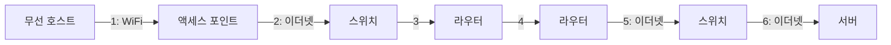
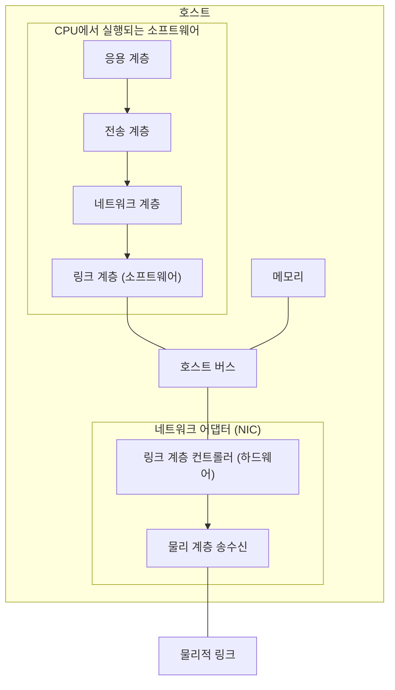
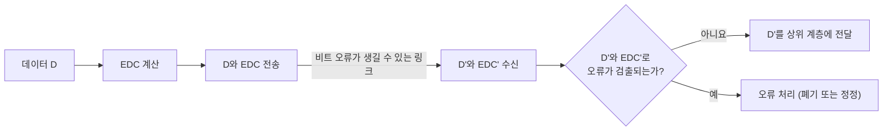
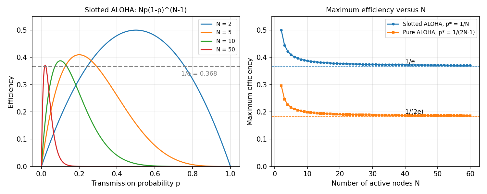
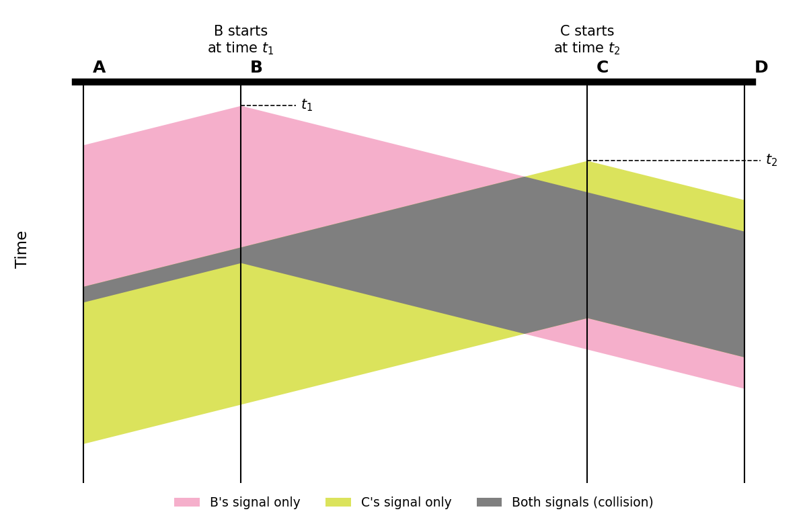
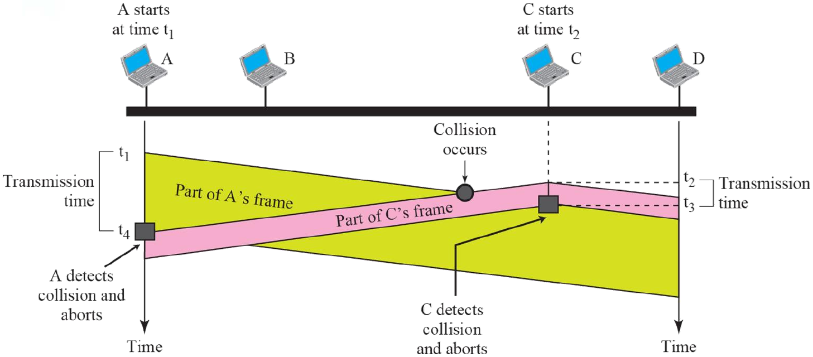
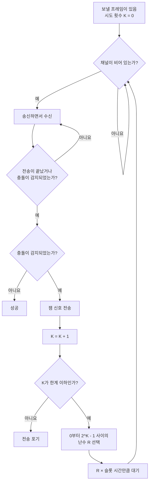
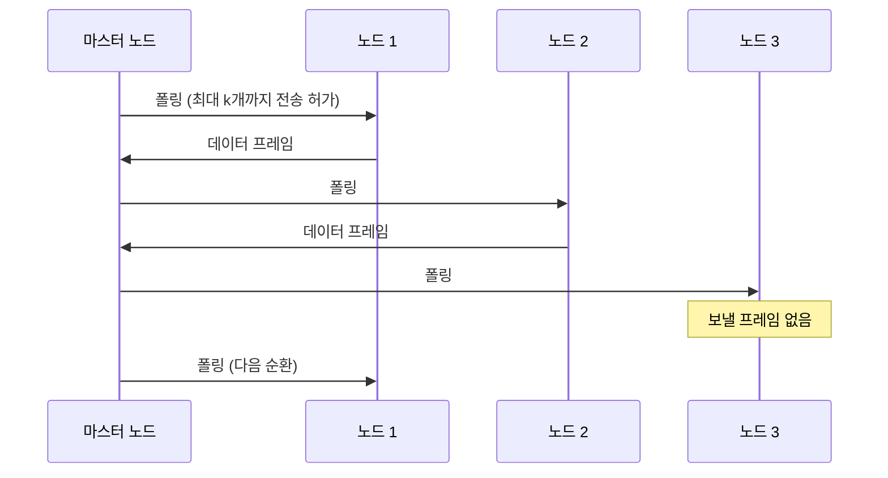
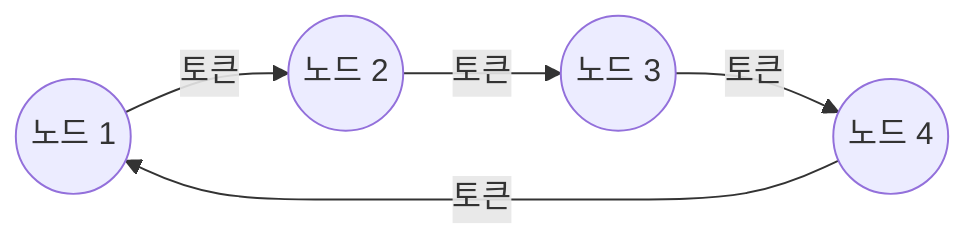

# 18장 — 링크 계층, 오류 검출, 다중 접근

[레포지토리 안내](../../README.ko.md) | [English](Concepts_Lecture.md) | [한국어](Concepts_Lecture.ko.md)

> **최종 수정일:** 2026-11-18
>
> Computer Networking: A Top-Down Approach, Kurose and Ross, Ch 6; TCP/IP Protocol Suite, Forouzan, Ch 3

> **학습 목표:**
> 1. 링크 계층이 제공하는 서비스와 링크 계층이 구현되는 위치를 설명할 수 있다
> 2. 패리티 검사, 체크섬, CRC로 오류 검출 비트를 계산하고 세 기법의 검출 능력을 비교할 수 있다
> 3. 다중 접근 프로토콜을 채널 분할, 랜덤 접근, 순번 방식으로 분류하고 장단점을 설명할 수 있다
> 4. 슬롯 ALOHA와 순수 ALOHA의 효율을 유도하고 CSMA/CD와 이진 지수 백오프의 동작을 설명할 수 있다
> 5. CSMA/CD에 최소 프레임 크기가 필요한 이유를 설명하고 그 크기를 계산할 수 있다
> 6. DOCSIS가 여러 다중 접근 기법을 결합하는 방식을 설명할 수 있다

---

## 목차

- [1. 링크 계층 소개](#1-링크-계층-소개)
  - [1.1 노드와 링크](#11-노드와-링크)
  - [1.2 링크 계층이 제공하는 서비스](#12-링크-계층이-제공하는-서비스)
  - [1.3 링크 계층이 구현되는 위치](#13-링크-계층이-구현되는-위치)
- [2. 오류 검출과 정정 기법](#2-오류-검출과-정정-기법)
  - [2.1 오류 검출의 기본 구도](#21-오류-검출의-기본-구도)
  - [2.2 패리티 검사](#22-패리티-검사)
  - [2.3 2차원 패리티와 순방향 오류 정정](#23-2차원-패리티와-순방향-오류-정정)
  - [2.4 체크섬](#24-체크섬)
  - [2.5 순환 중복 검사 (CRC)](#25-순환-중복-검사-crc)
  - [2.6 세 기법의 비교](#26-세-기법의-비교)
- [3. 다중 접근 링크와 프로토콜](#3-다중-접근-링크와-프로토콜)
  - [3.1 점대점 링크와 브로드캐스트 링크](#31-점대점-링크와-브로드캐스트-링크)
  - [3.2 다중 접근 문제와 충돌](#32-다중-접근-문제와-충돌)
  - [3.3 다중 접근 프로토콜의 분류와 바람직한 성질](#33-다중-접근-프로토콜의-분류와-바람직한-성질)
- [4. 채널 분할 프로토콜](#4-채널-분할-프로토콜)
  - [4.1 시분할 다중화 (TDM)](#41-시분할-다중화-tdm)
  - [4.2 주파수 분할 다중화 (FDM)](#42-주파수-분할-다중화-fdm)
  - [4.3 코드 분할 다중 접근 (CDMA)](#43-코드-분할-다중-접근-cdma)
- [5. 랜덤 접근 프로토콜](#5-랜덤-접근-프로토콜)
  - [5.1 슬롯 ALOHA](#51-슬롯-aloha)
  - [5.2 슬롯 ALOHA의 효율](#52-슬롯-aloha의-효율)
  - [5.3 순수 ALOHA](#53-순수-aloha)
  - [5.4 반송파 감지 다중 접근 (CSMA)](#54-반송파-감지-다중-접근-csma)
  - [5.5 충돌 감지를 갖춘 CSMA (CSMA/CD)](#55-충돌-감지를-갖춘-csma-csmacd)
  - [5.6 이진 지수 백오프](#56-이진-지수-백오프)
  - [5.7 최소 프레임 크기](#57-최소-프레임-크기)
  - [5.8 CSMA/CD의 효율](#58-csmacd의-효율)
- [6. 순번 프로토콜](#6-순번-프로토콜)
  - [6.1 폴링 프로토콜](#61-폴링-프로토콜)
  - [6.2 토큰 전달 프로토콜](#62-토큰-전달-프로토콜)
  - [6.3 세 분류의 비교](#63-세-분류의-비교)
- [7. DOCSIS: 케이블 인터넷 접속의 링크 계층 프로토콜](#7-docsis-케이블-인터넷-접속의-링크-계층-프로토콜)
- [개념 적용](#개념-적용)
- [요약](#요약)
- [점검 문제](#점검-문제)

---

<br>

## 1. 링크 계층 소개

### 1.1 노드와 링크

링크 계층(2계층) 프로토콜을 실행하는 장치를 통틀어 **노드(node)** 라고 부른다. 호스트, 라우터, 스위치, 무선 LAN의 액세스 포인트(AP)가 모두 노드이다. 통신 경로에서 서로 이웃한 두 노드를 잇는 통신 채널은 **링크(link)** 라고 부른다. 데이터그램이 출발지 호스트에서 목적지 호스트까지 가려면 종단 간 경로를 이루는 링크를 하나씩 차례로 건너야 한다.

예를 들어 회사 네트워크의 무선 호스트가 데이터 센터의 서버로 데이터그램을 보내면, 그 데이터그램은 그림 1처럼 여섯 개의 링크를 지난다. 각 링크에서 송신 노드는 데이터그램을 **링크 계층 프레임(frame)** 에 캡슐화하여 링크로 내보내고, 수신 노드는 프레임에서 데이터그램을 꺼내 다음 링크로 넘긴다.



*그림 1. 무선 호스트에서 서버까지 데이터그램이 지나는 여섯 개의 링크*

링크 계층과 네트워크 계층의 관계는 여행 비유로 이해할 수 있다. 여행사가 미국 프린스턴에서 스위스 로잔까지 가는 관광객의 일정을 짠다고 하자. 여행사는 프린스턴에서 JFK 공항까지 리무진, JFK에서 제네바 공항까지 비행기, 제네바 공항에서 로잔 역까지 기차를 예약한다. 예약이 끝나면 각 구간의 책임은 리무진 회사, 항공사, 스위스 철도가 진다. 세 구간은 서로 다른 회사가 서로 다른 수단으로 운영하지만, 모두 승객을 한 지점에서 이웃한 지점으로 옮긴다는 기본 서비스를 제공한다.

| 여행 비유 | 네트워크 |
|:-----|:-----|
| 관광객 | 데이터그램 |
| 각 이동 구간 | 링크 |
| 이동 수단 (리무진, 비행기, 기차) | 링크 계층 프로토콜 |
| 여행사 | 라우팅 프로토콜 |

*표 1. 여행 비유와 네트워크 구성 요소의 대응*

이 비유가 보여 주듯, 한 데이터그램은 경로의 링크마다 서로 다른 링크 계층 프로토콜로 운반될 수 있다. 첫 링크는 WiFi, 다음 링크는 이더넷일 수 있으며, 각 프로토콜이 제공하는 서비스도 서로 다를 수 있다.

### 1.2 링크 계층이 제공하는 서비스

모든 링크 계층의 기본 서비스는 데이터그램을 한 노드에서 하나의 링크를 거쳐 이웃 노드로 옮기는 것이다. 그 밖에 어떤 서비스를 더 제공하는지는 프로토콜마다 다르며, 제공될 수 있는 서비스는 다음 네 가지이다.

> **용어 정의:** **프레이밍(framing)** 은 네트워크 계층의 데이터그램을 링크 계층 프레임의 데이터 필드에 넣고 헤더 필드를 붙여 링크로 보낼 단위를 만드는 일이다. 프레임의 구조는 링크 계층 프로토콜이 정한다.

- **프레이밍:** 거의 모든 링크 계층 프로토콜은 데이터그램을 프레임에 캡슐화한 뒤 전송한다. 이더넷 프레임의 구조는 20장, 802.11 프레임의 구조는 22장에서 다룬다.
- **링크 접근(link access):** **매체 접근 제어(medium access control, MAC)** 프로토콜은 프레임을 링크로 내보내는 규칙을 정한다. 한쪽 끝에 송신자 하나, 다른 쪽 끝에 수신자 하나만 있는 점대점 링크에서는 링크가 비어 있을 때 언제든 보내면 되므로 MAC 프로토콜이 단순하거나 아예 없다. 여러 노드가 하나의 브로드캐스트 링크를 공유할 때는 이들의 전송을 조율해야 하며, 이를 **다중 접근 문제(multiple access problem)** 라고 한다(3절).
- **신뢰적 전달(reliable delivery):** 링크 계층이 신뢰적 전달을 제공하면 각 데이터그램이 오류 없이 링크를 건너도록 보장한다. 전송 계층의 TCP처럼 확인 응답과 재전송으로 구현한다(7장). 무선 링크처럼 오류율이 높은 링크에서는 오류가 난 링크에서 바로 고치는 편이 전송 계층이나 응용 계층의 종단 간 재전송을 기다리는 것보다 낫다. 반대로 광섬유, 동축 케이블, 많은 트위스티드 페어 구리선처럼 비트 오류가 드문 링크에서는 신뢰적 전달이 불필요한 오버헤드이므로, 유선 링크 계층 프로토콜 다수는 이 서비스를 제공하지 않는다.
- **오류 검출과 정정(error detection and correction):** 수신 노드의 하드웨어는 1로 보낸 비트를 0으로 판단하거나 그 반대로 판단할 수 있다. 이런 **비트 오류(bit error)** 는 신호 감쇠와 전자기 잡음 때문에 생긴다. 오류가 있는 데이터그램은 전달할 이유가 없으므로, 많은 링크 계층 프로토콜은 송신 노드가 프레임에 오류 검출 비트를 넣고 수신 노드가 오류를 검사하게 한다. 오류 정정은 오류가 생겼다는 사실뿐 아니라 프레임의 어느 비트가 틀렸는지까지 알아내어 고치는 기능이다.

| 서비스 | 하는 일 | 비고 |
|:-----|:-----|:-----|
| 프레이밍 | 데이터그램을 프레임에 캡슐화 | 거의 모든 프로토콜이 제공 |
| 링크 접근 | 프레임을 링크로 내보내는 규칙 (MAC 프로토콜) | 브로드캐스트 링크에서 핵심 |
| 신뢰적 전달 | 확인 응답과 재전송으로 오류 없는 전달 보장 | 무선 링크에서 주로 사용 |
| 오류 검출과 정정 | 비트 오류를 찾고, 가능하면 위치까지 찾아 고침 | 하드웨어로 구현하는 경우가 많음 |

*표 2. 링크 계층이 제공할 수 있는 서비스*

> **참고:** 전송 계층과 네트워크 계층도 인터넷 체크섬으로 제한된 형태의 오류 검출을 한다(6장, 11장). 링크 계층의 오류 검출은 보통 그보다 정교하며 하드웨어로 구현된다. 2.6절에서 그 이유를 다룬다.

### 1.3 링크 계층이 구현되는 위치

라우터에서는 링크 계층이 라인 카드에 구현된다(13장). 호스트에서는 링크 계층의 대부분이 **네트워크 어댑터(network adapter)**, 다른 이름으로 **네트워크 인터페이스 카드(network interface card, NIC)** 에 구현된다. 어댑터의 핵심은 **링크 계층 컨트롤러**라는 특수 목적 칩 하나이며, 프레이밍, 링크 접근, 오류 검출 같은 서비스의 대부분을 하드웨어로 수행한다. 예전에는 어댑터가 별도의 확장 카드였지만, 지금은 호스트의 메인보드에 통합되는 경우가 많다.

- **송신 측:** 컨트롤러는 상위 계층이 만들어 호스트 메모리에 둔 데이터그램을 가져와 프레임의 각 필드를 채워 캡슐화하고, 링크 접근 프로토콜에 따라 프레임을 링크로 내보낸다. 오류 검출을 하면 송신 컨트롤러가 오류 검출 비트를 채운다.
- **수신 측:** 컨트롤러는 프레임 전체를 받아 오류 검사를 하고 데이터그램을 꺼낸다.
- **소프트웨어 부분:** 링크 계층의 일부는 호스트 CPU에서 실행되는 소프트웨어이다. 이 부분은 링크 계층 주소 정보를 모으고 컨트롤러 하드웨어를 작동시키며, 수신 측에서는 프레임 도착 인터럽트에 응답하고 오류 상황을 처리한 뒤 데이터그램을 네트워크 계층으로 올린다.



*그림 2. 네트워크 어댑터와 호스트 구성 요소의 관계*

> **핵심:** 링크 계층은 하드웨어와 소프트웨어가 결합된 계층이며, 프로토콜 스택에서 소프트웨어가 하드웨어를 만나는 지점이다.

---

<br>

## 2. 오류 검출과 정정 기법

### 2.1 오류 검출의 기본 구도

송신 노드는 보호할 데이터 D에 **오류 검출 및 정정 비트(error-detection and -correction bits, EDC)** 를 덧붙여 보낸다. 보호하는 데이터에는 네트워크 계층에서 내려온 데이터그램뿐 아니라 링크 계층 주소, 순서 번호 같은 프레임 헤더 필드도 포함된다. 수신 노드는 전송 중에 비트가 뒤집혔을 수 있는 D'와 EDC'를 받는다.



*그림 3. 오류 검출과 정정의 기본 구도*

수신자의 판단이 "오류가 생겼는가"가 아니라 "오류가 **검출되었는가**"라는 점이 중요하다. 오류 검출 비트를 써도 수신자는 비트 오류를 언제나 알아내지는 못하며, **검출되지 않은 비트 오류(undetected bit error)** 가 남을 수 있다. 그러면 손상된 데이터그램이 네트워크 계층으로 올라가거나 프레임 헤더의 필드가 손상된 사실을 모른 채 지나간다. 따라서 이런 일이 일어날 확률이 작은 기법을 골라야 한다. 일반적으로 검출되지 않은 오류의 확률이 작은 정교한 기법일수록 계산량이 많고 덧붙이는 비트도 많아 오버헤드가 크다.

이 절에서는 세 가지 기법을 다룬다. 패리티 검사는 오류 검출과 정정의 기본 발상을 보여 주고, 체크섬은 주로 전송 계층에서 쓰이며, 순환 중복 검사는 주로 링크 계층의 어댑터에서 쓰인다.

### 2.2 패리티 검사

> **용어 정의:** **패리티 검사(parity check)** 는 데이터 비트에 패리티 비트 하나를 덧붙여, 전체에서 1의 개수가 짝수(짝수 패리티) 또는 홀수(홀수 패리티)가 되게 하는 오류 검출 기법이다.

보낼 정보 D가 d비트라 하자. **짝수 패리티(even parity)** 방식에서 송신자는 비트 하나를 더 붙이고, d + 1비트 전체에서 1의 개수가 짝수가 되도록 그 값을 정한다. **홀수 패리티(odd parity)** 방식은 1의 개수가 홀수가 되게 정한다.

```text
  ┌─────────────────────────────────┐ ┌───┐
  │ 0 1 1 1 0 0 0 1 1 0 1 0 1 0 1 1 │ │ 1 │
  └─────────────────────────────────┘ └───┘
   ◄──────────── d = 16 ────────────►  패리티 비트

  데이터의 1은 9개이므로 패리티 비트는 1이고, 17비트 전체의 1은 10개(짝수)
```

*그림 4. 1비트 짝수 패리티의 예*

수신자의 동작도 간단하다. 받은 d + 1비트에서 1의 개수를 세어, 짝수 패리티 방식인데 1이 홀수 개이면 적어도 하나의 비트 오류가 생겼다고 판단한다. 더 정확히 말하면 홀수 개의 비트 오류가 생겼다는 사실을 안다.

비트 오류가 짝수 개 생기면 1의 개수의 홀짝이 그대로이므로 오류를 검출하지 못한다. 비트 오류가 드물고 비트마다 독립적으로 생긴다면 한 패킷에 오류가 여러 개 생길 확률은 매우 작으므로 패리티 비트 하나로 충분할 수 있다. 그러나 실제 측정에 따르면 오류는 독립적으로 흩어지지 않고 **버스트(burst)** 로 몰려 생기는 경우가 많다. 버스트 오류 조건에서 단일 패리티 비트로 보호한 프레임이 오류를 놓칠 확률은 50%에 가까워질 수 있다. 그래서 실제로는 더 강력한 기법이 필요하다.

### 2.3 2차원 패리티와 순방향 오류 정정

> **용어 정의:** **2차원 패리티(two-dimensional parity)** 는 데이터 비트를 i행 j열로 배열하고 각 행과 각 열의 패리티를 계산하여, 모두 i + j + 1개의 패리티 비트를 오류 검출 비트로 쓰는 기법이다.

단일 패리티를 2차원으로 일반화하면 오류를 검출할 뿐 아니라 정정할 수도 있다. 마지막의 1비트는 행 패리티들과 열 패리티들의 패리티이며, 짝수 패리티에서는 두 방법으로 계산한 값이 같다. 다음은 d = 15비트를 3행 5열로 배열한 예이며, 패리티 비트는 3 + 5 + 1 = 9개이다.

```text
  (a)                          (b)

   1  0  1  1  0 │ 1            1  0  1  1  0 │ 1
   0  1  1  0  1 │ 1            0  1 (0) 0  1 │ 1   ← 2행 패리티 불일치
   1  1  0  0  0 │ 0            1  1  0  0  0 │ 0
  ───────────────┼───          ───────────────┼───
   0  0  0  1  1 │ 0            0  0  0  1  1 │ 0
                                      ↑
                                      3열 패리티 불일치
```

*그림 5. 2차원 짝수 패리티와 단일 비트 오류의 위치 찾기*

그림 5에서 왼쪽 다섯 열은 데이터, 세로줄 오른쪽 열은 행 패리티, 가로줄 아래 행은 열 패리티이며, 오른쪽 아래 모서리의 비트가 마지막 1비트이다. (a)는 오류가 없는 블록이고, (b)는 2행 3열의 비트가 1에서 0으로 뒤집힌 블록이다. (b)처럼 데이터의 한 비트가 뒤집히면, 그 비트가 속한 행과 열의 패리티가 모두 맞지 않게 된다. 2행의 1의 개수는 2개가 되어 행 패리티 1과 어긋나고, 3열의 1의 개수는 1개가 되어 열 패리티 0과 어긋난다. 수신자는 패리티가 어긋난 행 번호와 열 번호로 손상된 비트의 위치 (2, 3)을 알아내고 그 비트를 뒤집어 고친다. 패리티 비트 자체에 생긴 단일 오류도 같은 방식으로 검출하고 정정할 수 있다. 두 개의 오류는 어떤 조합이든 검출할 수 있지만 정정할 수는 없다. 두 오류가 같은 행에 있으면 행 패리티는 맞고 열 패리티 두 개만 어긋나므로, 어느 행에서 생긴 오류인지 알 수 없기 때문이다.

> **용어 정의:** **순방향 오류 정정(forward error correction, FEC)** 은 수신자가 송신자에게 재전송을 요청하지 않고 받은 비트만으로 오류를 검출하고 정정하는 기법이다.

FEC는 오디오 CD 같은 저장 및 재생 장치에서 널리 쓰인다. 네트워크에서는 FEC를 단독으로 쓰거나, 7장에서 다루는 재전송 기반 오류 제어(ARQ)와 함께 쓴다. FEC는 송신자의 재전송 횟수를 줄이고, 무엇보다 수신자에서 오류를 즉시 고칠 수 있게 한다. 송신자가 NAK를 받고 재전송한 패킷이 다시 도착할 때까지의 왕복 전파 지연을 기다리지 않아도 되므로, 실시간 응용이나 심우주 링크처럼 전파 지연이 긴 링크에서 특히 유리하다.

### 2.4 체크섬

체크섬 기법은 d비트의 데이터를 k비트 정수의 나열로 보고 이 정수들을 더한 값을 오류 검출 비트로 쓴다. **인터넷 체크섬(Internet checksum)** 이 대표적이다. 데이터를 16비트 정수로 나누어 1의 보수 덧셈으로 더하고(최상위에서 넘친 자리 올림은 최하위로 되돌려 더함), 그 합의 1의 보수를 체크섬으로 헤더에 싣는다. 수신자는 체크섬을 포함한 받은 데이터 전체의 합을 구하여, 그 결과가 모두 1이 아니면(1의 보수를 취했을 때 0이 아니면) 오류로 판단한다.

| 단계 | 값 (16진수) | 값 (2진수) |
|:-----|:-----|:-----|
| 첫째 워드 | B1F2 | 1011 0001 1111 0010 |
| 둘째 워드 | 8A3C | 1000 1010 0011 1100 |
| 두 워드의 합 | 1 3C2E | 넘친 자리 1을 최하위에 더해 3C2F |
| 셋째 워드 | 1234 | 0001 0010 0011 0100 |
| 세 워드의 합 | 4E63 | 0100 1110 0110 0011 |
| 체크섬 (합의 1의 보수) | B19C | 1011 0001 1001 1100 |

*표 3. 16비트 워드 세 개의 인터넷 체크섬 계산*

수신자가 세 워드와 체크섬 B19C를 모두 더하면 4E63 + B19C = FFFF가 되어 오류가 없다고 판단한다. TCP와 UDP는 헤더와 데이터를 포함한 모든 필드에 대해 체크섬을 계산하고(6장, 8장), IP는 헤더에 대해서만 계산한다(11장). 체크섬은 TCP와 UDP에서 16비트만 쓸 만큼 오버헤드가 작지만, CRC보다 오류 검출 능력이 약하다.

### 2.5 순환 중복 검사 (CRC)

> **용어 정의:** **순환 중복 검사(cyclic redundancy check, CRC)** 는 송신자와 수신자가 미리 정한 r + 1비트의 생성자 G로 나누어떨어지도록 데이터 D 뒤에 r비트 R을 덧붙여 보내고, 수신자가 받은 비트열을 G로 나눈 나머지로 오류를 검사하는 기법이다.

CRC 부호는 보낼 비트열을 계수가 0과 1인 다항식으로 보고 비트열 연산을 다항식 연산으로 해석할 수 있어 **다항식 부호(polynomial code)** 라고도 한다. 동작은 다음과 같다.

1. 송신자와 수신자는 r + 1비트 패턴인 **생성자(generator)** G를 미리 합의한다. G의 최상위(가장 왼쪽) 비트는 1이어야 한다.
2. 송신자는 d비트 데이터 D에 대해 r비트 R을 골라 D 뒤에 붙인다. R은 d + r비트 패턴 전체가 모듈로 2 연산으로 G로 나누어떨어지도록 정한다.
3. 수신자는 받은 d + r비트를 G로 나눈다. 나머지가 0이 아니면 오류가 생긴 것이고, 0이면 데이터를 올바른 것으로 받아들인다.

```text
   ◄─────────────── d ───────────────►◄────── r ──────►
  ┌───────────────────────────────────┬───────────────┐
  │                 D                 │       R       │
  └───────────────────────────────────┴───────────────┘

  비트 패턴 = D × 2^r XOR R (G로 나누어떨어짐)
```

*그림 6. CRC가 덧붙인 송신 비트 패턴*

CRC의 계산은 모두 **모듈로 2 산술(modulo-2 arithmetic)** 로 한다. 덧셈에서 자리 올림이 없고 뺄셈에서 자리 빌림이 없으므로, 덧셈과 뺄셈이 같은 연산이며 둘 다 비트별 배타적 논리합(XOR)과 같다. 예를 들어 1011 XOR 0101 = 1110이고 1001 XOR 1101 = 0100이며, 1011 − 0101과 1001 − 1101도 각각 1110과 0100이다. 곱셈과 나눗셈은 2진 산술과 같되 그 안의 덧셈과 뺄셈을 자리 올림과 빌림 없이 한다. 2진 산술처럼 $`2^k`$를 곱하면 비트 패턴이 왼쪽으로 k자리 이동하므로, D 뒤에 R을 붙인 패턴은 $`D \cdot 2^r \ \mathrm{XOR}\ R`$로 쓸 수 있다.

> **[논리설계]** XOR는 두 입력이 다를 때 1을 내는 논리 연산이며, 1비트 덧셈에서 자리 올림을 버린 합과 같다. 그래서 CRC 계산은 시프트 레지스터와 XOR 게이트만으로 간단한 하드웨어 회로가 된다.

R을 구하는 방법은 다음과 같다. 어떤 정수 n에 대해

```math
D \cdot 2^r \ \mathrm{XOR}\ R = nG
```

가 되도록 R을 고르면 된다. 양변에 R을 XOR하면(모듈로 2에서는 자기 자신을 XOR하면 0이 된다)

```math
D \cdot 2^r = nG \ \mathrm{XOR}\ R
```

이다. 이 식은 $`D \cdot 2^r`$를 G로 나눈 나머지가 바로 R이라는 뜻이다. 따라서

```math
R = \text{remainder}\left(\frac{D \cdot 2^r}{G}\right)
```

이다. D = 101110, d = 6, G = 1001, r = 3인 경우를 계산해 본다. D 뒤에 0을 r = 3개 붙인 101110000을 G로 모듈로 2 나눗셈한다. 매 단계에서 현재 앞자리가 1이면 G를 XOR하고(몫 비트 1), 0이면 0000을 XOR한다(몫 비트 0).

```text
                 1 0 1 0 1 1        ← 몫
          ┌──────────────────
  1 0 0 1 │ 1 0 1 1 1 0 0 0 0      ← D 뒤에 0 세 개
            1 0 0 1
            ───────
              0 1 0 1
              0 0 0 0
              ───────
                1 0 1 0
                1 0 0 1
                ───────
                  0 1 1 0
                  0 0 0 0
                  ───────
                    1 1 0 0
                    1 0 0 1
                    ───────
                      1 0 1 0
                      1 0 0 1
                      ───────
                        0 1 1      ← 나머지 R
```

*그림 7. D = 101110, G = 1001일 때 CRC의 모듈로 2 나눗셈*

나머지는 R = 011이므로 송신자는 101110 뒤에 011을 붙인 9비트 101110011을 보낸다. 몫 101011에 G를 곱하고 R을 XOR하면 $`D \cdot 2^r = 101110000`$이 다시 나온다. 수신자가 101110011을 1001로 나누면 나머지가 000이므로 오류가 없다고 판단한다. 9비트 가운데 어느 한 비트라도 뒤집히면 나머지가 100, 010, 001 중 하나가 되어 오류가 검출된다.

8비트, 12비트, 16비트, 32비트 생성자에 대한 국제 표준이 있다. 여러 IEEE 링크 계층 프로토콜이 채택한 32비트 표준 CRC-32는 다음 생성자를 쓴다.

```math
G_{\text{CRC-32}} = 100000100110000010001110110110111
```

CRC 표준의 검출 능력은 다음과 같다.

- 길이가 r + 1비트보다 짧은 **버스트 오류(burst error)** 는 모두 검출한다. 곧 연속한 r비트 이하의 오류는 모두 검출한다.
- 적절한 가정 아래에서 r + 1비트보다 긴 버스트 오류는 확률 $`1 - 0.5^r`$로 검출한다.
- 홀수 개의 비트 오류는 모두 검출한다.

### 2.6 세 기법의 비교

체크섬은 CRC보다 오류 검출 능력이 약한데도 전송 계층에서 쓰이고, 링크 계층에서는 CRC가 쓰인다. 전송 계층은 보통 호스트 운영체제 안의 소프트웨어로 구현되므로 단순하고 빠른 검출 기법이 필요하다. 반면 링크 계층의 오류 검출은 어댑터의 전용 하드웨어에서 수행되므로 더 복잡한 CRC 연산도 빠르게 처리할 수 있다.

| 기법 | 오류 검출 비트 | 검출 능력 | 정정 | 주로 쓰이는 곳 |
|:-----|:-----|:-----|:-----|:-----|
| 단일 패리티 | 1비트 | 홀수 개의 오류만 검출 | 불가 | 원리 설명용 |
| 2차원 패리티 | i + j + 1비트 | 오류 두 개까지의 모든 조합 검출 | 단일 비트 오류 정정 | FEC의 원리 설명 |
| 인터넷 체크섬 | 16비트 | 비교적 약함 | 불가 | 전송 계층, IP 헤더 (소프트웨어) |
| CRC | r비트 | r비트 이하 버스트, 홀수 개 오류 모두 검출 | 불가 | 링크 계층 어댑터 (하드웨어) |

*표 4. 세 가지 오류 검출 기법의 비교*

---

<br>

## 3. 다중 접근 링크와 프로토콜

### 3.1 점대점 링크와 브로드캐스트 링크

네트워크 링크는 두 종류로 나뉜다.

- **점대점 링크(point-to-point link):** 한쪽 끝의 송신자 하나와 다른 쪽 끝의 수신자 하나로 이루어진다. 점대점 프로토콜(PPP, 21장)과 HDLC가 이런 링크를 위한 프로토콜이다.
- **브로드캐스트 링크(broadcast link):** 여러 송신 노드와 수신 노드가 하나의 공유 채널에 연결된다. 한 노드가 프레임을 보내면 채널이 프레임을 퍼뜨려 다른 모든 노드가 사본을 받으므로 브로드캐스트라고 부른다. 이더넷(20장)과 무선 LAN(22장)이 대표적이다.

텔레비전 방송은 고정된 송신자 하나가 많은 수신자에게 보내는 단방향 방송이지만, 컴퓨터 네트워크의 브로드캐스트 채널에서는 모든 노드가 보내기도 하고 받기도 한다. 더 알맞은 비유는 큰 방에 모인 사람들이 공기라는 하나의 매체로 말하고 듣는 칵테일 파티, 또는 교수와 학생이 같은 매체를 공유하는 강의실이다. 두 경우 모두 핵심 문제는 누가 언제 말할 것인가이며, 사람들은 "모두에게 말할 기회를 준다", "다른 사람이 말할 때 끼어들지 않는다", "대화를 독점하지 않는다", "질문이 있으면 손을 든다" 같은 규칙으로 이 문제를 푼다. 브로드캐스트 채널을 공유하는 노드들이 전송을 조율하는 규칙이 다중 접근 프로토콜이다.

### 3.2 다중 접근 문제와 충돌

> **용어 정의:** **다중 접근 프로토콜(multiple access protocol)** 은 공유 브로드캐스트 채널에 연결된 노드들이 언제 채널로 전송할지를 정하여 전송을 조율하는 프로토콜이다.

다중 접근 프로토콜은 유선 공유 매체(초기 이더넷의 공유 케이블), 공유 무선 매체(WiFi), 위성 채널, 케이블 접속 네트워크처럼 여러 환경에서 필요하다. 실제로 수백에서 수천 개의 노드가 하나의 브로드캐스트 채널로 직접 통신할 수 있다.

모든 노드가 프레임을 보낼 수 있으므로 둘 이상의 노드가 동시에 보낼 수 있다. 그러면 모든 노드가 여러 프레임을 동시에 받게 되는데, 이를 **충돌(collision)** 이라고 한다. 충돌이 일어나면 보통 어느 수신 노드도 충돌한 프레임을 해석하지 못한다. 충돌한 프레임들의 신호가 풀 수 없게 뒤엉키기 때문이다. 따라서 충돌에 관련된 프레임은 모두 손실되고, 충돌하는 동안 브로드캐스트 채널은 낭비된다. 많은 노드가 자주 보내려 하면 충돌이 잦아지고 채널 대역폭의 상당 부분이 낭비되므로, 활성 노드들의 전송을 조율하는 일이 다중 접근 프로토콜의 책임이다.

### 3.3 다중 접근 프로토콜의 분류와 바람직한 성질

지금까지 수많은 다중 접근 프로토콜이 제안되고 구현되었지만, 거의 모두 다음 세 분류 중 하나에 속한다.

| 분류 | 기본 발상 | 예 |
|:-----|:-----|:-----|
| 채널 분할 프로토콜 (channel partitioning protocol) | 채널을 시간, 주파수, 부호로 나누어 노드마다 고정 할당 | TDM, FDM, CDMA |
| 랜덤 접근 프로토콜 (random access protocol) | 항상 전체 속도로 보내고, 충돌하면 무작위로 기다렸다가 재전송 | 슬롯 ALOHA, ALOHA, CSMA, CSMA/CD |
| 순번 프로토콜 (taking-turns protocol) | 노드들이 차례를 정해 돌아가며 전송 | 폴링, 토큰 전달 |

*표 5. 다중 접근 프로토콜의 세 분류*

속도가 R bps인 브로드캐스트 채널의 다중 접근 프로토콜은 다음 성질을 갖추는 것이 이상적이다.

1. 보낼 데이터가 있는 노드가 하나뿐이면 그 노드의 처리량은 R bps이다.
2. 보낼 데이터가 있는 노드가 M개이면 각 노드의 처리량은 R/M bps이다. 각 노드가 매 순간 R/M으로 보낸다는 뜻이 아니라, 적당한 시간 구간에서 평균 전송 속도가 R/M이라는 뜻이다.
3. 프로토콜이 분산되어 있다. 곧 고장 나면 네트워크 전체가 멈추는 단일 장애점인 마스터 노드가 없다.
4. 프로토콜이 단순하여 구현 비용이 적다.

이 네 가지 성질은 4절에서 6절까지 각 분류의 장단점을 평가하는 기준이 된다.

---

<br>

## 4. 채널 분할 프로토콜

채널이 N개의 노드를 지원하고 전송 속도가 R bps라 하자. 채널 분할 프로토콜은 채널의 대역폭을 N개의 노드에 나누어 준다. 시분할 다중화(TDM)와 주파수 분할 다중화(FDM)는 1장에서 회선 교환의 다중화 기법으로 다룬 것과 같은 원리이다.

### 4.1 시분할 다중화 (TDM)

**시분할 다중화(time-division multiplexing, TDM)** 는 시간을 **시간 프레임(time frame)** 으로 나누고, 각 시간 프레임을 다시 N개의 **시간 슬롯(time slot)** 으로 나누어 슬롯 하나씩을 각 노드에 배정한다. 노드는 보낼 패킷이 있으면 돌아가는 TDM 프레임에서 자신의 슬롯 동안 패킷을 보낸다. 보통 슬롯 하나 동안 패킷 하나를 보낼 수 있게 슬롯 크기를 정한다. 여기서 TDM의 시간 프레임은 어댑터 사이에서 주고받는 링크 계층 프레임과 다른 개념이므로, 이 절에서는 링크 계층의 데이터 단위를 패킷이라고 부른다.

칵테일 파티에 비유하면, TDM은 한 사람에게 정해진 시간 동안 말하게 하고 다음 사람에게 같은 시간을 주는 방식이며, 모두 한 번씩 말하면 같은 순서를 되풀이한다.

TDM은 충돌이 없고 완벽하게 공정하다. 각 노드는 매 프레임 시간 동안 R/N bps의 전용 전송 속도를 얻는다. 그러나 두 가지 큰 단점이 있다.

- 보낼 패킷이 있는 노드가 하나뿐이어도 그 노드의 평균 속도는 R/N bps로 제한된다.
- 노드는 보낼 것이 자신뿐이어도 항상 자기 차례를 기다려야 한다.

### 4.2 주파수 분할 다중화 (FDM)

**주파수 분할 다중화(frequency-division multiplexing, FDM)** 는 R bps 채널을 대역폭이 각각 R/N인 서로 다른 주파수 대역으로 나누어 N개의 노드에 하나씩 배정한다. 하나의 큰 채널에서 R/N bps인 작은 채널 N개를 만드는 방식이므로, TDM의 장점과 단점을 그대로 갖는다. 충돌이 없고 대역폭을 공정하게 나누지만, 보낼 패킷이 있는 노드가 하나뿐이어도 R/N의 대역폭밖에 쓰지 못한다.

```text
  (a) TDM: 시간을 슬롯으로 나눔

   │ 1 │ 2 │ 3 │ 4 │ 1 │ 2 │ 3 │ 4 │ 1 │ 2 │ ...   → 시간
   └───────────────┘└───────────────┘
      TDM 프레임        TDM 프레임

  (b) FDM: 주파수를 대역으로 나눔

   ↑ 주파수
   │ ████████████████████████████████████   대역 4: 노드 4 (R/4)
   │ ████████████████████████████████████   대역 3: 노드 3 (R/4)
   │ ████████████████████████████████████   대역 2: 노드 2 (R/4)
   │ ████████████████████████████████████   대역 1: 노드 1 (R/4)
   └─────────────────────────────────────►  시간
```

*그림 8. 네 노드가 공유하는 채널의 TDM과 FDM*

### 4.3 코드 분할 다중 접근 (CDMA)

세 번째 채널 분할 프로토콜인 **코드 분할 다중 접근(code division multiple access, CDMA)** 은 시간 슬롯이나 주파수 대신 노드마다 서로 다른 **코드(code)** 를 배정한다. 각 노드는 자신의 코드로 데이터 비트를 부호화한다. 코드를 잘 고르면 여러 노드가 동시에 보내도, 수신자가 송신자의 코드를 알고 있는 한 다른 노드의 전송에 간섭받지 않고 그 송신자의 비트를 올바르게 복원할 수 있다. CDMA는 방해 전파에 강해 오래전부터 군사 시스템에서 쓰였고, 지금은 셀룰러 전화를 비롯한 민간 분야에서도 널리 쓰인다. CDMA는 무선 채널과 밀접하므로 구체적인 동작은 22장에서 다룬다. 여기서는 CDMA 코드도 TDM의 시간 슬롯이나 FDM의 주파수처럼 다중 접근 채널의 사용자에게 나누어 주는 자원이라는 점만 기억하면 된다.

---

<br>

## 5. 랜덤 접근 프로토콜

**랜덤 접근 프로토콜(random access protocol)** 에서 송신 노드는 항상 채널의 전체 속도 R bps로 보낸다. 충돌이 일어나면 충돌에 관련된 각 노드는 프레임(패킷)이 충돌 없이 전달될 때까지 되풀이해서 재전송한다. 다만 충돌 직후 바로 재전송하지 않고 **무작위 지연(random delay)** 만큼 기다린 뒤 재전송한다. 노드마다 지연을 독립적으로 고르므로, 한 노드가 다른 노드들보다 충분히 짧은 지연을 골라 충돌 없이 프레임을 보낼 가능성이 생긴다.

문헌에는 수많은 랜덤 접근 프로토콜이 있다. 이 절에서는 가장 널리 쓰이는 ALOHA 계열과 반송파 감지 다중 접근(CSMA) 계열을 다룬다. 이더넷은 널리 보급된 CSMA 프로토콜이다.

### 5.1 슬롯 ALOHA

> **용어 정의:** **슬롯 ALOHA(slotted ALOHA)** 는 시간을 프레임 하나의 전송 시간과 같은 슬롯으로 나누고, 노드가 슬롯의 시작에서만 전송하며, 충돌한 프레임은 이후 각 슬롯에서 확률 p로 재전송하는 랜덤 접근 프로토콜이다.

슬롯 ALOHA는 가장 단순한 랜덤 접근 프로토콜 중 하나이며 다음을 가정한다.

- 모든 프레임은 정확히 L비트이다.
- 시간은 L/R초 크기의 슬롯으로 나뉜다. 곧 슬롯 하나는 프레임 하나를 보내는 시간과 같다.
- 노드는 슬롯의 시작에서만 프레임 전송을 시작한다.
- 노드들은 동기화되어 있어 각 노드가 슬롯의 시작 시점을 안다.
- 한 슬롯에서 둘 이상의 프레임이 충돌하면, 모든 노드가 그 슬롯이 끝나기 전에 충돌을 검출한다.

p를 0과 1 사이의 확률이라 하자. 각 노드의 동작은 다음과 같다.

1. 새로 보낼 프레임이 생기면 다음 슬롯의 시작까지 기다렸다가 그 슬롯에서 프레임 전체를 보낸다.
2. 충돌이 없으면 전송에 성공한 것이므로 재전송을 고려할 필요가 없다. 보낼 프레임이 더 있으면 새 프레임을 준비한다.
3. 충돌이 있으면 그 슬롯이 끝나기 전에 충돌을 검출한다. 이후 프레임이 충돌 없이 전송될 때까지 매 슬롯마다 확률 p로 그 프레임을 재전송한다.

확률 p로 재전송한다는 것은 앞면이 나올 확률이 p인 동전을 던져, 앞면이면 재전송하고 뒷면(확률 1 − p)이면 그 슬롯을 건너뛰고 다음 슬롯에서 다시 던진다는 뜻이다. 충돌에 관련된 노드들은 서로 독립적으로 동전을 던진다.

```text
   1   2   3   4   5   6   7   8   9    ← 슬롯 번호
   ■       ■           ■       ■        ← 노드 1
   ■       ■   ■                        ← 노드 2
   ■                   ■           ■    ← 노드 3
   C   E   C   S   E   C   E   S   S    ← 결과
```

*그림 9. 슬롯 ALOHA의 동작 예*

그림 9의 ■는 노드가 그 슬롯에서 전송했다는 표시이고, 결과 행의 C는 충돌, E는 빈 슬롯, S는 성공 슬롯이다. 노드 1, 2, 3은 첫 슬롯에서 충돌한다. 세 노드는 이후 슬롯마다 확률 p로 재전송을 시도하며, 세 번째 슬롯에서는 노드 1과 2가, 여섯 번째 슬롯에서는 노드 1과 3이 다시 충돌한다. 노드 2는 네 번째 슬롯에서, 노드 1은 여덟 번째 슬롯에서, 노드 3은 아홉 번째 슬롯에서 마침내 성공한다. 아홉 개의 슬롯 가운데 성공 슬롯은 세 개뿐이다.

슬롯 ALOHA의 장점은 다음과 같다.

- 활성 노드(보낼 프레임이 있는 노드)가 하나뿐이면 그 노드는 전체 속도 R로 연속해서 보낼 수 있다. 채널 분할 프로토콜과 달리 첫째 성질을 만족한다.
- 각 노드가 스스로 충돌을 검출하고 재전송 시점을 정하므로 분산되어 있다. 다만 슬롯의 동기화는 필요하다.
- 프로토콜이 매우 단순하다.

### 5.2 슬롯 ALOHA의 효율

활성 노드가 여럿이면 두 가지 낭비가 생긴다. 일부 슬롯에서는 충돌이 일어나 낭비되고, 다른 일부 슬롯은 모든 활성 노드가 확률적 전송 규칙에 따라 전송을 미루어 비게 된다. 낭비되지 않는 슬롯은 정확히 한 노드만 보내는 슬롯이며, 이를 **성공 슬롯(successful slot)** 이라고 한다. 슬롯 방식 다중 접근 프로토콜의 **효율(efficiency)** 은 활성 노드가 많고 각 노드가 보낼 프레임을 많이 가진 상황에서 장기적으로 성공 슬롯이 차지하는 비율로 정의한다. 아무런 접근 제어 없이 충돌 직후 모든 노드가 곧바로 재전송하면 효율은 0이다.

효율을 유도하기 위해 프로토콜을 조금 바꾸어, 각 노드가 항상 보낼 프레임이 있고 새 프레임이든 충돌한 프레임이든 매 슬롯 확률 p로 보낸다고 가정한다. 노드가 N개이면, 한 슬롯이 성공 슬롯일 확률은 한 노드가 보내고 나머지 N − 1개의 노드가 보내지 않을 확률이다. 특정 노드가 보낼 확률은 p이고 나머지 노드가 모두 보내지 않을 확률은 $`(1-p)^{N-1}`$이므로, 특정 노드가 성공할 확률은 $`p(1-p)^{N-1}`$이다. 노드가 N개이므로 N개 중 어느 한 노드가 성공할 확률, 곧 효율은 다음과 같다.

```math
E(p) = N p (1-p)^{N-1}
```

> **[확률및통계]** 각 노드의 전송 여부를 성공 확률이 p인 독립 시행(베르누이 시행)으로 보면, 한 슬롯에서 전송하는 노드의 수는 이항 분포 B(N, p)를 따른다. 효율은 이 확률 변수가 정확히 1일 확률 $`\binom{N}{1}p(1-p)^{N-1}`$이다.

N이 주어졌을 때 효율을 최대로 하는 p\*는 E(p)를 p로 미분하여 0이 되는 점에서 얻는다.

```math
\frac{dE}{dp} = N(1-p)^{N-2}\bigl[(1-p) - (N-1)p\bigr] = 0 \quad\Longrightarrow\quad p^{*} = \frac{1}{N}
```

이때 최대 효율은 $`E(p^{*}) = (1 - 1/N)^{N-1}`$이다. 예를 들어 N = 5이면 p\* = 0.2이고 최대 효율은 $`0.8^4 = 0.4096`$이다. 활성 노드가 많을 때의 최대 효율은 N을 무한대로 보낸 극한이다.

```math
\lim_{N \to \infty} \left(1 - \frac{1}{N}\right)^{N-1} = \lim_{N \to \infty} \frac{(1 - 1/N)^{N}}{1 - 1/N} = \frac{1}{e} \approx 0.37
```

> **[미적분학]** $`\lim_{N\to\infty}(1 - 1/N)^N = 1/e`$는 자연 상수 e의 정의 $`\lim_{N\to\infty}(1 + 1/N)^N = e`$에서 나온다. 분모의 1 − 1/N은 1로 수렴하므로 극한에 영향을 주지 않는다.

곧 많은 노드가 보낼 프레임을 많이 가지고 있으면 기껏해야 슬롯의 37%만 유용한 일을 하며, 채널의 실효 전송 속도는 R bps가 아니라 0.37R bps이다. 같은 분석으로 슬롯의 약 37%는 비고 약 26%는 충돌한다. 100 Mbps 슬롯 ALOHA 시스템을 사서 많은 사용자 사이에 총 80 Mbps를 주고받으려는 네트워크 관리자는 실망하게 된다. 채널은 한 프레임을 100 Mbps로 보낼 수 있지만, 장기적인 성공 처리량은 37 Mbps보다 작기 때문이다.



*그림 10. 슬롯 ALOHA와 순수 ALOHA의 효율*

그림 10의 왼쪽은 N에 따른 E(p)의 곡선이다. N이 클수록 최적의 p는 작아지고 최대 효율은 1/e에 가까워진다. 오른쪽은 각 N에서 최적의 p를 썼을 때의 최대 효율이며, 슬롯 ALOHA는 1/e, 순수 ALOHA는 1/(2e)로 수렴한다.

### 5.3 순수 ALOHA

슬롯 ALOHA는 모든 노드가 슬롯의 시작에 맞추어 전송하도록 동기화해야 한다. 최초의 ALOHA 프로토콜은 슬롯이 없는 완전 분산 프로토콜이었으며, 이를 **순수 ALOHA(pure ALOHA)** 라고 한다. 순수 ALOHA에서는 네트워크 계층에서 데이터그램이 내려와 프레임이 생기면 노드가 곧바로 프레임 전체를 채널로 보낸다. 보낸 프레임이 다른 전송과 충돌하면, 충돌한 프레임을 다 보낸 직후 확률 p로 재전송한다. 재전송하지 않으면 프레임 전송 시간 하나만큼 기다린 뒤, 다시 확률 p로 보내거나 확률 1 − p로 프레임 시간 하나를 더 기다린다.

효율을 구하기 위해 프레임 전송 시간을 시간의 단위로 잡고 슬롯 ALOHA와 같은 가정을 둔다. 임의의 시각에 한 노드가 프레임을 보내고 있을 확률은 p이다. 노드 i가 시각 t₀에 전송을 시작했다고 하자. 이 프레임이 성공하려면 다음 두 조건이 필요하다.

- 구간 [t₀ − 1, t₀]에서 다른 노드가 전송을 시작하지 않아야 한다. 이 구간에서 시작한 전송은 노드 i 프레임의 앞부분과 겹친다. 나머지 노드가 모두 이 구간에서 시작하지 않을 확률은 $`(1-p)^{N-1}`$이다.
- 노드 i가 보내는 동안인 구간 [t₀, t₀ + 1]에서도 다른 노드가 전송을 시작하지 않아야 한다. 이 구간에서 시작한 전송은 노드 i 프레임의 뒷부분과 겹친다. 이 확률도 $`(1-p)^{N-1}`$이다.

```text
                                    ┌──────────────────────┐
                                    │        frame i       │
                                    └──────────────────────┘
  ──────────┼──────────────────────┼──────────────────────┼──────────►
          t₀ − 1                   t₀                   t₀ + 1
            ◄────────── (a) ───────►◄────────── (b) ───────►

  (a) 여기서 시작한 전송은 노드 i 프레임의 앞부분과 겹침
  (b) 여기서 시작한 전송은 노드 i 프레임의 뒷부분과 겹침
  (a)와 (b)를 합친 취약 구간은 프레임 전송 시간 2개
```

*그림 11. 순수 ALOHA에서 노드 i의 프레임과 간섭하는 전송 구간*

따라서 한 노드가 전송에 성공할 확률은 $`p(1-p)^{2(N-1)}`$이고, 효율은 다음과 같다.

```math
E_{\text{pure}}(p) = N p (1-p)^{2(N-1)}
```

이 식을 최대로 하는 확률은 p\* = 1/(2N − 1)이며, 슬롯 ALOHA와 같은 방식으로 극한을 취하면 최대 효율은 1/(2e) ≈ 0.18이다. 슬롯 ALOHA의 정확히 절반이며, 이것이 완전히 분산된 ALOHA를 위해 치르는 대가이다. 순수 ALOHA는 한 프레임이 충돌할 수 있는 **취약 구간(vulnerable period)** 이 프레임 시간 2개인 반면, 슬롯 ALOHA는 슬롯 경계가 맞추어져 있어 취약 구간이 프레임 시간 1개로 줄어든다.

> **참고:** **ALOHAnet.** 순수 ALOHA는 1969년 하와이 대학에 온 Norm Abramson이 여러 섬에 흩어진 지점을 무선 패킷 교환으로 잇기 위해 고안했고, 그의 ALOHAnet은 1970년 ARPAnet에 연결되었다. 중앙 호스트에서 각 지점으로 가는 하향 채널과 각 지점에서 중앙 호스트로 가는 상향 채널이 서로 다른 주파수를 썼고, 분산된 지점들이 상향 채널에 보낸 패킷이 충돌하는 문제를 해결하기 위해 ALOHA 프로토콜이 만들어졌다. 이 연구는 몇 년 뒤 Bob Metcalfe가 ALOHA를 고쳐 CSMA/CD와 이더넷을 만드는 계기가 되었다.

### 5.4 반송파 감지 다중 접근 (CSMA)

슬롯 ALOHA와 순수 ALOHA에서 노드는 다른 노드의 활동과 무관하게 전송을 결정한다. 보내기 시작할 때 다른 노드가 보내고 있는지 살피지 않고, 보내는 도중 다른 노드가 간섭해도 멈추지 않는다. 칵테일 파티로 말하면 남이 말하든 말든 계속 떠드는 무례한 손님과 같다. 사람의 대화에는 충돌을 줄이는 두 가지 규칙이 있다.

- **말하기 전에 듣는다.** 다른 사람이 말하고 있으면 그 말이 끝날 때까지 기다린다. 네트워크에서는 이를 **반송파 감지(carrier sensing)** 라고 한다. 노드는 전송하기 전에 채널을 듣고, 다른 노드의 프레임이 전송되고 있으면 잠시 동안 전송이 감지되지 않을 때까지 기다린 뒤 전송을 시작한다.
- **다른 사람이 동시에 말을 시작하면 말을 멈춘다.** 네트워크에서는 이를 **충돌 감지(collision detection)** 라고 한다. 전송 중인 노드는 전송하면서 채널을 듣고, 다른 노드가 간섭하는 프레임을 보내고 있음을 감지하면 전송을 멈춘 뒤 무작위 시간만큼 기다렸다가 감지 후 전송 과정을 되풀이한다.

이 두 규칙을 구현한 것이 **반송파 감지 다중 접근(carrier sense multiple access, CSMA)** 과 **충돌 감지를 갖춘 CSMA(CSMA with collision detection, CSMA/CD)** 프로토콜이다. 표준 이더넷(Standard Ethernet)은 IEEE 802.3 표준이 정한 10 Mbps의 초기 이더넷이며, 그 접근 방법이 CSMA/CD이다. 표준 이더넷의 스테이션은 물리적으로 버스나 스타 토폴로지로 연결되지만 논리적 토폴로지는 항상 버스이다. 곧 매체를 모든 스테이션이 공유하고 한 번에 한 스테이션만 쓸 수 있으며, 한 스테이션이 보낸 프레임을 모든 스테이션이 받는다. 실제 목적지는 프레임을 보관하고 나머지는 버린다. CSMA는 "전송 전에 감지한다(sense before transmit)", 곧 "말하기 전에 듣는다(listen before talk)"는 원리에 기반한다.

모든 노드가 반송파를 감지하는데도 충돌이 일어나는 이유는 **전파 지연(propagation delay)** 에 있다. 한 스테이션이 프레임을 보내도 첫 비트가 모든 스테이션에 도달하여 감지되기까지는 짧지만 0이 아닌 시간이 걸린다. 다른 스테이션이 보낸 첫 비트가 아직 도착하지 않았기 때문에 매체가 비어 있다고 판단하고 보내기 시작할 수 있는 것이다. 이를 그림 12의 **시공간 그림(space-time diagram)** 으로 볼 수 있다. 가로축은 공유 버스 위의 스테이션 위치, 세로축은 아래로 흐르는 시간이다.



*그림 12. CSMA에서 충돌이 일어나는 시공간 모델*

1. 시각 t₁에 스테이션 B가 매체를 감지하고 비어 있음을 확인한 뒤 프레임을 보낸다. B의 비트는 매체를 따라 양쪽으로 퍼진다. 비트가 퍼지는 데 시간이 걸리므로 B의 신호 영역(분홍)은 B에서 멀어질수록 아래로, 곧 늦은 시각으로 기울어진다.
2. 시각 t₂(t₂ > t₁)에 스테이션 C가 매체를 감지한다. B가 이미 보내고 있지만 B의 첫 비트가 아직 C에 도착하지 않았으므로 C는 매체가 비어 있다고 판단하고 프레임을 보낸다(노랑).
3. 잠시 뒤 두 신호가 겹치는 영역(회색)이 생긴다. 이 영역에 있는 스테이션은 두 신호를 동시에 받으므로 어느 프레임도 해석할 수 없으며, 두 프레임은 모두 손상된다.

그림이 보여 주듯 브로드캐스트 채널의 **종단 간 채널 전파 지연(end-to-end channel propagation delay)**, 곧 신호가 한 노드에서 다른 노드까지 퍼지는 데 걸리는 시간은 성능을 좌우한다. 이 지연이 길수록 반송파를 감지하는 노드가 이미 다른 곳에서 시작된 전송을 아직 감지하지 못할 가능성이 커진다.

### 5.5 충돌 감지를 갖춘 CSMA (CSMA/CD)

> **용어 정의:** **CSMA/CD(carrier sense multiple access with collision detection)** 는 전송 전에 채널을 감지하고, 전송 중에도 채널을 감시하다가 충돌을 감지하면 곧바로 전송을 중단하고 무작위 시간 뒤 다시 시도하는 다중 접근 프로토콜이다.

그림 12의 노드들은 충돌 감지를 하지 않으므로 충돌이 났는데도 프레임을 끝까지 보낸다. 충돌 감지를 하면 충돌을 감지하자마자 전송을 멈추므로, 다른 프레임과의 간섭으로 이미 손상된 쓸모없는 프레임을 끝까지 보내지 않아 성능이 좋아진다. 그림 13은 충돌에 관련된 두 스테이션이 보낸 첫 비트를 따라가며 충돌 감지 과정을 보여 준다.



*그림 13. CSMA/CD에서 첫 비트의 충돌과 감지*

1. 시각 t₁에 스테이션 A가 프레임의 비트를 보내기 시작한다.
2. 시각 t₂에 스테이션 C는 아직 A의 첫 비트를 감지하지 못했으므로 자신의 프레임을 보내기 시작한다. C의 비트는 왼쪽과 오른쪽으로 퍼진다.
3. t₂ 이후 어느 시점에 두 신호가 만나 충돌이 일어난다.
4. 시각 t₃에 C가 A의 첫 비트를 받으면서 충돌을 감지하고 즉시 전송을 중단한다.
5. 시각 t₄에 A가 C의 첫 비트를 받으면서 충돌을 감지하고 즉시 전송을 중단한다.

따라서 A는 t₄ − t₁ 동안, C는 t₃ − t₂ 동안 전송한다. 프로토콜이 올바르게 동작하려면 어떤 프레임이든 그 길이를 전송 속도로 나눈 전송 시간이 이 두 시간보다 길어야 한다. 이 조건은 5.7절의 최소 프레임 크기로 이어진다.

어댑터의 관점에서 CSMA/CD의 동작을 정리하면 다음과 같다.

1. 어댑터는 네트워크 계층에서 데이터그램을 받아 링크 계층 프레임을 준비하고 어댑터 버퍼에 넣는다.
2. 채널이 비어 있다고 감지하면, 곧 채널에서 어댑터로 들어오는 신호 에너지가 없으면 프레임을 보내기 시작한다. 채널이 사용 중이면 신호 에너지가 없어질 때까지 기다렸다가 보내기 시작한다.
3. 보내는 동안 같은 채널을 쓰는 다른 어댑터에서 오는 신호 에너지가 있는지 감시한다.
4. 다른 어댑터의 신호 에너지를 감지하지 않고 프레임 전체를 보내면 그 프레임의 전송을 마친다. 보내는 도중 다른 어댑터의 신호 에너지를 감지하면 전송을 중단한다.
5. 중단한 뒤에는 무작위 시간만큼 기다렸다가 2단계로 돌아간다.

같은 절차를 흐름도로 나타내면 그림 14와 같다. 스테이션은 서로 다른 두 포트로 송신과 수신을 동시에 계속하며, 전송이 끝나거나 충돌이 감지될 때까지 감시를 반복한다. 충돌을 감지하면 짧은 **잼 신호(jamming signal)** 를 보내 아직 충돌을 감지하지 못한 다른 스테이션도 충돌을 확실히 알게 한다.



*그림 14. CSMA/CD의 흐름도*

### 5.6 이진 지수 백오프

> **용어 정의:** **이진 지수 백오프(binary exponential backoff)** 는 n번 충돌한 프레임을 재전송하기 전에 $`\lbrace 0, 1, 2, \ldots, 2^n - 1 \rbrace`$에서 K를 균등하게 무작위로 골라 K에 비례하는 시간만큼 기다리게 하는 알고리즘이다.

충돌 뒤에 고정된 시간이 아니라 무작위 시간을 기다리는 이유는 분명하다. 두 노드가 동시에 보내 충돌한 뒤 같은 고정 시간을 기다리면 영원히 충돌하게 된다. 무작위 대기 시간을 고르는 구간의 크기는 다음처럼 절충해야 한다.

- 구간이 크고 충돌한 노드가 적으면, 노드들이 채널을 비워 둔 채 오래 기다릴 가능성이 크다.
- 구간이 작고 충돌한 노드가 많으면, 고른 무작위 값들이 비슷해져 다시 충돌할 가능성이 크다.

따라서 충돌한 노드가 적을 때는 짧고 많을 때는 긴 구간이 바람직하다. 이더넷과 DOCSIS의 다중 접근 프로토콜이 쓰는 이진 지수 백오프는 이 문제를 깔끔하게 해결한다. 충돌 횟수가 늘어날 때마다 구간의 크기를 두 배로 늘리므로, 노드는 충돌 횟수를 통해 경쟁하는 노드의 수를 간접적으로 추정하게 된다.

- 이미 n번 충돌한 프레임을 보낼 때, 노드는 $`\lbrace 0, 1, 2, \ldots, 2^n - 1 \rbrace`$에서 K를 무작위로 고른다.
- 이더넷에서 실제로 기다리는 시간은 K × 512비트 시간, 곧 512비트를 이더넷으로 보내는 시간의 K배이다. 512비트 시간은 10 Mbps에서 51.2 μs, 100 Mbps에서 5.12 μs이다.
- n의 최댓값은 10으로 제한된다. 10번 이상 충돌한 뒤에는 K를 {0, 1, 2, ..., 1023}에서 고른다.

| 충돌 횟수 n | K의 범위 | 10 Mbps에서 최대 대기 시간 | 100 Mbps에서 최대 대기 시간 |
|:-----|:-----|:-----|:-----|
| 1 | 0, 1 | 51.2 μs | 5.12 μs |
| 2 | 0\~3 | 153.6 μs | 15.36 μs |
| 3 | 0\~7 | 358.4 μs | 35.84 μs |
| 4 | 0\~15 | 768 μs | 76.8 μs |
| 10 이상 | 0\~1023 | 52,377.6 μs (약 52.4 ms) | 5,237.76 μs (약 5.24 ms) |

*표 6. 충돌 횟수에 따른 K의 범위와 최대 대기 시간*

예를 들어 노드가 프레임을 처음 보내다가 충돌을 감지하면 K = 0과 K = 1을 각각 확률 0.5로 고른다. K = 0이면 곧바로 채널 감지를 시작하고, K = 1이면 512비트 시간을 기다린 뒤 감지 후 전송 과정을 시작한다. 두 번째 충돌 뒤에는 {0, 1, 2, 3}에서, 세 번째 충돌 뒤에는 {0, 1, ..., 7}에서 같은 확률로 고른다. K를 고르는 집합의 크기가 충돌 횟수에 따라 지수적으로 커지므로 이진 지수 백오프라는 이름이 붙었다.

노드는 새 프레임을 준비할 때마다 최근의 충돌 이력을 고려하지 않고 CSMA/CD 알고리즘을 처음부터 실행한다. 따라서 다른 노드 여럿이 지수 백오프 상태에 있는 동안, 새 프레임을 가진 노드가 곧바로 끼어들어 전송에 성공할 수도 있다.

> **참고:** **백오프 시간의 단위와 시도 횟수의 한계.** 백오프 시간을 프레임 전송 시간의 R배(R은 0부터 $`2^K - 1`$ 사이의 난수)로 나타내고 시도 횟수 K가 15에 이르면 전송을 포기하는 흐름도도 있다. 대기 시간의 단위를 512비트 시간(슬롯 시간)으로 보면 이 절의 설명과 같은 알고리즘이다. 난수 구간의 크기는 10번째 충돌에서 더 늘어나지 않고, 시도 횟수가 한계에 이르면 프레임을 버린다.

### 5.7 최소 프레임 크기

CSMA/CD가 동작하려면 프레임 크기에 제한이 필요하다. 송신 스테이션은 프레임의 마지막 비트를 보내기 전에 충돌이 있으면 그것을 감지하고 전송을 중단해야 한다. 프레임 전체를 보낸 스테이션은 그 프레임의 사본을 남겨 두지 않고 충돌 감지를 위해 회선을 감시하지도 않기 때문이다. 마지막 비트를 보낸 뒤에야 충돌 신호가 돌아오면 송신자는 프레임이 성공했다고 여기고, 손상된 프레임은 재전송되지 않는다.

최악의 경우를 생각한다. 충돌에 관련된 두 스테이션이 최대 거리만큼 떨어져 있으면, 첫 스테이션의 신호가 둘째 스테이션에 닿는 데 최대 전파 시간 $`T_p`$가 걸린다. 둘째 스테이션이 그 직전에 보내기 시작했다면 충돌의 영향이 첫 스테이션으로 돌아오는 데 다시 $`T_p`$가 걸린다. 따라서 첫 스테이션은 $`2T_p`$가 지날 때까지 계속 전송하고 있어야 한다.

```text
     A                                                D
     │ 0                                              │
     │ ─────────────────────────────────────────────► │ Tp − ε
     │                                                │
     │ ◄───────────────────────────────────────────── │
     │ 2Tp − ε                                        │
     ▼ 시간                                            ▼ 시간

  시각 0: A가 첫 비트를 보냄
  시각 Tp − ε: A의 첫 비트가 닿기 직전에 D가 매체를 비었다고 판단하고 보냄
  시각 2Tp − ε: D의 첫 비트가 A에 닿아 A가 충돌을 감지함
  따라서 A는 시각 2Tp까지 전송 중이어야 모든 충돌을 감지할 수 있음
```

*그림 15. 최소 프레임 크기를 정하는 최악의 경우*

따라서 프레임 전송 시간 $`T_{fr}`$은 최대 전파 시간의 두 배 이상이어야 한다.

```math
T_{fr} \ge 2 \times T_p
```

프레임 전송 시간은 프레임 길이를 전송 속도로 나눈 값이고, 최대 전파 시간은 충돌 영역의 최대 길이를 전파 속도로 나눈 값이다. 그러므로 최소 프레임 길이를 전송 속도로 나눈 값은 충돌 영역의 길이를 전파 속도로 나눈 값에 비례한다.

```math
\frac{L_{\min}}{R} = 2 \times \frac{\text{충돌 영역의 최대 길이}}{\text{전파 속도}}
```

최소 프레임 크기는 이처럼 충돌이 일어나는 상황을 고려하여 정해진 값이다. 표준 이더넷에서 최대 전파 시간이 25.6 μs이면, 최악의 경우 스테이션은 충돌을 감지하기 위해 $`T_{fr} = 2 \times 25.6 = 51.2\ \mu\text{s}`$ 동안 전송해야 한다. 그러므로 최소 프레임 크기는 다음과 같다.

```math
10\ \text{Mbps} \times 51.2\ \mu\text{s} = 512\ \text{bits} = 64\ \text{bytes}
```

이 값이 표준 이더넷의 최소 프레임 크기 64바이트이다(프레임 형식은 20장). 512비트 시간이 이진 지수 백오프의 단위 시간과 같다는 점에도 주목할 필요가 있다.

> **주의:** 이 식에서 전송 속도를 높이고 최소 프레임 크기를 그대로 두면 허용되는 최대 전파 시간, 곧 충돌 영역의 최대 길이가 같은 비율로 줄어든다. 100 Mbps에서 512비트를 보내는 데는 5.12 μs가 걸리므로 $`T_p`$는 2.56 μs 이하여야 하고, 1 Gbps에서는 0.256 μs 이하여야 한다. 고속 이더넷이 CSMA/CD 대신 스위치와 전이중 링크를 쓰게 된 배경이 여기에 있다(20장).

### 5.8 CSMA/CD의 효율

노드 하나에만 보낼 프레임이 있으면 그 노드는 채널의 전체 속도로 보낼 수 있다. 많은 노드에 보낼 프레임이 있으면 실효 전송 속도는 훨씬 낮아질 수 있다. CSMA/CD의 효율은 활성 노드가 많고 각 노드가 보낼 프레임을 많이 가진 상황에서, 장기적으로 채널에서 충돌 없이 프레임이 전송되는 시간의 비율로 정의한다. $`d_{\text{prop}}`$를 신호 에너지가 임의의 두 어댑터 사이를 퍼지는 데 걸리는 최대 시간, $`d_{\text{trans}}`$를 최대 크기 프레임을 보내는 시간이라 하자. 10 Mbps 이더넷에서 $`d_{\text{trans}}`$는 약 1.2 ms이다. 유도 과정은 이 정리본의 범위를 넘으므로 근사식만 적는다.

```math
\text{효율} = \frac{1}{1 + 5\, d_{\text{prop}} / d_{\text{trans}}}
```

- $`d_{\text{prop}}`$가 0에 가까워지면 효율은 1에 가까워진다. 전파 지연이 0이면 충돌한 노드들이 즉시 전송을 중단하여 채널을 낭비하지 않는다는 직관과 맞는다.
- $`d_{\text{trans}}`$가 매우 커져도 효율은 1에 가까워진다. 한 프레임이 채널을 차지하면 오랫동안 붙잡고 있으므로 채널이 대부분의 시간 동안 유용한 일을 하기 때문이다.

예를 들어 10 Mbps 이더넷에서 $`d_{\text{prop}} = 25.6\ \mu\text{s}`$이고 최대 프레임 1518바이트의 전송 시간이 $`d_{\text{trans}} = 1.2144\ \text{ms}`$이면, 효율은 $`1/(1 + 5 \times 25.6/1214.4) \approx 0.90`$이다. 이 값은 슬롯 ALOHA의 0.37보다 훨씬 높다.

---

<br>

## 6. 순번 프로토콜

ALOHA와 CSMA 프로토콜은 3.3절의 첫째 성질(노드 하나만 활성이면 처리량 R)은 갖추지만 둘째 성질(M개가 활성이면 각각 R/M)은 갖추지 못한다. 이 둘째 성질을 얻기 위해 고안된 것이 **순번 프로토콜(taking-turns protocol)** 이다. 이 분류에도 수많은 프로토콜과 변형이 있으며, 여기서는 대표적인 두 가지를 다룬다.

### 6.1 폴링 프로토콜

> **용어 정의:** **폴링 프로토콜(polling protocol)** 은 마스터 노드가 다른 노드들에 차례로 전송 허가를 주고, 허가받은 노드만 정해진 최대 개수까지 프레임을 보내게 하는 순번 프로토콜이다.

마스터 노드는 각 노드를 라운드 로빈 방식으로 폴링한다. 먼저 노드 1에게 최대 몇 개까지 프레임을 보내도 된다는 메시지를 보낸다. 노드 1이 프레임을 보내고 나면 노드 2에게 같은 허가를 준다. 마스터 노드는 채널에 신호가 없어지는 것을 보고 노드가 전송을 마쳤음을 알 수 있다. 이 과정을 순환하며 되풀이한다.



*그림 16. 폴링 프로토콜의 동작*

폴링은 랜덤 접근 프로토콜을 괴롭히는 충돌과 빈 슬롯을 없애므로 훨씬 높은 효율을 얻는다. 그러나 단점도 있다.

- **폴링 지연(polling delay):** 노드에 전송해도 된다고 알리는 데 시간이 걸린다. 노드 하나만 활성이어도, 그 노드가 최대 개수의 프레임을 보낼 때마다 마스터가 비활성 노드를 차례로 폴링해야 하므로 처리량이 R bps보다 작아진다.
- **단일 장애점:** 마스터 노드가 고장 나면 채널 전체가 동작하지 않는다. 이 단점이 더 심각할 수 있다.

블루투스는 폴링 프로토콜의 예이다(22장).

### 6.2 토큰 전달 프로토콜

> **용어 정의:** **토큰 전달 프로토콜(token-passing protocol)** 은 토큰이라는 작은 특수 프레임을 노드들이 정해진 순서로 넘겨 주고, 토큰을 가진 노드만 정해진 최대 개수까지 프레임을 보내게 하는 순번 프로토콜이다.

토큰 전달 프로토콜에는 마스터 노드가 없다. 예를 들어 노드 1은 언제나 노드 2에게, 노드 2는 노드 3에게, 노드 N은 노드 1에게 토큰을 넘긴다. 토큰을 받은 노드는 보낼 프레임이 있을 때만 토큰을 붙잡고 최대 개수까지 프레임을 보낸 뒤 다음 노드에 넘기며, 보낼 프레임이 없으면 곧바로 넘긴다.



*그림 17. 토큰 전달 프로토콜의 순환 순서*

토큰 전달은 분산되어 있고 효율이 매우 높다. 그러나 노드 하나의 고장이 채널 전체를 멈추게 할 수 있고, 어떤 노드가 실수로 토큰을 놓아주지 않으면 토큰을 다시 돌게 하는 복구 절차가 필요하다. FDDI(fiber distributed data interface)와 IEEE 802.5 토큰 링이 이런 문제를 다루어야 했던 토큰 전달 프로토콜이다.

### 6.3 세 분류의 비교

| 성질 | 채널 분할 (TDM, FDM) | 랜덤 접근 (ALOHA, CSMA/CD) | 순번 (폴링, 토큰 전달) |
|:-----|:-----|:-----|:-----|
| 노드 하나만 활성일 때의 처리량 | R/N으로 제한 | R | R에 가까움 (폴링 지연, 토큰 순환 시간만큼 손실) |
| 노드 M개가 활성일 때 | 각자 R/N (공정) | 충돌로 효율 저하 | 각자 R/M에 가까움 |
| 충돌 | 없음 | 있음 | 없음 |
| 분산성 | 슬롯이나 대역의 사전 배정 필요 | 분산 (슬롯 ALOHA는 동기화 필요) | 폴링은 마스터 필요, 토큰은 분산 |
| 주요 약점 | 부하가 적을 때 낭비 | 부하가 클 때 충돌 증가 | 마스터나 토큰의 장애 |

*표 7. 세 분류의 다중 접근 프로토콜 비교*

---

<br>

## 7. DOCSIS: 케이블 인터넷 접속의 링크 계층 프로토콜

케이블 접속 네트워크에는 세 분류의 다중 접근 프로토콜이 모두 들어 있어 좋은 사례가 된다. 1장에서 다룬 것처럼, 케이블 접속 네트워크는 보통 수천 대의 가정용 **케이블 모뎀(cable modem)** 을 케이블 네트워크 헤드엔드의 **케이블 모뎀 종단 시스템(cable modem termination system, CMTS)** 에 연결한다. **DOCSIS(Data-Over-Cable Service Interface Specifications)** 는 케이블 데이터 네트워크의 구조와 프로토콜을 정한 명세이다.

- **FDM:** DOCSIS는 FDM으로 하향(CMTS에서 모뎀으로) 구간과 상향(모뎀에서 CMTS로) 구간을 여러 주파수 채널로 나눈다. 하향 채널은 폭이 6 MHz이고 채널당 최대 처리량이 약 40 Mbps이다(실제 모뎀에서 이 속도가 나오는 경우는 드물다). 상향 채널은 최대 폭이 6.4 MHz이고 최대 처리량이 약 30 Mbps이다.
- **하향 채널:** 각 채널은 브로드캐스트 채널이다. CMTS가 하향 채널로 보낸 프레임은 그 채널을 수신하는 모든 케이블 모뎀이 받는다. 하향 채널로 보내는 노드는 CMTS 하나뿐이므로 다중 접근 문제가 없다.
- **상향 채널의 TDM과 중앙 배정:** 여러 케이블 모뎀이 같은 상향 채널을 공유하므로 충돌이 일어날 수 있다. 각 상향 채널은 시간 구간으로 나뉘고(TDM과 유사), 각 구간은 케이블 모뎀이 CMTS로 보낼 수 있는 **미니 슬롯(mini-slot)** 의 나열이다. CMTS는 하향 채널로 **MAP 메시지**라는 제어 메시지를 보내, 보낼 데이터가 있는 어느 모뎀이 어느 미니 슬롯에서 보낼지를 명시적으로 허가한다. 미니 슬롯을 명시적으로 배정하므로 그 미니 슬롯에서는 충돌이 없다.
- **랜덤 접근:** CMTS가 어느 모뎀에 보낼 데이터가 있는지 알려면, 모뎀이 이 용도로 따로 정해 둔 미니 슬롯에서 **미니 슬롯 요청 프레임(mini-slot-request frame)** 을 보내야 한다. 요청 프레임은 랜덤 접근 방식으로 보내므로 서로 충돌할 수 있다. 케이블 모뎀은 상향 채널이 사용 중인지 감지할 수도 없고 충돌을 감지할 수도 없다. 대신 다음 하향 제어 메시지에서 요청에 대한 응답을 받지 못하면 충돌이 났다고 추론하고, 이진 지수 백오프로 요청 프레임의 재전송을 이후 슬롯으로 미룬다.
- 상향 트래픽이 적을 때는 요청 프레임용 슬롯에서 데이터 프레임을 바로 보내 미니 슬롯 배정을 기다리지 않을 수도 있다.

```text
  하향 채널 (CMTS에서 모든 모뎀으로 브로드캐스트)
  ──►│ MAP │ data │ data │ MAP │ data │ ...

  상향 채널 (여러 모뎀이 공유)
  ──►│ R │ R │ R │ R │   A   │   A   │   B   │   C   │ ...

  MAP: 다음 구간의 미니 슬롯 배정을 알리는 제어 메시지
  R: 미니 슬롯 요청 프레임용 슬롯 (랜덤 접근, 충돌 가능)
  A, B, C: MAP 메시지로 모뎀 A, B, C에 배정된 미니 슬롯 (충돌 없음)
```

*그림 18. DOCSIS의 하향 채널과 상향 채널*

| DOCSIS의 요소 | 해당하는 다중 접근 기법 |
|:-----|:-----|
| 하향과 상향을 여러 주파수 채널로 나눔 | 채널 분할 (FDM) |
| 상향 채널을 시간 구간과 미니 슬롯으로 나눔 | 채널 분할 (TDM과 유사) |
| CMTS가 MAP 메시지로 미니 슬롯을 배정 | 중앙에서 배정하는 순번 방식 (폴링과 유사) |
| 요청 프레임의 전송과 이진 지수 백오프 | 랜덤 접근 |

*표 8. DOCSIS에 들어 있는 다중 접근 기법*

> **핵심:** 하나의 케이블 접속 네트워크 안에서 FDM, TDM, 랜덤 접근, 중앙에서 배정하는 시간 슬롯이 함께 동작한다.

---

<br>

## 개념 적용

**T/F 점검:**

| 문장 | 판단과 근거 |
|:-----|:-----|
| 오류 검출 비트를 쓰면 수신자는 프레임의 모든 비트 오류를 검출할 수 있다. | **F.** 검출되지 않은 비트 오류가 남을 수 있으며, 좋은 기법은 그 확률을 작게 할 뿐이다. |
| 짝수 패리티에서 비트 두 개가 뒤집히면 수신자는 오류를 검출하지 못한다. | **T.** 1의 개수의 홀짝이 바뀌지 않으므로 홀수 개의 오류만 검출된다. |
| 2차원 패리티는 단일 비트 오류를 검출할 뿐 아니라 정정할 수 있다. | **T.** 어긋난 행 패리티와 열 패리티의 교차점이 오류 비트의 위치이다. |
| CRC에서 생성자 G의 최상위 비트는 0이어도 된다. | **F.** G는 r + 1비트이며 최상위 비트가 1이어야 한다. |
| 모듈로 2 산술에서 덧셈과 뺄셈은 모두 XOR와 같다. | **T.** 자리 올림과 빌림이 없으므로 두 연산이 같다. |
| 전송 계층이 CRC 대신 체크섬을 쓰는 이유는 체크섬이 더 강력하기 때문이다. | **F.** 체크섬은 더 약하지만 소프트웨어로 빠르게 계산할 수 있어 전송 계층에 쓰인다. |
| TDM에서는 노드 하나만 활성이어도 R/N bps보다 빠르게 보낼 수 없다. | **T.** 자신의 슬롯에서만 보낼 수 있으므로 평균 속도가 R/N으로 제한된다. |
| 슬롯 ALOHA의 최대 효율은 활성 노드가 많아질수록 1/e에 가까워진다. | **T.** 최적의 p = 1/N에서 효율 $`(1-1/N)^{N-1}`$이 1/e로 수렴한다. |
| 순수 ALOHA의 최대 효율은 슬롯 ALOHA보다 높다. | **F.** 취약 구간이 두 배이므로 최대 효율은 1/(2e)로 절반이다. |
| 모든 노드가 반송파를 감지하면 충돌은 일어나지 않는다. | **F.** 전파 지연 때문에 다른 노드의 첫 비트가 도착하기 전에 매체를 비었다고 판단할 수 있다. |
| 이더넷에서 다섯 번째 충돌 뒤에는 K를 0\~31에서 고른다. | **T.** n = 5이므로 $`\lbrace 0, 1, \ldots, 2^5 - 1 \rbrace`$에서 고른다. |
| 전송 속도를 열 배로 높이고 최소 프레임 크기를 유지하면 충돌 영역의 최대 길이도 열 배로 늘어난다. | **F.** 최소 프레임의 전송 시간이 열 배 짧아지므로 충돌 영역의 최대 길이는 열 배로 줄어든다. |
| 폴링 프로토콜은 충돌이 없지만 마스터 노드가 단일 장애점이 된다. | **T.** 마스터가 고장 나면 채널 전체가 동작하지 않는다. |
| DOCSIS의 케이블 모뎀은 상향 채널에서 충돌을 직접 감지한다. | **F.** 다음 하향 제어 메시지에 응답이 없으면 충돌로 추론한다. |

---

<br>

## 요약

| 개념 | 핵심 요약 |
|:-----|:-----|
| 노드와 링크 | 링크 계층 프로토콜을 실행하는 장치가 노드이고, 이웃한 노드를 잇는 통신 채널이 링크이며, 데이터그램은 링크마다 프레임에 캡슐화된다. |
| 링크 계층 서비스 | 프레이밍, 링크 접근, 신뢰적 전달, 오류 검출과 정정을 제공할 수 있으며, 무엇을 제공하는지는 프로토콜마다 다르다. |
| 구현 위치 | 링크 계층은 주로 네트워크 어댑터의 컨트롤러 하드웨어에 구현되고, 일부는 호스트 CPU의 소프트웨어로 구현된다. |
| 패리티 검사 | 패리티 비트 하나로 홀수 개의 비트 오류를 검출하지만, 짝수 개의 오류와 버스트 오류에는 약하다. |
| 2차원 패리티 | i + j + 1개의 패리티 비트로 단일 비트 오류를 검출하고 정정하며, 오류 두 개까지의 조합은 검출한다. |
| FEC | 수신자가 재전송 없이 오류를 고쳐 재전송 횟수와 왕복 지연을 줄인다. |
| 인터넷 체크섬 | 16비트 워드의 1의 보수 합의 보수이며, 오버헤드가 작고 소프트웨어로 빠르지만 검출 능력이 약하다. |
| CRC | $`D \cdot 2^r`$를 G로 나눈 나머지 R을 붙여 G로 나누어떨어지게 하며, r비트 이하의 버스트와 홀수 개의 오류를 모두 검출한다. |
| 다중 접근 프로토콜 | 공유 브로드캐스트 채널에서 충돌을 줄이도록 전송을 조율하며, 채널 분할, 랜덤 접근, 순번 방식으로 나뉜다. |
| 채널 분할 | TDM, FDM, CDMA는 충돌이 없고 공정하지만, 노드 하나만 활성이어도 R/N밖에 쓰지 못한다. |
| 슬롯 ALOHA | 슬롯 시작에서만 보내고 충돌하면 확률 p로 재전송하며, 최대 효율은 1/e ≈ 0.37이다. |
| 순수 ALOHA | 슬롯 없이 곧바로 보내므로 취약 구간이 두 배이고, 최대 효율은 1/(2e) ≈ 0.18이다. |
| CSMA와 CSMA/CD | 보내기 전에 듣고, 보내는 중 충돌을 감지하면 중단하지만, 전파 지연 때문에 충돌을 완전히 없앨 수는 없다. |
| 이진 지수 백오프 | n번 충돌하면 $`\lbrace 0, \ldots, 2^n - 1 \rbrace`$에서 K를 골라 K × 512비트 시간을 기다리며, n은 10에서 멈춘다. |
| 최소 프레임 크기 | 마지막 비트를 보내기 전에 충돌을 감지하도록 $`T_{fr} \ge 2T_p`$를 요구하며, 표준 이더넷에서 512비트(64바이트)이다. |
| CSMA/CD 효율 | $`1/(1 + 5d_{\text{prop}}/d_{\text{trans}})`$로 근사하며, $`d_{\text{prop}}`$가 작거나 $`d_{\text{trans}}`$가 클수록 1에 가깝다. |
| 순번 프로토콜 | 폴링은 마스터가 차례를 주고, 토큰 전달은 토큰을 돌려 충돌 없이 R/M에 가까운 처리량을 얻는다. |
| DOCSIS | FDM으로 채널을 나누고, 상향 채널은 MAP 메시지로 미니 슬롯을 배정하며, 요청 프레임은 랜덤 접근과 이진 지수 백오프로 보낸다. |

---

<br>

## 점검 문제

1. **CRC 계산:** 생성자 G = 1001이고 데이터 D = 10101010일 때 R을 구하고, 송신하는 비트열을 쓰라. 수신자가 그 비트열을 받았을 때의 나머지도 확인하라.

   <details>
   <summary>정답</summary>

   r = 3이므로 D 뒤에 0을 세 개 붙인 10101010000을 1001로 모듈로 2 나눗셈한다. 몫은 10111101이고 나머지는 R = 101이다. 송신하는 비트열은 D 뒤에 R을 붙인 10101010101이다. 수신자가 이 11비트를 1001로 나누면 나머지가 000이므로 오류가 없다고 판단한다.

   </details>

2. **2차원 패리티:** 짝수 2차원 패리티로 보호한 다음 블록을 받았다. 오류가 있으면 위치를 찾아 정정하라. 데이터 행은 `1 1 0 1`, `0 1 0 1`, `1 0 0 1`이고, 행 패리티는 차례로 1, 1, 0이며, 열 패리티는 `0 0 1 1`이다.

   <details>
   <summary>정답</summary>

   행의 1의 개수는 3, 2, 2이므로 행 패리티는 1, 0, 0이어야 하며, 받은 패리티 1과 어긋나는 행은 2행뿐이다. 열의 1의 개수는 2, 2, 0, 3이므로 열 패리티는 0, 0, 0, 1이어야 하며, 받은 패리티 1과 어긋나는 열은 3열뿐이다. 어긋난 행과 열이 만나는 위치 (2, 3)의 비트가 오류이므로, 이 비트를 0에서 1로 되돌리면 2행이 `0 1 1 1`이 되고 모든 행과 열의 패리티가 맞는다.

   </details>

3. **슬롯 ALOHA의 효율:** 활성 노드가 N = 5개인 슬롯 ALOHA에서 효율을 최대로 하는 p와 그때의 효율을 구하라. 이 효율이 N → ∞일 때의 값보다 큰 이유는 무엇인가?

   <details>
   <summary>정답</summary>

   최적의 p는 1/N = 0.2이고, 효율은 $`5 \times 0.2 \times 0.8^4 = 0.8^4 = 0.4096`$이다. N이 유한하면 $`(1-1/N)^{N-1}`$은 1/e ≈ 0.368보다 크며, N이 커질수록 감소하여 1/e로 수렴한다. 노드가 적을수록 둘 이상이 같은 슬롯을 고를 가능성이 줄어 성공 슬롯의 비율이 높아지기 때문이다.

   </details>

4. **이진 지수 백오프:** 10 Mbps 이더넷에서 한 프레임이 네 번째 충돌을 겪었다. K를 고르는 범위와 최대 대기 시간을 구하라. 열두 번째 충돌 뒤에는 어떻게 되는가?

   <details>
   <summary>정답</summary>

   n = 4이므로 K는 {0, 1, ..., 15}에서 고르고, 최대 대기 시간은 15 × 51.2 μs = 768 μs이다. 열두 번째 충돌 뒤에는 n이 10으로 제한되므로 K는 {0, 1, ..., 1023}에서 고르고, 최대 대기 시간은 1023 × 51.2 μs = 52,377.6 μs, 곧 약 52.4 ms이다.

   </details>

5. **최소 프레임 크기:** 100 Mbps CSMA/CD 네트워크에서 최대 전파 시간이 $`T_p = 2.56\ \mu\text{s}`$이다. 최소 프레임 크기는 몇 비트이고 몇 바이트인가? 이 결과를 표준 이더넷과 비교하라.

   <details>
   <summary>정답</summary>

   $`T_{fr} \ge 2T_p = 5.12\ \mu\text{s}`$이므로 최소 프레임 크기는 100 Mbps × 5.12 μs = 512비트, 곧 64바이트이다. 표준 이더넷과 최소 프레임 크기는 같지만, 전송 속도가 열 배이므로 허용되는 최대 전파 시간은 25.6 μs에서 2.56 μs로 열 배 짧고 충돌 영역도 그만큼 작아야 한다.

   </details>

6. **CSMA/CD의 효율:** 효율 근사식 $`1/(1 + 5d_{\text{prop}}/d_{\text{trans}})`$에서 $`d_{\text{prop}}`$가 0에 가까워지면 효율이 1에 가까워지는 이유를 프로토콜의 동작으로 설명하라.

   <details>
   <summary>정답</summary>

   $`d_{\text{prop}}`$가 작으면 한 노드가 보내기 시작한 신호를 다른 노드가 거의 즉시 감지하므로 반송파 감지로 대부분의 충돌을 피한다. 충돌이 나더라도 충돌한 노드들이 곧바로 이를 감지하고 전송을 중단하므로, 충돌로 낭비되는 채널 시간이 0에 가까워진다. 따라서 채널은 거의 모든 시간 동안 성공하는 프레임을 전송한다.

   </details>

7. **TDM과 슬롯 ALOHA:** 노드 10개가 1 Mbps 채널을 공유한다. 노드 하나만 보낼 데이터가 있을 때와 10개 모두에 많은 데이터가 있을 때, TDM과 슬롯 ALOHA의 처리량을 각각 비교하라. 슬롯 ALOHA는 최적의 p를 쓴다고 가정한다.

   <details>
   <summary>정답</summary>

   노드 하나만 활성이면 TDM은 자신의 슬롯만 쓰므로 0.1 Mbps이고, 슬롯 ALOHA는 매 슬롯 보낼 수 있으므로 1 Mbps이다. 10개 모두 활성이면 TDM은 노드마다 0.1 Mbps, 합계 1 Mbps를 충돌 없이 쓴다. 슬롯 ALOHA는 p = 0.1에서 효율이 $`10 \times 0.1 \times 0.9^9 \approx 0.387`$이므로 합계 약 0.387 Mbps, 노드당 약 0.039 Mbps이다. 부하가 적을 때는 랜덤 접근이, 부하가 클 때는 채널 분할이 유리하다.

   </details>

8. **DOCSIS의 충돌 처리:** DOCSIS의 케이블 모뎀은 반송파 감지도 충돌 감지도 할 수 없다. 미니 슬롯 요청 프레임의 충돌을 어떻게 알아내고 어떻게 대처하는가?

   <details>
   <summary>정답</summary>

   케이블 모뎀은 요청 프레임을 보낸 뒤 다음 하향 제어 메시지(MAP 메시지)에서 자신의 요청에 대한 응답이 없으면 충돌이 났다고 추론한다. 그러면 이진 지수 백오프로 요청 프레임의 재전송을 이후의 요청용 슬롯으로 미룬다. 실제 데이터는 CMTS가 배정한 미니 슬롯에서 보내므로 충돌하지 않는다.

   </details>
